<!-- Markdown version of https://zappelmann-sketch.github.io/AutoPlayer-Beta-Testing/handbuch/index.html?lang=en (English), built by tools/website/baue_website.py -->

# AutoPlayer – User Guide

*Rewritten on August 27, 2026 · based on the actual state of the program code*

> ### Welcome to AutoPlayer
>
> **AutoPlayer** is a music player for Android that plays your own music: the music files stored on your phone – your MP3 collection. It runs on your phone and in the car through **Android Auto**. There is no streaming, no subscription and no user account.
>
> ### How it started
>
> It started with an everyday wish: to listen to your own music collection in the car – controlled from the dashboard screen and by voice, without internet and without a subscription. When you drive, music is more than entertainment. When traffic gets hectic, the right music helps you calm down: you drive more calmly and arrive more relaxed. AutoPlayer grew out of this wish – first as a player for the road, then, step by step, for everything you might want to do with your music.
>
> ### Who AutoPlayer is for
>
> - Anyone who owns **their own music files** and wants to listen to them, organize them and keep them in order – with playlists, favorites, genres and the tag editor.
> - **Drivers with Android Auto**: large controls, voice commands and features for the road – music to suit the city, the highway, a traffic jam or the weather.
> - Anyone who wants to listen **without streaming** – no subscription, no ads, even without a signal, abroad or on a plane.
> - **Music tinkerers** who build their own mixes from their songs with the Loop Mixer and the Synth Studio.
> - And anyone who likes a bit of **play** while listening: player views, visualizers, the Vumikio Pets and the game Surf the Beat.
>
> ### How AutoPlayer handles your data
>
> AutoPlayer is a **local app**. Your music, library, playlists, history and all settings are processed on your device only. There is no account, no cloud and no server of the provider holding your data – no tracking, no ads, no selling of data.
>
> AutoPlayer needs no internet to play music; it also works in airplane mode. It only goes online for a few features on the side, such as the weather for the Weather DJ, checking for updates or buying Pro through Google Play. The chapter [Privacy](index.html?lang=en#en-datenschutz) shows what goes where – the contents of your library are never part of it.

> ### The markers
>
> - (Free) – can be used without a purchase.
> - (Pro) – requires AutoPlayer Pro (one-time purchase, no subscription).
> - (Partly) – part of the feature is free, part is not.
> - (Android Auto) – can also be used in the car.

> ### Listen instead of reading
>
> Every chapter has a **Read aloud** button. The text was recorded with two AI voices from Google (Gemini), one female and one male – you can switch between them in the bar. It is read at a calm reading pace, not rushed. Altogether that is about **seven hours** of speech per voice.
>
> - At the bottom is the **read-aloud bar**. Its **▶ Read aloud** button starts with the chapter at the top of the screen. It also has **Pause**, **10 seconds back** and forward and the **speaking speed**. The bar inside a chapter can be clicked to jump.
> - **Read along** is on from the start: the page scrolls as slowly as it is read aloud. If you scroll yourself, it pauses for a few seconds and then catches up again. You can turn it off in the bar.
> - **Chain: on** reads the next chapter automatically when one ends – a whole section in one go.
> - A green check mark remembers what you have already heard – in the table of contents too. [Reset](index.html?lang=en#)
> - **↑ Contents** on the right of every chapter bar jumps back to the table of contents, right to this chapter’s entry.
> - Keyboard: **Space** pauses, **left/right arrow** skips ten seconds.
>
> **If there is no sound:** check the volume of your device and reload the page. Some browsers only play after you have tapped the page once.

## Contents

1. [Basics](index.html?lang=en#en-kat1)
  1. [AutoPlayer Pro Pro](index.html?lang=en#en-pro)
  2. [Getting started Free](index.html?lang=en#en-erste-schritte)
  3. [Music library Free](index.html?lang=en#en-bibliothek)
  4. [The Player Free Android Auto](index.html?lang=en#en-player)
  5. [The song menu Partly free](index.html?lang=en#en-kontextmenue)
  6. [Playlists Free Android Auto](index.html?lang=en#en-playlists)
  7. [Favorites Free Android Auto](index.html?lang=en#en-favoriten)
  8. [Settings Free](index.html?lang=en#en-einstellungen)
  9. [Song details in the list Free](index.html?lang=en#en-songdetails)
  10. [Genre Browse Free Android Auto](index.html?lang=en#en-genre)
  11. [App updates Free](index.html?lang=en#en-updates)
  12. [The main menu Free](index.html?lang=en#en-hauptmenue)
2. [The player views](index.html?lang=en#en-kat2)
  1. [Overview of the views Partly free](index.html?lang=en#en-ansichten)
  2. [DJ Turntable Pro](index.html?lang=en#en-dj-turntable)
  3. [Jukebox Player Pro](index.html?lang=en#en-jukebox)
  4. [Cassette Player Pro](index.html?lang=en#en-kassette)
  5. [Reel-to-Reel Pro](index.html?lang=en#en-bandmaschine)
  6. [Vintage Turntable Free](index.html?lang=en#en-vintage)
  7. [Sci-Fi Hologram Pro](index.html?lang=en#en-hologramm)
  8. [The bar visualizer Free](index.html?lang=en#en-visualizer)
  9. [Fullscreen Visualizer Free](index.html?lang=en#en-vollbild-visualizer)
  10. [Music DNA Pro](index.html?lang=en#en-genom)
3. [Sound and effects](index.html?lang=en#en-kat3)
  1. [Equalizer Partly free](index.html?lang=en#en-equalizer)
  2. [Concert Mode Pro](index.html?lang=en#en-konzert)
  3. [Vocal Isolator Pro](index.html?lang=en#en-vocal)
  4. [Binaural Beats Pro](index.html?lang=en#en-binaural)
  5. [Atmosphere Mixer Pro](index.html?lang=en#en-atmosphaere)
  6. [Hearing Protection Free](index.html?lang=en#en-gehoerschutz)
  7. [Bass Vibration Pro](index.html?lang=en#en-vibration)
4. [What the app picks by itself](index.html?lang=en#en-kat4)
  1. [Smart DJ – the foundation Free](index.html?lang=en#en-smartdj)
  2. [Smart Playlists Pro](index.html?lang=en#en-smartplaylists)
  3. [Auto Playlists Free](index.html?lang=en#en-autoplaylists)
  4. [Mood Morph Pro](index.html?lang=en#en-moodmorph)
  5. [Mood Browse Free](index.html?lang=en#en-stimmung)
  6. [Smart Reorder Pro](index.html?lang=en#en-reorder)
  7. [Song Paths Pro](index.html?lang=en#en-songpfade)
5. [In the vehicle](index.html?lang=en#en-kat5)
  1. [Android Auto Free Android Auto](index.html?lang=en#en-androidauto)
  2. [Drive Mode DJ Pro](index.html?lang=en#en-fahrmodus)
  3. [Weather DJ Pro](index.html?lang=en#en-wetter)
  4. [Speed-based Volume Free](index.html?lang=en#en-speedvolume)
  5. [Cabin Calibrator Pro](index.html?lang=en#en-kabine)
  6. [Passenger Mode Free](index.html?lang=en#en-beifahrer)
6. [Controlling playback](index.html?lang=en#en-kat6)
  1. [Queues Free Android Auto](index.html?lang=en#en-warteschlange)
  2. [Detour – a quick interlude Free](index.html?lang=en#en-detour)
  3. [Queue Crossfade Pro](index.html?lang=en#en-queuecrossfade)
  4. [A–B Repeat Partly free](index.html?lang=en#en-abrepeat)
  5. [Waveform Pro](index.html?lang=en#en-wellenform)
  6. [Remember Playback Position Free Android Auto](index.html?lang=en#en-position)
  7. [Beat-Match DJ Pro](index.html?lang=en#en-beatmatch)
  8. [Sleep Timer Free](index.html?lang=en#en-sleeptimer)
  9. [Sleep Fade Pro](index.html?lang=en#en-schlaferkennung)
7. [When the app reacts by itself](index.html?lang=en#en-kat7)
  1. [Context Auto-Switch Pro](index.html?lang=en#en-kontext)
  2. [My places Pro](index.html?lang=en#en-orte)
  3. [Heartbeat Sync Pro](index.html?lang=en#en-herzschlag)
  4. [Sound Souvenir Pro](index.html?lang=en#en-souvenir)
  5. [Geo Music Pro](index.html?lang=en#en-geomusik)
  6. [Shake to Shuffle Pro](index.html?lang=en#en-schuetteln)
  7. [Gesture Control Pro](index.html?lang=en#en-gesten)
8. [With others](index.html?lang=en#en-kat8)
  1. [Party Mode Pro](index.html?lang=en#en-party)
  2. [Sharing Hub Pro](index.html?lang=en#en-teilen)
9. [Statistics, achievements and mascots](index.html?lang=en#en-kat9)
  1. [Music Wrapped Partly free](index.html?lang=en#en-wrapped)
  2. [Achievements and levels Free](index.html?lang=en#en-erfolge)
  3. [Nostalgie Machine Pro](index.html?lang=en#en-nostalgie)
  4. [Vumikio Pets Partly free](index.html?lang=en#en-pets)
  5. [Surf the Beat Free](index.html?lang=en#en-surf-the-beat)
10. [Tools](index.html?lang=en#en-kat10)
  1. [Tag Editor Pro](index.html?lang=en#en-tageditor)
  2. [Track Cutter Pro](index.html?lang=en#en-cutter)
  3. [Ringtone Changer Pro](index.html?lang=en#en-klingelton)
  4. [Tag Rescue Pro](index.html?lang=en#en-tagrettung)
  5. [Home screen widget Free](index.html?lang=en#en-widget)
  6. [App icon shortcuts Free](index.html?lang=en#en-kurzbefehle)
  7. [Theme Builder Pro](index.html?lang=en#en-themebuilder)
  8. [Battery Mode Free](index.html?lang=en#en-akkumodus)
11. [Controlling by voice](index.html?lang=en#en-kat11)
  1. [Voice commands – the essentials first Free Android Auto](index.html?lang=en#en-sprachbefehle)
  2. [Playlists by voice Free Android Auto](index.html?lang=en#en-voiceplaylist)
  3. [Read aloud Free](index.html?lang=en#en-vorlesen)
12. [Loop Mixer and Synth Studio](index.html?lang=en#en-kat12)
  1. [Loop Mixer – what is it? Pro](index.html?lang=en#en-mixer-ueberblick)
  2. [The interface Pro](index.html?lang=en#en-mixer-oberflaeche)
  3. [Your first mix Pro](index.html?lang=en#en-mixer-erstermix)
  4. [The tracks Pro](index.html?lang=en#en-mixer-spuren)
  5. [Arranging segments Pro](index.html?lang=en#en-mixer-arrangieren)
  6. [Making segments repeat Pro](index.html?lang=en#en-mixer-loop)
  7. [Music DNA in the background Pro](index.html?lang=en#en-mixer-dna)
  8. [Matching the tempo (Beat-Match) Pro](index.html?lang=en#en-mixer-beatmatch)
  9. [Crossfading Pro](index.html?lang=en#en-mixer-crossfade)
  10. [Waveform on the timeline Pro](index.html?lang=en#en-mixer-wellenform)
  11. [Tempo, beat grid and beat snap Pro](index.html?lang=en#en-mixer-takt)
  12. [Effect: volume, Fade In and Fade Out Pro](index.html?lang=en#en-mixer-lautstaerke)
  13. [Effect: Reverb and Echo Pro](index.html?lang=en#en-mixer-hall)
  14. [Effect: Pitch and Speed Pro](index.html?lang=en#en-mixer-tonhoehe)
  15. [Effect: Low-Pass and High-Pass Pro](index.html?lang=en#en-mixer-filter)
  16. [Effect: Panning Pro](index.html?lang=en#en-mixer-pan)
  17. [Curves over time (Automation) Pro](index.html?lang=en#en-mixer-automation)
  18. [What segments display Pro](index.html?lang=en#en-mixer-anzeigen)
  19. [Undo and previewing Pro](index.html?lang=en#en-mixer-rueckgaengig)
  20. [Markers and chapters Pro](index.html?lang=en#en-mixer-marker)
  21. [Saving, loading and preview Pro](index.html?lang=en#en-mixer-projekte)
  22. [Exporting as a file Pro](index.html?lang=en#en-mixer-ausgabe)
  23. [Pad Mode Pro](index.html?lang=en#en-mixer-pad)
  24. [Repeating a segment and embedding a cover Pro](index.html?lang=en#en-mixer-wiederholen)
  25. [Synth Studio Pro](index.html?lang=en#en-synth)
  26. [Synth Studio: FM Pro](index.html?lang=en#en-synth-fm)
  27. [Synth Studio: Wavetable Pro](index.html?lang=en#en-synth-wavetable)
  28. [Arpeggiator Pro](index.html?lang=en#en-synth-arp)
  29. [Project templates Pro](index.html?lang=en#en-mixer-vorlagen)
  30. [Gestures and frequently asked questions Pro](index.html?lang=en#en-mixer-gesten)
13. [Data, privacy and moving](index.html?lang=en#en-kat13)
  1. [Backing up and restoring Free](index.html?lang=en#en-backup)
  2. [Privacy Free](index.html?lang=en#en-datenschutz)
  3. [Permissions Free](index.html?lang=en#en-berechtigungen)
  4. [Crash reports Free](index.html?lang=en#en-absturz)
  5. [Device Transfer Free](index.html?lang=en#en-transfer)
  6. [Factory Reset Free](index.html?lang=en#en-reset)
  7. [Exit App Free](index.html?lang=en#en-beenden)

## 1. Basics

### AutoPlayer Pro (Pro)

#### What is it?

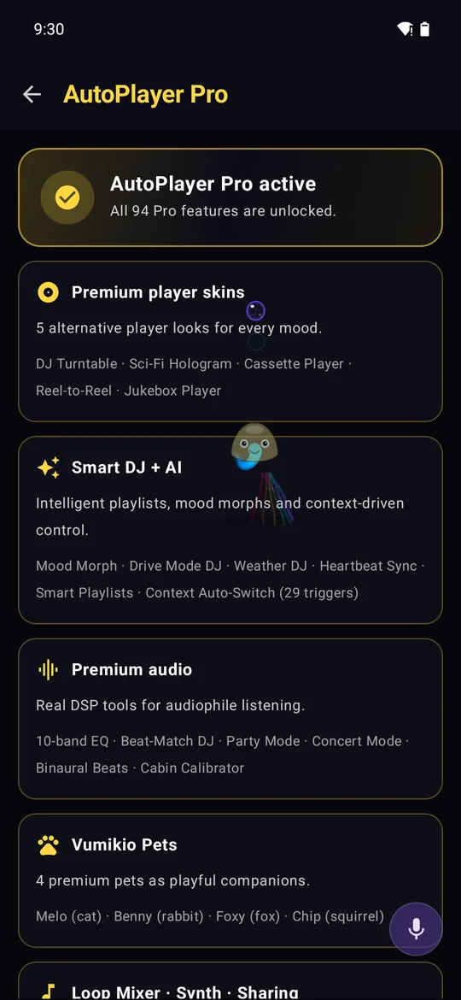
*→ Menu → AutoPlayer Pro*

AutoPlayer is a **one-time purchase** – no subscription, no ads, no running costs. The purchase applies on all devices with the same Google account, and the usual refund period applies through Google.

#### What works without a purchase

Everything you need to listen to music:

- Library with all ten tabs, search, sorting, folder view
- Player, playlists, queues, favorites
- Equalizer with five bands, reverb, a custom sound setting per song
- Android Auto in full, with voice control
- Voice control for all free features, reading aloud, genre and mood view
- Smart DJ with tempo analysis, Auto Playlists
- Hearing Protection, Sleep Timer, Battery Mode
- Achievements, Music Wrapped, the mascot **Octo**
- Backup, Device Transfer, Passenger Mode, widget, shortcuts
- The Vintage Turntable as an alternative view
- The full-screen Visualizer and the game **Surf the Beat**

#### What Pro unlocks

| Area | Contents |
|---|---|
| **Five player views** | DJ Turntable, Sci-Fi Hologram, Cassette Player, Reel-to-Reel, Jukebox Player |
| **Sound** | Ten-band equalizer, Concert Mode, Vocal Isolator, Binaural Beats, Atmosphere Mixer, Cabin Calibrator, Beat-Match DJ, Crossfade |
| **Automation** | Context rules with 29 conditions, Drive Mode DJ, Weather DJ, Heartbeat Sync, Mood Morph, Song Paths, Smart Playlists, Smart Reorder, Geo Music, My places |
| **Tools** | Tag editor, Change cover, Track Cutter, Tag Rescue, Ringtone Changer, Theme Builder, Color Themes |
| **Display** | Waveform view, Music DNA, Nostalgie Machine, Sound Souvenir |
| **Four mascots** | Melo, Benny, Foxy and Chip – Octo stays free |
| **Loop Mixer** | The whole area: timeline, pad mode, Synth Studio with 823 sound presets, Sharing Hub |
| **More** | Party Mode, Shake to Shuffle, Gesture Control, Bass Vibration, Sleep Fade, Loop Bookmarks |

#### How to recognize a Pro feature

- In the menu there is a **lock** next to it
- In the menu, the relevant items are marked at the title
- In the settings, the switches have a golden background
- Tapping it does not open the feature, but shows what it can do and what it costs

In the car, the app takes a different approach: locked items disappear from the menu entirely instead of turning you away when you tap them – nobody should reach for nothing while driving.

#### Restoring

After a reinstall or on a new device: **Restore** on the purchase screen. Nobody has to pay a second time.

#### Tips

- If you just want to listen to music – even in the car, even by voice – you don't need Pro.
- It pays off most for two groups: people who spend a lot of time in the vehicle and want to use the automation, and people who want to build something themselves.
- In this guide, every chapter is labeled. A glance at the badge at the top is enough.

### Getting started (Free)

#### What is it?

AutoPlayer plays the music files that are stored on the device. No streaming, no sign-in, no account. Listening to music, the library, playlists and almost everything else work in airplane mode. The app goes online for only a few things at the edges: the weather (Weather DJ and the weather conditions of the context rules), the context rule “Nature Nearby”, the map and place search in **My places**, updates and buying Pro. The full list is in the **Privacy** chapter.

#### How to set it up

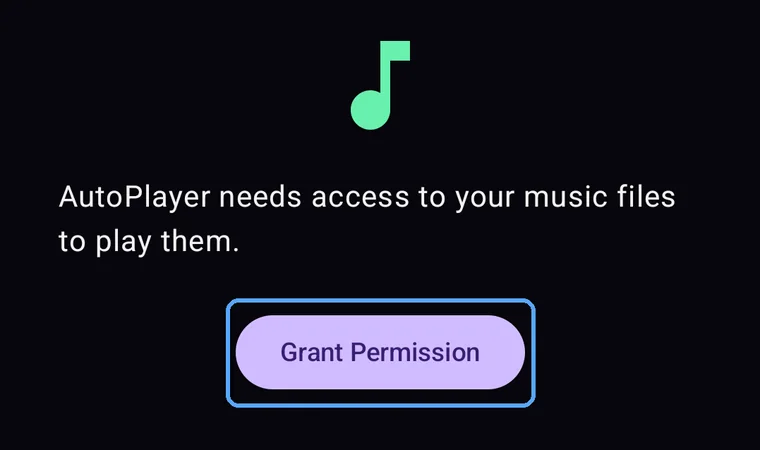
*→ the first time you start the app*

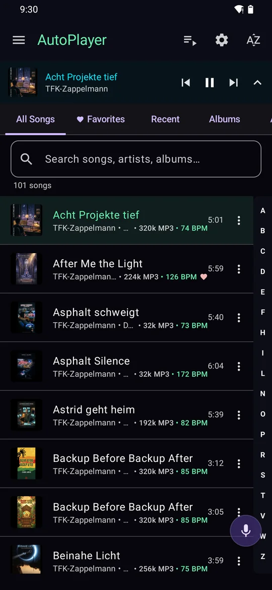

1. Start the app. It opens straight into the **Library** – there is no welcome flow.
2. If access to the music has not been granted yet, a notice appears instead of the list with the **Grant Permission** button.
3. Android then asks:
  - From Android 13: access to **Music and audio**
  - Android 10 to 12: access to **Files and media**
4. Once granted, the app scans the device storage on its own. It finds everything Android lists as an audio file. While it is scanning, the middle of the screen shows **Building your library…** – with a lot of music this takes a few seconds.
5. Tapping a song starts playback. At the top, above the tabs, the **mini bar** appears with cover, title, three buttons and an arrow.
6. The **up arrow** on the right of the bar opens the large player.

If new music arrives on the device, the app finds it the next time it starts. To get it right away, go to **Settings → Library → Rescan music library**.

#### How to get around

*→ Library → top left*

The app has **no bottom navigation bar**. Everything goes through the menu behind the three-line icon at the top left. It is divided into four sections:

| Section | What is in it |
|---|---|
| **Music Player** | Reload library, Playlists, Equalizer, Sleep Timer, Hearing Protection, Bass Vibration, Gesture Control, Battery Mode |
| **Tools & Features** | The largest section – Smart DJ, Theme Builder, Track Cutter, Ringtone Changer, Tag Rescue, Nostalgie Machine, Music Wrapped, Song Paths, Smart Playlists, Context Auto-Switch, My places, Loop Bookmarks, Loop Mixer, Sharing Hub, Achievements, Vumikio Pets, Passenger and Party Mode as well as all the DJ features |
| **Player Skins** | Seven looks for the same player, plus the Fullscreen Visualizer |
| **Settings & Info** | Settings, Voice Commands, Rate App, Share App, Privacy Policy, About, Exit App |

#### The microphone

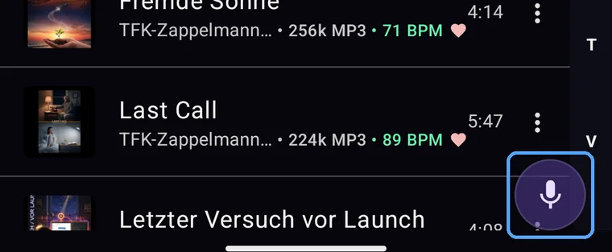
*→ on every screen, bottom right by default*

A round microphone button floats on every screen. You can drag it anywhere on the screen with your finger, and it remembers the position. All voice commands on the phone go through it.

#### What runs along from the start

- **Achievements:** From the first song, the app keeps count – listening time, streaks, levels.
- **Vumikio Pets:** An octopus named Octo is there from the start and grows with every piece of music you listen to.
- **Tempo detection:** While a song plays, its tempo is determined and saved. Many later features build on it.

#### What costs money

The app is a **one-time purchase**, not a subscription. Without a purchase, everything you need to listen to music works: library, player, playlists, queues, equalizer, Android Auto, voice commands, backup. The paid features are marked in this guide with (Pro); tapping one in the app shows what it can do and what it costs. There is a chapter of its own right at the beginning.

#### Tips

- If the app finds no music, access may be missing. Whether it has been granted is shown under **Settings → Permissions → Music and audio** (on Android 11 and 12 **Files and media**, on Android 10 **Storage**).
- The **Unplayed** tab shows what has never been played – often the best way in to a collection that has grown over the years.
- Before bigger changes, a backup is worthwhile (**Settings → Export backup**). It includes favorites, playlists, settings, listening history, achievements and the pets.

### Music library (Free)

#### What is it?

The library is the start screen of the app and shows all the music that is on the device. It is divided into **ten tabs** that sort the same collection in different ways.

#### The ten tabs

| Tab | What it shows |
|---|---|
| **All Songs** | The complete collection |
| **Favorites** | Everything with a heart |
| **Recent** | Recently played, newest first |
| **Most Played** | By play count |
| **New** | Most recently added to the device |
| **Unplayed** | What has never been played |
| **Albums** | Grouped by album |
| **Artists** | Grouped by artist |
| **Folders** | By location on the device |
| **Genres** | By style, from the tags |

You can change the order of these tabs: **Settings → Library → Tab order**.

#### How to use it

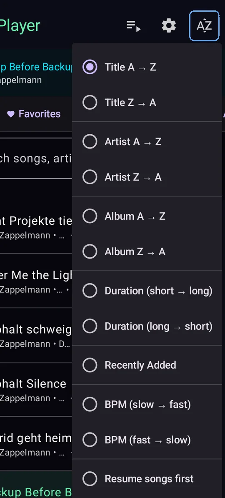
*→ Library → AZ icon at the top right*

1. **Tapping** a song starts it.
2. **Pressing and holding** turns on multi-select. After that, you can select everything else with a simple tap.
3. The **three dots** on the right of the row open the menu for that one song (chapter of its own).
4. The **sort icon** at the top offers twelve orders: Title, Artist, Album and Duration, each ascending and descending, plus “Recently Added”, BPM (slow → fast), BPM (fast → slow) and “Resume songs first”.
5. The **search field** filters as you type, without confirmation.
6. The **Albums**, **Artists** and **Folders** tabs have their own search field above their list. Below it you can see how many entries the search term matches – for example “12 of 574 folders”. Tapping the cross on the right of the field clears the search again.
  - In **Albums**, the search covers album title *and* artist. If you no longer remember the album name, you can still find it through the artist.
  - In **Folders**, it searches the whole path, not just the displayed name. The list always shows only the last section of a path; so typing “download” also finds a folder that is simply called “drums” there.
7. In the **Folders** tab, tapping a folder opens it. A folder can also be **blocked** here – its songs then disappear from the whole app. This works only here, not in the settings. Below the folder name is always its full path, even for blocked folders. This is necessary because the same folder name can occur in several places.

#### What does not show up in the library

The app hides some folders on its own, because they don't contain music in the real sense:

- **Voice messages from messengers** – WhatsApp, Telegram, Signal, Threema, Viber and WeChat
- **Ringtones, notification sounds, alarms and voice recordings** of the device
- **What the app stores itself** – exports and snippets from the Loop Mixer, cuts from the Track Cutter, copies for ringtones, recordings from the Synth Studio and playlist backups

These folders appear as normal in the **Folders** tab and can be shown again there at any time. The files stay untouched and remain available in the Loop Mixer as material – they just don't appear as songs in the collection.

#### The chip bar

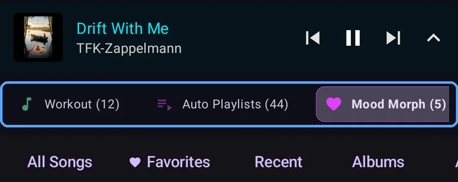
*→ Library → below the mini bar*

As soon as one of the automatic features has created a collection, a row of colored buttons appears above the list – one per collection, with the number of songs.

- **Tapping** a chip shows only its songs; the chip then appears filled. The music keeps playing unchanged.
- **Tapping one of those songs** plays the collection starting from that song.
- **Tapping the chip a second time** hides the collection again, and the library shows everything again. That doesn't interrupt the music either.
- The collection that is currently **playing** is recognizable by bold type, a colored frame and a strong icon.

The colors stand for the origin:

- Violet – moods and Mood Morph, purple – Auto Playlists
- Blue – Weather DJ, green – Smart DJ
- Orange – Drive Mode DJ, red – Heartbeat Sync
- Turquoise – playlists you created by hand
- Mint green – everything else: genres, smart playlists, Song Paths

The search field keeps filtering within the selected collection.

If a watch or a chest strap is connected in [Heartbeat Sync](index.html?lang=en#en-herzschlag), the heart in the chip **Heartbeat Sync** is filled and beats in time with your pulse; the chip keeps its size. Without a live pulse, it is a calm outline.

*The chip of a Heartbeat session with a live pulse: the heart is filled and beating.*
*→ Library, chip bar*

#### The mini bar

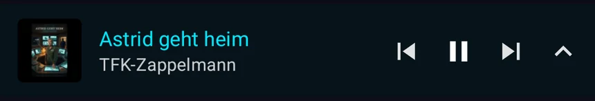
*→ Library → above the tabs*

While music is playing, a slim bar sits at the top – below the title row, above the tabs – with cover, title, artist and three buttons (back, play/pause, next). Tapping it opens the large player.

#### Settings

Under **Settings → Library**:

- **Show song details** – shows bitrate, format and file size in every row
- **Default sorting** – what the list starts with when you open it (Title, Artist, Album or Duration). Within a session you can re-sort freely; this is just the starting value.
- **Rescan music library**
- **Show all hidden songs**
- **Clear all resume positions**
- **Tab order**

#### Voice commands

- “Play *[title]*” – searches and plays. Inexact pronunciation is caught. (Android Auto)
- “Play artist *[name]*” – everything by this artist, shuffled. (Android Auto)
- “Play album *[name]*” – in track order. (Android Auto)

#### How it works with other features

- **Tempo display:** Songs that have already been analyzed show their tempo as a small badge in the row.
- **Hidden songs** disappear from all views; the file stays where it is.
- **Blocked folders** also apply app-wide – including in Android Auto and in the automatic collections.
- All features that choose music themselves draw on the same collection.

#### Tips

- **Unplayed** is the most rewarding tab in a collection that has grown over the years.
- Sorted by tempo, you find something suitable for running or falling asleep without thinking.
- If you have audiobooks or recordings in your collection: **Resume songs first** brings everything you've started to the top.
- If a folder with ringtones or voice memos gets in the way, block it once in the Folders tab – and it's gone everywhere.

### The Player (Free) (Android Auto)

#### What is it?

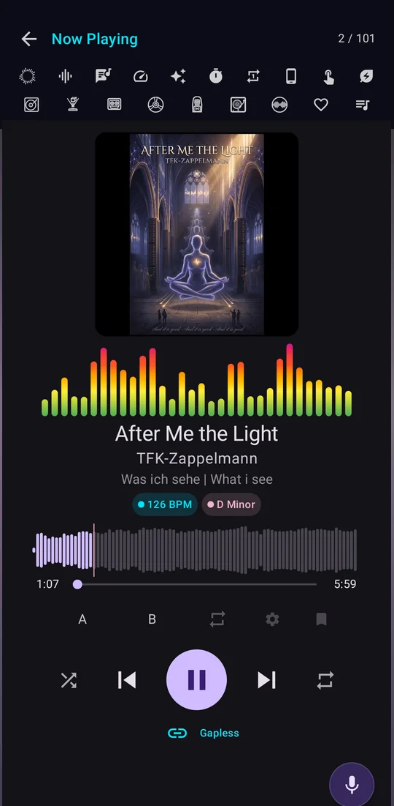
*The player while music is playing: at the top the two icon rows, below them the cover, the visualizer, title and album, the three readouts for volume, tempo and key, the waveform with the play marker and, at the very bottom, the controls.*

The player is the screen where the current song is shown large. From here, paths lead to almost every feature that has to do with sound or the view. You reach it through the up arrow on the right of the library's mini bar. The menu item **Player Skins → Player Control**, on the other hand, leads to the waveform view (chapter of its own).

#### The layout from top to bottom

1. **Header row** – back arrow, “Now Playing” and the position in the queue.
2. **Two icon rows** – see below.
3. **The cover** – large, with swipe gestures assigned.
4. **Four small readouts** – volume in decibels, tempo, key, Battery Mode. Decibels and tempo can be turned off in the settings; the key always appears as soon as it is known.
5. **Title, artist, album**
6. **The progress bar** with elapsed and remaining time. Instead of the bar, the **waveform** can be shown – switchable in the settings. If you play a song for the first time, a flat row of bars appears there at first: you can already seek, and the waveform follows after a few seconds. The slider between the two time readouts enlarges the waveform – more on that under A–B Repeat.
7. **The main controls** – shuffle, back, play/pause, next, repeat. Active switches are highlighted in color. Next to them sits the **Gapless** switch.

#### First icon row – tools and sound

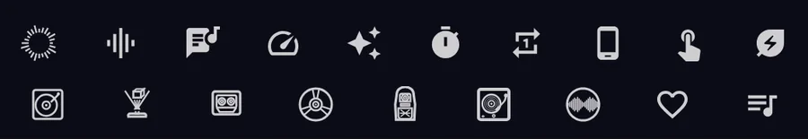

| Icon | What happens |  |
|---|---|---|
| Full-screen Visualizer | Opens the full-screen display – and the game [Surf the Beat](index.html?lang=en#en-surf-the-beat), if it is turned on | (Free) |
| Equalizer | Sound control. The five-band part is free, the ten-band part belongs to Pro. | (Partly) |
| Lyrics | Shows the text, if it is stored in the file. If it is missing, a notice appears. | (Free) |
| Speed & Pitch | Two sliders: speed from 0.5x to 2x, pitch separately from it. One button resets both. | (Free) |
| Smart DJ | Tempo-based collection | (Free) |
| Sleep Timer | Stops the music after a chosen time | (Free) |
| A–B Repeat | Repeats a section you set yourself. Setting it is free; *saving* it as a bookmark belongs to Pro. | (Partly) |
| Bass Vibration | Quick switch. The settings for it belong to Pro. | (Pro) |
| Gesture Control | Quick switch. The settings for it belong to Pro. | (Pro) |
| Battery Mode | Quick switch for Battery Mode | (Free) |

#### Second icon row – views and collection

| Icon | What happens |  |
|---|---|---|
| DJ Turntable | Switches to a different look for the same player. The music keeps playing. | (Pro) |
| Sci-Fi Hologram | (Pro) |  |
| Cassette Player | (Pro) |  |
| Reel-to-Reel | (Pro) |  |
| Jukebox Player | (Pro) |  |
| Vintage Turntable | (Free) |  |
| Waveform | Full-screen waveform with bookmarks | (Pro) |
| Heart | Adds the current song to the favorites or removes it | (Free) |
| Queue | Opens the list of what comes next | (Free) |

#### Gestures on the cover

- **Swipe left** – next song
- **Swipe right** – previous song

Further gestures – shaking, tilting, hand movements over the screen – come from Gesture Control and are described there.

#### Settings

- **Playback → Waveform Display** – waveform instead of progress bar
- **Playback → Show dB in player**, **Show BPM in player**, **Show key in player**
- **Playback → Gapless Playback** – on to the next piece without a pause
- **Playback → Crossfade** – smooth fading between songs (Pro)
- **Appearance → Text size** and **Icon size** apply here too

#### Voice commands

- “Play”, “Pause”, “Next”, “Previous” (Android Auto)
- “Shuffle on” / “Shuffle off” (Android Auto)
- “Repeat all” / “Repeat one” / “Repeat off” (Android Auto)
- “Louder”, “Quieter”, “Mute”, “Set volume to 30 percent” – phone only. In the vehicle, the vehicle controls the volume itself; no voice command changes it.
- “What’s playing?” – in the vehicle, the answer is read aloud (Android Auto)
- “Faster”, “Slower”, “Speed 1.5”, “Forward 30 seconds”, “Back 30 seconds” – phone only

#### Tips

- Tempo and pitch can be set separately: audiobooks can be sped up without the voice getting squeaky.
- The decibel readout can be tapped and leads straight to Hearing Protection.
- Gapless and Crossfade are mutually exclusive – one joins the pieces seamlessly, the other fades them into each other.
- You can switch the view in the middle of a song without the music stuttering.
- In the vehicle, playback looks different: there Android Auto provides its own interface, fed from your collection. What you can do there is covered in the Android Auto chapter.

### The song menu (Partly free)

#### What is it?

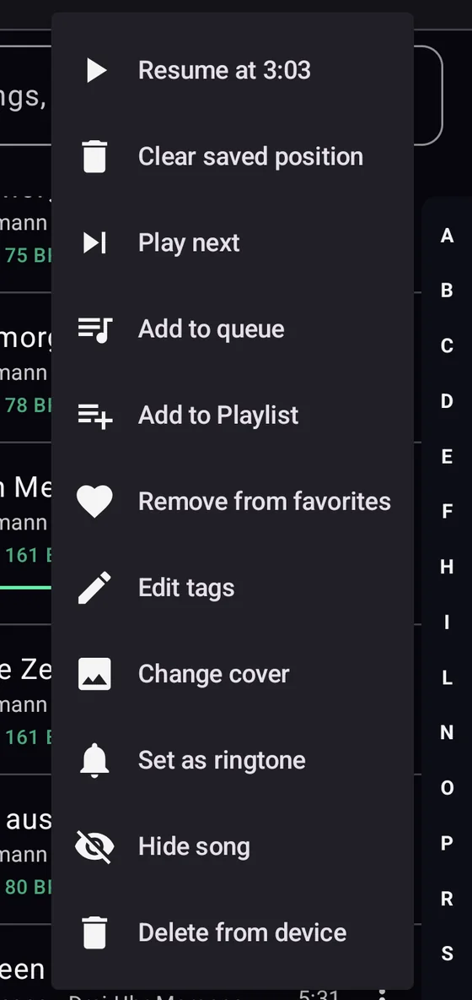
*→ Three dots on the right of every song row*

On the right of every song row there are three dots. Tapping them opens a menu with everything you can do with that one song. It appears in the library, in the queue and in playlists.

#### The entries

| Entry | Effect |  |
|---|---|---|
| **Resume at *[time]*** | Appears only if a position has been saved for this song. Jumps exactly there. | (Free) |
| **Clear saved position** | Appears under the same conditions. Discards the saved spot. | (Free) |
| **Play next** | Puts the song right after the current one. | (Free) |
| **Add to queue** | Appends it to the end. | (Free) |
| **Add to Playlist** | Opens the selection. You can create a new playlist there. If the song is already in it, you are told. | (Free) |
| **Favorite** | Sets or removes the heart. Text and icon change depending on the state. | (Free) |
| **Edit tags** | Opens the tag editor for this song. | (Pro) |
| **Change cover** | Opens the device's image picker. | (Pro) |
| **Set as ringtone** | The choices are ringtone, notification and alarm. | (Pro) |
| **Hide song** | Removes the song from all views. The file is left untouched. | (Pro) |
| **Delete from device** | Deletes the file permanently. | (Free) |

The four Pro entries have a lock icon. Tapping one does not lead to the feature, but shows what Pro costs.

#### Several songs at once

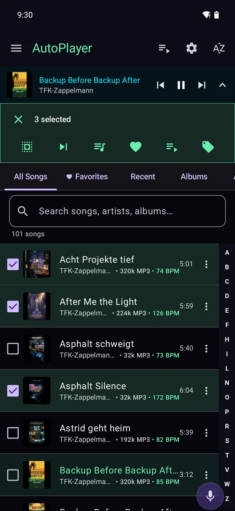
*→ Library → press and hold a song*

Pressing and holding a row turns on multi-select. After that, tapping is enough to add more. At the top, the count and the **Select all** button appear. For your selection, among other things, setting a genre in one go is available.

#### Voice commands

There are **none** for this menu. The only voice command that affects the queue is the **Detour** – and that, too, refers to a song, not to an entry in this list.

#### How it works with other features

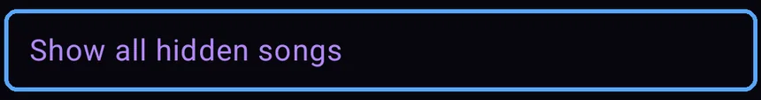
*→ Settings → Library*

- **Hidden songs** are brought back via **Settings → Library → Show all hidden songs** – one by one is not possible.
- **Saved positions** come from the setting **Remember Playback Position**. Clearing all of them at once works via **Settings → Library**.
- **Changed covers** apply across the whole app, including Android Auto.

#### Tips

- **Play next** is the fastest way to slip something in between without messing up the order.
- **Hiding** can be undone, **deleting** cannot. When in doubt, hide.
- A song doesn't have to be playing for its tags to be edited.

### Playlists (Free) (Android Auto)

#### What is it?

Playlists are collections that you create by hand and that stay permanently – unlike what the automatic features generate. There is no limit to how many you can have. You reach them via **Menu → Music Player → Playlists**.

#### The overview

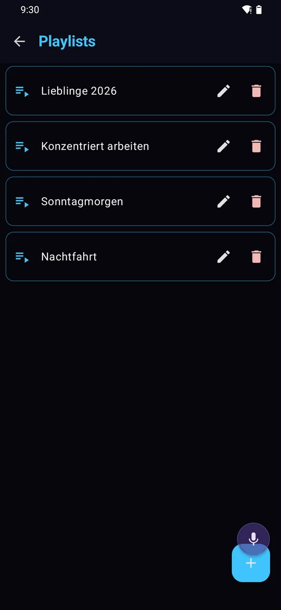
*→ Menu → Playlists*

Each playlist appears as a row with its name and number of songs. Two icons on the right:

- **Pencil** – rename
- **Trash can** – delete, after a confirmation

The **+** button at the bottom right creates a new one. Tapping the row opens it.

#### Inside a playlist

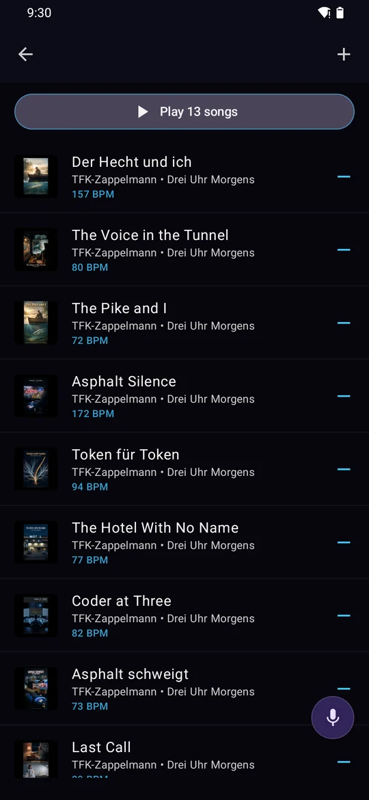

- A bar at the top, **“Play *[count]* songs”** – starts from the beginning.
- A **search field** filters within the playlist.
- Tapping a song starts from that point.
- The **minus** on the right removes a song. The file stays.
- The **+** at the top leads to the song selection.

The order results from when something was added. **Re-sorting is not provided.**

#### Getting songs in

1. Via the three dots on a song row → **Add to Playlist**. In the selection dialog you can also create a new playlist right away.
2. Via multi-select in the library – for many at once.
3. Via the **+** in the opened playlist.

If a song is already included, the app tells you and does not add it twice.

#### Voice commands

- “Play playlist *[name]*” – loads it and starts the first song. The name doesn't have to be matched exactly. (Android Auto)
- “Show my playlists” – opens the overview without playing anything. (Android Auto)

Both also work through the voice button on the steering wheel, provided AutoPlayer is set as the default music app.

#### How it works with other features

- **Backup:** Playlists are included in the backup and move along when you switch devices.
- **Android Auto:** Playlists appear in the vehicle menu.
- **Context rules:** A playlist can be assigned to a rule – for example “mornings in the car”.
- **Geo Music:** A playlist can be tied to a place.
- **Smart Playlists** are something different: They are created from a description and are kept as a type of their own.

#### Tips

- Since you can't re-sort, it's worth adding the songs in the order you want right away.
- Short, clear names make it easier to call them up by voice. “Workshop” is recognized more reliably than “Mix for Saturdays in the workshop”.
- If you've forgotten the name of a playlist, say “Show my playlists” – the overview opens without anything starting to play.

### Favorites (Free) (Android Auto)

#### What is it?

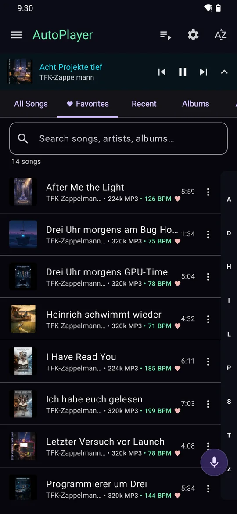
*→ Library → Favorites tab*

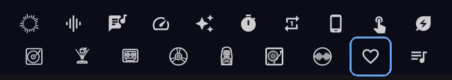
*→ Player → second icon row, heart*

A heart on every song, and the dedicated **Favorites** tab in the library collects everything marked. No effort, no upkeep.

#### How to set the heart

- In the **player** – the heart in the second icon row
- In the **library list** – the heart in the row
- In the **song menu** – the entry changes depending on the state
- Via **multi-select** – for many at once

A second tap removes it again. There is no confirmation prompt.

#### The home screen shortcut

Pressing and holding the app icon opens a menu with three shortcuts:

- **Open favorites** – jumps straight to the tab without playing anything
- **Resume** – continues where you last stopped
- **Shuffle** – opens the player, turns shuffle on and starts at a randomly chosen song from the whole collection. Covered in detail in the chapter **App icon shortcuts**.

#### Voice command

- “Show favorites” – switches to the tab.

There are no other favorites commands. If you want to hear your favorites shuffled, open the tab and tap shuffle.

#### How it works with other features

- **Android Auto:** Favorites are an item of their own in the vehicle menu.
- **Backup:** All markings are in the backup and come along when you switch devices.
- **Achievements:** Collecting favorites counts toward several awards.
- **Context rules** and the automatic collections can give favorites extra weight.

#### Tips

- Mark generously – removing one is a single tap.
- In the vehicle, favorites are the fastest way to safe music: one tap in the menu, without scrolling through the whole collection.
- If you use the tab often, drag it to the front via **Settings → Library → Tab order**.

### Settings (Free)

#### What is it?

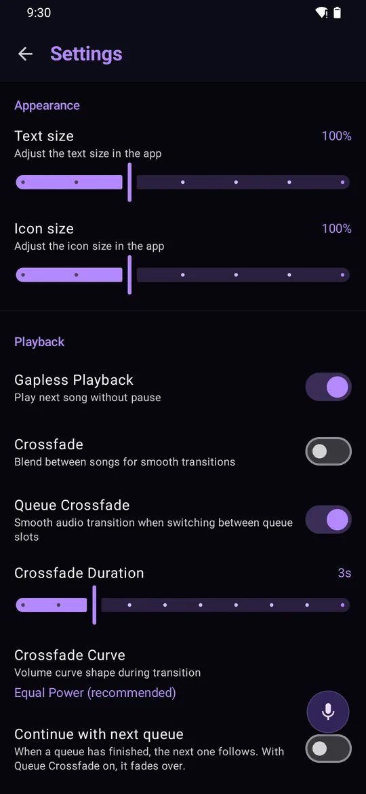
*→ Menu → Settings*

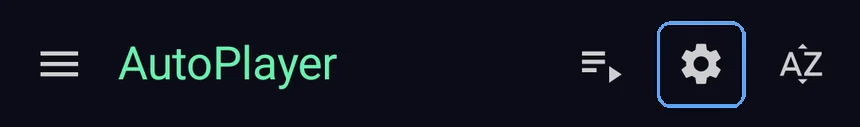
*→ Library → gear at the top*

The central control point. You reach it via the gear at the top of the library or via **Menu → Settings & Info → Settings**. Every change takes effect immediately; there is no save button.

#### The eleven sections

**1. Appearance**

- **Text size** – continuously from 80 % to 140 %
- **Icon size** – the same range

Both apply across the whole app, including on the vehicle screen. You can't choose a color design here – that is done by the Theme Builder.

**2. Playback** – the largest section

| Setting | Meaning |  |
|---|---|---|
| Gapless Playback | Next song without a pause | (Free) |
| Crossfade + duration | Fading between songs, 1 to 10 seconds | (Pro) |
| Queue Crossfade + duration + curve | Transition when switching queues. Four curves: Linear, Logarithmic, S-Curve, Equal Power (recommended) | (Pro) |
| Remember last song | Keep listening where you left off | (Free) |
| Remember Playback Position | Save the position per song; optionally only for pieces over 10 minutes | (Free) |
| Pause on headphone disconnect | Stops when they are unplugged | (Free) |
| ReplayGain | Evens out volume differences using the metadata | (Free) |
| Bluetooth Auto-Resume | Starts playback as soon as a Bluetooth speaker or the car connects. From Android 12, the switch asks for the Bluetooth permission when you turn it on | (Free) |
| Shake to Shuffle | Shaking skips ahead | (Pro) |
| Beat-Match DJ | Tempo-matched transitions | (Pro) |
| Weather DJ, Concert Mode, Music DNA, Heartbeat Sync, Atmosphere Mixer, Sleep Fade, Binaural Beats, Cabin Calibrator | Main switches for these features | (Pro) |
| Waveform Display | Waveform instead of progress bar | (Pro) |
| Context Auto-Switch | Switches playlists by time of day, Bluetooth device, speed, movement | (Pro) |
| Hearing Protection + dB display | Monitors the volume | (Free) |
| BPM display, key display | Badges in the player | (Free) |
| Bass Vibration, Gesture Control | Main switches | (Pro) |
| Battery Saver | Power-hungry features rest – details under Battery Mode | (Free) |
| Crash Reports | After a crash, asks whether a report should be sent | (Free) |
| OpenStreetMap Lookups | **Off** by default. Only for the rule “Nature Nearby”; sends coordinates rounded to about 110 m. | (Free) |

**3. Library**

- Show song details · Default sorting · Rescan music library
- Show all hidden songs · Clear all resume positions · Tab order

**4. Android Auto**

- **Autoplay on connect**
- **Set as default music app** – needed so that the voice button on the steering wheel and “Hey Google, play music” end up in AutoPlayer. A button leads to the matching Android setting.
- **Voice button in car not working?** – opens a help page.

**Speed-based volume**

- A section of its own with a switch, a slider for the target speed and the drawn curve. Works via Bluetooth speakers and headphones – not on the vehicle screen, where the vehicle controls the volume itself.

**5. Permissions**

Seven rows with their current state – Microphone, Location, Bluetooth, motion detection, Camera, Notifications, Music and audio – each with a note on what it is needed for. Tapping a row grants the permission or takes it back. There is also a note about the green dot in the status bar. More under [Permissions](index.html?lang=en#en-berechtigungen).

**6. Language**

26 languages to choose from, plus **System default**. Each entry in the list appears in its own script, so that people who can't read the current language can still find theirs.

**7. Backup & Restore** – saving and restoring by hand.

**8. Automatic Backup** – backs up when the app is closed, once a folder has been chosen. Without a folder it stays off.

**9. Device Transfer** – hand all data over to another device.

**10. Danger Zone** – Factory Reset. Two confirmation prompts, then everything is gone.

**11. About** – only the version number is shown here. The guide, changelog, privacy policy and terms of use are **not** here, but in the main menu under **About**.

#### Voice commands

“Open settings” works. Individual switches can **not** be flipped by voice – except for those that have a command of their own (such as “Vibration on” or “Gestures off”).

#### Tips

- If you have trouble reading in the vehicle: set the text size to 120 or 130 %.
- The permissions section shows every state at a glance and grants or takes back permissions. The detour through the Android settings is only necessary when Android itself no longer asks – and for taking permissions back on Android 10 to 12.
- Automatic backup is the best safeguard. Choose a folder once, and after that it runs by itself.
- Battery Saver spares the battery, but lets the equalizer, sound effects and other power-hungry features rest. You can recognize it by the green leaf icon in the player, which is then highlighted. Your settings are kept and come back unchanged when you switch back.

### Song details in the list (Free)

#### What is it?

A switch that shows a third line with technical details under every song row.

#### What it shows

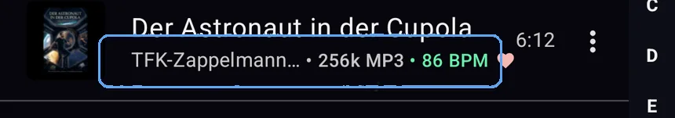

Bitrate · format · tempo · file size – separated by dots. Anything that isn't known is skipped; the line closes up. Example: `320 kbps • MP3 • 128 BPM • 8.4 MB`

#### Turning it on

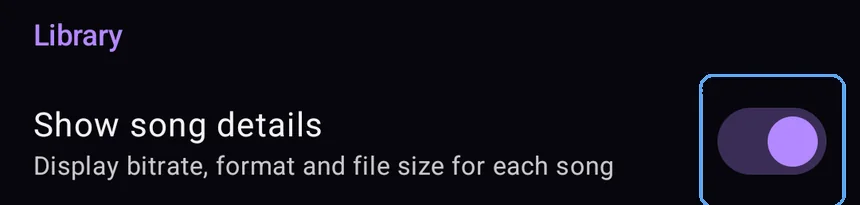
*→ Settings → Library → Show song details*

**Settings → Library → Show song details**. The line then appears in all lists – library, playlists, queue.

#### How it works with other features

- The **tempo** comes from the analysis that runs along during playback. For songs that have never been played, the value is missing.
- If the file already contains a tempo value in its tag, it is taken over.
- The **resume bar** is something different: a thin strip under the row that shows how far a song has already played.

#### Tips

- Quickly spot what is in poor quality: bitrates of 128 kbps and below stand out immediately.
- Sorted by tempo and with the details shown, a collection is easy to browse without listening to every song.
- On narrow screens the line is cut off. In the vehicle this doesn't matter: Android Auto shows only title and artist, and the detail line doesn't appear there at all.

### Genre Browse (Free) (Android Auto)

#### What is it?

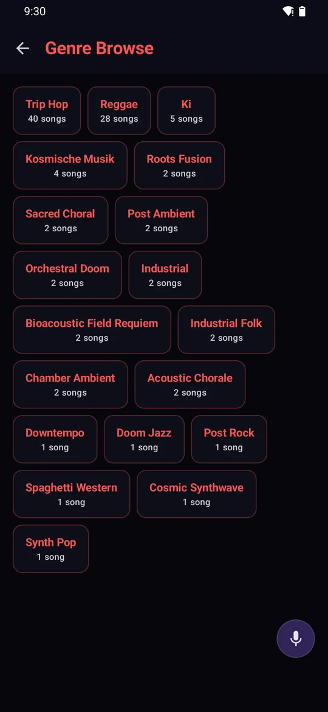
*→ Menu → Genre Browse*

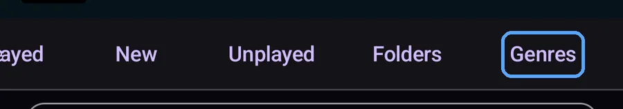
*→ Library → swipe the tab row to the left*

A screen of its own that organizes the collection by style – from the genre entries in the files. You reach it via **Menu → Tools & Features → Genre Browse**. The same access is available as the **Genres** tab in the library.

#### How to use it

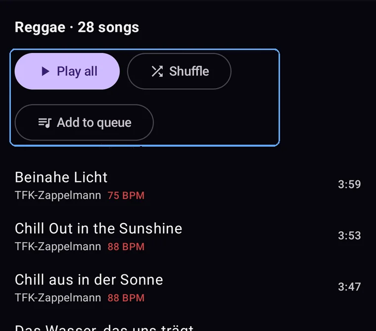
*→ Genre Browse → Reggae*

1. At the top, all available genres appear as buttons, each with the number of songs.
2. Tapping one opens the genre as a view of its own – the name and the count at the top, the songs below. You go back via the arrow at the top left. Nothing gets “selected” that you would then have to deselect again.
3. Above the song list there are three buttons: On narrow devices the third one drops to the next line.
  - **Play all** – in list order
  - **Shuffle** – shuffled
  - **Add to queue** – appends the whole genre to the end of the queue without interrupting what is playing
4. Tapping a single song starts it immediately.

If the app finds no genres, a notice appears asking you to add the tags.

#### Voice commands

- “Play genre *[name]*”. (Android Auto)
- For common styles the name alone is enough: “Play reggae”. (Android Auto)

#### How it works with other features

- **Tag editor:** Where a genre is missing or wrong, it is set there (Pro).
- **Multi-select in the library:** Give many songs a genre at once – the fastest way to organize an untagged collection.
- **Android Auto:** Genres are a category of their own in the vehicle menu.
- **Party Mode:** Guests can filter by genre in the browser.

#### Tips

- The app merges upper and lower case itself: “Rock” and “rock” end up in one entry, and the most common spelling is shown. Variants such as “Rock/Pop”, on the other hand, stay separate – the only fix is to standardize the tags.
- Songs from blocked folders don't show up here – the block also applies to the genre count.
- The multi-select route is worth it: mark songs, set the genre, done.
- If a style is missing entirely, the files simply have no genre entry.

### App updates (Free)

#### What is it?

At startup, the app asks the Play Store whether a newer version is available and lets you know on its own.

#### How it works

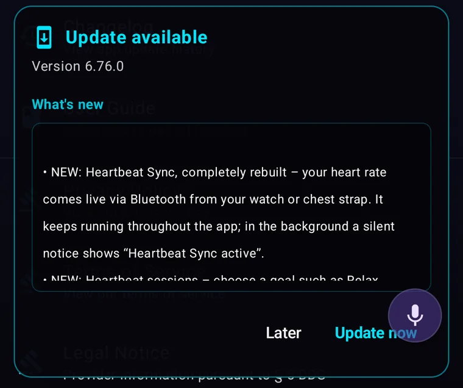
*→ appears on its own when the app starts*

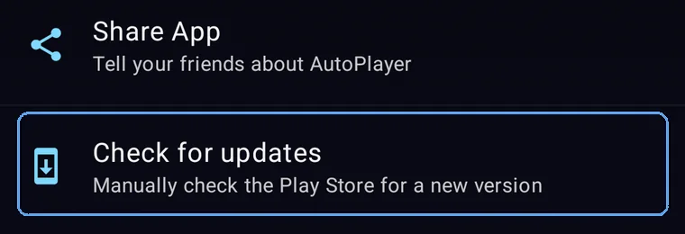
*→ Menu → Settings & Info → About*

1. If there is something new, a card with the changes appears.
2. **Update now** downloads in the background; the music keeps playing. After the download, you are asked to restart.
3. **Later** postpones it. The app asks again the next time it starts.
4. For especially important updates, postponing is not offered. The Play Store then takes over and the app only starts again afterward.

To check by hand: **Menu → Settings & Info → About → Check for updates**.

#### The changelog

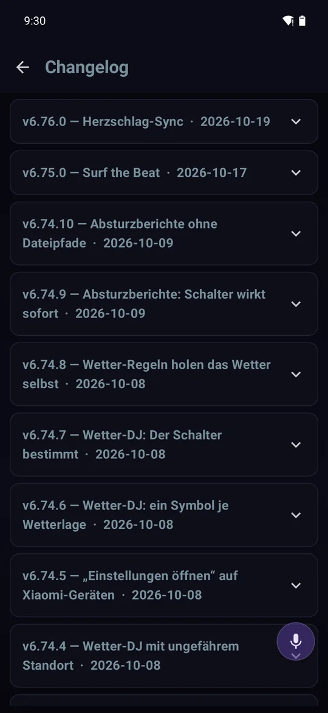
*→ Menu → About → Changelog*

Under **About → Changelog** you find the complete history, newest version at the top. Each entry has a version number, date and the changes – first in German, then, separated by a line, in English.

#### Voice command

- “Read changelog” – the app reads it aloud.

#### Tips

- Updates change nothing about your music, playlists, favorites or achievements.
- If you want to know what's new without updating: the card shows the changes beforehand.
- Before bigger jumps, a backup never hurts – not because of the update itself, but because one is due anyway.

### The main menu (Free)

#### What is it?

The list that slides in from the left. It is the main route to everything that isn't in the player itself – **58 entries** in four sections.

#### How to get there

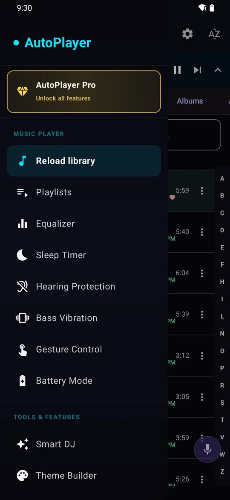
*→ Swipe from the left or the three-line icon*

- The **three-line icon** at the top left of the library.
- **Swipe from the left edge to the right** – also in the library.

> Both work only in the library.
>
> Elsewhere the swipe gesture is turned off. Otherwise it would get in the way of swiping back and of the gestures in the player. From any screen, the way to the menu therefore leads back to the library first and from there into the menu.

It is closed by tapping next to it, by swiping left or with the back button. Tapping an entry closes it on its own.

#### 1. Music Player

Whatever has directly to do with listening.

| Entry | In short |
|---|---|
| **Reload library** | Reads the music files in again and opens the library |
| **Playlists** | Your own collections |
| **Equalizer** | Sound control and reverb |
| **Sleep Timer** | End playback after a set time |
| **Hearing Protection** | Volume monitoring |
| **Bass Vibration** | Vibration in time with the beat |
| **Gesture Control** | Nine gestures for operation |
| **Battery Mode** | Battery-saving playback |

> What “Reload library” is good for:
>
> The entry repeats the check that otherwise runs only when the app starts. It is therefore the fastest way to
>
> make newly added songs visible
>
> – for example after you've copied music onto the device on your computer without closing the app. Playback keeps running.
>
> **Changed tags** arrive this way too: If you've corrected the title, artist or year of a file outside the app – on your computer, say – and copied the file back to the device, the library then shows the new details. The listening history of the song is kept and carries the new name.
>
> You'll find the same process under **Settings → Library → Rescan music library**.

#### 2. Tools & Features

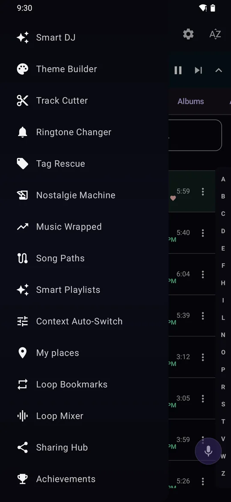

By far the largest section – **35 entries**. This is where almost everything is that lifts the app above an ordinary player. Every item has its own chapter in this guide.

| Group | Entries |
|---|---|
| **Selection and suggestions** | Smart DJ, Smart Playlists, Auto Playlists, Mood Morph, Mood Browse, Genre Browse, Song Paths, Beat-Match DJ |
| **Reacts to the situation** | Context Auto-Switch, My places, Geo Music, Drive Mode DJ, Weather DJ, Heartbeat Sync, Sound Souvenir, Sleep Fade |
| **Sound** | Concert Mode, Vocal Isolator, Binaural Beats, Atmosphere Mixer, Cabin Calibrator, Music DNA |
| **Make it yourself** | Loop Mixer, Loop Bookmarks, Track Cutter, Ringtone Changer, Tag Rescue, Theme Builder |
| **With others** | Party Mode, Passenger Mode, Sharing Hub |
| **Numbers and play** | Music Wrapped, Achievements, Vumikio Pets, Nostalgie Machine |

#### 3. Player Skins

Eight looks for the same player. The music keeps playing without stuttering when you switch.

**Player Control** · **Fullscreen Visualizer** · **DJ Turntable** · **Sci-Fi Hologram** · **Cassette Player** · **Reel-to-Reel** · **Jukebox Player** · **Vintage Turntable**

#### 4. Settings & Info

| Entry | In short |
|---|---|
| **Settings** | The big settings screen with eleven sections |
| **Voice Commands** | Reference of all commands in your language |
| **Rate App** | Leads to the Play Store |
| **Share App** | Pass on a link to the app |
| **Privacy Policy** | Privacy policy and terms of service |
| **About** | A screen of its own with ten items – see below |
| **Exit App** | Closes the app along with playback |

#### What is behind “About”

This item is more extensive than its name suggests – this is where all the legal texts and the guide are:

| Entry | In short |
|---|---|
| **Rate App** | Leads to the Play Store |
| **Share App** | Pass on a link to the app |
| **Check for updates** | Looks for a newer version by hand |
| **Changelog** | What changed in each version |
| **User Guide** | This guide, in the app |
| **Privacy Policy** | Which data is used for what |
| **Terms of Service** | The legal terms |
| **Legal Notice** | Details about the provider |
| **Closed Testing** | Access to the closed test |
| **Send Feedback** | Feedback to the developers |

At the top there is also a short description of the app with a **read-aloud button** and below it the **version number** of the installed version.

#### Locked entries

Some of the entries belong to the Pro version. They are still in the menu and carry a lock; tapping one leads to an overview of what Pro contains. That way you see what exists, and nothing is hidden.

#### Voice commands

None – the menu itself can't be opened by voice. Many of its destinations can, though, such as “Open settings” or “Smart DJ”. The complete list is under **Settings & Info → Voice Commands**.

#### Tips

- The **Tools & Features** section is long – the menu can be scrolled.
- What you need often is usually quicker to reach through the icon rows in the player. The menu is the complete route, not always the shortest.

## 2. The player views

### Overview of the views (Partly free)

#### What is it?

The same music, seven looks. Playback keeps running without interruption when you switch; volume, shuffle, repeat and sound settings apply the same everywhere.

| View | Character |  |
|---|---|---|
| **Player Control** | The default view with all the tools | (Free) |
| **Vintage Turntable** | Wooden plinth, tonearm, 33/45 rpm | (Free) |
| **DJ Turntable** | Scratching and tempo slider | (Pro) |
| **Sci-Fi Hologram** | Projection with picture glitches | (Pro) |
| **Cassette Player** | Portable cassette player with turning reels | (Pro) |
| **Reel-to-Reel** | Tape machine with needle gauges | (Pro) |
| **Jukebox Player** | Jukebox with bubble tubes | (Pro) |

#### How to get there

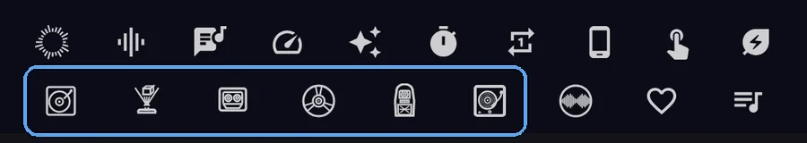
*→ Player → second icon row*

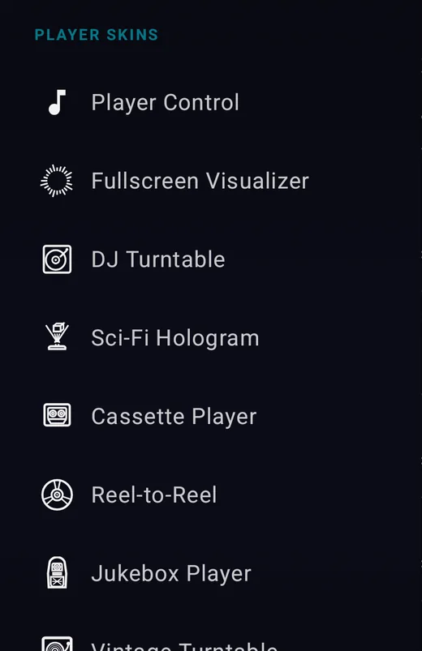
*→ Menu → Player Skins*

- **Menu → Player Skins** – all seven one below the other
- **Second icon row in the player** – the same switch, one tap away

You go back via the arrow at the top left or the device's back gesture.

#### What the views have in common

- The current song keeps playing when you switch, without stuttering.
- All of them show the tempo as soon as it has been determined.
- All of them work in full screen.

The controls, on the other hand, differ considerably – each view imitates a different device. What works where is covered in the following chapters.

#### Voice commands

- “Open turntable” → DJ Turntable
- “Open vintage turntable” → Vintage Turntable
- “Open visualizer” → Fullscreen Visualizer

Cassette, reel-to-reel, jukebox and hologram can **not** be opened by voice. There is no command for closing any of the views.

#### In Android Auto

None of these views appears on the vehicle screen. There, Android shows its own media interface – that is a requirement of the platform.

#### Tips

- The Vintage Turntable is the only alternative without a purchase – and the only one where the speed lever really changes the tempo.
- If you need all the tools, stay with the default view: only there are the equalizer, Sleep Timer, lyrics and the other buttons.

### DJ Turntable (Pro)

#### What is it?

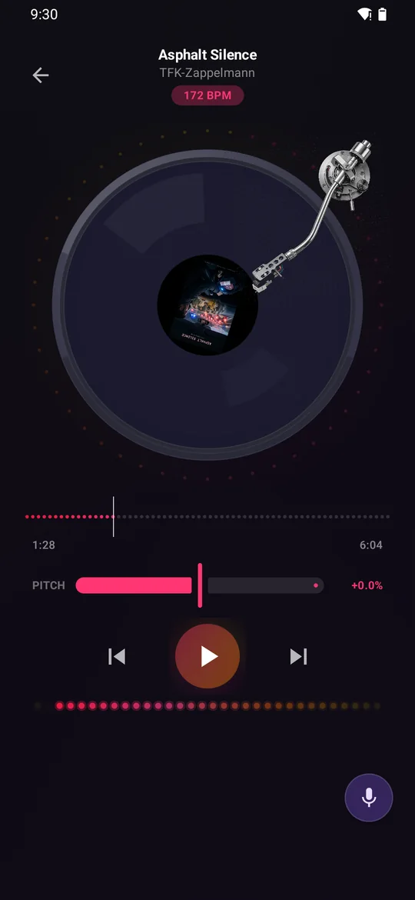
*→ Menu → Player Skins → DJ Turntable*

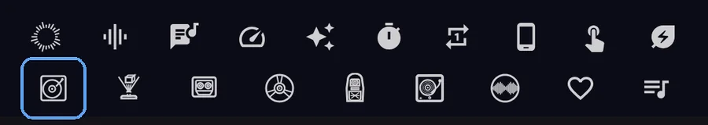
*→ Player → second icon row, first icon*

A turntable like a DJ uses: The disc spins with playback, and when you put a finger on it, you really intervene in the drive.

#### How to use it

- **Dragging on the record** – scratching. Playback follows your finger, along with distorted sound. When you let go, the song continues from the new spot.
- **Tempo slider** – changes the speed like the pitch fader on a real device.
- **Tonearm** – moves inward with the progress and can be tapped.
- **Play, pause, forward and back** are available as buttons of their own.

While you are scratching, a notice appears on the screen.

#### Settings

None. Everything that can be adjusted is on the screen itself.

#### Voice command

- “Open turntable”.

#### How it works with other features

- You can scratch in **Battery Saver** mode too – the view only runs while you are looking at it.
- The Vintage Turntable uses the same scratch technique.
- The strip with the bars shows the sound that is playing and needs the **microphone permission** for that. If it is missing, the **Allow microphone** button is there; everything else works without it too.
- The equalizer and sound effects apply here too.

#### Tips

- For finding a particular spot in a long piece, scratching is more precise than the progress bar.
- Short movements work best – dragging far overdrives it.
- The tempo slider affects the sound, not just the view.

### Jukebox Player (Pro)

#### What is it?

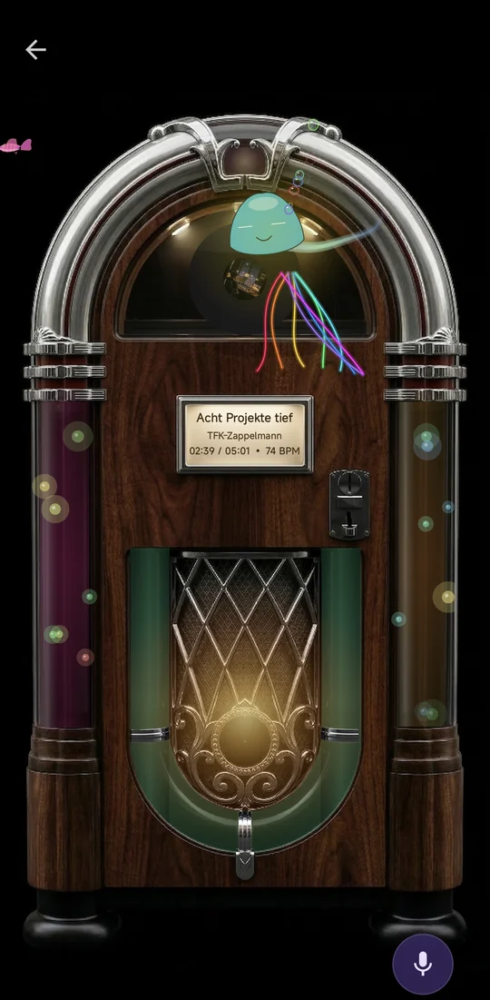
*→ Menu → Player Skins → Jukebox Player*

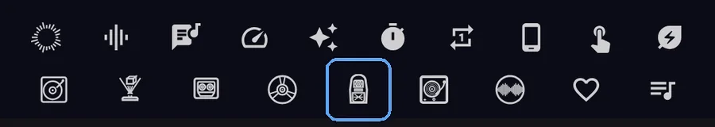
*→ Player → second icon row, fifth icon*

A fifties-style jukebox, with a spinning record and glowing bubble tubes that react to the bass.

#### How to use it

- **Tapping the record or the speaker grille** – play and pause
- **Dragging horizontally across the display** – seeking within the current song
- **Dragging vertically on the left tube** – volume

Long song names scroll through as a ticker, like on a real jukebox.

#### Settings

None. Colors and bubbles run on their own.

#### Voice commands

None. The jukebox can only be opened via the menu or the player.

#### How it works with other features

- The glow of the tubes follows the bass. If you change the equalizer, you see it immediately.
- The volume control uses the system volume – like the buttons on the edge of the device.

#### Tips

- On a tablet standing upright, the jukebox looks like a device of its own.
- With bass-heavy music the glow effect is strongest.
- If you use it often, remember the horizontal drag for seeking – there is no progress bar here.

### Cassette Player (Pro)

#### What is it?

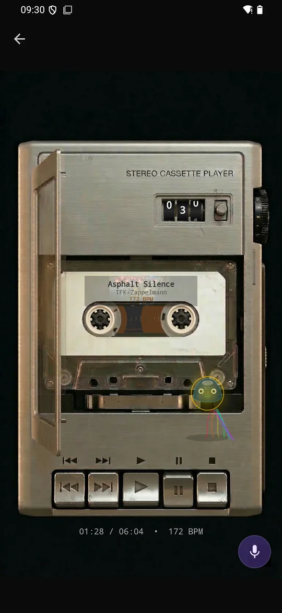
*→ Menu → Player Skins → Cassette Player*

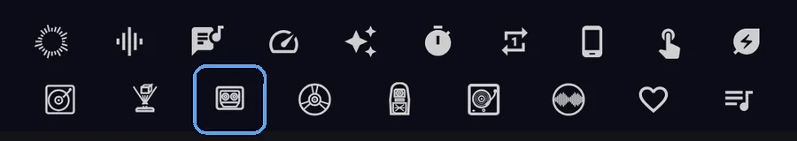
*→ Player → second icon row, third icon*

A portable cassette player like the ones you know from the eighties. The reels turn in the right ratio: At first the supply side runs slowly and the take-up side fast, and over the course of the song this reverses. The tape visibly moves through the window.

#### The five buttons

| Button | Effect |
|---|---|
| **REW** | Previous song |
| **FF** | Next song |
| **PLAY** | Play and pause |
| **PAUSE** | Also play and pause |
| **STOP** | Stops and jumps to the beginning |

Every press triggers a short vibration, and the housing image shows the pressed button.

#### The volume wheel

Over the drawn little wheel on the right edge there is an invisible touch area. Dragging vertically there controls the volume – **down is louder, up is quieter**, like on a real wheel.

#### Settings

None.

#### Voice commands

None.

#### Tips

- From the tape in the window you can tell how far along the song is – without a bar.
- The cassette label shows title and artist. The **tempo** is at the bottom next to the time – larger and easier to read than on the label.

### Reel-to-Reel (Pro)

#### What is it?

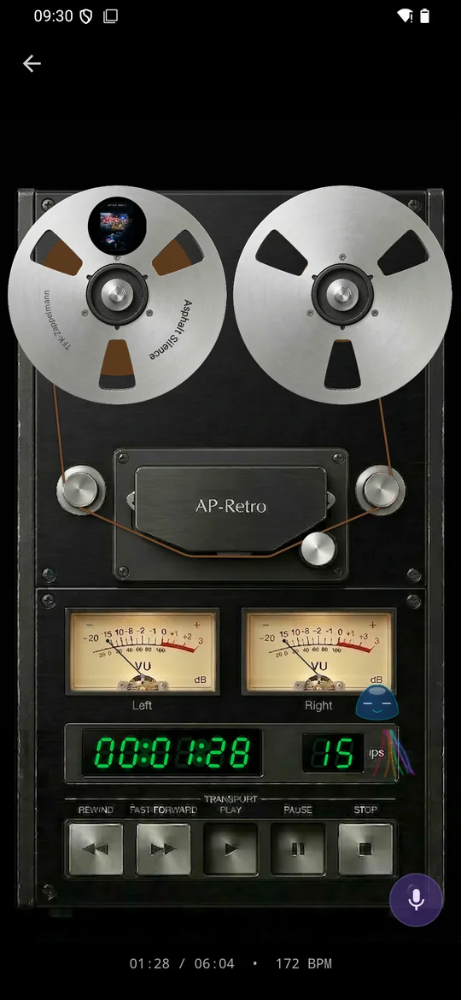
*→ Menu → Player Skins → Reel-to-Reel*

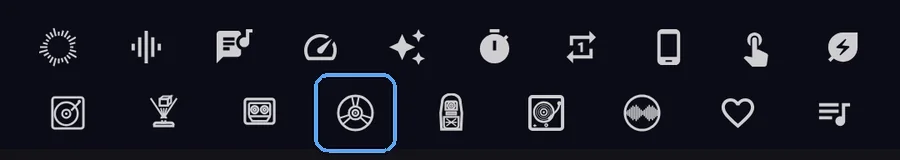
*→ Player → second icon row, fourth icon*

A tape machine with two open reels. The left one pays out, the right one takes up, and the tape runs over three guide rollers in between.

#### The needle gauges

Two gauges show the actual level – not imitated, but calculated from the sound that is playing. The needles jump up quickly and fall back sluggishly, like on real devices.

#### The five buttons

- **REW** – previous song
- **FF** – next song
- **PLAY** and **PAUSE** – both toggle between play and pause
- **STOP** – stops and jumps to the beginning

#### Settings

None.

#### Voice commands

None. Reachable only via the menu or the player.

#### Tips

- With bass-heavy music the left gauge visibly swings further than the right one.
- The album name is printed on the reel flange, curved around the edge.
- The gauges need the **microphone permission**. Android requires it for any level measurement, even if nothing is recorded. Without it the needles stay still – the music plays anyway. Above the gauges there is then the **Allow microphone** button.

### Vintage Turntable (Free)

#### What is it?

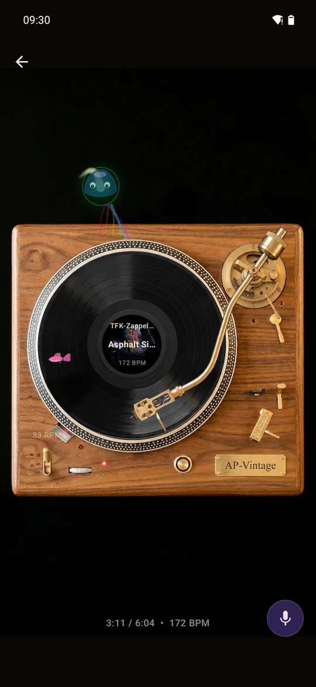
*→ Menu → Player Skins → Vintage Turntable*

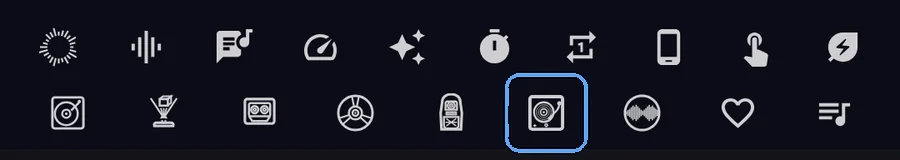
*→ Player → second icon row, sixth icon*

A turntable with a wooden plinth, like the ones that stood in living rooms in the seventies. The only alternative view that can be used without a purchase.

#### How to use it

| Control | Effect |
|---|---|
| **Start/stop button** (bottom center) | Play and pause |
| **Tapping the record** | Also play and pause |
| **Dragging on the record** | Scratching, as on the DJ Turntable |
| **Speed lever** (bottom left) | Switches between 33 and 45 rpm. At 45 the music plays faster and higher – like a record played at the wrong speed. |
| **Cue lever** (small golden lever) | Lifts the tonearm and stops. A second tap sets it down again. |
| **Vertical dragging** | Volume |

The tonearm moves on its own: At the start it swings from its rest position to the edge of the record, during the piece it moves inward, and at the end it returns.

#### Settings

None.

#### Voice command

- “Open vintage turntable” – “vinyl player” is understood too.

Careful: “Turntable” on its own, without anything added, leads to the *DJ* Turntable.

#### How it works with other features

- The speed lever changes the **real** playback speed. It stays set even after you leave the view – to undo it, use **Speed & Pitch** in the standard player.
- Scratching uses the same technique as the DJ Turntable.

#### Tips

- If you like the view but don't want to buy anything: this one stays open permanently.
- The cue lever is the most elegant way to pause – the arm stays where it is.
- Don't forget to set the speed back to 33. Otherwise everything sounds faster until someone notices.

### Sci-Fi Hologram (Pro)

#### What is it?

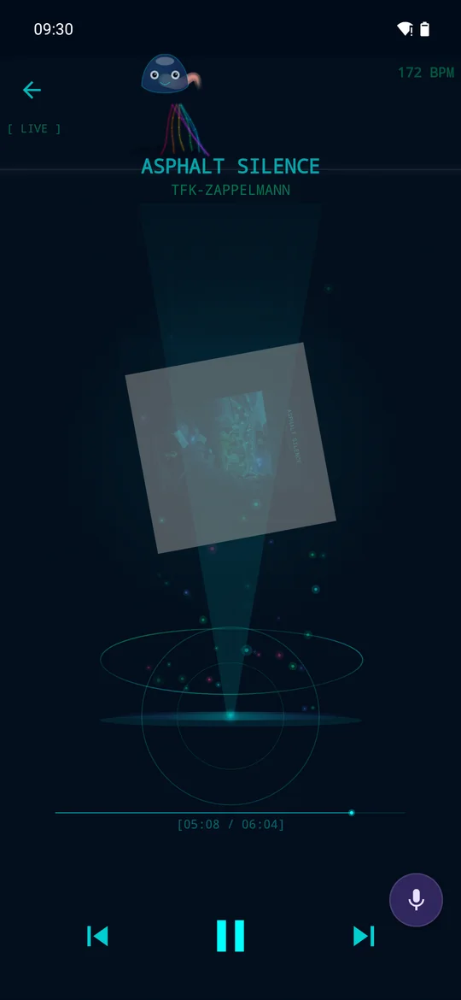
*→ Menu → Player Skins → Sci-Fi Hologram*

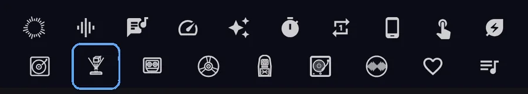
*→ Player → second icon row, second icon*

A projection that beams upward from a base and slowly rotates. On every beat the light rays pulse; now and then the picture flickers briefly.

#### How to use it

The screen is divided into three vertical strips:

- **Tap left** – previous song
- **Tap center** – play and pause
- **Tap right** – next song

**Dragging horizontally** seeks within the current song. The display at the bottom edge shows title, artist, progress and tempo. The state – playing or stopped – appears as text in the picture.

At the very bottom there are also **three visible buttons** in turquoise:

- **Previous song**
- **Play and pause** – the middle one, larger than the other two; the icon switches between a triangle and a double bar
- **Next song**

Both ways lead to the same result – use whichever is closer to hand.

#### Settings

None.

#### Voice commands

None.

#### How it works with other features

- The pulsing follows the tempo. For songs that haven't been analyzed yet, the animation keeps running evenly, just without any connection to the beat.
- The flickering is intentional and not a bug.

#### Tips

- In a darkened room at full brightness the depth effect comes across best.
- You quickly learn the split into thirds – then you can manage without looking down.

### The bar visualizer (Free)

#### What is it?

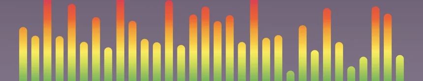
*In the player, below the cover: low tones on the left, high on the right. The higher a bar swings, the warmer its color.*
*→ In the player, below the cover*

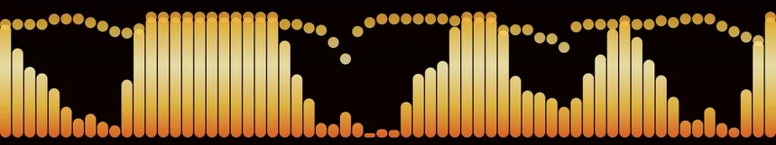
*The same strip in the full-screen view, here in gold: there the chosen design determines the colors, and with a different one it looks completely different.*
*→ Menu → Player Skins → Player Control*

A slim strip in the player that shows the music as moving bars – low tones on the left, high on the right. Not a screen of its own, but part of the player view.

**The colors in the player are fixed:** A low bar is green, a high one turns yellow, orange, red and, at the peaks, violet. Nothing about this can be adjusted. **It is different in the full-screen view** (Menu → Player Skins → Player Control): There the same strip runs along the top, but in the colors of the design chosen there – via the palette icon in the title row. The same piece of music then looks completely different.

#### The microphone permission

When you first open the player, the app explains what it needs the **microphone** for. After **Continue**, Android asks. This seems odd, but there is a technical reason: Android requires this permission for any analysis of the sound that is playing – even if only your own playback is being measured. **Nothing is recorded**, nothing is stored and nothing is sent.

The player asks on its own exactly **once**. If you decline, you lose only the bars; the music plays unchanged. In their place there is then a notice with two buttons:

- **Allow microphone** asks once more.
- **Hide** removes the notice for good.

You can grant the permission later at any time under **Settings → Permissions → Microphone Access**.

While measuring is going on, Android shows a **green dot** in the status bar from version 12 on. There is a note about that in the settings, too.

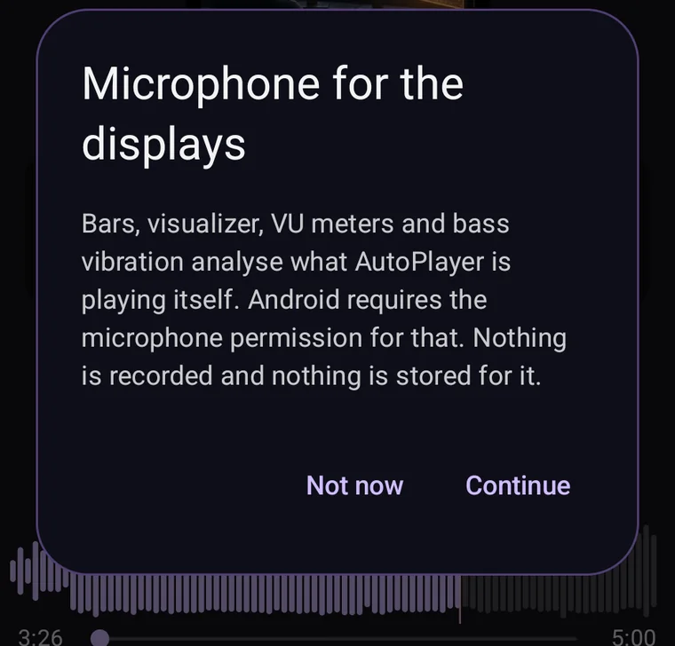
*Before Android's question, the app explains what it needs the microphone for.*
*→ when you first open the player*

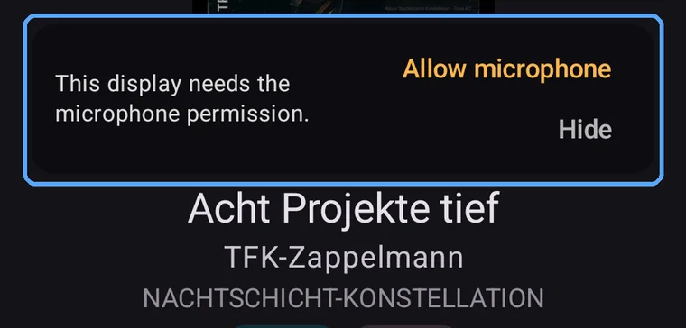
*Without the microphone, this notice appears in place of the bars.*
*→ Player, between cover and title*

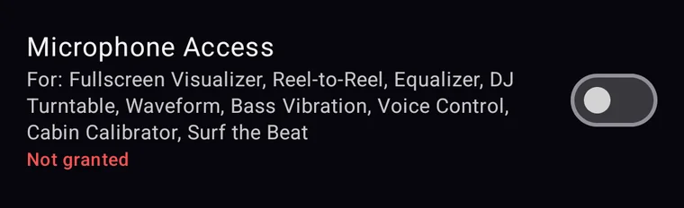
*This shows whether microphone access has been granted. One tap grants it or takes it back.*
*→ Settings → Permissions → Microphone Access*

#### Settings

None of its own. The strip appears as soon as the permission is granted.

#### Voice commands

None. “Open visualizer” leads to the **Fullscreen Visualizer** – a different display.

#### How it works with other features

- The same measurement drives **Bass Vibration**, the needle gauges of the **Reel-to-Reel** and the glow of the **Jukebox**. Without the microphone permission, all of that stays silent or still. Wherever a display can't work for that reason, the **Allow microphone** button appears.
- Changes to the equalizer can be read off the bars immediately.
- The measurement also runs in **Battery Saver** mode – it only works while the bars are visible.

#### Tips

- The strip is the fastest way to check whether an equalizer setting does anything at all.
- If you don't like the green dot, decline the permission – nothing is lost except the displays mentioned.

### Fullscreen Visualizer (Free)

#### What is it?

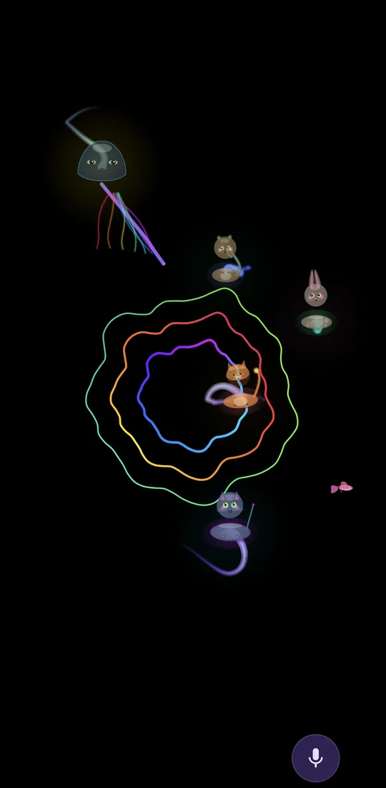
*The rings swing to the beat – and the Vumikio Pets have the whole screen to themselves. The fox stands in the middle of the rings, and on the right a fish swims by.*
*→ Menu → Player Skins → Fullscreen Visualizer*

A screen-filling, circular display of the music. The status bar and navigation bar disappear.

This stage is also where the game [Surf the Beat](index.html?lang=en#en-surf-the-beat) takes place: If it is turned on, the rings become a tunnel through which one of your animals surfs.

#### How to use it

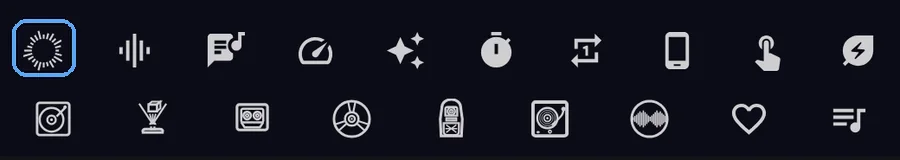

- Open it via the first icon in the player or via **Menu → Tools & Features**.
- Close it via the cross or the back gesture.

While the view is open, **the screen stays on**. That is intentional – and costs battery.

#### With your pulse

If a watch or a chest strap is connected in [Heartbeat Sync](index.html?lang=en#en-herzschlag), a soft glow settles over the whole stage. It has the color of the zone your pulse is currently in – the same as in the zone bar of Heartbeat Sync – and swells and fades in time with your heart, without flashing. The center stays dark, the rings stay as they are. Without a live pulse there is no glow. If you don't want any movement, turn on “Remove animations” in **Android's settings** – not in the app – (under **Accessibility**, on the Xiaomi under **Accessibility → Vision**) and restart the app once; the glow then stays steady, without swelling.

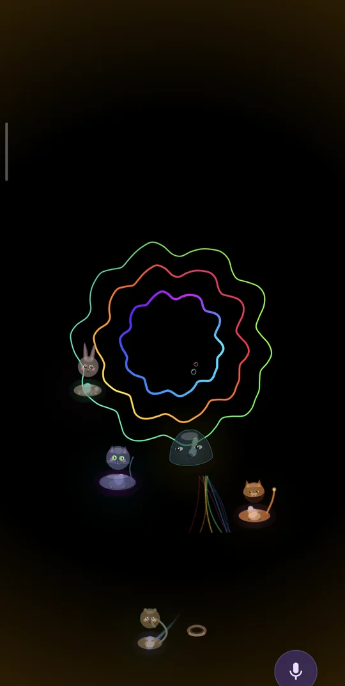
*On the heartbeat: The glow in the color of the Moderate zone is at full strength.*
*→ Player → Fullscreen Visualizer, with live pulse*

*Between two beats: The glow has faded.*
*→ Player → Fullscreen Visualizer, with live pulse*

#### Settings

None.

#### Voice command

- “Open visualizer”

#### How it works with other features

- Needs the same **microphone permission** as the bars in the player. If it is missing, a notice with the **Allow microphone** button appears there instead of the display. After you allow it, the display starts up without your having to leave the screen.
- Also runs in **Battery Saver** mode.
- The glow in time with the heartbeat comes from [Heartbeat Sync](index.html?lang=en#en-herzschlag); that is where you connect the watch or chest strap.
- Without music playing, the view closes by itself after a short time – unless a round of [Surf the Beat](index.html?lang=en#en-surf-the-beat) is running.

#### Tips

- Close it after listening – otherwise the screen stays on until the battery is empty.
- Most impressive at full brightness in a dark room.
- **The best stage for the Vumikio Pets.** Nowhere else do they have so much room: no list, no buttons, nothing that could cover them. They dance to the beat, chase their prey across the whole screen and perform their tricks while the music plays. If you have turned on **All pets at once**, you see all five here together – see [Vumikio Pets](index.html?lang=en#en-pets).

### Music DNA (Pro)

#### What is it?

A picture that looks different for every song – calculated from three properties of its music. Not random: The same song always produces the same picture.

#### What the picture shows

*→ Menu → Tools & Features → Music DNA*

| Property | How it becomes visible |
|---|---|
| **Key** | The color. Warm tones stand for major, cold ones for minor. |
| **Tempo** | The speed of the movement. |
| **Energy** | The strength and brightness of the display. |

The three values appear as numbers below the picture. The arrows next to the title jump to the previous or next song – a swipe across the title does the same. Tapping the title pauses the music and lets it play on again.

#### Requirements

1. The **switch at the top** of the screen must be on. Otherwise a notice appears instead of the picture.
2. Music must be playing.
3. The song must have been **analyzed**. If it hasn't, the notice there says to run a Smart DJ analysis first.

#### Settings

*→ Settings → Playback → Music DNA*

- The switch on the screen itself
- The same switch under **Settings → Playback → Music DNA**

#### Voice commands

None.

#### How it works with other features

- The values come from the same analysis that also feeds Smart DJ, the tempo display in the player and the mood selection.
- If the key is unknown, a dash appears there – the picture is created anyway.

#### Tips

- Major and minor can be told apart immediately by color – often faster than you hear it.
- If you flip through many songs one after another, you see the collection like a color fan.
- If many songs lack the analysis, a run through Smart DJ is worthwhile – after that the tempo display is filled in everywhere too.

## 3. Sound and effects

### Equalizer (Partly free)

#### What is it?

*→ Menu → Equalizer*

Four sections, one below the other, from top to bottom.

#### 1. Software equalizer – ten bands (Pro)

From 31 Hz to 16 kHz, calculated in the app itself. That is why it sounds the same on every device, regardless of what the manufacturer built in. Without a purchase, a notice card appears here instead of the sliders.

The ten bands from left to right:

- **31** and **63 Hz** – Sub
- **125** and **250 Hz** – Bass
- **500 Hz** and **1 kHz** – Low
- **2** and **4 kHz** – Mid
- **8 kHz** – High
- **16 kHz** – Air

These frequencies are fixed – the same on every device.

#### 2. Hardware equalizer – five bands (Free)

Uses the device's own sound control. Plus three knobs:

- **Bass** – boosts the lows
- **3D** – widens the sound image
- **Loud** – raises the perceived loudness

The five bands are called **Sub**, **Bass**, **Low**, **Mid** and **Air**. There is no band called **High** here – only the software equalizer has that.

Which frequencies are behind them is up to the device. On the test device they are 60, 230 and 910 Hz as well as 3 and 14 kHz – elsewhere they may be different.

#### 3. Reverb (Free)

A reverb with five rooms: Arena, Club, Open Air, Church, Café. Two sliders determine the strength and the bass portion of the reverb.

*→ Menu → Equalizer → Software EQ*

*→ Menu → Equalizer → Hardware EQ*

*→ Menu → Equalizer → Reverb / Hall*

#### 4. Custom setting per song (Free)

Whatever is set here can be **saved for the current song**. The next time it plays, it is loaded automatically; a badge confirms this. Later you can update or remove it.

Useful for recordings that stand out – a live recording that is too dull, a digitization that is too sharp.

#### The 42 presets

From **Rock**, **Pop**, **Jazz** and **Classical** through **Techno**, **Dubstep** and **Afrobeats** to **Schlager**. Plus presets by purpose rather than by style:

- **Car Audio** – against driving noise
- **Headphones** and **Small Speaker**
- **Night Mode** – listen quietly without details disappearing
- **Vocal Boost**, **Bass Heavy**, **Treble Boost**, **Flat**

#### Voice commands

- “Open equalizer”

Presets can **not** be chosen by voice.

#### How it works with other features

- **Battery Saver:** Shuts the equalizer down – software and hardware part alike, plus Bass, 3D and Loud. Your bands stay saved and come back unchanged when you switch back. If you turn the equalizer on in saver mode, the app asks whether it should run anyway.
- **Cabin Calibrator:** Can set the bands itself based on a measurement in the vehicle.
- **Bass Vibration:** Can be coupled to the bass control.
- The **bar visualizer** in the player immediately shows what a change does.
- The cards pulse to the beat of the music. That needs the **microphone permission**; if it is missing, **Allow microphone** appears at the top right. The equalizer itself works without it too.

#### Tips

- Choose a preset first, then fine-tune – that is faster than starting from zero.
- Boosting often sounds worse than cutting. Instead of boosting the highs, it's better to cut the mids.
- In the vehicle, **Car Audio** is worth a try: It boosts what the wind noise swallows.
- Both equalizers work together. If you turn both up hard, it overdrives.

### Concert Mode (Pro)

#### What is it?

Lays the sound of a venue over the music. A studio recording becomes something that sounds like a room.

#### The five venues

*→ Menu → Concert Mode*

- **Arena** – large hall, long reverb
- **Club** – tight room, strong bass
- **Open Air** – wide and open, little reflection
- **Church** – long, soft reverb
- **Acoustic Café** – small room, short reverb

#### How to use it

1. Turn on the switch at the top
2. Choose a venue
3. Set the **Reverb Intensity** and **Bass Boost**

Everything takes effect immediately while the music is playing – so you can adjust at your leisure.

#### Settings

*→ Settings → Playback → Concert Mode*

- Everything on the screen itself
- The main switch is also under **Settings → Playback → Concert Mode**

#### Voice commands

None.

#### How it works with other features

- The reverb comes **after** the equalizer – the two can be combined.
- The equalizer has a reverb section of its own. Both at the same time quickly become too much.
- In **Battery Saver** mode, Concert Mode rests; the setting stays and comes back when you switch back. With **Use anyway** it keeps running.

#### Tips

- **Church** suits choir and orchestral music, **Club** suits electronic.
- Use it sparingly. Too much reverb blurs the voice.
- With headphones the effect is much stronger than through speakers.

### Vocal Isolator (Pro)

#### What is it?

Separates vocals from instruments – no download, no waiting, right in the sound as it plays. The app itself calls this an **experiment**: The result depends heavily on the recording.

#### Why this works at all

In most recordings the lead voice sits right in the middle – equally loud on both sides. If you subtract the two sides from each other, everything in the center disappears. If you keep only the center, mostly the voice remains. That is all there is to it, and that is why the limits are clear:

- With **mono** recordings it doesn't work at all – the app points this out.
- Whatever else sits in the center – bass, kick drum, snare – disappears too.
- Live recordings and old recordings give poor results.

#### The modes

*→ Menu → Vocal Isolator*

*→ Vocal Isolator → Karaoke*

| Mode | Effect |
|---|---|
| **Off** | Unchanged sound |
| **Karaoke** | The vocals are removed, the instruments stay |
| **Vocals Only** | The other way around – the voice stays, the surroundings disappear |

Two sliders determine **how much** is removed – one for the vocals, one for the instruments. Complete removal often sounds worse than partial removal.

#### Settings

Everything on the screen itself.

#### Voice commands

None.

#### How it works with other features

- The **equalizer** comes in after the separation – you can use it to fine-tune.
- “Vocals Only” together with the **Church reverb** of Concert Mode gives a choir sound.
- In **Battery Saver** mode the separation rests; the setting stays and comes back when you switch back. With **Use anyway** it keeps running.

#### Tips

- Keep expectations low. What happens here is a computational trick – not a separation of the original tracks.
- Well-mixed studio recordings give the best results.
- If the bass disappears in Karaoke mode, that is not a bug: It sat in the center.
- To compare, set the mode to “Off” – this works without interruption.

### Binaural Beats (Pro)

#### What is it?

Two slightly different tones, one per ear. The brain perceives the difference as a slow pulsing – a tone that is not actually played. It sits quietly under the music.

> Headphones are a must.
>
> The effect depends on each ear hearing something different. Over speakers the tones mix in the air and nothing is left. The app points this out when you open it.

#### The four modes

*→ Menu → Binaural Beats*

| Mode | Pulse rate | Intended for |
|---|---|---|
| **Focus** | 18 Hz (Beta) | Concentration |
| **Relax** | 10 Hz (Alpha) | Calm with an alert mind |
| **Sleep** | 2.5 Hz (Delta) | Falling asleep |
| **Meditation** | 6 Hz (Theta) | Deep absorption |

#### How to use it

1. Put on headphones
2. Turn on the switch
3. Choose a mode
4. Set the **Beat Volume** – start quiet. The tone should hardly be noticeable.

#### Settings

*→ Settings → Playback → Binaural beat layer*

- Everything on the screen itself
- The main switch is also under **Settings → Playback → Binaural beat layer**

#### Voice commands

None.

#### How it works with other features

- Together with the **Atmosphere Mixer** you get three layers: music, surroundings, pulse.
- **Sleep** goes well with **Sleep Fade** and the Sleep Timer.
- In **Battery Saver** mode the beat rests; the setting stays and comes back when you switch back. With **Use anyway** it keeps running.
- It has no place in the vehicle – headphones at the wheel are banned in many places.

#### Tips

- If the tone is noticeable, it is too loud. It should work, not be heard.
- Calm music without a strong beat suits it better than driving music.
- The effect of such sounds is scientifically disputed. Trying it out does no harm; don't expect miracles.

### Atmosphere Mixer (Pro)

#### What is it?

An ambient sound that plays quietly under the music. All sounds are **calculated, not played back** – there are no audio files in the app. That is why nothing repeats and the app stays slim.

#### The seven sounds

*→ Menu → Atmosphere Mixer*

- **Rain** · **Thunderstorm** · **Fireplace**
- **Ocean** · **Forest** · **Cafe** · **Train**

#### How to use it

1. Turn on the switch
2. Choose a sound
3. Set the volume – it applies to the surroundings, not to the music

The sound can also be used **without music** – as a pure background for working or falling asleep.

#### Settings

*→ Settings → Playback → Atmosphere Mixer*

- Everything on the screen itself
- The main switch is also under **Settings → Playback → Atmosphere Mixer**

#### Voice commands

None.

#### How it works with other features

- Runs as a layer of its own – the equalizer and effects don't touch it.
- Together with **Binaural Beats** you get three layers.
- The **Sleep Timer** ends the atmosphere too.
- In **Battery Saver** mode the atmosphere rests; the setting stays and comes back when you switch back. With **Use anyway** it keeps running.

#### Tips

- Rain under calm music is the most reliable mix.
- The **Cafe** is good for working – it covers disturbances without being distracting itself.
- Set it quieter than you think. The surroundings should carry, not dominate.
- Since nothing is played back but calculated, every run sounds different – there is no audible loop.

### Hearing Protection (Free)

#### What is it?

A monitor of your listening volume over the day. The app estimates the level and holds it against the recommendation of the World Health Organization: 85 decibels for eight hours. If you listen louder, you have less time – and the app works that out.

#### What the screen shows

*During the measurement: 66 dB right now, 79 dB as the peak, below that the output and the daily budget – here still at 0 %.*
*→ Menu → Hearing Protection*

- **Current Level** and **Peak Level**
- **Output** – whether you are listening via Bluetooth, wired headphones, USB audio or the device speaker. This goes into the estimate.
- **Daily Budget (WHO)**, plus **listening time today** and the **average this week**
- A **Weekly Overview** as a chart
- A sentence like “At 78 dB you can safely listen for 4h 30min more”

#### The four levels

**Safe** → **Caution** → **Elevated Risk** → **Dangerous**. At moderate volume it says **Unlimited**.

#### Settings

*→ Settings → Hearing Protection → Enable hearing protection*

*→ Settings → Hearing Protection → Show dB in player*

- **Enable hearing protection**
- **Show dB in player** – shows the level next to tempo and key

That's all there is. The app does **not intervene on its own** in the volume.

#### Voice commands

- “Hearing protection on” / “Hearing protection off”
- “Hearing budget?” – tells you where you stand
- “Reduce volume” – lowers it to a safe level

These commands go through the app's microphone on the phone.

#### How it works with other features

- The dB readout in the player can be tapped and leads here.
- The values feed into the **Achievements**.
- All data stays on the device. Nothing is sent.

#### Tips

- This is an **estimate**, not a measuring instrument. It is based on the set volume and the output route, not on a measurement in the ear.
- In-ear headphones are louder at the same setting than ones that enclose the ear.
- The rule of thumb: at most 60 % volume, at most 60 minutes at a stretch.
- In the vehicle you turn it up unconsciously, because you're competing with the wind noise. The weekly overview shows this clearly.

### Bass Vibration (Pro)

#### What is it?

*Bass Vibration with its strength, the heartbeat vibration and, below them, the sources it follows.*
*→ Menu → Bass Vibration*

*→ Player → first icon row, eighth icon*

The vibration motor swings in time with the music. Listening becomes feeling.

#### What your device can do

At the very top it says what the built-in motor is good for:

| Level | Meaning |
|---|---|
| **Premium** | Fine gradations possible – the full experience |
| **Standard** | Continuously variable strength |
| **Basic** | Only on and off |
| **No motor** | The feature has no effect |

#### Strength

**Off**, **Light** (subtle pulsing), **Medium** (clearly noticeable), **Strong** (full force) or **Custom** with its own slider.

#### What the vibration follows

- **BPM Sync** – in time with the beat. The current tempo is shown next to it.
- **Bass Sync** – follows the low tones. The frequency range can be narrowed between 20 and 250 Hz: set low, the vibration follows mainly the kick drum; set higher, more the bass line. A bar shows the current bass level.

#### Heartbeat vibration

*Turned on, strength Light; the green dot shows that a pulse is arriving.*
*→ Menu → Bass Vibration, below the Haptic Mode*

If a watch or a chest strap is connected in [Heartbeat Sync](index.html?lang=en#en-herzschlag), the phone can, if you want, beat in time with your pulse – a soft double beat like a heartbeat. There is a tile of its own for this:

- **Switch** – on and off. It doesn't need the Haptic Mode, it also runs when that is set to **Off**. Every time the app starts, the switch is **off** – the heartbeat vibration never starts by itself; you turn it on every time.
- **Subtle**, **Light**, **Medium** – the strength. The choice appears as soon as the switch is on; the app remembers it.
- The **green dot** shows that a pulse is arriving right now. If it is gray, none is arriving and the phone stays silent; if the switch is on, the tile then says that the watch has to be connected in Heartbeat Sync.
- It never runs together with **BPM Sync** or **Bass Sync**: Turning one on turns the other off, and the app says so briefly.

#### To try it out

Four patterns can be tested without music: **Light Pulse**, **Bass Drop**, **BPM 120** and **Wobble**.

#### More settings

- **Battery Saver** – half strength as soon as the battery is below 20 %
- **Auto-Activate** – turns on as soon as headphones are connected
- **Display Off** – vibrates even with a dark screen
- **EQ Bass Boost Coupling** – stronger when the bass control is raised
- **Optimized for Hearing Impaired** – sets everything in one step so that music can be perceived mainly through the skin

#### Voice commands

On the phone via the app's microphone. Every command also moves the selection on the screen – so you see right away where you landed, and the app shows the new level by name.

| Command | What happens |
|---|---|
| **Vibration on** | Turns it on. If the selection was on **Off**, it moves to **Light**; a level that was already chosen stays. |
| **Vibration off** | Turns it off, the selection jumps to **Off**. |
| **Vibration stronger** | One level up: Off → Light → Medium → Strong. At **Strong** it stops. |
| **Vibration weaker** | One level back. From **Light** it goes to **Off**, and the vibration ends. |

From the **Custom** level, “stronger” leads to **Strong** and “weaker” to **Medium** – your own setting stays saved and can be selected again at any time.

#### How it works with other features

- Bass Sync needs the same measurement as the visualizer – and therefore the **microphone permission**. If it is missing, the app asks for it when you turn it on; on the level display, the **Allow microphone** button sits in the meantime.
- BPM Sync needs a known tempo. For songs that haven't been analyzed yet, it falls back to the bass measurement.
- In the player there is a quick switch in the first icon row.
- In **Battery Saver** mode Bass Vibration rests completely; the setting stays and comes back when you switch back. With **Use anyway** it keeps running. This also applies to the heartbeat vibration.
- The **heartbeat vibration** needs the live pulse from [Heartbeat Sync](index.html?lang=en#en-herzschlag).

#### Tips

- Lying on a hard surface, the device vibrates much more noticeably than in your hand.
- Constant vibration costs battery. The **Battery Saver** setting halves it when the battery is low.
- If you have trouble hearing, start with the preset for the hearing impaired.
- With electronic music Bass Sync works better, with rock and pop BPM Sync tends to.

## 4. What the app picks by itself

### Smart DJ – the foundation (Free)

#### Why this chapter matters

Almost everything the app picks by itself is based on three values per song: **tempo**, **energy** and **key**. Without them, Mood Morph, Drive Mode, Weather DJ, Smart Reorder, Song Paths, Auto Playlists and Music DNA stay empty or imprecise.

#### The analysis

*→ Menu → Smart DJ*

*→ Player → first icon row, fifth icon*

1. Open the screen – either via **Menu → Tools & Features → Smart DJ** or via the **star icon** in the first row of the player
2. Tap **Analyze Library**
3. The progress is shown as a percentage

This takes a while depending on the size of the collection and the device. After that it's done – new songs are added on their own as they play. The symbol to the right of it resets the values – only after asking, because the new analysis takes a long time again. You hardly ever need this, at most after putting your whole music collection on the phone anew.

#### Finding similar songs

For the current song, the app puts together a selection that fits its tempo, energy and key – the **Vibe Mix**. It appears as a list with tempo and energy values and can be played in one go.

#### Karaoke Preparation

A section of its own further down. It separates vocals and instruments in advance, so that Karaoke mode sounds cleaner than separating in the live sound. This happens in the background, the progress is shown, and the results can be deleted again.

#### Settings

None.

#### Voice command

- “Smart DJ” – opens the screen. Phone only.

The analysis itself can't be started by voice.

#### How it works with other features

These depend on it: Mood Morph, Auto Playlists, Smart Reorder, Song Paths, Drive Mode DJ, Weather DJ, Heartbeat Sync, Beat-Match, Music DNA as well as the tempo and key display in the player.

#### Tips

- It's best to let it run overnight, with the device plugged in.
- Songs without analysis play perfectly normally – they're only missing where the app picks by itself.
- If you have unusual things in your collection – audiobooks, recordings, noises – don't be surprised if their values say little.

### Smart Playlists (Pro)

#### What is it?

*→ Menu → Smart Playlists*

You write or say what you want to hear – the app puts it together. It recognizes tempo, genre, year, mood and your own listening behavior.

#### How to use it

*→ Smart Playlists → quick chip Workout*

1. **Menu → Tools & Features → Smart Playlists**
2. Write in the field, for example *fast rock songs* or *chill evening music*
3. The results appear with tempo and energy. Above them is the count, below it three buttons:
  - **Save** – with a name the list is kept
  - **Play All** – plays the list from the first song
  - **Shuffle** – plays the same songs in shuffled order. This doesn't create a new collection.
4. Tapping a single song plays the list from that song.

If the app finds nothing, it suggests a different description.

#### The ten quick chips

Below the input field there are ready-made requests:

- **Workout** · **Party** · **Chill** · **Roadtrip** · **Focus** · **Evening**
- **Top Songs** – the most played
- **Newly Discovered** – recently added
- **Long Forgotten** – what hasn't played in a long time
- **Never Skipped** – what was always listened to the end

The last four draw on listening behavior, not on the music itself.

#### Saved lists

They appear below the input field with name and count, each with buttons for playing and deleting. **They don't update themselves** – if you want new results, make the request again.

#### Voice commands

*→ Library → below the mini bar*

All via the **microphone in the app**:

- “Create playlist *[description]*” – puts a list together from the description and plays it
- “Play playlist *[name]*” – starts a saved playlist
- “Show my playlists” – opens the overview without playing anything
- “Play energetic music”, “Play calm music”, “Play party music” – puts a list together by mood. The selection appears as a chip in the library; tapping it shows what was put together.

> In the vehicle these commands don't work
>
> – and that is on purpose. Android Auto passes on what is spoken as a
>
> search query
>
> , not as a command: It finds songs, artists, albums and saved playlists, but doesn't create new ones. Having lists put together while driving would be the wrong kind of attention anyway.
>
> What does work in the vehicle: **“Play playlist *[name]*”** – that route goes through search and works reliably there.

#### How it works with other features

- Needs the **Smart DJ analysis**. Without it, only genre, year and listening behavior apply.
- The **mood analysis** improves the hits for descriptions like “happy” or “melancholic”.
- The result appears as a colored button in the library.

#### Keeping a collection permanently

*→ Tap the chip → press and hold a song*

*→ Multi-select → Add to Playlist*

Saving a chip directly is not provided – there is no button for it. The route goes through multi-select and takes a few steps:

1. **Tap the chip**. The list below now shows only the songs of this collection.
2. **Press and hold** any song. That switches the library to multi-select, and a bar appears at the top.
3. In this bar, tap **Select all** – the first icon on the left, a dashed square. Above it you then see how many songs are marked.
4. Now tap the **playlist icon** – the **second from the right**. The bar has six icons without labels: Select all, Play next, Add to queue, Favorites, **Add to Playlist**, Genre.
5. In the window, either tap an existing playlist or enter a **name for a new one** at the bottom.

After that the selection is a real playlist in the library and survives every restart. From there it can also be started by voice: “Play playlist *[name]*” – in the vehicle just as on the phone.

#### Tips

- Criteria can be combined: *happy songs between 120 and 140 BPM*.
- **Long Forgotten** is the best way to bring a collection that has grown over the years back to life.
- The collection is **temporary**: The chip disappears as soon as you close the app.

### Auto Playlists (Free)

#### What is it?

*→ Menu → Auto Playlists*

Five collections by time of day. Each has its own tempo and energy range – different in the morning than at night.

#### The five times

**Morning** · **Midday** · **Afternoon** · **Evening** · **Night**

The one that applies right now is highlighted. For each, the tempo and energy range and the number of songs found are shown.

#### How to use it

1. **Menu → Tools & Features → Auto Playlists**
2. Choose a time of day
3. Play – playback starts with the first song of the list. Or have it put together again with the refresh icon.

If the Smart DJ analysis is missing, the app points this out.

#### The chip in the library

*→ Library → below the mini bar*

As soon as a collection is playing, a chip called **Auto Playlists** appears in the library. Tapping it shows which songs were chosen; a second tap hides them again. The music simply keeps playing.

> The chip is temporary
>
> – it disappears as soon as you close the app. If you want to keep a collection, save it as a playlist of your own. The route there goes through multi-select and is described step by step in the chapter
>
> Smart Playlists
>
> under “Keeping a collection permanently”. It applies here in just the same way.

#### Settings

None. The ranges are fixed.

#### Voice commands

- “Open auto playlists” – opens the screen, phone only

#### How it works with other features

- Needs the **Smart DJ analysis**.
- The rules in **Context Auto-Switch** can trigger the same thing on their own – there it is one rule among many.
- The result appears as an **Auto Playlists** button in the library.

#### Tips

- The fastest way to suitable music without thinking.
- If you want it to happen on its own, use Context Auto-Switch.
- After a larger addition of music, refreshing is worthwhile.

### Mood Morph (Pro)

#### What is it?

*→ Menu → Mood Morph*

A collection that leads from one mood to another – not with a cut, but across many songs. From energetic to calm, from down to happy.

#### The eight moods

**Energetic** · **Happy** · **Relaxed** · **Melancholic** · **Sad** · **Angry** · **Focused** · **Dreamy**

#### How to use it

*→ Mood Morph → Energetic → Relaxed → Generate Morph Mix*

1. **Menu → Tools & Features → Mood Morph**
2. Choose the **Start Mood** and the **Target Mood**
3. Set the **Duration** – 15 to 120 minutes
4. **Generate Morph Mix**
5. The preview shows each song with tempo and energy. The progression shows the transition.
6. **Play Morph Mix**

If too few songs have been analyzed, the app says so and points to Smart DJ. It shows how many out of how many have been captured so far.

#### Settings

None outside this screen.

#### Voice commands

- “Open mood morph” – opens the screen, phone only

#### How it works with other features

- Needs the **Smart DJ analysis**.
- The **mood analysis** improves the assignment.
- The result appears as a violet button in the library.

#### The chip in the library

*→ Library → below the mini bar*

As soon as a progression is running, it appears as a chip in the library – labeled **Mood Morph** and the number of songs in parentheses. Tapping it shows them in the order in which they blend into one another; the music keeps playing.

> The chip is temporary
>
> and disappears when you close the app. With Mood Morph in particular, saving is especially worthwhile: The order is calculated and won't come out exactly the same the next time. How to keep it as a playlist of your own is described step by step in the chapter
>
> Smart Playlists
>
> under “Keeping a collection permanently”.

#### Tips

- The longer the duration, the gentler the transition. At 15 minutes it goes quickly, at two hours you hardly notice it.
- After exercise: from **Energetic** to **Relaxed**. Before going out the other way around.
- On long drives **Energetic → Focused** fits – staying awake without being wired.

### Mood Browse (Free)

#### What is it?

The app assigns a mood to every song – from the sound itself, without the internet and without anything leaving the device. At the top, the screen shows how far the analysis has got, and below it the moods found, as tiles.

The most important factor is the **timbre** – whether a piece sounds bright and wide or soft and dark. That separates hard from gentle more reliably than tempo or volume: A slow metal piece and a calm ambient piece can have the same tempo and be equally loud, yet sound completely different. Added to that are tempo, key and how dense the attacks are.

Every song is analyzed at **three points** – at the beginning, in the middle and near the end. That way it shows when a piece changes over its course.

#### Which tiles appear

*→ Menu → Mood Browse*

That is decided by **your collection**, not by a fixed list. The app counts how often each mood occurs as the **main mood** and shows only those for which it actually has songs.

The possibilities are:

| Tile | What it stands for |
|---|---|
| **Happy** | Bright and lively |
| **Sad** | Subdued, little movement |
| **Melancholic** | Heavy, often in a minor key |
| **Aggressive** | Loud, hard, fast |
| **Energetic** | Driving, high energy |
| **Relaxed** | Calm, restrained |
| **Romantic** | Warm, medium tempo |
| **Party** | Danceable and upbeat |
| **Danceable** | By rhythm, regardless of mood |
| **Instrumental** | Without vocals |

The last two are not moods but characteristics of their own – a song can be **melancholic** and **danceable** at the same time. If a tile is missing, no song in your collection has that mood as its main mood.

> Instrumental
>
> is detected by the app from how much the range in which vocals sit fluctuates: Sung passages start and stop, instruments run more evenly. This is a rule of thumb, not voice recognition – the app classifies a song as instrumental only if both signs agree. When in doubt, it counts as sung.

#### How to use it

*→ Mood Browse → Relaxed tile*

1. **Menu → Tools & Features → Mood Browse**
2. **Start Analysis** – needed the first time. The progress is shown above the bar.
3. Tap a tile – the screen then shows only its songs, each with the value for exactly that category as a percentage.
4. Tapping a song starts the list from that song.

**Reset** discards all calculated values. Useful if you want to run the analysis again from scratch.

> Sound analysis first.
>
> The mood is derived from the values of the
>
> Smart DJ analysis
>
> . Songs for which it hasn't run yet can't be classified – they are skipped. If that happens, the app reports at the end with a window and gives the number. Then first let the sound analysis in
>
> Smart DJ
>
> run through.

#### Settings

None.

#### Voice commands

On the phone via the app's microphone:

- “Play *[mood]* music” – such as *happy*, *calm*, *energetic*, *melancholic* or *danceable* music. The app puts together up to 50 matching songs in shuffled order and starts with the first.
- “What mood?” – names the mood of the **current song** with its percentage value and the second mood.

> “What mood?” always refers to the song that is currently playing – not to the collection it comes from. The two can differ: In a
>
> Relaxed
>
> list there may well be a song whose strongest value lies elsewhere.

#### The chip in the library

After a voice command, the collection appears as a chip in the library, labeled with the mood and the number of songs. Tapping it shows them in the order in which they play; the music keeps playing.

> The chip is temporary
>
> and disappears when you close the app. How to keep a collection as a playlist of your own is described step by step in the chapter
>
> Smart Playlists
>
> under “Keeping a collection permanently”.

#### How it works with other features

- The analysis builds on the **Smart DJ analysis** – without a song's tempo and key, its mood can't be determined.
- **Smart Playlists** and **Mood Morph** use the same values.

#### Tips

- The analysis keeps running in the background even if you leave the screen.
- Newly added songs are picked up on the next run – a reset isn't necessary for that.
- **Danceable** is the fastest way to music with drive, without committing to a mood.

### Smart Reorder (Pro)

#### What is it?

The queue is reordered – not alphabetically, but the way a DJ would lay it out: by tempo, key and energy.

#### The four profiles

*→ Player → Queue → Smart Reorder*

Each profile determines two things: **what it starts with** and **where it goes**. The starting point depends on tempo and volume at the same time – a build-up starts slow and quiet, a wind-down the other way around.

| Profile | Starts with | Progression |
|---|---|---|
| **Party Build-Up** | the **slowest** and quietest song | tempo and energy rise to the peak |
| **Chill Fade** | the **fastest** and strongest song | gradually gets slower and calmer |
| **DJ Mix** | medium energy | keeps the tempo even and pays attention above all to keys that fit together |
| **Energy Wave** | a calm song | build-up, peak, cool-down – the tempo stays as even as possible |

> With
>
> DJ Mix
>
> and
>
> Energy Wave
>
> there is deliberately no tempo direction: Both are meant to hold the tempo, not raise or lower it. There, energy alone decides what it starts with.

#### Custom profiles

If you want more, create one of your own:

- **Weighting** – how much tempo, key and energy count, in percent
- **Energy Curve** – **Build-Up**, **Cool-Down** or **Wave**

#### How to use it

*→ Player → Queue → magic wand*

*→ Smart Reorder → choose a profile → Preview*

1. Open the queue
2. Open Smart Reorder
3. Choose a profile
4. The **Preview** shows the number of songs, total duration, key clashes and how many songs have no analysis data
5. **Sort Now**

**Playback starts from the beginning.** Which song comes first is determined by the chosen profile – not by the song that was just playing. That is exactly the point: A new order starts at its own beginning.

#### Voice command

When you speak, it **sorts immediately** – the selection card does not open. You say which profile to use right in the command:

| You say | Profile |
|---|---|
| “Sort for party” | Party Build-Up |
| “Chill sort” | Chill Fade |
| “DJ mix” · “Sort harmonically” | DJ Mix |
| “Energy wave” | Energy Wave |
| “Smart reorder” with nothing added | DJ Mix |

Which profile was applied is then shown in the message – together with the number of songs, the key clashes and the tempo range.

> Custom profiles can
>
> not
>
> be called up by voice, only the four built-in ones. For a custom profile you need the selection card.

#### How it works with other features

- Needs the **Smart DJ analysis**.
- Together with **Beat-Match** or **Crossfade** you get a continuous flow.
- Sorts the queue that is currently displayed. The new order stays in it – even after switching to another one and back.

#### Tips

- The **key clashes** in the preview are the best indicator: The fewer, the smoother the transitions.
- For an evening with guests: **Party Build-Up** at the start, **Chill Fade** toward the end.
- A custom profile with a high key weighting gives the smoothest progression – at the expense of variety.

### Song Paths (Pro)

#### What is it?

*→ Menu → Song Paths*

Two songs as beginning and end – the app finds the route in between. From a slow piece to a fast one, without a break, over exactly as many songs as you want.

#### How to use it

1. **Menu → Tools & Features → Song Paths**
2. Choose the **Start Song** and **End Song**. For each song the list shows tempo, key and energy.
3. Set the **path length** – 3 to 20 songs. This length is kept.
4. Choose the **criteria** (see below)
5. **Find Path**
6. Play it or save it as a playlist

#### When saving: the name

*→ Song Paths → Save*

When you tap **Save**, the app first asks what the playlist should be called:

| Choice | Result |
|---|---|
| **Name it automatically** (default) | The app forms the name from the first and last song, for example *Path: Night Shift → Morning Light*. It is already in the window, so you see beforehand what comes out. |
| **Choose my own name** | Unlocks the input field. The automatic name is already in it – you can modify it instead of typing a new one. |

Tapping **OK** creates the playlist. If you don't want to change anything, you get by with one extra tap.

> With
>
> Choose my own name
>
> ,
>
> OK
>
> stays disabled as long as the field is empty. You can rename the playlist later at any time in the playlist overview.

#### The criteria

For start and end you can set separately what matters: **Tempo**, **Key**, **Energy**. What is checked at the start shapes the first songs; what is set at the end, the last ones. In between it blends gradually.

An example: Tempo at the start, key at the end – the route begins tempo-true and ends harmonically.

#### What the result shows

*→ Song Paths → Find Path*

Number of songs, total duration, a cost value for the quality of the route and the size of the network searched. If the app finds no route, it suggests lengthening the path or having more songs analyzed.

#### Voice command

- “Song path” or “Find path” – opens the screen, phone only. You choose start and end there yourself.

> The app also understands
>
> “Connect songs”
>
> and “Bridge songs”. The word “path” on its own is not enough – so a song with that word in its title can still be found through search.

#### How it works with other features

- Only **analyzed** songs can be waypoints. If there aren't enough of them, the app reports how many are still missing.
- A saved path becomes an ordinary playlist.

#### Tips

- The path length is also a time estimate: 10 songs are about 40 minutes – suitable for the way to work.
- The same two songs with different criteria give completely different routes. It's worth experimenting.
- If no route is found, the two songs are too far apart – a longer path helps.

## 5. In the vehicle

### Android Auto (Free) (Android Auto)

#### What is it?

*→ Recorded with the developer console; in the vehicle it looks different depending on the manufacturer – see below.*

The app appears on the vehicle's screen with a simplified interface – large areas, little text. It works over a cable and wirelessly.

**How it looks for you is decided by your vehicle.** Android Auto defines the content, the presentation comes from the manufacturer's infotainment system: font size, colors, shape of the buttons, position of the bar and even the aspect ratio of the screen differ from brand to brand. The picture above comes from the developer console and corresponds to what you see in the **Dacia Jogger** – in another car the same view can look quite different. What is *where* stays the same, though: title and artist on the left, the cover on the right, the playback buttons below.

#### The menu in the vehicle

How many items fit on the start page is determined by the vehicle. If something is left over, the app collects it under **More** – everything remains reachable.

At the top are the items most needed while driving:

| Item | Contents | Appears |
|---|---|---|
| **Continue Listening** | Songs you've started, at the saved spot | only if there are any |
| **Favorites** | Everything with a heart | always |
| **Recently Played** | Chronological | always |
| **All Songs** | The whole collection, organized by first letter | always |
| **Playlists** | The ones you created yourself | always |
| **Smart Playlists** | The saved smart lists | only with Pro |
| **Queues** | Saved queues | only with Pro |
| **Albums** / **Artists** | By album or by artist, respectively | always |
| **Mood Browse** | The ten moods | only after the mood analysis |
| **Genres** | By style | only if genres exist |

#### Tiles and lists

**Albums** and **Artists** appear as a tile grid: Each tile carries a cover, with the name below it. The picture comes from a song in the respective album or by the artist – if no song in it has an embedded cover, the tile stays empty.

If you tap a tile, it continues as a **list**, with the cover to the left of each song. This is intentional: Songs are told apart by their name, not by their picture – and a list is quicker to take in while driving than a grid of lettering. All the other entry points show lists as well.

#### The whole collection in the vehicle

**All Songs** first shows no songs, but **first letters**: first **123** for everything that begins with a digit, then **A** to **Z**, at the end **#** for songs with a special character in front. One tap on a letter, and the songs appear below it.

Only letters under which something really sits are listed – so you never walk into an empty folder. Umlauts go where you would look for them: “Über den Wolken” is under **U**, not with the special characters. The same goes for É, Ñ, Ø and the others.

> Why not one single long list?
>
> Because it would never arrive in full. Android limits how much data an app may hand to the vehicle interface at once – at about one megabyte it stops, without an error message. A collection of around 2,000 songs arrived only a quarter complete, and the vehicle's jump bar ended in the middle of the alphabet. Split up behind letters, every response stays small enough – even for a collection that is many times larger.

#### The voice button on the steering wheel

For it to end up in AutoPlayer, the app must be registered as the **default music app**. The route there is under **Settings → Android Auto → Set as default music app**; a button leads straight to the matching Android setting. If there are problems, the button **Voice button in car not working?** helps.

#### What works by voice in the vehicle

Choosing something:

- “Play *[title]*”
- “Play artist *[name]*”
- “Play album *[name]*”
- “Play playlist *[name]*”
- “Play genre *[name]*”

Controlling playback:

- “Play” and “Pause” – if it needs to be clearer, also “Pause the music”
- “Next” and “Previous”

Short, clear sentences are recognized most reliably. A playlist name is matched best when it consists of one or two words.

The other voice commands – tempo, second-precise seeking, markers and opening individual screens – belong to the app itself and go through the **app's microphone on the phone**.

#### Moods in the vehicle

Once the mood analysis has run, two routes lead to the right music – both without typing on a keyboard:

- Via the menu: **Mood Browse** lists the ten moods from *Happy* through *Relaxed* to *Danceable*. A single tap is enough.
- Via the **magnifying glass**: There “happy music”, “sad music” or “melancholic music” lead straight to the matching list – spoken or typed.

The search understands the mood names in the language that is set, plus the common paraphrases: *Happy* is found just the same when you say “cheerful”. Besides moods, the magnifying glass naturally also finds songs, artists and albums.

#### Settings

*→ Settings → Android Auto*

- **Autoplay on connect** – music starts as soon as the vehicle is connected
- **Speed-based Volume**
- **Set as default music app**
- In addition, **Bluetooth Auto-Resume** from the Playback section takes effect

#### What runs along in the background

- Every song shows its **own** cover, even within the same album.
- If a file can't be played, the app silently skips to the next song instead of stopping.
- **Blocked folders** and **hidden songs** apply here too.

#### Tips

- In wireless operation the phone leaves the home Wi-Fi – it sets up its own connection to the vehicle. That is normal.
- Short, clear playlist names are matched most reliably by voice.
- **Continue Listening** is the fastest way back into an audiobook or a long recording.
- If you let the mood analysis run once, you get an additional menu item in the vehicle – and can ask the magnifying glass for moods.

### Drive Mode DJ (Pro)

#### What is it?

*→ Menu → Drive Mode DJ*

The app recognizes from your speed how you are driving and chooses the music accordingly.

#### The three situations

| Mode | When | Music |
|---|---|---|
| **City** | about 10 to 60 km/h | Relaxed, medium tempo |
| **Highway** | over 80 km/h | Energetic, upbeat |
| **Traffic Jam** | under 15 km/h, for longer than three minutes | Calm, soothing |

The app shows the current and the average speed as well as the active mode.

#### Match my pace

*→ Menu → Drive Mode DJ → Match my pace*

The three situations above are calibrated for the car. On foot, on a bike or on a boat you stay permanently under fifteen kilometers per hour – and so after three minutes you land in **Traffic Jam**, even if you are pedaling briskly uphill.

That is what the second switch **Match my pace** is for. When it is on, the switching points no longer follow fixed car values, but your [target speed](index.html?lang=en#en-speedvolume) from the speed-based volume. The proportions stay the same, only the axis moves with it:

| Target speed | Calm | Steady | Brisk |
|---|---|---|---|
| On foot (6 km/h) | under 0.9 | 0.9 to 4.8 | over 4.8 |
| Boat (10 km/h) | under 1.5 | 1.5 to 8 | over 8 |
| Bike (25 km/h) | under 3.8 | 3.8 to 20 | over 20 |
| Car (100 km/h) | under 15 | 15 to 80 | over 80 |

The bottom row is the state that has always existed – so for the car nothing changes. The music for the three situations also stays the same: calm still means 60 to 100 beats, brisk 110 to 160.

**The names change too.** On a bike or a boat there is no highway, and “Traffic Jam” doesn't fit when you are drifting at your fishing spot. When the switch is on, the three situations are therefore called **Calm**, **Steady** and **Brisk** – on the screen, in the overview and in the notification when it switches. When the switch is off, it stays City, Highway and Traffic Jam.

**In the vehicle the switch does not apply.** As soon as Android Auto is connected, the car values count, no matter how the switch is set. Otherwise you would have highway music in the car from eight kilometers per hour with a boat setting.

#### How to use it

*Android's question about the location. Drive Mode DJ needs **Precise**.*
*→ Drive Mode DJ → turn on the switch*

1. **Menu → Tools & Features → Drive Mode DJ**
2. Turn on the switch – Android asks for the **location**. Choose **Precise** and **While using the app**; with “Approximate” or “Only this time” Drive Mode does not work reliably
3. **Start music.** A song of your choice, as usual
4. Drive off. Until the first signal it says **Waiting for GPS signal…**

> **Drive Mode doesn't start playing by itself.** It adapts what is already playing – from silence it starts nothing. That is intentional: Otherwise the app would start playing just because you opened it or because you get rolling. If you change the mode while nothing is playing, the list is put together and shown, but not played.

For each mode, the collection can also be played by hand.

#### Viewing the song list

At the bottom of the screen it says how many songs are currently put together. Tapping it brings the full list in from below – with number, title and beat count, scrollable. From there every song can be tapped individually or the whole list started. Swiping down closes it again.

#### The chip in the library

As soon as Drive Mode DJ plays a collection, a chip called **Drive Mode DJ** appears in the library. Tapping it shows exactly the songs that are currently in the queue; a second tap hides them again. The music keeps playing. That way you can check at any time what the automation has picked – even while driving, without opening the Drive Mode screen.

This also applies when you start the list **yourself** – via “Play All”, the button in the summary or a single song from it.

If [Weather DJ](index.html?lang=en#en-wetter) is running at the same time, the two put the list together jointly. The chip is then called **Drive Mode DJ + Weather DJ**, and below it says which situation and which weather went in – for example “City and rain”. That way you can read from the chip what the list was built from.

> The chip is temporary
>
> – it disappears as soon as you close the app. If you want to keep a collection, save it as a playlist of your own; the route there is in the chapter
>
> Smart Playlists
>
> under “Keeping a collection permanently”.

#### Settings

Both switches are on the screen itself: the main switch and below it **Match my pace**. You won't find any of it in the app's settings – only the target speed that the second switch refers to is at the [speed-based volume](index.html?lang=en#en-speedvolume).

#### Voice command

- “Drive mode” – opens the screen, phone only

#### How it works with other features

- Needs the **Smart DJ analysis** – at least ten songs.
- Needs the **location permission**, specifically the precise location. The switch asks for it when you turn it on. If only the approximate one is allowed, the app says so and leads to the settings.
- In **Battery Saver** mode, drive mode detection rests; the setting stays and comes back when you switch back. With **Use anyway** it keeps running.
- The **speed-based volume** decides separately – this feature chooses the music, that one controls the level, and it only applies over Bluetooth or headphones, not on the vehicle screen. Both can, however, share the same **target speed** (see above).
- The **Weather DJ**: When both are running, they share the work – the tempo comes from Drive Mode, the mood from the weather. If the weather closes in or clears up, the list is re-determined while Drive Mode is running; the song that is playing is not cut off. At most every three minutes, so that a changeable route doesn't upend the music every minute.
- The **context rules** take priority: If a rule has started a list, Drive Mode holds back until it has finished – and then takes over again immediately, with no pause in between. You created a rule yourself; Drive Mode only runs along in the background.
- The **passenger** can start it from their own device.

#### Tips

- The location is used only to measure speed. Nothing is recorded and nothing is sent.
- It is most worthwhile on long drives with changing stretches.
- Continuous location tracking costs battery – in the vehicle the phone is usually plugged in anyway.

### Weather DJ (Pro)

#### What is it?

*→ Menu → Weather DJ*

The app checks the weather at your current location and chooses the music accordingly. Sun sounds different from rain.

#### The seven weather conditions

**Sunny** · **Cloudy** · **Rainy** · **Stormy** · **Snowy** · **Foggy** · **Clear Night**

Each condition has a mood profile with a tempo and energy range. The time of day is factored in.

#### How to use it

*Android's question about the location. For Weather DJ, **Approximate** is enough.*
*→ Weather DJ → turn on the switch → Grant Permission*

1. **Menu → Tools & Features → Weather DJ**
2. Turn on the switch. As long as it is off, the screen shows no weather and no songs and asks for nothing.
3. If the location permission is missing, the app asks for it now: tap **Grant Permission**. In Android's question, **Approximate** is enough; with **While using the app** the permission stays in place. GPS must be on. If you decline, the switch stays off.
4. The app shows temperature, wind and weather condition, and below them the collection
5. Play with the round button at the bottom right – or tap a song, and the list starts there. The refresh icon at the top checks the weather again.

If the switch stays on, weather and collection are there immediately the next time you open it. Turning it off empties the screen and removes the blue button of Weather DJ from the library; music that is currently playing keeps playing. If you take the location permission back while it is on, it says “Weather DJ needs access to: Location.”

> **Turning it on doesn't start any music.** The app puts the list together and shows it; it is only played when you start it. If the weather changes later, Weather DJ adapts what is currently playing – from silence it starts nothing. Otherwise the app would begin playing on its own just because the sun comes out outside.

#### What is sent

The app queries the weather service Open-Meteo. The coordinates, rounded to about 110 meters, are sent there – without an identifier, without an account, without a sign-in. Without internet, Weather DJ stays empty. What else the app sends online is in the chapter **Privacy**.

#### Settings

*→ Settings → Playback → Weather DJ*

- The switch on the screen
- The same switch under **Settings → Playback → Weather DJ**

#### Voice commands

- “Weather DJ” – opens the screen, phone only

#### How it works with other features

- Needs the **Smart DJ analysis**.
- The **Drive Mode DJ**: When both are on, they no longer fight over the music, but share the work – Drive Mode sets the **tempo**, the weather sets the **mood**. If the situation changes on the road, the list is re-determined while Drive Mode is running, at most every three minutes. The current song plays to the end.
- The **context rules** can use the weather as a condition – and they take priority: If a rule has started a list, Weather DJ holds back until it has finished.
- The **passenger** can trigger it.
- The result appears as a blue button in the library.

#### Tips

- The effect is clearest in pronounced weather. With medium cloud cover the difference is barely noticeable.
- If you don't want a connection to the outside, leave the feature off. Everything else in the app is unaffected.
- When traveling you get different music at your destination than at home.

### Speed-based Volume (Free)

#### What is it?

The faster you travel, the louder the music gets – so that it keeps up with wind, engine or tires. When your speed drops, it goes back down again. Intended for anything where noise rises with speed and nobody has a hand free: **bicycle, boat, jogging**.

#### Where it works

*→ Menu → Settings → Speed-based Volume*

Over **Bluetooth speakers and headphones**. As soon as such a device is connected and music is playing, the app measures the speed itself by GPS – independently of all other features. So you don't have to turn on Drive Mode or anything else.

Over the **phone speaker** it deliberately stays off: There the location would be running without anyone getting anything out of it.

> **Not available in Android Auto.** On the vehicle screen, the vehicle controls the volume itself – through its display and the buttons on the steering wheel. An app can't change anything there; that is by design and applies to every app equally. Even a spoken “louder” doesn't reach the sound system, even if the voice assistant gives a confirmation.

#### Setting the target speed

*→ Menu → Settings → Speed-based Volume*

A slider determines at what speed **full** volume is applied. Everything below it is distributed proportionally – so the same curve fits very different ways of getting around:

| Traveling by | Target speed |
|---|---|
| Canoe, rowboat | about 6 km/h |
| Motorboat | 10 to 30 km/h |
| Bicycle | about 25 km/h |
| E-bike, moped | about 30 km/h |
| Car (without Android Auto) | 80 to 100 km/h |

Below the slider, the app draws the curve as you go. If you move the target speed, the curve moves with it – so you see immediately what will happen.

[Drive Mode DJ](index.html?lang=en#en-fahrmodus) can use the same target speed too. If you flip the **Match my pace** switch there, it likewise aligns its switching points to it, instead of to fixed car values. One value, two features – you still set the target speed only here.

#### What the curve looks like

It is calculated in fractions of the target speed, not in fixed speeds:

| Fraction of target speed | Boost | Example at 10 km/h |
|---|---|---|
| up to 10 % | none | up to 1 km/h |
| 30 % | about 11 % | 3 km/h |
| 50 % | about 30 % | 5 km/h |
| 80 % | about 68 % | 8 km/h |
| 100 % | full | 10 km/h |

Between the values it blends smoothly, without jumping. At the bottom the curve deliberately holds back; it only becomes noticeable in the upper third. The speed is also smoothed, so that brief spikes don't come through.

When you slow down, the boost deliberately takes its time: First it waits about ten seconds – that covers a traffic light or a short stop, without the volume starting to pump right away. If you stay stopped, it then drops back in one go, taking about twenty seconds for it, no matter how high it was. From stopping to being back at your base volume takes about half a minute.

If the device loses GPS reception – in a tunnel, in a pocket, in a building –, the app waits fifteen seconds and then takes the boost back as well. Otherwise the music would stay at driving volume long after nobody is driving anymore.

Important: It is a **boost**, not a fixed level. Your set volume always remains the floor – it never goes below that.

#### When you turn the volume control yourself

Your hand takes priority. The app distinguishes which direction you turn:

- **Quieter** – this applies first to the *boost*, not to your base volume. The app takes back its addition, and your value becomes the upper limit. It only raises it again when you get noticeably faster than at the moment you turned it (about 3 km/h more).
- **Louder** – this is adopted as the new base volume, and the automation continues from there.

This matters more than it sounds: Without this distinction the app would have understood turning it down as “the base volume is now lower” – and since the boost is measured by the distance to the top, that would have created *more* headroom. The more decisively you turned it down, the louder it would have become.

#### How to turn it on

**Settings → Speed-based Volume**. Below it, the slider and curve appear. When you turn it off, the original volume is restored.

#### Voice commands

None of its own. **“Louder”** and **“Quieter”** are available through the app's microphone on the phone, as is **“Set volume to 50 percent”**.

#### How it works with other features

- Needs the **location permission** – the speed comes from GPS. The switch asks for it when you turn it on. If it is on and the permission is missing, a line with the **Grant Permission** button appears below it.
- In **Battery Saver** mode it rests; the setting stays and comes back when you switch back. With **Use anyway** it keeps running.
- Acts on the same volume as the buttons on the device – whoever turns it themselves has priority (see above).
- **Hearing Protection** factors in the boost.
- **Drive Mode DJ** chooses the music by speed, this feature controls the volume. The two decide separately from each other – but they can share the same **target speed** if you flip the **Match my pace** switch in Drive Mode.

#### Tips

- Set the target speed to the speed you **actually reach**. If you travel at 10 km/h and set 100, you get almost no boost.
- Feel free to choose the base volume a bit lower than usual – there is then more headroom upward, and that is exactly what the feature uses.
- The target speed can't be set below 5 km/h: At that slow a speed the GPS measurement is too imprecise, and the volume would fluctuate.

### Cabin Calibrator (Pro)

#### What is it?

*After a measurement: the acoustics score – here 50 % – and below it the frequency response from 60 Hz to 14 kHz. The red line is the measured sound, the green one the correction.*
*→ Menu → Cabin Calibrator*

The app plays a test tone through the speakers and listens at the same time with the microphone. From the difference it calculates what the interior swallows or overemphasizes, and compensates for it.

#### Step by step

1. Park the vehicle, close the windows, turn off the engine
2. Put the phone in its usual place – where it lies while driving
3. Set the **media volume to about half** (see below)
4. **Menu → Tools & Features → Cabin Calibrator**
5. Grant the microphone permission
6. **Start Calibration.** If music is playing, the app stops it itself. Stay quiet for eight seconds – don't talk, don't move
7. Afterward an **Acoustics Score** and the **Frequency Response** appear
8. **Apply Correction EQ**

#### Music off, and how loud?

**The music must be off** – the app stops it itself when the measurement starts. The reason: The microphone hears everything that is in the room. If music is playing too, the app measures its sound instead of that of your interior. Talking, wind or a running engine also go into the calculation.

**The volume of the test tone** depends on your media volume. About **half** is a good starting point:

| Too quiet | Good | Too loud |
|---|---|---|
| The tone is lost in the background noise. Below a certain level the app aborts with **No signal detected**. | The tone is clearly audible without being unpleasant. About 40 to 60 % of the media volume. | Speakers and microphone distort, and the highs overdrive. The result gets worse, not better. |

#### If nothing comes through

If the app reports **No signal detected**, the microphone didn't hear the test tone. Then check: Is the volume high enough? Is the microphone covered – by a case, a mount, the palm of your hand? Is it quiet all around?

#### Settings

*→ Settings → Playback → Cabin Calibrator*

- Everything on the screen itself
- The main switch is also under **Settings → Playback → Cabin Calibrator**

#### What is measured

In eight seconds the test tone sweeps the range from **20 Hz to 20 kHz**. Measurement takes place at five points: 60, 230, 910, 3,600 and 14,000 Hz. The correction arises from the distance of each point to the average – what the room swallows is boosted, what it overemphasizes is cut.

The **score** says how even it sounds: 100 would mean perfectly flat. A closed vehicle interior typically comes in at 20 to 60, an open space at much more – there the reflections that make a room uneven are missing.

#### What your speaker can't do

The app doesn't just measure the room. It measures the whole chain: speaker, room, microphone. And a small Bluetooth speaker simply puts out nothing below about a hundred hertz – the diaphragm is too small for it.

The app recognizes such limits by itself and leaves that range alone. If it lies more than twenty decibels below the loudest, it counts as a limit of the technology and not as a weakness of the room. It is not touched and stays at zero on the screen. If the app instead turned it up to fill the supposed gap, what came out would be not bass but a scratching – the equalizer would run into its limiter.

That is not a bug but the right decision: What the speaker can't reproduce can't be dialed in.

#### Voice command

- “**Cabin**” or “**Calibration**” – opens the screen. It does not start the measurement itself.

#### How it works with other features

- The result goes into the app's **ten-band equalizer**, not into the hardware's five-band equalizer. The five measured values are converted to the ten bands. The equalizer is turned on at the same time.
- If you adjust by hand in the **equalizer** afterward, you overwrite the correction. If you turn it off there, the switch here goes off too – both are the same thing.
- Needs the **microphone permission** – the calibrator really listens through the microphone to how your car sounds. If it is missing, a notice appears there with the **Allow microphone** button.

#### Tips

- The measurement is only as good as the conditions. With the engine running or a window open, nonsense comes out.
- **Measure twice.** If two runs in a row come out with similar values, it was quiet enough. If they differ strongly, something interfered – then once more, under better conditions. What is reliable is what repeats: the same score and individual values that agree to within half a decibel.
- The corrections are deliberately restrained: The app compensates only half of the measured deviation and boosts by three decibels at most. A complete equalization sounds unnatural, and strong boosting leads to distortion.
- Measure again after changing the speakers or the vehicle.
- Put the phone in the same place every time – otherwise you're measuring a different room.
- If you don't like the result: The equalizer can be reset.

### Passenger Mode (Free)

#### What is it?

*→ Menu → Passenger Mode*

The passenger controls the music from their own phone. The driver doesn't have to touch their device.

#### The connection

1. AutoPlayer must be running on both devices, with Bluetooth and location permission.
2. **Driver:** Menu → Passenger Mode → **HOST**. A four-digit PIN appears.
3. **Passenger:** Menu → Passenger Mode → **PASSENGER**. The driver's device appears in the list, with the PIN to compare.
4. Tap it, connect – done.

*→ Menu → Passenger Mode → HOST*

*→ Menu → Passenger Mode → HOST*

*→ Menu → Passenger Mode → PASSENGER*

The connection runs over Bluetooth and a direct link between the devices. **No Wi-Fi needed**, no data connection. It works alongside wireless Android Auto.

#### What the passenger sees

At the top a bar with the current song: play, pause, forward, back, shuffle, repeat, heart and progress. Below it three tabs:

| Tab | Contents |
|---|---|
| **Songs** | The driver's whole collection with a search field. Tapping plays the song immediately – it is placed right after the current one, the rest of the queue stays as it is. The plus appends it at the end instead. |
| **Queue** | What comes next, the current song highlighted. Tapping jumps to that spot without changing the list. |
| **Features** | Start and stop Drive Mode DJ, trigger Weather DJ and eight moods: Melancholic, Aggressive, Energetic, Party, Relaxed, Happy, Romantic, Danceable |

*→ Passenger Mode → connected → Songs*

*→ Passenger Mode → connected → Queue*

*→ Passenger Mode → connected → Features*

#### The queue belongs to both

Driver and passenger work on the same list. What the passenger appends is also in the driver's list, and vice versa. It stays in place as long as nobody starts something completely new – a single song from the collection therefore doesn't overturn it.

The **Queue** tab keeps itself up to date. If the driver changes something, or an automation takes over at the end of a list, the new order is immediately there for the passenger too – without switching tabs.

That is why **forward**, **back**, **shuffle** and **repeat** also act on exactly what is in the queue. If there is only a single song in it, there is nothing to skip and nothing to shuffle – that is not a bug, but simply the end of the list.

#### The Features tab

Here the passenger starts what the driver would otherwise operate on their device.

| Button | What happens |
|---|---|
| **Drive Mode DJ** | Turns Drive Mode on or off – the same one the driver has in their settings. So the driver sees it running on their screen as well. When it is turned on, the music starts right away. |
| **Weather DJ** | Turns Weather DJ on or off – also the same switch as in the driver's settings. When it is turned on, it immediately puts together a list for the current weather. Needs weather data; without it nothing happens. |
| **Eight moods** | Melancholic, Aggressive, Energetic, Party, Relaxed, Happy, Romantic, Danceable. One tap starts the mood, a second stops it. The songs come from the sound analysis – if it hasn't been run for a song yet, it doesn't show up here. |

**What the passenger picks takes priority:** If they start a mood or Weather DJ, Drive Mode holds back until the list has finished.

Only then does it take over again, with no pause in between. A deliberate choice is therefore not overwritten at the next change of location.

A mood **doesn't turn anything off**. Drive Mode and Weather DJ stay on and report that back too – their switches therefore still show on while the mood is playing.

#### When both DJs are running

If Drive Mode and Weather DJ are on at the same time, they don't switch against each other, but put things together **jointly**.

Drive Mode sets the beat count, the weather the mood. In the driver's lists it then says, for example, “City and rain” instead of just “City”.

Exactly this joint list also takes over when a passenger's mood has finished.

#### The driver sees along

What the passenger starts also appears in the **driver's library** as a chip – a mood under its name, Weather DJ as “Weather DJ”. Tapping it shows the songs.

There is only ever **one** chip for the automation, the one for the running list. If a mood is added, its chip appears **next to it**, because the automation stays on and takes over again later. When the mood is over or deselected, its chip disappears on its own.

#### What is transmitted

Only title, artist and an ID number – **no covers, no music files**. That is why it is fast even with large collections.

#### The connection stays

The driver can leave the screen, send the app to the background or make a phone call – the connection holds. It ends only through **Disconnect** or by closing the app completely.

#### Voice command

- “Open passenger mode” – phone only

#### How it works with other features

- What the passenger starts plays through the vehicle's speakers – as if it came from the driver's device.
- Drive Mode and Weather DJ use the location of the **driver's** device.
- Hearts are set by the passenger on the driver's device.

#### Tips

- Both devices need the permissions. The app asks for them as soon as you choose one of the two roles. If you decline, it says which one is missing – the role then doesn't start.
- The PIN only serves to recognize the right device – it is not a password.
- If the passenger finds nothing, the driver usually hasn't yet started Host mode.
- On long drives the most elegant solution: The driver keeps their mind on the road, the passenger looks for the music.

## 6. Controlling playback

### Queues (Free) (Android Auto)

#### What is it?

*→ Player → Queue icon*

The queue is what is playing right now – and what comes after it. You can keep **up to ten** of them side by side. Each remembers its own state: which song, which spot, whether shuffled, whether repeating.

#### How to use it

- **Open** it via the icon in the player.
- At the top a bar with the existing queues. Tapping shows the contents of a queue; it starts once you tap a song in it – with **Queue Crossfade** fading over smoothly.
- **+** creates a new one.
- **Pressing and dragging** reorders a song.
- **Swiping** removes it.
- **Undo** takes back the last change – up to twenty steps.

Via the More menu, a queue can be renamed, deleted or saved as a new one.

The selected tab is underlined. The play marker **▶** shows which queue is currently playing. If you play something else – a playlist, an album, Drive Mode –, no queue carries the play marker, and the list shows the current playback.

What you add lands in the selected queue. If none is selected, it lands in the current playback.

#### Clearing the queue

If you often append whole genres or albums, you quickly end up with several hundred entries – some of them twice, if the same thing was added twice. Swiping them away one by one takes forever. In the **More menu**, **Clear queue** is right at the top.

- A confirmation names the number of songs that will disappear. This can't be undone.
- The **current song stays** and keeps playing – afterwards the queue has exactly one entry, and you fill it anew.
- The item appears only if there is something in it besides the current song, and acts only on the **current** queue – saved presets are left untouched.

#### Presets

A queue can be saved as a **preset** and loaded again later. Unlike a playlist, it is a complete playback state. Presets can be renamed and deleted.

If songs are missing on loading because they are no longer on the device, the app loads the rest and names both numbers – for example **42/43**. It doesn't say which song is missing.

#### Extend Queue

**Extend Queue** appends five songs that match the sound of what came before – by tempo, key and energy, measured against the average of the whole queue. The fastest way when the list is running low.

#### Voice commands

- “Switch to queue *[name]*”

#### How it works with other features

- **Smart Reorder** arranges the queue by DJ rules.
- **Queue Crossfade** fades smoothly over when switching.
- **Context rules** can switch on their own.
- In the vehicle, saved queues appear as a menu item of their own – though only with Pro.
- Everything goes into the backup.

#### Tips

- Separate queues for work, driving and evening save you from constantly re-assembling – each keeps its place.
- Save a preset before big changes. That is faster than pressing Undo twenty times.

### Detour – a quick interlude (Free)

#### What is it?

A song is slipped in between – afterwards it continues exactly where the queue was interrupted. Not at the start of the song, but at the spot.

#### How it works

*→ Player → Queue → options on the song*

*→ Queue → options on the song → Play as Detour*

Two routes lead there:

1. In the queue, tap the three dots next to a song and choose **Play as Detour**.
2. Or say “**Detour *[title]***” – then the song is searched for first.

The song plays immediately. After it ends, playback continues at the old spot.

If you don't want to wait, say “**Back to queue**” – or tap in the notice banner that appears at the top of the queue during a detour.

#### Settings

None.

#### Voice commands

- “Detour *[title]*” – say the word “detour”, then the *title*
- “Back to queue”

#### How it works with other features

- Builds on the queue system and remembers the exact return spot.
- The difference from **Play next**: There the song is lined up and the current one plays to the end. With a detour it comes immediately, and afterwards it continues in the middle of the interrupted song.

#### Tips

- On the phone the fastest way to fulfill a sudden wish: speak once, and afterwards everything continues as before.
- The song title doesn't have to be matched exactly – inexact pronunciation is caught.

### Queue Crossfade (Pro)

#### What is it?

When you switch from one queue to another, the app fades smoothly over instead of switching abruptly. This is different from the ordinary crossfade, which works between two songs of the same list.

#### How to switch

*→ Player → Queue*

- **Tapping** – in a queue that is not currently playing, tap a song. The app fades over to exactly that song.
- **Voice** – “Switch to queue *[name]*” via the microphone in the app. It continues with the first song.
- **Automatic** – if **Continue with next queue** is on, a queue that has finished is followed by the next one in the order of the tabs. Empty ones are skipped, and after the last one it ends.
- **Context rules** with the action “Switch Queue”.

It only fades over if something is playing at the moment. From silence the new queue simply starts.

If repeat is turned on, a queue keeps looping instead of switching to the next one.

#### Settings

*→ Menu → Settings → Playback*

Under **Settings → Playback**:

- **Queue Crossfade** – main switch
- **Crossfade Duration** – 1 to 10 seconds
- **Crossfade Curve** – how the volume behaves during it:
  - **Linear** – even
  - **Logarithmic** – faster at the start
  - **S-Curve** – gentle entry and exit
  - **Equal Power** – keeps the volume constant throughout **(recommended)**
- **Continue with next queue** – off by default. Also works without Queue Crossfade, in which case the switch is abrupt.

#### Voice commands

- “Switch to queue *[name]*”

#### How it works with other features

- The ordinary **Crossfade** is a setting of its own. The **Crossfade Curve** applies to both.
- During a **detour** there is no automatic switching.
- After the last queue, **Drive Mode DJ** takes over, if it is standing by.
- Every crossfade counts toward the achievement **Smooth Operator**.

#### Tips

- **Equal Power** is recommended for a reason: With the other curves the volume audibly sags in the middle.
- Two to three seconds is enough. Longer feels sluggish.

### A–B Repeat (Partly free)

#### What is it?

A section of a song is repeated – from point A to point B. Intended for anyone who needs to hear a spot again and again: when practicing, learning languages, picking out parts by ear.

#### How to set the points

*→ Player → A-B icon*

1. Start a song
2. At the beginning of the spot, tap **A** – at the bottom in the bar or at the top via the A–B icon, which also sets point A
3. At the end, tap **B**. The duration of the section is shown.
4. Tap the **loop icon** – now the repetition is running. It deliberately doesn't start on its own, so that you can set the points in peace.

The loop icon glows green and pulses as long as it is repeating. Next to it is the number of the pass that is currently running.

**Beat-precise:** Between the two time readouts below the waveform there is a slim slider. Pushed to the right, it magnifies the waveform around the play marker – up to ten times. Then tap in the waveform on the beginning of the spot and set **A**, tap on the end and set **B**.

*The waveform magnified ten times: **1** the slider between the time readouts, pushed all the way to the right · **2** the section from A to B – ten seconds fill a third of the width · **3** the two points that have been set.*
*→ Player → slider below the waveform*

#### The settings for it

| Setting | Effect |
|---|---|
| **Fine Tuning** | Moves A or B forward or back by 100 milliseconds – more precise than tapping allows |
| **Repetitions** | Freely selectable from 1 to 30 – all the way to the left is infinite. After that the song continues normally |
| **Speed** | A quarter to double speed – slower to keep up |
| **Preserve Pitch** | When on, the pitch stays the same no matter how slowly it plays – important when playing along. When off, it drops and rises with the tempo, like a record |
| **Pause Between Loops** | A breather before the next pass |

#### Practice Mode

For musicians: The speed rises on its own. Four sliders determine the progression – **Start**, **Target**, the **step size** and the number of **passes per level**. That way you work your way from quarter speed to full speed without taking your fingers off the instrument.

*→ Player → A-B bar → gear*

*→ Player → A-B bar → gear → Practice Mode*

#### Bookmarks (Pro)

*→ Menu → Tools & Features → Loop Bookmarks*

A section can be saved under a name. The saved loops are under **Menu → Tools & Features → Loop Bookmarks** and can be played, deleted and **exported as an audio file**.

#### Voice commands

- “Set point A” / “Set point B”
- “Start loop” / “Stop loop” / “Clear loop”
- “Loop 5 times” – sets the number of passes
- “Loop speed 70 percent”

On the phone via the app's microphone.

#### How it works with other features

- In the **waveform** the points are visible – that makes precise setting easier.
- Saved sections are the basis for the **Loop Mixer**.

#### Tips

- First tap roughly, then adjust with fine tuning. By hand you rarely hit it exactly.
- Turn on **Preserve Pitch** when playing along to the song – otherwise the tuning no longer matches.
- The pause between passes helps more with practicing than you'd think.

### Waveform (Pro)

#### What is it?

Instead of a progress bar, the app shows the volume over time. Where a piece gets loud, where it is quiet, where the chorus sits – you can see it at a glance.

#### In the player

*→ Settings → Playback → Waveform Display*

Turn it on under **Settings → Playback → Waveform Display**. After that it takes the place of the progress bar. Tapping jumps to that spot.

#### The full-screen view

*While music is playing: several layers on top of each other – bars, figure and line –, below them the waveform of the song with the play marker. At the very bottom the presets from **Full** to **Retro**.*
*→ Menu → Player Skins → Player Control*

Via the **third icon from the right** in the second icon row of the player – a circle with a wave in it. This is where it gets elaborate:

**Five presets** – each turns on a different set of layers:

- **Full** – everything on
- **Zen** – calm and reduced
- **Minimal** – only the essentials
- **Club** – loud and colorful
- **Retro** – old devices as the model

**Twelve layers** can be switched individually:

| Background | Scan Lines | Wireframe 3D | Particles |
|---|---|---|---|
| Frequency Rings | Album Art | LED Progress | EQ Bars |
| Oscilloscope | Waveform | Waveform Mirror | Neon Bloom |

**Thirteen designs** determine the colors. The **palette icon** at the top right opens the selection; each tile shows a small preview. Three designs are general – **Neon Noir**, **Sequoia DNA** and the **App Theme**, which takes on your own colors. Ten depict a landscape, with color gradients and movement of their own:

| **Deep Sea** | Light rays fade downward, plankton glimmers, jellyfish pulse in cyan and violet |
|---|---|
| **Coral Reef** | Bright turquoise, colorful fish swim by, an anemone pulses to the beat |
| **Black Hole** | Black center, a glowing disc races around the center, rings of light turn to the beat |
| **Starfield** | The band of the Milky Way, white stars, a slowly turning galaxy |
| **Desert** | Violet dusk over terracotta, the sun in the cover, sand blowing sideways |
| **Aurora** | Green and violet curtains of light drift across the sky, snow falls |
| **Magma** | Embers from below, lava fountains and sparks spray to the beat |
| **Rainforest** | Light falls at an angle through the canopy, fireflies, colorful birds |
| **Sunset** | Night blue to orange, the sun in the cover, glitter on the water |
| **Thunderstorm** | Bright wall of cloud, lightning strikes to the beat, rain falls |

Designs of your own are created in the **Theme Builder** – with fixed colors, freely chosen colors or moving color gradients per layer. They appear here below the built-in ones.

Every design that is shown here for three minutes at a stretch counts toward the achievement **Dark Side** – your own ones already when you save them.

Also: zooming in and out as well as the usual playback buttons.

#### Bookmarks in the waveform

A **long press** on the waveform sets a bookmark at that spot. A window asks for a **label** – which may also stay empty – and for one of **eight colors**.

After that a colored line stands at the spot in the waveform, and below the picture a button appears with the time and label. Tapping it jumps to the spot and plays on from there. Several bookmarks per song are possible.

The bookmarks are kept: They belong to the song, survive closing the app and are included in the backup. The next time you listen to the same piece, they are there again.

Intended for spots you want to hear again and again – the entrance of the chorus, a solo, a line of lyrics.

#### Voice commands

None.

#### How it works with other features

- The points of the **A–B Repeat** are visible in the waveform – as a bright area between A and B.
- The **bookmarks** are also in the backup; a new device gets them when you restore.
- The moving layers need the **microphone permission**; the waveform itself doesn't. If it is missing, the **Allow microphone** button appears in the full-screen view.
- The waveform is calculated the first time and then saved – the second time you open it, it is there immediately.

#### Tips

- If you only want to see the structure, take **Minimal** – everything else is distracting.
- **Club** on a large screen is the most impressive setting in the whole app.
- For setting A and B precisely, zooming in is worthwhile.
- The landscape designs differ most clearly with **Full** – there all twelve layers are on and each contributes its own color.

### Remember Playback Position (Free) (Android Auto)

#### What is it?

The app remembers where you left a song and picks up there again. Indispensable for audiobooks, recordings and long recordings.

#### Settings

*→ Settings → Playback → Remember Playback Position*

*→ Settings → Library → Clear all resume positions*

Under **Settings → Playback**:

- **Remember Playback Position** – main switch
- **Long Tracks Only (>10 min)** – remembers only pieces over ten minutes. Useful if not every song should get a saved spot.

To delete all markers at once: **Settings → Library → Clear all resume positions**. This resets the saved spot of **all** songs – after that each one starts from the beginning again. The app asks first, because this can't be undone. The main switch stays on: from the next time you listen, the app remembers new spots again.

#### When it is saved, cleared and resumed

- It is saved from **30 seconds** of listening time – when pausing, when switching to another song and during playback every 30 seconds.
- If you **listen to a song to the end**, its marker disappears.
- When resuming, playback starts **three seconds** before the saved spot – so no word is missing.

It resumes when a song is tapped, started via **Resume at** or reached in the list. It starts from the beginning when jumping with **Next** and **Previous**, in a crossfade, in a playlist started by voice and in a session of [Heartbeat Sync](index.html?lang=en#en-herzschlag) – there every song in the list starts at the beginning.

After the app restarts, the song last played stands exactly where it was stopped – without the three seconds.

#### How to tell

*→ Three dots on the song row*

- A thin strip under the song row shows how far along it is, with the time next to it.
- In the song menu there is **Resume at *[time]***.
- The sort order **Resume songs first** brings everything you've started to the top.
- In the vehicle there is the menu item **Continue Listening**.

#### Voice commands

- “Resume position” or “Continue where I left off” – jumps to the saved spot if the song is still before it, and plays on.
- “Clear position” – removes the marker of the current song.

#### How it works with other features

- Individual markers are deleted via the song menu.
- The markers go into the backup.

#### Tips

- If you mix audiobooks and music, turn on **Long Tracks Only**.
- The strip under the row is the fastest way to see what is still open.
- In the vehicle, **Continue Listening** is usually the first thing you reach for.

### Beat-Match DJ (Pro)

#### What is it?

*→ Menu → Beat-Match DJ*

At the transition from one song to the next, the app matches the tempos to each other – like a DJ bringing two records into sync. Instead of a break you get a continuous beat.

#### How to use it

1. **Menu → Tools & Features → Beat-Match DJ**
2. Turn on the switch
3. Choose a **Transition Mode**: **Smooth** or **Quick**
4. Set the **Max Speed Adjustment** – 2 to 15 percent

When a next song is queued up, the screen shows both songs with their tempo and the difference between them in percent. Without a next song, a notice appears there.

#### Smooth and Quick

- **Smooth** – the matching is spread over about six seconds.
- **Quick** – it is done after a second and a half.

If the next song is faster, the current one speeds up in its last seconds. If it is slower, the next one starts at the old tempo and then finds its way back to its own. Nothing is ever slowed down.

The **Max Speed Adjustment** determines how far apart two songs may be. If they are further apart, the transition runs without matching. Half and double tempo count as the same beat – a song at 136 BPM fits one at 68.

#### Settings

*→ Settings → Playback → Beat-Match DJ*

- Everything on the screen itself
- The main switch is also under **Settings → Playback → Beat-Match DJ**
- **Battery Saver** leaves Beat-Match untouched.

#### Voice command

- “Open beat match” – phone only

#### How it works with other features

- Needs the **Smart DJ analysis** – no tempo, no matching.
- With the ordinary **Crossfade**, the matching is finished before the fade. If the next song has to start faster, it holds the tempo as long as both are audible.
- With **shuffle**, Beat-Match matches to the song that actually comes next. If a song is repeated, there is no transition.
- Together with **Smart Reorder** you get a continuous flow: One feature arranges, the other connects.

#### Tips

- With a low value the adjustment stays inaudible. With a high one, individual songs sound noticeably sped up.
- It works best with music that has a steady beat. With classical or free-form recordings it does nothing.
- Beat-Match and Crossfade together give the smoothest transitions. If you only want a smooth fade, use Crossfade alone – that works without the analysis.

### Sleep Timer (Free)

#### What is it?

The music stops by itself after a chosen time or at the end of the current song.

#### How to set it

*→ Menu → Sleep Timer*

*→ Player → first icon row, sixth icon*

1. In the player, tap the **stopwatch** in the top icon bar – or **Menu → Music Player → Sleep Timer**
2. Choose: **15**, **30**, **45**, **60**, **90** or **120 minutes** – or **End of Song**

As long as a timer is running, the stopwatch in the player is red. If you open the dialog again, the remaining time counts down there. With **Off** you cancel the timer.

#### End of Song

The current song plays to its last note, then playback stops. A crossfade that is turned on does not fade into the next song in this case.

Beat-Match and the switch to the next queue wait as well. If you press Play afterward, the next song starts.

#### When the time runs out

- The music stops – even if the app is running in the background or the screen is off.
- **Atmosphere** and **binaural beats** are switched off too. Next time you turn them on again.
- If you close the app completely, a running timer ends along with the music.

#### Voice commands – phone only

- “Sleep timer 30 minutes” – any value from 1 to 180
- “Sleep timer off”

Both work only via the app's microphone button. By voice, times that aren't in the dialog are also possible.

In Android Auto, Google Assistant understands the sentence as a command of its own. It sets an alarm timer in another app, and the music keeps playing.

#### Gesture

Under **Menu → Music Player → Gesture Control** you can assign the action **Sleep timer (+5 min)** to a gesture.

It extends a running timer by five minutes. If none is running, it starts one for five minutes.

#### How it works with other features

- **Sleep Fade** is the automatic alternative – it needs no time setting.

#### Tips

- **End of Song** is the friendliest setting: No song is cut off in the middle.
- If you fall asleep to rain or ocean sounds, you don't need to turn anything extra off – the timer takes the atmosphere along.

### Sleep Fade (Pro)

#### What is it?

*Turned on and at work: **Monitoring movement…**, the bar shows how much is happening right now – here 48 %. Below it the slider for the fade duration, here 15 minutes.*
*→ Menu → Sleep Fade*

If you put your phone aside and fall asleep, it no longer moves. The app notices and lets the music fade out slowly – no timer, no guessing.

#### How to use it

1. **Menu → Tools & Features → Sleep Fade**
2. Turn on the switch
3. Set the **Fade Duration**: 1 to 30 minutes
4. Put the phone down, for example on the nightstand

When the phone lies still, the displayed movement slowly sinks toward zero. If it is very low for a few minutes, the fade-out begins.

#### The four states

| **Monitoring movement…** | Running, movement is still being detected |
|---|---|
| **Sleep detected!** | No more movement |
| **Fading out…** | The fade-out is running |
| **Music stopped – Sleep well!** | Done |

A value continuously shows the measured movement.

#### Settings

*→ Settings → Playback → Sleep Fade*

- Everything on the screen itself
- The main switch is also under **Settings → Playback → Sleep Fade**

#### Voice commands – phone only

- “Sleep detection on” – turns it on without opening the screen
- “Sleep detection off”
- “Sleep duration 10 minutes” – sets the fade duration, any value from 1 to 30
- “Open sleep fade” – opens the screen

Instead of “sleep detection” the app also understands “sleep fade”; the minutes can also be given as a word (“ten minutes”). The commands work only via the app's microphone button.

#### How it works with other features

- The **Sleep Timer** is the alternative with a fixed time.
- Together with binaural beats in **Sleep** mode and a calm **atmosphere** you get a routine for falling asleep.

#### Tips

- A longer fade duration is more pleasant: You don't wake up because it suddenly goes quiet.
- In the evening “Sleep detection on” is enough – after that just put the phone down.

## 7. When the app reacts by itself

### Context Auto-Switch (Pro)

#### What is it?

*→ Menu → Context Auto-Switch*

Rules in the pattern *if … then …*. When everything in a rule is true, the music switches by itself. All signals come from the device – with one exception, see below.

#### The 29 conditions

| Group | Conditions |
|---|---|
| **Time & day** | Time Range · Time Slot · Day of Week · Day Type (weekday or weekend) · Sun Phase |
| **Motion & activity** | Speed Range · Activity (standing, walking, running, driving) · Step Counter · Phone laid flat · Phone in pocket · Sitting too long |
| **Devices & system** | Bluetooth Device · Any Bluetooth · WiFi Network · Headphones · Charging State · Battery Level · Volume Level · Silent / Vibrate · Do not disturb |
| **Location & environment** | Known place · Home / Away · Altitude · Ambient light · Weather · Temperature · Strong wind · Weather change ahead · Nature Nearby |

All conditions of a rule must be true **at the same time**. Each one can be reversed with **NOT**.

#### The six actions

- **Switch Queue** · **Play Playlist** · **Smart Playlist**
- **Auto Playlist** · **Queue Preset** · **Play Folder**

#### The 100 presets

*→ Context Auto-Switch → Browse rule presets*

Instead of starting from scratch, you can take a ready-made rule and adjust it. They come in ten categories:

**Morning** · **Work & focus** · **Commute** · **Sport** · **Weather** · **Sun & time** · **Home** · **Evening** · **Social** · **Nature**

#### How to create a rule

1. **Menu → Tools & Features → Context Auto-Switch**
2. Turn on the main switch at the top
3. **+** for a new rule – or pick a preset
4. Give it a name
5. Add conditions
6. Choose the action and the target
7. Set the **Priority** – when several rules match, the higher one wins
8. Set the **Cooldown** – after that, the rule rests for a while
9. Save and turn it on

#### Quick-Wins Settings

*→ Context Auto-Switch → Quick-Wins Settings → Configure*

The card above the rule list, which you open with **Configure**. Here you define what some conditions mean exactly – the values apply to all rules.

| Setting | Effect |
|---|---|
| **Home Wi-Fi networks** | The names of your Wi-Fi networks, separated by commas; apply them with **Save**. When the phone is connected to one of them, **Home** applies, otherwise **Away**. |
| **Nature search radius** | 200, 500 or 1000 meters – how far the search for **Nature Nearby** reaches. |
| **Sunrise window** | The sun phase **Sunrise** applies for this many minutes before and after sunrise. |
| **Golden Hour** | This many minutes before sunset and after sunrise. |
| **Blue Hour** | This many minutes after sunset and before sunrise. |
| **Deep night** | Fixed times of day, for example 02:00 to 05:00. An invalid time is marked red and cannot be saved. |
| **Forecast horizon** | 60, 120 or 180 minutes – how far ahead **Weather change ahead** looks. |

You adjust the three sun windows in five-minute steps.

#### The Context Monitor

*→ Context Auto-Switch → Context Monitor*

Shows all signals in real time: time of day, time slot, day, Bluetooth, speed, activity, charging state, Wi-Fi, headphones, steps per minute, battery, volume, silent mode, Do not disturb and ambient light. When a rule does not fire, you will find the reason here.

#### The two privacy exceptions

All signals stay on the device – except for two.

**The weather.** The conditions **Weather**, **Temperature**, **Strong wind** and **Weather change ahead** need a weather service. As long as an enabled rule uses one of them, the app queries it – at most every 30 minutes and with coordinates rounded to about 110 meters. The same happens when you open the monitor, so that it has values to show. It is the same service that Weather DJ uses.

**Nature Nearby.** This condition asks a map service whether parks, forests or bodies of water are nearby. Rounded coordinates are sent for this as well. This is **turned off by default** and has to be explicitly allowed under **Settings → Playback → OpenStreetMap Lookups**. Without your consent the condition has no effect.

#### Voice commands

- “Enable auto switch” / “Disable auto switch”
- “Which rule is active?”
- “Show my rules”

On the phone, via the app’s microphone.

#### Who takes priority?

Three things can change the music on their own: your rules, [Drive Mode DJ](index.html?lang=en#en-fahrmodus) and [Weather DJ](index.html?lang=en#en-wetter). **Your rules come first.**

When a rule fires, the other two hold back until the list it started has played through. Only then does Drive Mode take over again – immediately, so that there is no silence.

The reason for this order: you created a rule yourself. You decided that this music plays at this place or at this time. Drive Mode, on the other hand, is an automation that runs along in the background. Intent beats default.

The priority ends early if you **start something else yourself** – your hand naturally has the last word. And after two hours at the latest, so that a list on endless repeat does not shut down Drive Mode forever.

#### How it works with other features

- Uses queues, playlists, smart playlists, auto playlists, presets and folders.
- **My places** supplies the points for the condition **Known place**.
- Some conditions need a **permission**: speed, altitude, place, weather and Wi-Fi network need location; the Bluetooth conditions need Bluetooth; steps, activity and “Sitting too long” need motion detection. The app asks for it when you save the rule. If you decline, the rule stays saved and only fires once the permission is granted – a line on the screen reminds you.
- In **Battery Saver**, Context Auto-Switch rests, along with GPS and sensors; the setting stays and comes back when you switch back. With **Use anyway** it keeps running.
- The **speed-based volume** keeps running independently – it only adjusts the level and never touches the queue.
- All rules are included in the backup.

#### Tips

- Start with a preset. Building a good rule from scratch takes much longer.
- Don’t set the **Cooldown** too short – otherwise the music jumps around every few minutes.
- **Wi-Fi** is the most reliable sign of “at home” – it needs no GPS and costs no battery. Also enter your home Wi-Fi in the Quick-Wins Settings.
- The **Headphones** condition only means plugged-in ones. Wireless ones are detected via Bluetooth.
- Two rules for the way there and the way back with different times are the most obvious example – and work the most reliably.

### My places (Pro)

#### What is it?

*→ Menu → My places*

A map on which you can mark places – home, work, gym, the lake. The context rules can be based on them.

#### How to add a place

*→ My places → long-press the map*

1. **Menu → Tools & Features → My places**
2. Find the place: search in the **search bar** above the map or move and zoom the map
3. **Long-press the map** where the pin should go – or tap the location icon at the top right to use your current position
4. Enter a **name** – for example *Gym*, *Granny*, *Lake*
5. Set the **radius** in meters – how big the area should be
6. Choose an **icon** and a **color**
7. Save

#### The place search

*→ My places → search bar → magnifier*

Type a place, a street or an address and tap the magnifier or the search key on the keyboard. If there is a result, the map shows it in the center; if there are several, a list to choose from appears.

The result gets a yellow marker. Tapping the marker or **Set pin here** immediately opens the create dialog, with the place name as a suggestion. The X clears the search again.

#### The list below the map

- Each point is shown with its radius and coordinates.
- **Tap the row** – the map jumps to that point.
- The **switch** takes a point out temporarily: it disappears from the map and counts for no rule, but stays saved.
- The **pencil** opens editing – so does tapping the pin on the map. A new name also applies in the rules that use the place.
- The **trash can** deletes. The app points out that rules with this point will no longer match afterwards.

#### Settings

None.

#### Voice command – phone only

- “Open my places”

#### Map and search online

The map comes from OpenStreetMap; the attribution is in its corner. When displaying it, the app loads the map tiles from there. For a search, only the term you typed goes to OpenStreetMap – no location. A search only runs once you tap the magnifier.

#### How it works with other features

- Without any places, the context condition **Known place** is empty.
- **Geo Music** also picks its places from here – one rule per place, with no further conditions.
- The points are included in the backup.

#### Tips

- Don’t choose the radius too small. GPS is imprecise; below 100 meters it becomes unreliable.
- In a city, choose a larger one – between buildings, positioning fluctuates more.
- Colors and icons help when many points are close together.

### Heartbeat Sync (Pro)

#### What is it?

*Header and live tile with the live heart rate from the watch: the heart and the pulse line beat in time.*
*→ Menu → Heartbeat Sync*

The music follows your heart rate and leads you song by song toward a goal: to calm down, through a workout, or back down after exertion. Your watch or chest strap delivers the heart rate live; without a device you set it by hand.

#### What you need

A device that sends the heart rate via the **standard Bluetooth heart rate broadcast** (Heart Rate Service). What matters is this function, not the watch’s operating system. On the watch it is often called “HR Broadcast”, “Broadcast heart rate” or “Heart rate transmission”. AutoPlayer doesn’t need an app from the watch manufacturer.

| Device | Evidence |
|---|---|
| **Xiaomi Watch 5** | tested with AutoPlayer |
| **Polar H10** (chest strap) | according to Polar’s manual, compatible with Bluetooth devices that support the Heart Rate Service |

Other watches and straps can do it too – but not every watch can send the heart rate. Without a suitable device, **Manual** mode works.

#### Setting up

**On the watch:** turn on heart rate broadcasting and **leave it on**. On the Xiaomi Watch 5: **Settings → Advanced features → Workout settings → Heart rate broadcast**. Its screen has to stay open, even when the display goes dark. If broadcasting is off, the app shows “Searching …”.

**On the phone:**

1. Turn on Bluetooth.
2. Open Heartbeat Sync and turn on the main switch at the top of the live tile.
3. Tap **Live**. The first time, the app asks for your consent (**I consent**), then Android asks for **Nearby devices**.
4. Tap **Choose device**. Android shows its own picker with the devices that are currently sending a heart rate; tap your device. For this search Android requires location to be turned on – AutoPlayer does not get your location as a result.

The live value arrives on its own. From then on the app remembers the device and connects the next time you open it without asking.

#### The screen from top to bottom

| Part | What it does |
|---|---|
| **Header** | Large neon heart with a pulse line. With a live heart rate it beats in your rhythm, otherwise it rests. When you scroll down, the header becomes a slim title bar; a small heart on the right shows whether the heart rate is live, and beats in its rhythm. |
| **Live tile** | Main switch, heart rate, connection status. Next to the heart is the Bluetooth symbol: blue and in rhythm with a live heart rate, otherwise gray. Below it **Live** and **Manual** – the active one glows. In **Manual** you set the heart rate with the slider; a connected heart rate stays visible but controls nothing. |
| **Current state** | A bar with the five zones and a carousel that you can swipe or tap. With a live heart rate it turns to your zone by itself. If you choose a different zone, the app switches to **Manual** – until you tap **Live** again. |
| **What do you want to achieve?** | The five goals (see below). When collapsed, only the chosen one is shown. |
| **Music target range** | The target tempo and the mood that fits the goal. |
| **Recommended music curve** | The path from your heart rate now to the target tempo over the length of the session. A tap on the curve opens a slider for the target; **Apply** closes the tile, **Suggestion** takes the goal’s value again. |
| **Session settings** | Mode, duration, transitions, genres, favorites, expanding or collapsing all tiles and the pulse templates. |
| **Music analysis** | How many songs Smart DJ has analyzed and how many are still open. You analyze new songs in Smart DJ; **Open Smart DJ** takes you there. |
| **Moods** | Eight chips: happy (sun), sad (rain cloud), aggressive (lightning), relaxed (wave), party (disco ball), energetic (flame), melancholic (moon), romantic (rose). Without a tap they are just a legend. When tapped, a chip tilts forward, glows and filters; several at once show songs with any of these moods. |
| **Matching songs** | The list, with the songs for your heart rate now at the top and those for the goal at the bottom. |
| **Create heartbeat session** | Plays the list as a session or saves it as a playlist. |

*The live heart rate is in the Light zone; the carousel has turned there by itself.*
*→ Heartbeat Sync → Current state*

*Music analysis and the mood chips; the row can be swiped sideways.*
*→ Heartbeat Sync, above the song list*

#### The five goals

| Goal | Target tempo |
|---|---|
| **Relax** | Toward 65 BPM |
| **Keep energy** | stays at your heart rate now |
| **Support activity** | around 125 BPM |
| **Activate / Push** | up to 140 BPM |
| **Cooldown** | Step by step toward 70 BPM, for example after exertion or excitement |

The target tempo is always between 55 and 140 BPM, and you can move it on the curve. Each song is at most 5 BPM away from its point on the curve. The values are based on studies on music and heart rate: slow music at around 55 to 70 BPM lowered the heart rate, fast music at around 136 to 150 BPM raised it, and during exercise 120 to 140 BPM is considered favorable.

*The five goals, below them the target range that belongs to the chosen goal.*
*→ Heartbeat Sync → What do you want to achieve?*

*A tap on the curve opens the slider for the target.*
*→ Heartbeat Sync → Recommended music curve*

#### Session settings

- **Manual**: You set everything and build the list; nothing changes by itself.
- **Automatic**: The app decides what plays. If your heart rate (smoothed over 30 seconds) is more than 10 BPM off the curve for half a minute, it re-plans – three minutes after the last change at the earliest. The current song always plays to the end. The list under the **Heartbeat Sync** chip in the library follows right away: what has already played stays, only the upcoming songs change.
- **Duration**: 10, 20, 30, 45, 60, 90 or 120 minutes.
- **Transitions**: gentle (2 BPM per song, similar moods together), normal (4) or dynamic (8). The app’s crossfade stays as it is.
- **Genre filter**: off = all genres, on = only the chosen ones.
- **Favorites only**.

The app remembers your settings, even across a restart. You only need templates if you want to switch between several setups.

*Mode, duration, transitions and the genre filter – here only the genre KI.*
*→ Heartbeat Sync → Session settings*

#### The song tile

When collapsed, it shows the title, tempo, main mood and the distance from your heart rate, for example “+3 bpm” (green if it is at most 5 BPM). A tap expands it: cover, artist, genre, size, length, bitrate, key, the strongest moods, plus valence (unpleasant to pleasant) and arousal (calm to excited). Several tiles can be open at once.

A swipe from right to left removes a song with a little firework; in the open tile you can also do this with the **X**. This applies only to this compilation – another song moves up, nothing is blocked.

*Collapsed: tempo, main mood and distance from the heart rate.*
*→ Heartbeat Sync, bottom*

*Expanded: all values of the song, the X removes it from the compilation.*
*→ Heartbeat Sync → tap a song tile*

#### The session

**Start session** plays the list. Every song of the session starts at the beginning, even if “Remember Playback Position” knows a spot – like a playlist chosen in the car. The session keeps running when you leave the screen, also in the game. Back in Heartbeat Sync you can see how far along it is and how your heart rate has gone so far; **End session** stops it and pauses the music. When the time is up, the current song plays to the end and the music stops; if the music is paused at that moment, the session ends immediately. If the connection drops, an automatic session continues to follow the curve with the last smoothed heart rate.

*Play it or save it as a playlist.*
*→ Heartbeat Sync → Create heartbeat session*

*A running session: progress, heart rate and the course so far.*
*→ Heartbeat Sync, below the live tile*

*The review after a session of ten minutes.*
*→ Heartbeat Sync, after a session ends*

Afterwards, the **review** shows your heart rate as a glowing curve in the colors of the zones, with the planned music curve dashed below it. The covers of the songs that played sit on the curve; a tap shows the title, tempo and your average heart rate. You also get the time per zone as well as the most calming and the most energizing song. None of this is saved; **Close review** discards it.

Under Android Auto a session simply keeps running; nothing about it appears on the car display. If it runs out while driving, no new one starts.

#### Pulse templates

Under **Session settings → Save as template** you store the settings under a name, such as “Evening calm” or “Running”. A tap on the template loads it, the **X** deletes it after a confirmation prompt. A template stores only settings (mode, goal, target value, duration, transitions, filters, moods), no songs – the list is built anew each time. Templates are included in the backup and in the device transfer (their own checkbox “Pulse templates”).

*A saved template: a tap loads it, the X deletes it.*
*→ Heartbeat Sync → Session settings, bottom*

#### The heartbeat in the app

Once connected, the heart rate keeps running throughout the app:

- **Library**: The heart in the “Heartbeat Sync” chip pulses in rhythm.
- **Bass Vibration**: The **Heartbeat vibration** tile makes the phone beat in time with your heart rate, subtle, light or medium. The green dot shows that a heart rate is arriving. It never runs together with BPM Sync or Bass Sync – turning one on turns the other off, and the app tells you briefly. Each time the app starts, it is off; you turn it on yourself every time.
- **Stage** (full-screen visualizer): a soft glow in the color of your zone that swells and fades in the heart’s rhythm.
- **Vumikio Pets**: calmer at a low heart rate, livelier at a high one, and depending on the mood of the song; they keep dancing to the song.
- **Surf the Beat**: If you stay calm, you get the **Cool bonus** – if your heart rate stays at most 10 BPM above the value at the start of the round for a whole level, you get 10 % of that level’s points on top. At the end of the level “Cool +…” appears in blue, the total in the summary at the end of the round. Tunnel and speed still depend only on the song.

If you don’t want any movement: in the **Android settings** – not in the app – there is the switch **“Remove animations”**. It is under **Accessibility** (on some phones under Accessibility → Color and motion), on the Xiaomi under **Accessibility → Vision**. Once it is on and the app has been restarted (Menu → Exit App, then open it again), nothing beats in rhythm anymore: the heart rests, the glow stays still.

*Library: With a live heart rate the heart in the chip is filled and beats.*
*→ Library, chip bar*

*Bass Vibration: the Heartbeat vibration tile, the green dot shows the live heart rate.*
*→ Menu → Bass Vibration*

*Stage: The glow in the color of the zone – here Moderate – swells in the heart’s rhythm.*
*→ Player → Fullscreen Visualizer*

*Surf the Beat: Stayed calm – the Cool bonus at the end of the level.*
*→ Fullscreen Visualizer → Surf the Beat*

#### In the background

*The silent notification while the app is in the background – without a heart rate value.*
*→ Notification shade*

As long as music is playing, playback keeps the app awake and the heart rate keeps arriving. While the app is in the background, a silent notification **“Heartbeat Sync active”** appears – without a heart rate value, without sound, without vibration; a tap on it opens the app. From Android 13 it needs the **Notifications** permission. If the music is stopped and the app is in the background, Android may end the app; the notification then disappears by itself after three minutes at most, and in Heartbeat Sync the app reconnects.

#### Disconnecting and withdrawing

- The connection ends with **Disconnect**, with the main switch (also under **Settings → Playback**) or with **Exit App**.
- The app remembers the main switch. If it was on when you exited, the app starts disconnected after a restart; as soon as you open Heartbeat Sync, it connects by itself. If it was off, it stays off.
- **Disconnect** offers two ways: **Disconnect only** or **Forget device and withdraw consent**. The same is possible under **Settings → Permissions**, row **Heart rate from watch or chest strap**.

#### Your heart rate stays with you

The heart rate is processed in working memory only, including the course of a session. It is not saved and does not leave the phone. Only the chosen device, the date of your consent, the strength of the heartbeat vibration, your most recently chosen session settings and your pulse templates are stored.

AutoPlayer is not a medical device and does not make diagnoses. For health questions, consult a doctor.

#### If it doesn’t work

- **“Searching …”**: Is heart rate broadcasting still running on the watch? Is its screen open?
- **“The watch is not taking a connection right now”**: Turn heart rate broadcasting on the watch off and on again (for a chest strap, take it off briefly and put it back on) – AutoPlayer then connects by itself. This happens when the phone ended the connection: with **Disconnect**, the main switch, **Exit App** or a new version of the app. The Xiaomi Watch 5 then sometimes ends its broadcast and only accepts a connection again after a restart of the watch.
- **“No device with heart rate broadcasting found”**: Turn broadcasting on, bring the watch closer to the phone, tap **Choose device** again.
- **“This device does not send a heart rate”**: The device doesn’t know the standard heart rate broadcast.
- **“Turn on location”**: For the device search, Android requires location.
- **No skin contact**: The watch isn’t sitting right.
- **Empty list**: Loosen the mood filter or let Smart DJ analyze more songs.
- While Android Auto is running, no device can be chosen.

#### The five zones

The zones are **guide values** for everyone; age or maximum heart rate are not used.

| Zone | Heart rate | A tap sets |
|---|---|---|
| **Rest** | up to 69 | 54 |
| **Light** | 70 to 99 | 84 |
| **Moderate** | 100 to 129 | 114 |
| **Intense** | 130 to 159 | 144 |
| **Maximum** | from 160 | 180 |

#### Voice commands

None.

#### How it works with other features

- Needs the **Smart DJ analysis** (tempo and mood).
- For the watch: **Bluetooth**, and from Android 12 **Nearby devices**.

#### Tips

- Without a watch, the slider is good for presetting: if you know you’ll be running at around 120, set 120.
- For a calm evening: goal **Relax**, transitions **gentle**, moods **relaxed** and **romantic** – and save the whole thing as a template.
- With a 5 BPM margin, you only find songs if you have analyzed many. Run Smart DJ first.

### Sound Souvenir (Pro)

#### What is it?

*→ Menu → Sound Souvenir*

The app remembers which music was playing at which place. When you come back there on a later day, it reminds you.

#### How to use it

1. **Menu → Tools & Features → Sound Souvenir**
2. Turn on the switch and allow location
3. Listen to music

#### When a memory is created

- A song has played for **30 seconds** – pauses don’t count.
- The app knows a **current location**, at most two minutes old.
- The same song at the same place is recorded only **once a day**.

Android only gives the app the location while it is in use. With the screen off, memories are therefore only created for a short while – at most two minutes after the last location.

#### The display

At the top are three numbers: how many **Memories**, at how many **Places**, with how many **Songs**. Below them are two tabs: **Recent** sorted by time, **Places** sorted by place.

Each entry plays the song, shows the spot on the map or deletes itself. For every place, **Show on Google Maps** leads to the map.

#### Coming back

If on a later day you are less than 200 meters from a memory, the app briefly shows a message: *You listened to “[title]” here on [date]*. This happens at most once a day per place and also needs a location.

#### Deleting

One at a time or all at once – the latter after a confirmation prompt.

#### Settings

Just the switch on the screen.

#### How it works with other features

- In **Battery Saver**, Sound Souvenir rests; the setting stays and comes back when you switch back. With **Use anyway** it keeps running.

#### Voice command

- “Open Sound Souvenir” – phone only

#### Privacy

The memories stay on the device and are included in the backup. The place name is determined by the Android system from rounded coordinates – depending on the device, via an online service, often Google.

#### Tips

- On trips, this creates a kind of diary on the side – best with the phone in its mount and the screen on.
- If you don’t want places recorded, leave the switch off. Then nothing is captured.

### Geo Music (Pro)

#### What is it?

*→ Menu → Geo Music*

A playlist starts when you arrive: on a Wi-Fi network, at one of your places, or when you start walking, running or driving. Simpler than the context rules: one trigger, one playlist, done.

#### The three triggers

| Trigger | How to choose it |
|---|---|
| **WiFi** | Type the name of the network – or be on the network and tap **Use current WiFi** |
| **Place** | Select a pin from **My places**. The radius comes from the pin. |
| **Activity** | Walking, running or driving |

#### How to create a rule

*→ Geo Music → Location Auto-Play on → +*

1. **Menu → Tools & Features → Geo Music**
2. Turn on **Location Auto-Play** and allow location
3. Tap **+**
4. Enter a rule name, choose a playlist, set the trigger
5. **OK**

No suitable place yet? **Open My places** in the dialog takes you there. Create the pin there, go back – what you entered in the dialog is still there.

#### When the playlist starts

- On **arrival**: the phone connects to the Wi-Fi network, enters the radius of the pin, or the activity begins. If you stay, the playlist doesn’t start again.
- If you are already there when the app starts or when you create the rule, nothing happens – only on the next arrival.
- The same rule starts again after **30 minutes** at the earliest. Stepping out briefly and coming back doesn’t count.
- The playlist starts at the first song, and a message names the rule. **Drive Mode DJ** and **Weather DJ** let it play through.
- This works as long as AutoPlayer is running – also in the background or with Android Auto only.

#### Settings

Just the main switch **Location Auto-Play** at the top of the screen. With the switch on each rule you pause it individually.

#### Voice command – phone only

- “Open Geo Music”

#### How it works with other features

- Wi-Fi and places need **location permission**. If it is missing, the screen shows a notice with a button.
- In **Battery Saver**, Geo Music rests; the setting stays and comes back when you switch back. With **Use anyway** it keeps running.
- **Walking** and **Running** come from the step counter; the app asks for motion detection when you save. **Driving** is detected by speed.
- With the **screen off**, Android doesn’t hand out a location. Places and driving then only take effect once the screen is on again. Wi-Fi isn’t affected.
- **My places:** Renaming a pin carries over to the rule. If the pin is deleted, the rule says “This place no longer exists”. A pin switched off there triggers nothing.
- If you want to combine more conditions, use the **context rules**.

#### Tips

- Wi-Fi is the most reliable trigger: no GPS, hardly any battery, and it works with a dark screen too.
- You can test a Wi-Fi rule by turning Wi-Fi off and on again on the phone.

### Shake to Shuffle (Pro)

#### What is it?

Shake briefly and a different song comes on. Without looking, without unlocking the screen.

#### Turning it on

*→ Menu → Settings → Playback*

**Settings → Playback → Shake to Shuffle**. It is off by default.

#### Voice commands

None.

#### How it works with other features

- The same movement is also stored as a gesture in **Gesture Control** – there with adjustable sensitivity and a freely selectable effect.
- Only works while music is playing.
- If a **Vumikio Pet** is shown, it responds with a trick and a remark – but only with a firmer shake of three distinct jolts, so that a pothole doesn’t wake it. A light shake just changes the song.

#### Tips

- Turn it off when walking or cycling – otherwise the music skips ahead on its own.
- If you want to adjust the sensitivity, use **Gesture Control** instead of this switch.

### Gesture Control (Pro)

#### What is it?

You can control the music without touching the screen – through movement, tilting and the proximity sensor at the top of the phone.

#### The nine gestures

*→ Menu → Music Player → Gesture Control*

*→ Player → first row of icons, ninth icon*

| Gesture | Movement |
|---|---|
| **Hand over sensor** | Hold your hand over the sensor for about two seconds |
| **Wave over sensor** | Wave briefly over it – half a second to a second – and take your hand away |
| **Flip to Mute** | Place the phone face down – flipping it back undoes it |
| **Pick Up to Play** | Let the phone lie flat for about two seconds, then pick it up and hold it upright – calmly, no jerk is needed |
| **Double Tap Back** | Tap the back twice in quick succession, both taps about equally firm |
| **Chop** | Hold the phone upright and make a short chop downward, like a karate chop |
| **Twist Volume** | Hold the phone upright and twist your wrist as on a motorcycle throttle – right, left |
| **Shake to Shuffle** | Shake firmly twice |
| **Tilt to change track** | Hold the phone upright and tilt it to the right or left like a steering wheel |

#### The sensor at the top of the display

“Hand over sensor” and “Wave over sensor” use the proximity sensor at the top of the display. It measures with invisible infrared light how close something is – the brightness of the room doesn’t matter. Hold your hand flat one to three centimeters above the top center of the display.

The two gestures **cannot be turned on at the same time**: turning one on turns the other off. A message tells you so.

#### What if a sensor is missing?

Each gesture needs a particular sensor. If the phone doesn’t have it, the gesture can’t be turned on: it says “Sensor unavailable” and the switch is gray. If you tap it, a message at the bottom tells you for five seconds which sensor is missing.

| Sensor | Gestures |
|---|---|
| **Proximity sensor** | Hand over sensor, Wave over sensor |
| **Accelerometer** | Flip, Pick up, Double tap, Chop, Shake |
| **Rotation sensor (gyroscope)** | Twist, Tilt – without a gyroscope, a substitute sensor that many phones have is enough |

A backup from another phone does not turn on gestures whose sensor is missing on this one.

#### The ten actions

*→ Gesture Control → Customize on the gesture*

You can assign one of these to each gesture:

Pause/Resume · Next song · Previous song · Mute/Unmute · Random track · Repeat · Volume up · Volume down · Favorite · Sleep timer (+5 min)

- **Twist** and **Tilt** depend on the direction: if Volume up or Volume down is assigned, right makes it louder and left quieter; with Next song or Previous song, right skips forward and left skips back.
- **Pick up** starts music that is paused – it never pauses.
- **Flip** with Mute/Unmute mutes when you put the phone down and unmutes when you flip it back; with Pause/Resume it works the same way.
- **Mute/Unmute** mutes the media volume; the volume key also undoes it.
- **Volume up** and **Volume down** each go one volume step, several when twisting firmly.
- **Favorite** adds the current song to your favorites or removes it again; a message says what happened.
- **Random track** jumps to any song in the queue.

#### How to set it up

1. **Menu → Music Player → Gesture Control**
2. Turn on the main switch
3. Turn on individual gestures – the top shows how many of nine are active
4. For a gesture, tap **Customize**: set **Assign action** and **Sensitivity**

#### For practicing

- **Test Area** – at the top, each detected gesture appears with the action it would trigger. A check mark means: the gesture is turned on. Gestures that are turned off are detected too – of the two sensor gestures only the one that is turned on, otherwise “Hand over sensor”. Nothing is executed here. Below are the sensor values.
- **Gesture Guide** – explains each gesture individually.
- **Gesture history** – what was most recently detected and executed.

![The Test Area: Under Detected gestures each gesture appears as soon as the phone detects it – with the time and the action it would trigger, here “Wave over sensor → Next song”. The check mark means: turned on. Nothing is triggered here. Below it work the three sensors of the gestures: the accelerometer (Z at about 9.8 m/s² is gravity – the phone is lying flat), the gyroscope measures rotation, here almost zero, and the proximity sensor reports FAR as long as nothing is in front of it, and NEAR as soon as the hand is over it. Further down, depending on the phone, come light, compass and other values – they don’t count for the gestures.](bilder/en/gesten-test.webp)
*The Test Area: Under **Detected gestures** each gesture appears as soon as the phone detects it – with the time and the action it would trigger, here “Wave over sensor → Next song”. The check mark means: turned on. Nothing is triggered here. Below it work the three sensors of the gestures: the **accelerometer** (Z at about 9.8 m/s² is gravity – the phone is lying flat), the **gyroscope** measures rotation, here almost zero, and the **proximity sensor** reports FAR as long as nothing is in front of it, and NEAR as soon as the hand is over it. Further down, depending on the phone, come light, compass and other values – they don’t count for the gestures.*
*→ Gesture Control → Test Area*

*The Gesture Guide: one page per gesture with the movement and tips, you page through with Next and Back. **Try now** opens the Test Area.*
*→ Gesture Control → Gesture Guide*

*→ Gesture Control → scroll down*

#### Further settings

- **Only with headphones** – gestures only work with wired, Bluetooth or USB headphones. A Bluetooth connection to the car counts as well.
- **Also when screen is off**
- **Vibration feedback** – a short vibration for each gesture
- **Audio feedback** – a short tone for each gesture
- **Sensitivity** per gesture, in five steps from low to high

#### Voice commands

- “Gestures on” / “Gestures off” – on the phone

#### How it works with other features

- The player has a quick switch (hand symbol).
- **Shake to Shuffle** in the settings is the same movement, just without any settings. If the Shake gesture is turned on, it stays silent.
- Gestures also work when the app is closed and the music keeps playing.
- In **Battery Saver**, Gesture Control rests – its sensors are then off; the setting stays and comes back when you switch back. With **Use anyway** it keeps running.

#### Good to know

- **One movement, one gesture:** After a detected gesture, every other one has no effect for one second. A firm shake also looks like a double tap – then only what was detected first counts.
- **Hand over sensor** and **Wave over sensor** only count if the phone stays still at the time. That way, putting it in your pocket triggers nothing.
- Putting down and picking up don’t count as a double tap, tilting forward doesn’t count as a tilt.
- With the display off, many phones deliver no motion data – then most gestures rest anyway.
- Under Android Auto the vehicle controls the volume: Volume up and Volume down do nothing there, Mute mutes the playback itself.

#### Tips

- Start with two or three gestures. If you turn on all nine, you constantly trigger something by accident.
- Don’t turn on Shake, Double Tap and Chop together.
- If you carry the phone in your pocket, leave **Also when screen is off** off. When walking, steps otherwise look like a chop or a double tap.
- The Test Area is worth it: every gesture needs a bit of practice until it clicks.
- **Only with headphones** is the most effective brake against accidental triggers.

## 8. With others

### Party Mode (Pro)

#### What is it?

Your own phone becomes a music server. Guests scan a code and request songs through their browser – **without having to install anything**. Everything stays on your home network, with no internet.

#### Preparation

1. **Menu → Tools & Features → Party Mode**
2. Enter a **Party Name**
3. Choose a network:
  - **Use current WiFi** – enter the Wi-Fi password so that it can be embedded in the code
  - **WiFi Hotspot** – set up one of your own. A link leads to the Android settings.
4. Secure it as you like (see below)
5. **Start Party**

*→ Menu → Tools & Features → Party Mode*

*Further down the security options: PIN, approval, Max Guests and voting, then the security notice and **Start Party**.*
*→ Party Mode → scroll down*

*→ Party Mode → Start Party*

#### The two codes

**Two** QR codes appear, and the order matters:

1. **WiFi Login** – scan this first. It puts the guest’s device on the right network.
2. **Party address** – scan this second. It opens the control page in the browser, with the PIN already included.

If you mix up the order, you end up nowhere: without the same network the page can’t be reached. The app also points this out.

#### Security

| Setting | Effect |
|---|---|
| **Require PIN** | Only those who know the PIN get in. After three wrong entries the device is locked out for one minute. |
| **Approval Required** | Every request has to be confirmed before it enters the queue |
| **Max Guests** | Upper limit |
| **Voting Enabled** | Guests can vote on the order. If it is off, the arrows for voting are missing. |
| **Max. requests per guest** | Slows down individual guests – during the party via the gear icon |
| **Cooldown between requests** | Prevents quick successive requests – also via the gear icon |

*→ Party running → gear icon at the top right*

The values apply to the running party. A new party starts again with the default values.

> The app’s security notice:
>
> The connection is not encrypted on the Wi-Fi network. It is recommended only on trusted networks – that is, in your own home, not on public networks.

#### How requests are played

The first request goes into the current playback as the **next song**. Whatever is playing now runs to the end – if you don’t want to wait, tap Next in the player. When no requests are left, the previous music simply keeps playing. Shuffle and repeat switch off for this. All of this also works when the Party screen is closed.

The order of the requests:

1. those the host has pushed to the top
2. more votes
3. guests who haven’t had much played yet
4. older requests before newer ones

#### What guests see

First a sign-in page with a name field and language selection. If you type the address in by hand, you also enter the PIN there. If the name is already taken, the page says so.

Then: the current song with progress, a search field, browsing by songs (with a letter bar), albums, artists and genres – and the queue. Tapping the plus requests a song, the arrow next to it is a vote. With approval, a request only appears after it has been approved. The page is available in all languages of the app. When the party ends, it shows a thank-you page.

*After scanning, the sign-in page opens: enter a name, choose a language, **Join Party**. The PIN is already in the address.*
*→ Guest: browser after the party code*

*→ Guest: Search tab*

*→ Guest: Browse tab → Songs*

*→ Guest: Browse → Genres*

*→ Guest: Queue tab*

*→ Guest: top of every page*

#### What the host sees

At the top the codes, the number of guests, the waiting requests and the total requests. Below that four tabs:

| Tab | Content |
|---|---|
| **Queue** | Play a request right away, push it to the top or remove it. Also the switch for Karaoke Mode. |
| **Guests** | Block and unblock guests |
| **Requests** | Approve or reject requests |
| **Statistics** | Guests, requests, songs played, top requester, most voted |

*→ Party running → Queue*

*→ Party running → Guests*

*→ Party running → Statistics*

#### Voice commands

- “Start party mode” – opens the Party screen
- “End party” – ends the running party
- “How many guests?” – announces the number and names of the guests

On the phone, via the app’s microphone.

#### How it works with other features

- Requests play along in normal **playback** – they appear there as the next song in the list.
- The **genres** in the browser come from the tags of the files.

#### Tips

- Try it once with your own second device before the party. That saves explaining things at the door.
- **Approval Required** is the most effective brake if the music selection threatens to drift.
- If a guest sees a timeout, the devices are usually on different networks.
- Hotspot mode helps if your home network isolates devices from each other.

### Sharing Hub (Pro)

#### What is it?

Here you pass on what you created in the Loop Mixer and in Synth Studio – and bring in what someone sends you. You can reach it via **Menu → Tools & Features → Sharing Hub**.

| Tab | What goes out | As |
|---|---|---|
| **Audio** | A saved project as a finished audio file, tailored to a platform | Audio file or video |
| **Loops** | A loop segment with its audio | File with the extension *loopseg* or QR code |
| **Pads** | The pad layout of a project – with or without samples | File with the extension *padconfig* or QR code |
| **Presets** | Your own synth and arp presets | File or QR code |
| **Bundles** | A whole project with all its audio files | File with the extension *mxbundle* or QR code |

The hub shows what comes from you or what you have imported. What comes with the app – the bundled presets, the showcase mixes – is not listed here: everyone already has that.

*The Sharing Hub, Bundles tab.*
*→ Menu → Tools & Features → Sharing Hub*

1. The five **tabs**
2. **Activity**: how often something was exported and how often something was imported
3. A **grayed-out** entry is incomplete and cannot be shared. It has a **trash can**.
4. The **QR button** passes the entry on via QR code.
5. The **share button** passes it on as a file.
6. The **Imported** badge: this entry came in from outside. The trash can on the right in the row deletes it again.
7. **Import** brings something in – in the same place on every tab.

#### Passing on a project

The **Bundles** tab lists the projects you saved in the Loop Mixer, each with its length, number of segments and size. The share button packs the project into a file and opens the share sheet. The QR button instead shows a [QR code](index.html?lang=en#en-teilen-qr-datei) that the other phone scans. For large projects, a row shows how far the packing has got.

The bundle contains the whole project: all segments with their audio files, the tracks, markers, the pads with their samples, the synth and arpeggiator settings and the tempo. The recipient needs nothing else.

The same works from within the Loop Mixer: in the list of [saved projects](index.html?lang=en#en-mixer-projekte) there is a share icon next to each project.

#### Bringing in a bundle

1. Open the file – tap it in the messenger or file manager and choose **AutoPlayer**, or in the Sharing Hub choose **Import → Open file**.
2. The **preview** shows the name, segments, tracks, length, audio files, pads and size.
3. Tap **Import**.
4. The project then appears in the Loop Mixer under **Projects**, like one of your own. **Open Loop Mixer** takes you straight there.

*The preview shows what is in the bundle before anything is taken over.*

*If a project with this name already exists, the app asks.*

| Choice | What happens |
|---|---|
| **Save as copy** | The new project gets a number after its name. The existing one stays as it is. |
| **Replace** | The existing project is replaced – in the Loop Mixer and in the project folder. If exactly this project is loaded in the Loop Mixer, the mixer lets go of it. If it has unsaved changes there, only the copy works. |
| **Cancel import** | Nothing is taken over. |

#### Grayed out and deleting

For every entry the hub checks whether everything needed for sharing is there.

| Entry | Complete if | Otherwise |
|---|---|---|
| **Project** | it has at least one segment and all audio files are in the project | Grayed out, with the number of missing audio files |
| **Loop segment** | its audio file is there | Grayed out, *Audio file is missing* |
| **Preset** | always – it consists only of settings | – |

Two kinds of entries carry the **trash can**: the grayed-out ones and the imported ones. It deletes after a confirmation prompt that names the entry.

| Entry | What deleting removes |
|---|---|
| **Project** | The project – from the Loop Mixer and from the project folder |
| **Loop segment** | The segment; an imported one together with its audio file |
| **Preset** | The preset |
| **Pad layout** | The imported pads are emptied. The project stays. |

Your own, complete entries have no trash can – you delete those where they were created.

#### Audio tab

A saved project becomes a finished audio file – in format and loudness as the chosen platform expects it. What the individual presets set is explained under the [Platform Export](index.html?lang=en#en-mixer-ausgabe) of the Loop Mixer.

1. Tap a **preset**. A window shows the format, channels, loudness and the platform’s upper limits.
2. Tap **Export & share**.
3. Choose the **project**. If it is longer than the platform accepts, or incomplete, it is grayed out.
4. The app renders the file and opens the share sheet.

If the finished file is larger than the platform accepts, the app tells you before it shares: **Share anyway** or **Cancel**. Muted tracks are missing from the file.

*The 14 presets for platforms.*
*→ Sharing Hub → Audio*

*You can choose from the projects saved in the Loop Mixer.*

*The finished file is measured before it goes out.*

#### Loops tab

This is where the loop segments are listed – the cut-outs you made from a song with the scissors in the [Loop Bookmarks](index.html?lang=en#en-abrepeat), and the ones you imported. The share button passes a segment on with its audio as a file, the QR button via [QR code](index.html?lang=en#en-teilen-qr-datei). An imported segment then appears in the Loop Mixer in the **Add Segment** list.

#### Pads tab

A pad layout is what is on the [pads](index.html?lang=en#en-mixer-pad) of a project. It goes out in two ways:

| Button | What goes out |
|---|---|
| **Layout** | Only the arrangement: names, colors, play style, volume. A small file without audio. |
| **With samples** | The arrangement together with the pads’ audio files |

The **QR button** in front passes the layout on via [QR code](index.html?lang=en#en-teilen-qr-datei). If all samples are present, it asks whether they should go along.

When you bring in a layout, you see the pads in a preview and choose the **project** it should go into. Pads with the same number are replaced there, the others stay. If the layout comes without samples, each pad keeps the sample it has. The project currently loaded in the Loop Mixer is also available to choose – the mixer takes over the new pads immediately.

*The loop segments.*
*→ Sharing Hub → Loops*

*Projects whose pads are assigned.*
*→ Sharing Hub → Pads*

*When bringing a layout in, you choose the project that gets it.*

#### Presets tab

This is where the presets you saved or imported yourself are listed. At the top you switch between **Synth** and **Arp**. The search field searches by name and category. **Imported** shows only what came from outside.

Each row has two buttons: the **QR code** and **Share** as a file.

#### Passing on via QR code

A **preset** fits in a QR code. The other person scans it from the screen – done. **Share image** sends the code as an image, **Copy text** puts its content on the clipboard as text. If a preset is too large for a QR code, the app says so; then it goes as a file.

*Your own synth and arp presets.*
*→ Sharing Hub → Presets*

*The QR code of a preset.*
*→ Sharing Hub → Presets → QR button*

#### Bundle, loop segment and pad layout via QR code

A bundle, a loop segment or a pad layout with samples is too large for a QR code. Here the code leads to your phone: the other phone scans it and fetches the file directly – without sending and without a detour via the internet.

1. On your own phone, tap the entry’s **QR button**. Under the code it says **Ready** with the size of the file.
2. On the other phone, in the Sharing Hub choose **Import → Scan QR code** and hold the code inside the frame.
3. The file is transferred. On the other phone the preview then appears, as with any file.

*The QR code of a project leads to your phone.*
*→ Sharing Hub → Bundles → QR button*

*Four ways in.*
*→ Sharing Hub → Import*

*Hold the code inside the frame.*
*→ Sharing Hub → Import → Scan QR code*

Both phones have to be on the same Wi-Fi – or one on the other’s hotspot. The file is only available as long as the window with the code is open. It travels encrypted; the code carries the key. If the other phone reports that yours cannot be reached, the two are not on the same Wi-Fi, or the window is already closed.

#### Import

| Way | What it is for |
|---|---|
| **Scan QR code** | Reading a QR code with the camera – that of a preset, a bundle, a loop segment or a pad layout |
| **QR code from image** | Reading the code from a photo or screenshot |
| **Paste QR text** | Taking over the text that **Copy text** put on the clipboard |
| **Open file** | Choosing a bundle, a pad layout, a loop segment or a preset from your files |

After each way, a preview shows what is coming in. Only **Import** takes it over. If a preset has a name that already exists, it gets a number after it.

Importing is part of Pro, like the whole hub – even if you tap a file in the messenger or file manager.

#### The scanner

The first time, the app asks for the **Camera** permission. Then it shows the camera image with a frame. If you hold the code inside it, the preview appears by itself. If the scanner reads a code that doesn’t come from AutoPlayer, it says so and keeps searching. If it is dark, the flashlight icon at the top right turns on the light.

The camera image is processed on the device. It is neither saved nor transmitted.

#### Where the files stay

What the hub creates for sharing sits only in the app’s cache and is removed after one day. The files are meant for passing on, not for keeping.

#### Settings

**Settings → Permissions → Camera Access** shows whether the permission for the scanner has been granted.

#### Voice commands

- “Open Sharing Hub”

#### How it works with other features

- An imported project is an ordinary project of the [Loop Mixer](index.html?lang=en#en-mixer-projekte): it can be opened, changed, saved and deleted, and, like your own, it is also stored in the project folder.
- Imported presets appear in [Synth Studio](index.html?lang=en#en-synth) and in the [Arpeggiator](index.html?lang=en#en-synth-arp) with your own.
- The **Imported** badges are included in the [backup](index.html?lang=en#en-backup).

#### Tips

- The QR code is the fastest way when two people are sitting next to each other – no sending, no account.
- A **bundle** is the right choice if someone should keep working on the whole project.
- For just listening, an audio file from the **Audio** tab is enough.
- A bundle with many long segments gets large. The size is shown in the project’s row before you share.

## 9. Statistics, achievements and mascots

### Music Wrapped (Partly free)

#### What is it?

A look back at your own listening – like the ones streaming services show at the end of the year, except that the data never leaves the device. You can find it under **Menu → Tools & Features → Music Wrapped**.

#### Four time periods

**This Week** · **This Month** · **This Year** · **All Time**

#### What is shown

*→ Menu → Music Wrapped*

- **Listen Time**, **Total Plays**, **Songs** and **Skip Rate**
- **Top Songs** by plays, **Top Artists**, **Top Genres** and the Genre Mix as a ring
- **Listening Activity** across the day, with the most active hour
- **Current Streak** and **Record** – days in a row with music. The streak keeps going as long as you listened yesterday.
- A **Personality** – one of eight: Explorer, Loyal, Night Owl, Early Bird, Energizer, Chillout, Collector, Focused – plus the average tempo
- **Fun Facts**: most skipped song, longest song, oldest song, favorite day of the week, number of different artists, newly discovered songs

A song counts as skipped if it was skipped within the first 30 seconds.

#### The screen sequence (Pro)

*→ Music Wrapped → Start Wrapped → swipe to the end*

**Start Wrapped** shows the results one after another as 15 designed images. The last one sums everything up: **Save Image** puts it in the gallery, **Share** sends it on. Back closes the sequence. This view is part of Pro; the numbers themselves are freely viewable.

#### Requirement

At least **five plays** in the chosen time period, skipped ones included. Before that, a notice is shown.

#### When the collection was copied back onto the phone

If you delete your music and copy it onto the phone again, Android gives you new song entries. AutoPlayer **recognizes the songs by their sound** and matches listening history, favorites, playlists and bookmarks by itself – even if file names, folders or tags are different by now.

To do this, the app analyzes the new songs once in the background. As soon as the first ones are recognized, a short message says so. With a large collection this takes a while, and the matching fills in gradually. A song that is playing in the player is handled right away.

Whatever can’t be matched because the song no longer exists still counts toward listen time, plays and streak, but is missing from the top lists and genres. A notice below the overview gives the number.

#### Songs that no longer exist

*Below the Top Songs: what played in the period and is missing today.*
*→ Music Wrapped → Top Songs*

Below the **Top Songs** is the section **No longer in your library**: the most-listened songs of the period that are missing today – with title, artist and number of plays, grayed out and not tappable. This also includes hidden songs and songs in excluded folders.

For some entries the app only knows the plays, not the name. They appear in no list; the notice below the overview counts them too.

#### Removing entries of missing songs

*What removing does, which songs it affects, and the checkbox for a backup.*
*→ Music Wrapped → three dots at the top right → Remove entries of missing songs*

Via the three dots at the top right – or via the button below the notice. Only entries of songs that are **no longer on the device** are removed. Their plays and their listen time then no longer count anywhere – not here, not in the Nostalgie Machine and not for the progress of the achievements. All other entries stay.

The dialog **names every affected song** – with the artist and the number of its entries, the most-listened first. A long list can be scrolled. Entries for which the app only knows the play count are shown as a number below.

If a song is in the list that you want to copy back onto the phone: **Cancel**. When the file comes back, the app recognizes it again, and its history is back. Once the entries are removed, only the backup brings them back.

Hidden songs and songs in excluded folders are still on the device. Their entries stay, and the notice keeps counting them.

The backup checkbox works as it does when deleting the whole history.

#### Deleting the listening history

*→ Music Wrapped → three dots at the top right → Delete listening history*

Via the three dots at the top right. The app first says how many entries are affected. Music Wrapped, the achievements’ activity card, the daily streak and the Nostalgie Machine start from zero again. Songs, playlists and settings are left untouched.

A checkbox offers to **create a backup first**. It goes to the chosen backup folder. In the list under **Settings → Backup & Restore** it is ready and can bring the history back if needed. Without a backup folder set, the checkbox is grayed out, with a note about it.

After that comes a second, red confirmation. Only that one deletes. If the backup fails, the history is left untouched.

#### Voice command

- “Open music recap” – also “Open Wrapped” for short

On the phone, via the app’s microphone.

#### How it works with other features

- Everything comes from the listening history, which also feeds the **Achievements** and the **Nostalgie Machine**.
- The average tempo comes from the **Smart DJ analysis**.
- The history is included in the backup.

#### Tips

- The **Skip Rate** is the most honest value: it shows how much of your own collection you actually like.
- **All Time** gets more interesting over the months – after a few weeks it is worth a look.
- If you don’t want the numbers: you can delete the listening history right here – or have it removed along with an app reset.
- Before removing entries of missing songs, read the list in the dialog: a song that should come back keeps its history only if its entries stay.

### Achievements and levels (Free)

#### What is it?

As you listen, you collect experience points, rise in level and unlock awards. It runs on the side without you having to do anything.

#### The 64 achievements

*→ Menu → Achievements*

Each has **three tiers**: Bronze, Silver and Gold – with rising requirements and rising rewards. They are spread over 21 areas, including:

| **Milestones** | songs listened to, hours listened |
|---|---|
| **Streaks** | days in a row |
| **Discovery** | different genres listened to |
| **Habits** | night owl, early bird, patience |
| **Mood, loops, waveform, themes** | use of individual features |
| **Mascots** | feeding, tapping, level, speech bubbles, hunting, fishing, collecting |
| **Karaoke, mixer, gestures, haptics, battery, automation** | depending on the feature |

What an achievement counts exactly is revealed by **tapping its tile**. A window explains how it comes about, what number each tier requires and how many points it earns: Bronze 250, Silver 300, Gold 850. Below that is your own progress. **Got it** closes the window again.

A tier you have reached stays, even if the counter drops later – for example after a playlist was deleted.

#### The 50 levels

The title changes every five levels:

**Listener** → **Music Fan** → **Enthusiast** → **Audiophile** → **Connoisseur** → **Master** → **Legend** → **Mythical** → **Ascended** → **Eternal** → **Pantheon**

The first levels go quickly, after that it gets noticeably slower. That is intentional: the scale is designed for years, not for weeks.

#### The streak

Every day with music extends the streak and earns points. A missed day ends it – unless a **freeze** is left. The number of remaining freezes is shown on the screen.

Every thirty days of streak, a freeze grows back, up to three. The longer the streak runs, the more points each song earns: from eight days 1.5 times, from fifteen double, from thirty-one two and a half times, from sixty-one triple.

#### When something is unlocked

A card fades in at the top, names the award and its tier and disappears by itself after a few seconds. On a level-up it appears the same way, with the new level and its title. It sits above every screen – so you don’t have to be in Achievements to notice it.

#### The screen

*→ Achievements → tap a tile*

**Menu → Tools & Features → Achievements**. At the top level, experience points, streak, number of awards, listen time and song count. The bar shows progress *in the current level*, not the overall total. Below it a **Listening Heatmap** that shows on which days how much played. Three tabs separate **All**, **Unlocked** and **Locked**. Each tile can be tapped and then shows its explanation.

#### Voice commands

- “My achievements” – opens the screen
- “My level” – the app tells you level, title and points
- “My streak” – the app tells you the streak in days

All three on the phone only. The last two open nothing; they answer out loud.

#### How it works with other features

- Draws on the same history as **Music Wrapped** and the **Nostalgie Machine**.
- Many achievements depend on individual features – if you never use them, you won’t get them.
- Everything is included in the backup.

#### Tips

- The Gold tiers are deliberately set far out. **Vinyl Veteran**, for example, requires a five-digit number of hours.
- If an achievement stands still, a tap on its tile helps: it says what it counts – often it depends on a feature you haven’t used yet.
- The heatmap shows habits more clearly than any number.
- A freeze saves the streak on vacation – but only as long as one is left.

### Nostalgie Machine (Pro)

#### What is it?

A look back at your own listening history – and the chance to put on what you listened to back then again.

#### The three tabs

*→ Menu → Nostalgie Machine*

*→ Nostalgie Machine → Time Travel*

| Tab | Content |
|---|---|
| **Stats** | Total plays, different songs, top artists and top songs – optionally for a **Week**, **Month** or **Year** |
| **On This Day** | What played around the same calendar day – optionally **1 month ago**, **6 months ago** or **1 year ago** |
| **Time Travel** | The top songs of the last thirteen months to rediscover – the current month comes first |

In **On This Day** and in **Time Travel**, **Play Mix** starts the whole list. Tapping a song starts at the chosen song and plays the rest after it. If data is missing, the app says so.

The window of **On This Day** reaches one day before and one day after the date – otherwise it would stay empty on most days.

#### Settings

None.

#### Voice command

- “Open nostalgia” – phone only

#### Songs that no longer exist

*Below the list: what played back then and is missing today – with notice and button below.*
*→ Nostalgie Machine → one of the three tabs*

What played back then and is missing today appears below the lists in the section **No longer in your library**: title, artist and number of plays, grayed out and not tappable. For some entries the app only knows the plays, not the name; the notice below counts them all together.

**Remove entries of missing songs** sits directly below the notice. The button clears away the entries of songs that are no longer on the device – more on this in the chapter [Music Wrapped](index.html?lang=en#en-wrapped).

#### When the collection was copied back onto the phone

If you delete your music and copy it onto the phone again, you lose nothing here: AutoPlayer recognizes the songs by their sound and matches the history by itself. Time Travel and **On This Day** fill up again as soon as the app has analyzed the new songs.

#### How it works with other features

- Needs the **listening history**. In the first weeks there is little to see.
- **Music Wrapped** looks at the same data, but as a summary rather than a look back.

#### Tips

- **On This Day** gets really interesting after a year.
- Time Travel brings to light what you liked and then forgot.
- If you set the app up again from scratch, you lose this data – the backup preserves it.
- A song that is deleted and later copied back gets its history back.

### Vumikio Pets (Partly free)

#### What is it?

*All five at once, here above the library. They float above every screen and can be pushed aside.*

A small animal that floats above all screens of the app and grows with your own listening. It reacts to the music, dances to the beat, gets tired and hungry.

#### The five animals

*A tapped animal becomes the main animal; with **All pets at once** the same tap adds it or removes it.*
*→ Menu → Vumikio Pets → Select pets*

| Animal |  |
|---|---|
| **Octo** – the octopus | (Free) |
| **Melo** – the cat | (Pro) |
| **Foxy** – the fox | (Pro) |
| **Benny** – the rabbit | (Pro) |
| **Chip** – the squirrel | (Pro) |

Several at once are possible; **All pets at once** shows all five.

#### Growth

*The status card: level and phase, progress to the next level, energy, happiness, songs listened to and the streak.*
*→ Menu → Vumikio Pets → at the very top*

Every song you listen to earns experience. The animal rises in level and passes through ten phases up to level 1000. Each level needs slightly more songs than the previous one: the second needs three, the thousandth a good seventy – around 38,000 songs all the way to the top, at twenty a day a good five years. In higher phases a song earns more experience, but a level demands correspondingly more; the path stays even. With each phase a new trick is added. **Ten per animal**, so fifty in total. Once unlocked, they stay in rotation.

**Each animal grows on its own.** If you show all five at the same time, all five listen along too – each collects its own experience and shows the tricks that belong to its own maturity. A young animal simply can’t do yet what an old one can.

At each level-up, confetti bursts exactly where the animal stands – and once as a greeting when you open the app.

#### The eight moods

**Happy** · **Relaxed** · **Excited** · **Tired** · **Hungry** · **Dancing** · **Sleeping** · **Eating**

#### Feeding and energy

The animal is fed by listening to music: **every song** gives energy back – not just the first one after a pause. If you listen all the way through, you keep your animal fed by itself. A song feeds once it has played for **one minute**, a shorter one almost to the end; if you only skip ahead, nothing is fed. Each song feeds once: pausing and continuing doesn’t count again, a song that starts over from the beginning – also in repeat – does.

Without music the energy falls evenly. How fast is determined by the **Hunger interval**: if the slider is at six hours, the gauge is empty after six hours without music. From 1 to 24 hours – the one-hour setting is meant for trying things out, because there you see in minutes what otherwise takes a day. A new value applies from the moment you change it: the current energy stays, only the pace changes.

The mood also changes below the gauge: at half, the animal gets tired, at a quarter hungry, shortly before zero it falls asleep.

The **Next feeding in** counter shows when the energy is really empty – an animal that was hungry and got only one song therefore needs music again sooner than one that is full. The **Energy history** in the statistics shows the same path as a curve: from the last feeding until it runs empty, with a dot for now.

#### Happiness

Besides energy there is **happiness**. It rises when you tap the animal and slowly falls if you don’t pay attention to it for a longer time. A quick tap now and then is enough.

#### Hunting and collecting

While music is playing, something that belongs to the animal appears from time to time. Cat and fox hunt a **mouse and a bird**, the octopus a **fish**. The rabbit finds a **dandelion**, the squirrel a **nut**. A double tap on the animal sends it off.

Each one gets its prey in its own way. The **rabbit** hops in three arcs to the dandelion. The **squirrel** dashes in a zigzag to the nut and pauses briefly halfway – nose up, is anyone watching? The **fox** takes a single high leap. If need be, it jumps right across the whole screen. The **cat** stalks low to the ground and pounces over the last stretch. Only the **octopus** stays where it is – it has eight arms and grabs with one of them.

When a hunter jumps, the mouse freezes until it has landed. That is what prey animals do first, long before they run away.

Whether it works depends on maturity. A newborn animal catches about four out of ten prey, a fully grown one nine out of ten. Collecting is easier than hunting, but even then something sometimes goes wrong – and the animal has something to say for both cases.

#### Eye contact

*This is where **Eye contact**, **Camouflage** and the **Liveliness** slider are, which only determines how often the animals show their little quirks.*
*→ Menu → Vumikio Pets → Behavior*

The animals look. If a fish swims by, a mouse scurries across the screen or a nut grows, the eyes follow – even if the animal doesn’t reach for it. And as long as a finger touches the screen, it watches the finger: when flipping a switch, dragging a slider, scrolling through a list. After you let go, it keeps looking in that direction for a moment, then turns back to whatever else is going on. The head tilts slightly along with it.

A sleeping animal looks at nothing. And if that is too much attention, you turn **Eye contact** off under **Behavior**.

#### Among themselves

When several animals are visible, they notice each other. Whoever speaks is looked at. Whoever has caught something is stared at. If one levels up, the others turn to the confetti and hop along once. And if you drag an animal across the screen, you are followed by four pairs of eyes.

They also keep out of each other’s way: if two get too close, they move apart. Two of them stick together for a while and stay near each other, until that changes again. Sleeping ones slowly drift into a heap. And yawning is contagious – whoever sees it in a neighbor yawns shortly after.

Each animal has its own patience. The squirrel loses interest after a second and a half, the fox looks the longest. That is why they never all turn away at the same time.

**Who hunts, who flees:** Fox, cat and octopus are hunters, rabbit and squirrel are prey animals. If a hunter gets too close to the rabbit, it drums three times with its hind paw on the ground – dust flies up, rings run across the ground. That is the warning to the other prey animals: the squirrel freezes, makes two leaps and gets away from the hunter for a moment to safety. The hunters stay cold.

#### Octo’s camouflage

An octopus changes color faster than any other animal – not for decoration, but to disappear in the sea. **Octo does that too:** it takes on the lead color of the screen it is floating above. In the library it turns greenish, in the player turquoise, in the queue orange, in Genre Browse red.

It doesn’t disappear completely: the screen color comes through at a good two thirds, its own blue stays underneath, and the whole thing is lightened slightly. Outline and mouth always stand out from the body – dark on a light background, light on a dark one.

The change doesn’t come instantly. First almost a second passes, then the color moves across over a good two more. An octopus first arrives and looks around before it takes on the color. If you flip quickly through several screens, you therefore don’t trigger a color storm.

**Two things stay as they are:** The tentacles still follow the music. And in the Fullscreen Visualizer it doesn’t camouflage at all – there the colors change in time with the beat, an octopus following along would only flicker. The mood also comes through: a tired animal stays muted on a loud-colored screen.

**Only Octo can do this.** The other four don’t change color – that would also be rather strange for a fox or a rabbit. You can turn it off under **Behavior** → **Camouflage**.

#### Quirks

Now and then each animal does something that belongs only to it: the cat stretches, the rabbit digs, the squirrel shakes itself briefly, the fox shakes its head, the octopus sinks and rises again. When one performs a trick, a neighbor sometimes tries to imitate it – smaller and a moment too late.

The squirrel also digs **fake caches**: the front paws scratch, the soil flies over its back, and a hole is left beside it. Then it looks around to see whether anyone was watching – and leaves the hole empty. Real squirrels do this so that nobody finds out where the full caches are. After a few seconds the hole is gone again.

The octopus **blows bubbles**: it purses its mouth into a little O and lets a chain of bubbles rise, sometimes with a big one at the end. The bubbles shimmer in all colors, get bigger and faster on the way up, sway back and forth and burst at the end. Once out, they stay in the water – it swims on, they rise where it let them go. Even when it yawns, a few escape.

They also notice the app. When the song changes, they all briefly look up at the player. On pause they stop for a moment. When it suddenly gets loud, they duck; when it gets quiet, they lean forward. And if you tap next to an animal, you get five glances and a question about what that was.

The music also determines the pace: to metal they move fast and hard, to jazz loosely, to classical slowly. A tired animal also gets slower – not smaller, just more sluggish. And the emptier the energy, the longer it blinks and the lower its head hangs.

Even the weather reaches them: in rain they shake themselves, in thunderstorms they duck, in sun they stretch. Nothing is downloaded for this – the app only uses what **Weather DJ** or a context rule with weather already knows anyway. If you use neither, you won’t see any of it.

**At night** all animals are shown dimmed: from 10 p.m. a little, after midnight more, from 5 a.m. less again, from 7 a.m. they are back at full brightness. This depends only on the time of day. Only one gets brighter in the dark: in the cat the pupils widen and glow green – like cat’s eyes in headlights. Behind its retina sits a mirror that sends the light through the eye a second time.

How often all of this happens is determined by the **Liveliness** slider under **Behavior**: from 1 (rare, calm) to 10 (something going on all the time). By default it is in the middle.

#### Shaking

If you shake the device firmly, you get a reaction – each animal in its own way. If all five are visible, they answer in turn, so that not five talk at once. Real shaking is meant, back and forth several times; putting the phone down or putting it away triggers nothing. If the app is not in the foreground, the animal stays quiet.

If you have **Shake to Shuffle** turned on, a firm shake gives you both: a new song and a remark from the animal about it. The animal demands three distinct jolts so that a pothole doesn’t wake it – a light shake therefore only changes the song.

#### What you can set

| Area | Settings |
|---|---|
| **Appearance** | Size (small, medium, large), transparency, accent color. If all five are shown at once, they are one size smaller so that they have room side by side. |
| **Pet Name** | Each animal can be renamed – the name then also appears in the animal selection and in the birthday greeting |
| **Speech Bubbles** | On and off, read aloud by speech output, interval between messages. Off really means silent – also during hunting, tricks and shaking. |
| **Behavior** | **Beat reaction** (movement to the music), **Autonomous movement** (wanders around on its own), **Eye contact** (eyes follow prey and finger), **Camouflage** (Octo takes on the screen color) and **Liveliness** 1–10 (how often the animals show their quirks) |
| **Hunt mode** | Prey appears only while music is playing – about every 25 seconds |
| **Games** | The game [Surf the Beat](index.html?lang=en#en-surf-the-beat) on and off, its mode, the high score, the trophy wall and the vibration for all games |
| **Effects** | **Glow trail** when moving. Below it **Night mode** shows how bright the animals currently are – it is not a switch, it follows the time of day: dimmed from 10 p.m., full brightness again from 7 a.m. |

#### Statistics

*The energy history and what has accumulated over time.*
*→ Menu → Vumikio Pets → at the very bottom*

Level, experience, energy, happiness, songs listened to, streak, age, number of touches, unlocked tricks and the longest hunger – the longest time with empty energy. On the anniversary of its creation the app congratulates the animal – for the first time one year after it moved in.

#### Voice commands

None.

#### How it works with other features

- The tempo of the music controls how lively the animal moves.
- If a watch or chest strap is connected in [Heartbeat Sync](index.html?lang=en#en-herzschlag), the pace at which the animals move around also follows your heart rate: calmer at a low, livelier at a high heart rate, plus somewhat more leisurely or brisker depending on the mood of the song. They keep dancing to the song. Without a live heart rate they move as usual.
- Bass, mids and highs each move something different – in the rabbit, for example, the bass goes into the hind legs and the mids into the ears.
- The **genre** of the current song tints all five animals: rock glows red, jazz golden, electronic turquoise.
- The animal notices what you do in the app – a newly created playlist, a new favorite, the volume keys, a changed color style, a song you haven’t listened to in a long time, or that you are back after a longer break.
- If the app runs in the background or Android Auto is connected, the animals stay quiet – even if the app is still visible on the phone, and no prey appears. If something is being read aloud – for example this manual –, the animal only shows its speech bubble and doesn’t talk over it.
- Several **Achievements** depend on the animals – feeding, tricks, hunting, and for the octopus also **Fish Catcher** and **Genre Dancer**.
- Everything is included in the backup: level, experience, phase, tricks, statistics – for each animal individually. On restore, each animal gets its own state back, whichever one is currently active.
- With the **device transfer** everything comes along – including the selection of which animals are visible at the same time.
- In the game [Surf the Beat](index.html?lang=en#en-surf-the-beat) the animals are the game characters. As long as the game has the stage, no prey appears there and the animals don’t talk on their own.

#### Tips

- Octo is the way in – it costs nothing and can do everything the others can.
- If the animal distracts you, turn the transparency up or turn off autonomous movement.
- You can drag the animal to any spot. It will be there again at the next start.
- The **speech output** of the speech bubbles is handy in a vehicle – and quickly annoying elsewhere.
- **Always make a backup before an app reset.** Otherwise years of progress are gone.

> ### And then there is the Easter egg
>
> Exactly **one** Easter egg is hidden in the whole app, and it belongs to the animals. It isn’t unlocked with a switch but with a key sequence – the kind that used to be whispered around in games because it was written down nowhere. Somewhere in this app there are a few buttons that want to be pressed in the right order. Only the right one. In any other, they just do what the buttons otherwise do.
>
> Whoever hits it notices right away: the phone buzzes three times, and from then on something is waiting on the Pets page that wasn’t there before.
>
> That is all it says here. Not where, not which buttons, not what comes afterward. An Easter egg you can look up in the manual is no longer an Easter egg, but a shopping list. And don’t worry: you don’t need it to listen to music. The animal stays a good animal even without its secret – it just knows more than you.

### Surf the Beat (Free)

#### What is it?

A game on the stage of the Fullscreen Visualizer. The music that is currently playing becomes a tunnel of light, and one of your Vumikio Pets surfs through it: it dodges blockers and catches what comes toward it. You don’t need to choose or load anything – you play with whatever the player is playing anyway.

There are two ways to play. In **High score mode** your pet has lives, collects points and moves up a level with every song; if you hold out for ten songs in a row, you win. In **Endless mode** there is nothing to lose and nothing to win – just surf for as long as the music plays.

From the second level on – and in Endless mode from the start – some spice is added: every pet has an **ability** that you trigger with a button, and the tunnel **forks** every now and then into two tubes. If you catch a lot in a row, you build up a **groove chain**. From the third level on, the tunnel itself does something to you: it pushes as a **wave** in time with the beat, goes dark in the **spotlight**, falls out of step in the **offset** and spins in the **whirl** like a vortex. And for special rounds there are **trophies**.

The last two levels are the finale: in level 9 the tunnel breaks out of the beat, and a **storm** rolls in. Level 10 ends in the **boss run** – and whoever survives it sees the strongest moments of their round once more.

If you like, you can give the tunnel **color worlds** – by the genre of the song or built yourself – and turn on a quiet **game sound**.

*The pets wait above the tunnel. One of them says how to start.*

*A round: Octo on its lane, ahead of it a note, a heart and a blocker. Level at the top left, points on the right.*

#### How to turn it on

1. Open **Menu → Vumikio Pets**. The pets have to be turned on.
2. Scroll to the **Games** tile. It is below **All pets at once**.
3. Turn on **Surf the Beat** and choose the mode: **High score** or **Endless**.

That’s all you need. The stage itself has no switch: if the game is turned on, it starts by itself as soon as you open the Fullscreen Visualizer. If it is turned off, the stage shows its rings as usual.

The tile is **grayed out** if the pets are turned off or the microphone permission is missing – it then says what is missing. For the microphone, the button **Allow microphone** is right next to it. As long as the tile is grayed out, no game runs on the stage.

*The **Games** tile on the Vumikio Pets page.*
*→ Menu → Vumikio Pets → Games*

#### How to play

1. Start music and open the **Fullscreen Visualizer** – via the first icon in the player or via the menu.
2. Your pets wait in a row above the tunnel. One of them says how it works: **press and hold a pet**. A ring fills around the pet; when it is full, exactly that pet jumps into the tunnel, onto the middle lane.
3. In High score mode the stage counts **3 – 2 – 1** in time with the beat, then the first blockers come.

| Gesture | Effect |
|---|---|
| **Swipe** left or right, anywhere in the tunnel | The pet changes lane. If you keep swiping, it changes several lanes in one go. |
| **Tap** anywhere in the tunnel | The pet grabs and catches whatever is arriving on its lane right now. |
| **Tap** the round button at the right above the tunnel | Triggers the ability of the surfing pet – as soon as the button is full and glowing. |
| **Press and hold** the surfing pet | Pause. The music stops. Press and hold again: continue – in High score mode again with “3 – 2 – 1”. |
| **Press and hold** a waiting pet | It relieves the surfing pet and takes over its lane. |
| **Tap** above the tunnel | Shows the cross for leaving. |

The tunnel has five lanes – in a fork each of the two tubes has three –, and only one pet surfs at a time. The others stay at the edge, where you can tap and push them as usual. Only on the **giant wave** (from level 8) do all ride together.

Without music playing, no round begins. If you press and hold a pet then, you get the note to start a song or a playlist first.

*“3 – 2 – 1” in time with the beat – only after that do blockers come.*

*Pause: press and hold the surfing pet. The music stops too.*

#### Every pet surfs differently

Up to level 7 every pet changes lane instantly – when catching and dodging, none has an advantage. From level 8 on, each has its own **playing style** (see below). And each one moves in its own way:

- **Octo** glides over softly and swings afterwards.
- **Chip** snaps sharply onto the new lane.
- **Foxy** leans into the curve and steers with its tail.
- **Melo** pushes off smoothly and springs on arrival.
- **Benny** hops from lane to lane and lets its ears fly.

The faster and harder the song, the lower they crouch – only Octo makes itself long and narrow. The pets also show what is happening to them: they get a fright at a hit, shake themselves off at the first catch after it, cheer when the chain goes up a stage or a level is cleared, and reach out when you tap – each in several ways of its own. You can also see what the tunnel does to them: on the wave they bend their knees and push off with the surge, in the dark they glow themselves and make big eyes, in the offset they keep their balance, and they brace against the whirl. When their ghost catches something, they share the joy; in the lane dance they cushion the crests; and on the giant wave each has its big appearance. In the finale they stumble with the tunnel, brace against the storm, flinch at every flash of lightning and get ready for the boss run. And in levels 9 and 10 the pets at the edge cheer along: they cheer when the chain goes up a stage and duck at a hit.

#### What comes down the tunnel

| Sign | What it is | What you do |
|---|---|---|
| White bar in three parts with a red glow across a lane | **Blocker** | Dodge it. If your pet is on the lane when it arrives, it is a hit. Jumping over is not possible. |
| Golden note, golden star | Collectibles for every pet | Move onto the lane and tap at the right moment. |
| Green heart | **Healing item** | Catch it. It gives back a good tenth of a life – if nothing is missing, a new life gradually grows from it. |
| Fish, nut, dandelion, mouse, bird – in the pet’s color | **Own prey** | Best caught with the pet it belongs to: then it counts triple. |

Every pet has its own prey: Octo the fish, Chip the nut, Benny the dandelion, Melo the mouse and Foxy the bird. Prey only appears for pets that are playing.

Never more than three lanes are blocked – two always stay free. What you miss lapses without consequence. You have about a third of a second to catch; if you tap wildly, you grab at nothing more often, because the pet needs a moment after each grab.

What happens to your pet, you see on it. A **hit** flashes red. A **catch** glows just as strongly, in the color of the thing caught; in addition a ring opens up from the pet, and in High score mode the points of the catch rise above it as a number. With a heart, the heart that was filled pulses in the life display. The phone also vibrates – strongly at a hit, briefly and gently at a catch.

*Foxy brings the bird – any pet may catch it.*

*Caught: a ring opens from the pet, the points rise above it.*

#### Groove chain

Every catch lengthens the chain. Only a **hit** breaks it – what you miss leaves it standing. Its length is shown as a number at the left above the tunnel.

- At **5, 10, 20 and 35** catches in a row the chain goes up a stage. With each stage the tunnel beats more strongly in time; from the third on, a ring of light runs through the tube with every beat.
- In High score mode a catch counts with the factor of its stage: single, double, fourfold, eightfold, sixteenfold.
- After a hit the chain starts over.

#### Abilities

From level 2 on and in Endless mode. At the right above the tunnel sits a round button with the symbol of the surfing pet’s ability – right where your thumb rests.

- The button **fills** with every catch by this pet; after twelve catches it is full. When a pet enters the tunnel, it brings a full charge with it once per song.
- When it is full, it **glows** in the pet’s color. Only then does a tap trigger the ability. The charge stays until you use it.
- While the ability is running, the button **empties** – for six seconds. After that it is gray and recharges.
- The tunnel **responds**: a second and a half after the trigger, more comes down for six seconds – something different depending on the ability.
- Every trigger earns bonus points in High score mode.

| Pet | Ability | Effect | What the tunnel adds |
|---|---|---|---|
| Octo | **Shield** | Absorbs the next hit: life and chain stay. It lasts until it has been used. | More blockers |
| Chip | **Magnet** | Catches by itself what arrives on its lane and the two neighboring lanes. | Many collectibles, no additional blockers |
| Foxy | **Slalom** | Jumps out of the way of every blocker by itself. | Individual blockers in a zigzag |
| Melo | **Long arm** | A tap also catches on the two neighboring lanes. | Collectibles across the lanes |
| Benny | **Double strike** | Every catch counts double for the chain; what you catch by hand earns double points. At the end of the round there is a bonus for every catch from these phases. | Dense sequences that can be caught by hand |

If you swap a pet out while its ability is running, it ends. Octo’s shield stays with it.

#### Fork

In level 2 and in Endless mode the tunnel splits every now and then into **two tubes** that flow back together a little further on. Both stay visible and twist around each other. Level 3 has no fork; from level 4 on it returns, but rarely – about once or twice per song.

- You choose with the lane your pet is on at the moment of the split: the two left lanes lead into the left tube, the two right ones into the right. From the middle lane it goes where you last changed to.
- Each tube has **three lanes**. Swiping stays inside the tube.
- The two are stocked differently: in one more blockers come, but also stars and prey; in the other fewer blockers, but hearts and notes. Which side is which, you can see from afar by what comes down there.
- In a tube everything comes denser than in the tunnel.
- **From level 8** a whirl spins in every fork: it pushes your pet one to three lanes onward – only within the tube, and every push is announced as usual.

#### Wave, spotlight, offset and whirl

From level 3 on – and in Endless mode – the tunnel does something of its own for a few seconds. Each of these phases comes and goes smoothly over half a second, none lies at the beginning or end of a song, and up to level 7 none falls into a fork.

| Phase | From | What you see | What you do |
|---|---|---|---|
| **Wave** | Level 3 | Rings and things pause briefly and shoot ahead with the beat – strongly at loud spots, gently at quiet ones. With every row a second thing to catch comes. | Take what you can: what the wave brings in addition counts on top. Things arrive exactly in time, as usual. |
| **Spotlight** | Level 3 | The tube goes dark, only around your pet it stays bright. A thing glimmers up only a second before arrival and is fully visible shortly after. | Watch the bright area in front of the pet and react quickly. Blockers come out of the dark just as late as everything else. |
| **Offset** | Level 4 | The lanes fall out of step with each other: each one comes a little earlier or later, the rings tear open at the lanes. | Go for what you see – things really do arrive as shifted as the lane shows. |
| **Whirl** | Level 4 | The tunnel runs backward, and threads of light spin around the tube. Up to three times the vortex pushes your pet one lane in the direction of rotation; shortly before, the lane it will land on shimmers. | Steer against it: swipe back. If you do nothing, you end up at the wall of the tube. |

- **Level 3:** Wave and spotlight alternate; occasionally a wave begins while the spotlight is just ending.
- **From level 4:** Offset and whirl alternate, wave and spotlight come less often. Never do two phases run at once.
- **Endless mode:** all four, mixed and rare – about one phase per minute.
- The whirl never pushes onto a lane where a blocker is about to arrive, and never beyond the edge of the tube.
- Abilities work in every phase as usual.

#### Magnet beat and doubles

From level 5 on – and in Endless mode – two things are added that are always there, not just for a few seconds.

**Magnet beat.** Around your pet’s feet lies a fine, bright ring. When it pulses in time, the magnet is ready: tap exactly on a beat of the music, and everything catchable that you see in the tunnel flies from all five lanes to your pet.

- After that the magnet recharges for about **seven and a half seconds**: in most songs 16 beats, in fast ones up to 20. The ring is then gone and grows back as a pale arc; when it pulses again, it is ready.
- A tap next to the beat is an ordinary grab and costs nothing. If there is nothing to collect, the magnet stays ready.
- What it collects counts as if caught yourself: points, groove chain and hearts.
- It never attracts blockers and doubles. In the spotlight it only collects what is already glowing, in a fork only from your tube.

**Doubles.** Some notes and stars are not real. A double gives itself away in three ways: it **flickers**, its glow is **violet** instead of golden, and it **shrinks on the beat** when everything real grows a little.

- It only does harm if you reach for it on its lane – then doubly: two hits at once, and the groove chain breaks.
- Letting it pass is enough: don’t tap while it arrives at you, or change lane.
- Octo’s shield also absorbs a double hit. Chip’s magnet and the magnet beat leave doubles alone; Melo’s long arm only grabs them on its own lane.
- In the spotlight, the offset and the whirl none comes, and never two in quick succession.

#### Slow motion, shark, mirror and open space

Four more phases. They come and go like wave, spotlight, offset and whirl: for a few seconds, never at the beginning or end of a song, never two at once.

| Phase | From | What you see | What you do |
|---|---|---|---|
| **Slow motion** | Level 5 | For six seconds the tunnel runs at about half speed, the rings become wide and soft, and every thing pulls a pale tail behind it. Only half as much comes. The music stays as it is. | Catch your breath. Your pet changes lane and grabs as fast as ever, and everything still arrives exactly in time. |
| **Shark** | Level 6 | A shark swims in the tube. Three times it has its eye on a star: a turquoise ring spins around the star, and the shark follows it with its mouth open. | Move there and tap in time – the star is always at least two lanes away from you. If you get there first, there is a bonus; if the shark is faster, it takes the same amount off you. |
| **Mirror** | Level 6 | The tunnel tilts to one side and back once – that is the warning. Then the rings run double: as long as they do, left is right. At the end the tunnel briefly tilts to the other side. | Swipe the other way around. Tapping, press and hold and the ability button stay as they are. |
| **Open space** | Level 6 | The roof lifts off, and the tube opens into a wide space: the floor becomes broad and flat, lights drift by high above the lanes. After about twelve seconds the tube closes again. | Play as usual – lanes, beat and controls stay. Only the picture is different. |

- **Level 5:** Slow motion is added to offset, whirl, wave and spotlight.
- **From level 6:** Shark, mirror and open space are added. In return each individual phase comes less often; in level 6 the spotlight stays away in songs up to about four minutes.
- **Endless mode:** all phases, mixed and rare – about one per minute.
- If a song becomes audibly quieter – a breakdown –, slow motion can also begin **by itself**. It applies to what is not yet visible, and comes at most every 45 seconds. The same song therefore does not run the same way every time.
- The shark never costs a life, and the groove chain stays. Bonus and deduction are **200 points times the level number**, more with fewer pets. The score never falls below zero. In Endless mode the duel is only for show.
- On the lane of the contested star no blocker comes shortly before and after, and in the first moments of a mirror none comes at all.
- In open space no other phase runs, and the tunnel does not fork there.
- Your pet shows what is going on: it stretches at the magnet beat, gets a double fright when it falls for a double, calms down in slow motion, staggers when the tunnel tilts, and marvels in open space. After a duel it cheers – or sulks. Each of the five pets in its own way.

*Open space: the tube opens, lights drift by high above the lanes.*

#### Echo pet and lane dance

From level 7 on – and in Endless mode – two more phases are added.

| Phase | From | What you see | What you do |
|---|---|---|---|
| **Echo pet** | Level 7 | For twelve seconds a ghost detaches from your pet: the pet itself, translucent and in cool light. It always stands on the lane where your pet stood three seconds ago. What your pet catches in this time comes once more three seconds later – on the lane where it stood at the catch, paler and with an afterimage. | Catch a lot and change lanes. Every echo belongs to the ghost: it catches it without a tap. It also catches whatever else arrives on its lane, where your pet is not standing itself. On your own lane you tap as usual. |
| **Lane dance** | Level 7 | For eight seconds the five lanes rise and fall like water – in time and each offset against its neighbors. Things and pet ride along. | Change early. For a lane that is currently higher, your pet needs a moment; until then it still counts on the old one. To a lane of equal height or lower it is there immediately. |

- What the ghost catches counts as if caught yourself: points, groove chain and hearts.
- The ghost never does harm: blockers pass through it, it does not reach for a double, and it leaves the shark’s star alone.
- An echo never comes after the end of the phase, and there is no echo of an echo. No magnet attracts an echo – it stays with the ghost. In the echo phase no double comes.
- If you swap the pet during the phase, the ghost stays – it then looks like the new pet.
- In the lane dance a change uphill takes **160 milliseconds** at most. Everything else stays: things arrive exactly in time, and tapping works as usual.
- **From level 7** the spotlight lasts twelve instead of eight seconds, and in its second half a wave runs along with it.
- **Endless mode:** Echo pet and lane dance mix in with the other phases.

#### Giant wave

From level 8 on – and in Endless mode. The giant wave is the reward for a groove chain that stays high: when the chain is at its highest stage, a second arc grows above its number – a bit with every catch. After **50 catches** it is full, and the giant wave comes as soon as the tunnel is free.

- The floor rises under the pets, a crest of foam runs from wall to wall, and **all the pets of your team** that still have a life surf alongside.
- For six seconds the wave collects everything catchable – on all five lanes, without a tap. Every catch counts **double**. And it brings something itself: with every row a second collectible comes on another lane.
- Nothing can go wrong: it washes away blockers and doubles, no life is lost, and the chain does not break.
- At the end there is a bonus: **10 points for every link of the chain** with which you triggered it (300 links at most), times the level number – more with fewer pets.
- If the chain breaks before then, the 50 catches start over. A wave you have earned does not lapse: if a phase or a fork is running, it waits for the next gap.
- What the wave catches itself lengthens the chain, but does not count toward the next wave.
- While it runs, no pet can be swapped in – none is waiting anyway.
- In Endless mode it comes by the same rule, without points.

*Giant wave: all pets together on the crest of foam.*

#### Playing style

From level 8 in High score mode every pet plays differently. Each is strong in one thing and pays for it elsewhere – there is no best pet.

| Pet | Strength | Price |
|---|---|---|
| **Octo** – the collector | Grabs for longer: a tap already catches 300 milliseconds before arrival and still 150 after. | Changes more sluggishly: on the new lane it only counts after 110 milliseconds. |
| **Melo** – the nimble one | Changes lane with a shorter finger path – a small swipe is enough. | Grabs for less time: 170 milliseconds before arrival and 70 after. |
| **Foxy** – the chain keeper | Once per song its groove chain survives a hit: it flickers and stays standing. | The hit still costs the life. |
| **Benny** – the jumper | Every lane change is a jump: for a quarter of a second it is in the air, and no blocker hits it. | In the air it catches nothing by hand. The next jump only protects again after two seconds. |
| **Chip** – the timekeeper | The higher the chain stands, the more its catch counts: up to 1.6 times at the highest stage. | Without a chain its catch counts only 0.6 times. |

- All other pets grab 220 milliseconds before arrival and 100 after – as in the levels before.
- The style of the pet that is currently surfing applies. If you swap the pet, the style changes.
- In levels 1 to 7 and in Endless mode all pets grab and change the same way.
- A blocker that Benny jumps over costs nothing – but the level still does not count as “without a hit”.

#### Beat break and spectrum storm

From level 9 the finale begins. Two phases are added, and they lie at fixed points in the song: the beat break twice, after about a quarter and after about half, the storm once, after about three quarters. In level 10 they share what lies before the boss run: the storm in the middle of it, a beat break before and one after.

| Phase | From | What you see | What you do |
|---|---|---|---|
| **Beat break** | Level 9 | The tunnel stumbles: its rings catch, the mouth flickers. Then a golden ring bursts out of it, and rings, floor and everything you see jump into a different beat. For about ten seconds four rows come where three used to come – against the music, which stays as it is. At the end the tunnel stumbles once more and jumps back. | Go by the rings instead of the song: tap when a thing arrives at you. After every jump you have a moment to adjust – no blocker comes for that long. |
| **Spectrum storm** | Level 9 | Clouds roll in, and lightning flashes three times. Two seconds later the storm breaks loose, and for ten seconds everything applies at once: it is dark as in the spotlight, the lanes dance, left is right as in the mirror, the vortex pushes, and the tube stands open as in open space. In addition it rains collectibles – up to two more with every row. | Swipe the other way around, change early, stay in the middle – and catch what glimmers up. |

- In both, every catch counts **fourfold**, in level 10 **fivefold** – in addition to the stage of the groove chain.
- Both announce themselves: the beat break with the stumble, a good half second before, the storm with the clouds. In the storm’s announcement and in the first moments after a jump or after it breaks loose, no blocker comes.
- What arrives in the first moments after a jump stays in the old beat. Only after that does it get tighter.
- In the storm no double comes and at most one blocker per row. The whirl’s pushes are announced as usual.
- In very fast songs the beat breaks the other way around: two rows come where three used to come.
- In the beat break a triggered ability throws nothing extra into the tunnel. The ability itself works as always.
- A very short song does not have all three: first one beat break drops out, then the second. The storm stays.
- **Endless mode:** The beat break mixes in with the other phases. There is no storm there.

#### Boss run

Level 10 ends in the boss run: the last quarter of the song, at least 40 and at most 70 seconds long. Two seconds before, golden rings run into the tunnel, and it turns golden. At that moment the **ability of every pet** on your team is charged.

- The course of the song rests: no blockers, no other phase, no fork. Only **calls** come – collectibles with a golden ring. Around every call a second ring closes as it comes closer: where the two meet, the call is there.
- Every call wants to be caught: move there and tap, as since level 1. A caught call counts **fivefold**. A **missed call hits like a blocker** – it costs a life and breaks the groove chain.
- Seven sections, each shorter than the one before: first only calls, then in the spotlight, in the whirl, with doubles in between, in the mirror, in the lane dance and finally in the broken beat. With each section a jolt runs through the tunnel, and the calls come denser.
- Two calls never come closer than just under a second and within a section never further apart than two seconds. They stay on the beat of the music – in a calm song one comes on every second beat. At the start of a section there is as much room as between two calls. The next call is never further away than you can travel in half the time to reach it – after changing lanes you have time to tap. Every sixth call is a heart.
- Octo’s shield absorbs a missed call, Chip’s magnet pulls calls in, and Foxy jumps in its slalom by itself to the lane of the next call – you have to tap yourself. The magnet beat does not pull calls, and the ghost does not catch any.
- At the end the **giant wave** rises by itself – a gift. It collects everything, every catch counts fivefold, and its bonus depends on the chain you bring along.
- If the last life is lost in the boss run, the round is lost. You have won when the song is over.
- In a very short song the boss run is at most half as long as the song.

*Boss run: golden tunnel, calls with a ring.*

#### Memory finale

If you have won level 10, the tunnel shows you the strongest moments of your round once more before the “You won!” window: up to five, four seconds each. The pet from back then travels its path once again, with what it caught and what hit it, in the color of the song from back then. At the end all the pets of your team stand side by side in the tunnel.

- Which moments they are follows from the round: where the most was going on – and what was at stake. At most two come from one level.
- It lasts about 20 seconds. There is nothing to do, and nothing counts anymore. **It cannot be skipped:** until “You won!” comes, a tap does nothing – the cross for leaving also only appears afterward.
- It runs in time with the music that is playing then – and carries on silently if none is playing anymore.
- Nothing of it is saved. A lost round and Endless mode have no finale.

*A moment from back then – here a giant wave.*

*In the end, all together.*

#### Crowd lights

Only in levels 9 and 10. A string of lights hangs above the tunnel, and behind each waiting pet there is a glow. The lights glow in time with the beat and brighter with every stage of the groove chain. When the chain goes up a stage, a cheer runs through the lights, and the pets at the edge cheer along; at a hit they duck. From level 9 to level 10 and in the boss run with every section the glow gets stronger.

It is decoration: it changes nothing about the rules and points, and the waiting pets can be tapped as usual. Even if you play with a single pet, you have the string of lights.

#### Lives

Only in High score mode. The surfing pet’s lives are shown as hearts in an arc above the tunnel.

- The first pet you send in has **three lives** and can collect up to seven.
- Every pet you swap in brings **one life** with it and can have up to two. Each pet keeps its own account.
- A hit costs 15 % of a life in level 1, 25 % in level 10, evenly more in between. Each heart shows its fill level; a lost life stays as an outline and can be filled again.
- A caught heart gives back 12 % of a life as long as your pet has fewer lives than at the start. If it has as many or more, a heart counts only half: the reserve grows more slowly than damage heals.
- The color of the hearts shows how the pet is doing: from green through yellow and orange to deep red.
- If a pet has no life left, it drops out and stands darkened at the edge. The first pet of the round moves up by itself – or, if it is no longer alive, the next pet with a life.
- The round is only lost when no pet has a life left.

*Less than half a life left, the hearts are red – and a heart approaches.*

#### Level, points and high score

- **A song is a level.** It is counted when it has played to the end and you were there until the finish. There are ten levels; after the tenth song you have won – where the songs come from doesn’t matter.
- If you skip a song or fast-forward in it, you stay in the same level and play it with the next song.
- Each level has a fixed pot: **1,000 points times the level number**. The pot is distributed over everything there is to catch in that song. A fast or long song therefore doesn’t bring more points than a calm one – just more chances to grab and miss.
- With fewer pets there are more points: one pet alone double, all five together single.
- On top comes the spice: the factor of the **groove chain**, the bonus points for every **ability** triggered, what the tunnel throws in afterward, what a **wave** and an **echo** bring in addition, the bonus of the **giant wave** – and in the finale four and five times in **beat break**, **storm** and **boss run**. There is therefore no maximum score.
- Blockers cost lives, not points. The score only drops when the **shark** (from level 6) wins a duel – and never below zero.
- During the round the level is shown small at the top left, the points at the top right – next to the phone’s camera, never below it.

Your best run is the **high score**. It is shown in the **Games** tile and is saved while you play – if you quit, you lose nothing. At the end of a round the stage says whether you beat it.

Otherwise the points have nothing to do with the music: they don’t count toward your pets’ level, nor toward the achievements, nor toward the profile.

#### Cool bonus

If you have a watch or chest strap connected in [Heartbeat Sync](index.html?lang=en#en-herzschlag), you can get something extra for a calm heart rate. It is measured against your heart rate at the start of the round: if your heart rate during a level never rises more than **10 BPM** above it, you get **10 % of the points** you collected in that level on top at the end of the level. Under “You finished level” **Cool +…** then appears in blue; the total for the round is shown by the window at the end as **Cool bonus**. Without a live heart rate there is no bonus – and otherwise the heart rate changes nothing about the game: tunnel and tempo still depend only on the song.

*Stayed calm: the Cool bonus at the end of the level.*

*After the tenth song, with the Cool bonus for the whole round.*

*No pet has a life left. The points stay.*

#### Trophies

In the **Games** tile, below the high score, is the **trophy wall** with 18 slots in four rows. What you have earned glows golden; what is still open stays gray – and doesn’t reveal what it is awarded for.

- Tap a slot: an earned trophy says what it was for, which stage it is at and in which level and when you earned its last stage.
- Some trophies have **stages** – five, six or ten. Under the slot it says how far you are, for example “3/5”. A stage you have reached is never lost.
- Stages are only awarded in a round that you **play to the end** – until “You won!” or “Round over”. If you quit via the cross, you get none.
- When a trophy is added, the stage announces it with a line at the top edge or in the window at the end of the round.

Like the points, trophies count for nothing else: not toward your pets’ level, not toward the achievements and not toward the profile.

*The trophy wall: golden is what you have earned.*
*→ Menu → Vumikio Pets → Games*

#### Endless mode

The same tunnel, the same music, the same movement – but without lives, without points, without an end and without “3 – 2 – 1”. Blockers announce themselves with a glow and a gentle vibration and cost nothing; they only break the groove chain. Chain, abilities and forks are there from the start, plus magnet beat and doubles, all phases – mixed and rare, so that it stays relaxed – and the giant wave. The shark is only for show here, and falling for a double costs only the chain, like any hit. The beat break also mixes in with the phases. A playing style, the whirl in the fork, the storm, the boss run, the memory finale and the crowd lights do not exist here. After a pause it continues exactly where the picture stopped.

*Endless: no hearts above the tunnel, no points at the edge.*

#### The tunnel and the music

- The song’s **tempo** drives the pulse of the rings and the forward travel. Your own heart rate from Heartbeat Sync changes nothing about this; it only counts for the **Cool bonus**.
- The **energy** determines how brightly the tunnel glows and how densely things come. A calm song is a calm tunnel.
- The **key** gives the tunnel its color – as long as no color world is turned on. Between two songs it glides over. In the color of the key the tunnel never turns red.
- Behind the pet runs the **surf trail**: a band of light that follows its lane changes and changes color in time with the beat.
- The same song in the same level always brings the same sequence – also in both tubes of a fork, and with the same phases at the same places. The only addition is what the tunnel throws in after a triggered ability.

#### Color worlds by genre

By default the tunnel gets its color from the key of the song. With the **Genre themes** switch in the **Games** tile it instead wears the color world that belongs to the genre of the song. It is chosen when a level begins: while the game counts down, the tunnel glides over in about two seconds, and it stays that way until the end of the level. In Endless mode it changes with every song.

There are 52 color worlds and one for **KI**, ordered by families. The rings of a family lie in the same color range; their worlds differ in the rings in between and in the bars.

*Classic Pop: pink with turquoise.*
*→ Vumikio Pets → Games → Genre themes*

*Hard Rock: embers, through the red.*
*→ Vumikio Pets → Games → Genre themes*

*Techno: glaring yellow-green, almost a single color.*
*→ Vumikio Pets → Games → Genre themes*

*Heavy Metal: steel gray, peaks in ember orange.*
*→ Vumikio Pets → Games → Genre themes*

*Maritime: turquoise, sea spray and navy blue.*
*→ Vumikio Pets → Games → Genre themes*

*K-Pop: cotton candy in pastel.*
*→ Vumikio Pets → Games → Genre themes*

| Family | Colors | Worlds |
|---|---|---|
| **Rock** | warm, from cherry red to amber | **Classic Rock** (also “Rock”), Hard Rock, Punk, Grunge, Indie Rock, Gothic/Dark Rock, Alternative |
| **Electronic** | each world its own neon | **EDM/Dance** (also “Electronic”, “Dance”), House, Techno, Trance, Drum and Bass, Dubstep, Ambient, Synthwave |
| **Metal** | steel, and what glows on it | **Heavy Metal** (also “Metal”), Death/Black Metal, Metalcore, Nu Metal, Power/Symphonic Metal |
| **Hip-Hop/Rap** | violet and dark | **Oldschool Hip-Hop** (also “Hip-Hop”, “Rap”), Trap, Drill, Gangsta Rap, Deutschrap |
| **Pop** | pink and bright | **Classic Pop** (also “Pop”), Synthpop, Electropop, K-Pop, Schlager |
| **R&B/Soul** | plum, warm | **Soul** (also “R&B”), Funk, Disco, Gospel |
| **Jazz** | blue | **Bebop** (also “Jazz”), Swing, Smooth Jazz, Jazz Fusion |
| **Blues** | denim blue | **Delta/Classic Blues** (also “Blues”), Rock Blues |
| **Folk** | green | Folk, Maritime (shanties, pirate folk, pub songs), Country |
| **World Music** | colorful | World Music, Latin, Reggae |
| **Classical** | ivory | Classical, Epic Orchestral (also soundtrack and trailer), Chamber Ambient |
| **Other** | each on its own | New Age, Spoken Word (audiobook, radio play, podcast, comedy), Trip-Hop (also downtempo, chillout, lounge), **KI** |

- The genre comes from the file’s tag – or from what you have set as a song’s genre in the app yourself.
- Spelling doesn’t matter: “Hip-Hop”, “hip hop” and “HipHop” are the same. The app recognizes variants by the end of the name: “Pop Rock” is Classic Rock, “Melodic Death Metal” is Death/Black Metal.
- The bare name of a family – “Rock”, “Electronic”, “Jazz” – leads to its first world, in bold in the table.
- If several genres are in the tag, the first one that matches counts.
- **KI** only applies if “KI” is in the tag as a genre of its own – but then before everything else.
- If nothing matches – chanson, folk music, no genre at all – the tunnel stays with the color of the key.
- Under the switch it says what was recognized at the last level.
- The key shifts the hue of a world a little: two songs of the same genre look related, not identical.

What comes down the tunnel keeps its colors in every color world – likewise the golden boss run, the storm and the string of lights. Some worlds are red, such as Hard Rock, Gothic/Dark Rock and Death/Black Metal; a blocker can still be recognized there by its white core.

#### Own themes (Pro)

In the [Theme Builder](index.html?lang=en#en-themebuilder) you build your own color worlds for the tunnel. With the **Own themes** switch, each level wears the theme you give it.

*The three switches in the Games tile.*
*→ Menu → Vumikio Pets → Games*

*Each level gets a theme – or Standard.*
*→ Vumikio Pets → Games → Assign themes*

- **Assign themes** – the button below the switch – opens the list: Level 1 to 10 and Endless, each row with a choice of **Standard** and your themes.
- The same theme may be set for several levels. **Apply to all levels**, at the very bottom of a row’s selection, sets its choice for all eleven.
- A level without a theme wears Standard. If you delete a theme, its levels fall back to Standard.
- **Genre themes** and **Own themes** exclude each other: turning one on turns the other off. If both are off, Standard applies.

#### Game sound

With the **Game sound** switch you hear what you catch and what hits you – quietly, always a good bit below the music.

- **Catch:** a soft, short tone from the scale of the song. It therefore fits the music, whatever key it is in.
- With the **groove chain** it rises: every three catches one step higher, over two octaves. After a hit it starts at the bottom again.
- **Hit:** a dull swish – also for a missed call and for reaching for a double.
- When the **giant wave** collects a lot at once, you hear a small rising sequence. A catch by the **ghost** sounds an octave lower.
- If the app doesn’t know a song’s key yet, the tone is soft and without a clear pitch.
- In a quiet spot of the song the tone also gets quieter. It does not change the phone’s volume or the music itself.
- Over **Bluetooth** the sound arrives audibly later than the picture. That is due to the radio link and cannot be compensated for in the app.

#### Settings

All in the **Games** tile under **Menu → Vumikio Pets**:

| Setting | Effect |
|---|---|
| **Surf the Beat** | Turns the game on and off. It applies regardless of which pets are chosen. |
| **High score / Endless** | How the next round is played. A running round keeps its mode. |
| **Genre themes** | Colors the tunnel by the genre of the song. Turns off “Own themes”. |
| **Own themes** | Each level wears the theme assigned to it. Turns off “Genre themes”. Part of Pro. |
| **Assign themes** | Opens the list of levels with their themes. |
| **Game sound** | Quiet tones for a catch and for a hit. One switch for all games. |
| **Vibration** | One switch for all games. |

#### Voice commands

None.

#### How it works with other features

- **The round follows the music.** If the music stops – by you, the headphone button or a call –, the round pauses. When the music runs again, the round runs again too. If the queue is finished, the round waits for the next song.
- **App in the background:** Round and music stop. When you come back, both continue exactly where they were – unless you had paused yourself beforehand.
- **Leaving** via the cross or the back gesture ends the round; the music keeps playing.
- As long as a round is running or paused, the stage does not close by itself.
- If the app resumes a song at a remembered spot (see [Remember Playback Position](index.html?lang=en#en-position)), it still counts as a level – with the rest of the pot.
- With **Crossfade** the next song takes over earlier; the level counts the same.
- While the game has the stage, the usual prey does not appear, and the pets don’t talk on their own. A pet at the edge that you tap still answers.
- Tired, hungry and sleeping pets can play. In the tunnel a pet is awake and shown in full color; when it leaves, it looks as before. The game changes nothing about energy and hunger; listening feeds the pets as always.
- **In the vehicle** no game starts on the stage.
- Game switch, mode, vibration, high score and trophies are included in the **backup** and the **device transfer**. A high score never gets smaller in the process, a trophy never falls back.
- Likewise the switches for Genre themes, Own themes and Game sound, your game themes and their assignment to the levels. In the device transfer the game themes travel with the checkbox **Themes**; if it is missing, the levels on the new device wear Standard.

#### Tips

- To get to know it, take Endless mode: same movement, no risk.
- For the high score a single pet is worth it – it counts double. With more pets you have lives in reserve instead.
- Take hearts along even if your pet is healthy: gradually they grow into additional lives.
- Before a fork, move early to the side you want.
- In the whirl stay in the middle: after a push there is still room to dodge.
- In the spotlight don’t drive ahead, but wait until something glimmers up – one second is enough for a lane change and the grab.
- The full charge on entering is available once per pet per song – with several pets swapping in is worthwhile.
- Save the magnet beat until a lot is visible in the tunnel – in a wave it collects the most.
- If something flickers, let it pass: a missed star costs nothing, a double two hits.
- In the mirror better swipe once less. The double rings tell you how long it still applies.
- When the shark sets off, move there immediately: the star is never on the neighboring lane.
- In the echo change lanes instead of standing still: the ghost keeps catching on your old lane, and you pick up the new one as well.
- In the lane dance rather change downhill – or swipe a moment earlier.
- When the chain is at the highest stage, risk nothing more: 50 catches later the giant wave comes.
- From level 8 choose the pet by the situation: Benny where many blockers come, Foxy for a long chain, Chip when it is already high.
- When the tunnel stumbles, the beat break is coming: the first things after the jump still come in the old beat – only after that does it get tighter.
- When clouds roll in, move to the middle and rethink: in the storm left is right.
- Before the boss run all abilities are charged. Save Octo’s shield for the call you can no longer reach.
- In the boss run watch the golden rings: when the outer one closes around the call, tap.
- A playlist with ten songs is the most convenient way to play a whole round in one go.
- With Genre themes you can see at the countdown already what kind of song is coming.
- For an own theme in the editor start from a color world and change only what bothers you.
- The stage keeps the screen on. Close it after playing.

## 10. Tools

### Tag Editor (Pro)

#### What is it?

Here you can change the information stored in a music file. It is written **into the file itself** – so it is also visible in every other program.

#### The six fields

*→ Library → ⋮ on the song → Edit tags*

**Title** · **Artist** · **Album** · **Genre** · **Year** · **Track number**

An **empty field deletes** the entry in the file. For the genre, the app suggests terms while you type that already appear in the collection.

#### Step by step

*→ Library → ⋮ on the song → Edit tags*

1. On a song, tap the **three dots**
2. Choose **Edit tags**
3. The first time, Android asks whether the file may be changed – tap **Allow**. Without this consent nothing can be saved. For a file that has been approved once, the app doesn’t ask again.
4. Change the fields
5. **Save**

The app confirms the save – or reports when it didn’t work, and says why: missing consent, a format without tags or a write error. If something goes wrong while writing back, the app restores the file to its old state.

#### Which files work

**MP3**, **FLAC**, **M4A** and **OGG** work fully: the change is in the file and immediately in the library.

With **WAV** and **WMA** the app does write the information into the file, but **Android itself doesn’t read it there** – the library keeps showing the file name. On a computer you see the change, on the phone you don’t.

**Opus** and raw **AAC files** have no tags – there the app says so and leaves the file untouched.

#### Many at once

*→ Library → press and hold a song → Tag icon*

With the **multi-select** in the library (press and hold a song), you can give many songs a genre at the same time. That is the quickest way to make an unsorted collection usable.

Unlike in the Tag Editor, this genre is saved **only in the app**, not in the files. That is why Android doesn’t ask for permission here either. It is in the backup and travels along with the device transfer.

Selecting several songs is free – giving them a **genre** is part of **Pro**, like the Tag Editor.

#### Voice command

- “Open Tag Editor” – phone only. It opens the song that is **marked** in the library (press and hold), otherwise the one that is **currently playing**. If nothing is playing and nothing is marked, the app says so.

#### How it works with other features

- **Tag Rescue** can fill in many songs at once from the file names.
- A changed title appears in the library immediately, a changed genre immediately in the genre view.
- The **cover** isn’t changed here, but via its own menu entry.

#### Tips

- Consistent spellings pay off. “Beatles” and “The Beatles” are two different artists.
- For the genre, better use a few clear terms.
- Since the changes are written into the file, they also apply after a device change.

### Track Cutter (Pro)

#### What is it?

A section of a song is saved as a file of its own – for the **Loop Mixer**, which picks it up from its import list, and for the **Ringtone Changer**. The original stays untouched.

#### Step by step

*→ Menu → Tools & Features → Track Cutter*

1. **Start** the song you want – the cutter takes the song that is playing when it opens. Without music playing, the app points this out.
2. **Menu → Tools & Features → Track Cutter**
3. Set the start and end with the range slider
4. **Preview** – plays exactly the chosen range and stops at the end. **Stop** cancels.
5. **Save trimmed track**

If the music changes while you are setting things up, the cutter stays with its song and says so. Preview then only works again once that song is playing.

#### Where does the cut end up?

In the phone’s music folder, in the **AutoPlayer** subfolder, as “*Title* (cut)”. Title, artist and album are written along with it (for MP3, FLAC and M4A). You can find it:

- in the **Loop Mixer’s import list** (as “Cut”)
- in the **Ringtone Changer** under **Cuts**

**Not** in the library – a snippet shouldn’t show up in shuffle or in the car. If you want it there anyway, go to the Library tab **Folders** and turn on the *AutoPlayer* folder.

#### Which formats work

| Format | Result |
|---|---|
| MP3 | lossless, exactly at the chosen spot even with variable bitrate |
| FLAC | lossless |
| WAV | lossless, sample-accurate |
| M4A / AAC | lossless |
| Opus | lossless |
| OGG (Vorbis) | is saved as **WAV** – Android can read Vorbis, but not write it. The file is bigger, the sound stays the same. |
| WMA | **not possible** – Android cannot read WMA. The app says so. |

#### Voice command

- “Open Track Cutter” – phone only

#### How it works with other features

- **Loop Mixer:** pick up the cut as a sample via the import list.
- **Ringtone Changer:** under **Cuts**, set it as a ringtone, notification or alarm sound.
- If you only want to hear a spot repeatedly, you don’t need a cut – that is what **A–B repeat** is for.

#### Tips

- Use the preview. A cut in the middle of a sound is unpleasantly noticeable.
- For ringtones, 20 to 30 seconds is enough.
- Anything shorter than half a second can’t be saved.
- The original is kept – trying things out costs nothing.

### Ringtone Changer (Pro)

#### What is it?

A song from your own collection becomes your ringtone, notification sound or alarm sound.

#### Two ways

*→ Menu → Tools & Features → Ringtone Changer*

1. On a song, tap the **three dots** → **Set as ringtone**
2. Via **Menu → Tools & Features → Ringtone Changer** – there the whole collection is available to choose from, with a **search field** for title, artist and album. Under **Cuts** are the sections from the Track Cutter.

Then the app asks what for: **Ringtone**, **Notification sound** or **Alarm sound**. The first time, Android requires an additional permission so that the app may change system sounds. After allowing it, tap the song again – the app doesn’t set the sound by itself.

*→ Menu → Tools & Features → Ringtone Changer → tap a song*

The app creates a copy for the sound. The original stays as it is, and the copy doesn’t show up in the library.

#### Voice command

- “Open Ringtone” – phone only

#### How it works with other features

- Shorten it first with the **Track Cutter** – a whole song as a ringtone is rarely a good idea. The cut is then here under **Cuts**.

#### Tips

- For notifications, choose something short and unobtrusive.
- The alarm sound should start quiet and build up – a drum entry at six in the morning is a rough start.
- The permission is only asked for once.
- A song can be ringtone, notification sound and alarm sound at the same time.
- If an alarm in the clock app has a sound of its own, it keeps ringing with it. The alarm sound applies to alarms that use the system’s default sound.

### Tag Rescue (Pro)

#### What is it?

*→ Menu → Tools & Features → Tag Rescue*

Tag Rescue searches the collection for faulty information in title, artist and album and shows each finding as a card of its own. Safe fixes take a tap, everything else you check yourself.

#### What it finds

- **Character error** – instead of an umlaut there are two strange characters, because a program read the information wrongly. This can be calculated back exactly.
- **Letter missing** – where an umlaut was, there is a question mark or a replacement character. The app doesn’t know which letter was there. If the file name fits the gap, it suggests it.
- **Missing info** – no artist, “Unknown Artist”, “Track 1” or the file name as the title. The values come from a file name of the form `Artist - Title.mp3`.
- **Formatting** – the artist appears again in the title, a track number is at the front of the title, underscores instead of spaces.
- **Title cut off** – older tags hold only 30 characters, a long title breaks off in the middle of a word. If it is complete in the file name, the app suggests the rest for checking.
- **Number as title** – the title consists only of a number with four or more digits, and the file name doesn’t know this number. The app suggests the title from the file name, always for checking. If the number is also in the file name, it counts as the title: `Prince - 1999.mp3` is not reported.

*A number as title: the file name supplies the suggestion – for checking.*
*→ Menu → Tools & Features → Tag Rescue*

#### Safe or please check

*→ Menu → Tools & Features → Tag Rescue*

Every card carries a badge. **Safe** means: the fix follows unambiguously from the existing information. **Please check** means: the app is only guessing. At the top the old value is shown struck through, below it the new one; the changed spot is marked in color.

#### The buttons on a card

- **Check mark** – accepts the suggestion
- **Pencil** – opens the song in the Tag Editor. After saving, Tag Rescue searches again by itself.
- **Triangle** – plays a snippet of the song. The music that is playing pauses and then continues at the same spot.
- **Magnifier** – shows the search text; **Search in browser** passes it to the phone’s search, **Copy text** puts it on the clipboard
- **Shazam** – starts the Shazam app, if it is installed
- **X** – *It’s correct*: the finding disappears permanently. At the very bottom, **Show hidden findings again** brings everything back.

**Fix all safe ones** accepts only the cards with the badge *Safe*. Before writing, Android asks once whether the app may change the files.

#### Tip: find, check, enter cleanly

*→ Menu → Tools & Features → Tag Rescue → Magnifier*

Tag Rescue brings the most as a search tool. Don’t blindly accept suggestions marked *Please check*:

1. The list shows where something in the collection is wrong
2. If in doubt, tap the **magnifier** and look up the correct name on the internet
3. If it isn’t clear which song it even is: the **triangle**, then **Shazam** – Shazam listens in and names title and artist
4. Then enter it correctly via the **pencil** in the Tag Editor

AutoPlayer itself doesn’t go on the internet for this. The search is done by the app you hand it to.

#### Voice commands

- “Open Tag Rescue” – phone only
- “Open Shazam” – phone only

#### How it works with other features

- Everything Tag Rescue isn’t sure about can be entered by hand in the **Tag Editor**.
- The information is written into the files; the library shows it immediately.
- The list of findings marked *It’s correct* is included in the backup.

#### Tips

- With file names like `track01.mp3` nothing useful comes out – such songs don’t even appear.
- If the information of a song marked *It’s correct* changes, Tag Rescue reports it again if something is then wrong.
- Tag Rescue can’t guess genres – those come via the multi-select.

### Home screen widget (Free)

#### What is it?

*→ Home screen → press and hold → Widgets → AutoPlayer*

On the home screen the widget shows what is playing right now and controls the music without opening the app. Background and glow frame take on the colors of the cover; without a cover the app’s neon glass appears.

#### How to add it

*→ Home screen → press and hold → Widgets → AutoPlayer*

1. Press and hold an empty spot on the home screen
2. Choose **Widgets**
3. Find **AutoPlayer** and add it – tap it or drag it onto the home screen

It spans the full width and two rows.

#### Two sizes

- **From two rows:** cover, title, artist and album, timeline, the buttons, “Up next” and **Open**
- **One row:** cover, title, artist, Back, Play, Next and a thin progress line

The size changes as with any widget: press and hold and drag at the edges. The widget picks the suitable form itself.

#### The buttons

- **Heart** – marks the current song as a favorite or removes it again
- **Back**, **Play** and **Pause**, **Next**
- **Microphone** – opens the app and starts voice control
- **Timeline** – a tap jumps to that spot in the song
- **Open**, cover or title – open the app

#### Settings

None.

#### Voice commands

None.

#### How it works with other features

- The display follows playback – even if playback is controlled in the vehicle or by voice.
- The heart shows the same favorite as the player.
- If nothing is left from the last listening, for example because the songs were deleted or moved, **Play** plays all songs shuffled.

#### Tips

- The buttons also work when the app is closed.
- The time runs along by itself, the bar catches up every few seconds. With the screen off it rests and costs no battery.

### App icon shortcuts (Free)

#### What is it?

*→ Home screen → press and hold the AutoPlayer icon*

Pressing and holding the app icon on the home screen opens a small menu with three shortcuts:

| Entry | What happens |
|---|---|
| **Resume** | Continues where you last stopped. If nothing has ever played, the collection starts from the beginning. |
| **Shuffle** | Opens the player, turns on shuffle and starts at a randomly chosen song. |
| **Open favorites** | Opens the library on the **Favorites** tab. Nothing is played – the choice is left to you. |

Depending on the home screen, the short or the long names appear there: **Resume** or **Resume last song**, **Shuffle** or **Shuffle all songs**, **Favorites** or **Open favorites**. Entries like **Widgets** or **App info** in the same menu come from the home screen itself.

#### The Shuffle shortcut in detail

This shortcut is the most often misunderstood, so here it is in detail. It does three things at once.

- It takes your **entire collection** as the queue – not just a section, not just one folder.
- It turns on **shuffle mode**, the same one you operate in the player with the icon with the crossed arrows.
- It looks for a **random song** as the starting point and opens the player directly.

#### How you can tell that Shuffle is running

- The **player opens** by itself. If you stay in the library, the shortcut was not executed.
- The **icon with the crossed arrows** in the player is highlighted. That is the reliable sign: shuffle on.
- Each start brings a **different song**. Getting the same starting point twice is pure chance in a large collection.
- When skipping ahead, it does **not continue in order** but jumps.

> The library list doesn’t change in the process – and that is as it should be.
>
> The list in the library shows your collection in the sorting you have set. It is a directory, not a playback order. What gets shuffled is the
>
> queue
>
> – that is, the order in which things continue. You see it in the Queue screen, not in the library. If you look at the library after Shuffle and find everything as before, you haven’t done anything wrong: you are just looking at the other of the two lists.

#### Ending Shuffle again

Tap the icon with the crossed arrows in the player. Shuffle goes off, and playback continues in normal order – from the song that is playing right now. The queue stays your whole collection in its usual order.

#### As an icon of its own

On many home screens, such as on Pixel phones, each of the three can be dragged out of the menu: hold the entry and drag it to an empty spot. Then a single tap is enough – without the detour through pressing and holding.

Not every phone can do this – the home screen decides that, not AutoPlayer. On Xiaomi phones, for example, the shortcuts appear as small icons at the top of the menu; those can only be tapped, not dragged out.

#### Settings

None.

#### Voice commands

None.

#### Tips

- **Resume** is the quickest way back into an audiobook or a long recording.
- A few seconds pass between the tap and the first sound: the app first has to start the playback service. That is normal.
- **Shuffle** is the best start before a drive: tap once, put the device away, and it plays across the collection without you having to choose anything.
- Not every home screen interface supports shortcuts. If nothing appears when you press and hold, that is why.

### Theme Builder (Pro)

#### What is it?

*→ Menu → Tools & Features → Theme Builder*

Your own color worlds for the app and your own designs for the full-screen waveform – create, select and pass on as a file.

#### The overview

- **Import Theme** – the button at the very top, for theme files you have received
- **My Themes** – the themes for the app that you created yourself
- **Visualizer Themes** – your own designs of the full-screen waveform
- **Game themes** – your own color worlds for the tunnel of Surf the Beat

The first two areas work the same way:

| Gesture | Effect |
|---|---|
| **Tap** | Selects the theme, the tile gets a check mark |
| **Tap again** | Deselects it: for My Themes back to the standard, for Visualizer Themes back to Neon Noir |
| **Pencil** | Opens the theme for editing |
| **Trash can** | Deletes it after a confirmation prompt |
| **Press and hold** | Duplicate or export |

The plus at the bottom right creates a new app theme, the plus next to **Visualizer Themes** a new design, the plus next to **Game themes** a new game theme. For game themes the pencil, trash can and press and hold work the same way; a tap opens the editor there.

#### What an app theme changes

The **font** across the whole app, the colors of the standard controls – for example the play button and timeline in the player, the plus and the microphone, the tab bar of the library –, the **corner rounding** and the **player background**. Most screens have fixed neon colors; those stay.

#### The editor

| Setting | Description |
|---|---|
| **Colors** | Primary, Secondary, Background, Surface, Text and Accent – each can be chosen individually |
| **Typography** | Eight to choose from: Roboto, Inter, Montserrat, Poppins, JetBrains Mono, Playfair Display, Nunito, Source Sans |
| **Corner Radius** | How strongly the corners are rounded |
| **Player Background** | Solid Color, Gradient, Album Art Blur, Wallpaper Colors, AMOLED Black or Time Adaptive. With **Gradient**, one to four colors and the dice for new colors appear below it |
| **Choose your color theme** | Twelve color presets for the app. They take effect immediately – as long as no theme of your own is selected |

*→ Theme Builder → Pencil → Player Background*

Colors can also be taken **from an image** or **from the wallpaper** (“Extract from Image” and “Extract from Wallpaper”). The **Preview** at the top shows the colors the app actually uses.

#### Readability

The app is always dark. It darkens background and surface colors that are too bright and replaces a hard-to-read text color with light gray – the editor tells you when that happens. That way all text stays readable, no matter which colors are chosen.

#### Passing on

*→ Theme Builder → press and hold a tile → Export*

1. Press and hold the tile and choose **Export**.
2. In the share sheet, choose the app, such as a messenger. A file is sent: **.aptheme** for an app theme, **.apvisual** for a visualizer theme, **.apgame** for a game theme.
3. On the other phone, save the file, then in the Theme Builder tap **Import Theme** and select it.

The app recognizes by itself which kind of theme it is and puts it in the right area. Files from older versions (.json) can be read in as well. Which level a game theme is assigned to is not in the file – everyone sets that on their own device.

#### Building game themes

*The third section: themes for the tunnel of Surf the Beat.*
*→ Menu → Tools & Features → Theme Builder*

*The preview stays put, the sections scroll below it.*
*→ Theme Builder → plus next to Game themes*

A game theme is a color world for the tunnel of [Surf the Beat](index.html?lang=en#en-surf-the-beat). The plus next to **Game themes** creates one, a tap on a tile or the pencil opens it. A game theme is not selected here: the **Assign themes** button leads to the list in which each level gets its theme.

At the top, the editor shows a **Preview** – a piece of tunnel with rings, lanes, bars, a pet with a trail, a star and a blocker. Every change is visible there immediately. The preview stays at the top, only the name, **Start from a colour world** and the sections scroll below it: push an expanded section up, and you can see what each slider does as you drag it.

| Section | What you set |
|---|---|
| **Base colour** | The color of the tunnel: from the key of the song as in the standard, or a fixed hue – then also how far the key may shift it |
| **Rings** | How strong the rings are, and how far the rings in between differ in color |
| **Lines and far light** | How strong the lines between the lanes and the light at the end of the tunnel are |
| **Floor under the pet** | How strongly it glows and how much the color changes from lane to lane |
| **Bars** | Five colors from bottom to top, their strength – and whether the peaks have a color of their own |
| **Trail of the pet** | How many colors it runs through and how far it wanders with each beat |
| **Brightness** | How bright the tunnel is with quiet and with loud songs |

*Start from a colour world: first the family …*
*→ Theme Builder → Game theme → Start from a colour world*

*… then the world.*
*→ Theme Builder → Game theme → Start from a colour world → Metal*

- **Start from a colour world** loads one of the genre worlds as a starting point: first the family, then the world. The name stays.
- Every color slider runs once all the way around the color wheel, red included.
- If notes and stars or blockers get lost against your tunnel, the editor says so under the preview. You can still save.
- The **check mark** at the top right saves.
- The **trash can** asks for confirmation and names the levels the theme is assigned to. They then wear Standard.

#### Building visualizer themes

The plus next to **Visualizer Themes** creates a new one, the pencil opens an existing one. Each layer of the full-screen waveform gets its own color:

| Area | What it colors |
|---|---|
| **Background** | The base color, optionally with a matrix grid in a color of its own |
| **Glow & Bloom** | Primary: the glowing ring around the cover, the play marker and the flash on the beat. Secondary: the wider glow around the cover and the A-B section in the waveform |
| **EQ Bars** | Three tones from bottom to top |
| **Frequency Rings** | Bass outside, mids, highs inside |
| **Oscilloscope** | The sine wave |
| **Waveform** | Played and unplayed part, optionally as a rainbow |
| **Wireframe 3D** | The edges of the wireframe |
| **LED Progress Ring** | Active and inactive dots |
| **Particles** | A base color or rainbow |
| **Scan Lines** | The line color |

For each color field, **twelve fixed colors** are available. To the right is a **round color wheel** for any other color:

1. Tap the color wheel – a window opens.
2. Tap or drag in the circle. The angle determines the hue, the distance from the center the saturation: strong on the outside, white in the middle.
3. Use the bar on the right to set the brightness, from full to black.
4. At the top a preview shows the result including the hex value. **OK** accepts the color.

Afterwards the color wheel shows the chosen color in its center and the white selection ring – like a color dot that has been tapped.

#### Color gradients

Each section has the **Colour gradient** switch. When it is on, the gradient replaces the section’s main colors. Their color rows disappear for as long as it is on, the chosen values are kept. A strip shows the preview.

| Setting | Effect |
|---|---|
| **Colours** | Two to five. Tapping opens the color wheel, plus adds one, minus removes the last one |
| **Pattern** | Vertical, Horizontal, Diagonal, From the centre, All around or Stripes |
| **Motion** | Off, Slow, Fast or To the beat – then the gradient runs faster with loud music and gets a boost on every beat |
| **Spread over** | The element itself or the whole screen |
| **Gradient from** | Takes over the colors, pattern and motion of another section. Appears as soon as another section has a gradient of its own |

What the gradient replaces in each case:

| Section | The gradient replaces |
|---|---|
| **Background** | The background color – the grid stays |
| **Glow & Bloom** | Primary Glow – Secondary Glow stays |
| **EQ Bars** | All three tones |
| **Frequency Rings** | All three ring colors |
| **Oscilloscope** | The sine wave |
| **Waveform** | Played and Rainbow – Unplayed stays |
| **Wireframe 3D** | The edge color |
| **LED Progress Ring** | Active – Inactive stays |
| **Particles** | Base color and rainbow |
| **Scan Lines** | The lines, in matrix mode also grid and rain |

**Save** stores the design. Tapping the tile sets it in the full-screen waveform; there it also appears in the design menu, among the bundled ones.

#### Settings

None.

#### Voice commands

- “Open Theme Builder” – phone only

#### How it works with other features

- An app theme applies across the whole app.
- The selected visualizer theme is the same as in the design menu of the full-screen waveform – if a different one is chosen there, the check mark disappears here.
- Deselecting leaves the player background as it is – for example Album Art Blur with the colors of the cover.
- All themes are included in the backup.

#### Tips

- **AMOLED Black** saves battery on suitable screens – and looks best at night in the vehicle.
- **Album Art Blur** recolors the player from the cover with every song.
- Duplicate an existing theme and modify it instead of starting from scratch.
- Set several sections to **Whole screen** and link them via **Gradient from** – then one gradient flows through background, rings and waveform.
- For a dark background, first choose the hue in the circle and then darken it with the bar – that way a hint of color remains instead of pure black.
- **Back up before an app reset** – themes you built yourself are otherwise gone.

### Battery Mode (Free)

#### What is it?

*→ Menu → Music Player → Battery Mode*

Two operating modes for playback:

| Mode | What it means |
|---|---|
| **Quality** | Everything runs as you have set it. |
| **Battery Saver** | Features that use power in the background while you listen to music rest. Your settings stay – back in Quality, everything is as before. |

At the top, the screen shows the active mode, who switched it on and what is currently resting. A tap on this card switches the mode.

#### What rests in Battery Saver

| Feature | Why it uses power |
|---|---|
| **Equalizer** with Bass, 3D and Loudness | Constant sound processing |
| **Concert Mode** and reverb | Constant sound processing |
| **Vocal Isolator** | Constant sound processing |
| **Bass Vibration** | Vibration motor and audio capture |
| **Gesture Control** | Motion and proximity sensors |
| **Atmosphere Mixer**, **Binaural Beats** | Generate extra sound all the time |
| **Drive Mode DJ**, **Speed-based volume**, **Sound Souvenir**, **Geo Music**, **Context Auto-Switch** | Location (GPS) |

*→ Battery Mode → What rests in the battery saver*

The table on the screen shows the state of each feature: **Off**, **Running**, **Resting** or **Running anyway**. Next to a resting feature is **Use anyway**.

Not included are visualizers, full-screen views, turntables and the measurement of the Cabin Calibrator: they only run while you are looking – and then the screen uses many times more. Tempo, pitch and Beat-Match also stay, Android calculates the tempo in the audio system anyway.

#### Use anyway

*→ Turn on a resting feature in Battery Saver*

If you turn on a resting feature in Battery Saver – on its screen, in the settings or by voice command with the app open –, the app asks once. It names the reason (for example “Your battery is at 24 % – below your threshold of 30 %”) and, if already measured, the consumption of both modes.

- **Use anyway** – only this one feature runs, everything else keeps saving. This applies until you turn it off or Battery Saver ends.
- **Keep saving** – it stays turned on and starts as soon as Battery Saver ends.
- **Battery Mode** – opens this screen, for example to change the threshold.

On the screen of each of these features, in Battery Saver there is a line “Resting in the battery saver” with the same button, and for an exception “Running despite the battery saver” with **Save again**.

#### Measured consumption

*→ Battery Mode → Measured consumption*

While music plays without a charger, the app reads every 30 seconds what the battery reports. From that it shows:

- **Battery Level** and **Battery capacity** – the capacity is derived from remaining charge and battery level. If a phone doesn’t report the remaining charge, it says “not reported by this phone”.
- **Music with the screen off** – the consumption in Quality and in Battery Saver, each with the duration it was measured over. Until a quarter of an hour has accumulated, it says “being measured”.
- **Difference** – only once both modes have been measured for at least half an hour. If it is smaller than the measurement accuracy, it says “no measurable difference”.
- **Battery lasts in this mode** – from battery level and measured consumption.
- **Since last charge** – how long music played, what it used and the average in mA. The average moves along: with the display on it rises, with the display off it falls.

The whole phone is measured: Android doesn’t tell an app how much of it is down to the app itself. The comparison is made with the screen off, because with it on the display uses many times more and drowns out any difference. The measured values stay on the phone and don’t go into backups – on another phone they would be wrong.

#### Battery saver at low battery

*→ Battery Mode → Automatic Switching*

Once turned on, Battery Saver kicks in as soon as the battery falls below the threshold – with **one** notification that names what is now resting. When charging it switches back quietly. If you choose Quality yourself below the threshold, it stays that way until the phone charges or the battery is 5 % above the threshold again.

- **Calculate threshold** (the default) – from your phone’s measured consumption: Battery Saver comes when about six hours of music with the screen off are left in Quality mode, but at 50 % at most and at 15 % at the earliest. A phone with a small or aged battery thus switches earlier than one with a large battery. Until it has been measured, 30 % applies.
- **Own value** – switch off, then set the slider between 15 and 50 %.

Below it, it says what the threshold means on your phone, for example “At 30 % about 1,450 mAh remain – with music and the screen off about 9 h.”

#### Battery saver while the screen is off

30 seconds after the screen goes off, Battery Saver comes on, and when the screen comes on it goes off again. It only undoes what it switched on itself: if you chose Battery Saver yourself, it stays. Keep in mind: the sound effects rest too then – with the equalizer, music sounds different in your pocket than with the screen on.

#### Display

- **Mode Indicator in Player** – a small “Saver” badge below the title
- **Notification at the threshold** – the one message when it drops below; can be turned off

#### Ways to get there

- **Menu → Music Player → Battery Mode**
- The leaf in the first row of the player – switches directly and names what is now resting
- **Settings → Playback → Battery Saver**

#### Voice commands

- “Open Battery Mode” – opens this screen
- “Battery mode on”, “Save battery” / “Battery mode off”, “Quality mode” / “Toggle battery mode” – on the phone

#### How it works with other features

- **Achievements:** **Power Saver** counts how often you turn on Battery Saver yourself; **Eco Listener** counts the hours you listen in Battery Saver.
- The battery saver of **Bass Vibration** in its settings is something else: it halves the strength when the battery is below 20 %.

#### Tips

- Battery Saver only saves when something of it is running. If you listen without an equalizer, effects and GPS features, it changes nothing – the measurement then shows “no measurable difference”.
- If you have set up the equalizer and suddenly don’t hear it anymore: usually Battery Saver switched on at the threshold – the badge in the player shows it.
- In the vehicle the phone is usually on power – the threshold doesn’t switch anything there.

## 11. Controlling by voice

### Voice commands – the essentials first (Free) (Android Auto)

#### The two ways

| Way | What works |
|---|---|
| **Microphone in the app** (the round button on every screen) | **Everything** in this chapter. The app listens itself, shows its answer and speaks it for questions. |
| **Voice button on the steering wheel** (or “Hey Google”) | **Choosing music and controlling playback.** Google Assistant does the recording and passes only a music request on to the app. |

This is a rule of Android: in the vehicle the microphone belongs to the assistant. It hands the app a search, not a command. Opening screens, tempo, timers and switches therefore only work on the phone.

#### Requirement in the vehicle

For the voice button to land at AutoPlayer, the app must be entered as the **default music app** – see **Settings → Android Auto → Set as default music app**.

#### What works in the vehicle

Choosing music:

- “Play *[title]*” · “Play artist *[name]*” · “Play album *[name]*”
- “Play playlist *[name]*” · “Show my playlists”
- “Play genre *[name]*” – for common styles the name is enough: “Play reggae”

Controlling playback:

- “Play” · “Pause” · “Next” · “Previous”
- “Shuffle on” / “Shuffle off”
- “Repeat all” / “Repeat one” / “Repeat off”
- “What’s playing?” – the answer is read aloud

In the vehicle, the vehicle itself controls the volume – no voice command changes it. In the vehicle, moods are found by the magnifier, for example “happy music”; more on this in the chapter on Android Auto.

#### How a command arrives

- Tap the microphone and speak. The answer stays in a card for a few seconds. Questions – “What’s playing?”, “My level”, “What mood?”, “Hearing budget?” and the others – the app also answers with a voice.
- Voice commands need the **microphone permission**. The first time you tap, Android asks for it. If it is missing, the card says “Voice commands need the microphone.” with the button **Allow microphone**.
- Short sentences are recognized most reliably. Screens open with “Open …” – which ones is listed below.
- What the app doesn’t recognize as a command, it searches for as a song title. “Open jukebox” is, for example, not a command: the app then plays the song that matches best, or reports that nothing was found.
- If a command belongs to a Pro feature, the app says so instead of executing it.
- The commands exist in all 26 languages of the app – you speak in the language that is set on the device.

#### The list in the app

*→ Menu → Settings & Info → Voice Commands*

*→ Menu → Settings & Info → Voice Commands → Phone Only*

**Menu → Settings & Info → Voice Commands** shows all commands of this chapter in the app’s language – in each of the 26 languages the sentences that the app also understands in that language. Three tabs separate **All**, **Android Auto** and **Phone Only**.

#### All commands on the phone

Ordered by topic, the way they appear in their chapters.

**Playback**

- “Play” · “Pause” · “Next” · “Previous”
- “Shuffle on” / “Shuffle off”
- “Repeat all” / “Repeat one” / “Repeat off”
- “Louder” · “Quieter” · “Mute” · “Set volume to 30 percent”
- “What’s playing?”
- “Faster” · “Slower” · “Speed 1.5”
- “Forward 30 seconds” / “Back 30 seconds”

**Choose music**

- “Play *[title]*” – searches and plays, inexact pronunciation is caught
- “Play artist *[name]*” – everything by this artist, shuffled
- “Play album *[name]*” – in track order
- “Play playlist *[name]*” – more on this in the chapter Playlists by voice
- “Show my playlists” – opens the overview
- “Play genre *[name]*” – the bare name of a common genre is understood too

**Library and app**

- “Show favorites”
- “Open settings”

**Views**

- “Open turntable” (Pro)
- “Open vintage turntable” – also “vinyl player”
- “Open visualizer” – the full-screen visualizer

**Sound**

- “Open equalizer”
- “Hearing protection on” / “Hearing protection off” · “Hearing budget?” · “Reduce volume”
- “Vibration on” / “Vibration off” / “Vibration stronger” / “Vibration weaker” (Pro)

**Smart playback**

- “Smart DJ” – opens the screen
- “Create playlist *[description]*” – puts a list together and plays it (Pro)
- “Play fast songs” · “Play calm songs” · “Play party songs”
- “Play *[mood]* music” – for example happy, calm, energetic, melancholic or danceable music
- “What mood?” – the mood of the current song
- “Open auto playlists”
- “Open mood morph” (Pro)
- “Sort for party” · “Chill sort” · “DJ mix” · “Energy wave” – sorts immediately (Pro)
- “Song path” · “Find path” · “Connect songs” (Pro)

**On the road**

- “Drive mode” (Pro)
- “Weather DJ” (Pro)
- “Cabin” or “Calibration” – opens the screen, it does not start the measurement (Pro)
- “Open passenger mode”

**Playback control**

- “Switch to queue *[name]*”
- “Detour *[title]*” – first the word, then the *title* · “Back to queue”
- “Set point A” / “Set point B” · “Start loop” / “Stop loop” / “Clear loop” · “Loop 5 times” · “Loop speed 70 percent” (Pro)
- “Resume position” or “Continue where I left off” · “Clear position”
- “Open beat match” (Pro)
- “Sleep timer 30 minutes” – any value from 1 to 180 · “Sleep timer off”
- “Sleep detection on” / “Sleep detection off” · “Sleep duration 10 minutes” · “Open sleep fade” (Pro)

**Context and sensors**

- “Enable auto switch” / “Disable auto switch” · “Which rule is active?” · “Show my rules” (Pro)
- “Open my places” (Pro)
- “Open sound souvenir” (Pro)
- “Open geo music” (Pro)
- “Gestures on” / “Gestures off” (Pro)

**Party**

- “Start party mode” · “End party” · “How many guests?” (Pro)

**Recap and achievements**

- “Open music recap” – also “Open Wrapped” for short
- “My achievements” · “My level” · “My streak”
- “Open nostalgia” (Pro)

**Tools**

- “Open tag editor” – for the marked or the current song (Pro)
- “Open track cutter” (Pro)
- “Open ringtone” (Pro)
- “Open tag rescue” (Pro)
- “Open Shazam”
- “Open theme builder” (Pro)
- “Open sharing hub” (Pro)
- “Open battery mode” · “Battery mode on” / “Save battery” · “Battery mode off” / “Quality mode” · “Toggle battery mode”

**Read aloud**

- “Read aloud” – reads the text that is open right now
- “Read user guide” · “Read changelog”
- “Read privacy policy” · “Read terms of use”
- “Stop reading”

Playlists by voice and read aloud have chapters of their own right after this one. The marker commands of the Loop Mixer are in its chapter.

#### Tips

- Speak briefly and clearly. Whole sentences don’t help.
- The **Android Auto** tab in the list answers the most common question: does it work in the vehicle too?
- The microphone button can be moved if it is in the way: press and hold and drag it to another spot.

### Playlists by voice (Free) (Android Auto)

#### What is it?

Every saved playlist can be started with two words and its name: **“Play playlist Roadtrip”**. The first song starts right away – and from the beginning, not at a remembered spot.

#### What it is for

Choosing a playlist used to mean: tapping the screen several times. At the wheel that means taking your eyes off the road every time. This command takes that away – without a single glance at the display.

#### How it works

1. Tap the microphone – or in the vehicle press the voice button on the steering wheel
2. Say “Play playlist” and add the name
3. The playlist starts with its first song
4. On the phone, the card shows which playlist is playing and how many songs it contains

#### When several names sound similar

*→ Tap the microphone → say “Play playlist Road”*

It only asks when no name matches exactly. If there is a playlist that is called exactly “Roadtrip”, it starts right away with “Play playlist Roadtrip”, even if there is also “Roadtrip Live” next to it. Uppercase and lowercase and spaces don’t matter here. Only with “Play playlist Road” do both match only in part, and the app asks.

**On the phone** the *Which playlist?* window appears with the matches, numbered and with their song count: *1 Roadtrip, 2 Roadtrip Live*. Tap the one you want – it starts like any other playlist and appears in the library. The app doesn’t say anything out loud. You have 15 seconds; a counter visibly runs along. After that the window closes, and nothing is played. A new voice command also closes it.

**In the vehicle** this follow-up question is not possible. There the microphone belongs to the voice assistant; it hands the app only the finished text, with no way back. That is why the best match starts immediately there. Unambiguous names help.

#### Overview of the playlists

“**Show my playlists**” opens the overview without playing anything. In the vehicle, the Playlists menu item leads there.

#### How the name is found

Speech recognition rarely hits exactly, and the assistant often writes a name differently from how it is saved. The app therefore searches in steps: first the exact name, then regardless of uppercase and lowercase, then without spaces and hyphens, finally by similarity.

A spoken “Under Glass” is also found if the assistant delivers *underglass*. And a playlist saved as *Constelation* is also found with “Constellation”.

#### The commands

| Command | Effect |  |
|---|---|---|
| **Play playlist *[name]*** | Starts a saved playlist | (Android Auto) |
| **Show my playlists** | Opens the overview | (Android Auto) |

#### How it works with other features

*→ Library → chip above the tabs*

A start by voice behaves exactly like a tap – the playlist then appears in the library just the same.

#### Tips

- Unambiguous names work best. “Roadtrip” is easier to match than “Mix 2”.
- Empty playlists are reported as empty and never start silently.
- If nothing matches, you always get a response – the app never fails silently.
- This is a basic feature and works without Pro.

### Read aloud (Free)

#### What is it?

*→ Menu → Settings & Info → About*

The app reads its own texts aloud – user guide, changelog, privacy policy and terms of service. Offline, in the language of the device. This only works on the phone; in the vehicle the app does not read texts aloud.

#### Two ways

*→ Menu → Settings & Info → About → Terms of Service*

1. **The speaker icon** on every text – in the user guide and in the changelog in every expanded chapter. One tap starts, a second one stops. **Info** and **Legal Notice** also have the icon.
2. **By voice:** tap the microphone and say one of the commands below. The app opens the text and reads it aloud.

#### The commands

*→ Menu → Settings & Info → Voice Commands → Read aloud*

| Command | Effect |
|---|---|
| **Read aloud** | Reads the text that is open right now. If none of the four texts is open, the app says so. |
| **Read user guide** | The whole user guide, chapter by chapter |
| **Read changelog** | All versions, the newest first |
| **Read privacy policy** | The privacy policy |
| **Read terms of use** | The terms of service |
| **Stop reading** | Stops immediately |

The app also understands “Read this aloud” as a second form of “Read aloud” – speech recognition just writes it correctly less often. All commands are also in the app’s command list under **Read aloud**.

#### How it works with other features

- The **speech bubbles of the Vumikio Pets** can also be read aloud – a separate switch in their settings.
- Reading aloud stops when you leave the text. The voice command “Pause” ends it as well.
- It runs through the same voice that also speaks the answers to voice commands.

#### Tips

- The length of the text doesn’t matter – the app breaks long texts into sections itself.
- This is a basic feature and works without Pro.

## 12. Loop Mixer and Synth Studio

### Loop Mixer – what is it? (Pro)

#### What is it?

*→ Menu → Tools & Features → Loop Mixer*

A small recording studio inside the app. Excerpts from your own songs – in the mixer they are called **segments** – lie as blocks on a timeline with up to 16 tracks. You can move, shorten, split and stack them, and add effects. At the end you get a finished audio file. No computer, no other program.

#### What it is for

For trying things out: repeat a chorus, let two songs flow into each other, stack rhythms, build soundscapes. All you need is your phone.

#### How to open it

- **Menu → Tools & Features → Loop Mixer**
- or the voice command “Open Loop Mixer”

#### The three areas

Below the toolbar rows, a bar switches between three ways of working. All three belong to the same project:

| Tab | What happens there |
|---|---|
| **Timeline** | The timeline: arrange segments, cut them, add effects, export. Most chapters in this section are about it. |
| **Pad Mode** | 16 pads to tap. Each plays a sound; whatever you play can be recorded and ends up as blocks on the timeline. |
| **Synth Studio** | Build and play your own sounds – reuse them as a recording or on a pad. |

#### Where segments come from

The mixer works with excerpts, not whole songs. The plus icon (**Add Segment**) opens the list of what is available. Under each entry you see its length and origin:

| Origin in the list | What it is | How it gets there |
|---|---|---|
| the song title | a loop bookmark | **Menu → Tools & Features → Loop Bookmarks**, then tap the **scissors** |
| **Cut** | a cut | cut from a song with the Track Cutter |
| **Mix** | a mix of your own | exported earlier from the mixer |
| **Loop** | a loop file without a bookmark | is still in the loops folder, for example after a reinstall |

*The **Loop Mixer** entry in the main menu, with Loop Bookmarks directly above it.*
*→ Menu → Tools & Features*

*Three loop bookmarks. The **scissors** cut out the excerpt and make it available as a segment for the mixer.*
*→ Menu → Tools & Features → Loop Bookmarks*

*The list in the mixer: the target track at the top, below it three bookmarks, an earlier mix and two cuts.*
*→ Loop Mixer → Plus (Add Segment)*

The pads have their own selection, and Synth Studio generates its sounds itself.

#### The process in brief

1. In the player, mark a spot with **A–B Repeat** and save it as a bookmark
2. In **Loop Bookmarks**, tap the scissors – the segment is ready
3. In the mixer, choose the track via the plus icon and add the segment, then more
4. Play the preview – the green triangle
5. Tap a segment and set volume, fades and effects in its properties
6. Save and export

The chapter [Your first mix](index.html?lang=en#en-mixer-erstermix) covers this step by step, and the chapter [The interface](index.html?lang=en#en-mixer-oberflaeche) explains every icon.

#### Settings

There are none in the app's settings. In the mixer itself:

- **Zoom, the visible section, the number of tracks and muted tracks** are saved with the project.
- The **view switches** – waveform, beat grid, beat snap, automation – apply to all projects until the app is closed.
- The **Music DNA** in the background always stays the way you last left it.

#### Voice commands

- “Open Loop Mixer”
- “Set marker” · “Delete marker” · “Next marker” · “Previous marker” · “Jump to marker *[name]*”

On the phone, using the app's microphone.

#### How it works with other features

- **A–B Repeat** and the **Track Cutter** supply the segments.
- The **Sharing Hub** passes results on.
- The app's **backup** contains a project's name, pads and markers. The segments on the timeline and their audio files are stored in the app's storage and disappear when the app is uninstalled. Export anything you want to keep first.

#### Tips

- Set loop bookmarks while you are simply listening. Tap the scissors only once the excerpt is right – they cut exactly from A to B.
- Save often. Your work survives switching to other screens, but not closing the app. If you leave with unsaved changes, the mixer asks.
- The ready-made export presets save you from thinking about data rates.

### The interface (Pro)

#### The layout

*The mixer with a selected segment. The numbers on the left edge match the list next to it.*
*→ Loop Mixer → tap a segment*

From top to bottom:

1. **Header** – back, projects, save, export right away
2. **First toolbar row** – play, undo, view, templates, platform export
3. **Second toolbar row** – project name and the tools for segments, tracks, markers and export
4. **Tabs** – Timeline, Pad Mode, Synth Studio
5. **Timeline** – the tracks with their segments, with the time readout below
6. **Scroll bar** – shows and moves the visible section
7. **Zoom** – from 20 % to 800 %
8. **Tracks** – one mute button per track
9. **Edit row** – appears as soon as a segment is selected
10. **Hint line** – names the selected segment

For all icons: in a strong color an icon is usable or switched on, pale it is not. The following sections go through the areas in order – each picture carries numbers, and the table below it explains them.

#### The header

*The header. The numbers are explained in the table below.*
*→ Loop Mixer → top row*

| No. | Icon | What it does |
|---|---|---|
| 1 | **Arrow** | Leaves the mixer. If changes are not saved yet, it asks first. |
| 2 | **Folder** – Projects | The saved projects: load or delete |
| 3 | **Floppy disk** – Save | Saves the project under a name |
| 4 | **Share icon** – Instant export | Exports the mix without detours, using the export settings you chose last, and then opens the share sheet |

#### The first toolbar row

*The first toolbar row. The numbers are explained in the table below.*
*→ Loop Mixer → row below the header*

| No. | Icon | What it does |
|---|---|---|
| 1 | **Triangle** – Preview | Plays the mix from the playhead. Green: ready. During playback a red square appears here to stop. If the mixer is still calculating before the first sound, **Preparing preview…** appears above the timeline |
| 2 | **Left arrow** – Undo | Undoes the last step, up to 50 steps |
| 3 | **Right arrow** – Redo | Brings back a step you undid |
| 4 | **Two small numbers** | On top, how many steps can be undone; below, how many can be redone |
| 5 | **Level bars** – Waveform | Draws each segment's volume curve inside it |
| 6 | **Grid** – Beat grid | Shows the beats as lines in the selected segment. Yellow: switched on. |
| 7 | **Crosshair** – Beat snap | Makes segments snap to the beats when you move or shorten them. Yellow: switched on. |
| 8 | **Sliders** – Automation | Shows the curve lines for volume and stereo. Pink: switched on. |
| 9 | **Stars** – Music DNA | Puts the Music DNA behind the timeline. Purple: switched on. |
| 10 | **Tiles** – Templates | Opens the project templates and the showcase mixes |
| 11 | **Green share icon** – Platform export | Exports the mix to suit a platform – Instagram, WhatsApp, YouTube and others |

#### The second toolbar row

*The second toolbar row, here with a segment selected – so all icons are strong. The numbers are explained in the table below.*
*→ Loop Mixer → row above the tabs*

| No. | Icon | What it does |
|---|---|---|
| 1 | **Project name** | Tap to change it. The project is saved under this name. |
| 2 | **Plus** – Add Segment | Opens the list of segments: choose a track, add a segment |
| 3 | **Yellow list with a note** – Add track | Adds a track, up to 16 |
| 4 | **Two arrows in a circle** – Repeat segment | Places copies of the selected segment behind it at equal spacing |
| 5 | **Picture** – Cover | Embeds a picture as the cover in an audio file |
| 6 | **Sliders** – Properties | Opens volume, fades and effects of the selected segment |
| 7 | **Location pin with a plus** – Set marker | Sets a marker at the playhead |
| 8 | **List with a note** – Marker list | Opens the list of markers. The small number on the icon says how many there are. |
| 9 | **Up arrow** – Export | Opens the export dialog with format, quality and the file details |

**Repeat segment** and **Properties** stay pale until exactly one segment is selected.

#### The tabs

The bar below switches between **Timeline**, **Pad Mode** and **Synth Studio** – three ways of working in the same project. The header and both toolbar rows stay in place in all three.

#### The timeline

*The timeline at 100 % zoom. The first segment on T1 is selected. The numbers are explained in the table below.*
*→ Loop Mixer → Timeline*

| No. | What | Meaning |
|---|---|---|
| 1 | **Track name** | T1 to T16, each track in its own color |
| 2 | **Segment** | A block in its track's color, with name and waveform. A selected segment has a bright outline and white arrows at both ends for dragging. |
| 3 | **Cross with a time** | Here two segments on the same track overlap and are crossfaded into each other. The number gives the duration of the crossfade. |
| 4 | **Abbreviations** | Which effects are on the segment – for example E for echo, HP for the high-pass, PAN for the stereo position |
| 5 | **Playhead** | The spot where the preview starts playing and where splitting happens |
| 6 | **Marker** | A named spot in the mix, shown as a diamond on the time axis. The tinted strip between two markers is a region – see [Markers and chapters](index.html?lang=en#en-mixer-marker). |
| 7 | **Time axis** | The time readout. A tap sets the playhead. |

#### Below the timeline

*Below the timeline, with a segment selected. The numbers are explained in the table below.*
*→ Loop Mixer → Timeline → tap a segment*

| No. | What | What it does |
|---|---|---|
| 1 | **Scroll bar** | The bright part is the visible section. Dragging moves it. |
| 2 | **Zoom slider** | 20 % to 800 %, the number is on the right. Two fingers on the timeline do the same. |
| 3 | **Track buttons** | Tapping mutes and unmutes the track. An ∞ after the name: the track has a segment that repeats. |
| 4 | **Number** | How many segments are selected |
| 5 | **Deselect** | Clears the selection |
| 6 | **Dupl.** | Places a copy of each selected segment directly behind it |
| 7 | **Split** | Splits the one selected segment at the playhead |
| 8 | **Cut** | Splits all selected segments at the playhead |
| 9 | **Hint line** | Names the selected segment. An ∞ at the end: it repeats. |

If the project has more than four tracks, a red minus appears after the track buttons: it removes the last track as long as it is empty.

#### Tips

- If an icon stays pale, a selection is usually missing: tap a segment first.
- Split and Cut only become usable when the playhead is *inside* a selected segment.
- With many tracks the timeline becomes taller than the screen – you can then push the page upward.

### Your first mix (Pro)

#### Get two segments ready

1. In the player, start a song and mark a spot with [A–B Repeat](index.html?lang=en#en-abrepeat) – for example a chorus of 10 to 20 seconds. Save the section as a bookmark.
2. Open **Menu → Tools & Features → Loop Bookmarks** and tap the **scissors** on the bookmark. The message “Segment exported” confirms it.
3. Do the same with a spot from a second song.

#### Put them on the timeline

1. **Menu → Tools & Features → Loop Mixer**
2. Tap the **plus** in the second toolbar row. At the top of the list is the **Target Track** – T1 is preselected.
3. Tap **Add** on the first segment. The list closes and the segment lies at the start of T1.
4. Tap the plus again, this time **Add** on the second segment. It is placed half a second behind the first one.

If the two segments have different tempos, the mixer offers to match the second one to the first. For a first try either choice is fine – more in the chapter [Beat-Match](index.html?lang=en#en-mixer-beatmatch).

#### Build the transition

1. **Press and hold the second segment and drag it to the left** until it overlaps the end of the first by a little.
2. Where the two lie on top of each other, the mixer crossfades on its own: the first one gets quieter, the second one louder.
3. Tap the **green triangle** – the preview plays the two segments flowing into each other.

*After adding: two segments one after the other on T1, with half a second of gap between them. Zoom is set to 60 % here so that both are fully visible.*
*→ Loop Mixer → Plus → Add, twice*

*After dragging: the second segment overlaps the first, and the cross shows the crossfade and its duration.*
*→ Press and hold the segment and drag it to the left*

#### Save and export

*The export dialog: the quick presets at the top, below them the file details, then format and quality. At the very bottom **Export Mix**.*
*→ Loop Mixer → Up arrow*

1. Tap the **floppy disk** in the header and give the project a name.
2. Tap the **up arrow** in the second toolbar row, enter a title and tap **Export Mix** at the very bottom. The **Quick presets** at the top set format and quality to suit a purpose – you do not need them.
3. The file then lands in the Music folder under **AutoPlayer/Mixes**. The share sheet opens by itself – if you do not want to share anything, close it.

#### Tips

- Leave out effects and automation the first time. The appeal lies in the transition.
- If the crossfade sounds too short, let the segments overlap more.
- If you want two segments to sound at the same time instead of one after the other, put the second on a different track.
- Save right after your first result – the project makes a good starting point for further experiments.

### The tracks (Pro)

#### What is it?

*Five tracks. **1** Add track · **2** on T2 there is a segment that repeats · **3** T3 is muted · **4** the red minus removes the empty last track.*
*→ Loop Mixer → Timeline*

Up to **16 tracks** play at the same time. At the start there are four, T1 to T4. Each has its own color – in the name at the left edge, in the segments and in the button below the timeline.

The number 16 is no coincidence: it matches the 16 pads of Pad Mode. Whatever is recorded there, each pad puts on its own track.

#### Adding and removing a track

- **Add:** the yellow **Add track** icon in the second toolbar row. At 16 tracks it turns pale.
- **Remove:** as soon as there are more than four tracks, a **red minus** appears at the end of the track buttons. It removes the last track – but only as long as nothing lies on it. If a segment is on it, the minus is gray.

#### Muting

Below the timeline, each track has a button with its name and a speaker. A tap mutes the track, and the speaker is then crossed out. A muted track is missing from the preview **and from the exported file**.

An **∞** after the name means: this track has a segment that repeats.

#### Many tracks

- With more than four tracks the timeline becomes taller than the screen. Dragging up or down on an empty spot of the timeline scrolls the page – the zoom slider and the track buttons are then at the very bottom.
- The row of track buttons can be pushed sideways.

#### Same track or different ones?

Segments on **different tracks** sound at the same time. Two segments that overlap on the **same track** are crossfaded into each other – more in the chapter [Crossfading](index.html?lang=en#en-mixer-crossfade).

#### Settings

None. The number of tracks and muted tracks are saved with the project.

#### Tips

- Put related things next to each other – all the rhythms together, all the sustained textures together.
- Muting is the quickest way to find out what is really carrying the mix.
- A segment changes track when you press and hold it and drag it up or down.

### Arranging segments (Pro)

#### What is it?

Segments are the building blocks – pieces of sound on the timeline. Everything about them can be changed without touching the original file.

#### Adding

1. Tap the **plus** in the second toolbar row
2. At the top, choose the **Target Track**
3. Tap **Add** on the segment you want

The list closes. On an empty track the segment lies at the start, otherwise half a second behind the last segment on that track.

#### Selecting

- **Tapping** selects a segment. It gets a bright outline and white arrows at both ends.
- Tapping more segments adds them to the selection. Tapping a selected one again removes it.
- A tap on an empty spot or on **Deselect** clears the selection.

The edit row appears below the timeline; the number at the far left says how many segments are selected.

#### Moving

**Press and hold the segment, then drag**: left and right changes the time, up and down changes the track.

- If the start comes close to the start or end of another segment, it snaps there.
- If **Beat snap** is switched on, it also snaps to the beats.
- At the edge of the timeline the visible section scrolls along.
- Pressing and holding *without* dragging opens the properties.

#### Shortening and lengthening

*A selected segment, shortened on the right. **1** one arrow: the source begins here, you can only go inward. **2** two arrows: this end can be dragged in both directions.*
*→ Loop Mixer → tap a segment*

Drag the white arrows of a selected segment:

| Arrows at the end | Meaning |
|---|---|
| **One arrow** pointing inward | The source has nothing more to give at this end. It can only be shortened. |
| **Two arrows**, pointing outward and inward | The end can be dragged in both directions: shorten it or lengthen it again. |

A segment will not get shorter than a tenth of a second. A segment that repeats can be dragged to the right as far as you like – it fills the space with repeats.

#### The playhead

The pink line with a triangle at the top and bottom. A tap on the time axis sets it, dragging on the time axis takes it along. It determines where the preview starts playing and where splitting happens.

#### Splitting, duplicating, deleting

*The properties of a segment. The trash can next to **Segment Details** deletes it.*
*→ Tap a segment → sliders icon (Properties)*

| What | How |
|---|---|
| **Split** | Splits the one selected segment in two at the playhead. |
| **Cut** | Splits all selected segments that the playhead runs through. |
| **Dupl.** | Places a copy of each selected segment directly behind it on the same track. The copies are then selected. |
| **Delete** | Open the properties, then use the trash can next to **Segment Details**. No confirmation – Undo brings the segment back. |

Split and Cut only become usable when the playhead is inside a selected segment. The two parts sound exactly the same together as before; fades and curves are split along with it.

#### View

Zoom ranges from 20 to 800 % – with the slider or with two fingers on the timeline. The section is moved by dragging on an empty spot or via the scroll bar.

#### Tips

- Selecting several segments and cutting them together saves a lot of time in long mixes.
- Play with **Beat snap** while moving: on for staying in time, off for free arranging.
- None of this changes the music file – trying things out has no consequences.

### Making segments repeat (Pro)

#### What is it?

A switch in a segment's properties, labeled **Loop**. When it is on, the segment repeats by itself – without you having to create copies.

#### What it is for

Put short rhythms or bass figures under a long mix. If the mix later gets longer, the repeat simply keeps going.

#### How it works

*The **Loop** switch at the top right of the properties, turned on here.*
*→ Tap a segment → sliders icon (Properties)*

1. Tap the segment
2. Open the properties – the sliders icon in the second toolbar row, or press and hold the segment
3. At the top right next to the name, flip the **Loop** switch

#### How long it repeats

| The segment | What happens |
|---|---|
| keeps its length | It repeats until the end of the mix – up to where the last segment on all tracks ends. |
| is dragged longer at the right arrow | It fills exactly that length with repeats and ends there. |

If nothing lies behind the segment, the mix ends with it – then nothing repeats.

#### How to tell

*The short segment on T2 repeats under the two choruses on T1. The three numbers show where the **∞** appears.*
*→ Loop Mixer → Timeline*

1. an **∞** at the top right of the segment
2. an **∞** in the track button below the timeline; the button also gets a strong outline
3. an **∞** at the end of the hint line while the segment is selected

On the timeline the segment stays as wide as it is – the repeats are not drawn.

Any number of segments can repeat at the same time.

#### The difference from the repeat dialog

The switch keeps the repeat **flexible** – it follows the length of the mix. The [Repeat segment](index.html?lang=en#en-mixer-wiederholen) dialog creates **fixed copies**, for example for “chorus three times, then bridge”.

#### Tips

- If you hear the transition jump, the segment is not cut to a whole bar. **Beat snap** helps when shortening.
- For basic rhythms use the switch, for build-ups the dialog.
- If the repeat should stop before the end: drag the segment's right arrow to the length you want.

### Music DNA in the background (Pro)

#### What is it?

*During the preview, exactly on a beat: the figure lights up. The icon that switches it on and off is outlined.*
*→ Loop Mixer → stars icon, then preview*

A figure behind the timeline: a double helix with rings and a glowing core. While the preview plays, it rotates and flashes on every beat.

#### How it works

1. Tap the **stars icon** in the first toolbar row. Purple means switched on.
2. Start the preview – the figure moves with the music.
3. When you stop, it stands still and is only faintly visible.

*Stopped: the figure stands still and recedes.*
*→ Loop Mixer → stop the preview*

#### What the figure shows

- **Flashing** – every detected beat of the segment that is currently playing.
- **Brightness in between** – how loud the spot is.
- **Color** – the tempo of the segment under the playback position: slow pieces up to about 85 beats per minute red to yellow, medium ones green to blue, fast ones from about 125 purple to pink. If the tempo changes from segment to segment, the color changes with it.
- **Shape** – it results from the segments that are sounding right now and changes when another one comes in.

#### Settings

Just the switch itself. It is on from the start, applies to all projects and stays the way you last left it – even after the app is closed. The app's backup takes it along.

#### How it works with other features

- The tempo comes from [tempo detection](index.html?lang=en#en-mixer-takt). A tempo set by hand on a segment takes precedence.
- The display has no influence on the sound, nor on the exported file.

#### Tips

- If the figure gets in the way when you are working precisely, tap the stars icon again.
- If the preview stutters on an older device, switch this display off first.

### Matching the tempo (Beat-Match) (Pro)

#### What is it?

*The new segment has 75 beats per minute, the project 90. If you accept, it plays 1.2 times as fast.*
*→ Loop Mixer → Plus → Add*

When a segment is added via the list, the mixer compares its tempo with that of the timeline. If the two differ by more than 5 %, it asks: **Adjust Tempo?** Below that are both tempos and the factor by which the segment would become faster or slower.

#### Your choice

| Button | What happens |
|---|---|
| **Accept** | The new segment plays faster or slower until its tempo fits. It becomes shorter or longer as a result, and the pitch changes with it. In the properties the factor then appears under **Speed**. |
| **Decline** | The segment stays as it is. A tap next to the dialog does the same. |

**Undo** takes an accepted tempo back.

#### What it is compared with

1. With the **project tempo** – the **Master** field in the properties of a segment – if one is set
2. otherwise with the tempo of the **first segment**
3. If both are unknown, the mixer does not ask – so never for the very first segment.

Half and double tempo count as equal: the beats then fall on each other anyway.

#### How it works with other features

- The tempo of a new segment is [detected](index.html?lang=en#en-mixer-takt) first. That takes a moment – the question then appears by itself.
- It only asks when adding via the list. If you change the project tempo later, you set **Speed** yourself.
- If you want to keep the pitch, compensate for it afterwards with **Pitch** – see [Pitch and tempo](index.html?lang=en#en-mixer-tonhoehe).

#### Tips

- Matching small differences is worthwhile. With big ones – such as 75 against 110 – the result sounds unnatural; then rather leave the contrast in place.
- If you deliberately work with tempo changes, just decline.
- If the detection is off, enter the correct tempo in the segment's properties in the **Segment** field.

### Crossfading (Pro)

#### What is it?

*Two segments on T1 overlap by 3.2 seconds. The cross shows where the crossfade happens.*
*→ Loop Mixer → Timeline*

If two segments overlap on the **same track**, the mixer crossfades on its own: the earlier one gets quieter, the later one louder – for exactly as long as the two lie on top of each other.

#### How it works

1. Put two segments on the same track
2. Press and hold the second one and drag it left far enough that it overlaps the end of the first one
3. In the overlapping area a **cross** and the duration appear, for example “3.2s”

The further the segments overlap, the longer the crossfade. There is nothing else to set.

#### Same track or different ones

Crossfading only happens on the same track. Segments on **different tracks** sound at the same time at full volume – that is how you put a rhythm under a melody.

#### How it works with other features

- A segment's **Fade In and Fade Out** are kept. If the overlap is longer than the fade you set, the longer time applies.
- **Reverb and echo** ring out beyond the crossfade – it is the dry sound that fades out, not the tail.
- A segment that **repeats** until the end of the mix is not faded out for an overlapping segment.
- What you hear in the preview is exactly what ends up in the exported file.

#### Tips

- Three to five seconds sound flowing, half a second sounds energetic.
- If the transition sounds muddy, both segments are in the same frequency range. A [filter](index.html?lang=en#en-mixer-filter) on one of the two helps.
- If the tempos do not match, the transition stumbles – [match the tempo](index.html?lang=en#en-mixer-beatmatch) first.

### Waveform on the timeline (Pro)

#### What is it?

Each segment shows its volume curve – an area that is high at loud spots and flat at quiet ones. Choruses, pauses and dips can be seen at a glance.

*Switched on: every segment shows its volume curve.*
*→ Loop Mixer → level bars icon*

*Switched off: the segments are solid-colored blocks. The picture becomes calmer.*
*→ Loop Mixer → level bars icon, once more*

#### How it works

Tap the icon with the **level bars** in the first toolbar row. Strong means switched on – that is how it is after every start of the app.

If a segment from a file the mixer does not know yet is added, the curve is calculated briefly and then kept. Next time it is there instantly.

#### Settings

Just the switch. It applies to all projects until the app is closed.

#### How it works with other features

- The [beat grid](index.html?lang=en#en-mixer-takt) lays the beats over it as lines – together they show whether a cut sits on the beat.
- With higher **zoom** the waveform becomes more accurate.

#### Tips

- Cuts at quiet spots sound cleaner than in the middle of a beat.
- With very short segments, zoom in; otherwise the curve is squeezed.
- If you are concentrating on arranging, switch the waveform off.

### Tempo, beat grid and beat snap (Pro)

#### What is it?

***1** Beat grid · **2** Beat snap, both switched on · **3** the beat lines in the selected segment, every fourth one stronger.*
*→ Loop Mixer → grid icon, then tap a segment*

The mixer detects the tempo of every segment. Two aids build on it: the **beat grid** shows the beats as vertical lines, and **beat snap** makes segments snap to the beats when you drag them.

#### A segment's tempo

In the properties, under **Segment Details**, there is a line like “75.1 BPM · detected”. The word after the dot says where the number comes from:

| Display | Meaning |
|---|---|
| **manual** | The **Segment** field holds a tempo for exactly this segment. It takes precedence over everything else. |
| **Master** | The **Master** field holds a tempo for the whole project. It applies to all segments without a tempo of their own. |
| **detected** | The mixer determined the tempo itself. If the segment plays faster or slower, that is taken into account. |
| **analyzing…** | Detection is still running. |
| **not detected** | No steady beat found – for example with a very short noise. |

The **Segment** and **Master** fields accept values from 30 to 400 and take effect immediately as you type. An empty field means: automatic again.

#### Beat grid

1. Tap the **grid** in the first toolbar row – yellow means switched on.
2. Tap a segment. The beats appear in it as lines, every fourth one stronger.

Counting starts from the beginning of the timeline, not from the start of the segment: the lines therefore show where the segment would snap. They are only ever visible in the selected segment.

#### Beat snap

Tap the **crosshair** next to it. After that, whatever comes near a beat snaps to it:

- when **moving**, the start of the segment
- when **shortening and lengthening**, the end that is being dragged
- when dragging a **point of a curve line**, its time
- when tapping and dragging on the **timeline**, the playhead

What counts is the tempo of the segment that is being moved. For the playhead it is the tempo of the selected segment; if none or several are selected, the project tempo.

#### Settings

The two switches apply to all projects until the app is closed; after that they are off again. The project tempo and the segments' tempos are saved with the project.

#### How it works with other features

- [Matching the tempo](index.html?lang=en#en-mixer-beatmatch) compares the same tempos.
- The [Music DNA](index.html?lang=en#en-mixer-dna) takes its color from the tempo.
- Even without beat snap, the start of a segment snaps to the start and end of other segments.

#### Tips

- If a beat sits next to the line, move the **segment** – the lines themselves cannot be moved.
- With clear rhythms the detection hits well, with distorted or very quiet material less so. Then enter the tempo by hand.
- If the detection shows exactly half or double the tempo, that rarely matters: the beats still fall on each other.
- Beat grid, beat snap and [waveform](index.html?lang=en#en-mixer-wellenform) together give the most precise way of working.

### Effect: volume, Fade In and Fade Out (Pro)

#### What is it?

*Volume at 150 %, Fade In just under a second, Fade Out two seconds – all three are **ACTIVE**.*
*→ Tap a segment → sliders icon (Properties)*

Three settings in a segment's properties, right below the **Segment Details**:

| Section | Slider | Range | Effect |
|---|---|---|---|
| **Volume** | Level | 0 to 200 % | How loud the segment is compared with the others. 100 % leaves it as it is. |
| **Fade In** | Duration | 0 to 5000 ms | How long the segment rises from silence to its volume at the start |
| **Fade Out** | Duration | 0 to 5000 ms | How long it drops to silence at the end |

To the right of each heading it says **ACTIVE** as soon as the slider differs from its resting position, otherwise **inactive**.

#### How it works

1. Tap the segment
2. Tap the **sliders icon** in the second toolbar row – or press and hold the segment
3. Drag the slider. After a moment the mixer previews two seconds from the middle of the segment with the new setting – in a loop until the properties are closed.

The fades cannot be heard in this excerpt because it comes from the middle. To check them, start the preview – the green triangle.

#### How to tell on the timeline

- **Volume:** the abbreviation **V** at the bottom of the segment. A segment set quieter is darkened, one set louder has a slight yellow tint.
- **Fade In:** **F+** at the top left, plus a white line that rises diagonally.
- **Fade Out:** **F−** at the top right, the line falls toward the end.

#### How it works with other features

- The fades act on the dry sound. [Reverb and echo](index.html?lang=en#en-mixer-hall) ring out beyond the end.
- If two segments overlap on the same track, the mixer [crossfades on its own](index.html?lang=en#en-mixer-crossfade). If the overlap is longer than the fade you set, the longer time applies.
- If the segment has a [curve line for volume](index.html?lang=en#en-mixer-automation), the line applies – the **Level** slider then has no effect. The fades act in addition.
- If the sum of all segments gets too loud, the mixer lowers the entire mix instead of distorting.

#### Tips

- Balance the volumes first, then add effects. The other way around you get lost.
- Even 100 ms of Fade Out takes the click out of a hard cut.
- Better to lower the loud segments than to raise the quiet ones.

### Effect: Reverb and Echo (Pro)

#### What is it?

**Reverb** is room sound: the segment sounds as if it were standing in a room. **Echo** repeats the signal audibly delayed. Both are in a segment's properties in the **Effects** card.

#### The sliders

*The **Effects** card starts with Reverb and Echo. At the top right are the abbreviations of all effects that are currently active.*
*→ Tap a segment → sliders icon (Properties)*

| Section | Slider | Range | Effect |
|---|---|---|---|
| **Reverb** | Mix | 0 to 100 % | How much reverb is added to the dry sound. At 0 the reverb is off. |
| Decay | 0.1 to 5.0 s | How long the reverb takes to die away |  |
| **Echo** | Delay | 0 to 1000 ms | The gap to the first repeat and between the following ones |
| Feedback | 0 to 90 % | How much each repeat passes on to the next. At 0 there is exactly one repeat. |  |
| Mix | 0 to 100 % | How loud the repeats are. At 0 the echo is off. |  |

At the top of the card are the abbreviations of all effects that are currently active – or “none active”. To the right of each heading it says **ACTIVE** or **inactive**.

#### Guidelines for Decay

| Decay | Sounds like |
|---|---|
| 0.1 to 0.3 s | a tiled bathroom |
| 0.5 to 1.0 s | a living room |
| 1.5 to 2.0 s | a church |
| 2.5 to 3.5 s | a cathedral |
| 4.0 to 5.0 s | an endless hall |

#### How to tell on the timeline

- **Reverb:** the abbreviation **R** and a purple tail behind the segment – the longer the Decay, the longer the tail.
- **Echo:** the abbreviation **E** and vertical lines behind the segment, one per repeat, spaced by the Delay.

#### How it works with other features

- Reverb and echo ring out beyond the end of the segment, for up to eight seconds. If the segment is at the end of the mix, the exported file becomes longer by the tail.
- [Fade Out](index.html?lang=en#en-mixer-lautstaerke) and the [crossfade](index.html?lang=en#en-mixer-crossfade) fade out the dry sound, not the tail.
- The [filters](index.html?lang=en#en-mixer-filter) also act on reverb and echo.

#### Tips

- Use sparingly. Even 10 % Mix gives space, a lot smears.
- A delay that fits the tempo sounds musical: 60,000 divided by the tempo gives a quarter note in milliseconds – at 120 beats per minute that is 500 ms, an eighth note 250 ms.
- High feedback builds on itself – effective, but quickly too much.
- Reverb works well on vocals, rarely on bass and drums.

### Effect: Pitch and Speed (Pro)

#### The difference

*Pitch raised by six semitones, Speed at 1.25 times.*
*→ Tap a segment → sliders icon (Properties)*

| Section | Slider | Range | Effect |
|---|---|---|---|
| **Pitch** | Semitones | −12 to +12 st | Changes the pitch in semitones. Tempo and length stay. 12 semitones are an octave. |
| **Speed** | Factor | 0.50x to 2.00x | Plays the segment faster or slower – like a record: the pitch goes along, and the segment becomes shorter or longer. |

#### What it is for

- **Pitch**, to bring two pieces into the same key – or for effects from a cartoon-mouse voice to a deep rumble.
- **Speed**, to match tempos. [Matching the tempo](index.html?lang=en#en-mixer-beatmatch) sets exactly this slider.
- **Both together** change the tempo without the pitch going along: Speed at 1.50x raises the sound by about seven semitones; Pitch at −7 brings it back.

#### How to tell on the timeline

- **Pitch:** the abbreviation **P** and a yellowish tint – at the top edge when the sound is raised, at the bottom when it is lowered.
- **Speed:** the abbreviation **S** and diagonal stripes across the segment; it has also become narrower or wider.

#### How it works with other features

- The tempo line in the properties and the [beat grid](index.html?lang=en#en-mixer-takt) work with the tempo as it sounds after Speed.
- If Speed makes a segment shorter, the following ones do not move up – a gap appears, which you close by moving them.

#### Tips

- One to three semitones are usually enough to bring two pieces together.
- Beyond eight semitones it sounds artificial – either on purpose or not at all.
- Speed 0.95x makes a piece noticeably more relaxed without the tempo change being obvious.

### Effect: Low-Pass and High-Pass (Pro)

#### What is it?

*Low-Pass at 4150 Hz, High-Pass at 762 Hz: a middle range remains.*
*→ Tap a segment → sliders icon (Properties)*

Two filters that take away frequency ranges. They are in a segment's properties in the **Effects** card:

| Section | Slider | Range | Effect |
|---|---|---|---|
| **Low-Pass Filter** | Cutoff | 200 to 20,000 Hz | Lets the lows through and takes the highs away. The lower it goes, the duller the sound. All the way up it is off. |
| **High-Pass Filter** | Cutoff | 20 to 5000 Hz | Lets the highs through and takes the lows away. The higher it goes, the thinner the sound. All the way down it is off. |

Both together leave only a middle range – the telephone or radio sound. The filters work gently: they do not cut off sharply, they lower gradually.

#### Guidelines

| Low-Pass at | Sounds | High-Pass at | Sounds |
|---|---|---|---|
| 20,000 Hz | unchanged | 20 Hz | unchanged |
| 8000 to 15,000 | softer, warmer | 80 to 150 | without the deep rumble |
| 2000 to 5000 | dull, as if behind a wall | 300 to 500 | thinner |
| 500 to 1500 | like on the phone | 800 to 1500 | like a small speaker |
| 200 to 500 | like underwater | 2000 to 5000 | almost only hiss |

#### How to tell on the timeline

- **Low-Pass:** the abbreviation **LP** and a blue bar at the top edge of the segment – the lower the slider, the thicker.
- **High-Pass:** the abbreviation **HP** and an orange bar at the bottom edge.

#### How it works with other features

- The filters also act on the [reverb and echo](index.html?lang=en#en-mixer-hall) of the same segment.
- A filter that opens or closes is built from two segments: [split](index.html?lang=en#en-mixer-arrangieren) the segment and give the parts different values.

#### Tips

- A High-Pass around 80 Hz cleans up vocals without being audible.
- High-Pass at 400 and Low-Pass at 4000 give the radio sound.
- If a crossfade sounds muddy, take the lows out of one of the two segments.

### Effect: Panning (Pro)

#### What is it?

*The segment sits 60 % to the left.*
*→ Tap a segment → sliders icon (Properties)*

The **Pan** slider in the **Panning** section moves a segment in the stereo image to the left or right. It is in the properties in the **Effects** card, at the very bottom.

| Display | Meaning |
|---|---|
| **C** | Center – the resting position |
| **L 35 %** | 35 % to the left |
| **R 100 %** | all the way right – nothing more can be heard on the left |

The mixer calculates it so that the segment seems equally loud at every position.

#### What it is for

Making room. If everything is in the center, everything crowds together. If you spread things out, you hear more individual parts.

#### How to tell on the timeline

By the abbreviation **PAN** at the bottom of the segment. It appears as soon as the slider is more than 4 % off center.

#### How it works with other features

- If the segment has a [curve line for the stereo position](index.html?lang=en#en-mixer-automation), the line applies – the slider then has no effect.
- With stereo material the other side gets quieter: what was only audible on the right is missing when the segment is all the way left.

#### Tips

- **For the car:** at most 40 % outward, bass and bass drum always in the center. Many speakers combine to one channel anyway.
- Two identical segments on two tracks, one left and one right – that gives width.
- With rhythms: cymbals slightly to the side, drum in the center.

### Curves over time (Automation) (Pro)

#### What is it?

A segment's volume and stereo position need not only be set to a fixed value, they can also **change** over its duration. This is done with points – in the mixer they are called **keyframes** –, each with a time and a value. Between the points the mixer calculates the transition.

#### How it works

1. Tap a segment and open the properties
2. Scroll all the way down to the card with the switches **Volume Automation** and **Pan Automation**
3. Switch on the one you want. Two points appear: one at the start, one at the end, both with the previous value.
4. **Add Keyframe** adds another point.
5. Each point has two sliders: on the left the time within the segment, on the right the value.
6. Under **Curve**, choose the shape of the transitions.

#### The card in detail

*The card with Volume Automation switched on and three points.*
*→ Tap a segment → sliders icon (Properties) → all the way down*

| No. | What | Meaning |
|---|---|---|
| 1 | **Switch** | On: the line applies. Off: the points are discarded, and the fixed slider applies again. |
| 2 | **t** | The point's time, measured from the start of the segment |
| 3 | **vol** or **Pan** | The point's value: volume from 0.00 to 1.00 – that is, from silence to 100 % –, stereo position from L 100 % through C to R 100 % |
| 4 | **Red minus** | Removes the point. If only one is left, the minus is missing. |
| 5 | **Add Keyframe** | Puts a point into the largest gap of the line – with the value the line has there |
| 6 | **Curve** | The shape of the transitions, for the whole line |

A point cannot be pushed past its neighbors: it stops at their time. If two points are at the same time, the value jumps there.

#### The curve shapes

*The same three points, connected four different ways.*
*→ Loop Mixer → Timeline, Automation icon switched on*

| No. | Curve | The transition from point to point |
|---|---|---|
| 1 | **Linear** | even, on a straight path |
| 2 | **Ease** | starts gently, speeds up, ends gently |
| 3 | **Step** | jumps to the new value in one go halfway |
| 4 | **S-Curve** | stays at the old value for a long time, changes quickly and then stays at the new one |

#### On the timeline

*Both lines in one segment.*
*→ Loop Mixer → Timeline*

1. The **Automation** icon in the first toolbar row. Only while it is switched on can the lines be seen and dragged. Switched off, they disappear from the view – they can still be heard.
2. The **pan line**: mint green, in the middle of the segment. Top is right, bottom is left. A **P** at the top left of the segment shows that there is one.
3. The **volume line**: white, in the lower part. An **A** at the top left shows that there is one.
4. A **point**. It can be dragged with a finger: sideways changes the time, up and down the value.

#### How it works with other features

- As long as a line is switched on, it applies **instead of** the fixed slider: **Level** for volume, **Pan** for stereo position.
- A volume line goes up to 100 %. A segment only gets louder than the original via the fixed slider.
- [Fade In and Fade Out](index.html?lang=en#en-mixer-lautstaerke) act in addition.
- With [beat snap](index.html?lang=en#en-mixer-takt) the points snap to the lines of the beat grid when you drag them.
- If the segment is shortened or split, the line ends with it – with the value it had at that spot. If the segment is made faster or slower with **Speed**, the line stays on the same sound.
- If the segment repeats until the end of the mix, the curve repeats with every pass.

#### Tips

- The most common use: pull a rhythm down quieter as soon as vocals come in. The vocals become clearer without getting louder.
- Several points alternating left and right give a wandering movement.
- Beat snap on for rhythmic curves, off for flowing ones.

### What segments display (Pro)

#### What is it?

Every setting becomes visible on the segment itself – as an abbreviation, a tint or a pattern. That way you can see at a glance what acts where, without opening each segment one by one.

*A segment with everything switched on. The numbers are explained in the table below.*
*→ Loop Mixer → Timeline*

| No. | What you see | Meaning |
|---|---|---|
| 1 | **F+** at the top left, plus a rising line | Fade In. The darkened wedge extends as far as the fade. |
| 2 | **F−** at the top right, the line falls | Fade Out |
| 3 | Row of colored abbreviations at the bottom | The effects on the segment – see the next table |
| 4 | Patterns and tint in the segment | Diagonal stripes: Speed. Yellowish tint at the top or bottom: Pitch higher or lower. Overall darker or yellowish: Volume below or above 100 %. Blue bar at the top edge: Low-Pass. Orange bar at the bottom edge: High-Pass. |
| 5 | Tail and lines behind the segment | The purple tail is the reverb's tail, the vertical lines are the echo's repeats. |

#### The abbreviations

| Abbreviation | Color | Effect | Chapter |
|---|---|---|---|
| **R** | purple | Reverb | [Reverb and Echo](index.html?lang=en#en-mixer-hall) |
| **E** | turquoise | Echo |  |
| **P** | yellow | Pitch | [Pitch and Speed](index.html?lang=en#en-mixer-tonhoehe) |
| **S** | light green | Speed |  |
| **LP** | blue | Low-Pass Filter | [Low-Pass and High-Pass](index.html?lang=en#en-mixer-filter) |
| **HP** | orange | High-Pass Filter |  |
| **V** | pink | Volume | [Volume](index.html?lang=en#en-mixer-lautstaerke) |
| **PAN** | mint green | Panning | [Panning](index.html?lang=en#en-mixer-pan) |

The same abbreviations appear in the properties at the top of the **Effects** card and in front of each heading.

#### Other marks

| Mark | Meaning |
|---|---|
| **∞** at the top right | The segment [repeats](index.html?lang=en#en-mixer-loop). |
| **A** at the top left and a white line with points | Curve line for volume – see [Curves over time](index.html?lang=en#en-mixer-automation) |
| **P** and a mint-green line with points | Curve line for the stereo position |
| Cross with a time | [Crossfade](index.html?lang=en#en-mixer-crossfade) of two segments |
| Bright outline and white arrows at the ends | The segment is selected. |

The two curve lines can only be seen while the **Automation** switch in the first toolbar row is switched on. In very narrow segments the abbreviations get smaller; if they do not all fit, a plus with the number of the remaining ones appears at the end.

#### Tips

- Many abbreviations on one segment are a warning sign – usually less is better.
- If something sounds unexpected, it is worth looking at the abbreviations: often a forgotten effect is still active.

### Undo and previewing (Pro)

#### Undo and Redo

*The arrows and their counters in the first toolbar row.*
*→ Loop Mixer → first toolbar row*

1. **Undo** takes back the last step.
2. **Redo** brings it back.
3. The **counters** say how many steps are possible in each direction: on top backward, below forward again.

A short message names what was undone – for example “Undone: Segment moved”.

- Up to **50 steps** can be undone; if more are added, the oldest drop off.
- If you do something new after undoing, you lose the steps that could have been redone.
- Changes made to **one segment** in the properties without a pause of two seconds count as **one** step – even across several sliders. If you have been turning the sliders for a long time, one tap takes you back to the starting point.

#### What is included and what is not

| Can be undone | Cannot be undone |
|---|---|
| Adding, deleting, moving, shortening, splitting, duplicating, repeating segments | Setting, changing, deleting markers |
| All sliders in the properties and the Loop switch | Adding, removing, muting tracks |
| Curve lines and their points | The pad assignments |
| The project tempo and an accepted [tempo](index.html?lang=en#en-mixer-beatmatch) | The project name, zoom and visible section |
| A recording from Pad Mode | Saving and deleting projects |

If a step brings a segment back onto a track that has been removed in the meantime, the track comes back with it.

#### How long the history lasts

- It survives switching to other screens in the app.
- When you **load** a project or apply a template, it starts over.
- When the app is closed it is gone – it is not stored in the project file.

#### Previewing while adjusting

When you move a slider in the properties, the mixer plays, after a moment, **two seconds from the middle of the segment** with the new setting – in a loop until the properties are closed. That way you hear the effect immediately, without starting the whole mix.

Fades and curve lines cannot be heard in the excerpt: they belong to the whole segment, not to a piece of it. That is what the **preview** is for – the green triangle.

#### Tips

- The supply of undo steps makes trying things out risk-free.
- Save before loading another project – after that there is no going back.

### Markers and chapters (Pro)

#### What is it?

Markers are named spots in a mix. They help while you work – a tap jumps to one – and they go into the exported file as **chapters**: if you listen to a long mix or a podcast episode, you jump from chapter to chapter in the player.

#### Setting a marker

***1** Set marker · **2** Marker list; the small number on the icon counts the project's markers.*
*→ Loop Mixer → second toolbar row*

- The **location pin with a plus** icon in the second toolbar row sets a marker at the playhead. If the preview is playing, it lands at the spot you are hearing – so you can mark spots while listening.
- The **Set marker @ playhead** button at the top of the marker list does the same, and so does the voice command “Set marker”.

A project holds up to 64 markers. A new marker is at first simply called “Marker” and is turquoise.

#### On the timeline

***3** a marker: vertical line with a diamond on the time axis · **4** a region: the tinted strip between the markers “Verse” and “Chorus”.*
*→ Loop Mixer → Timeline*

Each marker is a vertical line in its color with a **diamond** on the time axis. If it has a name of its own, the name appears next to it.

| Gesture on the diamond | Effect |
|---|---|
| **Tap** | The playhead jumps to the marker. |
| **Hold** | The edit sheet opens. |
| **Drag** | As everywhere on the time axis, this moves the playhead – the marker stays where it is. |

#### The marker list

*The marker list. The **R** after “Verse” and “Chorus” marks the two ends of a region.*
*→ Loop Mixer → Marker list*

The **list with a note** icon next to it opens it; the small number on the icon gives the count. The markers are in chronological order, each with color, time and name – an **R** marks markers that belong to a region.

| In the list | Effect |
|---|---|
| **Row** or **triangle** | Jumps to the marker |
| **Pencil** | Opens the edit sheet |
| **Trash can** | Deletes the marker, after a confirmation |
| **Embed as chapters on export** | The switch for the chapters in the file, see below |
| **Clear all markers** | Clears all of them at once, after a confirmation |

#### Editing a marker

*The edit sheet, here for the marker “Verse” – type Region start.*
*→ Marker list → pencil*

| Field | Meaning |
|---|---|
| **Position** | A slider across the whole mix, with four buttons below for fine adjustment: one second or ten milliseconds back and forward |
| **Label** | The name, up to 32 characters. It becomes the chapter name. |
| **Color** | Eight colors to choose from |
| **Type** | Marker, Region start or Region end |
| **Notes** | Free text, up to 256 characters – only for your own work |

Below that: **Jump to marker**, **Save** and **Delete marker**.

#### Regions

A region is an area between two markers: one of type **Region start** and the next one of type **Region end** after it. It appears as a colored strip across all tracks – for example to see verse and chorus at a glance.

#### Chapters in the exported file

If **Embed as chapters on export** is switched on – it is on by default – the export writes the markers into the file as chapters:

- in **AAC (M4A)** and in **WAV**
- every marker and every region start becomes a chapter; a region end does not
- markers after the end of the mix are left out
- the **platform export** does not write chapters

Many players show the chapters as a list to jump to. Apple's apps do not read this kind of chapter.

#### Voice commands

- “Set marker” – also “Chapter here”
- “Delete marker” – removes the marker closest to the playback position
- “Next marker” · “Previous marker”
- “Jump to marker *[name]*”

On the phone, using the app's microphone.

#### How it works with other features

- Markers belong to the **project** and are saved with it. A new or changed marker counts as an unsaved change.
- Some **templates** come with markers, such as the one for a podcast episode.
- **Undo** applies to segments, not to markers – that is why deleting asks for confirmation.

#### Tips

- While listening through the preview, tap the marker icon at every important spot, then give the names in the list afterward.
- Keep chapter names short – players often show only a few words.
- For exact spots, use the fine-tuning buttons in the edit sheet instead of the slider.

### Saving, loading and preview (Pro)

#### What a project contains

- all segments with position, length, effects, curve lines and the Loop switch
- the **audio files** of the segments as a copy – the project plays even if the original was moved or deleted
- the number of tracks and which ones are muted, zoom and visible section
- the project tempo and the segments' tempos
- the markers and the sound in Synth Studio
- the assignment of the 16 pads – including their samples as a copy

#### Saving

*The name is already in the field and can be changed.*
*→ Loop Mixer → Floppy disk*

1. Tap the **floppy disk** in the header
2. Check or change the name
3. Tap **Save**. A message gives the name and where it was stored.

If a **different** saved project already has that name, the mixer asks: **Replace project?** Saving under the project's own name happens without a question. The same audio file is stored only once, even if several segments use it.

#### Loading and deleting

*The list of saved projects.*
*→ Loop Mixer → Folder*

Tap the **folder** in the header. The list shows the projects, the most recently saved on top, each with length, number of segments and date.

1. Tapping a project loads it.
2. The **share icon** passes the project on as a bundle – with all audio files, see [Sharing Hub](index.html?lang=en#en-teilen).
3. The **trash can** deletes the project along with its audio files – after a confirmation. It also disappears from the storage folder.
4. The line above the list names the **storage folder**: the folder where the projects are additionally stored (see below, *Where the projects are stored*).

If the mix on the timeline has not been saved yet, the mixer warns before loading: it would be lost. **Load anyway** loads, **Cancel** leaves everything as it is.

#### A new, empty project

There is no dedicated button for it. The way is via the [templates](index.html?lang=en#en-mixer-vorlagen): the tiles icon in the first toolbar row, then **Empty Project**.

#### When leaving

*The question when leaving.*
*→ Loop Mixer → back arrow, with unsaved changes*

If you leave the mixer with unsaved changes, you are asked:

| No. | Button | What happens |
|---|---|---|
| 1 | **Save** | Saves under the name in the field and leaves the mixer. |
| 2 | **Don't save** | Leaves the mixer without saving. The mix stays in place as long as the app is running – but the mixer does not ask a second time. |
| 3 | **Cancel** | Stays in the mixer. |

When you [close the app](index.html?lang=en#en-beenden), the mixer closes the open project. After the next start it is empty – which project you load is up to you, via **Projects**.

#### The preview

The **green triangle** in the first toolbar row plays the mix from the pink playhead. To do so, the mixer first calculates it; with long mixes **Preparing preview…** appears above the timeline for that time. During playback:

- a **red square** to stop appears where the triangle was
- a **green line** runs across the timeline; the visible section moves along
- the pink playhead stays where it is – the next preview starts there again

Muted tracks are missing from the preview. What you hear is exactly what ends up in the exported file.

#### Where the projects are stored

In two places:

- **In the app.** This is where the mixer works. This storage disappears when the app is uninstalled.
- **In the storage folder** – the subfolder **Mixer-Projekte** in the [backup folder](index.html?lang=en#en-backup). One folder per project with all audio files. It stays if the app is deleted.

The mixer keeps the storage folder up to date itself: saving puts the project there, the trash can removes it there. You only have to choose the folder once.

*Without a storage folder, the project list warns you.*
*→ Loop Mixer → Folder*

1. The notice appears above the list as long as no folder is chosen.
2. **Choose folder** opens Android's folder picker. There, open or create a folder – for example in **Documents** –, then **Use this folder** and **Allow**.

Afterward, the line above the list says where the projects are stored. It is the same folder as for the [automatic backup](index.html?lang=en#en-backup): if you have already chosen one there, you do not need to do anything. The audio files are then on the device twice.

#### After a reinstall

When the app is uninstalled, Android takes away its access to the folder – the projects in it stay. After installing, **choose the folder again once**, in the mixer or in the settings. The mixer brings the projects back by itself and reports how many there were.

If the list reports that the folder **can no longer be reached**, it was moved, renamed or deleted: choose it again as well.

The app's [backup file](index.html?lang=en#en-backup) contains only a project's name, pads and markers – the audio files are in the storage folder. Projects get to another phone with the [device transfer](index.html?lang=en#en-transfer).

#### Tips

- Use descriptive names. With ten projects, *Chorus test* helps more than *Mix 1*.
- Before a bigger rework, save under a new name – that way the old version is kept.
- Put the playhead just before a transition to check it specifically.

### Exporting as a file (Pro)

#### What is it?

The mix is calculated into a finished audio file. There are three ways:

| Way | Icon | What it is for |
|---|---|---|
| **Export dialog** | Up arrow, second toolbar row | Set format, quality and the file details, then export |
| **Instant export** | Share icon in the header | Exports without a dialog – with whatever was set last in the dialog |
| **Platform export** | Green share icon, first toolbar row | Ready-tuned for Instagram, TikTok, YouTube, WhatsApp and others – as a video if you want |

#### The export dialog

*The export dialog. The presets and the qualities can be scrolled sideways.*
*→ Loop Mixer → Up arrow (second toolbar row)*

1. **Quick presets**: if you like, choose one – it sets format and quality.
2. The line gives the **length** of the mix and the estimated **size** of the file.
3. The **file details**: title, artist, album, genre, year, track number
4. **Format**
5. **Quality**
6. **Export Mix** starts the export.

#### The quick presets

| Preset | Sets |
|---|---|
| **Instagram** | AAC, 128 kbit/s, stereo. If the mix is longer than 3 minutes, a notice appears – a Reel may not be longer. |
| **WhatsApp** | AAC, 96 kbit/s, mono |
| **Podcast** | AAC, 96 kbit/s, mono |
| **CD Quality** | WAV, 44.1 kHz, 16 bit |
| **DJ Ready** | WAV, 44.1 kHz, 24 bit |
| **Custom** | Free choice: AAC at 256 kbit/s as a starting point |

#### Format and quality

| Format | What it is |
|---|---|
| **AAC (M4A)** | Small, plays everywhere. The quality determines the data rate: **Fast** 128, **Standard** 256, **Best** 320, **Podcast** 96 kbit/s. |
| **WAV** | Lossless, but large – around 10 MB per minute. The quality choice does not matter here. |

The mixer does not export MP3.

#### File details

What is in the fields is written into the file and later appears in the library. If a field stays empty, the mixer fills something in itself:

| Field | If empty |
|---|---|
| **Title** | the project name |
| **Artist** | AutoPlayer Mix |
| **Album** | AutoPlayer Mixes |
| **Genre** | Mashup |
| **Year**, **Track number** | stay empty |

#### Where the file ends up

In the Music folder under **AutoPlayer/Mixes**, named after the title. If the name exists already, Android appends a number in parentheses. Afterward the share sheet opens – if you do not want to share anything, close it. The mix also appears as a **Mix** in the **Add Segment** list and can be reused in a new project.

#### The platform export

*The list of presets for a mix of 3:24 minutes: for Reel, Story and Shorts it is too long. The dot on the left shows the format: yellow AAC, turquoise WAV, green FLAC.*
*→ Loop Mixer → green share icon (first toolbar row)*

The **green share icon** opens a list of 14 presets. Each brings format, data rate and – where customary – a target loudness: the mix is made as loud as the platform expects, and a limiter catches the peaks.

1. Tap a **preset** – it is highlighted.
2. The **line under the name** says what is produced and what the platform accepts at most – for example *max. 3 min* or *max. 10 MB*. If the mix is too long or the file too large, an orange line below it warns, for example *Your mix is 4:12 long – too long for this platform*. You can still export; you have to shorten it yourself beforehand.
3. **Render & Share** starts the export.

| Preset | Result |
|---|---|
| Instagram Reel, Instagram Story, TikTok, YouTube Shorts | Vertical video (1080 × 1920) with sound |
| YouTube Standard | Landscape video (1920 × 1080) with sound |
| WhatsApp Audio, Podcast | AAC, mono, brought to speech loudness |
| SoundCloud | AAC, stereo, brought to streaming loudness |
| Telegram Music, Discord (Free), Discord (Nitro) | AAC, stereo, loudness unchanged |
| Bandcamp | FLAC, 48 kHz – lossless |
| CD Quality, DJ Ready | WAV, 16 or 24 bit, loudness unchanged |

While it is calculating, a window shows the progress. Afterward the share sheet opens. The file is only in the app's temporary storage and is removed after a day – it is meant for passing on, not for keeping.

#### How it works with other features

- **Muted tracks** are missing from the file, as in the preview.
- [Markers](index.html?lang=en#en-mixer-marker) are written into the file as chapters if the switch in the marker list is on – in AAC and WAV, not in the platform export.
- [Reverb and echo](index.html?lang=en#en-mixer-hall) at the end ring out: the file becomes longer than the timeline by the tail.
- If the sum gets too loud, the mixer lowers the whole mix instead of distorting.

#### Tips

- For further work on a computer, use **DJ Ready** – WAV at 24 bit, lossless.
- For social networks use the platform export: the loudness then fits right away.
- What you heard in the preview is also in the file.

### Pad Mode (Pro)

#### What is it?

The second tab of the Loop Mixer: **16 pads** in four rows, each of which can be assigned a sound and played with your finger. What you play can be recorded and ends up as segments on the timeline.

*Seven pads are assigned: four songs from the library, three sounds from Synth Studio. The rest are empty.*
*→ Loop Mixer → Pad Mode tab*

| No. | What | Meaning |
|---|---|---|
| 1 | **Hint line with pencil** | The pencil switches editing on: the line turns yellow, and a tap on a pad opens its settings instead of playing it. Another tap on the pencil switches back. |
| 2 | **The 16 pads** | An empty pad shows its number and **empty** – or, faintly, the name that a [template](index.html?lang=en#en-mixer-vorlagen) provides for it. An assigned one shows number, name and a small icon for its mode. A pad lights up while it is sounding. |
| 3 | **Bar** | Record, stop, grid and metronome – see below |

#### Assigning a pad

1. Tap an empty pad – the picker opens
2. At the top, choose the source: **Library** or **Samples**
3. Tap an entry – it is highlighted
4. Tap **Assign Pad …**. A double tap on the entry is quicker.

*An entry is highlighted, but not assigned yet.*
*→ Pad Mode → tap an empty pad*

| No. | What | Meaning |
|---|---|---|
| 1 | **Library** / **Samples** | **Library**: the songs of your music. **Samples**: the recordings from [Synth Studio](index.html?lang=en#en-synth) and the contents of a folder that you choose once. |
| 2 | **Search…** | Searches title and artist, for samples name and folder |
| 3 | **Entry** | A tap highlights, a double tap assigns right away |
| 4 | **Selected:** | Names the highlighted entry |
| 5 | **Assign Pad …** | Assigns the highlighted entry to the pad |

In the **Samples** tab there are two icons at the top right above the list: the **circular arrow** rescans the folder, the **folder** chooses a different one.

From a song, the first **30 seconds** go onto the pad. The name on the pad is the song title, shortened to 20 characters.

#### Playing

How a pad responds to your finger is determined by its **mode**:

| Mode | Icon on the pad | Behavior |
|---|---|---|
| **One-Shot** | Note | A tap plays the sample once to the end. A new tap starts it from the beginning. |
| **Loop** | Circular arrows | The sample repeats as long as your finger is on the pad. |
| **Toggle** | Switch | A tap switches it on, and the sample repeats. The next tap switches it off. |

Several pads sound at the same time. Each individual pad has one voice: a new tap cuts off whatever the same pad was still playing.

#### A pad's settings

In One-Shot and Toggle, **pressing and holding** opens the settings. In every mode you can use the **pencil**: tap the pencil, then the pad.

*The settings of Pad 3.*
*→ Pad Mode → press and hold a pad – or pencil, then pad*

| No. | What | Meaning |
|---|---|---|
| 1 | **Mode** | One-Shot, Loop or Toggle |
| 2 | **Volume** | 0 to 200 %. 100 % is the file's volume. |
| 3 | **Pitch** | 12 semitones lower to 12 higher, in whole steps. The length stays the same. |
| 4 | **Color** | Eight colors to choose from |
| 5 | **New Sample** | Opens the picker; mode, color and the other values stay |
| 6 | **Clear** | Takes the sample off the pad |
| 7 | **Apply** | Only this button makes mode, volume, pitch and color take effect. If you pull the sheet down and away, they are discarded. |

#### The bar

*The bar, with the grid set to 1/4.*
*→ Loop Mixer → Pad Mode tab, bottom edge*

| No. | Icon | Meaning |
|---|---|---|
| 1 | **Red dot** | Starts the recording and blinks while it runs. A second tap ends it. |
| 2 | **Square** | Silences all pads |
| 3 | **Q:** 1/1 · 1/2 · 1/4 · 1/8 · FREE | The grid the recording snaps to: whole bar, half bar, beat, half beat. **FREE** leaves each tap where it was. |
| 4 | **Yellow dot** | With the metronome switched on, blinks on every beat |
| 5 | **Tempo** | The project's tempo. If no tempo is set, 120 BPM applies. |
| 6 | **Sliders icon** | Metronome on and off. It is silent: the dot blinks, and the phone vibrates on every beat. |

#### Recording

1. Choose the grid
2. Tap the **red dot** – the recording starts immediately, without a count-in
3. Play
4. Tap the red dot once more

The mixer switches to the timeline. There every tap lies as a segment: **Pad 1 on Track 1, Pad 2 on Track 2** and so on – the mixer creates missing tracks. The whole recording counts as one step and can be undone with one tap on [Undo](index.html?lang=en#en-mixer-rueckgaengig).

*The result of a recording with three pads: kick, snare and hi-hat from pads 5, 6 and 7 lie on tracks 5, 6 and 7.*
*→ Pad Mode → end the recording*

- A **One-Shot** becomes as long as its sample.
- **Loop** and **Toggle** become as long as they sounded. If that was longer than the sample, the segment also repeats on the timeline.
- Whatever is still sounding when the recording ends stops there.
- The pad's volume and pitch carry over into the segment.
- The grid only moves the start of a segment, not its length.

#### How it works with other features

- The pads belong to the project and are [saved](index.html?lang=en#en-mixer-projekte) with it.
- The grid follows the project's tempo, see [Tempo and beat](index.html?lang=en#en-mixer-takt).
- Sounds from [Synth Studio](index.html?lang=en#en-synth) arrive with one tap on a free pad – on the one that a template provides for exactly that sound, otherwise on the first one for which it plans nothing.
- On the timeline the recorded segments are ordinary segments: move, cut, add effects.

#### Tips

- Start with four pads: kick, snare, hi-hat, bass. You can always expand.
- Assign colors by group – that helps when things go fast.
- Record the first pass with **FREE**, the second with the grid.

### Repeating a segment and embedding a cover (Pro)

#### Repeat segment

The dialog places copies of a segment behind it at equal spacing – fixed copies that can afterward be moved and edited individually.

*The dialog, here in **Count** mode.*
*→ Tap a segment → Two arrows in a circle (second toolbar row)*

1. Tap a segment
2. Tap the **two arrows in a circle** icon in the second toolbar row
3. Adjust and tap **Apply**

| No. | In the dialog | Meaning |
|---|---|---|
| 1 | **Mode** | **Count**: as many copies as are in the field. **Total duration**: as many as fit into a time. |
| 2 | **Repeat count** | 1 to 100 copies. Default 4. |
| 2 | **Total duration (ms)** | The segment and its copies together fill at most this time. 30,000 is 30 seconds. If the time is shorter than two passes, no copy is made. |
| 3 | **Gap between copies (ms)** | Pause between the end of one copy and the start of the next. 0 means: seamless. |
| 4 | **Distribute across tracks** | Each copy goes onto the next track; after the last one it continues at T1 again. Without the check mark, all stay on the segment's track. |
| 5 | Line above the buttons | Says in advance how many copies are made and where. |

The copies take over everything from the segment: effects, curve lines, the Loop switch.

The whole thing counts as **one** step and can be undone with one tap on Undo.

#### The difference from the Loop switch

The [Loop](index.html?lang=en#en-mixer-loop) switch repeats a segment flexibly until the end of the mix, without creating copies. The dialog creates **fixed copies** – just right for “chorus three times, then something different”. There is also **Dupl.** in the edit row: a single copy directly behind it.

#### Embed cover

Writes a picture into an audio file as its cover. Afterward the library, the player and Android Auto show it. The tool works with any file, not only with your own mixes.

*Audio file and picture are chosen.*
*→ Loop Mixer → picture icon (second toolbar row)*

1. **Choose audio file…** – Android's file picker opens. Afterward the file's name is on the button.
2. Choose the picture: **Gallery** for photos, **File** for pictures from any folder.
3. The **preview** shows the chosen picture.
4. Tap **Embed**. A line reports success or failure.

- Possible with MP3, M4A, FLAC and OGG. **WAV** does not take a picture – the dialog says so right after you choose. With other formats it reports after you tap **Embed** that it did not work; the file then stays as it was.
- Large pictures are scaled down to at most 1000 pixels on a side.
- A cover that is already there is replaced.

#### Tips

- Distributing across tracks gives an alternating effect – first T1, then T2, then T3.
- [Export](index.html?lang=en#en-mixer-ausgabe) a mix first, then give it the cover – as AAC (M4A), not as WAV.

### Synth Studio (Pro)

#### What is it?

The third tab of the Loop Mixer: a sound generator with four modes. You build a sound from sliders, play it on a keyboard or on six drum pads, record what you played and put it on a pad.

*Synth Studio in MELODIC mode.*
*→ Loop Mixer → Synth Studio tab*

| No. | What | Meaning |
|---|---|---|
| 1 | **Header** | Name of the preset and six icons – see below |
| 2 | **Modes** | MELODIC, FM, WAVETBL and DRUM. Each mode keeps its sound: if you switch back, you find it the way you left it. The [arpeggiator](index.html?lang=en#en-synth-arp) applies to the three melodic modes together. |
| 3 | **Sections** | The mode's sliders, in sections that fold open and closed. A tap on the heading toggles it. |
| 4 | **MIDI** | Shows whether a MIDI keyboard is connected |
| 5 | **Keyboard** | Two octaves to play. In DRUM mode there are six pads here. |

The list of sections is longer than the screen. You scroll it at the left edge, on the labels – a swipe across a slider adjusts the slider, a swipe across the keys plays them.

#### The header

*The header.*
*→ Loop Mixer → Synth Studio, top row*

| No. | Icon | Meaning |
|---|---|---|
| 1 | **Name** | The mode's preset. **New Preset** means: none has been loaded or saved yet. |
| 2 | **Red dot** | Start and stop recording |
| 3 | **Sheet of music** | Opens the Preset Browser |
| 4 | **Box** | Opens **My Recordings** |
| 5 | **Floppy disk** | Saves the sound as a preset of your own |
| 6 | **Down arrow** | **WAV Export**: writes the sound as an audio file |
| 7 | **Arrowhead** | **Assign to pad**: writes the sound as an audio file and puts it on a free pad, see **WAV Export and Assign to pad** further below |

#### The four modes

| Mode | How the sound is made | Factory presets |
|---|---|---|
| **MELODIC** | Two oscillators supply a harmonically rich waveform, a filter takes some of it away. | 221 |
| **FM** | Four operators modify one another – see [FM](index.html?lang=en#en-synth-fm). | 201 |
| **WAVETBL** | Two oscillators travel through a series of waveforms – see [Wavetable](index.html?lang=en#en-synth-wavetable). | 201 |
| **DRUM** | Six drum sounds, each with its own sliders | 80 |

Together that makes 703 presets. In addition there are 120 patterns in the library of the [arpeggiator](index.html?lang=en#en-synth-arp).

#### MELODIC: Oscillators

*The Oscillators section.*
*→ Synth Studio → MELODIC → Oscillators*

| No. | Slider | Meaning |
|---|---|---|
| 1 | **OSC 1 Wave** | **SINE** (sine, soft), **SAW** (sawtooth, sharp), **SQUA** (square, hollow), **TRIA** (triangle, mellow), **NOIS** (noise) |
| 2 | **Level** | Volume of OSC 1 |
| 3 | **Detune** | −100 to +100 cents, so up to a semitone lower or higher |
| 4 | **OSC 2 Wave** | As with OSC 1, plus **OFF**: OSC 2 is silent |
| 5 | **Level**, **Detune** | As with OSC 1. A few cents of difference between the two produce a beating effect. |
| 6 | **Octave** | Sets OSC 2 up to two octaves lower or higher |
| 7 | **Mix OSC1<>OSC2** | 0 % is OSC 1 only, 100 % is OSC 2 only |

#### MELODIC: Filter

*The Filter section.*
*→ Synth Studio → MELODIC → Filter*

| No. | Slider | Meaning |
|---|---|---|
| 1 | **OFF · LP · HP · BP** | **LP** (low-pass) lets the lows through, **HP** (high-pass) the highs, **BP** (band-pass) a range around the cutoff frequency. **OFF**: no filter. |
| 2 | **Cutoff** | The cutoff frequency, 20 to 20,000 Hz |
| 3 | **Resonance** | Emphasizes the region around the cutoff frequency |
| 4 | **Env Amount** | How far the filter envelope moves the cutoff frequency: to the right upward, to the left downward, in the middle not at all |

#### MELODIC: Envelopes

An envelope describes the course of a note from the keystroke to the fade-out. There are two: the **Amp Envelope** shapes the volume, the **Filter Envelope** moves the filter's cutoff frequency.

*The Envelopes section.*
*→ Synth Studio → MELODIC → Envelopes*

| No. | Slider | Meaning |
|---|---|---|
| 1 | **Attack** | How long the note takes to reach its full strength |
| 2 | **Decay** | How long it then takes to drop to the hold level |
| 3 | **Sustain** | The hold level, as long as the key stays pressed |
| 4 | **Release** | How long the note rings out after release |

The time sliders are fine at the left end and coarse at the right: the middle of the travel is at about 14 milliseconds, the right end at two to three seconds.

#### MELODIC: LFO

An LFO is a slow oscillation that you do not hear, but that moves something.

*The LFO section, the target is the pitch.*
*→ Synth Studio → MELODIC → LFO*

| No. | Slider | Meaning |
|---|---|---|
| 1 | **LFO Wave** | The shape of the movement: even (SINE, TRIA), rising with a snap back (SAW), jumping back and forth (SQUA) or random (NOIS) |
| 2 | **Rate** | The speed of the movement, 0.1 to 20 oscillations per second |
| 3 | **Depth** | How strong the movement is |
| 4 | **OFF · Pitch · Filter · Amp** | What is moved. **Pitch**: vibrato, at full depth a semitone up and down. **Filter**: the cutoff frequency. **Amp**: the volume (tremolo), at full depth down to silence. |

#### Effects

*The Effects section.*
*→ Synth Studio → MELODIC, FM or WAVETBL → Effects*

| No. | Slider | Meaning |
|---|---|---|
| 1 | **Reverb** | Amount of reverb. The room rings on for one and a half seconds. |
| 2 | **Echo** | Amount of echo. It repeats the sound after a quarter of a second, each time quieter. |
| 3 | **Master** | Volume of the sound, 0 to 200 % |

Reverb and echo are also heard in the recording, in the WAV Export and on the pad.

#### The keyboard

*The keyboard in its default position.*
*→ Synth Studio → at the end of the list*

1. **Octave 3-4** names the two octaves that are currently visible.
2. The **arrows** shift the keyboard down or up by one octave – from octave 0-1 to octave 7-8.
3. The **keys**. Each white one shows its note name; C4 is middle C. Several fingers play a chord, up to 16 notes sound at once.

#### DRUM

*DRUM mode, the kick is chosen.*
*→ Synth Studio → DRUM*

1. **Drum Type** names the pad whose sliders are shown.
2. The **sliders** of this type – see the table.
3. The **six pads**. A tap plays the hit and shows its sliders. Each pad keeps its own values.
4. **Effects**: reverb and echo for all six together.

| Pad | Sliders |
|---|---|
| **Kick** | **Tune** (pitch), **Pitch Sweep** (how fast the tone falls), **Decay** (length), **Click** (attack), **Gain** |
| **Snare** | **Tune**, **Body** (share of the tone), **Snappy** (share of the noise), **Decay**, **Gain** |
| **Hat Closed**, **Hat Open** | **Brightness**, **Resonance**, **Decay**, **Gain**. Closed, the cymbal is short, open it is long. |
| **Clap** | **Decay**, **Gain** |
| **Tom** | **Tune**, **Decay**, **Gain** |

**Decay** is the length of the whole hit. A preset in DRUM mode contains a single hit, not all six.

#### Recording

1. Tap the **red dot**. A red band with the running time appears.
2. Play – on the keyboard or the drum pads
3. Tap the red dot once more
4. In the dialog, enter a name and tap **Save**

*The dialog after a recording ends.*
*→ Synth Studio → red dot, play, red dot*

| No. | What | Meaning |
|---|---|---|
| 1 | **Duration** | Length of the recording. The silence before the first note counts. |
| 2 | **WAV filename** | The suggestion is the preset's name with the addition Live – without a preset, simply Recording |
| 3 | **Assign to next free pad** | With a check mark, the recording also lands on a pad, and the mixer switches to Pad Mode |
| 4 | **Discard** / **Save** | Discard deletes the recording, Save writes it as a WAV file |

A recording is at most **60 seconds** long. Then it ends by itself, and the dialog appears.

#### My Recordings

*Recordings and WAV exports, the newest on top.*
*→ Synth Studio → box in the header*

| No. | Icon | Meaning |
|---|---|---|
| 1 | **Circular arrow** | Rescans the list |
| 2 | **WAV files** | Number of files |
| 3 | **Triangle** | Plays the file; while it plays, a square to stop appears there |
| 4 | **Pencil** | Rename. The name is simplified for the file: lowercase letters, hyphens instead of spaces. |
| 5 | **Arrowhead** | Puts the file on a free pad |
| 6 | **Trash can** | Deletes the file after a confirmation |

The start of the name tells you where the file comes from: **Synth-rec** is a recording, **Drum-rec** a recording in DRUM mode, **Melodic**, **Fm**, **Wavetable** and **Drum** are WAV exports. Below that are length and size.

#### Presets

*The Preset Browser.*
*→ Synth Studio → sheet of music in the header*

| No. | What | Meaning |
|---|---|---|
| 1 | **All · Fav · Mel · FM · WT · Drum** | Shows all presets, only the favorites or only those of one mode |
| 2 | **Search…** | Searches the name and the group, such as Bass or Pad |
| 3 | **Presets:** | Number of hits |
| 4 | **Entry** | A tap loads the preset and switches to its mode; it only changes the [arpeggiator](index.html?lang=en#en-synth-arp) if it comes with an arpeggio of its own. Below are group and mode; presets of your own carry the group **User**. |
| 5 | **Share** | Passes the preset on as a file |
| 6 | **Star** | Makes the preset a favorite. Favorites appear at the top of the list. |

- **Saving**: the floppy disk in the header asks for a name and creates the sound as a preset of your own. If there is already a preset of your own with that name in this mode, it is replaced. Factory presets stay as they are – even with the same name.
- **Deleting**: press and hold a preset of your own. Factory presets cannot be deleted.

#### WAV Export and Assign to pad

Both write the sound as an audio file, just as it is currently set:

- In MELODIC, FM and WAVETBL the note **C4**: held for just under two seconds, then released, until it has died away. Reverb and echo ring out too.
- In DRUM the hit of the chosen pad.

**WAV Export** puts the file under **My Recordings**. **Assign to pad** also assigns a free pad with it and switches to [Pad Mode](index.html?lang=en#en-mixer-pad). If all 16 pads are in use, a message says so, and no pad is changed.

Which pad: if the project comes from a [template](index.html?lang=en#en-mixer-vorlagen) that provides a pad for this sound, that one – a recording counts if its name begins with the sound's name, such as “808 Kick Deep Live”. Otherwise the first free pad for which the template plans nothing, and without a template simply the first free one. The same applies to the arrowhead in **My Recordings** and the checkbox in the dialog after a recording.

#### MIDI keyboard

A MIDI keyboard on the USB port is connected by itself when you plug it in. The field above the keyboard turns green and names the device and the notes pressed. The **circular arrow** searches again; if several devices are available, a tap on the name connects.

| On the keyboard | Effect |
|---|---|
| Keys | Play the sound, with velocity |
| Pitch wheel | Up to two semitones lower or higher |
| Modulation wheel | Depth of the LFO |
| Sustain pedal | The notes keep sounding until the pedal is released |
| Controllers 7 and 11 | Master |
| Controllers 74 and 71 | Cutoff and Resonance |

#### How it works with other features

- The sounds of all four modes belong to the project and are [saved](index.html?lang=en#en-mixer-projekte) with it.
- Recordings and WAV exports appear in a pad's picker in the **Samples** tab under **Synth Studio**.
- From the pad the sound reaches the timeline via a recording in Pad Mode.
- Leaving the tab silences Synth Studio – including a running arpeggio.

#### Tips

- Start with a preset and tweak it – that is faster than starting from zero.
- Two sawtooth waves, the second detuned by 7 cents, plus a low-pass: that is the classic wide synthesizer sound.
- For a pad, a short sound suits better than a long one: Sustain at 0, and the file ends as soon as the note has died away.

### Synth Studio: FM (Pro)

#### What is it?

FM stands for frequency modulation. Four oscillators – the **operators** – are wired together. An operator that can be heard is called a **carrier**. One that changes another is called a **modulator**: it is not audible itself, but colors the sound of the operator it acts on. That is how glassy, bell-like and metallic sounds come about.

*FM mode with the Double Modulator algorithm.*
*→ Loop Mixer → Synth Studio → FM*

| No. | What | Meaning |
|---|---|---|
| 1 | **1 to 8** | Chooses the algorithm, that is, the wiring of the four operators. Its name is shown above. |
| 2 | **Diagram** | Shows the wiring: an arrow leads from the modulator to the operator it changes. Carriers have a thick frame. The yellow line at the bottom is the output. |
| 3 | **Description** | Says in one sentence what the algorithm does and what it is good for |
| 4 | **OP 4, OP 3, OP 2, OP 1** | The sliders of the four operators, each in the color of its box in the diagram |
| 5 | **Feedback** | See below |

Below Feedback come **Effects**, the [arpeggiator](index.html?lang=en#en-synth-arp), the MIDI field and the keyboard, as in [MELODIC mode](index.html?lang=en#en-synth). There is no filter, envelopes or LFO in FM – each operator has its own envelope.

#### The eight algorithms

*The eight diagrams. Turquoise is OP 1, pink OP 2, green OP 3, orange OP 4.*
*→ Synth Studio → FM → pads 1 to 8*

| No. | Name | Wiring | Carrier |
|---|---|---|---|
| 1 | **Linear Stack** | OP 4 changes OP 3, which changes OP 2, which changes OP 1 | OP 1 |
| 2 | **Double Modulator** | OP 3 and OP 4 together change OP 2, which changes OP 1 | OP 1 |
| 3 | **Parallel Pairs** | OP 4 changes OP 2, OP 3 changes OP 1 | OP 1 and OP 2 |
| 4 | **Parallel Chains** | OP 4 changes OP 3, OP 2 changes OP 1 | OP 1 and OP 3 |
| 5 | **Triple Modulator** | OP 2, OP 3 and OP 4 together change OP 1 | OP 1 |
| 6 | **Shared Modulator** | OP 4 changes OP 1, OP 2 and OP 3 | OP 1 to OP 3 |
| 7 | **All Parallel** | None changes another | all four |
| 8 | **Additive Sync** | Like No. 5, but the three together act only as strongly as one – softer | OP 1 |

#### One operator

*The tile of OP 4.*
*→ Synth Studio → FM → tiles below the diagram*

| No. | What | Meaning |
|---|---|---|
| 1 | **Header** | Number of the operator and its role in the chosen algorithm: **CAR** (carrier) or **MOD** (modulator). **FB** marks the operator the Feedback slider acts on. |
| 2 | **SIN · SAW · SQU · TRI** | The waveform: sine, sawtooth, square, triangle |
| 3 | **Ratio** | The relationship to the pitch being played, 0.125 to 16. At 1 the operator oscillates at the pitch of the key, at 2 an octave above, at 0.5 one below. Each octave gets the same amount of travel on the slider, and near the common values – 0.5, 1, 1.5, 2, 2.5, 3 and so on – it snaps. Values in between, like 3.5, stay free. |
| 4 | **Fine** | Fine tuning, −100 to +100 cents |
| 5 | **Level** | For a carrier, the volume. For a modulator, how strongly it colors the sound. |
| 6 | **A · D · S · R** | This operator's envelope: Attack, Decay, Sustain, Release. For a modulator it determines how the timbre changes over the course of the note. |

#### Feedback

The slider lets an operator act on itself – the one with the tag **FB**. That is OP 4, and with the **All Parallel** algorithm OP 1. As the value rises, the sound gets sharper. Above 70 % a red notice appears: from there on it can get rough.

#### Tips

- Whole numbers at **Ratio** sound harmonic. Values like 1.5 or 2.5 sound like a bell, 7 and 11 metallic.
- A modulator with a short Decay and Sustain 0 makes the attack bright and the rest soft – the recipe for an electric piano.
- **Linear Stack** is the starting point for electric pianos and bells, **All Parallel** for organs.

### Synth Studio: Wavetable (Pro)

#### What is it?

A wavetable is a **series of waveforms** that blend into one another. The **Position** slider chooses the spot in the series. If the position moves while the note is sounding, its timbre changes – that is what makes wavetable sounds lively.

*WAVETBL mode.*
*→ Loop Mixer → Synth Studio → WAVETBL*

| No. | What | Meaning |
|---|---|---|
| 1 | **OSC 1** | The first oscillator with its own wavetable – see below |
| 2 | **OSC 2** | The second, built the same way |
| 3 | **OSC Mix** | 0 % is OSC 1 only, 100 % is OSC 2 only |
| 4 | **Position Mod** | Makes the position move by itself – see below |

Below that come **Filter**, **Envelopes**, **LFO**, **Effects**, the [arpeggiator](index.html?lang=en#en-synth-arp), the MIDI field and the keyboard, as in [MELODIC mode](index.html?lang=en#en-synth).

#### One oscillator

*The tile of OSC 1.*
*→ Synth Studio → WAVETBL → OSC 1*

| No. | What | Meaning |
|---|---|---|
| 1 | **Selection** | Opens the list of the eight wavetables |
| 2 | **Curve** | The waveform at the set position, drawn twice in a row |
| 3 | **Position** | The spot in the series, from 0.00 to 1.00 |
| 4 | **Level** | Volume of the oscillator |
| 5 | **Detune** | Detuning, −100 to +100 cents |
| 6 | **Octave** | Up to two octaves lower or higher |

#### The eight wavetables

*Each wavetable at the start, in the middle and at the end of the series.*
*→ Synth Studio → WAVETBL → selection in the tile*

| Wavetable | From position 0 to 1 |
|---|---|
| **Basic** | From sine through sawtooth to square |
| **Harmonic** | One overtone after another is added to the fundamental – from soft to bright |
| **PWM** | A square wave whose width moves: thin and nasal at the ends, full in the middle |
| **Formant** | Through the vowels: a, e, i, o, u |
| **Evolve** | A hybrid form that keeps transforming |
| **Digital** | A sine in steps: coarse and angular at the start, smooth at the end |
| **FM-Shape** | From sine to a sharp FM wave |
| **Vocal** | A choir-like wave whose brilliance moves |

#### Position Mod

*The source is set to LFO.*
*→ Synth Studio → WAVETBL → Position Mod*

| No. | What | Meaning |
|---|---|---|
| 1 | **Off · LFO · F-Env · A-Env** | What moves the position. **LFO**: it swings evenly back and forth, at the speed of the **Rate** from the LFO section. **F-Env**: it follows the filter envelope. **A-Env**: it follows the amp envelope. **Off**: it stays put. |
| 2 | **Mod Depth** | How far the position travels. At 100 % it is half the series to each side. |

The movement applies to both oscillators. While a note is sounding, the **Position** sliders and the curves visibly move along. The LFO source works independently of what is chosen as the target in the LFO section. With F-Env and A-Env, an envelope at half height moves nothing; if it is higher, the position moves to the right, if it is lower, to the left. With Sustain at 50 %, only the start of the note therefore moves.

#### Tips

- **Evolve** with the LFO source and a slow Rate gives textures that do not stand still.
- **A-Env** with a long Attack: the sound opens up as it gets louder.
- Two different wavetables, the second oscillator an octave lower, the mix in the middle – that fills out the sound.

### Arpeggiator (Pro)

#### What is it?

The arpeggiator does not play held notes together, but one after the other – in time, as long as the keys are held. A chord becomes a sequence of notes.

It appears in the **MELODIC**, **FM** and **WAVETBL** modes above the keyboard and is the same for all three: if you change the mode, you keep your settings. In **DRUM** mode it does not exist; if you switch there, it is switched off.

*The arpeggiator, switched on: pattern Up, sixteenth notes, two octaves.*
*→ Synth Studio → MELODIC, FM or WAVETBL → Arpeggiator*

| No. | What | Meaning |
|---|---|---|
| 1 | **Header** | A tap on the name folds the section open and closed. When closed, the line names pattern and rate, and a dot blinks while the arpeggio is running. The **note icon** opens the library (see below), the **switch** turns the arpeggiator on and off. |
| 2 | **Patterns** | The order in which the notes come – see the table |
| 3 | **Rate** | **Free**: 0.5 to 32 notes per second. **BPM**: a note value at the project's tempo – see below. |
| 4 | **Octaves** | Over how many octaves the pattern runs. At 2, the held notes are followed by the same ones an octave higher. |
| 5 | **Swing** | 0 to 50 %: every second note comes later by this share of a step, the one after it on time again. The arpeggio stays in time. |
| 6 | **Hold** | On: the notes keep going even when the keys are released; more keys can be added. Off: the arpeggio ends with the last key. If you switch Hold off, the held notes are released; the last one rings out. |
| 7 | **Step Sequencer** | A rhythm of 16 steps over the pattern – see below. When closed, the line shows how many steps are on. |

#### The patterns

The keys C, E and G are held:

| Pattern | Sequence |
|---|---|
| **Up** | C E G C E G … – from low to high |
| **Dn** | G E C G E C … – from high to low. With several octaves it starts at the top of the highest one. |
| **UpDn** | C E G E C E G … – up and back down, the highest and lowest notes not doubled |
| **Rnd** | At each step, any one of the held notes |
| **Chord** | C, E and G together on every step |
| **Play** | In the order in which the keys were pressed |
| **Cust** | Each step plays its own note – see *The Cust pattern* |

#### Rate in tempo

With **BPM**, the field below opens a list of seven note values. The yardstick is the project's tempo; if the project has none, 120 BPM applies.

| Note value | One step at 120 BPM |
|---|---|
| **1/4** – quarter note | 500 ms |
| **1/8** – eighth note | 250 ms |
| **1/16** – sixteenth note | 125 ms |
| **1/32** – thirty-second note | 63 ms |
| **1/8.** – dotted eighth note | 375 ms |
| **1/8T** – eighth-note triplet | 167 ms |
| **1/16T** – sixteenth-note triplet | 83 ms |

How long a note sounds within its step is determined by the gate length that each step has in the Step Sequencer – by default half of the step.

#### The Step Sequencer

*Step 2 is quiet, step 5 is tripled, step 9 is long, steps 4, 8 and 12 are off.*
*→ Arpeggiator → Step Sequencer*

| No. | What | Meaning |
|---|---|---|
| 1 | **Use** | Switches the rhythm on. Off: every step sounds, but the steps' settings still apply. |
| 2 | **Clear** / **All** | Switches all steps off or all on |
| 3 | **Steps** | The 16 steps. The row can be pushed sideways if they do not all fit on screen. |

A step that is on shows a bar: its **height** is the velocity, its **width** the gate length, **dots** at the top right stand for ratcheting. With the Cust pattern the offset appears at the bottom left. The step that is playing right now has a white frame.

- **Tapping** switches a step on or off. A step that is off is a rest: the sequence of notes only advances with steps that sound. Two held keys therefore alternate even if only every second step is on.
- **Dragging vertically** changes the velocity – with the Cust pattern the offset.
- **Pressing and holding** opens the step's settings.

*The settings of a step with the Cust pattern.*
*→ Step Sequencer → press and hold a step*

| No. | What | Meaning |
|---|---|---|
| 1 | **Velocity** | How strongly the note is struck, 0 to 127 |
| 2 | **Gate Length** | What share of the step sounds, 5 to 100 % |
| 3 | **Ratchet** | The note repeats two, three or four times within the step |
| 4 | **Semitones** or **Chord Index** | Only with the Cust pattern: which note plays – see below |
| 5 | **→ All active steps** / **→ All 16 steps** | Applies this step's values to all steps that are on, or to all 16 |
| 6 | **Copy step** / **Paste step** | Remembers the values and puts them into a different step. They are remembered until the end of the session. |
| 7 | **Reset This Step** | Velocity 107, gate length 50 %, no ratcheting, no offset |

The steps' settings take effect with every pattern, even when **Use** is off.

#### The Cust pattern

With **Cust**, the **Mode** row with two fields appears below the patterns. Each step gets its note through the offset in its settings:

- **Semi**: the offset counts in semitones from the lowest held note, −24 to +24. With one held key that gives a melody: 0, +7, +12 plays root, fifth and octave.
- **Chord**: the offset is the number of a held note, 1 is the lowest. 0 is silent, a number with a minus plays the note an octave lower. With C, E and G held, 1, 2, 3, 0, −1 play the sequence C, E, G, rest, C an octave lower.

If you switch between Semi and Chord, you keep the numbers – they then mean something different.

#### The library

*The library with 120 factory patterns, one of them as a favorite.*
*→ Arpeggiator → note icon in the header*

| No. | What | Meaning |
|---|---|---|
| 1 | **Count** | How many patterns the list is currently showing |
| 2 | **Save Current** | Creates the arpeggiator's current settings as a pattern of your own, with name and category |
| 3 | **Search…** | Searches name and category |
| 4 | **Categories** | 17 categories from Acid/303 to Vaporwave, the row can be pushed sideways. **All** clears the selection. |
| 5 | **Entry** | Name, **F** for factory or **U** for a pattern of your own, below it category, pattern, rate and octaves. A tap loads it; whether the arpeggiator is on stays as it was. |
| 6 | **Star** | Makes the pattern a favorite. Favorites appear at the top. |

**Pressing and holding** a pattern of your own offers: **Rename** (name and category), **Overwrite with current**, **Share** and **Delete**. Factory patterns cannot be changed.

A pattern from the library swaps only the arpeggio, the sound stays. Conversely, a [preset](index.html?lang=en#en-synth) only changes the arpeggiator if it comes with an arpeggio of its own – the presets of the group **Arp** and ones of your own saved with an arpeggio. All others leave it as it is.

#### How it works with other features

- The settings belong to the sound and to the project and are saved with both.
- A recording with the red dot contains the arpeggio – that is how it gets onto a pad as a file.
- A MIDI keyboard plays into the arpeggio like the keyboard; the sustain pedal has no effect there, that is what **Hold** is for.
- Leaving the Synth Studio tab ends the arpeggio. The settings stay; after you come back, one key is enough.

#### Tips

- Up, sixteenth notes, two octaves – the classic sound of electronic music.
- Hold on, a chord, then hands free: use the other finger to change pattern and Swing while it runs.
- In the Step Sequencer, first Clear, then set four steps – that makes a distinctive figure.

### Project templates (Pro)

#### What is it?

Ready-made starting points for a new project: tempo, number of tracks, beat snap and beat grid, markers for the song structure and a plan for the pads – in one step. A genre template does not come with sounds, you put those on the prepared pads and tracks yourself. In addition there are three finished mixes to listen to and build on.

*The sheet with the templates, the first card at the top.*
*→ Loop Mixer → first toolbar row → four tiles*

| No. | What | Meaning |
|---|---|---|
| 1 | **Four tiles** | **Open template picker**: opens the sheet with the templates |
| 2 | **Card** | Icon, name and style. One tap folds the card open, a second one closed again. |
| 3 | **Tempo and tracks** | The project begins with this tempo and this many tracks |
| 4 | **Description** | Two lines when closed, in full when open |

#### The templates

| Tem­plate | BPM | Tracks | Snap | Mark­ers |
|---|---|---|---|---|
| **Promo Song** | 117.5 | 6 | on | 9 |
| **Demo Showcase Mix** | 100 | 6 | on | 8 |
| **Reggae Showcase Mix** | 75 | 6 | on | 8 |
| **Empty Project** | auto | 4 | off | – |
| **Podcast Episode** | 90 | 4 | off | 5 |
| **Hip Hop Beat** | 90 | 6 | on | 7 |
| **Trap Beat** | 70 | 6 | on | 7 |
| **House Set** | 128 | 8 | on | 7 |
| **Techno** | 130 | 6 | on | 5 |
| **Drum & Bass** | 174 | 8 | on | 6 |
| **Synthwave / Retrowave** | 100 | 6 | on | 6 |
| **Lo-Fi Beats** | 75 | 5 | off | 4 |
| **Pop Song** | 100 | 8 | on | 10 |
| **Cinematic Score** | 80 | 8 | off | 5 |
| **Ambient Soundscape** | 60 | 4 | off | 4 |

The first three are finished mixes – their 16 pads already hold a sound –, the other twelve are frameworks; they plan 8 to 12 pads, “Empty Project” none. **Snap** stands for beat snap and beat grid. Where both are on, the markers sit on bar boundaries – a segment that has snapped starts exactly at them.

#### Folding a card open

*The Hip Hop Beat card, expanded.*
*→ Templates → tap a card*

| No. | What | Meaning |
|---|---|---|
| 1 | **Markers** | The song structure. The first six are shown with their color, the rest as “+ … more”. |
| 2 | **Pad assignments** | What belongs on which pad. After the dot comes the sound from [Synth Studio](index.html?lang=en#en-synth) that suits it. |
| 3 | **Recommended synth presets** | Sounds from the Melodic, FM and Wavetable modes that suit the style |
| 4 | **Recommended drum presets** | Hits from Drum mode |
| 5 | **Tips** | What matters in this style |
| 6 | **Use …** | Applies the template |

Each recommended sound has exactly the name of a preset in Synth Studio and can be found there using the search.

#### Using a template

1. In the first toolbar row, tap the **four tiles**
2. Tap a card – it folds open
3. Tap **Use …**

The template creates a new project, named after itself, such as “🎤 Hip Hop Beat”. The open project is closed in the process. If it has unsaved changes, the mixer asks beforehand: **Unsaved changes** with **Load anyway** and **Cancel**.

What gets set is the tempo as the project tempo in the **Master** field, the number of tracks, beat snap and beat grid, the markers and the pads. The timeline is then at the start, the zoom at 100 %, and Undo starts over. The new project is only saved once you [save](index.html?lang=en#en-mixer-projekte) it.

#### A template's pads

*After the Hip Hop Beat template: ten pads with names and colors, still without a sound.*
*→ Use template → Pad Mode tab*

| No. | What | Meaning |
|---|---|---|
| 1 | **Planned pad** | Number and the name from the template, faint – no sound is on it yet |
| 2 | **Free pad** | The template plans nothing: number and **empty** |

This is how a sound gets onto a planned pad:

- **From the library or a folder:** tap the pad. At the top of the picker it says what the template plans for it.
- **From Synth Studio:** load the recommended sound and tap **Assign to pad**. It lands on the pad that the template plans for it – any other sound goes onto the first pad for which the template plans nothing.

***1** What the template plans for Pad 1: the name and, after the dot, the matching sound.*
*→ Pad Mode → tap a planned pad*

As soon as a sound is on the pad, its name appears there.

#### The three showcase mixes

**Promo Song**, **Demo Showcase Mix** and **Reggae Showcase Mix** are finished mixes: segments on all tracks, effects, curve lines for volume and pan, fade-ins and fade-outs, markers and 16 assigned pads. The mixer calculates their sounds itself when you apply them, which takes a few seconds. After that, a tap on the green **triangle** (preview) is enough.

*The Demo Showcase Mix at full length.*
*→ Templates → Demo Showcase Mix → use*

If you use a showcase a second time, you get it fresh, as the first time. It is best to save your own changes to it under a name of your own.

#### Empty Project

Four empty tracks, no markers, no pads and no project tempo – that is why the card says **BPM auto**. Each segment keeps its own tempo; the mixer compares further segments with the first and, if they differ, asks **Adjust Tempo?**, see [Matching the tempo](index.html?lang=en#en-mixer-beatmatch). You enter a fixed project tempo in the **Master** field in a segment's properties, see [Tempo, beat grid and beat snap](index.html?lang=en#en-mixer-takt).

#### How it works with other features

- The markers are ordinary [markers](index.html?lang=en#en-mixer-marker): move, rename, delete.
- The template changes the [beat snap and beat grid](index.html?lang=en#en-mixer-takt) switches. They stay that way until you switch them or start a new project.
- The pads belong to [Pad Mode](index.html?lang=en#en-mixer-pad) and are saved with the project, including their names from the template.

#### Tips

- The showcase mixes show in a minute what the mixer can do – good for demonstrating it.
- A template is a beginning: tempo, markers, pads and tracks can be changed afterward.

### Gestures and frequently asked questions (Pro)

#### All gestures at a glance

*Where which gesture works.*
*→ Loop Mixer → Timeline tab*

| No. | Where | Gesture | Effect |
|---|---|---|---|
| 1 | **Time axis** | Tap | Playhead to this spot |
| Drag | Playhead follows the finger |  |  |
| 2 | **Marker flag** | Tap | Playhead jumps to the marker |
| Hold still | Opens the [marker](index.html?lang=en#en-mixer-marker) for editing |  |  |
| 3 | **Segment** | Tap | Select or deselect |
| Press and hold, then drag | Move – horizontally in time, vertically to another track |  |  |
| Press and hold without dragging | Opens the properties |  |  |
| Swipe right away | Moves the view, as on an empty area |  |  |
| 4 | **Triangles at the edges** | Drag | Shorten or lengthen – only on the selected segment |
| 5 | **Point of a curve line** | Drag | Change the point's time and value, see [Automation](index.html?lang=en#en-mixer-automation) |
| 6 | **Empty area** | Tap | Clear all selections |
| Drag horizontally | Move the view along the time |  |  |
| Drag vertically | Scroll through the tracks when there are more than fit on the screen |  |  |
| 7 | **Zoom slider** | Slide | 20 to 800 percent |

Zooming also works with **two fingers**: spread or pinch on the timeline. The spot between the fingers stays in place.

With [beat snap](index.html?lang=en#en-mixer-takt) switched on, moving, the edges, points and the playhead snap to the beats.

#### Advice for good mixes

- **Layout:** rhythm, bass, melody and pads on separate tracks.
- **Transition:** half a second of fade-in and fade-out in the overlapping area is usually enough.
- **Reverb:** between 15 and 30 percent. Above that the mix smears.
- **Echo:** matched to the tempo, with medium feedback.
- **Less is more:** not every effect has to be on. Often volume and fades are enough.

#### Frequently asked questions

| Question | Answer |
|---|---|
| How many tracks? | Four to start with, up to 16 in total. [Templates](index.html?lang=en#en-mixer-vorlagen) begin with four to eight. |
| Why is the beat grid in the wrong place? | It always starts at the beginning of the timeline. If it does not fit, move the segment. |
| Does the export sound like the preview? | Yes. Both mix with the same calculation and the same sample rate. The export then writes the result into the chosen format. |
| Is my work kept when I leave the mixer? | Yes, as long as the app is running. If the app closes or crashes, only what is saved remains. So save often. |
| Why does the preview sometimes take a while? | Before the first sound, the mixer mixes the whole piece; for that time **Preparing preview…** appears above the timeline. With many or long segments this takes longer. It keeps the files it has read, so the second time is faster. |

#### Special case: vehicle

In a car nobody sits in the middle: what is panned far outward, the driver hears mainly from the nearby speaker, and the other side gets lost. If you mix for the vehicle, keep Pan to at most 40 % and keep bass and kick in the center.

## 13. Data, privacy and moving

### Backing up and restoring (Free)

#### What is backed up

A single file with **everything** the app has collected over time:

| Favorites · Playlists · Settings | Queues · Templates · Smart playlists |
|---|---|
| Listening history · Listening statistics · Achievements | Mascot with level, experience and tricks, plus high score and trophies of the games |
| Tempo and mood analyses | Themes, visualizer themes and game themes, including their assignment to the levels |
| Loop bookmarks · Waveform bookmarks | Remembered positions · Sort profiles |
| Context rules · Geo rules · Places | Music memories · Hearing protection values |
| Gesture settings · Genre corrections | Sound settings per song · Mixer projects |
| Heartbeat Sync: device, consent, strength of the heartbeat vibration, last chosen session settings | Pulse templates of Heartbeat Sync (never the heart rate itself) |

> What is not backed up:
>
> the
>
> music files themselves
>
> . A backup is a set of data, not a music archive. If you want to take everything with you – the files too – use the
>
> device transfer
>
> .

#### Mixer projects

The backup file holds the structure of a Loop Mixer project – tracks, blocks with their effects, pads and markers – but no audio files. The projects themselves – with all audio files – are stored by the mixer in the chosen folder, in the subfolder **Mixer-Projekte**, every time you save. That also happens when automatic backup is switched off. More in the chapter [Saving, loading and preview](index.html?lang=en#en-mixer-projekte).

#### Backing up by hand

*Backing up by hand, automatically and getting it back – all in one place.*
*→ Settings → Backup & Restore*

1. **Settings → Export backup**
2. Choose where to save it
3. Done – the file is a few megabytes in size

#### Backing up automatically

1. Switch on **Settings → Automatic Backup**
2. Choose a folder – **nothing happens without a folder**

After that, the app backs up **every time it closes**. The last **five** backups are kept; older ones disappear. The screen shows when the last backup was made.

#### Getting it back

Via **Import backup** or, for automatic backups, via **Restore from Auto-Backup**. There you can choose from the list – or take the newest right away via **Restore Latest Auto-Backup**. The app asks before restoring. The list also shows the backups the app makes before deleting the listening history; they are marked as such and are never cleared away.

*The automatic backups, the newest at the top; safety copies are marked.*
*→ Settings → Restore from Auto-Backup*

*The app asks before restoring.*
*→ after choosing a backup*

#### How data is merged

A backup can be imported as often as you like without creating duplicates:

- **Playlists, themes, templates, context rules and places:** are only added if the name is not taken yet
- **Favorites and hidden songs:** are added to the ones you have
- **Listening history and memories:** duplicates are detected and skipped
- **Achievements, statistics, mascot, high score and trophies of the games:** the **higher** value always wins. An old backup cannot throw your progress back.
- **Remembered positions:** only newer ones overwrite older ones
- **Game themes:** a theme that already exists on the device is only replaced by a version that was changed later; new ones are added. The assignment to the levels comes from the backup.
- **Pulse templates:** like the game themes – an existing template is only replaced by a later changed version, new ones are added.
- **Settings and saved queues:** come as they are in the backup – they replace what is on the device.

#### Voice commands

None – a folder has to be selected.

#### Tips

- After a reinstall, choose the folder again: only then does the app find the backups and the mixer projects again.
- Choose the **Documents folder** as the folder. It survives a reinstall of the app.
- Back up by hand **before** every reset and before every device change.
- The file is plain text and can be opened with any text editor – in case anyone wants to look at what is in it.

### Privacy (Free)

#### The principle

Your data stays on the device. No account, no sign-in, no server of the provider, no analysis of usage behavior. The app does measure a lot – listening time, tempo, mood, places – but that stays on the phone. Only what the table below lists goes online, such as a rounded location for the weather.

#### When the app goes online

Only on these occasions. The privacy policy is authoritative; its Section 6 names recipients and data in full wording.

| Occasion | Where to and what | When |
|---|---|---|
| **Weather DJ** | Weather service Open-Meteo: coordinates rounded to about 110 m | Only when switched on |
| **Weather in Context Auto-Switch** | The same weather service, the same data | As long as a switched-on rule uses Weather, Temperature, Strong wind or Weather change ahead – and when you open the monitor |
| **Nature Nearby** | Map service Overpass (OpenStreetMap): rounded coordinates | **Off by default**, has to be explicitly allowed |
| **Map in My places** | OpenStreetMap supplies the map sections and recognizes from them the area shown | As long as the map is visible |
| **Place search in My places** | Nominatim (OpenStreetMap): the search term and the app language, no location | Only on your input |
| **Search for updates** | Google Play: whether a new version is available | At every start and via **Check for updates** |
| **What's new** | GitHub Pages supplies the list of changes. Nothing from your library is sent | Only when a new version is available |
| **Purchase of Pro** | Google Play: purchase and license check | When purchasing and when checking the license |
| **Speech and place names** | Speech recognition and the resolving of place names are handled by your Android. Which provider is behind it depends on the device | For voice commands and wherever a place name is displayed |
| **Crash report** | Technical details by email – sent by hand | Only when sent |

Connections between two devices – party mode, passenger, device transfer, sharing by QR code – run directly over Wi-Fi or Bluetooth, with no server in between (section 7 of the policy).

#### Where the texts are

**Menu → Settings & Info → Privacy Policy** – plus Terms of Service and Legal Notice on the **About** screen. All three match the online version word for word. They exist in German and English; with any other app language they appear in English.

The button at the top right reads the text aloud – in the language it is shown in. The voice names web addresses only by the name of the site. Tapping an address opens it in the browser; only then does anything go online, not while reading in the app.

*The text in the app, word for word as online; the button at the top right reads it aloud.*
*→ Menu → Privacy Policy*

*All three legal texts are also under About.*
*→ Menu → About*

*The links of the online page can be tapped.*
*→ Privacy Policy → section 6*

#### Voice commands

- “Read privacy policy”
- “Read terms of use”

#### Tips

- If you want to give out as little as possible: Weather DJ off, no context rule with weather, OpenStreetMap lookups off, crash reports off. To listen to music, the app never needs the internet – it also runs in airplane mode.
- If the app is reset or uninstalled, all collected data is gone. Only what you have backed up yourself remains ([Backing up and restoring](index.html?lang=en#en-backup)) – there is no copy with the provider.

### Permissions (Free)

#### What is it?

An overview of what the app may do – and what it needs it for. Each permission can be granted and withdrawn again here. Under **Settings → Permissions**.

#### The seven rows

*Each row names what the permission is needed for and shows its state.*
*→ Settings → Permissions*

| Permission | What it is for |
|---|---|
| **Microphone Access** | Bars in the player, full-screen visualizer, needles of the Reel-to-Reel, equalizer, DJ Turntable, waveform, Bass Vibration, voice control, Cabin Calibrator, Surf the Beat |
| **Location Access (GPS)** | Drive Mode DJ, Weather DJ, speed-based volume, Geo Music, Sound Souvenir, Context Auto-Switch, My places, Passenger Mode, device transfer |
| **Bluetooth Access** | Passenger Mode, device transfer, Bluetooth Auto-Resume, Context Auto-Switch, Heartbeat Sync |
| **Motion Detection** | Steps and activity in Context Auto-Switch and in Geo Music |
| **Camera Access** | Scanning a QR code in the [Sharing Hub](index.html?lang=en#en-teilen) |
| **Notifications** | Notices from Drive Mode DJ, Weather DJ, Battery Mode and device transfer, as well as the silent message “Heartbeat Sync active” while the heart rate arrives in the background. The row exists from Android 13 |
| **Music and audio** | Finding and playing your music. On Android 11 and 12 the row is called **Files and media**, on Android 10 **Storage** |

Each row shows its state:

- **Granted** or **Not granted**.
- **Approximate only** for location, when Android only gives out the approximate one. That is enough for the **Weather DJ** and **My places**; all other location functions need the precise one. **Allow precise location** is then right in the row.
- **Not needed on this Android version** for Bluetooth on Android 10 and 11.

For location, the app also shows whether GPS is currently on.

#### Granting

A tap on a row that is not granted makes Android ask. Every function that needs a permission does the same as soon as you switch it on or open it.

Android offers up to three answers in its question:

- **While using the app** – the permission stays in place.
- **Only this time** – it applies until you close the app. After that Android asks again. For Drive Mode DJ and context rules that is not enough.
- **Don't allow** – with some manufacturers the button says “Deny”.

For **Location**, from version 12 Android also asks whether it should be **Precise** or **Approximate**. “Approximate” means: to within a few kilometers. That is enough for the [Weather DJ](index.html?lang=en#en-wetter), the [Drive Mode DJ](index.html?lang=en#en-fahrmodus) needs “Precise”.

After you decline twice, Android no longer shows its question. The app then opens the window **Allow in the settings**. **Open Settings** leads to Android's **App info**. There, tap **Permissions** – on Xiaomi the entry is called **App permissions** – and allow the permission by hand. You can reach the same page without the app via Android's settings: **Apps → AutoPlayer**.

#### Withdrawing

A tap on a granted row opens **Withdraw permission**. The window names what no longer works without it.

- **Withdraw** (from Android 13) only takes effect after the app is closed – via **Exit App** in the menu or by swiping it away from Recents. The Home button alone is not enough. About a minute later Android withdraws the permission. Until then everything stays as it is, and the row shows **Will be withdrawn when the app is closed**. It cannot be canceled.
- **Open in system settings** is the only way on Android 10 to 12 and is also available afterward: there, deny access under Permissions. That takes effect immediately.

The app never withdraws anything by itself.

*If Android no longer asks, this window leads to the settings.*
*→ after “Don't allow” twice*

*The window names what is missing without the permission and when the withdrawal takes effect.*
*→ Settings → Permissions → tap a granted row*

#### The same list in Android

Android also keeps the app's permissions itself. **Open Settings** and **Open in system settings** lead there: they open the **App info**, and from there it is one tap on **Permissions**. By hand it goes via Android's settings: **Apps → AutoPlayer → Permissions**.

- **Allowed** – granted.
- **Ask every time** – this is where what you allowed with “Only this time” appears.
- **Not allowed** – declined or never asked.

The page looks slightly different depending on the manufacturer, the names are the same. On Xiaomi the entry in the App info is called **App permissions**; “Other permissions” directly below it means something else.

#### Heart rate from watch or chest strap

The last row is not an Android permission, but your **consent** for [Heartbeat Sync](index.html?lang=en#en-herzschlag): that AutoPlayer reads your heart rate live from a watch or chest strap. It shows since when the consent has applied and which device is chosen.

**Forget device and withdraw consent** withdraws both, after a confirmation. The connection ends, Android forgets the pairing, and before the next connection the app asks again. The same item is in Heartbeat Sync under **Disconnect**.

If the app is not used for several months, Android takes its permissions away by itself. AutoPlayer then asks again next time. The switch for that is in the App info.

Under **⋮ → All permissions** Android also lists what needs no consent: network access for weather, map and error reports, the foreground service for playback, the Wi-Fi access for Passenger Mode and device transfer, vibration, “Prevent phone from sleeping” for playback with the screen off, the Google Play billing service for the Pro purchase and “Run at startup” for scheduled tasks such as the automatic backup.

*Android's App info. This is where **Open Settings** leads.*
*→ Android Settings → Apps → AutoPlayer*

*Android's own list. A tap on a row changes the permission.*
*→ App info → Permissions*

#### The green dot

From Android 12 a green dot appears in the status bar as soon as the microphone is in use. With AutoPlayer that means: the visualizer or the Bass Vibration is measuring the level right now. **Nothing is recorded.** A note about this appears from Android 12 below the rows.

The same dot appears as long as the QR scanner in the Sharing Hub is using the camera. The camera image is evaluated on the device and neither stored nor transmitted.

#### Basic function with nothing at all

To listen to music the app needs **one** permission: access to the audio files. Everything else is for extra functions and can be withdrawn at any time.

#### Tips

- A missing permission never causes a crash. The affected function shows a notice with a button to grant it.
- If you do not want the green dot, do without the microphone. Then the displays mentioned, voice control and the Cabin Calibrator are missing.

### Crash reports (Free)

#### What is it?

*The window after a crash.*
*→ appears by itself when the reports are switched on*

If the app crashes, it can send the developer a report about it – by email, and only if you want it to. The report contains technical details: where it got stuck, which device, which Android and app version, how much memory is free. A comment of your own can be added.

**No listening history, no location, no contacts, no settings** – and no permanent device identifier.

Also **no file and folder names**: if the crash was tied to a file, the app removes its path from the error message before the report is created. Of an internet address, only the name of the server remains.

#### Turning it on

*The switch for the crash reports – off by default.*
*→ Settings → Playback → Crash Reports*

**Settings → Playback → Crash Reports**. By default the switch is **off**: without your doing anything, the app asks nothing after a crash and sends nothing. The switch takes effect immediately.

#### How it works

1. Right after the crash, the **App Crashed** window appears
2. If you like, write what was happening
3. **Send Report** opens your own email app. Recipient and subject are filled in, the report is attached as a file. The body of the email is empty – there is room for more
4. Only sending in the email app actually sends it off
5. **Don't Send** discards the report

*The prepared email: subject and the report as an attachment.*
*→ Crash window → Send Report*

Nothing is transmitted without you sending it. The developer only learns your email address if you really send. If you discard the draft in the email app, you have discarded the report – there is no second one.

> **Crash in the background.** If music is playing with the screen off or another app is in front, AutoPlayer may not show a window – Android does not allow it. The question then comes the next time you open the app, one minute after the crash at the earliest.

#### The local log

Regardless of the switch, the app writes a short log to the device on every crash. It stays there: the app does not show it anywhere and never transmits it. The last five are kept.

#### Tips

- A sentence like *“I was scrolling through the album list”* helps more than the whole technical attachment.
- Bugs that only occur on certain devices often stay undiscovered for a long time without such reports.

### Device Transfer (Free)

#### What is it?

Moving to a new device – wireless, without a cloud, without the internet. All data is transferred, **and the music files themselves if you want**.

#### 1. Connect both devices

1. Install AutoPlayer on the new device. **Both on the same Wi-Fi.**
2. On both: **Menu → Settings → Device Transfer**
3. **Old device:** Send Data – a four-digit PIN appears
4. **New device:** Receive Data – the old device appears with its PIN. If it matches, tap **Connect**

The first time, Android asks for the location on the new device. Without this permission it finds no devices nearby – the location is not used for the transfer itself. If a permission is missing on either device, it says which one there, with the button **Grant Permission**.

*The same start on both devices: the old one sends, the new one receives.*
*→ Menu → Settings → Device Transfer*

***Old device:** the PIN, below it “Waiting for connection”.*
*→ Device Transfer → Send Data*

***New device:** the old one is found – compare the PIN, then “Connect”.*
*→ Device Transfer → Receive Data*

#### 2. Choose what comes along

The old device shows the selection, the new one waits meanwhile. The music files are unchecked at first – for a complete move, tick the check mark at the top. At the very bottom it says how much is transferred in total.

***Old device:** at the top the music files with count and size, below it what can always come along.*
*→ Send Data → after connecting*

***Old device, further down:** the library data, the total size and “Start Transfer”.*
*→ Send Data → scroll down*

***New device:** connected – it waits until the choice is made on the old one.*
*→ Receive Data → after connecting*

| Group | Content |
|---|---|
| **Audio files** | All songs with folder structure – with count and size. Plus your own cuts and loop segments |
| **Always available** | Settings, themes (app themes, visualizer themes and game themes), pulse templates (Heartbeat Sync), achievements, Vumikio Pets, Loop Mixer & Synth Studio (presets, pads, markers), mixer projects (files) |
| **Library Data** | Playlists, favorites, queues, statistics, tempo values, bookmarks, location data |

Without the music files, the items that depend on them are grayed out – they would be useless without the songs they belong to.

**Mixer projects (files)** takes along the Loop Mixer's project folders with all audio files – even without the music. Next to it is how big that is. If a project with the same name already exists on the new device, it is left untouched. The same version of AutoPlayer has to be installed on both devices. The demo mixes that come with the app are not included – they are inside the app.

#### 3. Start and confirm

After **Start Transfer**, the new device checks its free storage and shows what is coming. Only with **Confirm Transfer** does it begin; the old device waits meanwhile, the selection is locked.

***Old device:** the selection is locked, at the bottom “Waiting for confirmation from target device”.*
*→ Send Data → Start Transfer*

***New device:** required and free storage – below it “Confirm Transfer”.*
*→ Receive Data → Storage Check*

#### 4. During the transfer

First the settings, then the data, then the music. Both devices show progress, speed and remaining time. The screens stay on.

The old device finishes earlier. The new one afterward still sorts the songs into its library and shows how far along it is – with a large collection that takes a few minutes.

**Do not leave the screen.** A notice warns you if you try.

***Old device:** it is sending. “Cancel” ends the transfer on both devices.*
*→ Send Data → during the transfer*

***New device:** it is receiving – the same details.*
*→ Receive Data → during the transfer*

***New device, afterward:** the songs are sorted into the library.*
*→ Receive Data → after receiving*

#### 5. Done

Only when **both** devices show “Transfer Complete!”, tap **Done**. A notification reports the completion. Restart the app on the new device once – then all data is loaded and the genres have been taken from the files.

All links are **reassigned** in the process: playlists, favorites, tempo values and bookmarks find their songs again on the new device.

***Old device:** complete – duration, data size and the number of songs.*
*→ Send Data → at the end*

***New device:** complete – it takes longer than the old one. Below it the notice to restart the app.*
*→ Receive Data → at the end*

#### If the connection drops

If the Wi-Fi drops briefly, both devices **resume the transfer by themselves**. Meanwhile it says “Connection interrupted – resuming…”; afterward it continues from where it stopped. Just wait.

If the connection does not come back for a good minute, the new device shows **Transfer interrupted**: how many songs have arrived and how many are missing. What has arrived stays. Then start the transfer again – what is already there is skipped. Playlists, favorites and the remaining data come with the run that goes through.

***New device:** brief drop – the transfer resumes by itself.*
*→ Receive Data → during the transfer*

***New device:** the connection did not come back – songs that arrived and songs missing.*
*→ Receive Data → after an abort*

#### Voice commands

None – it needs input on both devices.

#### Tips

- Without music files it takes seconds. With a large collection a few minutes.
- If the transfer is slow or keeps dropping: switch Wi-Fi off and on again on both devices, then start over. The speed is determined by the new device's Wi-Fi – it is best if both are close to the router.
- Cached waveforms and karaoke data do not come along – they are created again when needed.
- Mobile data is not enough. It has to be the same Wi-Fi.

### Factory Reset (Free)

#### What is it?

The app is put into the state of a fresh install. Everything is gone: settings, playlists, favorites, statistics, achievements, mascot, themes, projects.

**The music files stay.** Only the app's data is deleted.

#### How it works

1. **Settings → Danger Zone → Factory Reset**
2. Confirm the first question
3. Confirm the second question – it expressly points out that this is the last chance to cancel
4. The app deletes everything and restarts

#### Voice commands

None – on purpose.

#### Tips

- **Back up first.** There is no going back. The app itself points this out in the second window.
- Useful for stubborn problems or before the device is handed on.
- If you only want to re-read your music, you do not need this – that is what **Rescan music library** is for.

### Exit App (Free)

#### What is it?

Closes AutoPlayer completely – including playback, background service and notification. Ordinary closing with the back gesture lets playback keep running; that is intended for a music app.

#### How it works

**Menu → Settings & Info → Exit App** – at the very bottom.

In the process the app first backs up by itself, provided automatic backup is set up.

A project that is open in the [Loop Mixer](index.html?lang=en#en-mixer-projekte) is closed in the process; whatever is not saved there is lost. The same applies if you close the app with the back gesture or swipe it away from the list of recent apps.

#### Voice commands

None.

#### Tips

- The best way when no music should play any more for sure – for example before going to sleep.
- Since a backup is made, it is also the easiest way to capture the current state.
