<!-- Markdown-Fassung von https://zappelmann-sketch.github.io/AutoPlayer-Beta-Testing/handbuch/index.html (Deutsch), erzeugt von tools/website/baue_website.py -->

# AutoPlayer – Benutzerhandbuch

*Neufassung vom 27. August 2026 · erstellt aus dem tatsächlichen Stand des Programmcodes*

> ### Willkommen bei AutoPlayer
>
> **AutoPlayer** ist ein Musik-Player für Android, der deine eigene Musik abspielt: die Musikdateien, die auf deinem Handy liegen – deine MP3-Sammlung. Er läuft auf dem Handy und im Auto über **Android Auto**. Streaming, Abo und Benutzerkonto gibt es nicht.
>
> ### Wie es dazu kam
>
> Am Anfang stand ein Wunsch aus dem Alltag: die eigene Musiksammlung im Auto hören – bedient über den Bildschirm im Armaturenbrett und per Sprache, ohne Internet und ohne Abo. Musik ist beim Fahren mehr als Unterhaltung. Wenn es auf der Straße hektisch wird, holt die richtige Musik einen herunter: Man fährt ruhiger und kommt entspannter an. Aus diesem Wunsch ist AutoPlayer entstanden – zuerst als Player für die Fahrt, dann Stück für Stück für alles, was man mit seiner Musik machen möchte.
>
> ### Für wen AutoPlayer gedacht ist
>
> - Für alle, die **eigene Musikdateien** besitzen und sie hören, ordnen und pflegen wollen – mit Playlists, Favoriten, Genres und dem Tag-Editor.
> - Für **Autofahrer mit Android Auto**: große Bedienflächen, Sprachbefehle und Funktionen für die Fahrt – Musik passend zu Stadt, Autobahn und Stau oder zum Wetter.
> - Für alle, die **ohne Streaming** hören möchten – ohne Abo, ohne Werbung, auch im Funkloch, im Ausland oder im Flugzeug.
> - Für **Musik-Bastler**, die mit dem Loop-Mixer und dem Synth Studio aus ihren Titeln eigene Mixe bauen.
> - Und für alle, die beim Hören **Freude am Spiel** haben: Player-Ansichten, Visualizer, die Vumikio Pets und das Spiel Surf the Beat.
>
> ### Wie AutoPlayer mit deinen Daten umgeht
>
> AutoPlayer ist eine **lokale App**. Deine Musik, die Bibliothek, Playlists, der Verlauf und alle Einstellungen werden nur auf deinem Gerät verarbeitet. Es gibt kein Konto, keine Cloud und keinen Server des Anbieters, auf dem deine Daten liegen – kein Tracking, keine Werbung, kein Verkauf von Daten.
>
> Zum Musikhören braucht AutoPlayer kein Internet, die App läuft auch im Flugmodus. Ins Netz geht sie nur bei wenigen Funktionen am Rand, etwa für das Wetter beim Wetter-DJ, für die Suche nach Aktualisierungen oder für den Kauf von Pro über Google Play. Was dabei wohin geht, zeigt das Kapitel [Datenschutz](index.html#datenschutz) – Inhalte deiner Bibliothek sind nie dabei.

> ### Die Kennzeichnungen
>
> - (Frei) – ohne Kauf nutzbar.
> - (Pro) – braucht AutoPlayer Pro (einmalig, kein Abo).
> - (teilweise) – ein Teil der Funktion ist frei, ein anderer nicht.
> - (Android Auto) – auch im Fahrzeug bedienbar.

> ### Vorlesen statt lesen
>
> Über jedem Kapitel steht ein **Vorlesen**-Knopf. Der Text wurde mit zwei KI-Stimmen von Google (Gemini) aufgesprochen, einer weiblichen und einer männlichen – umschalten lässt sich in der Leiste. Gelesen wird im ruhigen Vorlesetempo, nicht gehetzt. Insgesamt sind das je Stimme rund **sieben Stunden** Sprache.
>
> - Unten steht die **Vorlese-Leiste**. Ihr Knopf **▶ Vorlesen** beginnt mit dem Kapitel, das gerade oben auf dem Bildschirm steht. Dazu kommen **Pause**, **10 Sekunden zurück** und vor sowie das **Sprechtempo**. Der Balken im Kapitel lässt sich anklicken, um zu springen.
> - **Mitlesen** ist von Anfang an eingeschaltet: Die Seite wandert so langsam mit, wie vorgelesen wird – wer mitlesen will, muss nicht scrollen. Wer doch selbst scrollt, hält den Mitlauf für ein paar Sekunden an; danach fängt er sich wieder ein. Abschalten lässt er sich in der Leiste.
> - **Kette: an** liest nach dem Kapitel automatisch das nächste vor und scrollt mit – so lässt sich ein ganzer Bereich am Stück anhören, während du am Handy mitmachst.
> - Ein grünes Häkchen merkt sich, was du schon gehört hast – auch im Inhaltsverzeichnis. [Zurücksetzen](index.html#)
> - **↑ Inhalt** rechts in jeder Kapitel-Leiste springt zurück ins Inhaltsverzeichnis, genau an den Eintrag dieses Kapitels.
> - Tastatur: **Leertaste** hält an, **Pfeil links/rechts** spult zehn Sekunden.
>
> **Falls kein Ton kommt:** Lautstärke des Geräts prüfen und die Seite neu laden. Manche Browser spielen erst ab, nachdem du einmal auf die Seite getippt hast.

## Inhalt

1. [Grundlagen](index.html#kat1)
  1. [AutoPlayer Pro Pro](index.html#pro)
  2. [Erste Schritte Frei](index.html#erste-schritte)
  3. [Musikbibliothek Frei](index.html#bibliothek)
  4. [Der Player Frei Android Auto](index.html#player)
  5. [Das Menü am Titel teilweise frei](index.html#kontextmenue)
  6. [Playlists Frei Android Auto](index.html#playlists)
  7. [Favoriten Frei Android Auto](index.html#favoriten)
  8. [Einstellungen Frei](index.html#einstellungen)
  9. [Song-Details in der Liste Frei](index.html#songdetails)
  10. [Genre durchsuchen Frei Android Auto](index.html#genre)
  11. [App-Aktualisierungen Frei](index.html#updates)
  12. [Das Hauptmenü Frei](index.html#hauptmenue)
2. [Die Player-Ansichten](index.html#kat2)
  1. [Überblick über die Ansichten teilweise frei](index.html#ansichten)
  2. [DJ-Plattenspieler Pro](index.html#dj-turntable)
  3. [Jukebox-Player Pro](index.html#jukebox)
  4. [Kassetten-Player Pro](index.html#kassette)
  5. [Bandmaschine Pro](index.html#bandmaschine)
  6. [Vintage-Plattenspieler Frei](index.html#vintage)
  7. [Sci-Fi-Hologramm Pro](index.html#hologramm)
  8. [Der Balken-Visualizer Frei](index.html#visualizer)
  9. [Vollbild-Visualizer Frei](index.html#vollbild-visualizer)
  10. [Musik-DNA Pro](index.html#genom)
3. [Klang und Effekte](index.html#kat3)
  1. [Equalizer teilweise frei](index.html#equalizer)
  2. [Konzert-Modus Pro](index.html#konzert)
  3. [Gesangs-Isolator Pro](index.html#vocal)
  4. [Binaurale Beats Pro](index.html#binaural)
  5. [Atmosphären-Mixer Pro](index.html#atmosphaere)
  6. [Gehörschutz Frei](index.html#gehoerschutz)
  7. [Bass-Vibration Pro](index.html#vibration)
4. [Was die App selbst aussucht](index.html#kat4)
  1. [Smart DJ – die Grundlage Frei](index.html#smartdj)
  2. [Smarte Playlists Pro](index.html#smartplaylists)
  3. [Auto-Playlists Frei](index.html#autoplaylists)
  4. [Stimmungswandler Pro](index.html#moodmorph)
  5. [Stimmungs-Browse Frei](index.html#stimmung)
  6. [Smart Reorder Pro](index.html#reorder)
  7. [Song-Pfade Pro](index.html#songpfade)
5. [Im Fahrzeug](index.html#kat5)
  1. [Android Auto Frei Android Auto](index.html#androidauto)
  2. [Fahrmodus-DJ Pro](index.html#fahrmodus)
  3. [Wetter-DJ Pro](index.html#wetter)
  4. [Geschwindigkeitsbasierte Lautstärke Frei](index.html#speedvolume)
  5. [Kabinen-Kalibrator Pro](index.html#kabine)
  6. [Beifahrer-Modus Frei](index.html#beifahrer)
6. [Die Wiedergabe steuern](index.html#kat6)
  1. [Warteschlangen Frei Android Auto](index.html#warteschlange)
  2. [Abstecher – kurz dazwischen Frei](index.html#detour)
  3. [Queue Crossfade Pro](index.html#queuecrossfade)
  4. [A–B-Wiederholung teilweise frei](index.html#abrepeat)
  5. [Wellenform Pro](index.html#wellenform)
  6. [Wiedergabeposition merken Frei Android Auto](index.html#position)
  7. [Beat-Match DJ Pro](index.html#beatmatch)
  8. [Schlaf-Timer Frei](index.html#sleeptimer)
  9. [Schlaf-Ausblendung Pro](index.html#schlaferkennung)
7. [Wenn die App selbst reagiert](index.html#kat7)
  1. [Kontext Auto-Wechsel Pro](index.html#kontext)
  2. [Meine Orte Pro](index.html#orte)
  3. [Herzschlag-Sync Pro](index.html#herzschlag)
  4. [Klangerinnerung Pro](index.html#souvenir)
  5. [Geo-Musik Pro](index.html#geomusik)
  6. [Schütteln zum Mischen Pro](index.html#schuetteln)
  7. [Gestensteuerung Pro](index.html#gesten)
8. [Zu mehreren](index.html#kat8)
  1. [Party-Modus Pro](index.html#party)
  2. [Sharing-Hub Pro](index.html#teilen)
9. [Statistiken, Erfolge und Maskottchen](index.html#kat9)
  1. [Musik-Rückblick teilweise frei](index.html#wrapped)
  2. [Erfolge und Level Frei](index.html#erfolge)
  3. [Nostalgie-Maschine Pro](index.html#nostalgie)
  4. [Vumikio Pets teilweise frei](index.html#pets)
  5. [Surf the Beat Frei](index.html#surf-the-beat)
10. [Werkzeuge](index.html#kat10)
  1. [Tag-Editor Pro](index.html#tageditor)
  2. [Track-Cutter Pro](index.html#cutter)
  3. [Klingelton-Wechsler Pro](index.html#klingelton)
  4. [Tag-Retter Pro](index.html#tagrettung)
  5. [Startbildschirm-Widget Frei](index.html#widget)
  6. [Kurzbefehle am App-Symbol Frei](index.html#kurzbefehle)
  7. [Theme-Builder Pro](index.html#themebuilder)
  8. [Batterie-Modus Frei](index.html#akkumodus)
11. [Mit der Stimme steuern](index.html#kat11)
  1. [Sprachbefehle – das Wichtigste zuerst Frei Android Auto](index.html#sprachbefehle)
  2. [Playlists per Sprache Frei Android Auto](index.html#voiceplaylist)
  3. [Vorlesen Frei](index.html#vorlesen)
12. [Loop-Mixer und Synth Studio](index.html#kat12)
  1. [Loop-Mixer – was ist das? Pro](index.html#mixer-ueberblick)
  2. [Die Oberfläche Pro](index.html#mixer-oberflaeche)
  3. [Der erste Mix Pro](index.html#mixer-erstermix)
  4. [Die Tonspuren Pro](index.html#mixer-spuren)
  5. [Segmente anordnen Pro](index.html#mixer-arrangieren)
  6. [Segmente wiederholen lassen Pro](index.html#mixer-loop)
  7. [Musik-DNA im Hintergrund Pro](index.html#mixer-dna)
  8. [Tempo angleichen (Beat-Match) Pro](index.html#mixer-beatmatch)
  9. [Überblenden Pro](index.html#mixer-crossfade)
  10. [Wellenform auf der Zeitleiste Pro](index.html#mixer-wellenform)
  11. [Tempo, Beat-Grid und Beat-Snap Pro](index.html#mixer-takt)
  12. [Effekt: Lautstärke, Fade In und Fade Out Pro](index.html#mixer-lautstaerke)
  13. [Effekt: Reverb und Echo Pro](index.html#mixer-hall)
  14. [Effekt: Pitch und Speed Pro](index.html#mixer-tonhoehe)
  15. [Effekt: Low-Pass und High-Pass Pro](index.html#mixer-filter)
  16. [Effekt: Panning Pro](index.html#mixer-pan)
  17. [Verläufe über die Zeit (Automation) Pro](index.html#mixer-automation)
  18. [Was die Segmente anzeigen Pro](index.html#mixer-anzeigen)
  19. [Rückgängig und Vorhören Pro](index.html#mixer-rueckgaengig)
  20. [Marker und Kapitel Pro](index.html#mixer-marker)
  21. [Speichern, Laden und Vorschau Pro](index.html#mixer-projekte)
  22. [Ausgeben als Datei Pro](index.html#mixer-ausgabe)
  23. [Pad-Mode Pro](index.html#mixer-pad)
  24. [Segment wiederholen und Cover einbetten Pro](index.html#mixer-wiederholen)
  25. [Synth Studio Pro](index.html#synth)
  26. [Synth Studio: FM Pro](index.html#synth-fm)
  27. [Synth Studio: Wavetable Pro](index.html#synth-wavetable)
  28. [Arpeggiator Pro](index.html#synth-arp)
  29. [Projektvorlagen Pro](index.html#mixer-vorlagen)
  30. [Gesten und häufige Fragen Pro](index.html#mixer-gesten)
13. [Daten, Datenschutz und Umzug](index.html#kat13)
  1. [Sichern und Wiederherstellen Frei](index.html#backup)
  2. [Datenschutz Frei](index.html#datenschutz)
  3. [Berechtigungen Frei](index.html#berechtigungen)
  4. [Absturzberichte Frei](index.html#absturz)
  5. [Geräte-Transfer Frei](index.html#transfer)
  6. [Werkseinstellungen Frei](index.html#reset)
  7. [App beenden Frei](index.html#beenden)

## 1. Grundlagen

### AutoPlayer Pro (Pro)

#### Was ist das?

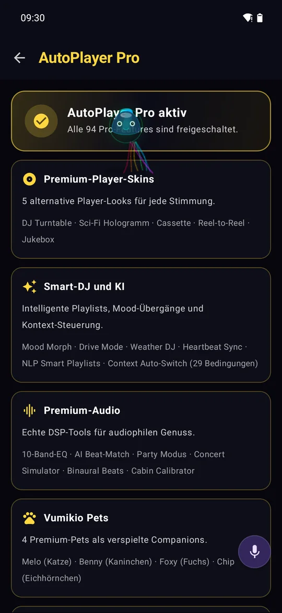
*→ Menü → AutoPlayer Pro*

AutoPlayer ist ein **Einmalkauf** – kein Abo, keine Werbung, keine laufenden Kosten. Der Kauf gilt auf allen Geräten desselben Google-Kontos, und über Google gibt es die übliche Rückgabefrist.

#### Was ohne Kauf funktioniert

Alles, was zum Musikhören gehört:

- Bibliothek mit allen zehn Reitern, Suche, Sortierung, Ordneransicht
- Player, Playlists, Warteschlangen, Favoriten
- Equalizer mit fünf Bändern, Hall, eigene Klangeinstellung je Titel
- Android Auto vollständig, mit Sprachsteuerung
- Die Sprachsteuerung für alle freien Funktionen, Vorlesen, Genre- und Stimmungsansicht
- Smart DJ mit Tempoanalyse, Auto-Playlists
- Gehörschutz, Schlaf-Timer, Batterie-Modus
- Erfolge, Musik-Rückblick, das Maskottchen **Octo**
- Sicherung, Geräte-Transfer, Beifahrer-Modus, Widget, Kurzbefehle
- Der Vintage-Plattenspieler als alternative Ansicht
- Der Vollbild-Visualizer und das Spiel **Surf the Beat**

#### Was Pro freischaltet

| Bereich | Inhalt |
|---|---|
| **Fünf Player-Ansichten** | DJ-Plattenspieler, Sci-Fi-Hologramm, Kassetten-Player, Bandmaschine, Jukebox-Player |
| **Klang** | Zehn-Band-Equalizer, Konzert-Modus, Gesangs-Isolator, binaurale Beats, Atmosphären-Mixer, Kabinen-Kalibrator, Beat-Match, Crossfade |
| **Automatik** | Kontext-Regeln mit 29 Bedingungen, Fahrmodus-DJ, Wetter-DJ, Herzschlag-Sync, Stimmungswandler, Song-Pfade, smarte Playlists, Smart Reorder, Geo-Musik, Meine Orte |
| **Werkzeuge** | Tag-Editor, Cover ändern, Track-Cutter, Tag-Retter, Klingelton, Theme-Builder, Farb-Themes |
| **Darstellung** | Wellenform-Ansicht, Musik-DNA, Nostalgie-Maschine, Musik-Erinnerungen |
| **Vier Maskottchen** | Melo, Benny, Foxy und Chip – Octo bleibt frei |
| **Loop-Mixer** | Der ganze Bereich: Zeitleiste, Pad-Modus, Synth Studio mit 823 Klangvorlagen, Sharing-Hub |
| **Weiteres** | Party-Modus, Schütteln zum Mischen, Gestensteuerung, Bass-Vibration, Schlaf-Ausblendung, Loop-Lesezeichen |

#### Woran du eine Pro-Funktion erkennst

- Im Menü steht ein **Schloss** daneben
- Im Menü am Titel sind die betreffenden Punkte gekennzeichnet
- In den Einstellungen sind die Schalter golden hinterlegt
- Ein Tippen führt nicht zur Funktion, sondern zeigt, was sie kann und was sie kostet

Im Fahrzeug geht die App einen anderen Weg: Dort verschwinden gesperrte Punkte ganz aus dem Menü, statt beim Antippen abzuweisen – beim Fahren soll niemand ins Leere greifen.

#### Wiederherstellen

Nach einer Neuinstallation oder auf einem neuen Gerät: **Wiederherstellen** auf dem Kaufbildschirm. Ein zweites Mal zahlen muss niemand.

#### Tipps

- Wer nur Musik hören will – auch im Auto, auch per Sprache – braucht Pro nicht.
- Am ehesten lohnt es sich für zwei Gruppen: Leute, die viel im Fahrzeug unterwegs sind und die Automatik nutzen wollen, und Leute, die selbst etwas bauen möchten.
- In diesem Handbuch ist jedes Kapitel gekennzeichnet. Ein Blick auf die Marke oben genügt.

### Erste Schritte (Frei)

#### Was ist das?

AutoPlayer spielt die Musikdateien ab, die auf dem Gerät liegen. Kein Streaming, keine Anmeldung, kein Konto. Musik hören, Bibliothek, Playlists und fast alles Übrige funktionieren im Flugmodus. Ins Internet geht die App nur für wenige Dinge am Rand: das Wetter (Wetter-DJ und Wetter-Bedingungen der Kontext-Regeln), die Kontext-Regel „Natur in der Nähe“, Karte und Ortssuche in **Meine Orte**, Aktualisierungen und den Kauf von Pro. Die ganze Liste steht im Kapitel **Datenschutz**.

#### So richtest du sie ein

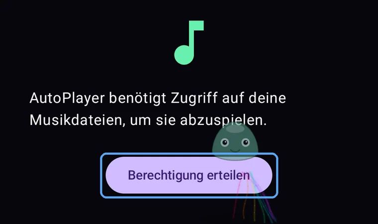
*→ beim ersten Start der App*

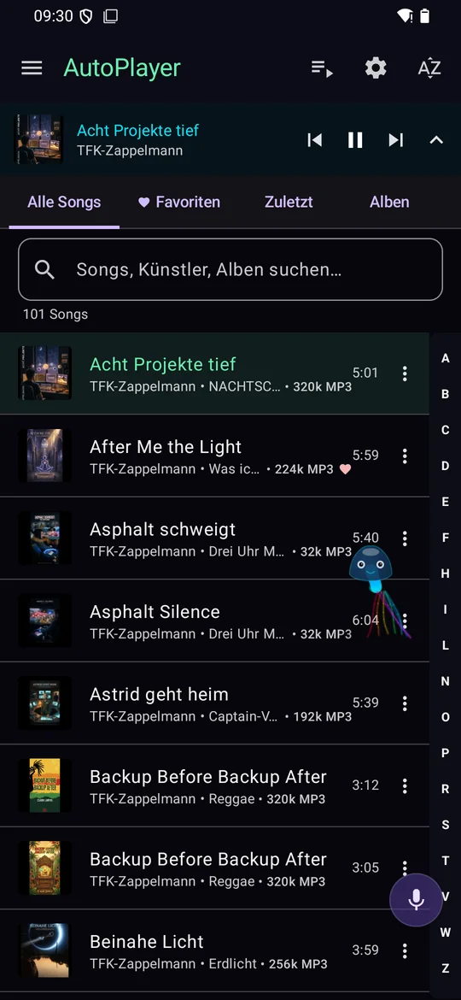

1. App starten. Sie öffnet sich direkt in der **Bibliothek** – einen Begrüßungsablauf gibt es nicht.
2. Ist der Zugriff auf die Musik noch nicht erteilt, erscheint statt der Liste ein Hinweis mit der Schaltfläche **Berechtigung erteilen**.
3. Android fragt dann nach:
  - Ab Android 13: Zugriff auf **Musik und Audio**
  - Android 10 bis 12: Zugriff auf **Dateien und Medien**
4. Nach dem Erteilen durchsucht die App den Gerätespeicher selbsttätig. Gefunden wird alles, was Android als Audiodatei führt. Solange sie sucht, steht in der Mitte **Bibliothek wird aufgebaut …** – bei viel Musik dauert das einige Sekunden.
5. Ein Tippen auf einen Titel startet die Wiedergabe. Oben, über den Reitern, erscheint die **Mini-Leiste** mit Cover, Titel, drei Tasten und einem Pfeil.
6. Der **Pfeil nach oben** rechts in der Leiste öffnet den großen Player.

Kommt neue Musik aufs Gerät, findet die App sie beim nächsten Start. Sofort geht es über **Einstellungen → Bibliothek → Musikbibliothek neu scannen**.

#### Wie du dich bewegst

*→ Bibliothek → oben links*

Die App hat **keine untere Navigationsleiste**. Alles läuft über das Menü hinter dem Symbol mit den drei Strichen oben links. Es ist in vier Bereiche geteilt:

| Bereich | Was darin steckt |
|---|---|
| **Musik-Player** | Bibliothek neu laden, Playlists, Equalizer, Schlaf-Timer, Gehörschutz, Bass-Vibration, Gestensteuerung, Batterie-Modus |
| **Tools & Funktionen** | Der größte Bereich – Smart DJ, Theme-Builder, Track-Cutter, Klingelton-Wechsler, Tag-Retter, Nostalgie-Maschine, Musik-Rückblick, Song-Pfade, Smarte Playlists, Kontext Auto-Wechsel, Meine Orte, Loop-Lesezeichen, Loop-Mixer, Sharing-Hub, Erfolge, Vumikio Pets, Beifahrer- und Party-Modus sowie sämtliche DJ-Funktionen |
| **Player-Skins** | Sieben Oberflächen für denselben Player, dazu der Vollbild-Visualizer |
| **Einstellungen & Info** | Einstellungen, Sprachbefehle, App bewerten, App teilen, Datenschutz, Über die App, App beenden |

#### Das Mikrofon

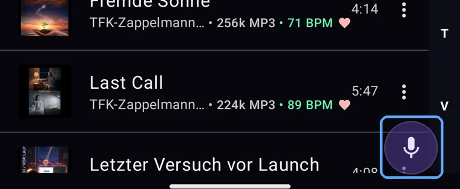
*→ auf jedem Bildschirm, ab Werk unten rechts*

Auf jedem Bildschirm schwebt eine runde Mikrofon-Schaltfläche. Sie lässt sich mit dem Finger an jede Stelle des Bildschirms ziehen und merkt sich die Position. Darüber laufen alle Sprachbefehle am Handy.

#### Was gleich mitläuft

- **Erfolge:** Ab dem ersten Titel zählt die App mit – Hördauer, Serien, Level.
- **Vumikio Pets:** Ein Tintenfisch namens Octo ist von Anfang an dabei und wächst mit jedem gehörten Stück.
- **Tempo-Erkennung:** Beim Abspielen wird das Tempo eines Titels ermittelt und gespeichert. Viele spätere Funktionen bauen darauf auf.

#### Was Geld kostet

Die App ist ein **einmaliger Kauf**, kein Abo. Ohne Kauf funktioniert alles, was zum Musikhören gehört: Bibliothek, Player, Playlists, Warteschlangen, Equalizer, Android Auto, Sprachbefehle, Sicherung. Die kostenpflichtigen Funktionen sind in diesem Handbuch mit (Pro) gekennzeichnet; ein Tippen darauf zeigt in der App, was sie können und was sie kosten. Ein eigenes Kapitel dazu steht gleich am Anfang.

#### Tipps

- Findet die App keine Musik, kann der Zugriff fehlen. Ob er erteilt ist, zeigt **Einstellungen → Berechtigungen → Musik und Audio** (unter Android 11 und 12 **Dateien und Medien**, unter Android 10 **Speicher**).
- Der Reiter **Ungehört** zeigt, was noch nie lief – oft der beste Einstieg in eine gewachsene Sammlung.
- Vor größeren Eingriffen lohnt eine Sicherung (**Einstellungen → Backup exportieren**). Sie umfasst Favoriten, Playlists, Einstellungen, Hörverlauf, Erfolge und die Pets.

### Musikbibliothek (Frei)

#### Was ist das?

Die Bibliothek ist der Startbildschirm der App und zeigt alles, was an Musik auf dem Gerät liegt. Sie ist in **zehn Reiter** geteilt, die dieselbe Sammlung unterschiedlich sortieren.

#### Die zehn Reiter

| Reiter | Was er zeigt |
|---|---|
| **Alle Songs** | Die vollständige Sammlung |
| **Favoriten** | Alles mit Herz |
| **Zuletzt** | Zuletzt gehört, neueste zuerst |
| **Meistgehört** | Nach Abspielhäufigkeit |
| **Neu** | Zuletzt aufs Gerät gekommen |
| **Ungehört** | Was noch nie lief |
| **Alben** | Nach Album gruppiert |
| **Künstler** | Nach Interpret gruppiert |
| **Ordner** | Nach Ablage auf dem Gerät |
| **Genres** | Nach Stilrichtung aus den Tags |

Die Reihenfolge dieser Reiter lässt sich ändern: **Einstellungen → Bibliothek → Tab-Reihenfolge**.

#### So bedienst du sie

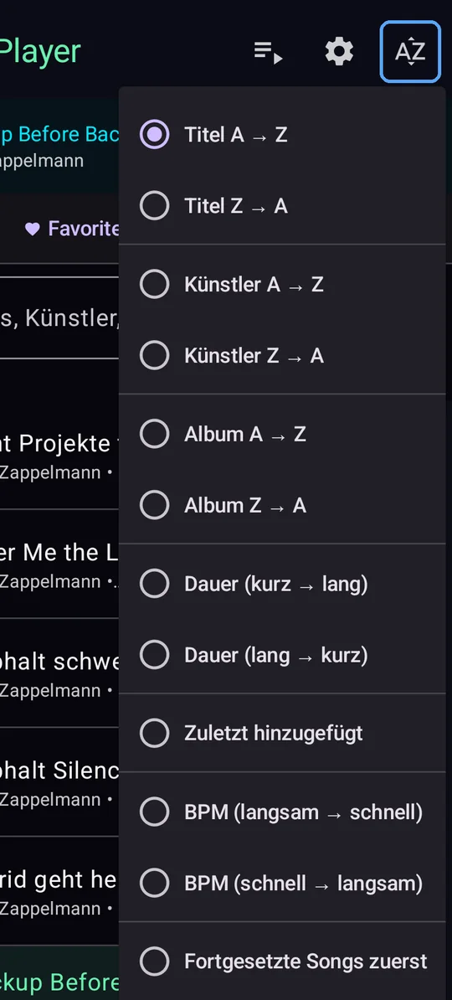
*→ Bibliothek → AZ-Symbol oben rechts*

1. **Tippen** auf einen Titel startet ihn.
2. **Langes Drücken** schaltet die Mehrfachauswahl ein. Danach lässt sich alles Weitere durch einfaches Tippen auswählen.
3. Die **drei Punkte** rechts in der Zeile öffnen das Menü für diesen einen Titel (eigenes Kapitel).
4. Das **Sortiersymbol** oben bietet zwölf Ordnungen an: Titel, Künstler, Album und Dauer jeweils vorwärts und rückwärts, dazu „Zuletzt hinzugefügt“, Tempo langsam → schnell, Tempo schnell → langsam und „Fortgesetzte Songs zuerst“.
5. Das **Suchfeld** filtert schon beim Tippen, ohne Bestätigung.
6. Die Reiter **Alben**, **Künstler** und **Ordner** haben ein eigenes Suchfeld über ihrer Liste. Darunter steht, wie viele Einträge der Suchbegriff trifft – etwa „12 von 574 Ordnern“. Ein Tippen auf das Kreuz rechts im Feld leert die Suche wieder.
  - Bei den **Alben** greift die Suche auf Albumtitel *und* Interpret. Wer den Albumnamen nicht mehr weiß, findet es also über den Künstler.
  - Bei den **Ordnern** durchsucht sie den ganzen Pfad, nicht nur den angezeigten Namen. In der Liste steht immer nur der letzte Abschnitt eines Pfades; die Eingabe „download“ findet deshalb auch einen Ordner, der dort schlicht „drums“ heißt.
7. Im Reiter **Ordner** öffnet ein Tippen den Ordner. Ein Ordner lässt sich hier auch **sperren** – seine Titel verschwinden dann aus der ganzen App. Das geht nur an dieser Stelle, nicht in den Einstellungen. Unter dem Ordnernamen steht immer sein vollständiger Pfad, auch bei gesperrten Ordnern. Das ist nötig, weil derselbe Ordnername an mehreren Stellen vorkommen kann.

#### Was nicht in der Bibliothek auftaucht

Einige Ordner blendet die App von sich aus aus, weil dort keine Musik im eigentlichen Sinn liegt:

- **Sprachnachrichten aus Messengern** – WhatsApp, Telegram, Signal, Threema, Viber und WeChat
- **Klingeltöne, Benachrichtigungstöne, Wecker und Sprachaufnahmen** des Geräts
- **Was die App selbst ablegt** – Exporte und Schnipsel aus dem Loop-Mixer, Schnitte aus dem Track-Cutter, Kopien für Klingeltöne, Aufnahmen aus dem Synth Studio und Sicherungen von Playlists

Diese Ordner stehen dabei ganz normal im Reiter **Ordner** und lassen sich dort jederzeit wieder einblenden. Die Dateien bleiben unberührt und im Loop-Mixer weiterhin als Material wählbar – sie erscheinen nur nicht als Titel in der Sammlung.

#### Die Chip-Leiste

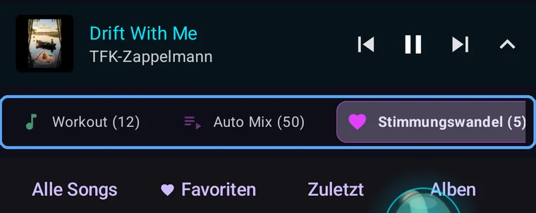
*→ Bibliothek → unter der Mini-Leiste*

Sobald eine der automatischen Funktionen eine Zusammenstellung erzeugt hat, erscheint über der Liste eine Reihe farbiger Schaltflächen – je eine pro Zusammenstellung, mit Anzahl der Titel.

- **Ein Tippen** auf einen Chip zeigt nur noch dessen Titel; der Chip erscheint dann ausgefüllt. Die Musik läuft dabei unverändert weiter.
- **Ein Tippen auf einen dieser Titel** spielt die Zusammenstellung ab diesem Titel.
- **Ein zweites Tippen** auf den Chip blendet die Zusammenstellung wieder aus, die Bibliothek zeigt wieder alles. Auch das unterbricht die Musik nicht.
- Die Zusammenstellung, die gerade **läuft**, erkennt man an fetter Schrift, farbigem Rahmen und kräftigem Symbol.

Die Farben stehen für die Herkunft:

- Violett – Stimmungen und Stimmungswandler, Lila – Auto-Playlists
- Blau – Wetter-DJ, Grün – Smart DJ
- Orange – Fahrmodus-DJ, Rot – Herzschlag-Sync
- Türkis – von Hand angelegte Playlists
- Mintgrün – alles Übrige: Genres, smarte Playlists, Song-Pfade

Das Suchfeld filtert dabei innerhalb der gewählten Zusammenstellung weiter.

Ist im [Herzschlag-Sync](index.html#herzschlag) eine Uhr oder ein Brustgurt verbunden, ist das Herz im Chip **Herzschlag-Sync** gefüllt und schlägt im Takt deines Pulses; der Chip behält dabei seine Größe. Ohne Live-Puls ist es ein ruhiger Umriss.

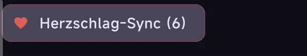
*Der Chip einer Herzschlag-Session mit Live-Puls: Das Herz ist gefüllt und schlägt.*
*→ Bibliothek, Chip-Leiste*

#### Die Mini-Leiste

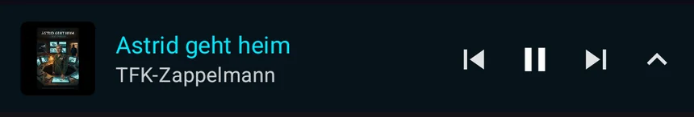
*→ Bibliothek → über den Reitern*

Läuft Musik, sitzt oben – unter der Titelzeile, über den Reitern – eine schmale Leiste mit Cover, Titel, Künstler und drei Tasten (zurück, Wiedergabe/Pause, weiter). Ein Tippen darauf öffnet den großen Player.

#### Einstellungen

Unter **Einstellungen → Bibliothek**:

- **Song-Details anzeigen** – blendet Bitrate, Format und Dateigröße in jeder Zeile ein
- **Standard-Sortierung** – womit die Liste beim Öffnen beginnt (Titel, Künstler, Album oder Dauer). Innerhalb einer Sitzung lässt sich frei umsortieren; dies ist nur der Startwert.
- **Musikbibliothek neu scannen**
- **Alle versteckten Songs einblenden**
- **Alle Song-Positionen zurücksetzen**
- **Tab-Reihenfolge**

#### Sprachbefehle

- „Spiel *[Titel]*“ – sucht und spielt. Ungenaue Aussprache wird abgefangen. (Android Auto)
- „Spiel Künstler *[Name]*“ – alles von diesem Interpreten, gemischt. (Android Auto)
- „Spiel Album *[Name]*“ – in Titelreihenfolge. (Android Auto)

#### Zusammenspiel

- **Tempo-Anzeige:** Bereits untersuchte Titel zeigen ihr Tempo als kleine Marke in der Zeile.
- **Versteckte Titel** verschwinden aus allen Ansichten, die Datei bleibt liegen.
- **Gesperrte Ordner** wirken ebenfalls app-weit – auch in Android Auto und bei den automatischen Zusammenstellungen.
- Alle Funktionen, die selbst Musik auswählen, greifen auf denselben Bestand zu.

#### Tipps

- **Ungehört** ist der ergiebigste Reiter in einer gewachsenen Sammlung.
- Nach Tempo sortiert findet man Passendes zum Laufen oder zum Einschlafen, ohne nachzudenken.
- Wer Hörbücher oder Mitschnitte in der Sammlung hat: **Fortgesetzte Songs zuerst** holt alles Angefangene nach oben.
- Stört ein Ordner mit Klingeltönen oder Sprachmemos, sperrt man ihn einmal im Ordner-Reiter – und er ist überall weg.

### Der Player (Frei) (Android Auto)

#### Was ist das?

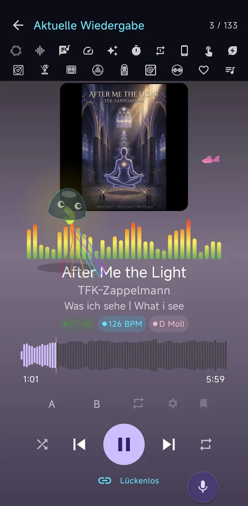
*Der Player bei laufender Musik: oben die beiden Symbolreihen, darunter das Cover, der Visualizer, Titel und Album, die drei Angaben zu Lautstärke, Tempo und Tonart, die Wellenform mit der Abspielmarke und ganz unten die Steuerung.*

Der Player ist der Bildschirm, auf dem der laufende Titel groß zu sehen ist. Von hier aus führen Wege zu fast allen Funktionen, die mit dem Klang oder der Ansicht zu tun haben. Erreichbar über den Pfeil nach oben rechts in der Mini-Leiste der Bibliothek. Der Menüpunkt **Player-Skins → Player-Steuerung** führt dagegen zur Wellenform-Ansicht (eigenes Kapitel).

#### Der Aufbau von oben nach unten

1. **Kopfzeile** – Zurück-Pfeil, „Aktuelle Wiedergabe“ und die Position in der Warteschlange.
2. **Zwei Symbolreihen** – siehe unten.
3. **Das Cover** – groß, mit Wischgesten belegt.
4. **Vier kleine Anzeigen** – Lautstärke in Dezibel, Tempo, Tonart, Batteriesparmodus. Dezibel und Tempo lassen sich in den Einstellungen abschalten, die Tonart erscheint immer, sobald sie bekannt ist.
5. **Titel, Künstler, Album**
6. **Der Fortschrittsbalken** mit verstrichener und verbleibender Zeit. Statt des Balkens kann auch die **Wellenform** stehen – umschaltbar in den Einstellungen. Spielst du einen Titel zum ersten Mal, steht dort zunächst eine flache Balkenreihe: Spulen kannst du schon, die Wellenform folgt nach ein paar Sekunden. Der Regler zwischen den beiden Zeitangaben vergrößert die Wellenform – mehr dazu bei der A–B-Wiederholung.
7. **Die Hauptsteuerung** – Zufall, zurück, Wiedergabe/Pause, weiter, Wiederholen. Aktive Schalter sind farblich hervorgehoben. Daneben sitzt der Schalter **Lückenlos**.

#### Erste Symbolreihe – Werkzeuge und Klang

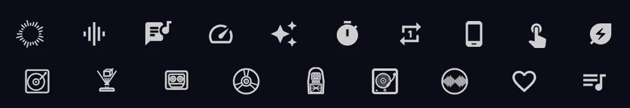

| Symbol | Was passiert |  |
|---|---|---|
| Vollbild-Visualizer | Öffnet die bildschirmfüllende Darstellung – und das Spiel [Surf the Beat](index.html#surf-the-beat), wenn es eingeschaltet ist | (Frei) |
| Equalizer | Klangregelung. Der Fünf-Band-Teil ist frei, der Zehn-Band-Teil gehört zu Pro. | (teilweise) |
| Liedtext | Zeigt den Text, sofern in der Datei hinterlegt. Fehlt er, erscheint ein Hinweis. | (Frei) |
| Tempo & Tonhöhe | Zwei Regler: Geschwindigkeit 0,5- bis 2-fach, Tonhöhe getrennt davon. Eine Schaltfläche setzt beides zurück. | (Frei) |
| Smart DJ | Tempobasierte Zusammenstellung | (Frei) |
| Schlaf-Timer | Stoppt die Musik nach einer Wählzeit | (Frei) |
| A–B-Wiederholung | Wiederholt einen selbst gesetzten Abschnitt. Das Setzen ist frei; das *Speichern* als Lesezeichen gehört zu Pro. | (teilweise) |
| Bass-Vibration | Schnellschalter. Die Einstellungen dazu gehören zu Pro. | (Pro) |
| Gestensteuerung | Schnellschalter. Die Einstellungen dazu gehören zu Pro. | (Pro) |
| Batteriesparmodus | Schnellschalter für den Batteriesparmodus | (Frei) |

#### Zweite Symbolreihe – Ansichten und Sammlung

| Symbol | Was passiert |  |
|---|---|---|
| DJ-Plattenspieler | Wechselt zu einer anderen Oberfläche für denselben Player. Die Musik läuft dabei weiter. | (Pro) |
| Sci-Fi-Hologramm | (Pro) |  |
| Kassetten-Player | (Pro) |  |
| Bandmaschine | (Pro) |  |
| Jukebox-Player | (Pro) |  |
| Vintage-Plattenspieler | (Frei) |  |
| Wellenform | Vollbild-Wellenform mit Lesezeichen | (Pro) |
| Herz | Setzt den laufenden Titel auf die Favoriten oder nimmt ihn herunter | (Frei) |
| Warteschlange | Öffnet die Liste des Kommenden | (Frei) |

#### Gesten auf dem Cover

- **Nach links wischen** – nächster Titel
- **Nach rechts wischen** – vorheriger Titel

Weitere Gesten – Schütteln, Neigen, Handbewegungen über dem Bildschirm – kommen aus der Gestensteuerung und sind dort beschrieben.

#### Einstellungen

- **Wiedergabe → Wellenform-Anzeige** – Wellenform statt Fortschrittsbalken
- **Wiedergabe → dB-Anzeige im Player**, **BPM-Anzeige im Player**, **Tonart-Anzeige im Player**
- **Wiedergabe → Lückenlose Wiedergabe** – ohne Pause zum nächsten Stück
- **Wiedergabe → Crossfade** – weiches Überblenden (Pro)
- **Darstellung → Textgröße** und **Symbolgröße** wirken auch hier

#### Sprachbefehle

- „Abspielen“, „Pause“, „Nächster“, „Vorheriger“ (Android Auto)
- „Zufall an“ / „Zufall aus“ (Android Auto)
- „Wiederholen alle“ / „Wiederholen eins“ / „Wiederholen aus“ (Android Auto)
- „Lauter“, „Leiser“, „Stumm“, „Lautstärke auf 30 Prozent“ – nur am Handy. Im Fahrzeug regelt das Fahrzeug die Lautstärke selbst, kein Sprachbefehl ändert sie.
- „Was spielt?“ – im Fahrzeug wird die Antwort vorgelesen (Android Auto)
- „Schneller“, „Langsamer“, „Geschwindigkeit 1.5“, „30 Sekunden vor“, „30 Sekunden zurück“ – nur am Handy

#### Tipps

- Tempo und Tonhöhe sind getrennt einstellbar: Hörbücher lassen sich beschleunigen, ohne dass die Stimme piepsig wird.
- Die Dezibel-Anzeige ist antippbar und führt direkt zum Gehörschutz.
- Lückenlos und Crossfade schließen einander aus – das eine setzt die Stücke nahtlos aneinander, das andere blendet sie ineinander.
- Die Ansicht lässt sich mitten im Titel wechseln, ohne dass die Musik stockt.
- Im Fahrzeug sieht die Wiedergabe anders aus: Dort stellt Android Auto seine eigene Oberfläche, gespeist aus deiner Sammlung. Was sich dort bedienen lässt, steht im Kapitel zu Android Auto.

### Das Menü am Titel (teilweise frei)

#### Was ist das?

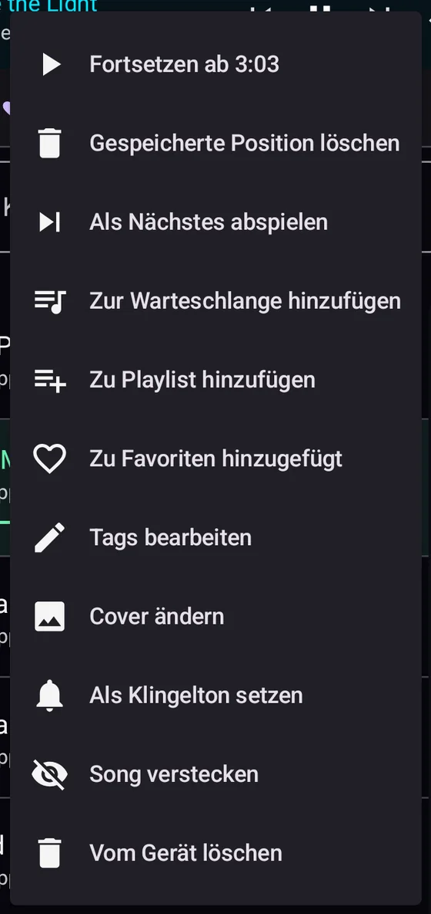
*→ Drei Punkte rechts an jeder Titelzeile*

Rechts an jeder Titelzeile stehen drei Punkte. Ein Tippen darauf klappt ein Menü mit allem auf, was sich mit diesem einen Titel anstellen lässt. Es erscheint in der Bibliothek, in der Warteschlange und in Playlists.

#### Die Einträge

| Eintrag | Wirkung |  |
|---|---|---|
| **Fortsetzen ab *[Zeit]*** | Erscheint nur, wenn für diesen Titel eine Position gemerkt wurde. Springt genau dorthin. | (Frei) |
| **Gespeicherte Position löschen** | Erscheint unter denselben Bedingungen. Verwirft die gemerkte Stelle. | (Frei) |
| **Als Nächstes abspielen** | Setzt den Titel direkt hinter den laufenden. | (Frei) |
| **Zur Warteschlange hinzufügen** | Hängt ihn ans Ende an. | (Frei) |
| **Zu Playlist hinzufügen** | Öffnet die Auswahl. Eine neue Playlist lässt sich dabei anlegen. Ist der Titel schon drin, wird das gemeldet. | (Frei) |
| **Favorit** | Setzt das Herz oder nimmt es weg. Text und Symbol wechseln je nach Zustand. | (Frei) |
| **Tags bearbeiten** | Öffnet den Tag-Editor für diesen Titel. | (Pro) |
| **Cover ändern** | Öffnet die Bildauswahl des Geräts. | (Pro) |
| **Als Klingelton setzen** | Zur Auswahl stehen Klingelton, Benachrichtigung und Wecker. | (Pro) |
| **Song verstecken** | Nimmt den Titel aus allen Ansichten. Die Datei bleibt unangetastet. | (Pro) |
| **Vom Gerät löschen** | Löscht die Datei endgültig. | (Frei) |

Bei den vier Pro-Einträgen steht ein Schlosssymbol. Ein Tippen darauf führt nicht zur Funktion, sondern zeigt, was Pro kostet.

#### Mehrere Titel auf einmal

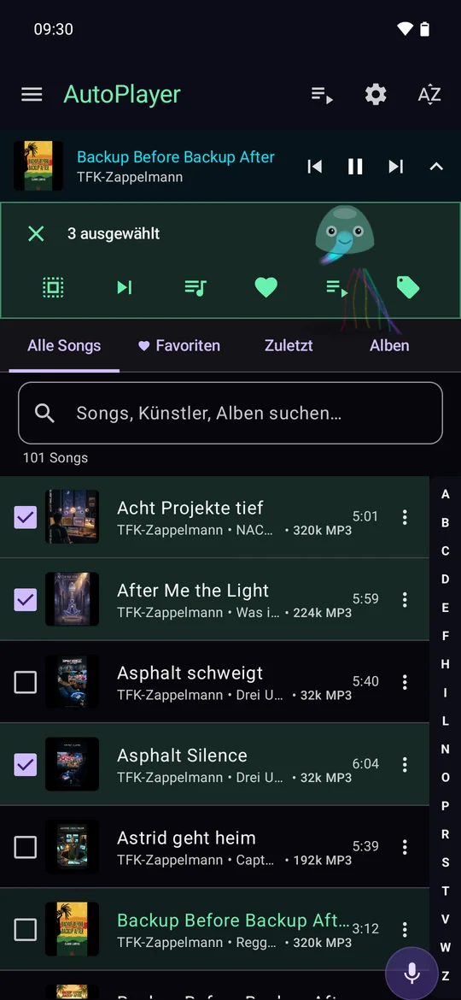
*→ Bibliothek → lange auf einen Titel drücken*

Langes Drücken auf eine Zeile schaltet die Mehrfachauswahl ein. Danach reicht Antippen, um weitere hinzuzunehmen. Oben erscheinen die Anzahl und die Schaltfläche **Alle auswählen**. Für die getroffene Auswahl steht unter anderem das Setzen eines Genres in einem Rutsch bereit.

#### Sprachbefehle

Für dieses Menü gibt es **keine**. Der einzige Sprachbefehl, der auf die Warteschlange wirkt, ist der **Abstecher** – und auch der meint einen Titel, nicht einen Eintrag in dieser Liste.

#### Zusammenspiel

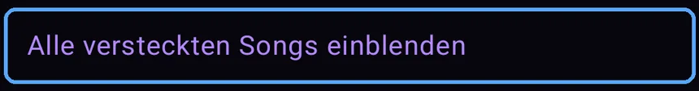
*→ Einstellungen → Bibliothek*

- **Versteckte Titel** holt man über **Einstellungen → Bibliothek → Alle versteckten Songs einblenden** wieder hervor – einzeln geht das nicht.
- **Gemerkte Positionen** stammen aus der Einstellung **Wiedergabeposition merken**. Alle auf einmal löschen geht über **Einstellungen → Bibliothek**.
- **Geänderte Cover** gelten in der ganzen App, auch in Android Auto.

#### Tipps

- **Als Nächstes abspielen** ist der schnellste Weg, etwas dazwischenzuschieben, ohne die Reihenfolge durcheinanderzubringen.
- **Verstecken** lässt sich rückgängig machen, **Löschen** nicht. Im Zweifel verstecken.
- Ein Titel muss nicht laufen, damit sich seine Tags bearbeiten lassen.

### Playlists (Frei) (Android Auto)

#### Was ist das?

Playlists sind Zusammenstellungen, die von Hand angelegt werden und dauerhaft bleiben – im Gegensatz zu dem, was die automatischen Funktionen erzeugen. Ihre Zahl ist nicht begrenzt. Zu erreichen sind sie über **Menü → Musik-Player → Playlists**.

#### Die Übersicht

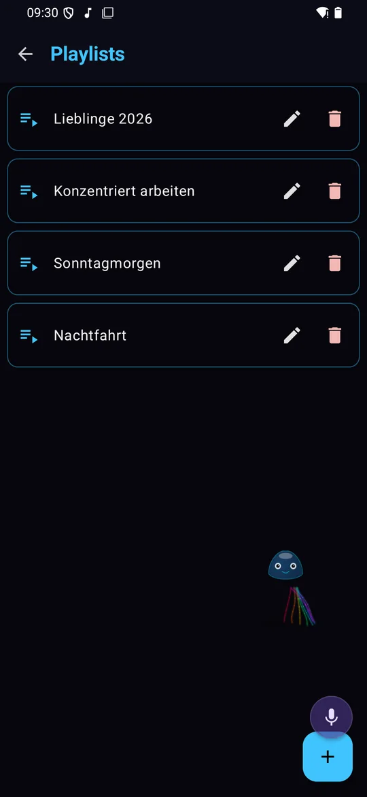
*→ Menü → Playlists*

Jede Playlist steht als Zeile mit Namen und Titelzahl. Rechts daneben zwei Symbole:

- **Stift** – umbenennen
- **Mülleimer** – löschen, nach Rückfrage

Die Schaltfläche **+** unten rechts legt eine neue an. Ein Tippen auf die Zeile öffnet sie.

#### In einer Playlist

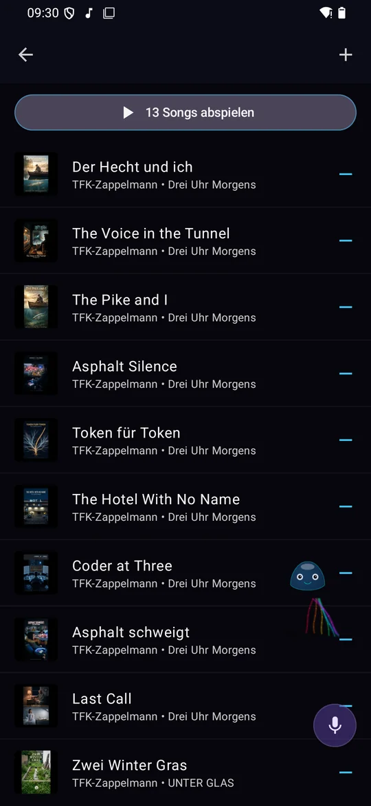

- Oben eine Leiste **„*[Anzahl]* Songs abspielen“** – startet von vorn.
- Ein **Suchfeld** filtert innerhalb der Playlist.
- Ein Tippen auf einen Titel startet ab dieser Stelle.
- Das **Minus** rechts nimmt einen Titel heraus. Die Datei bleibt.
- Das **+** oben führt zur Titelauswahl.

Die Reihenfolge ergibt sich daraus, wann etwas hinzugefügt wurde. **Umsortieren ist nicht vorgesehen.**

#### Titel hineinbekommen

1. Über die drei Punkte an einer Titelzeile → **Zu Playlist hinzufügen**. Im Auswahldialog lässt sich auch gleich eine neue Playlist anlegen.
2. Über die Mehrfachauswahl in der Bibliothek – für viele auf einmal.
3. Über das **+** in der geöffneten Playlist.

Ist ein Titel schon enthalten, meldet die App das und legt ihn nicht doppelt ab.

#### Sprachbefehle

- „Spiele Playlist *[Name]*“ – lädt sie und startet den ersten Titel. Der Name muss nicht genau getroffen werden. (Android Auto)
- „Zeige meine Playlists“ – öffnet die Übersicht, ohne etwas abzuspielen. (Android Auto)

Beides funktioniert auch über die Sprechtaste am Lenkrad, sofern AutoPlayer als Standard-Musik-App eingetragen ist.

#### Zusammenspiel

- **Sicherung:** Playlists sind im Backup enthalten und wandern beim Geräte-Umzug mit.
- **Android Auto:** Playlists erscheinen im Fahrzeug-Menü.
- **Kontext-Regeln:** Eine Playlist lässt sich einer Regel zuweisen – etwa „morgens im Auto“.
- **Geo-Musik:** Eine Playlist lässt sich an einen Ort binden.
- **Smarte Playlists** sind etwas anderes: Sie entstehen aus einer Beschreibung und werden als eigene Art geführt.

#### Tipps

- Da nicht umsortiert werden kann, lohnt es sich, die Titel gleich in der gewünschten Reihenfolge hinzuzufügen.
- Kurze, klare Namen erleichtern das Ansprechen per Sprache. „Werkstatt“ wird sicherer erkannt als „Mix für samstags in der Werkstatt“.
- Wer den Namen einer Playlist nicht mehr weiß, sagt „Zeige meine Playlists“ – die Übersicht öffnet sich, ohne dass etwas zu spielen beginnt.

### Favoriten (Frei) (Android Auto)

#### Was ist das?

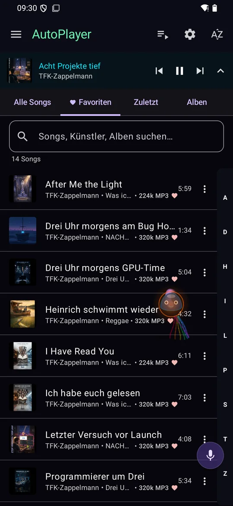
*→ Bibliothek → Reiter Favoriten*

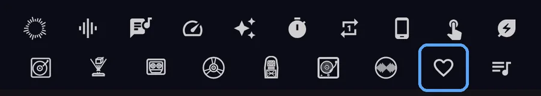
*→ Player → zweite Symbolreihe, Herz*

Ein Herz an jedem Titel, und der eigene Reiter **Favoriten** in der Bibliothek sammelt alles Markierte. Ohne Aufwand, ohne Pflege.

#### So setzt du das Herz

- Im **Player** – das Herz in der zweiten Symbolreihe
- In der **Bibliotheksliste** – das Herz in der Zeile
- Im **Menü am Titel** – der Eintrag wechselt je nach Zustand
- Über die **Mehrfachauswahl** – für viele auf einmal

Ein zweites Tippen nimmt es wieder weg. Eine Sicherheitsabfrage gibt es nicht.

#### Der Startbildschirm-Kurzbefehl

Ein langes Drücken auf das App-Symbol öffnet ein Menü mit drei Abkürzungen:

- **Favoriten öffnen** – springt direkt in den Reiter, ohne etwas abzuspielen
- **Fortsetzen** – spielt weiter, wo zuletzt aufgehört wurde
- **Zufallsmix** – öffnet den Player, schaltet den Zufall ein und beginnt bei einem zufällig gewählten Titel aus der ganzen Sammlung. Ausführlich im Kapitel **Kurzbefehle am App-Symbol**.

#### Sprachbefehl

- „Zeige Favoriten“ – wechselt in den Reiter.

Weitere Favoriten-Befehle gibt es nicht. Wer die Favoriten gemischt hören will, öffnet den Reiter und tippt auf Zufall.

#### Zusammenspiel

- **Android Auto:** Favoriten sind im Fahrzeug-Menü ein eigener Punkt.
- **Sicherung:** Alle Markierungen sind im Backup und beim Geräte-Umzug dabei.
- **Erfolge:** Das Sammeln von Favoriten zählt für mehrere Auszeichnungen.
- **Kontext-Regeln** und die automatischen Zusammenstellungen können Favoriten besonders gewichten.

#### Tipps

- Großzügig markieren – das Entfernen ist ein einziger Tipp.
- Im Fahrzeug sind die Favoriten der schnellste Weg zu sicherer Musik: ein Tippen im Menü, ohne durch die ganze Sammlung zu blättern.
- Wer den Reiter oft braucht, zieht ihn über **Einstellungen → Bibliothek → Tab-Reihenfolge** nach vorn.

### Einstellungen (Frei)

#### Was ist das?

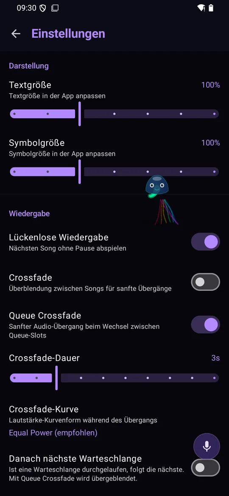
*→ Menü → Einstellungen*

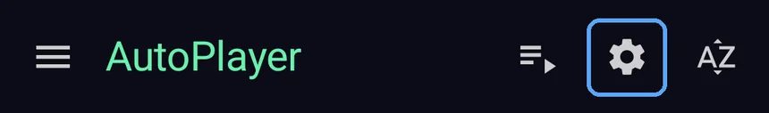
*→ Bibliothek → Zahnrad oben*

Die zentrale Schaltstelle. Zu erreichen über das Zahnrad oben in der Bibliothek oder über **Menü → Einstellungen & Info → Einstellungen**. Jede Änderung greift sofort; einen Speichern-Knopf gibt es nicht.

#### Die elf Abschnitte

**1. Darstellung**

- **Textgröße** – stufenlos von 80 % bis 140 %
- **Symbolgröße** – derselbe Bereich

Beides wirkt in der ganzen App, auch auf dem Fahrzeugbildschirm. Ein Farbdesign lässt sich hier nicht wählen – das macht der Theme-Builder.

**2. Wiedergabe** – der größte Abschnitt

| Einstellung | Bedeutung |  |
|---|---|---|
| Lückenlose Wiedergabe | Nächster Titel ohne Pause | (Frei) |
| Crossfade + Dauer | Überblenden, 1 bis 10 Sekunden | (Pro) |
| Queue Crossfade + Dauer + Kurve | Übergang beim Wechsel der Warteschlange. Vier Kurven: Linear, Logarithmisch, S-Kurve, Equal Power (empfohlen) | (Pro) |
| Letzten Song merken | Weiterhören, wo aufgehört wurde | (Frei) |
| Wiedergabeposition merken | Position je Titel speichern; wahlweise nur für Stücke über 10 Minuten | (Frei) |
| Pause bei Kopfhörer-Entfernung | Stoppt beim Abziehen | (Frei) |
| ReplayGain | Gleicht Lautstärkeunterschiede anhand der Metadaten aus | (Frei) |
| Bluetooth Auto-Resume | Startet die Wiedergabe, sobald sich ein Bluetooth-Lautsprecher oder das Auto verbindet. Ab Android 12 fragt der Schalter beim Einschalten nach der Bluetooth-Berechtigung | (Frei) |
| Schütteln zum Mischen | Schütteln springt weiter | (Pro) |
| Beat-Match DJ | Tempogleiche Übergänge | (Pro) |
| Wetter-DJ, Konzert-Modus, Musik-DNA, Herzschlag-Sync, Atmosphären-Mixer, Schlaf-Ausblendung, Binaurale Beats, Kabinen-Kalibrator | Hauptschalter dieser Funktionen | (Pro) |
| Wellenform-Anzeige | Wellenform statt Fortschrittsbalken | (Pro) |
| Kontext Auto-Wechsel | Wechselt Playlists nach Uhrzeit, Bluetooth-Gerät, Geschwindigkeit, Bewegung | (Pro) |
| Gehörschutz + dB-Anzeige | Überwacht die Lautstärke | (Frei) |
| BPM-Anzeige, Tonart-Anzeige | Marken im Player | (Frei) |
| Bass-Vibration, Gestensteuerung | Hauptschalter | (Pro) |
| Batteriesparmodus | Stromhungrige Funktionen ruhen – Einzelheiten im Batterie-Modus | (Frei) |
| Crash Reports | Fragt nach einem Absturz, ob ein Bericht gesendet werden soll | (Frei) |
| OpenStreetMap-Abfragen | Standardmäßig **aus**. Nur für die Regel „Natur in der Nähe“; sendet auf etwa 110 m gerundete Koordinaten. | (Frei) |

**3. Bibliothek**

- Song-Details anzeigen · Standard-Sortierung · Musikbibliothek neu scannen
- Alle versteckten Songs einblenden · Alle Song-Positionen zurücksetzen · Tab-Reihenfolge

**4. Android Auto**

- **Autoplay bei Verbindung**
- **Als Standard-Musik-App festlegen** – nötig, damit die Sprechtaste am Lenkrad und „Hey Google, spiele Musik“ bei AutoPlayer landen. Eine Schaltfläche führt zur passenden Android-Einstellung.
- **Sprechtaste im Auto funktioniert nicht?** – öffnet eine Hilfe.

**Geschwindigkeitsbasierte Lautstärke**

- Eigener Abschnitt mit Schalter, Regler für das Zieltempo und dem gezeichneten Verlauf. Wirkt über Bluetooth-Lautsprecher und Kopfhörer – nicht am Fahrzeugbildschirm, dort regelt das Fahrzeug selbst.

**5. Berechtigungen**

Sieben Zeilen mit ihrem jeweiligen Zustand – Mikrofon, Standort, Bluetooth, Bewegungserkennung, Kamera, Benachrichtigungen, Musik und Audio – jeweils mit der Angabe, wofür sie gebraucht werden. Ein Tipp auf eine Zeile erteilt die Berechtigung oder nimmt sie zurück. Dazu ein Hinweis zum grünen Punkt in der Statusleiste. Mehr unter [Berechtigungen](index.html#berechtigungen).

**6. Sprache**

26 Sprachen zur Auswahl, dazu **Systemstandard**. Die Liste steht jeweils in der eigenen Schrift, damit sie auch findet, wer die aktuelle Sprache nicht lesen kann.

**7. Backup & Wiederherstellung** – Sichern und Zurückholen von Hand.

**8. Automatisches Backup** – sichert beim Schließen der App, sobald ein Ordner gewählt wurde. Ohne Ordner bleibt es aus.

**9. Geräte-Transfer** – alle Daten an ein anderes Gerät übergeben.

**10. Gefahrenzone** – Werkseinstellungen. Zwei Rückfragen, dann ist alles weg.

**11. Über** – hier steht nur die Versionsnummer. Handbuch, Änderungsprotokoll, Datenschutz und Nutzungsbedingungen liegen **nicht** hier, sondern im Hauptmenü unter **Über die App**.

#### Sprachbefehle

„Öffne Einstellungen“ funktioniert. Einzelne Schalter lassen sich **nicht** per Sprache umlegen – mit Ausnahme derer, die einen eigenen Befehl haben (etwa „Vibration an“ oder „Gesten aus“).

#### Tipps

- Wer im Fahrzeug schlecht liest: Textgröße auf 120 oder 130 %.
- Der Berechtigungsabschnitt zeigt jeden Zustand auf einen Blick und erteilt oder nimmt zurück. Der Umweg über die Android-Einstellungen ist nur nötig, wenn Android selbst nicht mehr fragt – und zum Zurücknehmen unter Android 10 bis 12.
- Das automatische Backup ist die beste Vorsorge. Einmal einen Ordner wählen, danach läuft es von selbst.
- Der Batteriesparmodus schont den Akku, lässt dafür aber Equalizer, Klangeffekte und andere stromhungrige Funktionen ruhen. Du erkennst ihn am grünen Blatt-Symbol im Player, das dann hervorgehoben ist. Deine Einstellungen bleiben erhalten und kommen beim Zurückschalten unverändert wieder.

### Song-Details in der Liste (Frei)

#### Was ist das?

Ein Schalter, der unter jeder Titelzeile eine dritte Zeile mit technischen Angaben einblendet.

#### Was dort steht

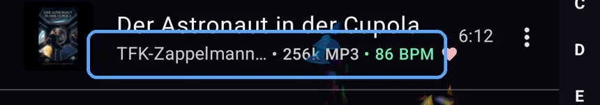

Bitrate · Format · Tempo · Dateigröße – durch Punkte getrennt. Was nicht bekannt ist, wird übersprungen; die Zeile rückt zusammen. Beispiel: `320 kbps • MP3 • 128 BPM • 8,4 MB`

#### Einschalten

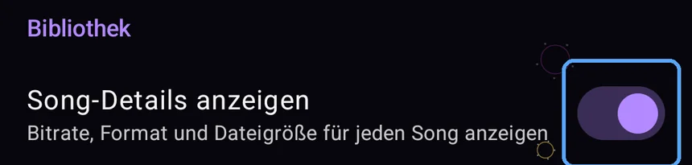
*→ Einstellungen → Bibliothek → Song-Details anzeigen*

**Einstellungen → Bibliothek → Song-Details anzeigen**. Die Zeile erscheint danach in allen Listen – Bibliothek, Playlists, Warteschlange.

#### Zusammenspiel

- Das **Tempo** stammt aus der Analyse, die beim Abspielen mitläuft. Bei noch nie gehörten Titeln fehlt der Wert.
- Enthält die Datei bereits eine Tempo-Angabe im Tag, wird sie übernommen.
- Der **Fortsetzen-Balken** ist etwas anderes: ein dünner Streifen unter der Zeile, der zeigt, wie weit ein Titel schon gelaufen ist.

#### Tipps

- Schnell erkennen, was in schlechter Qualität vorliegt: Bitraten von 128 kbps und darunter fallen sofort auf.
- Nach Tempo sortiert und mit eingeblendeten Details lässt sich eine Sammlung gut durchsehen, ohne jeden Titel anzuhören.
- Auf schmalen Bildschirmen wird die Zeile abgeschnitten. Im Fahrzeug spielt das keine Rolle: Android Auto zeigt nur Titel und Interpret, die Detailzeile erscheint dort gar nicht.

### Genre durchsuchen (Frei) (Android Auto)

#### Was ist das?

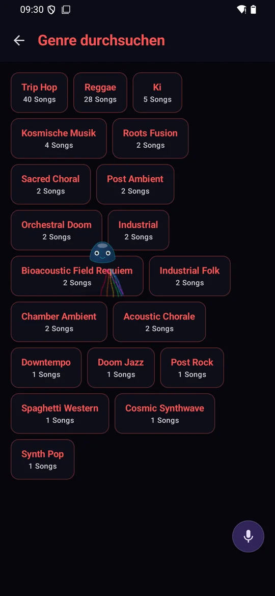
*→ Menü → Genre durchsuchen*

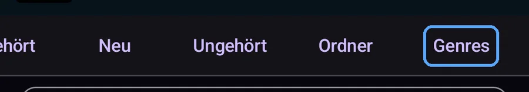
*→ Bibliothek → Reiterzeile nach links wischen*

Ein eigener Bildschirm, der die Sammlung nach Stilrichtungen ordnet – aus den Genre-Angaben in den Dateien. Zu erreichen über **Menü → Tools & Funktionen → Genre durchsuchen**. Denselben Zugriff gibt es als Reiter **Genres** in der Bibliothek.

#### So bedienst du ihn

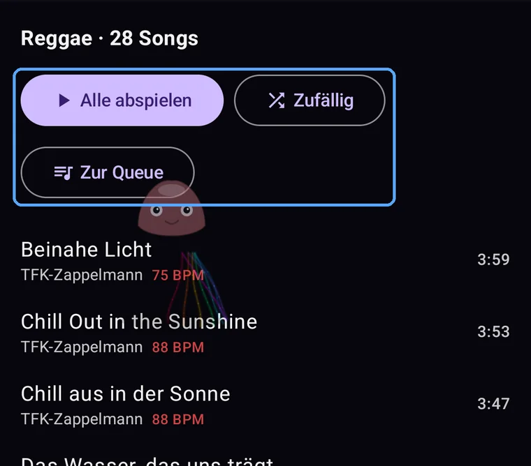
*→ Genre durchsuchen → Reggae*

1. Oben stehen alle vorhandenen Genres als Schaltflächen, jeweils mit der Zahl der Titel.
2. Ein Tippen öffnet das Genre als eigene Ansicht – oben der Name und die Anzahl, darunter die Titel. Zurück geht es über den Pfeil oben links. Es wird nichts „ausgewählt“, was man wieder abwählen müsste.
3. Über der Titelliste stehen drei Schaltflächen: Auf schmalen Geräten rutscht die dritte in die nächste Zeile.
  - **Alle abspielen** – in Listenreihenfolge
  - **Zufällig** – gemischt
  - **Zur Queue** – hängt das ganze Genre ans Ende der Warteschlange, ohne das Laufende zu unterbrechen
4. Ein Tippen auf einen einzelnen Titel startet ihn sofort.

Findet die App keine Genres, erscheint der Hinweis, die Tags zu ergänzen.

#### Sprachbefehle

- „Spiel Genre *[Name]*“ – auch „Musikrichtung“ wird verstanden. (Android Auto)
- Bei geläufigen Stilrichtungen genügt der Name allein: „Spiel Reggae“. (Android Auto)

#### Zusammenspiel

- **Tag-Editor:** Wo ein Genre fehlt oder falsch ist, wird es dort gesetzt (Pro).
- **Mehrfachauswahl in der Bibliothek:** Vielen Titeln auf einmal ein Genre geben – der schnellste Weg, eine ungetaggte Sammlung zu ordnen.
- **Android Auto:** Genres sind im Fahrzeug-Menü eine eigene Kategorie.
- **Party-Modus:** Gäste können im Browser nach Genre filtern.

#### Tipps

- Groß- und Kleinschreibung fasst die App selbst zusammen: „Rock“ und „rock“ landen in einem Eintrag, angezeigt wird die häufigste Schreibweise. Getrennt bleiben dagegen Varianten wie „Rock/Pop“ – da hilft nur das Vereinheitlichen der Tags.
- Titel aus gesperrten Ordnern tauchen hier nicht auf – die Sperre wirkt auch auf die Genre-Zählung.
- Der Weg über die Mehrfachauswahl lohnt sich: Titel markieren, Genre setzen, fertig.
- Fehlt eine Stilrichtung ganz, haben die Dateien schlicht keinen Genre-Eintrag.

### App-Aktualisierungen (Frei)

#### Was ist das?

Die App fragt beim Start beim Play Store nach, ob eine neuere Fassung vorliegt, und meldet sich selbständig.

#### Wie das abläuft

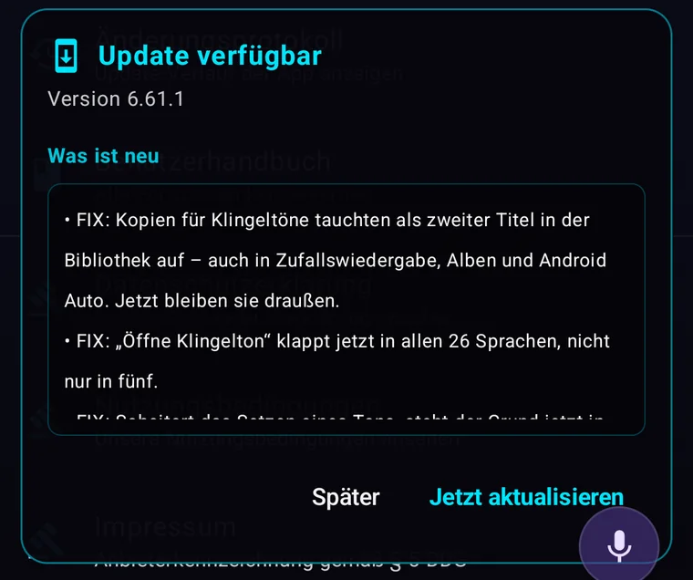
*→ erscheint von selbst beim Start der App*

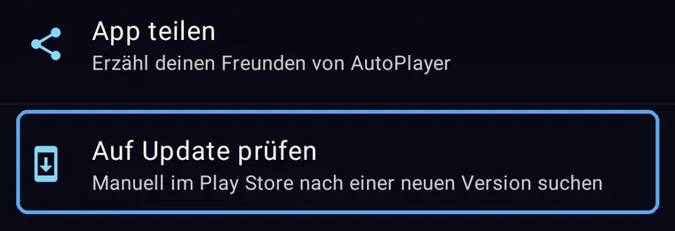
*→ Menü → Einstellungen & Info → Über die App*

1. Liegt etwas Neues vor, erscheint eine Karte mit den Änderungen.
2. **Jetzt aktualisieren** lädt im Hintergrund; die Musik läuft weiter. Nach dem Laden folgt die Aufforderung zum Neustart.
3. **Später** schiebt es auf. Beim nächsten Start fragt die App erneut.
4. Bei besonders wichtigen Aktualisierungen entfällt das Aufschieben. Der Play Store übernimmt dann und die App startet erst danach wieder.

Von Hand prüfen: **Menü → Einstellungen & Info → Über die App → Auf Update prüfen**.

#### Das Änderungsprotokoll

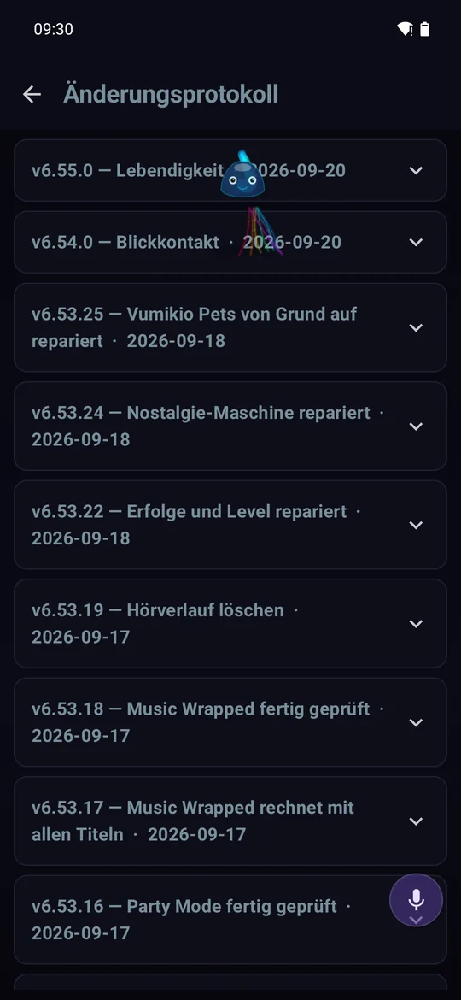
*→ Menü → Über die App → Änderungsprotokoll*

Unter **Über die App → Änderungsprotokoll** steht die vollständige Geschichte, neueste Fassung oben. Jeder Eintrag hat Versionsnummer, Datum und die Änderungen – erst auf Deutsch, dann durch eine Linie getrennt auf Englisch.

#### Sprachbefehl

- „Lies das Änderungsprotokoll vor“ – die App liest es vor.

#### Tipps

- Aktualisierungen ändern nichts an Musik, Playlists, Favoriten oder Erfolgen.
- Wer wissen will, was neu ist, ohne zu aktualisieren: Die Karte zeigt die Änderungen schon vorher.
- Vor größeren Sprüngen schadet eine Sicherung nie – nicht wegen der Aktualisierung selbst, sondern weil sie ohnehin fällig ist.

### Das Hauptmenü (Frei)

#### Was ist das?

Die Liste, die von links hereinfährt. Sie ist der Hauptweg zu allem, was nicht im Player selbst sitzt – **58 Einträge** in vier Bereichen.

#### So kommst du hin

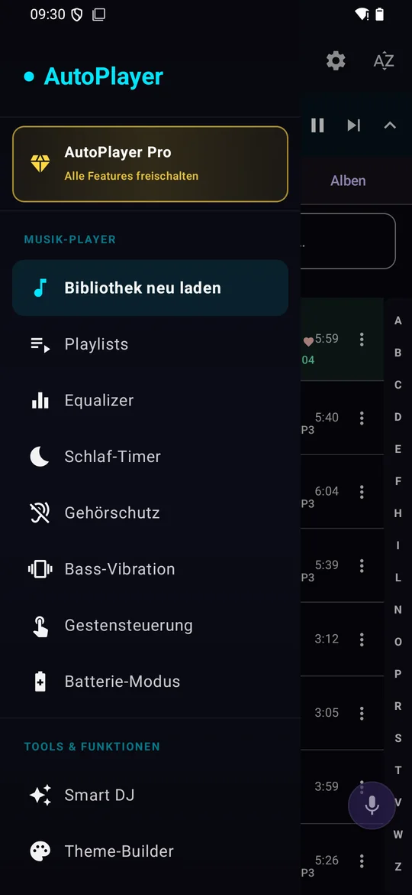
*→ Wischen von links oder das Symbol mit den drei Strichen*

- Das **Symbol mit den drei Strichen** oben links in der Bibliothek.
- **Vom linken Rand nach rechts wischen** – ebenfalls in der Bibliothek.

> Beides geht nur in der Bibliothek.
>
> Anderswo ist die Wischgeste abgeschaltet. Sonst käme sie dem Zurückwischen und den Gesten im Player in die Quere. Aus einem beliebigen Bildschirm führt der Weg also erst zurück zur Bibliothek und von dort ins Menü.

Geschlossen wird es mit einem Tippen daneben, durch Wischen nach links oder mit der Zurück-Taste. Ein angetippter Eintrag schließt es von selbst.

#### 1. Musik-Player

Was unmittelbar mit dem Hören zu tun hat.

| Eintrag | Kurz |
|---|---|
| **Bibliothek neu laden** | Liest die Musikdateien erneut ein und öffnet die Bibliothek |
| **Playlists** | Eigene Zusammenstellungen |
| **Equalizer** | Klangregelung und Hall |
| **Schlaf-Timer** | Wiedergabe nach Zeit beenden |
| **Gehörschutz** | Lautstärke-Überwachung |
| **Bass-Vibration** | Vibration zum Takt |
| **Gestensteuerung** | Neun Gesten für die Bedienung |
| **Batterie-Modus** | Akkuschonende Wiedergabe |

> Wofür „Bibliothek neu laden“ gut ist:
>
> Der Eintrag wiederholt die Prüfung, die sonst nur beim Start der App läuft. Er ist damit der schnellste Weg,
>
> neu hinzugekommene Titel sichtbar zu machen
>
> – etwa nachdem du am Rechner Musik auf das Gerät kopiert hast, ohne die App zu schließen. Die Wiedergabe läuft dabei weiter.
>
> Auch **geänderte Tags** kommen so an: Hast du Titel, Interpret oder Jahr einer Datei außerhalb der App berichtigt – etwa am Rechner – und die Datei wieder aufs Gerät kopiert, zeigt die Bibliothek danach die neuen Angaben. Der Hörverlauf des Titels bleibt und trägt den neuen Namen.
>
> Denselben Vorgang findest du auch unter **Einstellungen → Bibliothek → Musikbibliothek neu scannen**.

#### 2. Tools & Funktionen

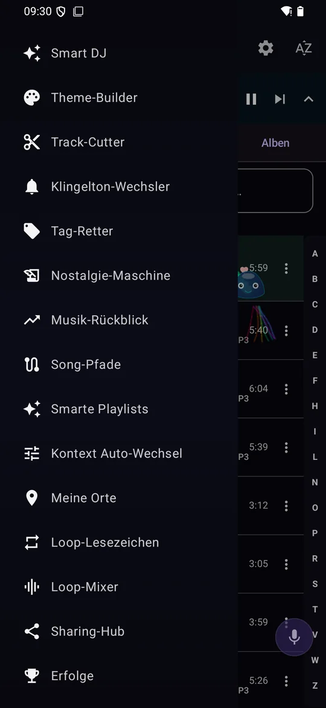

Mit Abstand der größte Bereich – **35 Einträge**. Hier steckt fast alles, was die App über einen gewöhnlichen Player hinaushebt. Jeder Punkt hat sein eigenes Kapitel in dieser Anleitung.

| Gruppe | Einträge |
|---|---|
| **Auswahl und Vorschläge** | Smart DJ, Smarte Playlists, Auto-Playlists, Stimmungswandler, Stimmungs-Browse, Genre durchsuchen, Song-Pfade, Beat-Match DJ |
| **Reagiert auf die Lage** | Kontext Auto-Wechsel, Meine Orte, Geo-Musik, Fahrmodus-DJ, Wetter-DJ, Herzschlag-Sync, Klangerinnerung, Schlaf-Ausblendung |
| **Klang** | Konzert-Modus, Gesangs-Isolator, Binaurale Beats, Atmosphären-Mixer, Kabinen-Kalibrator, Musik-DNA |
| **Selber machen** | Loop-Mixer, Loop-Lesezeichen, Track-Cutter, Klingelton-Wechsler, Tag-Retter, Theme-Builder |
| **Zu mehreren** | Party-Modus, Beifahrer-Modus, Sharing-Hub |
| **Zahlen und Spielerei** | Musik-Rückblick, Erfolge, Vumikio Pets, Nostalgie-Maschine |

#### 3. Player-Skins

Acht Oberflächen für denselben Player. Die Musik läuft beim Wechsel ohne Stocken weiter.

**Player-Steuerung** · **Fullscreen-Visualizer** · **DJ-Plattenspieler** · **Sci-Fi-Hologramm** · **Kassetten-Player** · **Bandmaschine** · **Jukebox-Player** · **Vintage-Plattenspieler**

#### 4. Einstellungen & Info

| Eintrag | Kurz |
|---|---|
| **Einstellungen** | Der große Einstellungs-Bildschirm mit elf Abschnitten |
| **Sprachbefehle** | Nachschlagewerk aller Befehle in deiner Sprache |
| **App bewerten** | Führt zum Play Store |
| **App teilen** | Verweis auf die App weitergeben |
| **Datenschutz** | Datenschutzerklärung und Nutzungsbedingungen |
| **Über die App** | Eigener Bildschirm mit zehn Punkten – siehe unten |
| **App beenden** | Beendet die App samt Wiedergabe |

#### Was hinter „Über die App“ steckt

Der Punkt ist umfangreicher, als der Name vermuten lässt – hier liegen alle Rechtstexte und das Handbuch:

| Eintrag | Kurz |
|---|---|
| **App bewerten** | Führt zum Play Store |
| **App teilen** | Verweis auf die App weitergeben |
| **Auf Update prüfen** | Sucht von Hand nach einer neueren Fassung |
| **Änderungsprotokoll** | Was sich in jeder Fassung geändert hat |
| **Benutzerhandbuch** | Diese Anleitung, in der App |
| **Datenschutzerklärung** | Welche Daten wofür verwendet werden |
| **Nutzungsbedingungen** | Die rechtlichen Bedingungen |
| **Impressum** | Angaben zum Anbieter |
| **Closed Testing** | Zugang zum geschlossenen Test |
| **Feedback senden** | Rückmeldung an die Entwicklung |

Dazu oben eine kurze Beschreibung der App mit **Vorlese-Schaltfläche** und darunter die **Versionsnummer** der installierten Fassung.

#### Gesperrte Einträge

Ein Teil der Einträge gehört zur Pro-Fassung. Sie stehen trotzdem im Menü und tragen ein Schloss; ein Tippen führt zur Übersicht, was Pro enthält. So siehst du, was es gibt, ohne dass etwas versteckt wird.

#### Sprachbefehle

Keine – das Menü selbst lässt sich nicht per Sprache öffnen. Viele seiner Ziele aber schon, etwa „Öffne Einstellungen“ oder „Smart DJ“. Die vollständige Liste steht unter **Einstellungen & Info → Sprachbefehle**.

#### Tipps

- Der Bereich **Tools & Funktionen** ist lang – das Menü lässt sich scrollen.
- Was du oft brauchst, erreichst du meist schneller über die Symbolreihen im Player. Das Menü ist der vollständige Weg, nicht immer der kürzeste.

## 2. Die Player-Ansichten

### Überblick über die Ansichten (teilweise frei)

#### Was ist das?

Dieselbe Musik, sieben Oberflächen. Die Wiedergabe läuft beim Wechsel ununterbrochen weiter; Lautstärke, Zufall, Wiederholung und Klangeinstellungen gelten überall gleich.

| Ansicht | Charakter |  |
|---|---|---|
| **Player-Steuerung** | Die Standardansicht mit allen Werkzeugen | (Frei) |
| **Vintage-Plattenspieler** | Holzzarge, Tonarm, 33/45 Umdrehungen | (Frei) |
| **DJ-Plattenspieler** | Scratchen und Temporegler | (Pro) |
| **Sci-Fi-Hologramm** | Projektion mit Bildstörungen | (Pro) |
| **Kassetten-Player** | Tragbarer Kassettenspieler mit laufenden Spulen | (Pro) |
| **Bandmaschine** | Tonband mit Zeigerinstrumenten | (Pro) |
| **Jukebox-Player** | Musikbox mit Blasenröhren | (Pro) |

#### Wie du hinkommst

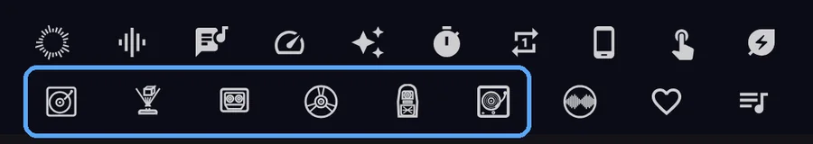
*→ Player → zweite Symbolreihe*

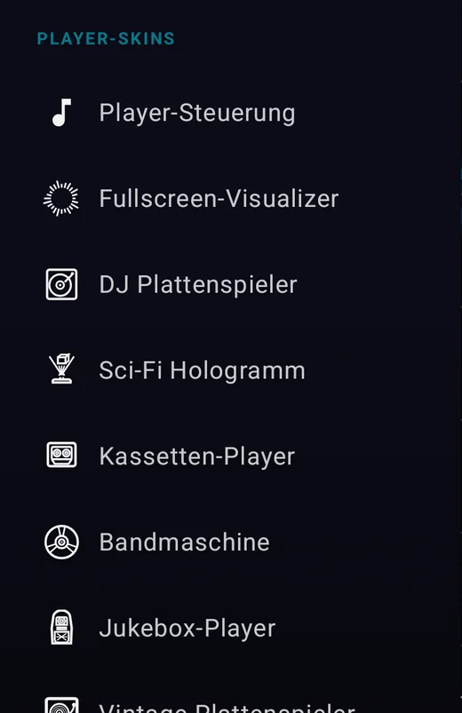
*→ Menü → Player-Skins*

- **Menü → Player-Skins** – alle sieben untereinander
- **Zweite Symbolreihe im Player** – derselbe Wechsel, einen Tipp entfernt

Zurück geht es über den Pfeil oben links oder die Zurück-Geste des Geräts.

#### Was die Ansichten gemeinsam haben

- Der laufende Titel spielt beim Wechsel weiter, ohne zu stocken.
- Alle zeigen das Tempo an, sobald es ermittelt ist.
- Alle arbeiten im Vollbild.

Die Bedienung unterscheidet sich dagegen deutlich – jede Ansicht bildet ein anderes Gerät nach. Was wo funktioniert, steht in den folgenden Kapiteln.

#### Sprachbefehle

- „Öffne Plattenspieler“ → DJ-Plattenspieler
- „Öffne Vintage-Plattenspieler“ → Vintage-Plattenspieler
- „Öffne Visualizer“ → Vollbild-Visualizer

Kassette, Bandmaschine, Jukebox und Hologramm lassen sich **nicht** per Sprache öffnen. Einen Befehl zum Schließen gibt es für keine Ansicht.

#### In Android Auto

Auf dem Fahrzeugbildschirm erscheint keine dieser Ansichten. Dort zeigt Android seine eigene Medienoberfläche – das ist eine Vorgabe der Plattform.

#### Tipps

- Der Vintage-Plattenspieler ist die einzige Alternative ohne Kauf – und die einzige, bei der der Drehzahlhebel wirklich das Tempo ändert.
- Wer alle Werkzeuge braucht, bleibt bei der Standardansicht: Nur dort liegen Equalizer, Schlaf-Timer, Liedtext und die übrigen Schaltflächen.

### DJ-Plattenspieler (Pro)

#### Was ist das?

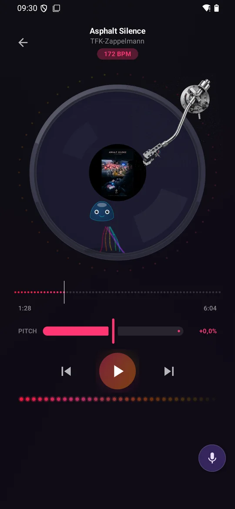
*→ Menü → Player-Skins → DJ-Plattenspieler*

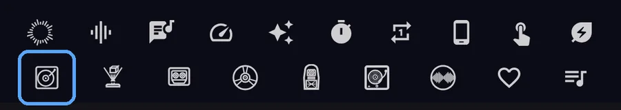
*→ Player → zweite Symbolreihe, erstes Symbol*

Ein Plattenspieler, wie ihn ein DJ benutzt: Die Scheibe dreht sich mit der Wiedergabe, und wer den Finger darauflegt, greift wirklich ins Laufwerk ein.

#### So bedienst du ihn

- **Ziehen auf der Platte** – scratchen. Die Wiedergabe folgt dem Finger, samt verzerrtem Klang. Beim Loslassen läuft der Titel an der neuen Stelle weiter.
- **Temporegler** – verändert die Geschwindigkeit wie der Pitch-Fader an einem echten Gerät.
- **Tonarm** – wandert mit dem Fortschritt nach innen und ist antippbar.
- **Play, Pause, vor und zurück** stehen als eigene Schaltflächen bereit.

Solange gescratcht wird, erscheint ein Hinweis auf dem Bildschirm.

#### Einstellungen

Keine. Alles, was sich einstellen lässt, liegt auf dem Bildschirm selbst.

#### Sprachbefehl

- „Öffne Plattenspieler“ – auch „Turntable“ wird verstanden.

#### Zusammenspiel

- Auch im **Batteriesparmodus** lässt sich scratchen – die Ansicht läuft ja nur, solange du hinsiehst.
- Der Vintage-Plattenspieler nutzt dieselbe Scratch-Technik.
- Der Streifen mit den Balken zeigt den laufenden Ton und braucht dafür die **Mikrofon-Berechtigung**. Fehlt sie, liegt dort der Knopf **Mikrofon erlauben**; alles andere geht auch ohne.
- Equalizer und Klangeffekte wirken auch hier.

#### Tipps

- Zum Aufsuchen einer bestimmten Stelle in einem langen Stück ist Scratchen genauer als der Fortschrittsbalken.
- Kurze Bewegungen wirken am besten – weites Ziehen übersteuert.
- Der Temporegler wirkt auf den Klang, nicht nur auf die Ansicht.

### Jukebox-Player (Pro)

#### Was ist das?

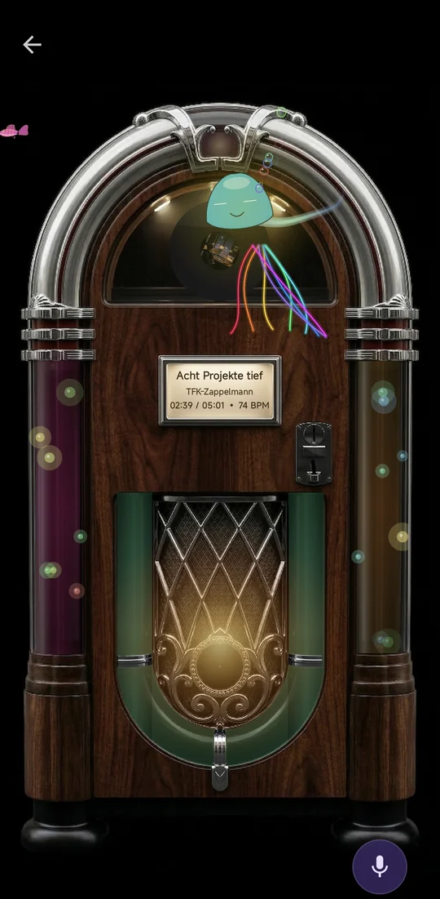
*→ Menü → Player-Skins → Jukebox-Player*

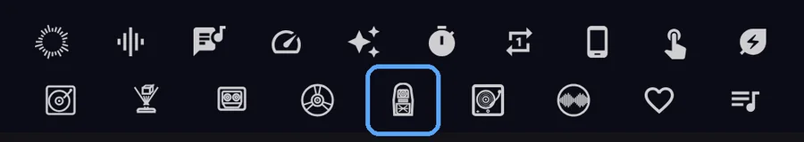
*→ Player → zweite Symbolreihe, fünftes Symbol*

Eine Musikbox im Stil der fünfziger Jahre, mit drehender Platte und leuchtenden Blasenröhren, die auf den Bass reagieren.

#### So bedienst du sie

- **Antippen der Platte oder des Lautsprechergitters** – Wiedergabe und Pause
- **Waagerechtes Ziehen über die Anzeige** – Spulen im laufenden Titel
- **Senkrechtes Ziehen an der linken Röhre** – Lautstärke

Lange Titelnamen laufen als Schriftband durch, wie bei einer echten Musikbox.

#### Einstellungen

Keine. Farben und Blasen laufen von selbst.

#### Sprachbefehle

Keine. Die Jukebox lässt sich nur über das Menü oder den Player öffnen.

#### Zusammenspiel

- Das Leuchten der Röhren folgt dem Bass. Wer den Equalizer verändert, sieht es sofort.
- Die Lautstärkeregelung greift auf die Systemlautstärke zu – wie die Tasten am Geräterand.

#### Tipps

- Auf einem aufgestellten Tablet wirkt die Jukebox wie ein eigenes Gerät.
- Bei bassbetonter Musik ist der Leuchteffekt am kräftigsten.
- Wer sie öfter nutzt, sollte sich das waagerechte Ziehen zum Spulen merken – einen Fortschrittsbalken gibt es hier nicht.

### Kassetten-Player (Pro)

#### Was ist das?

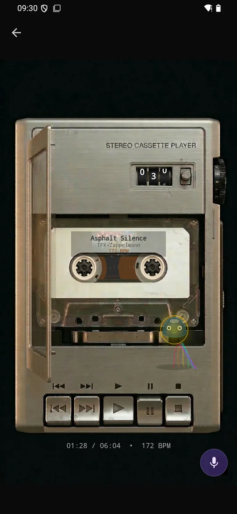
*→ Menü → Player-Skins → Kassetten-Player*

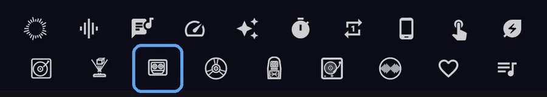
*→ Player → zweite Symbolreihe, drittes Symbol*

Ein tragbarer Kassettenspieler, wie man ihn aus den Achtzigern kennt. Die Spulen drehen sich im richtigen Verhältnis: Anfangs läuft die abgebende Seite langsam und die aufnehmende schnell, im Verlauf kehrt sich das um. Das Band wandert sichtbar durch das Fenster.

#### Die fünf Tasten

| Taste | Wirkung |
|---|---|
| **REW** | Vorheriger Titel |
| **FF** | Nächster Titel |
| **PLAY** | Wiedergabe und Pause |
| **PAUSE** | Ebenfalls Wiedergabe und Pause |
| **STOP** | Hält an und springt an den Anfang |

Jeder Druck löst eine kurze Vibration aus, und das Gehäusebild zeigt die gedrückte Taste.

#### Das Lautstärkerad

Über dem gezeichneten Rädchen am rechten Rand liegt eine unsichtbare Trefferfläche. Dort senkrecht ziehen regelt die Lautstärke – **nach unten lauter, nach oben leiser**, wie bei einem echten Rad.

#### Einstellungen

Keine.

#### Sprachbefehle

Keine.

#### Tipps

- Am Bandlauf im Fenster lässt sich ablesen, wie weit der Titel ist – ganz ohne Balken.
- Auf dem Kassettenetikett stehen Titel und Interpret. Das **Tempo** steht unten neben der Zeit – größer und besser lesbar als auf dem Etikett.

### Bandmaschine (Pro)

#### Was ist das?

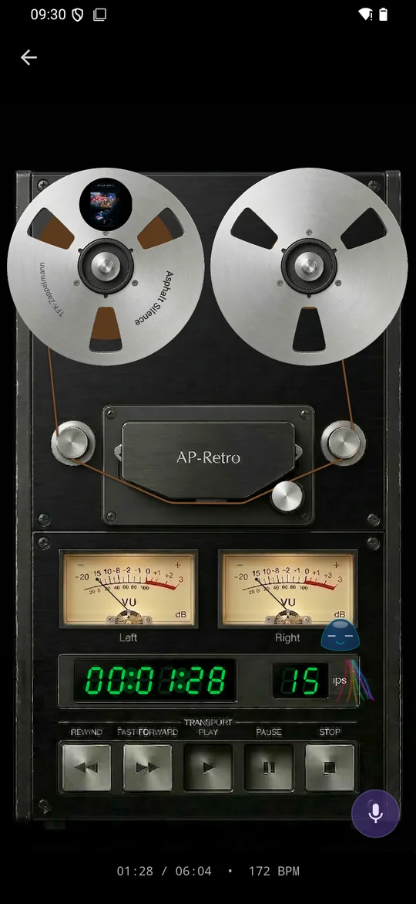
*→ Menü → Player-Skins → Bandmaschine*

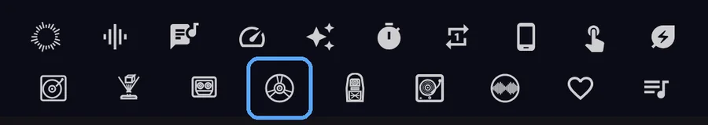
*→ Player → zweite Symbolreihe, viertes Symbol*

Eine Tonbandmaschine mit zwei offenen Spulen. Die linke gibt ab, die rechte nimmt auf, das Band läuft über drei Führungsrollen dazwischen.

#### Die Zeigerinstrumente

Zwei Instrumente zeigen den tatsächlichen Pegel – nicht nachgeahmt, sondern aus dem laufenden Ton berechnet. Die Nadeln springen schnell an und fallen träge zurück, wie bei echten Geräten.

#### Die fünf Tasten

- **REW** – vorheriger Titel
- **FF** – nächster Titel
- **PLAY** und **PAUSE** – beide schalten zwischen Wiedergabe und Pause um
- **STOP** – hält an und springt an den Anfang

#### Einstellungen

Keine.

#### Sprachbefehle

Keine. Nur über das Menü oder den Player zu erreichen.

#### Tipps

- Bei bassstarker Musik schlägt das linke Instrument sichtbar weiter aus als das rechte.
- Auf dem Spulenflansch steht der Albumname, um den Rand gebogen.
- Die Instrumente brauchen die **Mikrofon-Berechtigung**. Android verlangt sie für jede Pegelmessung, auch wenn nichts aufgenommen wird. Ohne sie bleiben die Nadeln stehen – die Musik läuft trotzdem. Über den Instrumenten liegt dann der Knopf **Mikrofon erlauben**.

### Vintage-Plattenspieler (Frei)

#### Was ist das?

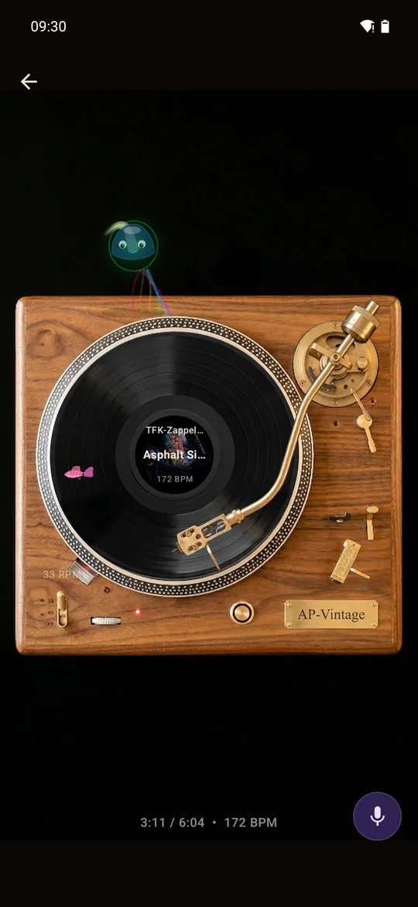
*→ Menü → Player-Skins → Vintage-Plattenspieler*

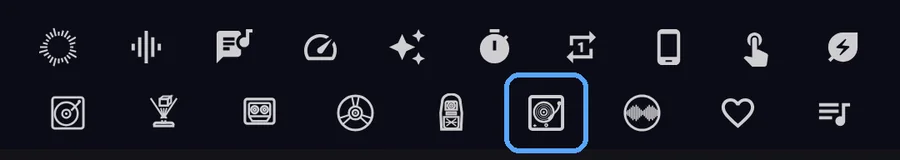
*→ Player → zweite Symbolreihe, sechstes Symbol*

Ein Plattenspieler mit Holzzarge, wie er in den siebziger Jahren in Wohnzimmern stand. Die einzige alternative Ansicht, die ohne Kauf nutzbar ist.

#### So bedienst du ihn

| Bedienelement | Wirkung |
|---|---|
| **Start/Stopp-Knopf** (Mitte unten) | Wiedergabe und Pause |
| **Antippen der Platte** | Ebenfalls Wiedergabe und Pause |
| **Ziehen auf der Platte** | Scratchen wie beim DJ-Plattenspieler |
| **Drehzahlhebel** (links unten) | Wechselt zwischen 33 und 45 Umdrehungen. Bei 45 läuft die Musik schneller und höher – wie eine falsch aufgelegte Platte. |
| **Cue-Hebel** (kleiner goldener Hebel) | Hebt den Tonarm an und hält an. Ein zweites Antippen setzt ihn wieder auf. |
| **Senkrechtes Ziehen** | Lautstärke |

Der Tonarm bewegt sich von selbst: Beim Start schwenkt er aus der Ruhelage an den Plattenrand, während des Stücks wandert er nach innen, am Ende kehrt er zurück.

#### Einstellungen

Keine.

#### Sprachbefehl

- „Öffne Vintage-Plattenspieler“ – auch „Schallplattenspieler“ wird verstanden.

Achtung: Nur „Plattenspieler“ ohne Zusatz führt zum *DJ*-Plattenspieler.

#### Zusammenspiel

- Der Drehzahlhebel ändert die **echte** Wiedergabegeschwindigkeit. Sie bleibt auch nach dem Verlassen der Ansicht gesetzt – zurück geht es über **Tempo & Tonhöhe** im Standard-Player.
- Das Scratchen nutzt dieselbe Technik wie der DJ-Plattenspieler.

#### Tipps

- Wer die Ansicht mag, aber nichts kaufen will: Diese hier bleibt dauerhaft offen.
- Der Cue-Hebel ist die eleganteste Art zu pausieren – der Arm bleibt stehen, wo er ist.
- Nicht vergessen, die Drehzahl auf 33 zurückzustellen. Sonst klingt alles schneller, bis es jemand merkt.

### Sci-Fi-Hologramm (Pro)

#### Was ist das?

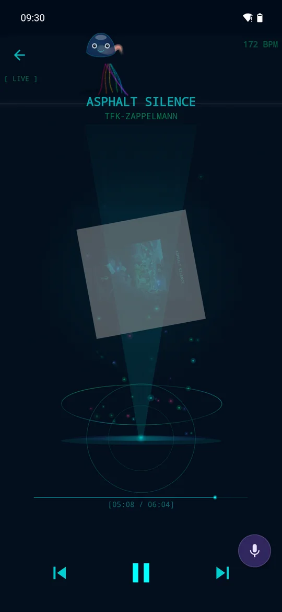
*→ Menü → Player-Skins → Sci-Fi-Hologramm*

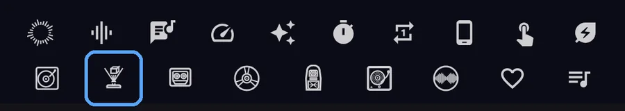
*→ Player → zweite Symbolreihe, zweites Symbol*

Eine Projektion, die aus einer Grundfläche nach oben strahlt und sich langsam dreht. Bei jedem Schlag pulsieren die Lichtstrahlen; gelegentlich flackert das Bild kurz.

#### So bedienst du es

Der Bildschirm ist in drei senkrechte Streifen geteilt:

- **Links tippen** – vorheriger Titel
- **Mitte tippen** – Wiedergabe und Pause
- **Rechts tippen** – nächster Titel

**Waagerecht ziehen** spult im laufenden Titel. Die Anzeige am unteren Rand zeigt Titel, Interpret, Fortschritt und Tempo. Der Zustand – laufend oder angehalten – steht als Text im Bild.

Ganz unten stehen zusätzlich **drei sichtbare Schaltflächen** in Türkis:

- **Vorheriger Titel**
- **Wiedergabe und Pause** – die mittlere, größer als die beiden anderen; das Symbol wechselt zwischen Dreieck und Doppelstrich
- **Nächster Titel**

Beide Wege führen zum selben Ziel – nimm, was dir näher liegt.

#### Einstellungen

Keine.

#### Sprachbefehle

Keine.

#### Zusammenspiel

- Das Pulsieren folgt dem Tempo. Bei noch nicht untersuchten Titeln läuft die Animation gleichmäßig weiter, nur ohne Bezug zum Takt.
- Das Flackern ist gewollt und kein Fehler.

#### Tipps

- Im abgedunkelten Raum bei voller Helligkeit kommt die Tiefenwirkung am besten heraus.
- Die Drittel-Aufteilung merkt man sich schnell – dann kommt man ohne den Blick nach unten aus.

### Der Balken-Visualizer (Frei)

#### Was ist das?

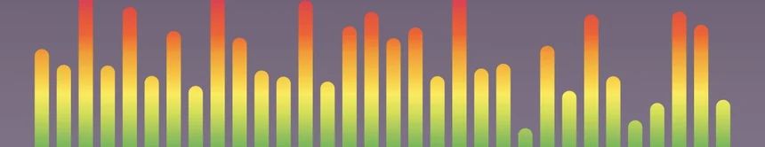
*Im Player, unter dem Cover: tiefe Töne links, hohe rechts. Je höher ein Balken ausschlägt, desto wärmer seine Farbe.*
*→ Im Player, unter dem Cover*

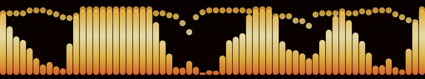
*Derselbe Streifen in der Vollbild-Ansicht, hier in Gold: dort bestimmt das gewählte Design die Farben, und mit einem anderen sieht er völlig anders aus.*
*→ Menü → Player-Skins → Player-Steuerung*

Ein schmaler Streifen im Player, der die Musik als bewegte Balken zeigt – tiefe Töne links, hohe rechts. Kein eigener Bildschirm, sondern Teil der Player-Ansicht.

**Die Farben im Player liegen fest:** Ein niedriger Balken ist grün, ein hoher wird gelb, orange, rot und bei den Spitzen violett. Daran lässt sich nichts einstellen. **Anders in der Vollbild-Ansicht** (Menü → Player-Skins → Player-Steuerung): Dort läuft derselbe Streifen oben mit, aber in den Farben des dort gewählten Designs – über das Paletten-Symbol in der Titelzeile. Dasselbe Stück Musik sieht damit völlig anders aus.

#### Die Mikrofon-Berechtigung

Beim ersten Öffnen des Players erklärt die App, wofür sie das **Mikrofon** braucht. Nach **Weiter** fragt Android. Das wirkt befremdlich, hat aber einen technischen Grund: Android verlangt diese Berechtigung für jede Auswertung des laufenden Tons – auch dann, wenn nur die eigene Wiedergabe gemessen wird. **Es wird nichts aufgenommen**, nichts gespeichert und nichts gesendet.

Der Player fragt genau **einmal** von selbst. Wer ablehnt, verliert nur die Balken; die Musik läuft unverändert. An ihrer Stelle steht dann ein Hinweis mit zwei Knöpfen:

- **Mikrofon erlauben** fragt noch einmal.
- **Ausblenden** nimmt den Hinweis für immer weg.

Nachtragen lässt sich die Berechtigung jederzeit unter **Einstellungen → Berechtigungen → Mikrofon-Zugriff**.

Solange gemessen wird, zeigt Android ab Version 12 einen **grünen Punkt** in der Statusleiste. Auch dazu steht ein Hinweis in den Einstellungen.

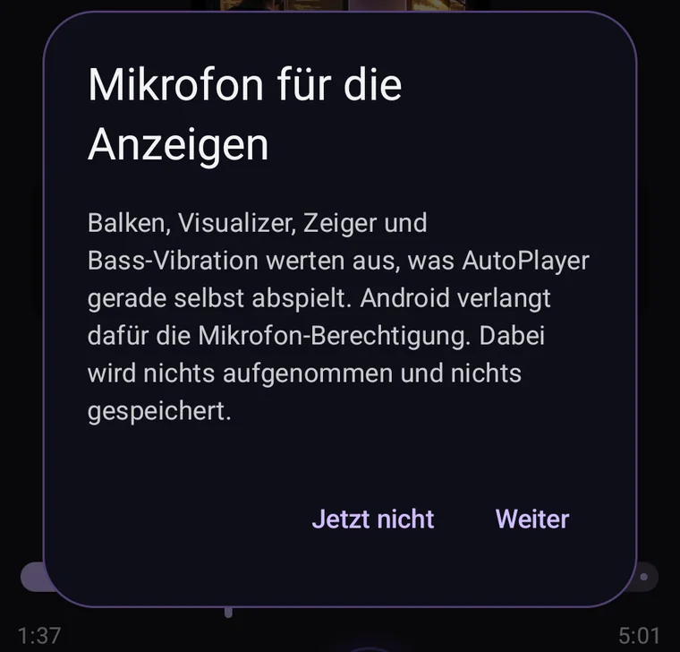
*Vor Androids Frage erklärt die App, wofür sie das Mikrofon braucht.*
*→ beim ersten Öffnen des Players*

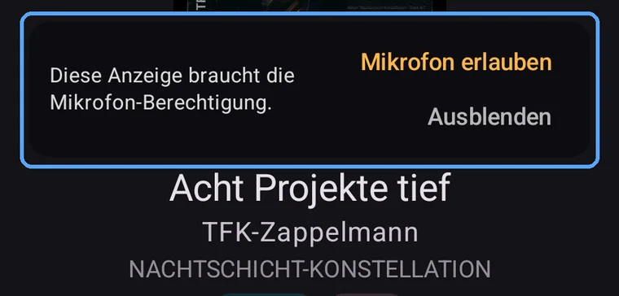
*Ohne Mikrofon steht an der Stelle der Balken dieser Hinweis.*
*→ Player, zwischen Cover und Titel*

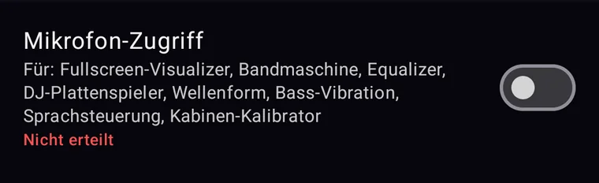
*Hier steht, ob der Mikrofon-Zugriff erteilt ist. Ein Tipp erteilt ihn oder nimmt ihn zurück.*
*→ Einstellungen → Berechtigungen → Mikrofon-Zugriff*

#### Einstellungen

Keine eigenen. Der Streifen erscheint, sobald die Berechtigung vorliegt.

#### Sprachbefehle

Keine. „Öffne Visualizer“ führt zum **Vollbild-Visualizer** – einer anderen Darstellung.

#### Zusammenspiel

- Dieselbe Messung treibt die **Bass-Vibration**, die Zeigerinstrumente der **Bandmaschine** und das Leuchten der **Jukebox** an. Ohne Mikrofon-Berechtigung bleibt all das stumm beziehungsweise still. Wo eine Anzeige deshalb nicht arbeitet, steht der Knopf **Mikrofon erlauben**.
- Änderungen am Equalizer sind sofort an den Balken abzulesen.
- Auch im **Batteriesparmodus** läuft die Messung – sie arbeitet nur, solange die Balken zu sehen sind.

#### Tipps

- Der Streifen ist der schnellste Weg zu prüfen, ob eine Equalizer-Einstellung überhaupt etwas bewirkt.
- Wer den grünen Punkt nicht mag, lehnt die Berechtigung ab – es geht dabei nichts verloren außer den erwähnten Anzeigen.

### Vollbild-Visualizer (Frei)

#### Was ist das?

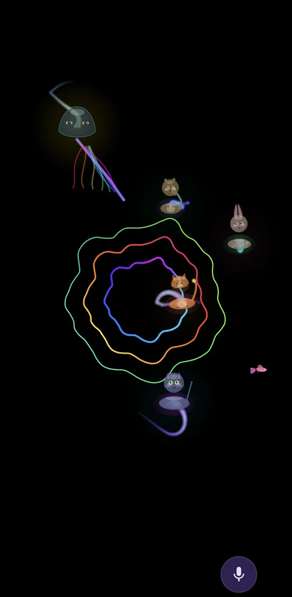
*Die Ringe schlagen im Takt aus – und die Vumikio Pets haben den ganzen Bildschirm für sich. Der Fuchs steht mitten in den Ringen, rechts zieht ein Fisch vorbei.*
*→ Menü → Player-Skins → Fullscreen-Visualizer*

Eine bildschirmfüllende, kreisförmige Darstellung der Musik. Statusleiste und Navigationsleiste verschwinden.

Diese Bühne ist auch der Ort des Spiels [Surf the Beat](index.html#surf-the-beat): Ist es eingeschaltet, wird aus den Ringen ein Tunnel, durch den eines deiner Tiere surft.

#### So bedienst du ihn

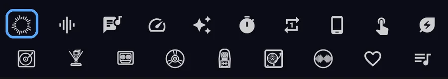

- Öffnen über das erste Symbol im Player oder über **Menü → Tools & Funktionen**.
- Schließen über das Kreuz oder die Zurück-Geste.

Solange die Ansicht offen ist, **bleibt der Bildschirm an**. Das ist so gewollt – und kostet Akku.

#### Mit deinem Puls

Ist im [Herzschlag-Sync](index.html#herzschlag) eine Uhr oder ein Brustgurt verbunden, legt sich ein weiches Leuchten über die ganze Bühne. Es hat die Farbe der Zone, in der dein Puls gerade liegt – dieselbe wie im Zonenbalken des Herzschlag-Sync – und schwillt im Takt deines Herzens an und ab, ohne zu blitzen. Die Mitte bleibt dunkel, die Ringe bleiben, wie sie sind. Ohne Live-Puls gibt es kein Leuchten. Wer keine Bewegung möchte, schaltet in den **Einstellungen von Android** – nicht in der App – „Animationen entfernen“ ein (unter **Bedienungshilfen**, beim Xiaomi unter **Barrierefreiheit → Sehen**) und startet die App einmal neu; dann leuchtet es gleichmäßig, ohne zu schwellen.

*Auf dem Herzschlag: Das Leuchten in der Farbe der Zone Moderat ist voll da.*
*→ Player → Fullscreen-Visualizer, mit Live-Puls*

*Zwischen zwei Schlägen: Das Leuchten ist abgeklungen.*
*→ Player → Fullscreen-Visualizer, mit Live-Puls*

#### Einstellungen

Keine.

#### Sprachbefehl

- „Öffne Visualizer“

#### Zusammenspiel

- Braucht dieselbe **Mikrofon-Berechtigung** wie die Balken im Player. Fehlt sie, steht dort statt der Anzeige ein Hinweis mit dem Knopf **Mikrofon erlauben**. Nach dem Erlauben läuft die Anzeige an, ohne dass du den Bildschirm verlässt.
- Läuft auch im **Batteriesparmodus**.
- Das Leuchten im Herztakt kommt vom [Herzschlag-Sync](index.html#herzschlag); dort verbindest du die Uhr oder den Brustgurt.
- Ohne laufende Musik schließt sich die Ansicht nach kurzer Zeit von selbst – außer es läuft eine Runde [Surf the Beat](index.html#surf-the-beat).

#### Tipps

- Nach dem Hören schließen – sonst bleibt der Bildschirm an, bis der Akku leer ist.
- Bei voller Helligkeit im dunklen Raum am eindrucksvollsten.
- **Die schönste Bühne für die Vumikio Pets.** Nirgends sonst haben sie so viel Platz: keine Liste, keine Schaltflächen, nichts, was sie verdecken könnten. Sie tanzen zum Takt, jagen ihre Beute quer über den ganzen Bildschirm und führen ihre Kunststücke vor, während die Musik läuft. Wer **Alle Pets gleichzeitig** eingeschaltet hat, sieht hier alle fünf zusammen – siehe [Vumikio Pets](index.html#pets).

### Musik-DNA (Pro)

#### Was ist das?

Ein Bild, das für jeden Titel anders aussieht – berechnet aus drei Eigenschaften seiner Musik. Kein Zufall: Derselbe Titel ergibt immer dasselbe Bild.

#### Was das Bild zeigt

*→ Menü → Tools & Funktionen → Musik-DNA*

| Eigenschaft | Wie sie sichtbar wird |
|---|---|
| **Tonart** | Die Farbe. Warme Töne stehen für Dur, kalte für Moll. |
| **Tempo** | Die Geschwindigkeit der Bewegung. |
| **Energie** | Die Kraft und Helligkeit der Darstellung. |

Die drei Werte stehen als Zahlen unter dem Bild. Die Pfeile neben dem Titel springen zum vorherigen oder nächsten Titel – ein Wisch über den Titel tut dasselbe. Ein Tippen auf den Titel hält die Musik an und lässt sie weiterlaufen.

#### Voraussetzungen

1. Der **Schalter oben** auf dem Bildschirm muss an sein. Sonst erscheint ein Hinweis statt des Bildes.
2. Es muss Musik laufen.
3. Der Titel muss **untersucht** sein. Ist er es nicht, steht dort der Hinweis, erst eine Smart-DJ-Analyse durchzuführen.

#### Einstellungen

*→ Einstellungen → Wiedergabe → Musik-DNA-Visualizer*

- Der Schalter auf dem Bildschirm selbst
- Derselbe Schalter unter **Einstellungen → Wiedergabe → Musik-DNA-Visualizer**

#### Sprachbefehle

Keine.

#### Zusammenspiel

- Die Werte stammen aus derselben Untersuchung, die auch Smart DJ, die Tempo-Anzeige im Player und die Stimmungsauswahl speist.
- Ist die Tonart unbekannt, steht dort ein Strich – das Bild entsteht trotzdem.

#### Tipps

- Dur und Moll lassen sich an der Farbe sofort unterscheiden – oft schneller, als man es hört.
- Wer viele Titel nacheinander durchblättert, sieht die Sammlung wie einen Farbfächer.
- Fehlt bei vielen Titeln die Untersuchung, lohnt ein Durchlauf über Smart DJ – danach ist auch die Tempo-Anzeige überall gefüllt.

## 3. Klang und Effekte

### Equalizer (teilweise frei)

#### Was ist das?

*→ Menü → Equalizer*

Vier Bereiche untereinander, von oben nach unten.

#### 1. Software-Equalizer – zehn Bänder (Pro)

Von 31 Hz bis 16 kHz, gerechnet in der App selbst. Deshalb klingt er auf jedem Gerät gleich, unabhängig davon, was der Hersteller eingebaut hat. Ohne Kauf steht hier eine Hinweiskarte statt der Regler.

Die zehn Bänder von links nach rechts:

- **31** und **63 Hz** – Sub
- **125** und **250 Hz** – Bass
- **500 Hz** und **1 kHz** – Tief
- **2** und **4 kHz** – Mitten
- **8 kHz** – Hoch
- **16 kHz** – Air

Diese Frequenzen sind fest – auf jedem Gerät dieselben.

#### 2. Hardware-Equalizer – fünf Bänder (Frei)

Nutzt die Klangregelung des Geräts. Dazu drei Drehregler:

- **Bass** – verstärkt die Tiefen
- **3D** – verbreitert das Klangbild
- **Laut** – hebt die empfundene Lautstärke an

Die fünf Bänder heißen **Sub**, **Bass**, **Tief**, **Mitten** und **Air**. Ein Band namens **Hoch** gibt es hier nicht – das hat nur der Software-Equalizer.

Welche Frequenzen dahinterstehen, gibt das Gerät vor. Auf dem Testgerät sind es 60, 230 und 910 Hz sowie 3 und 14 kHz – anderswo können es andere sein.

#### 3. Hall (Frei)

Ein Nachhall mit fünf Räumen: Arena, Club, Open Air, Kirche, Café. Zwei Regler bestimmen Stärke und Bassanteil des Halls.

*→ Menü → Equalizer → Software EQ*

*→ Menü → Equalizer → Hardware EQ*

*→ Menü → Equalizer → Reverb / Hall*

#### 4. Eigene Einstellung je Titel (Frei)

Was hier eingestellt ist, lässt sich **für den laufenden Titel speichern**. Beim nächsten Abspielen wird es von selbst geladen; eine Marke bestätigt das. Später lässt es sich aktualisieren oder entfernen.

Nützlich für Aufnahmen, die aus der Reihe fallen – ein zu dumpfer Mitschnitt, eine zu spitze Digitalisierung.

#### Die 42 Voreinstellungen

Von **Rock**, **Pop**, **Jazz** und **Klassik** über **Techno**, **Dubstep** und **Afrobeats** bis **Schlager**. Dazu Voreinstellungen nach Zweck statt nach Stil:

- **Auto-Audio** – gegen Fahrgeräusche
- **Kopfhörer** und **Kleiner Lautsprecher**
- **Nacht-Modus** – leise hören, ohne dass Details verschwinden
- **Gesangs-Boost**, **Bass-Heavy**, **Höhen-Boost**, **Flach**

#### Sprachbefehle

- „Öffne Equalizer“

Voreinstellungen lassen sich **nicht** per Sprache wählen.

#### Zusammenspiel

- **Batteriesparmodus:** Legt den Equalizer still – Software- wie Hardware-Teil, dazu Bass, 3D und Lautheit. Deine Bänder bleiben gespeichert und kommen beim Zurückschalten unverändert wieder. Schaltest du den Equalizer im Sparmodus ein, fragt die App, ob er trotzdem laufen soll.
- **Kabinen-Kalibrator:** Kann die Bänder anhand einer Messung im Fahrzeug selbst setzen.
- **Bass-Vibration:** Kann an den Bassregler gekoppelt werden.
- Der **Balken-Visualizer** im Player zeigt sofort, was eine Änderung bewirkt.
- Die Karten pulsieren im Takt der Musik. Das braucht die **Mikrofon-Berechtigung**; fehlt sie, steht oben rechts **Mikrofon erlauben**. Der Equalizer selbst arbeitet auch ohne.

#### Tipps

- Erst eine Voreinstellung wählen, dann nachbessern – das ist schneller, als bei Null anzufangen.
- Anheben klingt oft schlechter als Absenken. Statt die Höhen zu verstärken, lieber die Mitten senken.
- Im Fahrzeug lohnt **Auto-Audio**: Es hebt an, was der Fahrtwind verschluckt.
- Beide Equalizer wirken zusammen. Wer beide kräftig aufdreht, übersteuert.

### Konzert-Modus (Pro)

#### Was ist das?

Legt den Klang eines Veranstaltungsortes über die Musik. Aus einer Studioaufnahme wird etwas, das nach Raum klingt.

#### Die fünf Orte

*→ Menü → Konzert-Modus*

- **Arena** – große Halle, langer Nachhall
- **Club** – enger Raum, kräftiger Bass
- **Open Air** – weit und offen, wenig Reflexion
- **Kirche** – langer, weicher Nachhall
- **Akustik-Café** – kleiner Raum, kurzer Nachhall

#### So bedienst du ihn

1. Schalter oben einschalten
2. Ort auswählen
3. **Hall-Intensität** und **Bass-Verstärkung** einstellen

Alles wirkt sofort, während die Musik läuft – so lässt sich in Ruhe abgleichen.

#### Einstellungen

*→ Einstellungen → Wiedergabe → Konzert-Modus*

- Alles auf dem Bildschirm selbst
- Der Hauptschalter auch unter **Einstellungen → Wiedergabe → Konzert-Modus**

#### Sprachbefehle

Keine.

#### Zusammenspiel

- Der Hall kommt **nach** dem Equalizer – beide lassen sich kombinieren.
- Der Equalizer hat einen eigenen Hall-Bereich. Beide gleichzeitig ergeben schnell zu viel.
- Im **Batteriesparmodus** ruht der Konzert-Modus; die Einstellung bleibt und kommt beim Zurückschalten wieder. Mit **Trotzdem nutzen** läuft er weiter.

#### Tipps

- **Kirche** passt zu Chor- und Orchestermusik, **Club** zu elektronischer.
- Sparsam einsetzen. Zu viel Hall verwischt die Stimme.
- Bei Kopfhörern wirkt der Effekt deutlich stärker als über Lautsprecher.

### Gesangs-Isolator (Pro)

#### Was ist das?

Trennt Gesang von Instrumenten – ohne Download, ohne Wartezeit, direkt im laufenden Ton. Die App bezeichnet das selbst als **Versuch**: Das Ergebnis hängt stark von der Aufnahme ab.

#### Warum das überhaupt geht

In den meisten Aufnahmen sitzt die Hauptstimme genau in der Mitte – gleich laut auf beiden Seiten. Zieht man beide Seiten voneinander ab, verschwindet alles Mittige. Behält man nur die Mitte, bleibt vor allem die Stimme. Mehr steckt nicht dahinter, und deshalb sind die Grenzen klar:

- Bei **Mono**-Aufnahmen geht es gar nicht – die App weist darauf hin.
- Was ebenfalls mittig liegt – Bass, Bassdrum, Snare – verschwindet mit.
- Live-Mitschnitte und alte Aufnahmen liefern schlechte Ergebnisse.

#### Die Betriebsarten

*→ Menü → Gesangs-Isolator*

*→ Gesangs-Isolator → Karaoke*

| Modus | Wirkung |
|---|---|
| **Aus** | Unveränderter Klang |
| **Karaoke** | Der Gesang wird entfernt, die Instrumente bleiben |
| **Nur Gesang** | Umgekehrt – die Stimme bleibt, das Umfeld verschwindet |

Zwei Regler bestimmen, **wie viel** entfernt wird – einer für den Gesang, einer für die Instrumente. Vollständiges Entfernen klingt oft schlechter als teilweises.

#### Einstellungen

Alles auf dem Bildschirm selbst.

#### Sprachbefehle

Keine.

#### Zusammenspiel

- Der **Equalizer** greift nach der Trennung – damit lässt sich nachbessern.
- „Nur Gesang“ zusammen mit dem **Kirchen-Hall** des Konzert-Modus ergibt einen Chorklang.
- Im **Batteriesparmodus** ruht die Trennung; die Einstellung bleibt und kommt beim Zurückschalten wieder. Mit **Trotzdem nutzen** läuft sie weiter.

#### Tipps

- Erwartungen niedrig halten. Was hier passiert, ist ein Rechentrick – keine Trennung der Originalspuren.
- Gut gemischte Studioaufnahmen liefern die besten Ergebnisse.
- Wenn im Karaoke-Modus der Bass verschwindet, liegt das nicht an einem Fehler: Er lag mittig.
- Zum Vergleichen den Modus auf „Aus“ stellen – das geht ohne Unterbrechung.

### Binaurale Beats (Pro)

#### Was ist das?

Zwei leicht verschiedene Töne, einer je Ohr. Das Gehirn nimmt den Unterschied als langsames Pulsieren wahr – einen Ton, der so gar nicht gespielt wird. Er liegt leise unter der Musik.

> Kopfhörer sind zwingend.
>
> Der Effekt beruht darauf, dass jedes Ohr etwas anderes hört. Über Lautsprecher mischen sich die Töne in der Luft und es bleibt nichts übrig. Die App weist beim Öffnen darauf hin.

#### Die vier Betriebsarten

*→ Menü → Binaurale Beats*

| Modus | Pulsschlag | Gedacht für |
|---|---|---|
| **Fokus** | 18 Hz (Beta) | Konzentration |
| **Entspannung** | 10 Hz (Alpha) | Ruhe bei wachem Kopf |
| **Schlaf** | 2,5 Hz (Delta) | Einschlafen |
| **Meditation** | 6 Hz (Theta) | Versenkung |

#### So bedienst du es

1. Kopfhörer aufsetzen
2. Schalter einschalten
3. Modus wählen
4. **Beat-Lautstärke** einstellen – leise anfangen. Der Ton soll kaum auffallen.

#### Einstellungen

*→ Einstellungen → Wiedergabe → Binaurale Beat-Schicht*

- Alles auf dem Bildschirm selbst
- Der Hauptschalter auch unter **Einstellungen → Wiedergabe → Binaurale Beat-Schicht**

#### Sprachbefehle

Keine.

#### Zusammenspiel

- Mit dem **Atmosphären-Mixer** zusammen ergeben sich drei Schichten: Musik, Umgebung, Puls.
- **Schlaf** passt zur **Schlaf-Ausblendung** und zum Schlaf-Timer.
- Im **Batteriesparmodus** ruht der Beat; die Einstellung bleibt und kommt beim Zurückschalten wieder. Mit **Trotzdem nutzen** läuft er weiter.
- Im Fahrzeug hat das nichts zu suchen – Kopfhörer am Steuer sind vielerorts verboten.

#### Tipps

- Wenn der Ton auffällt, ist er zu laut. Er soll wirken, nicht gehört werden.
- Ruhige Musik ohne starken Takt eignet sich besser als treibende.
- Die Wirkung solcher Klänge ist wissenschaftlich umstritten. Ausprobieren schadet nicht; Wunder sind nicht zu erwarten.

### Atmosphären-Mixer (Pro)

#### Was ist das?

Ein Umgebungsgeräusch, das leise unter der Musik läuft. Alle Klänge werden **gerechnet, nicht abgespielt** – es liegen keine Tondateien in der App. Deshalb wiederholt sich nichts und die App bleibt schlank.

#### Die sieben Klänge

*→ Menü → Atmosphären-Mixer*

- **Regen** · **Gewitter** · **Kaminfeuer**
- **Meer** · **Wald** · **Cafe** · **Zug**

#### So bedienst du ihn

1. Schalter einschalten
2. Klang auswählen
3. Lautstärke einstellen – sie gilt für die Umgebung, nicht für die Musik

Der Klang lässt sich auch **ohne Musik** nutzen – als reine Geräuschkulisse zum Arbeiten oder Einschlafen.

#### Einstellungen

*→ Einstellungen → Wiedergabe → Atmosphären-Mixer*

- Alles auf dem Bildschirm selbst
- Der Hauptschalter auch unter **Einstellungen → Wiedergabe → Atmosphären-Mixer**

#### Sprachbefehle

Keine.

#### Zusammenspiel

- Läuft als eigene Schicht – Equalizer und Effekte greifen nicht darauf zu.
- Zusammen mit **binauralen Beats** ergeben sich drei Schichten.
- Der **Schlaf-Timer** beendet auch die Atmosphäre.
- Im **Batteriesparmodus** ruht die Atmosphäre; die Einstellung bleibt und kommt beim Zurückschalten wieder. Mit **Trotzdem nutzen** läuft sie weiter.

#### Tipps

- Regen unter ruhiger Musik ist die verlässlichste Mischung.
- Das **Cafe** eignet sich zum Arbeiten – es überdeckt Störungen, ohne selbst abzulenken.
- Leiser einstellen als man denkt. Die Umgebung soll tragen, nicht dominieren.
- Da nichts abgespielt, sondern gerechnet wird, klingt jeder Durchlauf anders – es gibt keine hörbare Schleife.

### Gehörschutz (Frei)

#### Was ist das?

Eine Beobachtung der Hörlautstärke über den Tag. Die App schätzt den Pegel und hält ihn gegen die Empfehlung der Weltgesundheitsorganisation: 85 Dezibel über acht Stunden. Wer lauter hört, hat weniger Zeit – und die App rechnet das aus.

#### Was der Bildschirm zeigt

*Während der Messung: 62 dB gerade, 79 dB als Spitzenwert, darunter die Ausgabe und das Tages-Budget – hier schon bei 204 %.*
*→ Menü → Gehörschutz*

- **Aktueller Pegel** und **Spitzenwert**
- **Ausgabe** – ob über Bluetooth, Kabel-Kopfhörer, USB-Audio oder den Gerätelautsprecher gehört wird. Das geht in die Schätzung ein.
- **Tages-Budget** nach WHO, dazu **Hörzeit heute** und der **Durchschnitt dieser Woche**
- Ein **Wochen-Verlauf** als Diagramm
- Ein Satz wie „Bei 78 dB kannst du noch 4h 30min sicher hören“

#### Die vier Stufen

**Sicher** → **Vorsicht** → **Erhöhtes Risiko** → **Gefährlich**. Bei mäßiger Lautstärke steht dort **Unbegrenzt**.

#### Einstellungen

*→ Einstellungen → Gehörschutz → Gehörschutz aktivieren*

*→ Einstellungen → Gehörschutz → dB-Anzeige im Player*

- **Gehörschutz aktivieren**
- **dB-Anzeige im Player** – blendet den Pegel neben Tempo und Tonart ein

Mehr gibt es nicht. Die App greift **nicht selbsttätig** in die Lautstärke ein.

#### Sprachbefehle

- „Gehörschutz an“ / „Gehörschutz aus“
- „Hörbudget?“ – nennt den Stand
- „Lautstärke reduzieren“ – senkt auf einen unbedenklichen Wert

Diese Befehle laufen über das Mikrofon der App am Handy.

#### Zusammenspiel

- Die dB-Anzeige im Player ist antippbar und führt hierher.
- Die Werte gehen in die **Erfolge** ein.
- Alle Daten bleiben auf dem Gerät. Nichts wird gesendet.

#### Tipps

- Das ist eine **Schätzung**, kein Messgerät. Sie beruht auf der eingestellten Lautstärke und dem Ausgabeweg, nicht auf einer Messung im Ohr.
- In-Ear-Kopfhörer sind bei gleicher Einstellung lauter als solche, die das Ohr umschließen.
- Die Faustregel: höchstens 60 % Lautstärke, höchstens 60 Minuten am Stück.
- Im Fahrzeug dreht man unbewusst auf, weil der Fahrtwind mithält. Der Wochenverlauf zeigt das deutlich.

### Bass-Vibration (Pro)

#### Was ist das?

*Die Bass-Vibration mit Stärke, der Herzschlag-Vibration und darunter den Quellen, nach denen sie sich richtet.*
*→ Menü → Bass-Vibration*

*→ Player → erste Symbolreihe, achtes Symbol*

Der Vibrationsmotor schwingt im Takt der Musik mit. Aus Hören wird Fühlen.

#### Was dein Gerät kann

Ganz oben steht, wozu der eingebaute Motor taugt:

| Stufe | Bedeutung |
|---|---|
| **Premium** | Feine Abstufungen möglich – das volle Erlebnis |
| **Standard** | Stufenlose Stärke |
| **Basis** | Nur an und aus |
| **Kein Motor** | Die Funktion bleibt wirkungslos |

#### Stärke

**Aus**, **Leicht** (feines Pulsieren), **Mittel** (deutlich spürbar), **Stark** (volle Wucht) oder **Benutzerdefiniert** mit eigenem Regler.

#### Wonach sich die Vibration richtet

- **BPM-Sync** – im Takt. Das aktuelle Tempo steht daneben.
- **Bass-Sync** – nach den tiefen Tönen. Der Frequenzbereich lässt sich zwischen 20 und 250 Hz eingrenzen: tief eingestellt folgt die Vibration vor allem der Bassdrum, höher eingestellt eher der Basslinie. Ein Balken zeigt den aktuellen Basspegel.

#### Herzschlag-Vibration

*Eingeschaltet, Stärke Leicht; der grüne Punkt zeigt, dass ein Puls ankommt.*
*→ Menü → Bass-Vibration, unter dem Haptic-Modus*

Ist im [Herzschlag-Sync](index.html#herzschlag) eine Uhr oder ein Brustgurt verbunden, schlägt das Handy auf Wunsch im Takt deines Pulses – ein weicher Doppelschlag wie ein Herzschlag. Dafür gibt es eine eigene Kachel:

- **Schalter** – ein und aus. Den Haptic-Modus braucht sie nicht, sie läuft auch, wenn er auf **Aus** steht. Bei jedem Start der App steht der Schalter auf **aus** – die Herzschlag-Vibration beginnt nie von selbst, du schaltest sie jedes Mal ein.
- **Dezent**, **Leicht**, **Mittel** – die Stärke. Die Wahl erscheint, sobald der Schalter an ist; die App merkt sie sich.
- Der **grüne Punkt** zeigt, dass gerade ein Puls ankommt. Ist er grau, kommt keiner, und das Handy bleibt still; ist der Schalter an, sagt die Kachel dann, dass die Uhr im Herzschlag-Sync verbunden werden muss.
- Sie läuft nie zusammen mit **BPM-Sync** oder **Bass-Sync**: Wer das eine einschaltet, schaltet das andere aus, und die App sagt es kurz.

#### Zum Ausprobieren

Vier Muster lassen sich ohne Musik testen: **Leichter Puls**, **Bass-Drop**, **BPM 120** und **Wobble**.

#### Weitere Einstellungen

- **Batteriesparmodus** – halbe Stärke, sobald der Akku unter 20 % liegt
- **Auto-Aktivierung** – schaltet sich ein, sobald Kopfhörer verbunden werden
- **Bei Display-Aus** – vibriert auch bei dunklem Bildschirm
- **EQ-Bass-Boost-Kopplung** – stärker, wenn der Bassregler angehoben ist
- **Optimiert für Hörgeschädigte** – setzt in einem Schritt alles so, dass Musik vor allem über die Haut wahrnehmbar wird

#### Sprachbefehle

Am Handy über das Mikrofon der App. Jeder Befehl verstellt die Auswahl im Bildschirm mit – du siehst also sofort, wo du gelandet bist, und die App zeigt die neue Stufe mit ihrem Namen an.

| Befehl | Was passiert |
|---|---|
| **Vibration an** | Schaltet ein. Stand die Auswahl auf **Aus**, rückt sie auf **Leicht**; eine bereits gewählte Stufe bleibt. |
| **Vibration aus** | Schaltet ab, die Auswahl springt auf **Aus**. |
| **Vibration stärker** | Eine Stufe hoch: Aus → Leicht → Mittel → Stark. Bei **Stark** ist Schluss. |
| **Vibration schwächer** | Eine Stufe zurück. Von **Leicht** geht es auf **Aus**, und die Vibration endet. |

Aus der Stufe **Benutzerdefiniert** heraus führt „stärker“ nach **Stark** und „schwächer“ nach **Mittel** – die eigene Einstellung bleibt gespeichert und lässt sich jederzeit wieder auswählen.

#### Zusammenspiel

- Der Bass-Sync braucht dieselbe Messung wie der Visualizer – und damit die **Mikrofon-Berechtigung**. Fehlt sie, fragt die App beim Einschalten danach; auf der Pegelanzeige liegt solange der Knopf **Mikrofon erlauben**.
- Der BPM-Sync braucht ein bekanntes Tempo. Bei noch nicht untersuchten Titeln fällt er auf die Bassmessung zurück.
- Im Player sitzt ein Schnellschalter in der ersten Symbolreihe.
- Im **Batteriesparmodus** ruht die Bass-Vibration ganz; die Einstellung bleibt und kommt beim Zurückschalten wieder. Mit **Trotzdem nutzen** läuft sie weiter. Das gilt auch für die Herzschlag-Vibration.
- Die **Herzschlag-Vibration** braucht den Live-Puls aus dem [Herzschlag-Sync](index.html#herzschlag).

#### Tipps

- Auf einer harten Fläche liegend vibriert das Gerät deutlich spürbarer als in der Hand.
- Dauerhafte Vibration kostet Akku. Die Einstellung **Batteriesparmodus** halbiert sie bei wenig Akku.
- Wer schlecht hört, sollte mit der Voreinstellung für Hörgeschädigte beginnen.
- Bei elektronischer Musik wirkt Bass-Sync besser, bei Rock und Pop eher BPM-Sync.

## 4. Was die App selbst aussucht

### Smart DJ – die Grundlage (Frei)

#### Warum dieses Kapitel wichtig ist

Fast alles, was die App selbst aussucht, beruht auf drei Werten je Titel: **Tempo**, **Energie** und **Tonart**. Ohne sie bleiben Stimmungswandler, Fahrmodus, Wetter-DJ, Smart Reorder, Song-Pfade, Auto-Playlists und die Musik-DNA leer oder ungenau.

#### Die Untersuchung

*→ Menü → Smart DJ*

*→ Player → erste Symbolreihe, fünftes Symbol*

1. Öffne den Bildschirm – entweder über **Menü → Tools & Funktionen → Smart DJ** oder über das **Sternchen-Symbol** in der ersten Reihe des Players
2. **Bibliothek analysieren** antippen
3. Der Fortschritt wird in Prozent angezeigt

Das dauert je nach Umfang der Sammlung und Gerät. Danach ist es erledigt – neue Titel kommen beim Abspielen von selbst dazu. Das Symbol rechts daneben setzt die Werte zurück – erst nach einer Rückfrage, denn die neue Untersuchung dauert wieder lange. Nötig ist das kaum, höchstens nach einer komplett neu aufgespielten Musiksammlung.

#### Ähnliche Songs finden

Zum laufenden Titel stellt die App eine Auswahl zusammen, die zu Tempo, Energie und Tonart passt – den **Vibe Mix**. Er erscheint als Liste mit Tempo- und Energieangabe und lässt sich am Stück abspielen.

#### Karaoke-Vorbereitung

Ein eigener Bereich weiter unten. Er trennt Gesang und Instrumente im Voraus, damit der Karaoke-Modus sauberer klingt als bei der Trennung im laufenden Ton. Das geschieht im Hintergrund, der Fortschritt wird angezeigt, und die Ergebnisse lassen sich wieder löschen.

#### Einstellungen

Keine.

#### Sprachbefehl

- „Smart DJ“ – öffnet den Bildschirm. Nur am Handy.

Die Untersuchung selbst lässt sich nicht per Sprache starten.

#### Zusammenspiel

Hiervon hängen ab: Stimmungswandler, Auto-Playlists, Smart Reorder, Song-Pfade, Fahrmodus-DJ, Wetter-DJ, Herzschlag-Sync, Beat-Match, Musik-DNA sowie die Tempo- und Tonart-Anzeige im Player.

#### Tipps

- Am besten über Nacht laufen lassen, mit Strom am Gerät.
- Titel ohne Untersuchung spielen ganz normal – sie fehlen nur dort, wo die App selbst aussucht.
- Wer Sonderbares in der Sammlung hat – Hörbücher, Mitschnitte, Geräusche – sollte sich nicht wundern, wenn deren Werte wenig aussagen.

### Smarte Playlists (Pro)

#### Was ist das?

*→ Menü → Smarte Playlists*

Man schreibt oder sagt, was man hören will – die App stellt es zusammen. Erkannt werden Tempo, Genre, Jahr, Stimmung und das eigene Hörverhalten.

#### So bedienst du es

*→ Smarte Playlists → Schnellauswahl Workout*

1. **Menü → Tools & Funktionen → Smarte Playlists**
2. In das Feld schreiben, etwa *Schnelle Rock Songs* oder *Ruhige Abendmusik*
3. Die Ergebnisse erscheinen mit Tempo und Energie. Darüber steht die Anzahl, darunter drei Knöpfe:
  - **Speichern** – mit einem Namen bleibt die Liste erhalten
  - **Alle abspielen** – spielt die Liste ab dem ersten Titel
  - **Zufällig** – spielt dieselben Titel in gemischter Reihenfolge. Eine neue Zusammenstellung entsteht dabei nicht.
4. Ein Tippen auf einen einzelnen Titel spielt die Liste ab diesem Titel.

Findet die App nichts, schlägt sie eine andere Beschreibung vor.

#### Die zehn Schnellauswahlen

Unter dem Eingabefeld stehen fertige Anfragen:

- **Workout** · **Party** · **Chill** · **Roadtrip** · **Fokus** · **Abend**
- **Top Songs** – das Meistgehörte
- **Neu entdeckt** – kürzlich Hinzugekommenes
- **Lange vergessen** – was lange nicht lief
- **Nie geskippt** – was immer zu Ende gehört wurde

Die letzten vier greifen auf das Hörverhalten zu, nicht auf die Musik selbst.

#### Gespeicherte Listen

Sie stehen unter dem Eingabefeld mit Namen und Anzahl, jeweils mit Schaltflächen zum Abspielen und Löschen. **Sie aktualisieren sich nicht von selbst** – wer neue Ergebnisse will, stellt die Anfrage erneut.

#### Sprachbefehle

*→ Bibliothek → unter der Mini-Leiste*

Alle über das **Mikrofon in der App**:

- „Erstelle Playlist *[Beschreibung]*“ – stellt aus der Beschreibung eine Liste zusammen und spielt sie
- „Spiele Playlist *[Name]*“ – startet eine gespeicherte Playlist
- „Zeige meine Playlists“ – öffnet die Übersicht, ohne etwas abzuspielen
- „Spiele schnelle Songs“, „Spiele ruhige Songs“, „Spiele Party Songs“ – stellt nach Stimmung zusammen. Die Auswahl erscheint als Chip in der Bibliothek; ein Tippen darauf zeigt, was zusammengestellt wurde.

> Im Fahrzeug funktionieren diese Befehle nicht
>
> – und das ist Absicht. Android Auto reicht Gesprochenes als
>
> Suchanfrage
>
> weiter, nicht als Befehl: Es findet Titel, Interpreten, Alben und gespeicherte Playlists, legt aber keine neuen an. Während der Fahrt Listen zusammenstellen zu lassen, wäre ohnehin die falsche Art Aufmerksamkeit.
>
> Was im Fahrzeug geht: **„Spiele Playlist *[Name]*“** – dieser Weg läuft über die Suche und funktioniert dort zuverlässig.

#### Zusammenspiel

- Braucht die **Smart-DJ-Untersuchung**. Ohne sie greifen nur Genre, Jahr und Hörverhalten.
- Die **Stimmungsanalyse** verbessert die Treffer bei Beschreibungen wie „fröhlich“ oder „melancholisch“.
- Das Ergebnis erscheint als farbige Schaltfläche in der Bibliothek.

#### Eine Zusammenstellung dauerhaft behalten

*→ Chip antippen → lange auf einen Titel drücken*

*→ Mehrfachauswahl → Zu Playlist*

Einen Chip direkt zu speichern ist nicht vorgesehen – eine Schaltfläche dafür gibt es nicht. Der Weg führt über die Mehrfachauswahl und dauert ein paar Schritte:

1. Den **Chip antippen**. Die Liste darunter zeigt jetzt nur noch die Titel dieser Zusammenstellung.
2. Auf einen beliebigen Titel **lange drücken**. Damit schaltet die Bibliothek in die Mehrfachauswahl, oben erscheint eine Leiste.
3. In dieser Leiste **Alle auswählen** antippen – das erste Symbol links, ein gestricheltes Quadrat. Darüber steht dann, wie viele Titel markiert sind.
4. Jetzt das **Playlist-Symbol** antippen – das **zweite von rechts**. Die Leiste trägt sechs Symbole ohne Beschriftung: Alle auswählen, Als Nächstes spielen, Zur Warteschlange, Favoriten, **Zu Playlist**, Genre.
5. Im Fenster entweder eine vorhandene Playlist antippen oder unten einen **Namen für eine neue** eingeben.

Danach steht die Auswahl als richtige Playlist in der Bibliothek und überlebt jeden Neustart. Von dort lässt sie sich auch per Sprache starten: „Spiele Playlist *[Name]*“ – im Fahrzeug ebenso wie am Handy.

#### Tipps

- Kriterien lassen sich verbinden: *fröhliche Songs zwischen 120 und 140 BPM*.
- **Lange vergessen** ist der beste Weg, eine gewachsene Sammlung wieder lebendig zu machen.
- Die Zusammenstellung ist **flüchtig**: Der Chip verschwindet, sobald du die App beendest.

### Auto-Playlists (Frei)

#### Was ist das?

*→ Menü → Auto-Playlists*

Fünf Zusammenstellungen nach Tageszeit. Jede hat ihren eigenen Tempo- und Energiebereich – morgens anders als nachts.

#### Die fünf Zeiten

**Morgen** · **Mittag** · **Nachmittag** · **Abend** · **Nacht**

Die gerade zutreffende ist hervorgehoben. Zu jeder stehen der Tempo- und der Energiebereich sowie die Zahl der gefundenen Titel.

#### So bedienst du sie

1. **Menü → Tools & Funktionen → Auto-Playlists**
2. Tageszeit wählen
3. Abspielen – die Wiedergabe beginnt mit dem ersten Titel der Liste. Oder mit dem Aktualisieren-Symbol neu zusammenstellen lassen.

Fehlt die Smart-DJ-Untersuchung, weist die App darauf hin.

#### Der Chip in der Bibliothek

*→ Bibliothek → unter der Mini-Leiste*

Sobald eine Zusammenstellung läuft, erscheint in der Bibliothek ein Chip namens **Auto-Playlists**. Ein Tippen darauf zeigt, welche Titel gewählt wurden; ein zweites blendet sie wieder aus. Die Musik läuft dabei einfach weiter.

> Der Chip ist flüchtig
>
> – er verschwindet, sobald du die App beendest. Wer eine Zusammenstellung behalten will, speichert sie als eigene Playlist. Der Weg dorthin führt über die Mehrfachauswahl und steht Schritt für Schritt im Kapitel
>
> Smarte Playlists
>
> unter „Eine Zusammenstellung dauerhaft behalten“. Er gilt hier genauso.

#### Einstellungen

Keine. Die Bereiche sind fest.

#### Sprachbefehle

- „Öffne Auto-Playlists“ – öffnet den Bildschirm, nur am Handy

#### Zusammenspiel

- Braucht die **Smart-DJ-Untersuchung**.
- Die Regeln im **Kontext Auto-Wechsel** können dasselbe selbsttätig auslösen – dort ist es eine Regel unter vielen.
- Das Ergebnis erscheint als Schaltfläche **Auto-Playlists** in der Bibliothek.

#### Tipps

- Der schnellste Weg zu passender Musik, ohne nachzudenken.
- Wer es selbsttätig will, greift zum Kontext Auto-Wechsel.
- Nach größerem Zuwachs an Musik lohnt das Aktualisieren.

### Stimmungswandler (Pro)

#### Was ist das?

*→ Menü → Stimmungswandler*

Eine Zusammenstellung, die von einer Stimmung zur anderen führt – nicht mit einem Schnitt, sondern über viele Titel hinweg. Von energiegeladen zu ruhig, von gedrückt zu fröhlich.

#### Die acht Stimmungen

**Energetisch** · **Fröhlich** · **Entspannt** · **Melancholisch** · **Traurig** · **Wütend** · **Konzentriert** · **Träumerisch**

#### So bedienst du es

*→ Stimmungswandler → Energetisch → Entspannt → Morph Mix generieren*

1. **Menü → Tools & Funktionen → Stimmungswandler**
2. **Start-Stimmung** und **Ziel-Stimmung** wählen
3. **Dauer** einstellen – 15 bis 120 Minuten
4. **Morph Mix generieren**
5. Die Vorschau zeigt jeden Titel mit Tempo und Energie. Am Verlauf ist der Übergang abzulesen.
6. **Morph Mix abspielen**

Sind zu wenige Titel untersucht, sagt die App das und verweist auf Smart DJ. Sie zeigt dabei, wie viele von wie vielen bereits erfasst sind.

#### Einstellungen

Keine außerhalb dieses Bildschirms.

#### Sprachbefehle

- „Öffne Stimmungswandler“ – öffnet den Bildschirm, nur am Handy

#### Zusammenspiel

- Braucht die **Smart-DJ-Untersuchung**.
- Die **Stimmungsanalyse** verbessert die Zuordnung.
- Das Ergebnis erscheint als violette Schaltfläche in der Bibliothek.

#### Der Chip in der Bibliothek

*→ Bibliothek → unter der Mini-Leiste*

Sobald ein Verlauf läuft, erscheint er als Chip in der Bibliothek – beschriftet mit **Stimmungswandler** und der Anzahl der Titel in Klammern. Ein Tippen zeigt sie in der Reihenfolge, in der sie ineinander übergehen; die Musik läuft dabei weiter.

> Der Chip ist flüchtig
>
> und verschwindet beim Beenden der App. Gerade beim Stimmungswandler lohnt sich das Sichern besonders: Die Reihenfolge ist berechnet und entsteht beim nächsten Mal nicht wieder genauso. Wie du sie als eigene Playlist behältst, steht Schritt für Schritt im Kapitel
>
> Smarte Playlists
>
> unter „Eine Zusammenstellung dauerhaft behalten“.

#### Tipps

- Je länger die Dauer, desto sanfter der Übergang. Bei 15 Minuten geht es rasch, bei zwei Stunden merkt man ihn kaum.
- Nach dem Sport: von **Energetisch** zu **Entspannt**. Vor dem Ausgehen umgekehrt.
- Auf langen Fahrten passt **Energetisch → Konzentriert** – wach bleiben, ohne aufgedreht zu sein.

### Stimmungs-Browse (Frei)

#### Was ist das?

Die App ordnet jedem Titel eine Stimmung zu – aus dem Klang selbst, ohne Internet und ohne dass etwas das Gerät verlässt. Der Bildschirm zeigt oben, wie weit die Untersuchung ist, darunter die gefundenen Stimmungen als Kacheln.

Am wichtigsten ist dabei die **Klangfarbe** – ob ein Stück hell und breit klingt oder weich und dunkel. Das trennt Hartes von Sanftem zuverlässiger als Tempo oder Lautstärke: Ein langsames Metall-Stück und eine ruhige Flächenmusik können dasselbe Tempo haben und gleich laut sein, klingen aber völlig verschieden. Dazu kommen Tempo, Tonart und wie dicht die Anschläge liegen.

Jeder Titel wird an **drei Stellen** untersucht – am Anfang, in der Mitte und gegen Ende. Dadurch fällt auf, wenn ein Stück sich im Verlauf verändert.

#### Welche Kacheln erscheinen

*→ Menü → Stimmungs-Browse*

Das entscheidet **deine Sammlung**, nicht eine feste Liste. Die App zählt, wie oft jede Stimmung als **Hauptstimmung** vorkommt, und zeigt nur, wofür sie tatsächlich Titel hat.

Möglich sind:

| Kachel | Wofür sie steht |
|---|---|
| **Fröhlich** | Hell und aufgeweckt |
| **Traurig** | Gedrückt, wenig Bewegung |
| **Melancholisch** | Schwer, oft in Moll |
| **Aggressiv** | Laut, hart, schnell |
| **Energetisch** | Treibend, hohe Energie |
| **Entspannt** | Ruhig, zurückgenommen |
| **Romantisch** | Warm, mittleres Tempo |
| **Party** | Tanzbar und gut gelaunt |
| **Tanzbar** | Nach dem Rhythmus, unabhängig von der Stimmung |
| **Instrumental** | Ohne Gesang |

Die letzten beiden sind keine Stimmungen, sondern eigene Merkmale – ein Titel kann gleichzeitig **melancholisch** und **tanzbar** sein. Fehlt eine Kachel, hat kein Titel deiner Sammlung diese Stimmung als Hauptstimmung.

> Instrumental
>
> erkennt die App daran, wie stark der Bereich schwankt, in dem Gesang liegt: Gesungene Stellen setzen ein und hören wieder auf, Instrumente laufen gleichmäßiger. Das ist eine Faustregel, keine Stimmerkennung – die App ordnet einen Titel nur dann als instrumental ein, wenn beide Anzeichen zusammenpassen. Im Zweifel gilt er als gesungen.

#### So bedienst du es

*→ Stimmungs-Browse → Kachel Entspannt*

1. **Menü → Tools & Funktionen → Stimmungs-Browse**
2. **Analyse starten** – beim ersten Mal nötig. Der Fortschritt steht über dem Balken.
3. Eine Kachel antippen – der Bildschirm zeigt dann nur noch ihre Titel, jeweils mit dem Wert für genau diese Kategorie in Prozent.
4. Einen Titel antippen startet die Liste ab diesem Titel.

**Zurücksetzen** verwirft alle berechneten Werte. Nützlich, wenn du die Untersuchung noch einmal von vorn laufen lassen willst.

> Zuerst die Klanganalyse.
>
> Die Stimmung wird aus den Werten der
>
> Smart-DJ-Analyse
>
> abgeleitet. Titel, für die diese noch nicht gelaufen ist, lassen sich nicht einordnen – sie werden übersprungen. Passiert das, meldet sich die App am Ende mit einem Fenster und nennt die Anzahl. Lass dann erst die Klanganalyse im
>
> Smart DJ
>
> durchlaufen.

#### Einstellungen

Keine.

#### Sprachbefehle

Am Handy über das Mikrofon der App:

- „Spiele *[Stimmung]* Musik“ – etwa *fröhliche*, *ruhige*, *energetische*, *melancholische* oder *tanzbare* Musik. Die App stellt bis zu 50 passende Titel in gemischter Reihenfolge zusammen und beginnt mit dem ersten.
- „Welche Stimmung?“ – nennt die Stimmung des **laufenden Titels** samt Prozentwert und die Zweitstimmung.

> „Welche Stimmung?“ bezieht sich immer auf den Titel, der gerade läuft – nicht auf die Zusammenstellung, aus der er stammt. Beides kann auseinandergehen: In einer Liste
>
> Entspannt
>
> steckt durchaus ein Titel, dessen stärkster Wert woanders liegt.

#### Der Chip in der Bibliothek

Nach einem Sprachbefehl erscheint die Zusammenstellung als Chip in der Bibliothek, beschriftet mit der Stimmung und der Anzahl der Titel. Ein Tippen zeigt sie in der Reihenfolge, in der sie laufen; die Musik läuft dabei weiter.

> Der Chip ist flüchtig
>
> und verschwindet beim Beenden der App. Wie du eine Zusammenstellung als eigene Playlist behältst, steht Schritt für Schritt im Kapitel
>
> Smarte Playlists
>
> unter „Eine Zusammenstellung dauerhaft behalten“.

#### Zusammenspiel

- Die Untersuchung baut auf der **Smart-DJ-Analyse** auf – ohne Tempo und Tonart eines Titels lässt sich seine Stimmung nicht bestimmen.
- **Smarte Playlists** und der **Stimmungswandler** nutzen dieselben Werte.

#### Tipps

- Die Untersuchung läuft im Hintergrund weiter, auch wenn du den Bildschirm verlässt.
- Neu hinzugekommene Titel kommen beim nächsten Lauf dazu – ein Zurücksetzen ist dafür nicht nötig.
- **Tanzbar** ist der schnellste Weg zu Musik mit Zug, ohne sich auf eine Stimmung festzulegen.

### Smart Reorder (Pro)

#### Was ist das?

Die Warteschlange wird neu geordnet – nicht alphabetisch, sondern so, wie ein DJ sie legen würde: nach Tempo, Tonart und Energie.

#### Die vier Profile

*→ Player → Warteschlange → Smart Reorder*

Jedes Profil bestimmt zweierlei: **womit begonnen wird** und **wohin es läuft**. Der Einstieg richtet sich dabei nach Tempo und Lautstärke zugleich – ein Aufbau fängt langsam und leise an, ein Ausklang entsprechend andersherum.

| Profil | Beginnt mit | Verlauf |
|---|---|---|
| **Party Build-Up** | dem **langsamsten** und ruhigsten Titel | Tempo und Energie steigen bis zum Höhepunkt |
| **Chill Fade** | dem **schnellsten** und kräftigsten Titel | wird nach und nach langsamer und ruhiger |
| **DJ Mix** | mittlerer Energie | hält das Tempo gleichmäßig und achtet vor allem darauf, dass die Tonarten zusammenpassen |
| **Energy Wave** | einem ruhigen Titel | Aufbau, Höhepunkt, Abkühlung – das Tempo bleibt dabei möglichst gleichmäßig |

> Bei
>
> DJ Mix
>
> und
>
> Energy Wave
>
> gibt es bewusst keine Temporichtung: Beide sollen das Tempo halten, nicht steigern oder senken. Dort entscheidet allein die Energie, womit begonnen wird.

#### Eigene Profile

Wer mehr will, legt ein eigenes an:

- **Gewichtung** – wie stark Tempo, Tonart und Energie zählen, in Prozent
- **Energiekurve** – **Aufbau**, **Abkühlung** oder **Welle**

#### So bedienst du es

*→ Player → Warteschlange → Zauberstab*

*→ Smart Reorder → Profil wählen → Vorschau*

1. Warteschlange öffnen
2. Smart Reorder aufrufen
3. Profil wählen
4. Die **Vorschau** zeigt Titelzahl, Gesamtdauer, Tonart-Konflikte und wie viele Titel keine Analysedaten haben
5. **Jetzt sortieren**

**Die Wiedergabe beginnt von vorn.** Welcher Titel dabei an erster Stelle steht, bestimmt das gewählte Profil – nicht der Titel, der gerade lief. Genau darin liegt der Sinn: Eine neue Reihenfolge fängt an ihrem eigenen Anfang an.

#### Sprachbefehl

Gesprochen wird **sofort sortiert** – die Auswahlkarte öffnet sich dabei nicht. Welches Profil verwendet wird, sagst du gleich mit:

| Du sagst | Profil |
|---|---|
| „Sortiere für Party“ · „Party sortieren“ | Party Build-Up |
| „Chill sortieren“ · „entspannt sortieren“ | Chill Fade |
| „DJ Mix“ · „harmonisch sortieren“ | DJ Mix |
| „Energiewelle“ · „Energy Wave“ | Energy Wave |
| „Smart Reorder“ ohne Zusatz | DJ Mix |

Welches Profil gegriffen hat, steht anschließend in der Meldung – zusammen mit der Anzahl der Titel, den Tonart-Konflikten und der Tempospanne.

> Eigene Profile lassen sich
>
> nicht
>
> per Sprache aufrufen, nur die vier mitgelieferten. Für ein eigenes Profil brauchst du die Auswahlkarte.

#### Zusammenspiel

- Braucht die **Smart-DJ-Untersuchung**.
- Zusammen mit **Beat-Match** oder **Crossfade** entsteht ein durchgehender Verlauf.
- Sortiert die Warteschlange, die gerade angezeigt wird. Die neue Reihenfolge bleibt darin – auch nach einem Wechsel zu einer anderen und zurück.

#### Tipps

- Die **Tonart-Konflikte** in der Vorschau sind der beste Anhaltspunkt: Je weniger, desto ruhiger die Übergänge.
- Für einen Abend mit Gästen: **Party Build-Up** zu Beginn, **Chill Fade** gegen Ende.
- Ein eigenes Profil mit hoher Tonart-Gewichtung ergibt den weichsten Verlauf – auf Kosten der Abwechslung.

### Song-Pfade (Pro)

#### Was ist das?

*→ Menü → Song-Pfade*

Zwei Titel als Anfang und Ende – die App sucht den Weg dazwischen. Von einem langsamen Stück zu einem schnellen, ohne Bruch, über genau so viele Titel, wie gewünscht.

#### So bedienst du es

1. **Menü → Tools & Funktionen → Song-Pfade**
2. **Start-Song** und **Ziel-Song** auswählen. Die Liste zeigt zu jedem Titel Tempo, Tonart und Energie.
3. **Pfadlänge** einstellen – 3 bis 20 Titel. Diese Länge wird eingehalten.
4. **Kriterien** wählen (siehe unten)
5. **Pfad finden**
6. Abspielen oder als Playlist speichern

#### Beim Speichern: der Name

*→ Song-Pfade → Speichern*

Tippst du auf **Speichern**, fragt die App zuerst, wie die Playlist heißen soll:

| Auswahl | Ergebnis |
|---|---|
| **Namen automatisch vergeben** (voreingestellt) | Die App bildet den Namen aus erstem und letztem Titel, etwa *Pfad: Nachtschicht → Morgenlicht*. Er steht schon im Fenster, du siehst also vorher, was herauskommt. |
| **Eigenen Namen vergeben** | Gibt das Eingabefeld frei. Der automatische Name steht bereits darin – du kannst ihn abwandeln, statt neu zu tippen. |

Ein Tippen auf **OK** legt die Playlist an. Wer nichts ändern will, kommt also mit einem zusätzlichen Tipper aus.

> Bei
>
> Eigenen Namen vergeben
>
> bleibt
>
> OK
>
> gesperrt, solange das Feld leer ist. Umbenennen lässt sich die Playlist später jederzeit in der Playlist-Übersicht.

#### Die Kriterien

Für Start und Ziel lässt sich getrennt festlegen, worauf es ankommt: **Tempo**, **Tonart**, **Energie**. Was beim Start angehakt ist, prägt die ersten Titel; was beim Ziel steht, die letzten. Dazwischen geht es fließend über.

Ein Beispiel: Tempo beim Start, Tonart beim Ziel – der Weg beginnt tempotreu und endet harmonisch.

#### Was das Ergebnis zeigt

*→ Song-Pfade → Pfad finden*

Titelzahl, Gesamtdauer, ein Kostenwert für die Güte des Wegs und die Größe des durchsuchten Netzes. Findet die App keinen Weg, schlägt sie vor, den Pfad zu verlängern oder mehr Titel untersuchen zu lassen.

#### Sprachbefehl

- „Song-Pfad“, „Pfad finden“ oder „finde den Weg“ – öffnet den Bildschirm, nur am Handy. Start und Ziel wählst du dort selbst.

> Die Spracherkennung hört bei „Pfad“ gern
>
> „Fahrt“
>
> . Die App fängt das ab – du musst also nicht besonders deutlich sprechen. Ein Titel mit „Fahrt“ im Namen bleibt trotzdem über die Suche auffindbar.

#### Zusammenspiel

- Nur **untersuchte** Titel können Wegpunkte sein. Ohne genug davon meldet die App, wie viele noch fehlen.
- Ein gespeicherter Pfad wird zu einer gewöhnlichen Playlist.

#### Tipps

- Die Pfadlänge ist zugleich eine Zeitangabe: 10 Titel sind rund 40 Minuten – passend für einen Weg zur Arbeit.
- Dieselben zwei Titel mit anderen Kriterien ergeben ganz verschiedene Wege. Das Ausprobieren lohnt.
- Wird kein Weg gefunden, liegen die beiden Titel zu weit auseinander – ein längerer Pfad hilft.

## 5. Im Fahrzeug

### Android Auto (Frei) (Android Auto)

#### Was ist das?

*→ Aufgenommen mit der Entwickler-Konsole, im Fahrzeug sieht es je nach Hersteller anders aus – siehe unten.*

Die App erscheint auf dem Bildschirm des Fahrzeugs mit einer vereinfachten Oberfläche – große Flächen, wenig Text. Sie funktioniert über Kabel und kabellos.

**Wie es bei dir aussieht, entscheidet dein Fahrzeug.** Android Auto gibt die Inhalte vor, die Darstellung kommt vom Infotainment-System des Herstellers: Schriftgröße, Farben, Form der Tasten, Lage der Leiste und sogar das Seitenverhältnis des Bildschirms unterscheiden sich von Marke zu Marke. Das Bild oben stammt aus der Entwickler-Konsole und entspricht dem, was im **Dacia Jogger** zu sehen ist – in einem anderen Wagen kann dieselbe Ansicht deutlich anders wirken. Was *wo* steht, bleibt aber gleich: Titel und Interpret links, das Cover rechts, die Wiedergabetasten darunter.

#### Das Menü im Fahrzeug

Wie viele Punkte auf der Startseite Platz haben, gibt das Fahrzeug vor. Bleibt etwas übrig, sammelt es die App unter **Mehr** – erreichbar bleibt alles.

Oben stehen die Punkte, die beim Fahren am meisten gebraucht werden:

| Punkt | Inhalt | Erscheint |
|---|---|---|
| **Weiterhören** | Angefangene Titel an der gemerkten Stelle | nur wenn es solche gibt |
| **Favoriten** | Alles mit Herz | immer |
| **Zuletzt gespielt** | Chronologisch | immer |
| **Alle Songs** | Die ganze Sammlung, nach Anfangsbuchstaben geordnet | immer |
| **Playlists** | Die selbst angelegten | immer |
| **Smart Playlists** | Die gespeicherten smarten Listen | nur mit Pro |
| **Warteschlangen** | Gespeicherte Warteschlangen | nur mit Pro |
| **Alben** / **Künstler** | Nach Album beziehungsweise Interpret | immer |
| **Stimmung durchsuchen** | Die zehn Stimmungen | nur nach der Stimmungsanalyse |
| **Genres** | Nach Stilrichtung | nur wenn Genres vorhanden |

#### Kacheln und Listen

**Alben** und **Künstler** erscheinen als Kachelraster: Jede Kachel trägt ein Cover, darunter der Name. Das Bild stammt von einem Titel aus dem jeweiligen Album beziehungsweise vom Interpreten – hat kein Titel darin ein eingebettetes Cover, bleibt die Kachel leer.

Tippst du eine Kachel an, geht es als **Liste** weiter, mit dem Cover links neben jedem Titel. Das ist so gewollt: Titel unterscheiden sich durch ihren Namen, nicht durch ihr Bild – und eine Liste ist während der Fahrt schneller zu erfassen als ein Raster aus Schriftzügen. Alle übrigen Einstiegspunkte zeigen ebenfalls Listen.

#### Die ganze Sammlung im Fahrzeug

**Alle Songs** zeigt zunächst keine Titel, sondern **Anfangsbuchstaben**: erst **123** für alles, was mit einer Ziffer beginnt, dann **A** bis **Z**, am Ende **#** für Titel mit einem Sonderzeichen davor. Ein Tippen auf einen Buchstaben, und darunter stehen die Titel.

Aufgeführt werden nur Buchstaben, unter denen wirklich etwas liegt – du läufst also nie in einen leeren Ordner. Umlaute wandern dorthin, wo man sie sucht: „Über den Wolken“ steht unter **U**, nicht bei den Sonderzeichen. Dasselbe gilt für É, Ñ, Ø und die übrigen.

> Warum nicht eine einzige lange Liste?
>
> Weil sie nie vollständig ankäme. Android begrenzt, wie viele Daten eine App auf einmal an die Fahrzeug-Oberfläche übergeben darf – bei etwa einem Megabyte ist Schluss, ohne Fehlermeldung. Eine Sammlung von rund 2.000 Titeln kam so nur zu einem Viertel an, und die Sprungleiste des Fahrzeugs endete mitten im Alphabet. Hinter Buchstaben aufgeteilt bleibt jede Antwort klein genug – auch bei einer Sammlung, die um ein Vielfaches größer ist.

#### Die Sprechtaste am Lenkrad

Damit sie bei AutoPlayer landet, muss die App als **Standard-Musik-App** eingetragen sein. Der Weg dorthin steht unter **Einstellungen → Android Auto → Als Standard-Musik-App festlegen**; eine Schaltfläche führt direkt zur passenden Android-Einstellung. Bei Problemen hilft die Schaltfläche **Sprechtaste im Auto funktioniert nicht?**.

#### Was im Fahrzeug per Sprache geht

Etwas auswählen:

- „Spiel *[Titel]*“
- „Spiel Künstler *[Name]*“
- „Spiel Album *[Name]*“
- „Spiele Playlist *[Name]*“
- „Spiel Genre *[Name]*“

Die Wiedergabe steuern:

- „Abspielen“ und „Pause“ – soll es eindeutiger sein, auch „Pausiere die Musik“
- „Nächster“ und „Vorheriger“

Kurze, deutliche Sätze werden am sichersten erkannt. Der Name einer Playlist wird am besten getroffen, wenn er aus ein bis zwei Wörtern besteht.

Die übrigen Sprachbefehle – Tempo, sekundengenaues Spulen, Marker und das Öffnen einzelner Bildschirme – gehören zur App selbst und laufen über das **Mikrofon der App am Handy**.

#### Stimmungen im Fahrzeug

Ist die Stimmungsanalyse einmal durchgelaufen, führen zwei Wege zur passenden Musik – beide ohne Tippen auf einer Tastatur:

- Über das Menü: **Stimmung durchsuchen** listet die zehn Stimmungen von *Glücklich* über *Entspannt* bis *Tanzbar*. Ein Tippen genügt.
- Über die **Lupe**: Dort führen „fröhliche Musik“, „traurige Musik“ oder „melancholische Musik“ unmittelbar zur passenden Liste – gesprochen oder getippt.

Die Suche versteht die Stimmungsnamen in der eingestellten Sprache und dazu die geläufigen Umschreibungen: *Glücklich* wird ebenso gefunden, wenn man „fröhlich“ sagt. Neben Stimmungen findet die Lupe natürlich auch Titel, Interpreten und Alben.

#### Einstellungen

*→ Einstellungen → Android Auto*

- **Autoplay bei Verbindung** – Musik startet, sobald das Fahrzeug verbunden ist
- **Geschwindigkeitsbasierte Lautstärke**
- **Als Standard-Musik-App festlegen**
- Dazu wirkt **Bluetooth Auto-Resume** aus dem Wiedergabe-Abschnitt

#### Was im Hintergrund mitläuft

- Jeder Titel zeigt sein **eigenes** Cover, auch innerhalb desselben Albums.
- Lässt sich eine Datei nicht abspielen, springt die App still zum nächsten Titel, statt stehen zu bleiben.
- **Gesperrte Ordner** und **versteckte Titel** gelten auch hier.

#### Tipps

- Bei kabellosem Betrieb verlässt das Handy das heimische WLAN – es baut eine eigene Verbindung zum Fahrzeug auf. Das ist normal.
- Kurze, klare Playlist-Namen werden per Sprache am sichersten getroffen.
- **Weiterhören** ist der schnellste Weg zurück in ein Hörbuch oder einen langen Mitschnitt.
- Wer die Stimmungsanalyse einmal laufen lässt, bekommt im Fahrzeug einen zusätzlichen Menüpunkt – und kann die Lupe nach Stimmungen fragen.

### Fahrmodus-DJ (Pro)

#### Was ist das?

*→ Menü → Fahrmodus-DJ*

Die App erkennt an der Geschwindigkeit, wie gefahren wird, und wählt die Musik danach.

#### Die drei Lagen

| Modus | Wann | Musik |
|---|---|---|
| **Stadt** | etwa 10 bis 60 km/h | Entspannt, mittleres Tempo |
| **Autobahn** | über 80 km/h | Energetisch, beschwingt |
| **Stau** | unter 15 km/h, länger als drei Minuten | Ruhig, beruhigend |

Die App zeigt die aktuelle und die durchschnittliche Geschwindigkeit sowie den aktiven Modus.

#### An mein Tempo anpassen

*→ Menü → Fahrmodus-DJ → An mein Tempo anpassen*

Die drei Lagen oben sind auf das Auto gerechnet. Zu Fuß, auf dem Rad oder auf dem Boot bleibst du dauerhaft unter fünfzehn Stundenkilometern – und landest damit nach drei Minuten im **Stau**, auch wenn du gerade zügig bergauf trittst.

Dafür gibt es den zweiten Schalter **An mein Tempo anpassen**. Ist er an, richten sich die Umschaltpunkte nicht mehr nach festen Autowerten, sondern nach deinem [Zieltempo](index.html#speedvolume) aus der geschwindigkeitsbasierten Lautstärke. Die Verhältnisse bleiben dieselben, nur die Achse wandert mit:

| Zieltempo | Ruhig | Normal | Zügig |
|---|---|---|---|
| Zu Fuß (6 km/h) | unter 0,9 | 0,9 bis 4,8 | über 4,8 |
| Boot (10 km/h) | unter 1,5 | 1,5 bis 8 | über 8 |
| Rad (25 km/h) | unter 3,8 | 3,8 bis 20 | über 20 |
| Auto (100 km/h) | unter 15 | 15 bis 80 | über 80 |

Die unterste Zeile ist der Zustand, den es immer schon gab – beim Auto ändert sich also nichts. Die Musik zu den drei Lagen bleibt ebenfalls dieselbe: ruhig heißt weiter 60 bis 100 Schläge, zügig 110 bis 160.

**Auch die Namen wechseln mit.** Auf dem Rad oder dem Boot gibt es keine Autobahn, und „Stau“ trifft es nicht, wenn du am Angelplatz treibst. Ist der Schalter an, heißen die drei Lagen deshalb **Ruhig**, **Normal** und **Zügig** – auf dem Bildschirm, in der Übersicht und in der Benachrichtigung beim Umschalten. Steht der Schalter aus, bleibt es bei Stadt, Autobahn und Stau.

**Im Fahrzeug gilt der Schalter nicht.** Sobald Android Auto verbunden ist, zählen die Autowerte, ganz gleich wie der Schalter steht. Sonst hättest du mit einer Booteinstellung ab acht Stundenkilometern Autobahnmusik im Wagen.

#### So bedienst du ihn

*Androids Frage nach dem Standort. Der Fahrmodus-DJ braucht **Genau**.*
*→ Fahrmodus-DJ → Schalter einschalten*

1. **Menü → Tools & Funktionen → Fahrmodus-DJ**
2. Schalter einschalten – Android fragt nach dem **Standort**. **Genau** wählen und **Bei Nutzung der App**; mit „Ungefähr“ oder „Nur dieses Mal“ arbeitet der Fahrmodus nicht verlässlich
3. **Musik starten.** Ein Lied deiner Wahl, wie sonst auch
4. Losfahren. Bis zum ersten Signal steht dort **Warte auf GPS-Signal**

> **Der Fahrmodus fängt nicht von selbst an zu spielen.** Er passt an, was schon läuft – aus der Stille startet er nichts. Das ist Absicht: Sonst würde die App losspielen, nur weil du sie geöffnet hast oder weil du ins Rollen kommst. Wechselst du den Modus, während nichts läuft, wird die Liste zwar zusammengestellt und angezeigt, aber nicht abgespielt.

Zu jedem Modus lässt sich die Zusammenstellung auch von Hand abspielen.

#### Die Titelliste ansehen

Unten auf dem Bildschirm steht, wie viele Titel gerade zusammengestellt sind. Ein Tippen darauf fährt die vollständige Liste von unten herein – mit Nummer, Titel und Schlagzahl, scrollbar. Von dort lässt sich jeder Titel einzeln antippen oder die ganze Liste starten. Nach unten wischen schließt sie wieder.

#### Der Chip in der Bibliothek

Sobald der Fahrmodus-DJ eine Zusammenstellung abspielt, erscheint in der Bibliothek ein Chip namens **Fahrmodus-DJ**. Ein Tippen darauf zeigt genau die Titel, die gerade in der Warteschlange stehen; ein zweites blendet sie wieder aus. Die Musik läuft dabei weiter. So lässt sich jederzeit nachsehen, was die Automatik ausgesucht hat – auch während der Fahrt, ohne den Fahrmodus-Bildschirm zu öffnen.

Das gilt auch dann, wenn du die Liste **selbst** startest – über „Alle abspielen“, den Knopf im Auszug oder einen einzelnen Titel daraus.

Läuft zugleich der [Wetter-DJ](index.html#wetter), stellen beide gemeinsam zusammen. Der Chip heißt dann **Fahrmodus-DJ + Wetter-DJ**, und darunter steht, welche Lage und welches Wetter eingeflossen sind – etwa „Stadt und Regen“. So ist am Chip abzulesen, woraus die Liste entstanden ist.

> Der Chip ist flüchtig
>
> – er verschwindet, sobald du die App beendest. Wer eine Zusammenstellung behalten will, speichert sie als eigene Playlist; der Weg dorthin steht im Kapitel
>
> Smarte Playlists
>
> unter „Eine Zusammenstellung dauerhaft behalten“.

#### Einstellungen

Beide Schalter sitzen auf dem Bildschirm selbst: der Hauptschalter und darunter **An mein Tempo anpassen**. In den Einstellungen der App findest du nichts davon – nur das Zieltempo, auf das sich der zweite Schalter bezieht, liegt bei der [geschwindigkeitsbasierten Lautstärke](index.html#speedvolume).

#### Sprachbefehl

- „Fahrmodus“ oder „Drive Mode“ – öffnet den Bildschirm, nur am Handy

#### Zusammenspiel

- Braucht die **Smart-DJ-Untersuchung** – mindestens zehn Titel.
- Braucht die **Standort-Berechtigung**, und zwar den genauen Standort. Der Schalter fragt beim Einschalten danach. Ist nur der ungefähre erlaubt, sagt die App das und führt in die Einstellungen.
- Im **Batteriesparmodus** ruht die Fahrmodus-Erkennung; die Einstellung bleibt und kommt beim Zurückschalten wieder. Mit **Trotzdem nutzen** läuft sie weiter.
- Die **geschwindigkeitsbasierte Lautstärke** entscheidet getrennt davon – diese hier wählt die Musik, jene regelt den Pegel, und sie greift nur über Bluetooth oder Kopfhörer, nicht am Fahrzeugbildschirm. Beide können sich aber dasselbe **Zieltempo** teilen (siehe oben).
- Der **Wetter-DJ**: Laufen beide, teilen sie sich die Arbeit – das Tempo kommt vom Fahrmodus, die Stimmung vom Wetter. Zieht das Wetter auf oder reißt es auf, wird die Liste im laufenden Fahrmodus neu bestimmt; der Titel, der gerade spielt, wird dabei nicht abgeschnitten. Höchstens alle drei Minuten, damit eine wechselhafte Strecke die Musik nicht im Minutentakt umwirft.
- Die **Kontext-Regeln** gehen vor: Hat eine Regel eine Liste gestartet, hält sich der Fahrmodus zurück, bis sie durchgelaufen ist – und übernimmt dann sofort wieder, ohne Pause dazwischen. Eine Regel hast du selbst angelegt; der Fahrmodus läuft nur im Hintergrund mit.
- Der **Beifahrer** kann ihn vom eigenen Gerät aus starten.

#### Tipps

- Der Standort wird nur zur Geschwindigkeitsmessung genutzt. Es wird nichts aufgezeichnet und nichts gesendet.
- Auf langen Fahrten mit wechselnden Abschnitten lohnt es sich am meisten.
- Dauerhafte Ortung kostet Akku – im Fahrzeug hängt das Handy meist ohnehin am Strom.

### Wetter-DJ (Pro)

#### Was ist das?

*→ Menü → Wetter-DJ*

Die App fragt das Wetter am aktuellen Ort ab und wählt die Musik danach. Sonne klingt anders als Regen.

#### Die sieben Wetterlagen

**Sonnig** · **Bewölkt** · **Regnerisch** · **Stürmisch** · **Verschneit** · **Neblig** · **Klare Nacht**

Zu jeder Lage gehört ein Stimmungsprofil mit Tempo- und Energiebereich. Die Tageszeit fließt mit ein.

#### So bedienst du ihn

*Androids Frage nach dem Standort. Für den Wetter-DJ reicht **Ungefähr**.*
*→ Wetter-DJ → Schalter einschalten → Berechtigung erteilen*

1. **Menü → Tools & Funktionen → Wetter-DJ**
2. Schalter einschalten. Solange er aus ist, zeigt der Bildschirm kein Wetter und keine Titel und fragt nach nichts.
3. Fehlt die Standort-Berechtigung, fragt die App jetzt danach: **Berechtigung erteilen** antippen. In Androids Frage genügt **Ungefähr**; mit **Bei Nutzung der App** bleibt die Erlaubnis bestehen. GPS muss an sein. Lehnst du ab, bleibt der Schalter aus.
4. Die App zeigt Temperatur, Wind und Wetterlage, darunter die Zusammenstellung
5. Abspielen mit dem runden Knopf unten rechts – oder einen Titel antippen, dann beginnt die Liste dort. Das Aktualisieren-Symbol oben fragt das Wetter neu ab.

Bleibt der Schalter an, stehen Wetter und Zusammenstellung beim nächsten Öffnen sofort da. Ausschalten leert den Bildschirm und nimmt die blaue Schaltfläche des Wetter-DJ aus der Bibliothek; Musik, die gerade läuft, spielt weiter. Nimmst du die Standort-Berechtigung zurück, während er an ist, steht dort „Wetter-DJ braucht Zugriff auf: Standort.“

> **Einschalten startet keine Musik.** Die App stellt die Liste zusammen und zeigt sie; gespielt wird sie erst, wenn du sie startest. Wechselt später das Wetter, passt der Wetter-DJ an, was gerade spielt – aus der Stille heraus startet er nichts. Sonst begänne die App von selbst zu spielen, nur weil draußen die Sonne durchkommt.

#### Was dabei gesendet wird

Die App fragt beim Wetterdienst Open-Meteo nach. Dorthin gehen die auf etwa 110 Meter gerundeten Koordinaten – ohne Kennung, ohne Konto, ohne Anmeldung. Ohne Internet bleibt der Wetter-DJ leer. Was die App sonst noch ins Netz gibt, steht im Kapitel **Datenschutz**.

#### Einstellungen

*→ Einstellungen → Wiedergabe → Wetter-DJ*

- Der Schalter auf dem Bildschirm
- Derselbe Schalter unter **Einstellungen → Wiedergabe → Wetter-DJ**

#### Sprachbefehle

- „Wetter-DJ“ – öffnet den Bildschirm, nur am Handy

#### Zusammenspiel

- Braucht die **Smart-DJ-Untersuchung**.
- Der **Fahrmodus-DJ**: Sind beide eingeschaltet, streiten sie nicht mehr um die Musik, sondern teilen sich die Arbeit – das **Tempo** gibt der Fahrmodus vor, die **Stimmung** das Wetter. Wechselt die Lage unterwegs, wird die Liste im laufenden Fahrmodus neu bestimmt, höchstens alle drei Minuten. Der laufende Titel spielt dabei zu Ende.
- Die **Kontext-Regeln** können das Wetter als Bedingung nutzen – und sie gehen vor: Hat eine Regel eine Liste gestartet, hält sich der Wetter-DJ zurück, bis sie durchgelaufen ist.
- Der **Beifahrer** kann ihn auslösen.
- Das Ergebnis erscheint als blaue Schaltfläche in der Bibliothek.

#### Tipps

- Am deutlichsten wirkt es bei ausgeprägtem Wetter. Bei mittlerer Bewölkung fällt der Unterschied kaum auf.
- Wer keine Verbindung nach außen will, lässt die Funktion aus. Alles andere in der App bleibt davon unberührt.
- Auf Reisen bekommt man am Zielort andere Musik als daheim.

### Geschwindigkeitsbasierte Lautstärke (Frei)

#### Was ist das?

Je schneller du unterwegs bist, desto lauter wird die Musik – damit sie gegen Fahrtwind, Motor oder Reifen ankommt. Lässt das Tempo nach, geht sie wieder zurück. Gedacht für alles, wo mit dem Tempo der Lärm steigt und niemand eine Hand frei hat: **Fahrrad, Boot, Jogging**.

#### Wo sie wirkt

*→ Menü → Einstellungen → Geschwindigkeitsbasierte Lautstärke*

Über **Bluetooth-Lautsprecher und Kopfhörer**. Sobald ein solches Gerät verbunden ist und Musik läuft, misst die App die Geschwindigkeit selbst per GPS – unabhängig von allen anderen Funktionen. Du musst also weder den Fahrmodus noch sonst etwas einschalten.

Über den **Telefonlautsprecher** bleibt sie bewusst aus: Dort liefe der Standort mit, ohne dass jemand etwas davon hätte.

> **In Android Auto nicht verfügbar.** Am Fahrzeugbildschirm regelt das Fahrzeug die Lautstärke selbst – über sein Display und die Tasten am Lenkrad. Eine App kann dort nichts verändern; das ist so vorgesehen und gilt für jede App gleichermaßen. Auch ein gesprochenes „lauter“ erreicht die Anlage nicht, selbst wenn der Sprachassistent eine Bestätigung nennt.

#### Das Zieltempo einstellen

*→ Menü → Einstellungen → Geschwindigkeitsbasierte Lautstärke*

Ein Regler bestimmt, bei welchem Tempo die **volle** Lautstärke anliegt. Alles darunter wird anteilig verteilt – damit passt dieselbe Kurve auf ganz verschiedene Arten, unterwegs zu sein:

| Unterwegs mit | Zieltempo |
|---|---|
| Kanu, Ruderboot | etwa 6 km/h |
| Motorboot | 10 bis 30 km/h |
| Fahrrad | etwa 25 km/h |
| E-Bike, Mofa | etwa 30 km/h |
| Auto (ohne Android Auto) | 80 bis 100 km/h |

Unter dem Regler zeichnet die App den Verlauf mit. Verschiebst du das Zieltempo, wandert die Kurve mit – du siehst also sofort, was passieren wird.

Dasselbe Zieltempo kann auch der [Fahrmodus-DJ](index.html#fahrmodus) nutzen. Legst du dort den Schalter **An mein Tempo anpassen** um, richtet er seine Umschaltpunkte ebenfalls danach aus, statt nach festen Autowerten. Ein Wert, zwei Funktionen – das Zieltempo stellst du weiterhin nur hier ein.

#### Wie der Verlauf aussieht

Gerechnet wird in Anteilen des Zieltempos, nicht in festen Geschwindigkeiten:

| Anteil vom Zieltempo | Anhebung | Beispiel bei 10 km/h |
|---|---|---|
| bis 10 % | keine | bis 1 km/h |
| 30 % | etwa 11 % | 3 km/h |
| 50 % | etwa 30 % | 5 km/h |
| 80 % | etwa 68 % | 8 km/h |
| 100 % | voll | 10 km/h |

Zwischen den Werten wird gleitend übergegangen, nicht gesprungen. Unten hält sich die Kurve bewusst zurück; deutlich wird sie erst im oberen Drittel. Die Geschwindigkeit wird zudem geglättet, damit kurze Ausschläge nicht durchschlagen.

Beim Langsamerwerden lässt sich die Anhebung bewusst Zeit: Erst wartet sie rund zehn Sekunden ab – das deckt eine Ampel oder einen kurzen Halt ab, ohne dass die Lautstärke gleich zu pumpen anfängt. Bleibst du stehen, fährt sie danach in einem Zug zurück und braucht dafür etwa zwanzig Sekunden, gleich wie hoch sie stand. Vom Anhalten bis zurück auf deine Grundlautstärke vergeht damit rund eine halbe Minute.

Verliert das Gerät den GPS-Empfang – im Tunnel, in der Tasche, im Gebäude –, wartet die App fünfzehn Sekunden und nimmt die Anhebung dann ebenfalls zurück. Sonst bliebe die Musik auf Fahrtlautstärke stehen, obwohl längst niemand mehr fährt.

Wichtig: Es ist eine **Anhebung**, kein fester Pegel. Deine eingestellte Lautstärke bleibt immer der Boden – darunter geht es nie.

#### Wenn du selbst am Regler drehst

Deine Hand hat Vorrang. Die App unterscheidet dabei, in welche Richtung du drehst:

- **Leiser** – das gilt zuerst der *Anhebung*, nicht deiner Grundlautstärke. Die App nimmt ihren Aufschlag zurück, und dein Wert wird zur Obergrenze. Sie regelt erst wieder höher, wenn du spürbar schneller wirst als in dem Moment, in dem du gedreht hast (etwa 3 km/h mehr).
- **Lauter** – das wird als neue Grundlautstärke übernommen, und die Automatik arbeitet von dort aus weiter.

Das ist wichtiger, als es klingt: Ohne diese Unterscheidung hätte die App ein Herunterdrehen als „die Grundlautstärke ist jetzt niedriger“ verstanden – und weil sich die Anhebung am Abstand nach oben bemisst, wäre dadurch *mehr* Luft entstanden. Je entschiedener du leiser gedreht hättest, desto lauter wäre es geworden.

#### So schaltest du sie ein

**Einstellungen → Geschwindigkeitsbasierte Lautstärke**. Darunter erscheinen Regler und Verlauf. Beim Ausschalten wird die ursprüngliche Lautstärke wiederhergestellt.

#### Sprachbefehle

Keine eigenen. **„Lauter“** und **„Leiser“** gibt es über das Mikrofon der App am Telefon, ebenso **„Lautstärke auf 50 Prozent“**.

#### Zusammenspiel

- Braucht die **Standort-Berechtigung** – die Geschwindigkeit kommt vom GPS. Der Schalter fragt beim Einschalten danach. Ist er an und die Berechtigung fehlt, steht darunter eine Zeile mit dem Knopf **Berechtigung erteilen**.
- Im **Batteriesparmodus** ruht sie; die Einstellung bleibt und kommt beim Zurückschalten wieder. Mit **Trotzdem nutzen** läuft sie weiter.
- Wirkt auf dieselbe Lautstärke wie die Tasten am Gerät – wer selbst dreht, hat Vorrang (siehe oben).
- Der **Gehörschutz** rechnet die Anhebung mit.
- Der **Fahrmodus DJ** wählt die Musik nach dem Tempo aus, diese Funktion regelt die Lautstärke. Beide entscheiden getrennt voneinander – sie können sich aber dasselbe **Zieltempo** teilen, wenn du im Fahrmodus den Schalter **An mein Tempo anpassen** umlegst.

#### Tipps

- Stell das Zieltempo auf die Geschwindigkeit, die du **tatsächlich erreichst**. Wer 10 km/h fährt und 100 einstellt, bekommt fast keine Anhebung.
- Die Grundlautstärke ruhig etwas niedriger wählen als sonst – nach oben ist dann mehr Luft, und genau die nutzt die Funktion.
- Unter 5 km/h lässt sich das Zieltempo nicht stellen: So langsam ist die GPS-Messung zu ungenau, die Lautstärke würde schwanken.

### Kabinen-Kalibrator (Pro)

#### Was ist das?

*Nach einer Messung: die Akustik-Bewertung – hier 79 % – und darunter der Frequenzgang von 60 Hz bis 14 kHz. Die rote Linie ist der gemessene Klang, die grüne die Korrektur.*
*→ Menü → Kabinen-Kalibrator*

Die App spielt einen Testton über die Lautsprecher und hört zugleich mit dem Mikrofon zu. Aus dem Unterschied errechnet sie, was der Innenraum verschluckt oder überbetont, und gleicht es aus.

#### So gehst du vor

1. Fahrzeug abstellen, Fenster schließen, Motor aus
2. Handy an den üblichen Platz legen – dort, wo es beim Fahren liegt
3. Die **Medien-Lautstärke auf etwa die Hälfte** stellen (siehe unten)
4. **Menü → Tools & Funktionen → Kabinen-Kalibrator**
5. Mikrofon-Berechtigung erteilen
6. **Kalibrierung starten.** Läuft Musik, hält die App sie selbst an. Acht Sekunden lang still sein – nicht sprechen, nicht bewegen
7. Danach erscheinen eine **Akustik-Bewertung** und der **Frequenzgang**
8. **Korrektur-EQ anwenden**

#### Musik aus, und wie laut?

**Die Musik muss aus sein** – die App hält sie beim Start der Messung selbst an. Der Grund: Das Mikrofon hört alles, was im Raum ist. Läuft Musik mit, misst die App deren Klangbild statt das deines Innenraums. Auch Sprechen, Wind oder ein laufender Motor gehen mit in die Rechnung ein.

**Die Lautstärke des Testtons** richtet sich nach deiner Medien-Lautstärke. Etwa die **Hälfte** ist ein guter Ausgangspunkt:

| Zu leise | Gut | Zu laut |
|---|---|---|
| Der Ton geht im Grundgeräusch unter. Unter einem bestimmten Pegel bricht die App mit **Kein Signal erkannt** ab. | Der Ton ist deutlich zu hören, ohne unangenehm zu sein. Etwa 40 bis 60 % der Medien-Lautstärke. | Lautsprecher und Mikrofon verzerren, und die Höhen übersteuern. Das Ergebnis wird schlechter, nicht besser. |

#### Wenn nichts ankommt

Meldet die App **Kein Signal erkannt**, hat das Mikrofon den Testton nicht gehört. Dann prüfen: Ist die Lautstärke hoch genug? Ist das Mikrofon verdeckt – durch eine Hülle, eine Halterung, die Handfläche? Ist es ringsum ruhig?

#### Einstellungen

*→ Einstellungen → Wiedergabe → Auto-Kabinen-Kalibrator*

- Alles auf dem Bildschirm selbst
- Der Hauptschalter auch unter **Einstellungen → Wiedergabe → Auto-Kabinen-Kalibrator**

#### Was dabei gemessen wird

Der Testton durchläuft in acht Sekunden den Bereich von **20 Hz bis 20 kHz**. Gemessen wird an fünf Punkten: 60, 230, 910, 3600 und 14000 Hz. Aus dem Abstand jedes Punktes zum Mittelwert entsteht die Korrektur – was der Raum verschluckt, wird angehoben, was er überbetont, abgesenkt.

Die **Bewertung** sagt, wie gleichmäßig es klingt: 100 hieße schnürgerade. Ein geschlossener Fahrzeuginnenraum kommt typischerweise auf 20 bis 60, ein offener Platz auf deutlich mehr – dort fehlen die Reflexionen, die einen Raum ungleichmäßig machen.

#### Was dein Lautsprecher nicht kann

Die App misst nicht nur den Raum. Sie misst die ganze Kette: Lautsprecher, Raum, Mikrofon. Und ein kleiner Bluetooth-Lautsprecher gibt unterhalb von etwa hundert Hertz schlicht nichts aus – die Membran ist zu klein dafür.

Solche Grenzen erkennt die App von selbst und lässt den Bereich in Ruhe. Liegt er mehr als zwanzig Dezibel unter dem lautesten, gilt er als Grenze der Technik und nicht als Schwäche des Raums. Er wird nicht angetastet und bleibt im Bildschirm bei null. Würde die App ihn stattdessen aufdrehen, um die vermeintliche Lücke zu füllen, käme dabei kein Bass heraus, sondern ein Kratzen – der Equalizer liefe in seine Begrenzung.

Das ist kein Fehler, sondern die richtige Entscheidung: Was der Lautsprecher nicht wiedergeben kann, lässt sich nicht herbeidrehen.

#### Sprachbefehl

- „**Kabine**“ oder „**Kalibrierung**“ – öffnet den Bildschirm. Die Messung selbst startet er nicht.

#### Zusammenspiel

- Das Ergebnis landet im **Zehnband-Equalizer der App**, nicht im Fünfband-Equalizer der Hardware. Die fünf gemessenen Werte werden dabei auf die zehn Bänder umgerechnet. Der Equalizer wird zugleich eingeschaltet.
- Wer danach im **Equalizer** von Hand nachstellt, überschreibt die Korrektur. Schaltest du ihn dort aus, geht auch der Schalter hier aus – beides ist dieselbe Sache.
- Braucht die **Mikrofon-Berechtigung** – der Kalibrator hört wirklich über das Mikrofon, wie dein Auto klingt. Fehlt sie, steht dort ein Hinweis mit dem Knopf **Mikrofon erlauben**.

#### Tipps

- Die Messung ist nur so gut wie die Bedingungen. Bei laufendem Motor oder offenem Fenster kommt Unsinn heraus.
- **Zweimal messen.** Kommen zwei Durchgänge hintereinander auf ähnliche Werte, war es ruhig genug. Weichen sie stark voneinander ab, hat etwas gestört – dann noch einmal, unter besseren Bedingungen. Verlässlich ist, was sich wiederholt: dieselbe Bewertung und Einzelwerte, die auf ein halbes Dezibel zusammenliegen.
- Die Korrekturen sind bewusst zurückhaltend: Die App gleicht nur die Hälfte der gemessenen Abweichung aus und hebt höchstens um drei Dezibel an. Eine vollständige Entzerrung klingt unnatürlich, und kräftiges Anheben führt zu Verzerrungen.
- Nach einem Wechsel der Lautsprecher oder des Fahrzeugs neu messen.
- Das Handy jedes Mal an dieselbe Stelle legen – sonst misst man einen anderen Raum.
- Wer das Ergebnis nicht mag: Der Equalizer lässt sich zurücksetzen.

### Beifahrer-Modus (Frei)

#### Was ist das?

*→ Menü → Beifahrer-Modus*

Der Beifahrer steuert die Musik vom eigenen Handy aus. Der Fahrer muss sein Gerät nicht anfassen.

#### Die Verbindung

1. Auf beiden Geräten muss AutoPlayer laufen, mit Bluetooth- und Standort-Berechtigung.
2. **Fahrer:** Menü → Beifahrer-Modus → **HOST**. Es erscheint eine vierstellige PIN.
3. **Beifahrer:** Menü → Beifahrer-Modus → **BEIFAHRER**. Das Gerät des Fahrers erscheint in der Liste, mit PIN zum Abgleichen.
4. Antippen, verbinden – fertig.

*→ Menü → Beifahrer-Modus → HOST*

*→ Menü → Beifahrer-Modus → HOST*

*→ Menü → Beifahrer-Modus → BEIFAHRER*

Die Verbindung läuft über Bluetooth und eine Direktverbindung zwischen den Geräten. **Kein WLAN nötig**, keine Datenverbindung. Sie funktioniert parallel zu kabellosem Android Auto.

#### Was der Beifahrer sieht

Oben eine Leiste mit dem laufenden Titel: Wiedergabe, Pause, vor, zurück, Zufall, Wiederholen, Herz und Fortschritt. Darunter drei Reiter:

| Reiter | Inhalt |
|---|---|
| **Songs** | Die ganze Sammlung des Fahrers mit Suchfeld. Antippen spielt den Titel sofort – er wird dabei hinter den laufenden gesetzt, die übrige Warteschlange bleibt stehen. Das Plus hängt ihn statt­dessen hinten an. |
| **Warteschlange** | Was als Nächstes kommt, der laufende Titel hervorgehoben. Antippen springt an diese Stelle, ohne die Liste zu verändern. |
| **Features** | Fahrmodus-DJ starten und stoppen, Wetter-DJ auslösen und acht Stimmungen: Melancholisch, Aggressiv, Energetisch, Party, Entspannt, Fröhlich, Romantisch, Tanzbar |

*→ Beifahrer-Modus → verbunden → Songs*

*→ Beifahrer-Modus → verbunden → Warteschlange*

*→ Beifahrer-Modus → verbunden → Features*

#### Die Warteschlange gehört beiden

Fahrer und Beifahrer arbeiten an derselben Liste. Was der Beifahrer anhängt, steht auch beim Fahrer drin, und umgekehrt. Sie bleibt bestehen, solange niemand etwas ganz Neues startet – ein einzelner Titel aus der Sammlung wirft sie also nicht um.

Der Reiter **Warteschlange** hält sich von selbst aktuell. Stellt der Fahrer etwas um, oder übernimmt eine Automatik am Ende einer Liste, steht die neue Reihenfolge sofort auch beim Beifahrer – ohne den Reiter zu wechseln.

Deshalb wirken auch **vor**, **zurück**, **Zufall** und **Wiederholen** auf genau das, was in der Warteschlange steht. Ist dort nur ein einziger Titel, gibt es nichts zu überspringen und nichts zu mischen – das ist kein Fehler, sondern schlicht das Ende der Liste.

#### Der Reiter Features

Hier startet der Beifahrer, was sonst der Fahrer auf seinem Gerät bedienen würde.

| Schaltfläche | Was passiert |
|---|---|
| **Fahrmodus-DJ** | Schaltet den Fahrmodus ein oder aus – denselben, den auch der Fahrer in seinen Einstellungen hat. Der Fahrer sieht ihn also auf seinem Bildschirm ebenfalls laufen. Beim Einschalten geht die Musik sofort los. |
| **Wetter-DJ** | Schaltet den Wetter-DJ ein oder aus – auch dies derselbe Schalter wie in den Einstellungen des Fahrers. Beim Einschalten stellt er sofort eine Liste zum aktuellen Wetter zusammen. Braucht Wetterdaten; ohne sie passiert nichts. |
| **Acht Stimmungen** | Melancholisch, Aggressiv, Energetisch, Party, Entspannt, Fröhlich, Romantisch, Tanzbar. Ein Tippen startet die Stimmung, ein zweites hält an. Die Titel kommen aus der Klanganalyse – wurde sie für einen Titel noch nicht durchgeführt, taucht er hier nicht auf. |

**Was der Beifahrer sich aussucht, geht vor:** Startet er eine Stimmung oder den Wetter-DJ, hält sich der Fahrmodus zurück, bis die Liste durchgelaufen ist.

Erst danach übernimmt er wieder, ohne Pause dazwischen. Eine bewusste Auswahl wird also nicht beim nächsten Ortswechsel überschrieben.

Eine Stimmung **schaltet dabei nichts ab**. Fahrmodus und Wetter-DJ bleiben eingeschaltet und melden das auch zurück – ihre Schalter stehen also weiter auf an, während die Stimmung läuft.

#### Wenn beide DJs laufen

Sind Fahrmodus und Wetter-DJ zugleich eingeschaltet, schalten sie nicht gegeneinander um, sondern stellen **gemeinsam** zusammen.

Der Fahrmodus gibt die Schlagzahl vor, das Wetter die Stimmung. In den Listen des Fahrers steht dann etwa „Stadt und Regen“ statt nur „Stadt“.

Genau diese gemeinsame Liste übernimmt auch, wenn eine Stimmung des Beifahrers durchgelaufen ist.

#### Der Fahrer sieht mit

Was der Beifahrer startet, erscheint auch in der **Bibliothek des Fahrers** als Chip – eine Stimmung unter ihrem Namen, der Wetter-DJ als „Wetter-DJ“. Ein Tippen darauf zeigt die Titel.

Es steht immer nur **ein** Chip für die Automatik da, und zwar der zur laufenden Liste. Kommt eine Stimmung dazu, stellt sich ihr Chip **daneben**, denn die Automatik bleibt ja an und übernimmt später wieder. Ist die Stimmung vorbei oder abgewählt, verschwindet ihr Chip von selbst.

#### Was übertragen wird

Nur Titel, Interpret und eine Kennnummer – **keine Cover, keine Musikdateien**. Deshalb geht es auch bei großen Sammlungen schnell.

#### Die Verbindung bleibt

Der Fahrer kann den Bildschirm verlassen, die App in den Hintergrund schicken oder telefonieren – die Verbindung hält. Sie endet nur durch **Trennen** oder durch vollständiges Schließen der App.

#### Sprachbefehl

- „Öffne Beifahrer-Modus“ – nur am Handy

#### Zusammenspiel

- Was der Beifahrer startet, läuft über die Fahrzeuglautsprecher – als käme es vom Gerät des Fahrers.
- Fahrmodus und Wetter-DJ nutzen den Standort des **Fahrer**-Geräts.
- Herz-Markierungen setzt der Beifahrer auf dem Gerät des Fahrers.

#### Tipps

- Beide Geräte brauchen die Berechtigungen. Die App fragt danach, sobald du eine der beiden Rollen wählst. Lehnst du ab, sagt sie, welche fehlt – die Rolle startet dann nicht.
- Die PIN dient nur zum Erkennen des richtigen Geräts – sie ist kein Passwort.
- Findet der Beifahrer nichts, hat der Fahrer den Host-Modus meist noch nicht gestartet.
- Auf langen Fahrten die eleganteste Lösung: Der Fahrer bleibt bei der Sache, der Beifahrer sucht die Musik.

## 6. Die Wiedergabe steuern

### Warteschlangen (Frei) (Android Auto)

#### Was ist das?

*→ Player → Symbol Warteschlange*

Die Warteschlange ist das, was gerade abgespielt wird – und was danach kommt. Es lassen sich **bis zu zehn** davon nebeneinander halten. Jede merkt sich ihren eigenen Stand: welcher Titel, welche Stelle, ob gemischt, ob wiederholt.

#### So bedienst du sie

- **Öffnen** über das Symbol im Player.
- Oben eine Leiste mit den vorhandenen Warteschlangen. Antippen zeigt den Inhalt einer Warteschlange; los geht sie, sobald du darin einen Titel antippst – mit **Queue Crossfade** weich übergeblendet.
- **+** legt eine neue an.
- **Langes Drücken und Ziehen** ordnet einen Titel um.
- **Wischen** entfernt ihn.
- **Rückgängig** nimmt die letzte Änderung zurück – bis zu zwanzig Schritte weit.

Über das Mehr-Menü lässt sich eine Warteschlange umbenennen, löschen oder als neue speichern.

Der gewählte Reiter ist unterstrichen. Das Abspielzeichen **▶** zeigt, welche Warteschlange gerade läuft. Spielst du etwas anderes ab – eine Playlist, ein Album, den Fahrmodus –, trägt keine das Abspielzeichen, und die Liste zeigt die laufende Wiedergabe.

Was du hinzufügst, landet in der gewählten Warteschlange. Ist keine gewählt, landet es in der laufenden Wiedergabe.

#### Die Warteschlange leeren

Wer öfter ganze Genres oder Alben anhängt, hat schnell mehrere hundert Einträge beisammen – teils doppelt, wenn dasselbe zweimal dazukam. Einzeln wegzuwischen dauert ewig. Im **Mehr-Menü** steht dafür ganz oben **Warteschlange leeren**.

- Eine Rückfrage nennt die Zahl der Titel, die verschwinden. Das lässt sich nicht rückgängig machen.
- Der **laufende Titel bleibt** und spielt weiter – danach steht die Warteschlange auf genau einem Eintrag, und du füllst sie neu.
- Der Punkt erscheint nur, wenn außer dem laufenden Titel etwas drin ist, und wirkt nur auf die **laufende** Warteschlange – gespeicherte Vorlagen bleiben unberührt.

#### Vorlagen

Eine Warteschlange lässt sich als **Vorlage** sichern und später wieder laden. Anders als eine Playlist ist sie ein vollständiger Wiedergabezustand. Vorlagen lassen sich umbenennen und löschen.

Fehlen beim Laden Titel, weil sie nicht mehr auf dem Gerät sind, lädt die App die übrigen und nennt beide Zahlen – etwa **42/43**. Welcher Titel fehlt, sagt sie nicht.

#### Queue erweitern

**Queue erweitern** hängt fünf Titel an, die klanglich zum Bisherigen passen – nach Tempo, Tonart und Energie, gemessen am Mittel der ganzen Warteschlange. Der schnellste Weg, wenn die Liste zur Neige geht.

#### Sprachbefehle

- „Wechsel zur Warteschlange *[Name]*“

#### Zusammenspiel

- **Smart Reorder** ordnet die Warteschlange nach DJ-Regeln.
- **Queue Crossfade** blendet beim Wechsel weich über.
- **Kontext-Regeln** können selbsttätig wechseln.
- Im Fahrzeug erscheinen gespeicherte Warteschlangen als eigener Menüpunkt – dieser allerdings nur mit Pro.
- Alles wandert in die Sicherung mit.

#### Tipps

- Getrennte Warteschlangen für Arbeit, Fahrt und Abend ersparen ständiges Neuzusammenstellen – jede behält ihre Stelle.
- Vor großen Änderungen eine Vorlage speichern. Das ist schneller als zwanzigmal Rückgängig.

### Abstecher – kurz dazwischen (Frei)

#### Was ist das?

Ein Titel wird dazwischengeschoben – danach geht es genau dort weiter, wo die Warteschlange unterbrochen wurde. Nicht am Anfang des Titels, sondern an der Stelle.

#### So geht es

*→ Player → Warteschlange → Optionen am Titel*

*→ Warteschlange → Optionen am Titel → Als Abstecher abspielen*

Zwei Wege führen hin:

1. In der Warteschlange auf die drei Punkte neben einem Titel tippen und **Als Abstecher abspielen** wählen.
2. Oder „**Abstecher *[Titel]***“ sagen – dann wird der Titel erst gesucht.

Der Titel wird sofort gespielt. Nach seinem Ende geht es an der alten Stelle weiter.

Wer nicht warten will, sagt „**Zurück zur Warteschlange**“ – oder tippt im Hinweisbanner, das während eines Abstechers oben in der Warteschlange steht.

#### Einstellungen

Keine.

#### Sprachbefehle

- „Abstecher *[Titel]*“ – auch „Umweg *[Titel]*“
- „Zurück zur Warteschlange“

#### Zusammenspiel

- Setzt auf dem Warteschlangen-System auf und merkt sich die genaue Rückkehrstelle.
- Der Unterschied zu **Als Nächstes abspielen**: Dort reiht sich der Titel ein und der laufende spielt zu Ende. Beim Abstecher kommt er sofort, und danach geht es mitten im unterbrochenen Titel weiter.

#### Tipps

- Am Telefon der schnellste Weg für einen Zwischenwunsch: einmal sprechen, danach läuft alles weiter wie zuvor.
- Der Titelname muss nicht genau getroffen werden – ungenaue Aussprache wird abgefangen.

### Queue Crossfade (Pro)

#### Was ist das?

Wechselst du von einer Warteschlange zu einer anderen, blendet die App weich über, statt hart umzuschalten. Das ist etwas anderes als das gewöhnliche Crossfade, das zwischen zwei Titeln derselben Liste wirkt.

#### So wechselst du

*→ Player → Warteschlange*

- **Antippen** – in einer Warteschlange, die gerade nicht läuft, einen Titel antippen. Die App blendet zu genau diesem Titel über.
- **Sprache** – „Wechsel zur Warteschlange *[Name]*“ über das Mikrofon in der App. Es geht mit dem ersten Titel weiter.
- **Automatisch** – ist **Danach nächste Warteschlange** an, folgt auf eine durchgelaufene Warteschlange die nächste in der Reihenfolge der Reiter. Leere werden übersprungen, nach der letzten ist Schluss.
- **Kontext-Regeln** mit der Aktion „Warteschlange wechseln“.

Übergeblendet wird nur, wenn gerade etwas spielt. Aus der Stille heraus startet die neue Warteschlange einfach.

Ist die Wiederholung eingeschaltet, dreht sich eine Warteschlange weiter, statt zur nächsten zu wechseln.

#### Einstellungen

*→ Menü → Einstellungen → Wiedergabe*

Unter **Einstellungen → Wiedergabe**:

- **Queue Crossfade** – Hauptschalter
- **Crossfade-Dauer** – 1 bis 10 Sekunden
- **Crossfade-Kurve** – wie die Lautstärke dabei verläuft:
  - **Linear** – gleichmäßig
  - **Logarithmisch** – am Anfang schneller
  - **S-Kurve** – sanfter Ein- und Ausstieg
  - **Equal Power** – hält die Lautstärke durchgehend gleich **(empfohlen)**
- **Danach nächste Warteschlange** – ab Werk aus. Wirkt auch ohne Queue Crossfade, dann wird hart gewechselt.

#### Sprachbefehle

- „Wechsel zur Warteschlange *[Name]*“

#### Zusammenspiel

- Das gewöhnliche **Crossfade** ist eine eigene Einstellung. Die **Crossfade-Kurve** gilt für beide.
- Während eines **Abstechers** wird nicht automatisch gewechselt.
- Nach der letzten Warteschlange übernimmt der **Fahrmodus-DJ**, wenn er bereitsteht.
- Jede Überblendung zählt für den Erfolg **Smooth Operator**.

#### Tipps

- **Equal Power** ist nicht ohne Grund empfohlen: Bei den anderen Kurven sackt die Lautstärke in der Mitte hörbar ab.
- Zwei bis drei Sekunden reichen. Länger wirkt schleppend.

### A–B-Wiederholung (teilweise frei)

#### Was ist das?

Ein Abschnitt eines Titels wird wiederholt – von Punkt A bis Punkt B. Gedacht für alle, die eine Stelle immer wieder hören müssen: beim Üben, beim Sprachenlernen, beim Heraushören.

#### So setzt du die Punkte

*→ Player → A-B-Symbol*

1. Titel starten
2. Am Anfang der Stelle **A** antippen – unten in der Leiste oder oben über das A–B-Symbol, das ebenfalls Punkt A setzt
3. Am Ende **B** antippen. Die Dauer des Abschnitts wird angezeigt.
4. Das **Schleifen-Symbol** antippen – jetzt läuft die Wiederholung. Sie beginnt bewusst nicht von allein, damit du die Punkte in Ruhe setzen kannst.

Das Schleifen-Symbol leuchtet grün und pulsiert, solange wiederholt wird. Daneben steht, der wievielte Durchlauf gerade läuft.

**Auf den Schlag genau:** Zwischen den beiden Zeitangaben unter der Wellenform sitzt ein schmaler Regler. Nach rechts geschoben, vergrößert er die Wellenform rund um die Abspielmarke – bis zum Zehnfachen. Tippe dann in der Wellenform auf den Anfang der Stelle und setze **A**, tippe auf das Ende und setze **B**.

*Die Wellenform zehnfach vergrößert: **1** der Regler zwischen den Zeitangaben, ganz nach rechts geschoben · **2** der Abschnitt von A bis B – zehn Sekunden füllen ein Drittel der Breite · **3** die beiden gesetzten Punkte.*
*→ Player → Regler unter der Wellenform*

#### Die Einstellungen dazu

| Einstellung | Wirkung |
|---|---|
| **Feinabstimmung** | Verschiebt A oder B um 100 Millisekunden vor oder zurück – genauer, als sich tippen lässt |
| **Wiederholungen** | Frei wählbar von 1 bis 30 – ganz links steht unendlich. Danach läuft der Titel normal weiter |
| **Geschwindigkeit** | Ein Viertel bis doppeltes Tempo – langsamer zum Mitkommen |
| **Tonhöhe beibehalten** | Eingeschaltet bleibt die Tonhöhe gleich, egal wie langsam es läuft – wichtig beim Mitspielen. Ausgeschaltet sinkt und steigt sie mit dem Tempo, wie bei einer Schallplatte |
| **Pause zwischen Loops** | Eine Atempause vor dem nächsten Durchlauf |

#### Der Übungsmodus

Für Musiker: Die Geschwindigkeit steigt von selbst. Vier Regler bestimmen den Verlauf – **Start**, **Ziel**, die **Schrittweite** und die Zahl der **Durchläufe je Stufe**. So arbeitet man sich vom Viertel- zum vollen Tempo, ohne die Finger vom Instrument zu nehmen.

*→ Player → A-B-Leiste → Zahnrad*

*→ Player → A-B-Leiste → Zahnrad → Übungsmodus*

#### Lesezeichen (Pro)

*→ Menü → Tools & Funktionen → Loop-Lesezeichen*

Ein Abschnitt lässt sich unter einem Namen speichern. Die gespeicherten Loops stehen unter **Menü → Tools & Funktionen → Loop-Lesezeichen** und lassen sich abspielen, löschen und **als Tondatei ausgeben**.

#### Sprachbefehle

- „Setze Punkt A“ / „Setze Punkt B“
- „Schleife starten“ / „Schleife stoppen“ / „Schleife aufheben“
- „Schleife 5 mal“ – legt die Zahl der Durchläufe fest
- „Schleifengeschwindigkeit 70 Prozent“

Am Handy über das Mikrofon der App.

#### Zusammenspiel

- In der **Wellenform** sind die Punkte sichtbar – das erleichtert das genaue Setzen.
- Gespeicherte Abschnitte sind die Grundlage für den **Loop-Mixer**.

#### Tipps

- Erst grob tippen, dann mit der Feinabstimmung nachziehen. Von Hand trifft man selten genau.
- **Tonhöhe beibehalten** einschalten, wenn zum Titel gespielt wird – sonst passt die Stimmung nicht mehr.
- Die Pause zwischen den Durchläufen hilft beim Üben mehr, als man denkt.

### Wellenform (Pro)

#### Was ist das?

Statt eines Fortschrittsbalkens zeigt die App die Lautstärke über die Zeit. Wo ein Stück laut wird, wo es leise ist, wo der Refrain sitzt – das ist auf einen Blick zu sehen.

#### Im Player

*→ Einstellungen → Wiedergabe → Wellenform-Anzeige*

Einzuschalten unter **Einstellungen → Wiedergabe → Wellenform-Anzeige**. Danach steht sie an der Stelle des Fortschrittsbalkens. Antippen springt zu der Stelle.

#### Die Vollbild-Ansicht

*Bei laufender Musik: mehrere Ebenen übereinander – Balken, Figur und Linie –, darunter die Wellenform des Titels mit der Abspielmarke. Ganz unten die Voreinstellungen von **Voll** bis **Retro**.*
*→ Menü → Player-Skins → Player-Steuerung*

Über das **dritte Symbol von rechts** in der zweiten Symbolreihe des Players – ein Kreis mit einer Welle darin. Hier wird es aufwendig:

**Fünf Voreinstellungen** – jede schaltet einen anderen Satz Ebenen ein:

- **Voll** – alles an
- **Zen** – ruhig und reduziert
- **Minimal** – nur das Nötigste
- **Club** – laut und bunt
- **Retro** – alte Geräte als Vorbild

**Zwölf Ebenen** lassen sich einzeln schalten:

| Hintergrund | Scan-Linien | Drahtgitter 3D | Partikel |
|---|---|---|---|
| Frequenzringe | Album-Cover | LED-Fortschritt | EQ-Balken |
| Oszilloskop | Wellenform | Wellenform-Spiegel | Neon-Leuchten |

**Dreizehn Designs** bestimmen die Farben. Das **Paletten-Symbol** oben rechts öffnet die Auswahl; jede Kachel zeigt eine kleine Vorschau. Drei Designs sind allgemein – **Neon Noir**, **Sequoia DNA** und das **App-Theme**, das die eigenen Farben übernimmt. Zehn zeichnen eine Landschaft nach, mit Farbverläufen und eigener Bewegung:

| **Tiefsee** | Lichtstrahlen verblassen nach unten, Plankton glimmt, Quallen pulsieren in Cyan und Violett |
|---|---|
| **Korallenriff** | helles Türkis, bunte Fische ziehen vorbei, eine Anemone pulsiert im Takt |
| **Schwarzes Loch** | schwarze Mitte, eine glühende Scheibe rast ums Zentrum, Lichtringe drehen sich im Takt |
| **Sternenfeld** | das Band der Milchstraße, weiße Sterne, eine langsam drehende Galaxie |
| **Wüste** | violette Dämmerung über Terrakotta, die Sonne im Cover, Sand weht quer |
| **Polarlicht** | grüne und violette Lichtvorhänge wandern über den Himmel, Schnee fällt |
| **Magma** | Glut von unten, Lava-Fontänen und Funken spritzen im Takt |
| **Regenwald** | Licht fällt schräg durchs Blätterdach, Glühwürmchen, bunte Vögel |
| **Sonnenuntergang** | Nachtblau bis Orange, die Sonne im Cover, Glitzern auf dem Wasser |
| **Gewitter** | helle Wolkenwand, Blitze schlagen im Takt ein, Regen fällt |

Eigene Designs entstehen im **Theme-Builder** – mit festen Farben, frei gewählten Farben oder bewegten Farbverläufen je Ebene. Sie stehen hier unter den mitgelieferten.

Jedes Design, das drei Minuten am Stück hier zu sehen ist, zählt für den Erfolg **Dunkle Seite** – eigene schon beim Speichern.

Dazu: hinein- und herauszoomen sowie die üblichen Wiedergabetasten.

#### Lesezeichen in der Wellenform

Ein **langer Druck** auf die Wellenform setzt an dieser Stelle ein Lesezeichen. Ein Fenster fragt nach einer **Bezeichnung** – die darf auch leer bleiben – und nach einer von **acht Farben**.

Danach steht an der Stelle ein farbiger Strich in der Wellenform, und unter dem Bild erscheint ein Knopf mit Zeit und Bezeichnung. Ein Tippen darauf springt an die Stelle und spielt von dort weiter. Mehrere Lesezeichen je Titel sind möglich.

Die Lesezeichen bleiben erhalten: Sie gehören zum Titel, überdauern das Schließen der App und sind in der Datensicherung enthalten. Beim nächsten Hören desselben Stücks sind sie also wieder da.

Gedacht für Stellen, die man immer wieder hören will – den Einsatz des Refrains, ein Solo, eine Textzeile.

#### Sprachbefehle

Keine.

#### Zusammenspiel

- Die Punkte der **A–B-Wiederholung** sind in der Wellenform sichtbar – als heller Bereich zwischen A und B.
- Die **Lesezeichen** stehen auch in der Datensicherung; ein neues Gerät bekommt sie beim Einspielen mit.
- Die bewegten Ebenen brauchen die **Mikrofon-Berechtigung**; die Wellenform selbst nicht. Fehlt sie, liegt in der Vollbild-Ansicht der Knopf **Mikrofon erlauben**.
- Die Wellenform wird beim ersten Mal berechnet und danach gespeichert – beim zweiten Aufruf ist sie sofort da.

#### Tipps

- Wer nur die Struktur sehen will, nimmt **Minimal** – alles andere lenkt ab.
- **Club** auf einem großen Bildschirm ist die eindrucksvollste Einstellung der ganzen App.
- Zum genauen Setzen von A und B lohnt das Hineinzoomen.
- Die Landschafts-Designs unterscheiden sich am deutlichsten bei **Voll** – dort sind alle zwölf Ebenen an und jede trägt ihre eigene Farbe bei.

### Wiedergabeposition merken (Frei) (Android Auto)

#### Was ist das?

Die App merkt sich, wo ein Titel verlassen wurde, und setzt dort wieder an. Unverzichtbar bei Hörbüchern, Mitschnitten und langen Aufnahmen.

#### Einstellungen

*→ Einstellungen → Wiedergabe → Wiedergabeposition merken*

*→ Einstellungen → Bibliothek → Alle Song-Positionen zurücksetzen*

Unter **Einstellungen → Wiedergabe**:

- **Wiedergabeposition merken** – Hauptschalter
- **Nur lange Tracks** – merkt sich nur Stücke über zehn Minuten. Sinnvoll, wenn nicht jedes Lied eine gemerkte Stelle bekommen soll.

Alle Marken auf einmal löschen: **Einstellungen → Bibliothek → Alle Song-Positionen zurücksetzen**. Das setzt die gemerkte Stelle **aller** Titel zurück – danach beginnt jeder wieder von vorn. Vorher fragt die App nach, denn rückgängig machen lässt sich das nicht. Der Hauptschalter bleibt an: ab dem nächsten Hören merkt sich die App wieder neue Stellen.

#### Wann gemerkt, gelöscht und fortgesetzt wird

- Gemerkt wird ab **30 Sekunden** Hörzeit – beim Pausieren, beim Wechsel zu einem anderen Titel und während der Wiedergabe alle 30 Sekunden.
- Wer einen Titel **zu Ende hört**, dessen Marke verschwindet.
- Beim Fortsetzen beginnt die Wiedergabe **drei Sekunden** vor der gemerkten Stelle – so fehlt kein Wort.

Fortgesetzt wird, wenn ein Titel angetippt, über **Fortsetzen ab** gestartet oder in der Liste erreicht wird. Von vorn beginnt er beim Springen mit **Vor** und **Zurück**, in einem Crossfade, in einer per Sprache gestarteten Playlist und in einer Session des [Herzschlag-Sync](index.html#herzschlag) – dort beginnt jedes Lied der Liste am Anfang.

Nach einem Neustart der App steht der zuletzt gespielte Titel genau dort, wo er angehalten wurde – ohne die drei Sekunden.

#### Woran du es erkennst

*→ Drei Punkte an der Titelzeile*

- Ein dünner Streifen unter der Titelzeile zeigt, wie weit es ist, daneben steht die Zeit.
- Im Menü am Titel steht **Fortsetzen ab *[Zeit]***.
- Die Sortierung **Fortgesetzte Songs zuerst** holt alles Angefangene nach oben.
- Im Fahrzeug gibt es den Menüpunkt **Weiterhören**.

#### Sprachbefehle

- „Position fortsetzen“ oder „Weiterhören“ – springt zur gemerkten Stelle, wenn der Titel noch davor steht, und spielt weiter.
- „Position löschen“ – entfernt die Marke des laufenden Titels.

#### Zusammenspiel

- Einzelne Marken löscht man über das Menü am Titel.
- Die Marken wandern in die Sicherung mit.

#### Tipps

- Wer Hörbücher und Musik mischt, schaltet **Nur lange Tracks** ein.
- Der Streifen unter der Zeile ist der schnellste Weg zu sehen, was noch offen ist.
- Im Fahrzeug ist **Weiterhören** meist der erste Griff.

### Beat-Match DJ (Pro)

#### Was ist das?

*→ Menü → Beat-Match DJ*

Beim Übergang von einem Titel zum nächsten gleicht die App die Tempi aneinander an – wie ein DJ, der zwei Platten ins Gleiche bringt. Statt eines Bruchs entsteht ein durchgehender Takt.

#### So bedienst du es

1. **Menü → Tools & Funktionen → Beat-Match DJ**
2. Schalter einschalten
3. **Übergangsmodus** wählen: **Sanft** oder **Schnell**
4. **Max. Tempo-Anpassung** einstellen – 2 bis 15 Prozent

Steht ein nächster Titel an, zeigt der Bildschirm beide Titel mit ihrem Tempo und dazwischen den Unterschied in Prozent. Ohne nächsten Titel steht dort ein Hinweis.

#### Sanft und Schnell

- **Sanft** – die Angleichung verteilt sich über etwa sechs Sekunden.
- **Schnell** – sie ist nach anderthalb Sekunden erledigt.

Ist der nächste Titel schneller, zieht der laufende in seinen letzten Sekunden das Tempo an. Ist er langsamer, beginnt der nächste im alten Tempo und findet dann zu seinem eigenen zurück. Verlangsamt wird dabei nie.

Die **max. Tempo-Anpassung** legt fest, wie weit zwei Titel auseinanderliegen dürfen. Liegen sie weiter, läuft der Übergang ohne Angleichung. Halbes und doppeltes Tempo zählen als derselbe Takt – ein Titel mit 136 BPM passt zu einem mit 68.

#### Einstellungen

*→ Einstellungen → Wiedergabe → Beat-Match DJ*

- Alles auf dem Bildschirm selbst
- Der Hauptschalter auch unter **Einstellungen → Wiedergabe → Beat-Match DJ**
- Der **Batteriesparmodus** lässt Beat-Match unberührt.

#### Sprachbefehl

- „Öffne Beat-Match“ – nur am Handy

#### Zusammenspiel

- Braucht die **Smart-DJ-Untersuchung** – ohne Tempo kein Abgleich.
- Mit dem gewöhnlichen **Crossfade** ist die Angleichung vor der Überblendung fertig. Muss der nächste Titel schneller beginnen, hält er das Tempo, solange beide zu hören sind.
- Bei **Zufallswiedergabe** gleicht Beat-Match an den Titel an, der tatsächlich als Nächstes kommt. Wird ein Titel wiederholt, gibt es keinen Übergang.
- Zusammen mit **Smart Reorder** entsteht ein durchgehender Verlauf: Die eine Funktion ordnet, die andere verbindet.

#### Tipps

- Bei niedrigem Wert bleibt die Anpassung unhörbar. Bei hohem klingen einzelne Titel merklich beschleunigt.
- Am besten wirkt es bei Musik mit durchgehendem Takt. Bei Klassik oder freien Aufnahmen bringt es nichts.
- Beat-Match und Crossfade zusammen ergeben die weichsten Übergänge. Wer nur weich überblenden will, nimmt das Crossfade allein – das kommt ohne Untersuchung aus.

### Schlaf-Timer (Frei)

#### Was ist das?

Die Musik hört nach einer gewählten Zeit oder am Ende des laufenden Titels von selbst auf.

#### So stellst du ihn

*→ Menü → Schlaf-Timer*

*→ Player → erste Symbolreihe, sechstes Symbol*

1. Im Player die **Stoppuhr** in der oberen Symbolleiste antippen – oder **Menü → Musik-Player → Schlaf-Timer**
2. Wählen: **15**, **30**, **45**, **60**, **90** oder **120 Minuten** – oder **Ende des Songs**

Solange ein Timer läuft, ist die Stoppuhr im Player rot. Öffnest du den Dialog erneut, zählt dort die Restzeit herunter. Mit **Aus** brichst du den Timer ab.

#### Ende des Songs

Der laufende Titel spielt bis zum letzten Ton, dann hält die Wiedergabe an. Ein eingeschaltetes Crossfade blendet dabei nicht in den nächsten Titel über.

Auch Beat-Match und der Wechsel zur nächsten Warteschlange warten. Drückst du danach auf Play, beginnt der nächste Titel.

#### Wenn die Zeit abläuft

- Die Musik hält an – auch wenn die App im Hintergrund läuft oder der Bildschirm aus ist.
- **Atmosphäre** und **binaurale Beats** werden mit ausgeschaltet. Beim nächsten Mal schaltest du sie wieder ein.
- Beendest du die App ganz, endet mit der Musik auch ein laufender Timer.

#### Sprachbefehle – nur am Handy

- „Sleep Timer 30 Minuten“ – jeder Wert von 1 bis 180
- „Sleep Timer aus“

Beide wirken nur über den Mikrofon-Knopf der App. Per Sprache sind auch Zeiten möglich, die im Dialog nicht stehen.

In Android Auto versteht der Google Assistant den Satz als eigenen Befehl. Er stellt einen Wecker-Timer in einer anderen App, und die Musik läuft weiter.

#### Geste

Unter **Menü → Musik-Player → Gestensteuerung** lässt sich einer Geste die Aktion **Sleep Timer (+5 Min)** zuweisen.

Sie verlängert einen laufenden Timer um fünf Minuten. Läuft keiner, startet sie einen über fünf Minuten.

#### Zusammenspiel

- Die **Schlaf-Ausblendung** ist die selbsttätige Alternative – sie braucht keine Zeitangabe.

#### Tipps

- **Ende des Songs** ist die freundlichste Einstellung: Kein Titel wird mitten durchgeschnitten.
- Wer mit Regen oder Meeresrauschen einschläft, braucht nichts extra auszuschalten – der Timer nimmt die Atmosphäre mit.

### Schlaf-Ausblendung (Pro)

#### Was ist das?

*Eingeschaltet und bei der Arbeit: **Bewegung wird überwacht**, der Balken zeigt, wie viel gerade passiert – hier 48 %. Darunter der Regler für die Ausblend-Dauer, hier 15 Minuten.*
*→ Menü → Schlaf-Ausblendung*

Legst du das Handy zur Seite und schläfst ein, bewegt es sich nicht mehr. Die App merkt das und lässt die Musik langsam verklingen – ohne Timer, ohne Schätzen.

#### So bedienst du sie

1. **Menü → Tools & Funktionen → Schlaf-Ausblendung**
2. Schalter einschalten
3. **Ausblend-Dauer** einstellen: 1 bis 30 Minuten
4. Handy ablegen, zum Beispiel auf den Nachttisch

Liegt das Handy still, sinkt die angezeigte Bewegung langsam gegen null. Ist sie einige Minuten lang sehr gering, beginnt das Ausblenden.

#### Die vier Zustände

| **Bewegung wird überwacht** | Läuft, es wird noch Bewegung erkannt |
|---|---|
| **Schlaf erkannt** | Keine Bewegung mehr |
| **Musik wird ausgeblendet** | Das Ausblenden läuft |
| **Musik gestoppt – Schlaf gut** | Fertig |

Ein Wert zeigt laufend die gemessene Bewegung.

#### Einstellungen

*→ Einstellungen → Wiedergabe → Schlaf-Ausblendung*

- Alles auf dem Bildschirm selbst
- Der Hauptschalter auch unter **Einstellungen → Wiedergabe → Schlaf-Ausblendung**

#### Sprachbefehle – nur am Handy

- „Schlaf-Ausblendung ein“ – schaltet sie ein, ohne den Bildschirm zu öffnen
- „Schlaf-Ausblendung aus“
- „Schlafdauer 10 Minuten“ – stellt die Ausblend-Dauer, jeder Wert von 1 bis 30
- „Öffne Schlaf-Ausblendung“ – öffnet den Bildschirm

Statt „Schlaf-Ausblendung“ versteht die App auch „Schlaferkennung“; beide Wörter dürfen getrennt kommen („Schlaf Ausblendung“), die Minuten auch als Wort („zehn Minuten“). Die Befehle wirken nur über den Mikrofon-Knopf der App.

#### Zusammenspiel

- Der **Schlaf-Timer** ist die Alternative mit fester Zeit.
- Zusammen mit binauralen Beats im Modus **Schlaf** und einer ruhigen **Atmosphäre** ergibt sich ein Ablauf zum Einschlafen.

#### Tipps

- Eine längere Ausblenddauer ist angenehmer: Man wacht nicht davon auf, dass es plötzlich still wird.
- Abends genügt „Schlaf-Ausblendung ein“ – danach das Handy einfach ablegen.

## 7. Wenn die App selbst reagiert

### Kontext Auto-Wechsel (Pro)

#### Was ist das?

*→ Menü → Kontext Auto-Wechsel*

Regeln nach dem Muster *wenn … dann …*. Trifft alles zu, was in einer Regel steht, wechselt die Musik von selbst. Alle Signale kommen vom Gerät – mit einer Ausnahme, siehe unten.

#### Die 29 Bedingungen

| Gruppe | Bedingungen |
|---|---|
| **Zeit & Tag** | Zeitbereich · Zeitfenster · Wochentag · Tagestyp (Werktag oder Wochenende) · Sonnenphase |
| **Bewegung & Aktivität** | Geschwindigkeitsbereich · Aktivität (stehen, gehen, laufen, fahren) · Schrittzähler · Handy liegt flach · Handy in der Tasche · Zu lange gesessen |
| **Geräte & System** | Bluetooth-Gerät · Beliebiges Bluetooth · WLAN-Netzwerk · Kopfhörer · Ladezustand · Akkustand · Lautstärke · Stumm / Vibration · Nicht stören |
| **Ort & Umwelt** | Bekannter Ort · Zuhause / Unterwegs · Höhe · Umgebungslicht · Wetter · Temperatur · Starker Wind · Wetterwechsel voraus · Natur in der Nähe |

Alle Bedingungen einer Regel müssen **gleichzeitig** zutreffen. Jede lässt sich mit **NICHT** umkehren.

#### Die sechs Aktionen

- **Queue wechseln** · **Playlist abspielen** · **Smart Playlist**
- **Auto-Playlist** · **Queue-Vorlage** · **Ordner abspielen**

#### Die 100 Vorlagen

*→ Kontext Auto-Wechsel → Regel-Vorlagen durchstöbern*

Statt bei Null anzufangen, lässt sich eine fertige Regel übernehmen und anpassen. Sie liegen in zehn Kategorien:

**Morgen** · **Arbeit & Fokus** · **Pendeln** · **Sport** · **Wetter** · **Sonne & Zeit** · **Zuhause** · **Abend** · **Soziales** · **Natur**

#### So legst du eine Regel an

1. **Menü → Tools & Funktionen → Kontext Auto-Wechsel**
2. Hauptschalter oben einschalten
3. **+** für eine neue Regel – oder eine Vorlage wählen
4. Namen vergeben
5. Bedingungen hinzufügen
6. Aktion und Ziel wählen
7. **Priorität** festlegen – bei mehreren zutreffenden Regeln gewinnt die höhere
8. **Abklingzeit** festlegen – danach ruht die Regel eine Weile
9. Speichern und einschalten

#### Quick-Wins-Einstellungen

*→ Kontext Auto-Wechsel → Quick-Wins-Einstellungen → Konfigurieren*

Die Karte über der Regelliste, aufzuklappen mit **Konfigurieren**. Hier legst du fest, was einige Bedingungen genau bedeuten – die Werte gelten für alle Regeln.

| Einstellung | Wirkung |
|---|---|
| **Heim-WLAN-Netzwerke** | Die Namen deiner WLANs, durch Komma getrennt, mit **Speichern** übernehmen. Ist das Handy mit einem davon verbunden, gilt **Zuhause**, sonst **Unterwegs**. |
| **Natur-Suchradius** | 200, 500 oder 1000 Meter – so weit reicht die Suche für **Natur in der Nähe**. |
| **Sonnenaufgangs-Fenster** | So viele Minuten vor und nach Sonnenaufgang gilt die Sonnenphase **Sonnenaufgang**. |
| **Goldene Stunde** | So viele Minuten vor Sonnenuntergang und nach Sonnenaufgang. |
| **Blaue Stunde** | So viele Minuten nach Sonnenuntergang und vor Sonnenaufgang. |
| **Tiefe Nacht** | Feste Uhrzeiten, etwa 02:00 bis 05:00. Eine ungültige Uhrzeit wird rot markiert und lässt sich nicht speichern. |
| **Vorhersage-Horizont** | 60, 120 oder 180 Minuten – so weit schaut **Wetterwechsel voraus** in die Zukunft. |

Die drei Sonnenfenster verstellst du in Fünf-Minuten-Schritten.

#### Der Kontext-Monitor

*→ Kontext Auto-Wechsel → Kontext-Monitor*

Zeigt alle Signale in Echtzeit: Uhrzeit, Zeitfenster, Tag, Bluetooth, Geschwindigkeit, Aktivität, Ladezustand, WLAN, Kopfhörer, Schritte je Minute, Akku, Lautstärke, Stummschaltung, Nicht-stören und Umgebungslicht. Wenn eine Regel nicht greift, findet man hier den Grund.

#### Die zwei Ausnahmen beim Datenschutz

Alle Signale bleiben auf dem Gerät – bis auf zwei.

**Das Wetter.** Die Bedingungen **Wetter**, **Temperatur**, **Starker Wind** und **Wetterwechsel voraus** brauchen einen Wetterdienst. Solange eine eingeschaltete Regel eine davon nutzt, fragt die App dort nach – höchstens alle 30 Minuten und mit auf etwa 110 Meter gerundeten Koordinaten. Dasselbe geschieht, wenn du den Monitor öffnest, damit dort Werte stehen. Es ist derselbe Dienst, den der Wetter-DJ nutzt.

**Natur in der Nähe.** Die Bedingung fragt bei einem Kartendienst nach, ob Parks, Wälder oder Gewässer in der Nähe sind. Dafür gehen ebenfalls gerundete Koordinaten hinaus. Das ist **standardmäßig abgeschaltet** und muss unter **Einstellungen → Wiedergabe → OpenStreetMap-Abfragen** ausdrücklich erlaubt werden. Ohne Zustimmung bleibt die Bedingung wirkungslos.

#### Sprachbefehle

- „Auto-Switch aktivieren“ / „Auto-Switch deaktivieren“
- „Welche Regel ist aktiv?“
- „Zeige Kontext-Regeln“

Am Handy über das Mikrofon der App.

#### Wer hat Vorrang?

Drei Dinge können die Musik von sich aus umstellen: deine Regeln, der [Fahrmodus-DJ](index.html#fahrmodus) und der [Wetter-DJ](index.html#wetter). **Deine Regeln gehen vor.**

Löst eine Regel aus, halten sich die beiden anderen zurück, bis die gestartete Liste durchgelaufen ist. Erst danach übernimmt der Fahrmodus wieder – und zwar sofort, damit keine Stille entsteht.

Der Grund für diese Rangfolge: Eine Regel hast du selbst angelegt. Du hast entschieden, dass an diesem Ort oder zu dieser Zeit diese Musik läuft. Der Fahrmodus ist dagegen eine Automatik, die im Hintergrund mitläuft. Absicht geht vor Voreinstellung.

Der Vorrang endet vorzeitig, wenn du **selbst etwas anderes startest** – dann hat deine Hand natürlich das letzte Wort. Und spätestens nach zwei Stunden, damit eine Liste in Dauerwiederholung den Fahrmodus nicht für immer stilllegt.

#### Zusammenspiel

- Greift auf Warteschlangen, Playlists, smarte Playlists, Auto-Playlists, Vorlagen und Ordner zu.
- **Meine Orte** liefert die Punkte für die Bedingung **Bekannter Ort**.
- Manche Bedingungen brauchen eine **Berechtigung**: Geschwindigkeit, Höhe, Ort, Wetter und WLAN-Netzwerk den Standort; die Bluetooth-Bedingungen Bluetooth; Schritte, Aktivität und „Zu lange gesessen“ die Bewegungserkennung. Die App fragt beim Speichern der Regel danach. Lehnst du ab, bleibt die Regel gespeichert und greift erst, wenn die Berechtigung da ist – eine Zeile auf dem Bildschirm erinnert daran.
- Im **Batteriesparmodus** ruht der Kontext Auto-Wechsel samt GPS und Sensoren; die Einstellung bleibt und kommt beim Zurückschalten wieder. Mit **Trotzdem nutzen** läuft er weiter.
- Die **geschwindigkeitsbasierte Lautstärke** läuft unabhängig weiter – sie regelt nur den Pegel und fasst die Warteschlange nie an.
- Alle Regeln wandern in die Sicherung mit.

#### Tipps

- Mit einer Vorlage anfangen. Von Null aus eine gute Regel zu bauen, dauert deutlich länger.
- Die **Abklingzeit** nicht zu kurz setzen – sonst springt die Musik alle paar Minuten um.
- Das **WLAN** ist das zuverlässigste Zeichen für „zu Hause“ – es braucht kein GPS und kostet keinen Akku. Dazu das Heim-WLAN in den Quick-Wins-Einstellungen eintragen.
- Die **Kopfhörer**-Bedingung meint nur gesteckte. Kabellose erkennt man über Bluetooth.
- Zwei Regeln für Hin- und Rückweg mit unterschiedlichen Zeiten sind das naheliegendste Beispiel – und funktionieren am zuverlässigsten.

### Meine Orte (Pro)

#### Was ist das?

*→ Menü → Meine Orte*

Eine Karte, auf der sich Orte markieren lassen – zu Hause, Arbeit, Sportstudio, der See. Die Kontext-Regeln können sich danach richten.

#### So legst du einen Ort an

*→ Meine Orte → lange auf die Karte tippen*

1. **Menü → Tools & Funktionen → Meine Orte**
2. Den Ort finden: in der **Suchzeile** über der Karte suchen oder die Karte verschieben und zoomen
3. **Lange auf die Karte tippen**, wo der Pin hin soll – oder das Standort-Symbol oben rechts antippen, um den aktuellen Aufenthaltsort zu nehmen
4. **Namen** vergeben – etwa *Gym*, *Oma*, *See*
5. **Radius** in Metern festlegen – wie groß der Bereich sein soll
6. **Symbol** und **Farbe** wählen
7. Speichern

#### Die Ortssuche

*→ Meine Orte → Suchzeile → Lupe*

Einen Ort, eine Straße oder eine Adresse eintippen und auf die Lupe oder die Suchtaste der Tastatur tippen. Gibt es einen Treffer, zeigt die Karte ihn mittig; bei mehreren erscheint eine Auswahl.

Der Treffer bekommt eine gelbe Markierung. Antippen der Markierung oder **Pin hier setzen** öffnet gleich das Anlegen, mit dem Ortsnamen als Vorschlag. Das X leert die Suche wieder.

#### Die Liste unter der Karte

- Jeder Punkt steht mit Radius und Koordinaten da.
- Die **Zeile antippen** – die Karte springt zu diesem Punkt.
- Der **Schalter** nimmt einen Punkt vorübergehend heraus: Er verschwindet von der Karte und zählt für keine Regel, bleibt aber gespeichert.
- Der **Stift** öffnet die Bearbeitung – ebenso das Antippen des Pins auf der Karte. Ein neuer Name gilt auch in den Regeln, die den Ort nutzen.
- Der **Papierkorb** löscht. Die App weist darauf hin, dass Regeln mit diesem Punkt danach nicht mehr greifen.

#### Einstellungen

Keine.

#### Sprachbefehl – nur am Handy

- „Öffne Meine Orte“

#### Karte und Suche im Netz

Die Karte stammt von OpenStreetMap, die Quellenangabe steht in ihrer Ecke. Beim Anzeigen lädt die App die Kartenausschnitte von dort. Bei einer Suche geht nur der eingetippte Begriff an OpenStreetMap – kein Standort. Gesucht wird erst, wenn du auf die Lupe tippst.

#### Zusammenspiel

- Ohne angelegte Orte ist die Kontext-Bedingung **Bekannter Ort** leer.
- **Geo-Musik** wählt ihre Orte ebenfalls hier aus – eine Regel je Ort, ohne weitere Bedingungen.
- Die Punkte wandern in die Sicherung mit.

#### Tipps

- Den Radius nicht zu klein wählen. GPS ist ungenau; unter 100 Metern wird es unzuverlässig.
- In der Stadt lieber größer ansetzen – zwischen Häusern schwankt die Ortung stärker.
- Farben und Symbole helfen, wenn viele Punkte dicht beieinanderliegen.

### Herzschlag-Sync (Pro)

#### Was ist das?

*Kopf und Live-Kachel mit Live-Puls von der Uhr: Herz und Pulslinie schlagen im Takt.*
*→ Menü → Herzschlag-Sync*

Die Musik richtet sich nach deinem Puls und führt dich Lied für Lied zu einem Ziel: zur Ruhe, durch ein Training oder nach einer Belastung wieder herunter. Den Puls liefert deine Uhr oder dein Brustgurt live; ohne Gerät stellst du ihn von Hand ein.

#### Was du brauchst

Ein Gerät, das den Puls über die **Standard-Bluetooth-Herzfrequenzübertragung** sendet (Heart Rate Service). Entscheidend ist diese Funktion, nicht das Betriebssystem der Uhr. An der Uhr heißt sie oft „HR Broadcast“, „Herzfrequenz senden“ oder „Pulsübertragung“. Eine App des Uhrenherstellers braucht AutoPlayer nicht.

| Gerät | Beleg |
|---|---|
| **Xiaomi Watch 5** | mit AutoPlayer getestet |
| **Polar H10** (Brustgurt) | laut Handbuch von Polar kompatibel mit Bluetooth-Geräten, die den Heart Rate Service unterstützen |

Andere Uhren und Gurte können es ebenfalls – nicht jede Uhr aber kann den Puls senden. Ohne passendes Gerät funktioniert der Modus **Manuell**.

#### Einrichten

**An der Uhr:** die Pulsübertragung einschalten und **eingeschaltet lassen**. Bei der Xiaomi Watch 5: **Einstellungen → Erweiterte Funktionen → Trainingseinstellungen → Pulsübertragung**. Ihr Bildschirm muss offen bleiben, auch wenn das Display dunkel wird. Ist die Übertragung aus, zeigt die App „Suche …“.

**Am Handy:**

1. Bluetooth einschalten.
2. Herzschlag-Sync öffnen und oben in der Live-Kachel den Hauptschalter einschalten.
3. **Live** tippen. Beim ersten Mal fragt die App nach deiner Einwilligung (**Ich willige ein**), danach fragt Android nach **Geräte in der Nähe**.
4. **Gerät wählen** tippen. Android zeigt seine eigene Auswahl mit den Geräten, die gerade Puls senden; dein Gerät antippen. Für diese Suche verlangt Android, dass der Standort eingeschaltet ist – AutoPlayer bekommt dadurch keinen Standort.

Der Live-Wert kommt von selbst. Ab dann merkt sich die App das Gerät und verbindet sich beim nächsten Öffnen ohne Nachfrage.

#### Der Bildschirm von oben nach unten

| Teil | Was er tut |
|---|---|
| **Kopf** | Großes Neon-Herz mit Pulslinie. Mit Live-Puls schlägt es in deinem Takt, sonst ruht es. Beim Herunterscrollen wird der Kopf zur schmalen Titelzeile; ein kleines Herz rechts zeigt, ob der Puls live ist, und schlägt in seinem Takt. |
| **Live-Kachel** | Hauptschalter, Puls, Zustand der Verbindung. Neben dem Herz das Bluetooth-Symbol: blau und im Takt bei Live-Puls, sonst grau. Darunter **Live** und **Manuell** – der aktive leuchtet. In **Manuell** stellst du den Puls mit dem Regler ein; ein verbundener Puls bleibt sichtbar, steuert aber nichts. |
| **Aktueller Zustand** | Balken mit den fünf Zonen und ein Karussell, das sich wischen oder antippen lässt. Mit Live-Puls dreht es sich selbst zu deiner Zone. Wählst du eine andere Zone, schaltet die App auf **Manuell** – bis du wieder **Live** tippst. |
| **Was möchtest du erreichen?** | Die fünf Ziele (siehe unten). Zugeklappt steht dort nur das gewählte. |
| **Musik-Zielbereich** | Das Ziel-Tempo und die Stimmung, die zum Ziel passt. |
| **Empfohlene Musikkurve** | Der Weg vom Puls jetzt zum Ziel-Tempo über die Dauer der Session. Ein Tipp auf die Kurve öffnet einen Regler für das Ziel; **Übernehmen** schließt die Kachel, **Vorschlag** nimmt wieder den Wert des Ziels. |
| **Session-Einstellungen** | Modus, Dauer, Übergänge, Genres, Favoriten, alle Kacheln auf- oder zuklappen und die Puls-Vorlagen. |
| **Musikanalyse** | Wie viele Titel Smart DJ untersucht hat und wie viele noch offen sind. Neue Titel untersuchst du in Smart DJ; **Zu Smart DJ** führt dorthin. |
| **Stimmungen** | Acht Chips: fröhlich (Sonne), traurig (Regenwolke), aggressiv (Blitz), entspannt (Welle), Party (Discokugel), energetisch (Flamme), melancholisch (Mond), romantisch (Rose). Ohne Tipp sind sie nur eine Legende. Angetippt kippt ein Chip nach vorn, leuchtet und filtert; mehrere zugleich zeigen Titel mit einer dieser Stimmungen. |
| **Passende Titel** | Die Liste, oben die Titel zum Puls jetzt, unten die zum Ziel. |
| **Herzschlag-Session erstellen** | Spielt die Liste als Session ab oder speichert sie als Playlist. |

*Der Live-Puls liegt in der Zone Leicht; das Karussell hat sich selbst dorthin gedreht.*
*→ Herzschlag-Sync → Aktueller Zustand*

*Musikanalyse und die Stimmungs-Chips; die Reihe lässt sich seitlich wischen.*
*→ Herzschlag-Sync, über der Titelliste*

#### Die fünf Ziele

| Ziel | Ziel-Tempo |
|---|---|
| **Relax** | Richtung 65 BPM |
| **Energie halten** | bleibt beim Puls von jetzt |
| **Aktivität unterstützen** | um 125 BPM |
| **Aktivieren / Push** | bis 140 BPM |
| **Cooldown** | Schritt für Schritt Richtung 70 BPM, etwa nach Belastung oder Aufregung |

Das Ziel-Tempo liegt immer zwischen 55 und 140 BPM, und du kannst es auf der Kurve verschieben. Jeder Titel liegt höchstens 5 BPM neben seinem Punkt der Kurve. Die Werte stützen sich auf Studien zu Musik und Puls: langsame Musik um 55 bis 70 BPM senkte den Puls, schnelle um 136 bis 150 BPM hob ihn, und beim Sport gelten 120 bis 140 BPM als günstig.

*Die fünf Ziele, darunter der Zielbereich, der zum gewählten Ziel gehört.*
*→ Herzschlag-Sync → Was möchtest du erreichen?*

*Ein Tipp auf die Kurve öffnet den Regler für den Zielwert.*
*→ Herzschlag-Sync → Empfohlene Musikkurve*

#### Session-Einstellungen

- **Manuell**: Du stellst alles ein und baust die Liste; nichts stellt sich von allein um.
- **Automatik**: Die App bestimmt, was läuft. Liegt dein Puls (über 30 Sekunden geglättet) eine halbe Minute lang mehr als 10 BPM neben der Kurve, plant sie neu – frühestens drei Minuten nach der letzten Umstellung. Das laufende Lied spielt immer zu Ende. Die Liste unter dem Chip **Herzschlag-Sync** in der Bibliothek zieht sofort mit: Was schon lief, bleibt stehen, nur die kommenden Lieder wechseln.
- **Dauer**: 10, 20, 30, 45, 60, 90 oder 120 Minuten.
- **Übergänge**: sanft (2 BPM je Lied, ähnliche Stimmungen beieinander), normal (4) oder dynamisch (8). Der Crossfade der App bleibt, wie er ist.
- **Genre-Filter**: aus = alle Genres, an = nur die gewählten.
- **Nur Favoriten**.

Die App merkt sich deine Einstellungen, auch über einen Neustart. Vorlagen brauchst du nur, wenn du zwischen mehreren Zusammenstellungen wechseln willst.

*Modus, Dauer, Übergänge und der Genre-Filter – hier nur das Genre KI.*
*→ Herzschlag-Sync → Session-Einstellungen*

#### Die Songkachel

Zugeklappt zeigt sie Titel, Tempo, Hauptstimmung und den Abstand zum Puls, etwa „+3 bpm“ (grün, wenn er höchstens 5 BPM beträgt). Ein Tipp klappt sie auf: Cover, Interpret, Genre, Größe, Länge, Bitrate, Tonart, die stärksten Stimmungen sowie Valenz (unangenehm bis angenehm) und Erregung (ruhig bis aufgeregt). Mehrere Kacheln können offen sein.

Ein Wisch von rechts nach links nimmt einen Titel mit einem kleinen Feuerwerk heraus; in der offenen Kachel geht das auch mit dem **X**. Das gilt nur für diese Zusammenstellung – ein anderer Titel rückt nach, gesperrt wird nichts.

*Zugeklappt: Tempo, Hauptstimmung und Abstand zum Puls.*
*→ Herzschlag-Sync, unten*

*Aufgeklappt: alle Werte des Titels, das X nimmt ihn aus der Zusammenstellung.*
*→ Herzschlag-Sync → Songkachel antippen*

#### Die Session

**Session starten** spielt die Liste ab. Jedes Lied der Session beginnt am Anfang, auch wenn „Wiedergabeposition merken“ eine Stelle kennt – wie eine im Auto gewählte Playlist. Die Session läuft weiter, wenn du den Bildschirm verlässt, auch im Spiel. Zurück im Herzschlag-Sync siehst du, wie weit sie ist und wie dein Puls bisher verlief; **Session beenden** hört auf und hält die Musik an. Ist die Zeit um, spielt das laufende Lied zu Ende und die Musik hält an; ist die Musik gerade pausiert, endet die Session sofort. Bricht die Verbindung ab, folgt eine automatische Session mit dem letzten geglätteten Puls weiter der Kurve.

*Abspielen oder als Playlist ablegen.*
*→ Herzschlag-Sync → Herzschlag-Session erstellen*

*Eine laufende Session: Fortschritt, Puls und der Verlauf bis jetzt.*
*→ Herzschlag-Sync, unter der Live-Kachel*

*Die Auswertung nach einer Session von 51 Minuten.*
*→ Herzschlag-Sync, nach dem Ende einer Session*

Danach zeigt die **Auswertung** deinen Puls als leuchtende Kurve in den Farben der Zonen, darunter gestrichelt die geplante Musikkurve. Auf der Kurve sitzen die Cover der gespielten Lieder; ein Tipp nennt Titel, Tempo und deinen Durchschnittspuls. Dazu kommen die Zeit je Zone sowie das am stärksten beruhigende und das am stärksten pushende Lied. Gespeichert wird davon nichts; **Auswertung schließen** verwirft sie.

Unter Android Auto läuft eine Session einfach weiter; im Auto-Display erscheint nichts dazu. Läuft sie während der Fahrt aus, startet keine neue.

#### Puls-Vorlagen

Unter **Session-Einstellungen → Als Vorlage speichern** legst du die Einstellungen unter einem Namen ab, etwa „Abendruhe“ oder „Laufen“. Ein Tipp auf die Vorlage lädt sie, das **X** löscht sie nach einer Rückfrage. Eine Vorlage speichert nur Einstellungen (Modus, Ziel, Zielwert, Dauer, Übergänge, Filter, Stimmungen), keine Titel – die Liste entsteht jedes Mal neu. Vorlagen gehen mit in die Sicherung und in den Geräte-Transfer (eigenes Kästchen „Puls-Vorlagen“).

*Eine gespeicherte Vorlage: Tipp lädt sie, das X löscht sie.*
*→ Herzschlag-Sync → Session-Einstellungen, unten*

#### Der Herzschlag in der App

Einmal verbunden, läuft der Puls in der ganzen App weiter:

- **Bibliothek**: Das Herz im Chip „Herzschlag-Sync“ pulsiert im Takt.
- **Bass-Vibration**: Die Kachel **Herzschlag-Vibration** lässt das Handy im Takt deines Pulses schlagen, dezent, leicht oder mittel. Der grüne Punkt zeigt, dass ein Puls ankommt. Sie läuft nie zusammen mit BPM-Sync oder Bass-Sync – wer das eine einschaltet, schaltet das andere aus, die App sagt es kurz. Bei jedem Start der App ist sie aus; du schaltest sie jedes Mal selbst ein.
- **Bühne** (Vollbild-Visualizer): ein weiches Leuchten in der Farbe deiner Zone, das im Herztakt an- und abschwillt.
- **Vumikio Pets**: ruhiger bei niedrigem, munterer bei hohem Puls und je nach Stimmung des Liedes; tanzen tun sie weiter zum Song.
- **Surf the Beat**: Wer ruhig bleibt, bekommt den **Cool-Bonus** – liegt dein Puls ein ganzes Level lang höchstens 10 BPM über dem Wert beim Start der Runde, gibt es 10 % der Punkte dieses Levels dazu. Am Levelende steht „Cool +…“ in Blau, die Summe in der Übersicht am Rundenende. Tunnel und Tempo richten sich weiter nur nach dem Song.

Wer keine Bewegung möchte: In den **Einstellungen von Android** – nicht in der App – gibt es den Schalter **„Animationen entfernen“**. Er steht unter **Bedienungshilfen** (bei manchen Handys unter Bedienungshilfen → Farbe und Bewegung), beim Xiaomi unter **Barrierefreiheit → Sehen**. Ist er an und die App einmal neu gestartet (Menü → App beenden, dann wieder öffnen), schlägt nichts mehr im Takt: Das Herz ruht, das Leuchten steht.

*Bibliothek: Mit Live-Puls ist das Herz im Chip gefüllt und schlägt.*
*→ Bibliothek, Chip-Leiste*

*Bass-Vibration: die Kachel Herzschlag-Vibration, der grüne Punkt zeigt den Live-Puls.*
*→ Menü → Bass-Vibration*

*Bühne: Das Leuchten in der Farbe der Zone – hier Moderat – schwillt im Herztakt an.*
*→ Player → Fullscreen-Visualizer*

*Surf the Beat: Ruhig geblieben – der Cool-Bonus am Levelende.*
*→ Fullscreen-Visualizer → Surf the Beat*

#### Im Hintergrund

*Die stille Meldung, solange die App im Hintergrund liegt – ohne Pulswert.*
*→ Benachrichtigungsleiste*

Solange Musik läuft, hält die Wiedergabe die App wach, und der Puls kommt weiter. Liegt die App im Hintergrund, zeigt eine stille Benachrichtigung **„Herzschlag-Sync aktiv“** – ohne Pulswert, ohne Ton, ohne Vibration; ein Tipp darauf öffnet die App. Ab Android 13 braucht sie die Berechtigung **Benachrichtigungen**. Steht die Musik und die App liegt im Hintergrund, kann Android die App beenden; die Meldung verschwindet dann nach spätestens drei Minuten von selbst, und im Herzschlag-Sync verbindet die App neu.

#### Trennen und widerrufen

- Die Verbindung endet mit **Trennen**, mit dem Hauptschalter (auch unter **Einstellungen → Wiedergabe**) oder mit **App beenden**.
- Den Hauptschalter merkt sich die App. War er beim Beenden an, ist nach dem Neustart zunächst getrennt; sobald du den Herzschlag-Sync öffnest, verbindet sie sich von selbst. War er aus, bleibt er aus.
- **Trennen** bietet zwei Wege: **Nur trennen** oder **Gerät vergessen und Einwilligung widerrufen**. Dasselbe geht unter **Einstellungen → Berechtigungen**, Zeile **Puls von Uhr oder Brustgurt**.

#### Dein Puls bleibt bei dir

Der Puls wird nur im Arbeitsspeicher verarbeitet, auch der Verlauf einer Session. Er wird nicht gespeichert und verlässt das Handy nicht. Gespeichert sind nur das gewählte Gerät, das Datum deiner Einwilligung, die Stärke der Herzschlag-Vibration, deine zuletzt gewählten Session-Einstellungen und deine Puls-Vorlagen.

AutoPlayer ist kein Medizinprodukt und stellt keine Diagnosen. Bei gesundheitlichen Fragen wende dich an eine Ärztin oder einen Arzt.

#### Wenn es nicht klappt

- **„Suche …“**: Läuft die Pulsübertragung an der Uhr noch? Ist ihr Bildschirm offen?
- **„Die Uhr nimmt gerade keine Verbindung an“**: Die Pulsübertragung an der Uhr einmal aus- und wieder einschalten (beim Brustgurt kurz abnehmen und wieder anlegen) – AutoPlayer verbindet sich dann von selbst. Das kommt vor, wenn das Handy die Verbindung getrennt hat: mit **Trennen**, dem Hauptschalter, **App beenden** oder einer neuen Version der App. Die Xiaomi Watch 5 beendet dann manchmal ihre Übertragung und nimmt erst nach einem Neustart an der Uhr wieder eine Verbindung an.
- **„Kein Gerät mit Pulsübertragung gefunden“**: Übertragung einschalten, Uhr näher ans Handy, erneut **Gerät wählen**.
- **„Dieses Gerät sendet keinen Puls“**: Das Gerät kennt die Standard-Pulsübertragung nicht.
- **„Standort einschalten“**: Für die Gerätesuche verlangt Android den Standort.
- **Kein Hautkontakt**: Die Uhr sitzt nicht richtig.
- **Liste leer**: Stimmungsfilter lockern oder mit Smart DJ weitere Titel untersuchen.
- Während Android Auto läuft, lässt sich kein Gerät wählen.

#### Die fünf Zonen

Die Zonen sind **Richtwerte** für alle; Alter oder Maximalpuls werden nicht verwendet.

| Zone | Puls | Ein Tipp stellt ein |
|---|---|---|
| **Ruhezone** | bis 69 | 54 |
| **Leicht** | 70 bis 99 | 84 |
| **Moderat** | 100 bis 129 | 114 |
| **Intensiv** | 130 bis 159 | 144 |
| **Maximum** | ab 160 | 180 |

#### Sprachbefehle

Keine.

#### Zusammenspiel

- Braucht die **Smart-DJ-Untersuchung** (Tempo und Stimmung).
- Für die Uhr: **Bluetooth**, ab Android 12 **Geräte in der Nähe**.

#### Tipps

- Ohne Uhr taugt der Regler zum Vorwählen: Wer weiß, dass er bei etwa 120 laufen wird, stellt 120 ein.
- Für einen ruhigen Abend: Ziel **Relax**, Übergänge **sanft**, Stimmungen **entspannt** und **romantisch** – und das Ganze als Vorlage speichern.
- Bei 5 BPM Spielraum findet nur, wer viele Titel untersucht hat. Erst Smart DJ laufen lassen.

### Klangerinnerung (Pro)

#### Was ist das?

*→ Menü → Klangerinnerung*

Die App merkt sich, welche Musik an welchem Ort lief. Kommst du an einem späteren Tag wieder dorthin, erinnert sie dich daran.

#### So bedienst du es

1. **Menü → Tools & Funktionen → Klangerinnerung**
2. Schalter einschalten und Standort erlauben
3. Musik hören

#### Wann eine Erinnerung entsteht

- Ein Titel ist **30 Sekunden** gelaufen – Pausen zählen nicht mit.
- Die App kennt einen **aktuellen Standort**, höchstens zwei Minuten alt.
- Derselbe Titel am selben Ort wird nur **einmal am Tag** festgehalten.

Den Standort gibt Android der App nur, solange sie benutzt wird. Bei ausgeschaltetem Bildschirm entstehen deshalb nur noch kurz Erinnerungen – höchstens zwei Minuten nach dem letzten Standort.

#### Die Anzeige

Oben stehen drei Zahlen: wie viele **Erinnerungen**, an wie vielen **Orten**, mit wie vielen **Songs**. Darunter zwei Reiter: **Aktuell** nach Zeit, **Orte** nach Ort.

Jeder Eintrag spielt den Titel ab, zeigt die Stelle auf der Karte oder löscht sich. Zu jedem Ort führt **Auf Google Maps anzeigen** zur Karte.

#### Wiederkommen

Bist du an einem späteren Tag weniger als 200 Meter von einer Erinnerung entfernt, blendet die App kurz ein: *Du hast „[Titel]“ hier am [Datum] gehört*. Das geschieht höchstens einmal am Tag je Ort und braucht ebenfalls einen Standort.

#### Löschen

Einzeln oder alle auf einmal – Letzteres nach Rückfrage.

#### Einstellungen

Nur der Schalter auf dem Bildschirm.

#### Zusammenspiel

- Im **Batteriesparmodus** ruht die Klangerinnerung; die Einstellung bleibt und kommt beim Zurückschalten wieder. Mit **Trotzdem nutzen** läuft sie weiter.

#### Sprachbefehl

- „Öffne Klangerinnerung“ – nur am Handy

#### Datenschutz

Die Erinnerungen bleiben auf dem Gerät und wandern in die Sicherung mit. Den Ortsnamen ermittelt das Android-System aus gerundeten Koordinaten – je nach Gerät über einen Online-Dienst, oft Google.

#### Tipps

- Auf Reisen entsteht so nebenbei eine Art Tagebuch – am besten mit dem Handy in der Halterung und eingeschaltetem Bildschirm.
- Wer keine Orte aufzeichnen will, lässt den Schalter aus. Dann wird auch nichts erfasst.

### Geo-Musik (Pro)

#### Was ist das?

*→ Menü → Geo-Musik*

Eine Playlist startet, wenn du ankommst: im WLAN, an einem deiner Orte oder wenn du losgehst, losläufst oder losfährst. Einfacher als die Kontext-Regeln: ein Auslöser, eine Playlist, fertig.

#### Die drei Auslöser

| Auslöser | So wählst du ihn |
|---|---|
| **WLAN** | Namen des Netzes eintippen – oder im Netz sein und **Aktuelles WLAN übernehmen** antippen |
| **Ort** | Einen Pin aus **Meine Orte** auswählen. Der Radius kommt vom Pin. |
| **Aktivität** | Gehen, Laufen oder Fahren |

#### So legst du eine Regel an

*→ Geo-Musik → Standort-Autoplay an → +*

1. **Menü → Tools & Funktionen → Geo-Musik**
2. **Standort-Autoplay** einschalten und den Standort erlauben
3. **+** antippen
4. Regelnamen vergeben, Playlist wählen, Auslöser festlegen
5. **OK**

Noch kein passender Ort? **Meine Orte öffnen** im Dialog führt hin. Dort den Pin anlegen, zurück – die Eingaben im Dialog sind noch da.

#### Wann die Playlist startet

- Beim **Ankommen**: Das Handy verbindet sich mit dem WLAN, betritt den Radius des Pins oder die Aktivität beginnt. Wer bleibt, bekommt die Playlist nicht erneut.
- Bist du schon da, wenn die App startet oder du die Regel anlegst, passiert nichts – erst beim nächsten Ankommen.
- Dieselbe Regel startet frühestens nach **30 Minuten** wieder. Kurz raus und wieder rein zählt nicht.
- Die Playlist beginnt beim ersten Titel, ein Hinweis nennt die Regel. **Fahrmodus-DJ** und **Wetter-DJ** lassen sie durchlaufen.
- Das klappt, solange AutoPlayer läuft – auch im Hintergrund oder nur mit Android Auto.

#### Einstellungen

Nur der Hauptschalter **Standort-Autoplay** oben auf dem Bildschirm. Mit dem Schalter an jeder Regel pausierst du sie einzeln.

#### Sprachbefehl – nur am Handy

- „Öffne Geo-Musik“

#### Zusammenspiel

- **Standort-Berechtigung** brauchen WLAN und Orte. Fehlt sie, zeigt der Bildschirm einen Hinweis mit Knopf.
- Im **Batteriesparmodus** ruht Geo-Musik; die Einstellung bleibt und kommt beim Zurückschalten wieder. Mit **Trotzdem nutzen** läuft sie weiter.
- **Gehen** und **Laufen** kommen vom Schrittzähler; die App fragt beim Speichern nach der Bewegungserkennung. **Fahren** erkennt sie am Tempo.
- Bei **ausgeschaltetem Display** gibt Android keinen Standort heraus. Orte und Fahren greifen dann erst, wenn das Display wieder an ist. Das WLAN betrifft das nicht.
- **Meine Orte:** Einen Pin umbenennen nimmt die Regel mit. Ist der Pin gelöscht, steht an der Regel „Diesen Ort gibt es nicht mehr“. Ein dort ausgeschalteter Pin löst nichts aus.
- Wer mehr Bedingungen verknüpfen will, greift zu den **Kontext-Regeln**.

#### Tipps

- Das WLAN ist der verlässlichste Auslöser: kein GPS, kaum Akku, und es klappt auch bei dunklem Display.
- Eine WLAN-Regel probierst du aus, indem du das WLAN am Handy aus- und wieder einschaltest.

### Schütteln zum Mischen (Pro)

#### Was ist das?

Kurz schütteln, und es kommt ein anderer Titel. Ohne hinzusehen, ohne den Bildschirm zu entsperren.

#### Einschalten

*→ Menü → Einstellungen → Wiedergabe*

**Einstellungen → Wiedergabe → Schütteln zum Mischen**. Ab Werk ist es aus.

#### Sprachbefehle

Keine.

#### Zusammenspiel

- Dieselbe Bewegung ist auch als Geste in der **Gestensteuerung** hinterlegt – dort mit einstellbarer Empfindlichkeit und frei wählbarer Wirkung.
- Wirkt nur, während Musik läuft.
- Ist ein **Vumikio Pet** eingeblendet, antwortet es mit einem Kunststück und einer Bemerkung – allerdings erst bei kräftigerem Schütteln mit drei deutlichen Stößen, damit ein Schlagloch es nicht weckt. Leichtes Schütteln wechselt nur den Titel.

#### Tipps

- Beim Laufen oder Radfahren besser ausschalten – sonst springt die Musik von selbst weiter.
- Wer die Empfindlichkeit anpassen möchte, nutzt statt dieses Schalters die **Gestensteuerung**.

### Gestensteuerung (Pro)

#### Was ist das?

Die Musik lässt sich steuern, ohne den Bildschirm zu berühren – über Bewegung, Neigung und den Näherungssensor oben am Handy.

#### Die neun Gesten

*→ Menü → Musik-Player → Gestensteuerung*

*→ Player → erste Symbolreihe, neuntes Symbol*

| Geste | Bewegung |
|---|---|
| **Hand über Sensor** | Hand etwa zwei Sekunden über den Sensor halten |
| **Über Sensor wischen** | Kurz darüberwischen – eine halbe bis eine Sekunde – und die Hand wegnehmen |
| **Umdrehen zum Stummschalten** | Handy mit dem Display nach unten ablegen – zurückdrehen hebt es wieder auf |
| **Aufheben zum Abspielen** | Handy etwa zwei Sekunden flach liegen lassen, dann aufnehmen und aufrecht halten – ruhig, ein Ruck ist nicht nötig |
| **Doppeltippen Rückseite** | Zweimal kurz hintereinander auf die Rückseite tippen, beide etwa gleich fest |
| **Hackbewegung** | Handy hochkant halten und einen kurzen Hieb nach unten machen, wie ein Karateschlag |
| **Drehen für Lautstärke** | Handy aufrecht halten und das Handgelenk drehen wie am Gasgriff – rechts, links |
| **Schütteln für Zufall** | Zweimal kräftig schütteln |
| **Kippen für Titelwechsel** | Handy aufrecht halten und wie ein Lenkrad nach rechts oder links neigen |

#### Der Sensor oben am Display

„Hand über Sensor“ und „Über Sensor wischen“ nutzen den Näherungssensor oben am Display. Er misst mit unsichtbarem Infrarotlicht, wie nah etwas ist – die Raumhelligkeit spielt keine Rolle. Die Hand flach ein bis drei Zentimeter über die obere Displaymitte halten.

Beide Gesten lassen sich **nicht gleichzeitig** einschalten: Wer die eine einschaltet, schaltet die andere aus. Ein Hinweis sagt das.

#### Fehlt ein Sensor?

Jede Geste braucht einen bestimmten Sensor. Hat das Handy ihn nicht, lässt sich die Geste nicht einschalten: An ihr steht „Sensor nicht verfügbar“, der Schalter ist grau. Wer ihn antippt, sieht unten fünf Sekunden lang, welcher Sensor fehlt.

| Sensor | Gesten |
|---|---|
| **Näherungssensor** | Hand über Sensor, Über Sensor wischen |
| **Beschleunigungssensor** | Umdrehen, Aufheben, Doppeltippen, Hackbewegung, Schütteln |
| **Drehsensor (Gyroskop)** | Drehen, Kippen – ohne Gyroskop genügt ein Ersatzsensor, den viele Handys haben |

Eine Sicherung von einem anderen Handy schaltet Gesten, für die hier der Sensor fehlt, nicht ein.

#### Die zehn Aktionen

*→ Gestensteuerung → Anpassen an der Geste*

Jeder Geste lässt sich eine davon zuordnen:

Pause/Weiter · Nächster Song · Vorheriger Song · Stumm/Laut · Zufälliger Titel · Wiederholung · Lauter · Leiser · Favorit · Sleep Timer (+5 Min)

- **Drehen** und **Kippen** richten sich nach der Richtung: Ist Lauter oder Leiser zugeordnet, macht rechts lauter und links leiser; bei Nächster oder Vorheriger Song springt rechts vor und links zurück.
- **Aufheben** startet angehaltene Musik – es pausiert nie.
- **Umdrehen** mit Stumm/Laut schaltet beim Ablegen stumm und beim Zurückdrehen wieder laut; mit Pause/Weiter genauso.
- **Stumm/Laut** schaltet die Medienlautstärke stumm; die Lautstärketaste hebt es ebenfalls auf.
- **Lauter** und **Leiser** gehen je einen Lautstärkeschritt, beim kräftigen Drehen mehrere.
- **Favorit** nimmt den laufenden Titel in die Favoriten auf oder wieder heraus; ein Hinweis sagt, was passiert ist.
- **Zufälliger Titel** springt zu einem beliebigen Titel der Warteschlange.

#### So richtest du es ein

1. **Menü → Musik-Player → Gestensteuerung**
2. Hauptschalter einschalten
3. Einzelne Gesten einschalten – oben steht, wie viele von neun aktiv sind
4. Bei der Geste **Anpassen** antippen: **Aktion zuweisen** und **Empfindlichkeit** setzen

#### Zum Üben

- **Test-Bereich** – oben erscheint jede erkannte Geste mit der Aktion, die sie auslösen würde. Ein Haken heißt: Die Geste ist eingeschaltet. Erkannt werden auch ausgeschaltete Gesten – von den beiden Sensor-Gesten nur die eingeschaltete, sonst „Hand über Sensor“. Ausgeführt wird hier nichts. Darunter stehen die Sensorwerte.
- **Gesten-Anleitung** – erklärt jede Geste einzeln.
- **Gesten-Verlauf** – was zuletzt erkannt und ausgeführt wurde.

![Der Test-Bereich: Unter Erkannte Gesten erscheint jede Geste, sobald das Handy sie erkennt – mit Uhrzeit und der Aktion, die sie auslösen würde, hier „Über Sensor wischen → Nächster Song“. Der Haken heißt: eingeschaltet. Ausgelöst wird hier nichts. Darunter arbeiten die drei Sensoren der Gesten: der Beschleunigungssensor (Z um 9,8 m/s² ist die Erdanziehung – das Handy liegt flach), das Gyroskop misst Drehung, hier fast null, und der Näherungssensor meldet FAR, solange nichts davor ist, und NEAR, sobald die Hand darüber ist. Weiter unten folgen je nach Handy Licht, Kompass und andere Werte – für die Gesten zählen sie nicht.](bilder/gesten-test.webp)
*Der Test-Bereich: Unter **Erkannte Gesten** erscheint jede Geste, sobald das Handy sie erkennt – mit Uhrzeit und der Aktion, die sie auslösen würde, hier „Über Sensor wischen → Nächster Song“. Der Haken heißt: eingeschaltet. Ausgelöst wird hier nichts. Darunter arbeiten die drei Sensoren der Gesten: der **Beschleunigungssensor** (Z um 9,8 m/s² ist die Erdanziehung – das Handy liegt flach), das **Gyroskop** misst Drehung, hier fast null, und der **Näherungssensor** meldet FAR, solange nichts davor ist, und NEAR, sobald die Hand darüber ist. Weiter unten folgen je nach Handy Licht, Kompass und andere Werte – für die Gesten zählen sie nicht.*
*→ Gestensteuerung → Test-Bereich*

*Die Gesten-Anleitung: eine Seite je Geste mit der Bewegung und Tipps, geblättert wird mit Weiter und Zurück. **Jetzt ausprobieren** öffnet den Test-Bereich.*
*→ Gestensteuerung → Gesten-Anleitung*

*→ Gestensteuerung → nach unten scrollen*

#### Weitere Einstellungen

- **Nur mit Kopfhörern** – Gesten wirken nur mit Kabel-, Bluetooth- oder USB-Kopfhörern. Eine Bluetooth-Verbindung zum Auto zählt ebenfalls.
- **Auch bei ausgeschaltetem Display**
- **Vibrations-Feedback** – kurzes Vibrieren bei jeder Geste
- **Audio-Feedback** – kurzer Ton bei jeder Geste
- **Empfindlichkeit** je Geste, in fünf Stufen von niedrig bis hoch

#### Sprachbefehle

- „Gesten an“ / „Gesten aus“ – am Handy

#### Zusammenspiel

- Im Player sitzt ein Schnellschalter (Hand-Symbol).
- **Schütteln zum Mischen** aus den Einstellungen ist dieselbe Bewegung, nur ohne Einstellmöglichkeiten. Ist die Geste Schütteln eingeschaltet, schweigt es.
- Gesten wirken auch, wenn die App geschlossen ist und die Musik weiterläuft.
- Im **Batteriesparmodus** ruht die Gestensteuerung – ihre Sensoren sind dann aus; die Einstellung bleibt und kommt beim Zurückschalten wieder. Mit **Trotzdem nutzen** läuft sie weiter.

#### Gut zu wissen

- **Eine Bewegung, eine Geste:** Nach einer erkannten Geste bleibt jede andere eine Sekunde lang wirkungslos. Ein kräftiges Schütteln sieht auch wie Doppeltippen aus – es zählt dann nur, was zuerst erkannt wurde.
- **Hand über Sensor** und **Über Sensor wischen** zählen nur, wenn das Handy dabei ruhig bleibt. So löst das Einstecken in die Tasche nichts aus.
- Ablegen und Aufnehmen zählen nicht als Doppeltippen, Kippen nach vorn nicht als Kippen.
- Bei ausgeschaltetem Display liefern viele Handys keine Bewegungsdaten – dann ruhen die meisten Gesten ohnehin.
- Unter Android Auto regelt das Fahrzeug die Lautstärke: Lauter und Leiser bewirken dort nichts, Stumm schaltet die Wiedergabe selbst stumm.

#### Tipps

- Mit zwei, drei Gesten anfangen. Wer alle neun einschaltet, löst ständig versehentlich etwas aus.
- Schütteln, Doppeltippen und Hackbewegung nicht zusammen einschalten.
- Wer das Handy in der Tasche trägt, lässt **Auch bei ausgeschaltetem Display** aus. Beim Gehen sehen Schritte sonst wie Hackbewegung oder Doppeltippen aus.
- Der Test-Bereich lohnt sich: Jede Geste braucht etwas Übung, bis sie sitzt.
- **Nur mit Kopfhörern** ist die wirksamste Bremse gegen Fehlauslöser.

## 8. Zu mehreren

### Party-Modus (Pro)

#### Was ist das?

Das eigene Handy wird zum Musikserver. Gäste scannen einen Code und wünschen sich Titel über ihren Browser – **ohne dass sie etwas installieren müssen**. Alles bleibt im heimischen Netz, ohne Internet.

#### Vorbereitung

1. **Menü → Tools & Funktionen → Party-Modus**
2. **Party-Namen** vergeben
3. Netzwerk wählen:
  - **Aktuelles WLAN verwenden** – das WLAN-Passwort eintragen, damit es in den Code eingebettet werden kann
  - **WLAN-Hotspot** – einen eigenen aufmachen. Ein Link führt zu den Android-Einstellungen.
4. Nach Wunsch absichern (siehe unten)
5. **Party starten**

*→ Menü → Tools & Funktionen → Party-Modus*

*Weiter unten die Absicherung: PIN, Genehmigung, Max. Gäste und Abstimmung, dann der Sicherheitshinweis und **Party starten**.*
*→ Party-Modus → nach unten scrollen*

*→ Party-Modus → Party starten*

#### Die zwei Codes

Es erscheinen **zwei** QR-Codes, und die Reihenfolge ist wichtig:

1. **WLAN-Login** – zuerst scannen. Er bringt das Gast-Gerät ins richtige Netz.
2. **Party-Adresse** – danach scannen. Er öffnet die Bedienseite im Browser, die PIN steckt schon mit drin.

Wer die Reihenfolge vertauscht, landet im Nichts: Ohne dasselbe Netz ist die Seite nicht erreichbar. Die App weist auch darauf hin.

#### Absicherung

| Einstellung | Wirkung |
|---|---|
| **PIN verwenden** | Nur wer die PIN kennt, kommt hinein. Nach drei falschen Eingaben ist das Gerät eine Minute gesperrt. |
| **Genehmigung erforderlich** | Jeder Wunsch muss bestätigt werden, bevor er in die Warteschlange kommt |
| **Max. Gäste** | Obergrenze |
| **Abstimmung aktiviert** | Gäste können über die Reihenfolge abstimmen. Ist sie aus, fehlen die Pfeile zum Abstimmen. |
| **Max. Wünsche pro Gast** | Bremst einzelne Gäste – während der Party über das Zahnrad |
| **Wartezeit zwischen Wünschen** | Verhindert schnelles Nachschieben – ebenfalls über das Zahnrad |

*→ Party läuft → Zahnrad oben rechts*

Die Werte gelten für die laufende Party. Eine neue Party beginnt wieder mit den Standardwerten.

> Sicherheitshinweis der App:
>
> Die Verbindung läuft unverschlüsselt über das WLAN. Empfohlen ist das nur in vertrauenswürdigen Netzen – also im eigenen Zuhause, nicht in öffentlichen Netzen.

#### Wie Wünsche gespielt werden

Der erste Wunsch kommt als **nächster Titel** in die laufende Wiedergabe. Was gerade spielt, läuft zu Ende – wer nicht warten will, tippt im Player auf Weiter. Sind keine Wünsche mehr offen, läuft die bisherige Musik einfach weiter. Zufallswiedergabe und Titel-Wiederholung schalten sich dafür aus. Das alles läuft auch, wenn der Party-Bildschirm geschlossen ist.

Die Reihenfolge der Wünsche:

1. vom Gastgeber nach oben geschobene
2. mehr Stimmen
3. Gäste, von denen noch wenig lief
4. ältere Wünsche vor neueren

#### Was Gäste sehen

Zuerst eine Anmeldeseite mit Namensfeld und Sprachauswahl. Wer die Adresse von Hand eintippt, gibt dort auch die PIN ein. Ist der Name schon vergeben, sagt die Seite das.

Danach: der laufende Titel mit Fortschritt, ein Suchfeld, Durchsuchen nach Titeln (mit Buchstabenleiste), Alben, Künstlern und Genres – und die Warteschlange. Ein Tippen auf Plus wünscht einen Titel, der Pfeil daneben ist eine Stimme. Mit Genehmigung erscheint ein Wunsch erst nach der Freigabe. Die Seite gibt es in allen Sprachen der App. Endet die Party, zeigt sie eine Dankesseite.

*Nach dem Scannen öffnet sich die Anmeldeseite: Namen eintragen, Sprache wählen, **Party beitreten**. Die PIN steckt schon in der Adresse.*
*→ Gast: Browser nach dem Party-Code*

*→ Gast: Reiter Suchen*

*→ Gast: Reiter Durchsuchen → Songs*

*→ Gast: Durchsuchen → Genres*

*→ Gast: Reiter Warteschlange*

*→ Gast: oben auf jeder Seite*

#### Was der Gastgeber sieht

Oben die Codes, die Zahl der Gäste, die wartenden Wünsche und die Anfragen insgesamt. Darunter vier Reiter:

| Reiter | Inhalt |
|---|---|
| **Warteschlange** | Wunsch sofort abspielen, nach oben schieben oder entfernen. Dazu der Schalter für den Karaoke-Modus. |
| **Gäste** | Gäste sperren und wieder freigeben |
| **Anfragen** | Wünsche genehmigen oder ablehnen |
| **Statistik** | Gäste, Anfragen, gespielte Titel, fleißigster Gast, meiste Stimmen |

*→ Party läuft → Warteschlange*

*→ Party läuft → Gäste*

*→ Party läuft → Statistik*

#### Sprachbefehle

- „Starte Party-Modus“ – öffnet den Party-Bildschirm
- „Beende Party“ – beendet die laufende Party
- „Wie viele Gäste?“ – sagt Zahl und Namen der Gäste an

Am Handy über das Mikrofon der App.

#### Zusammenspiel

- Wünsche laufen in der normalen **Wiedergabe** mit – sie stehen dort als nächster Titel in der Liste.
- Die **Genres** im Browser stammen aus den Tags der Dateien.

#### Tipps

- Vor der Feier einmal mit dem eigenen zweiten Gerät ausprobieren. Das erspart Erklärungen zwischen Tür und Angel.
- **Genehmigung erforderlich** ist die wirksamste Bremse, wenn die Musikauswahl abzudriften droht.
- Sieht ein Gast eine Zeitüberschreitung, sind die Geräte meist in verschiedenen Netzen.
- Der Hotspot-Betrieb hilft, wenn das Heimnetz Geräte voneinander abschottet.

### Sharing-Hub (Pro)

#### Was ist das?

Hier gibst du weiter, was im Loop-Mixer und im Synth Studio entstanden ist – und holst herein, was dir jemand schickt. Zu erreichen über **Menü → Tools & Funktionen → Sharing-Hub**.

| Reiter | Was hinausgeht | Als |
|---|---|---|
| **Audio** | Ein gespeichertes Projekt als fertige Tondatei, abgestimmt auf eine Plattform | Tondatei oder Video |
| **Loops** | Ein Loop-Segment mit seinem Ton | Datei mit der Endung *loopseg* oder QR-Code |
| **Pads** | Die Pad-Belegung eines Projekts – mit oder ohne Samples | Datei mit der Endung *padconfig* oder QR-Code |
| **Presets** | Deine eigenen Synth- und Arp-Presets | Datei oder QR-Code |
| **Bundles** | Ein ganzes Projekt mit allen Tondateien | Datei mit der Endung *mxbundle* oder QR-Code |

Im Hub steht, was von dir stammt oder was du importiert hast. Was mit der App kommt – die mitgelieferten Presets, die Showcase-Mixe –, steht hier nicht: Das hat jeder schon.

*Der Sharing-Hub, Reiter Bundles.*
*→ Menü → Tools & Funktionen → Sharing-Hub*

1. Die fünf **Reiter**
2. **Aktivität**: wie oft etwas ausgegeben und wie oft etwas importiert wurde
3. Ein **ausgegrauter** Eintrag ist unvollständig und lässt sich nicht teilen. Er trägt einen **Mülleimer**.
4. Der **QR-Knopf** gibt den Eintrag per QR-Code weiter.
5. Der **Teilen-Knopf** gibt ihn als Datei weiter.
6. Das Schild **Importiert**: Dieser Eintrag kam von außen herein. Der Mülleimer rechts in der Zeile löscht ihn wieder.
7. **Importieren** holt etwas herein – in jedem Reiter an derselben Stelle.

#### Ein Projekt weitergeben

Im Reiter **Bundles** stehen die Projekte, die du im Loop-Mixer gespeichert hast, jedes mit Länge, Zahl der Segmente und Größe. Der Teilen-Knopf packt das Projekt zu einer Datei und öffnet das Teilen-Fenster. Der QR-Knopf zeigt stattdessen einen [QR-Code](index.html#teilen-qr-datei), den das andere Handy scannt. Bei großen Projekten zeigt eine Zeile, wie weit das Packen ist.

Im Bundle steckt das ganze Projekt: alle Segmente mit ihren Tondateien, die Spuren, Marker, die Pads mit ihren Samples, die Einstellungen von Synth und Arpeggiator und das Tempo. Der Empfänger braucht nichts weiter.

Dasselbe geht aus dem Loop-Mixer heraus: In der Liste der [gespeicherten Projekte](index.html#mixer-projekte) steht neben jedem Projekt das Teilen-Symbol.

#### Ein Bundle hereinholen

1. Die Datei öffnen – im Messenger oder Dateimanager antippen und **AutoPlayer** wählen, oder im Sharing-Hub **Importieren → Datei öffnen**.
2. Die **Vorschau** nennt Name, Segmente, Spuren, Länge, Tondateien, Pads und Größe.
3. **Importieren** antippen.
4. Das Projekt steht danach im Loop-Mixer unter **Projekte**, wie ein eigenes. **Loop-Mixer öffnen** führt gleich dorthin.

*Die Vorschau zeigt, was im Bundle steckt, bevor etwas übernommen wird.*

*Gibt es ein Projekt dieses Namens schon, fragt die App nach.*

| Wahl | Was geschieht |
|---|---|
| **Als Kopie speichern** | Das neue Projekt bekommt eine Nummer hinter den Namen. Das vorhandene bleibt, wie es ist. |
| **Ersetzen** | Das vorhandene Projekt wird ersetzt – im Loop-Mixer und in der Ablage. Ist genau dieses Projekt im Loop-Mixer geladen, lässt der Mixer es dabei los. Hat er dort ungespeicherte Änderungen, geht nur die Kopie. |
| **Import abbrechen** | Es wird nichts übernommen. |

#### Ausgegraut und löschen

Der Hub prüft bei jedem Eintrag, ob alles da ist, was zum Teilen gehört.

| Eintrag | Vollständig, wenn | Sonst |
|---|---|---|
| **Projekt** | es mindestens ein Segment hat und alle Tondateien im Projekt liegen | Ausgegraut, mit der Angabe, wie viele Tondateien fehlen |
| **Loop-Segment** | seine Tondatei da ist | Ausgegraut, *Tondatei fehlt* |
| **Preset** | immer – es besteht nur aus Einstellungen | – |

Den **Mülleimer** tragen zwei Arten von Einträgen: die ausgegrauten und die importierten. Er löscht nach einer Nachfrage, die den Namen nennt.

| Eintrag | Was das Löschen entfernt |
|---|---|
| **Projekt** | Das Projekt – aus dem Loop-Mixer und aus der Ablage |
| **Loop-Segment** | Das Segment; ein importiertes mitsamt seiner Tondatei |
| **Preset** | Das Preset |
| **Pad-Belegung** | Die importierten Pads werden geleert. Das Projekt bleibt. |

Eigene, vollständige Einträge tragen keinen Mülleimer – die löschst du dort, wo sie entstanden sind.

#### Reiter Audio

Aus einem gespeicherten Projekt wird eine fertige Tondatei – in Format und Lautheit so, wie die gewählte Plattform es erwartet. Was die einzelnen Vorgaben einstellen, steht bei der [Plattform-Ausgabe](index.html#mixer-ausgabe) des Loop-Mixers.

1. Eine **Vorgabe** antippen. Ein Fenster nennt Format, Kanäle, Lautheit und die Obergrenzen der Plattform.
2. **Exportieren & teilen** antippen.
3. Das **Projekt** wählen. Ist es länger, als die Plattform annimmt, oder unvollständig, ist es ausgegraut.
4. Die App rechnet die Datei und öffnet das Teilen-Fenster.

Ist die fertige Datei größer, als die Plattform annimmt, sagt die App das, bevor sie teilt: **Trotzdem teilen** oder **Abbrechen**. Stummgeschaltete Spuren fehlen in der Datei.

*Die 14 Vorgaben für Plattformen.*
*→ Sharing-Hub → Audio*

*Zur Wahl stehen die Projekte, die im Loop-Mixer gespeichert sind.*

*Die fertige Datei wird gemessen, bevor sie hinausgeht.*

#### Reiter Loops

Hier stehen die Loop-Segmente – die Ausschnitte, die du in den [Loop-Lesezeichen](index.html#abrepeat) mit der Schere aus einem Titel geschnitten hast, und die, die du importiert hast. Der Teilen-Knopf gibt ein Segment mit seinem Ton als eine Datei weiter, der QR-Knopf per [QR-Code](index.html#teilen-qr-datei). Ein importiertes Segment steht danach im Loop-Mixer in der Liste **Segment hinzufügen**.

#### Reiter Pads

Eine Pad-Belegung ist das, was auf den [Pads](index.html#mixer-pad) eines Projekts liegt. Sie geht auf zwei Arten hinaus:

| Knopf | Was hinausgeht |
|---|---|
| **Belegung** | Nur die Anordnung: Namen, Farben, Spielart, Lautstärke. Eine kleine Datei ohne Ton. |
| **Mit Samples** | Die Anordnung samt den Tondateien der Pads |

Der **QR-Knopf** davor gibt die Belegung per [QR-Code](index.html#teilen-qr-datei) weiter. Sind alle Samples da, fragt er, ob sie mitgehen sollen.

Wer eine Belegung hereinholt, sieht die Pads in einer Vorschau und wählt das **Projekt**, in das sie soll. Pads mit derselben Nummer werden dort ersetzt, die übrigen bleiben. Kommt die Belegung ohne Samples, behält jedes Pad das Sample, das es hat. Auch das Projekt, das gerade im Loop-Mixer geladen ist, steht zur Wahl – der Mixer übernimmt die neuen Pads sofort.

*Die Loop-Segmente.*
*→ Sharing-Hub → Loops*

*Projekte, deren Pads belegt sind.*
*→ Sharing-Hub → Pads*

*Beim Hereinholen wählst du das Projekt, das die Belegung bekommt.*

#### Reiter Presets

Hier stehen die Presets, die du selbst gespeichert oder importiert hast. Oben schaltest du zwischen **Synth** und **Arp** um. Das Suchfeld sucht nach Name und Kategorie. **Importiert** zeigt nur, was von außen kam.

Jede Zeile hat zwei Knöpfe: den **QR-Code** und **Teilen** als Datei.

#### Weitergeben per QR-Code

Ein **Preset** passt in einen QR-Code. Der andere scannt ihn vom Bildschirm ab – fertig. **Bild teilen** schickt den Code als Bild, **Text kopieren** legt seinen Inhalt als Text in die Zwischenablage. Ist ein Preset zu groß für einen QR-Code, sagt die App das; dann geht es als Datei.

*Die eigenen Synth- und Arp-Presets.*
*→ Sharing-Hub → Presets*

*Der QR-Code eines Presets.*
*→ Sharing-Hub → Presets → QR-Knopf*

#### Bundle, Loop-Segment und Pad-Belegung per QR-Code

Ein Bundle, ein Loop-Segment oder eine Pad-Belegung mit Samples ist zu groß für einen QR-Code. Hier führt der Code zu deinem Handy: Das andere Handy scannt ihn und holt sich die Datei direkt – ohne Versand und ohne Umweg über das Internet.

1. Am eigenen Handy den **QR-Knopf** des Eintrags antippen. Unter dem Code steht **Bereit** mit der Größe der Datei.
2. Am anderen Handy im Sharing-Hub **Importieren → QR-Code scannen** wählen und den Code in den Rahmen halten.
3. Die Datei wird übertragen. Am anderen Handy erscheint danach die Vorschau, wie bei jeder Datei.

*Der QR-Code eines Projekts führt zu deinem Handy.*
*→ Sharing-Hub → Bundles → QR-Knopf*

*Vier Wege herein.*
*→ Sharing-Hub → Importieren*

*Den Code in den Rahmen halten.*
*→ Sharing-Hub → Importieren → QR-Code scannen*

Beide Handys müssen im selben WLAN sein – oder eines im Hotspot des anderen. Die Datei steht nur bereit, solange das Fenster mit dem Code offen ist. Sie reist verschlüsselt; den Schlüssel trägt der Code. Meldet das andere Handy, dass deines nicht erreichbar ist, sind die beiden nicht im selben WLAN, oder das Fenster ist schon geschlossen.

#### Importieren

| Weg | Wofür |
|---|---|
| **QR-Code scannen** | Einen QR-Code mit der Kamera lesen – den eines Presets, eines Bundles, eines Loop-Segments oder einer Pad-Belegung |
| **QR-Code aus Bild** | Den Code aus einem Foto oder Bildschirmfoto lesen |
| **QR-Text einfügen** | Den Text übernehmen, den **Text kopieren** in die Zwischenablage gelegt hat |
| **Datei öffnen** | Ein Bundle, eine Pad-Belegung, ein Loop-Segment oder ein Preset aus den Dateien wählen |

Nach jedem Weg zeigt eine Vorschau, was hereinkommt. Erst **Importieren** übernimmt es. Trägt ein Preset einen Namen, den es schon gibt, bekommt es eine Nummer dahinter.

Importieren gehört wie der ganze Hub zu Pro – auch dann, wenn du eine Datei im Messenger oder Dateimanager antippst.

#### Der Scanner

Beim ersten Mal fragt die App nach der Berechtigung für die **Kamera**. Danach zeigt sie das Kamerabild mit einem Rahmen. Hältst du den Code hinein, erscheint die Vorschau von selbst. Liest der Scanner einen Code, der nicht von AutoPlayer stammt, sagt er das und sucht weiter. Ist es dunkel, schaltet das Lampen-Symbol oben rechts das Licht ein.

Das Kamerabild wird auf dem Gerät ausgewertet. Es wird weder gespeichert noch übertragen.

#### Wo die Dateien bleiben

Was der Hub zum Teilen erzeugt, liegt nur im Zwischenspeicher der App und wird nach einem Tag entfernt. Die Dateien sind zum Weitergeben gedacht, nicht zum Aufbewahren.

#### Einstellungen

**Einstellungen → Berechtigungen → Kamera-Zugriff** zeigt, ob die Berechtigung für den Scanner erteilt ist.

#### Sprachbefehle

- „Öffne Sharing-Hub“

#### Zusammenspiel

- Ein importiertes Projekt ist ein gewöhnliches Projekt des [Loop-Mixers](index.html#mixer-projekte): Es lässt sich öffnen, ändern, speichern, löschen und liegt wie die eigenen zusätzlich in der Ablage.
- Importierte Presets stehen im [Synth Studio](index.html#synth) und im [Arpeggiator](index.html#synth-arp) bei den eigenen.
- Die Schilder **Importiert** reisen in der [Sicherung](index.html#backup) mit.

#### Tipps

- Der QR-Code ist der schnellste Weg, wenn zwei nebeneinandersitzen – kein Versand, kein Konto.
- Ein **Bundle** ist die richtige Wahl, wenn jemand am ganzen Projekt weiterarbeiten soll.
- Zum bloßen Anhören genügt eine Tondatei aus dem Reiter **Audio**.
- Ein Bundle mit vielen langen Segmenten wird groß. Die Größe steht in der Zeile des Projekts, bevor du teilst.

## 9. Statistiken, Erfolge und Maskottchen

### Musik-Rückblick (teilweise frei)

#### Was ist das?

Ein Rückblick auf das eigene Hören – wie ihn Streaming-Dienste zum Jahresende zeigen, nur dass die Daten das Gerät nie verlassen. Zu finden unter **Menü → Tools & Funktionen → Musik-Rückblick**.

#### Vier Zeiträume

**Diese Woche** · **Dieser Monat** · **Dieses Jahr** · **Gesamt**

#### Was gezeigt wird

*→ Menü → Musik-Rückblick*

- **Hörzeit**, **Wiedergaben**, **Songs** und **Skip-Rate**
- **Top Songs** nach Wiedergaben, **Top Künstler**, **Top Genres** und der Genre-Mix als Ring
- **Hör-Aktivität** über den Tag, mit der aktivsten Stunde
- **Aktueller Streak** und **Rekord** – Tage am Stück mit Musik. Der Streak läuft weiter, solange gestern gehört wurde.
- Eine **Persönlichkeit** – eine von acht: Entdecker, Loyaler, Nachtschwärmer, Frühaufsteher, Energiebündel, Entspannter, Sammler, Fokussierter – dazu das Durchschnittstempo
- **Überraschungsfakten**: meistgeskippter Titel, längster Titel, ältester Titel, Lieblingswochentag, Zahl der verschiedenen Künstler, neu entdeckte Titel

Als übersprungen zählt ein Titel, bei dem innerhalb der ersten 30 Sekunden weitergeschaltet wurde.

#### Die Bildschirmfolge (Pro)

*→ Musik-Rückblick → Wrapped starten → bis zum Ende wischen*

**Wrapped starten** zeigt die Ergebnisse nacheinander als 15 gestaltete Bilder. Das letzte fasst alles zusammen: **Bild speichern** legt es in der Galerie ab, **Teilen** schickt es weiter. Zurück schließt die Folge. Diese Ansicht gehört zu Pro; die Zahlen selbst sind frei einsehbar.

#### Voraussetzung

Mindestens **fünf Wiedergaben** im gewählten Zeitraum, übersprungene eingeschlossen. Vorher steht dort ein Hinweis.

#### Wenn die Sammlung neu aufgespielt wurde

Wer seine Musik löscht und neu auf das Handy kopiert, bekommt von Android neue Titel-Einträge. AutoPlayer **erkennt die Titel am Klang wieder** und ordnet Hörverlauf, Favoriten, Wiedergabelisten und Lesezeichen von selbst zu – auch wenn Dateinamen, Ordner oder Tags inzwischen anders sind.

Dafür untersucht die App die neuen Titel einmal im Hintergrund. Sobald die ersten wiedererkannt sind, sagt eine kurze Meldung es. Bei einer großen Sammlung dauert das eine Weile, und die Zuordnung füllt sich nach und nach. Ein Titel, der im Player läuft, ist sofort dran.

Was sich nicht zuordnen lässt, weil es den Titel nicht mehr gibt, zählt weiter bei Hörzeit, Wiedergaben und Streak, fehlt aber in den Bestenlisten und Genres. Ein Hinweis unter der Übersicht nennt die Zahl.

#### Titel, die es nicht mehr gibt

*Unter den Top Songs: was im Zeitraum lief und heute fehlt.*
*→ Musik-Rückblick → Top Songs*

Unter den **Top Songs** steht der Abschnitt **Nicht mehr in der Bibliothek**: die meistgehörten Titel des Zeitraums, die heute fehlen – mit Titel, Interpret und Zahl der Wiedergaben, ausgegraut und nicht zum Antippen. Dazu zählen auch ausgeblendete Titel und Titel in ausgeschlossenen Ordnern.

Von manchen Einträgen kennt die App nur die Wiedergaben, nicht den Namen. Sie stehen in keiner Liste; der Hinweis unter der Übersicht zählt sie mit.

#### Einträge ohne Titel entfernen

*Was das Entfernen bewirkt, welche Titel es trifft, und der Haken für eine Sicherung.*
*→ Musik-Rückblick → drei Punkte oben rechts → Einträge ohne Titel entfernen*

Über die drei Punkte oben rechts – oder über den Knopf unter dem Hinweis. Entfernt werden nur Einträge von Titeln, die **nicht mehr auf dem Gerät** sind. Ihre Wiedergaben und ihre Hörzeit zählen danach nirgends mehr mit – nicht hier, nicht in der Nostalgie-Maschine und nicht beim Fortschritt der Erfolge. Alle anderen Einträge bleiben.

Der Dialog **nennt jeden betroffenen Titel** – mit Interpret und der Zahl seiner Einträge, die meistgehörten zuerst. Eine lange Liste lässt sich rollen. Einträge, von denen die App nur die Wiedergabe kennt, stehen als Zahl darunter.

Steht ein Titel in der Liste, den du wieder aufs Handy kopieren willst: **Abbrechen**. Kommt die Datei zurück, erkennt die App sie wieder, und ihr Verlauf ist wieder da. Sind die Einträge entfernt, holt sie nur die Sicherung zurück.

Ausgeblendete Titel und Titel in ausgeschlossenen Ordnern liegen noch auf dem Gerät. Ihre Einträge bleiben, und der Hinweis zählt sie weiter mit.

Der Haken für die Sicherung arbeitet wie beim Löschen des ganzen Verlaufs.

#### Hörverlauf löschen

*→ Musik-Rückblick → drei Punkte oben rechts → Hörverlauf löschen*

Über die drei Punkte oben rechts. Die App nennt zuerst, wie viele Einträge betroffen sind. Der Musik-Rückblick, die Aktivitätskarte der Erfolge, die tägliche Serie und die Nostalgie-Maschine fangen wieder bei null an. Titel, Wiedergabelisten und Einstellungen bleiben unberührt.

Ein Haken bietet an, **vorher eine Sicherung anzulegen**. Sie landet im gewählten Sicherungsordner. In der Liste unter **Einstellungen → Sicherung** steht sie bereit und holt den Verlauf notfalls zurück. Ohne festgelegten Sicherungsordner ist der Haken ausgegraut, mit einem Hinweis darauf.

Danach folgt eine zweite, rote Nachfrage. Erst die löscht. Schlägt die Sicherung fehl, bleibt der Verlauf unangetastet.

#### Sprachbefehl

- „Öffne Musik-Rückblick“ – kurz auch „Öffne Rückblick“

Am Handy über das Mikrofon der App.

#### Zusammenspiel

- Alles stammt aus dem Hörverlauf, der auch die **Erfolge** und die **Nostalgie-Maschine** speist.
- Das Durchschnittstempo kommt aus der **Smart-DJ-Untersuchung**.
- Der Verlauf wandert in die Sicherung mit.

#### Tipps

- Die **Skip-Rate** ist der ehrlichste Wert: Sie zeigt, wie viel der eigenen Sammlung man tatsächlich mag.
- **Gesamt** wird mit den Monaten interessanter – nach ein paar Wochen lohnt der Blick.
- Wer die Zahlen nicht möchte: Der Hörverlauf lässt sich hier direkt löschen – oder bei der App-Zurücksetzung mitentfernen.
- Vor dem Entfernen von Einträgen ohne Titel die Liste im Dialog lesen: Ein Titel, der zurückkommen soll, behält seinen Verlauf nur, wenn seine Einträge bleiben.

### Erfolge und Level (Frei)

#### Was ist das?

Beim Hören sammelt man Erfahrungspunkte, steigt im Level und schaltet Auszeichnungen frei. Es läuft nebenher, ohne dass man etwas tun muss.

#### Die 64 Erfolge

*→ Menü → Erfolge*

Jeder hat **drei Stufen**: Bronze, Silber und Gold – mit steigender Anforderung und steigender Belohnung. Sie verteilen sich auf 21 Bereiche, unter anderem:

| **Meilensteine** | gehörte Titel, Hörstunden |
|---|---|
| **Serien** | Tage hintereinander |
| **Entdecken** | verschiedene gehörte Genres |
| **Gewohnheiten** | Nachtschwärmer, Frühaufsteher, Geduld |
| **Stimmung, Loops, Wellenform, Themes** | Nutzung einzelner Funktionen |
| **Maskottchen** | Füttern, Antippen, Level, Sprechblasen, Jagd, Fischfang, Sammeln |
| **Karaoke, Mixer, Gesten, Haptik, Akku, Automatisierung** | je nach Funktion |

Was ein Erfolg genau zählt, verrät ein **Tipp auf seine Kachel**. Ein Fenster erklärt, wodurch er zustande kommt, welche Zahl jede Stufe verlangt und wie viele Punkte sie bringt: Bronze 250, Silber 300, Gold 850. Darunter steht der eigene Stand. **Verstanden** schließt das Fenster wieder.

Eine erreichte Stufe bleibt, auch wenn der Zähler später sinkt – etwa nachdem eine Playlist gelöscht wurde.

#### Die 50 Level

Alle fünf Level wechselt der Titel:

**Listener** → **Music Fan** → **Enthusiast** → **Audiophile** → **Connoisseur** → **Master** → **Legend** → **Mythical** → **Ascended** → **Eternal** → **Pantheon**

Die ersten Level gehen schnell, danach wird es deutlich zäher. Das ist Absicht: Die Staffelung ist auf Jahre angelegt, nicht auf Wochen.

#### Der Streak

Jeder Tag mit Musik verlängert die Serie und bringt Punkte. Ein ausgelassener Tag beendet sie – es sei denn, ein **Freeze** ist übrig. Die Zahl der verbliebenen Freezes steht auf dem Bildschirm.

Alle dreißig Tage Serie wächst ein Freeze nach, bis zu dreien. Je länger die Serie läuft, desto mehr Punkte bringt jeder Titel: ab acht Tagen anderthalbfach, ab fünfzehn doppelt, ab einunddreißig zweieinhalbfach, ab einundsechzig dreifach.

#### Wenn etwas freigeschaltet wird

Eine Karte blendet sich oben ein, nennt die Auszeichnung und ihre Stufe und verschwindet nach wenigen Sekunden von selbst. Beim Levelaufstieg erscheint sie ebenso, mit der neuen Stufe und ihrem Titel. Sie liegt über jedem Bildschirm – man muss also nicht in den Erfolgen stehen, um es mitzubekommen.

#### Der Bildschirm

*→ Erfolge → Kachel antippen*

**Menü → Tools & Funktionen → Erfolge**. Oben Level, Erfahrungspunkte, Streak, Zahl der Auszeichnungen, Hörzeit und Titelzahl. Der Balken zeigt den Fortschritt *im laufenden Level*, nicht den Gesamtstand. Darunter eine **Hör-Heatmap**, die zeigt, an welchen Tagen wie viel lief. Drei Reiter trennen **Alle**, **Freigeschaltet** und **Gesperrt**. Jede Kachel lässt sich antippen und zeigt dann ihre Erklärung.

#### Sprachbefehle

- „Meine Erfolge“ – öffnet den Bildschirm
- „Mein Level“ – die App nennt Level, Titel und Punkte
- „Mein Streak“ – die App nennt die Serie in Tagen

Alle drei nur am Handy. Die beiden letzten öffnen nichts, sie antworten gesprochen.

#### Zusammenspiel

- Speist sich aus demselben Verlauf wie **Musik-Rückblick** und die **Nostalgie-Maschine**.
- Viele Erfolge hängen an einzelnen Funktionen – wer sie nie benutzt, bekommt sie nicht.
- Alles wandert in die Sicherung mit.

#### Tipps

- Die Gold-Stufen sind bewusst weit gesteckt. **Vinyl Veteran** etwa verlangt eine fünfstellige Stundenzahl.
- Steht ein Erfolg still, hilft ein Tipp auf die Kachel: Dort steht, was er zählt – oft hängt er an einer Funktion, die man noch nicht benutzt hat.
- Die Heatmap zeigt Gewohnheiten deutlicher als jede Zahl.
- Ein Freeze rettet die Serie im Urlaub – aber nur, solange einer übrig ist.

### Nostalgie-Maschine (Pro)

#### Was ist das?

Ein Blick zurück in den eigenen Hörverlauf – und die Möglichkeit, das Gehörte von damals wieder aufzulegen.

#### Die drei Reiter

*→ Menü → Nostalgie-Maschine*

*→ Nostalgie-Maschine → Zeitreise*

| Reiter | Inhalt |
|---|---|
| **Statistik** | Wiedergaben, verschiedene Titel, Top-Künstler und Top-Songs – wahlweise für **Woche**, **Monat** oder **Jahr** |
| **An diesem Tag** | Was um denselben Kalendertag herum lief – wahlweise vor **einem Monat**, vor **sechs Monaten** oder vor **einem Jahr** |
| **Zeitreise** | Die Top-Titel der letzten dreizehn Monate zum Wiederentdecken – der laufende Monat steht vorn |

In **An diesem Tag** und in der **Zeitreise** startet **Mix abspielen** die ganze Liste. Ein Antippen beginnt beim gewählten Titel und spielt den Rest hinterher. Fehlen Daten, sagt die App das.

Das Fenster von **An diesem Tag** reicht einen Tag vor und einen Tag nach dem Datum – sonst bliebe es an den meisten Tagen leer.

#### Einstellungen

Keine.

#### Sprachbefehl

- „Öffne Nostalgie“ – nur am Handy

#### Titel, die es nicht mehr gibt

*Unter der Liste: was damals lief und heute fehlt – darunter Hinweis und Knopf.*
*→ Nostalgie-Maschine → einer der drei Reiter*

Was damals lief und heute fehlt, steht unter den Listen im Abschnitt **Nicht mehr in der Bibliothek**: Titel, Interpret und Zahl der Wiedergaben, ausgegraut und nicht zum Antippen. Von manchen Einträgen kennt die App nur die Wiedergaben, nicht den Namen; der Hinweis darunter zählt alle zusammen.

**Einträge ohne Titel entfernen** steht direkt unter dem Hinweis. Der Knopf räumt die Einträge von Titeln weg, die nicht mehr auf dem Gerät sind – mehr dazu im Kapitel [Musik-Rückblick](index.html#wrapped).

#### Wenn die Sammlung neu aufgespielt wurde

Wer seine Musik löscht und neu auf das Handy kopiert, verliert hier nichts: AutoPlayer erkennt die Titel am Klang wieder und ordnet den Verlauf von selbst zu. Die Zeitreise und **An diesem Tag** füllen sich wieder, sobald die App die neuen Titel untersucht hat.

#### Zusammenspiel

- Braucht den **Hörverlauf**. In den ersten Wochen ist wenig zu sehen.
- **Musik-Rückblick** schaut auf dieselben Daten, aber zusammenfassend statt rückblickend.

#### Tipps

- **An diesem Tag** wird nach einem Jahr richtig interessant.
- Die Zeitreise fördert zutage, was man mochte und dann vergessen hat.
- Wer die App neu einrichtet, verliert diese Daten – das Backup bewahrt sie.
- Ein Titel, der gelöscht und später wieder aufgespielt wird, bekommt seinen Verlauf zurück.

### Vumikio Pets (teilweise frei)

#### Was ist das?

*Alle fünf gleichzeitig, hier über der Bibliothek. Sie schweben über jedem Bildschirm und lassen sich beiseiteschieben.*

Ein kleines Tier, das über allen Bildschirmen der App schwebt und mit dem eigenen Hören wächst. Es reagiert auf die Musik, tanzt zum Takt, wird müde und hungrig.

#### Die fünf Tiere

*Ein angetipptes Tier wird zum Haupttier; bei **Alle Pets gleichzeitig** schaltet derselbe Tipp es hinzu oder ab.*
*→ Menü → Vumikio Pets → Tiere auswählen*

| Tier |  |
|---|---|
| **Octo** – der Tintenfisch | (Frei) |
| **Melo** – die Katze | (Pro) |
| **Foxy** – der Fuchs | (Pro) |
| **Benny** – der Hase | (Pro) |
| **Chip** – das Eichhörnchen | (Pro) |

Mehrere gleichzeitig sind möglich; **Alle Pets gleichzeitig** zeigt alle fünf.

#### Wachstum

*Die Statuskarte: Stufe und Phase, der Fortschritt zur nächsten Stufe, Energie, Glück, gehörte Titel und die Serie.*
*→ Menü → Vumikio Pets → ganz oben*

Jeder gehörte Titel bringt Erfahrung. Das Tier steigt im Level und durchläuft zehn Phasen bis Level 1000. Jedes Level braucht ein wenig mehr Titel als das vorige: das zweite drei, das tausendste gut siebzig – bis ganz oben rund 38 000 Titel, bei zwanzig am Tag gut fünf Jahre. In höheren Phasen bringt ein Titel mehr Erfahrung, ein Level verlangt aber entsprechend mehr; der Weg bleibt gleichmäßig. Mit jeder Phase kommt ein neues Kunststück dazu. **Zehn je Tier**, also fünfzig insgesamt. Einmal freigeschaltet, bleiben sie im Wechsel.

**Jedes Tier wächst für sich.** Wer alle fünf gleichzeitig anzeigt, lässt auch alle fünf mithören – jedes sammelt seine eigene Erfahrung und zeigt die Kunststücke, die zu seiner eigenen Reife gehören. Ein junges Tier kann eben noch nicht, was ein altes kann.

Bei jedem Aufstieg platzt Konfetti genau dort, wo das Tier steht – und zur Begrüßung einmal beim Öffnen der App.

#### Die acht Stimmungen

**Glücklich** · **Entspannt** · **Aufgeregt** · **Müde** · **Hungrig** · **Tanzt** · **Schläft** · **Frisst**

#### Füttern und Energie

Gefüttert wird das Tier, indem man Musik hört: **jeder Titel** gibt Energie zurück – nicht nur der erste nach einer Pause. Wer durchhört, hält sein Tier also von selbst satt. Ein Titel füttert, sobald er **eine Minute** lang gelaufen ist, ein kürzerer fast bis zum Ende; wer nur weiterschaltet, füttert nichts. Jeder Titel füttert einmal: Pausieren und Weiterhören zählt nicht noch einmal, ein Titel, der wieder von vorn beginnt – auch in der Wiederholung –, schon.

Ohne Musik fällt die Energie gleichmäßig. Wie schnell, bestimmt das **Hunger-Intervall**: Steht der Regler auf sechs Stunden, ist die Anzeige nach sechs Stunden ohne Musik leer. Von 1 bis 24 Stunden – die Ein-Stunden-Stellung ist zum Ausprobieren gedacht, weil man dort in Minuten sieht, was sonst einen Tag braucht. Ein neuer Wert gilt ab dem Moment des Verstellens: Die Energie von jetzt bleibt, nur das Tempo ändert sich.

Unterhalb der Anzeige ändert sich auch die Stimmung: bei der Hälfte wird das Tier müde, bei einem Viertel hungrig, kurz vor null schläft es ein.

Der Zähler **Nächste Fütterung in** zeigt, wann die Energie wirklich leer ist – ein Tier, das hungrig nur einen Titel bekommen hat, braucht also früher wieder Musik als eines, das satt ist. Der **Energie-Verlauf** in den Statistiken zeigt denselben Weg als Kurve: von der letzten Fütterung bis zum Leerwerden, mit einem Punkt für jetzt.

#### Glück

Neben der Energie gibt es das **Glück**. Es steigt, wenn man das Tier antippt, und sinkt langsam, wenn man es längere Zeit nicht beachtet. Ein kurzes Antippen zwischendurch genügt.

#### Jagen und Sammeln

Bei laufender Musik erscheint von Zeit zu Zeit etwas, das dem Tier gehört. Katze und Fuchs jagen **Maus und Vogel**, der Tintenfisch einen **Fisch**. Der Hase findet einen **Löwenzahn**, das Eichhörnchen eine **Nuss**. Ein Doppeltipp auf das Tier schickt es los.

Jedes holt sich seine Beute auf seine Art. Der **Hase** hoppelt in drei Bögen zum Löwenzahn. Das **Eichhörnchen** flitzt im Zickzack zur Nuss und hält auf halbem Weg kurz inne – Nase hoch, guckt jemand? Der **Fuchs** nimmt einen einzigen hohen Satz. Notfalls springt er quer über den ganzen Bildschirm. Die **Katze** pirscht sich flach am Boden an und setzt über das letzte Stück nach. Nur der **Tintenfisch** bleibt, wo er ist – er hat acht Arme und greift mit einem davon zu.

Springt ein Jäger, erstarrt die Maus, bis er gelandet ist. Das tun Beutetiere als Erstes, lange bevor sie weglaufen.

Ob es klappt, hängt von der Reife ab. Ein neugeborenes Tier erwischt etwa vier von zehn Beutetieren, ein ausgewachsenes neun von zehn. Sammeln ist leichter als Jagen, aber auch dabei geht schon mal etwas daneben – und das Tier hat für beide Fälle etwas zu sagen.

#### Blickkontakt

*Hier sitzen **Blickkontakt**, **Tarnung** und der Regler **Lebendigkeit**, der nur bestimmt, wie oft die Tiere ihre kleinen Eigenheiten zeigen.*
*→ Menü → Vumikio Pets → Verhalten*

Die Tiere schauen hin. Zieht ein Fisch vorbei, huscht eine Maus über den Bildschirm oder wächst eine Nuss heran, folgen die Augen – auch wenn das Tier gar nicht zugreift. Und solange ein Finger den Bildschirm berührt, schaut es dem Finger nach: beim Umlegen eines Schalters, beim Ziehen eines Reglers, beim Blättern durch eine Liste. Nach dem Loslassen schaut es noch einen Moment in diese Richtung, dann wendet es sich wieder dem zu, was sonst los ist. Der Kopf neigt sich dabei leicht mit.

Ein schlafendes Tier schaut nichts an. Und wem das zu viel Aufmerksamkeit ist, der schaltet **Blickkontakt** unter **Verhalten** ab.

#### Untereinander

Sind mehrere Tiere zu sehen, nehmen sie einander wahr. Wer spricht, wird angeschaut. Wer etwas gefangen hat, wird angestarrt. Steigt eines im Level auf, drehen sich die anderen zum Konfetti und hüpfen einmal mit. Und wer ein Tier über den Bildschirm zieht, wird dabei von vier Augenpaaren verfolgt.

Sie gehen sich auch aus dem Weg: Kommen sich zwei zu nah, weichen sie auseinander. Zwei von ihnen halten eine Weile zusammen und bleiben in der Nähe des anderen, bis sich das wieder ändert. Schlafende driften langsam zu einem Haufen zusammen. Und Gähnen steckt an – wer es beim Nachbarn sieht, gähnt kurz darauf selbst.

Jedes Tier hat dabei seine eigene Geduld. Das Eichhörnchen verliert nach anderthalb Sekunden das Interesse, der Fuchs schaut am längsten hin. Deshalb wenden sie sich nie alle gleichzeitig ab.

**Wer jagt, wer flieht:** Fuchs, Katze und Tintenfisch sind Jäger, Hase und Eichhörnchen sind Fluchttiere. Kommt ein Jäger dem Hasen zu nah, trommelt er dreimal mit der Hinterpfote auf den Boden – Staub stiebt auf, Ringe laufen über den Grund. Das ist die Warnung an die anderen Fluchttiere: Das Eichhörnchen erstarrt, macht zwei Sätze und bringt sich für einen Moment vom Jäger weg in Sicherheit. Die Jäger lässt das kalt.

#### Octos Tarnung

Ein Oktopus wechselt die Farbe schneller als jedes andere Tier – nicht zur Zierde, sondern um im Meer zu verschwinden. **Octo macht das auch:** Er nimmt die Leitfarbe des Bildschirms an, über dem er gerade schwebt. In der Bibliothek wird er grünlich, im Player türkis, in der Warteschlange orange, beim Genre-Durchsuchen rot.

Er verschwindet dabei nicht: Die Bildschirmfarbe schlägt zu gut zwei Dritteln durch, sein eigenes Blau bleibt darunter, und das Ganze wird leicht aufgehellt. Umriss und Mund setzen sich immer vom Körper ab – auf hellem Grund dunkel, auf dunklem hell.

Der Wechsel kommt nicht sofort. Erst vergeht knapp eine Sekunde, dann wandert die Farbe über gut zwei weitere hinüber. Ein Oktopus kommt eben erst an und sieht sich um, bevor er die Farbe annimmt. Wer schnell durch mehrere Bildschirme blättert, löst deshalb kein Farbgewitter aus.

**Zwei Dinge bleiben, wie sie sind:** Die Tentakel folgen weiter der Musik. Und im Vollbild-Visualizer tarnt er sich gar nicht – dort wechseln die Farben im Takt, ein mitziehender Krake würde nur flackern. Auch die Stimmung schlägt durch: Ein müdes Tier bleibt auf einem knalligen Bildschirm gedämpft.

**Nur Octo kann das.** Die anderen vier wechseln nicht die Farbe – das wäre für einen Fuchs oder einen Hasen auch reichlich seltsam. Abschalten lässt es sich unter **Verhalten** → **Tarnung**.

#### Eigenheiten

Zwischendurch tut jedes Tier etwas, das nur zu ihm gehört: Die Katze streckt sich, der Hase buddelt, das Eichhörnchen schüttelt sich kurz, der Fuchs schüttelt den Kopf, der Tintenfisch sinkt ab und steigt wieder. Führt eines ein Kunststück vor, versucht ein Nachbar es manchmal nachzumachen – kleiner und einen Moment zu spät.

Das Eichhörnchen gräbt außerdem **Scheinverstecke**: Die Vorderpfoten scharren, die Erde fliegt ihm über den Rücken, und neben ihm bleibt ein Loch zurück. Dann schaut es sich um, ob jemand zugesehen hat – und lässt das Loch leer. Echte Eichhörnchen tun das, damit niemand erfährt, wo die vollen Verstecke liegen. Nach ein paar Sekunden ist das Loch wieder verschwunden.

Der Tintenfisch **blubbert**: Er spitzt den Mund zu einem kleinen O und lässt eine Kette Blasen aufsteigen, manchmal mit einer dicken zum Schluss. Die Blasen schillern in allen Farben, werden auf dem Weg nach oben größer und schneller, schwanken dabei hin und her und platzen am Ende. Einmal draußen, bleiben sie im Wasser – er schwimmt weiter, sie steigen dort auf, wo er sie losgelassen hat. Auch wenn er gähnt, entwischen ihm ein paar.

Auch die App bekommen sie mit. Beim Titelwechsel schauen alle kurz nach oben zum Player. Bei Pause halten sie einen Moment inne. Wird es plötzlich laut, ducken sie sich; wird es leise, beugen sie sich vor. Und wer neben ein Tier tippt, bekommt fünf Blicke und eine Nachfrage, was das denn war.

Die Musik bestimmt auch das Tempo: Zu Metal bewegen sie sich schnell und hart, zu Jazz gelöst, zu Klassik langsam. Ein müdes Tier wird zusätzlich langsamer – nicht kleiner, nur träger. Und je leerer die Energie, desto länger blinzelt es und desto tiefer hängt der Kopf.

Sogar das Wetter kommt bei ihnen an: Bei Regen schütteln sie sich, bei Gewitter ducken sie sich, bei Sonne strecken sie sich. Dafür wird nichts nachgeladen – die App nutzt nur, was der **Wetter-DJ** oder eine Kontext-Regel mit Wetter ohnehin schon weiß. Wer beides nicht benutzt, sieht davon nichts.

**Nachts** werden alle Tiere gedämpft dargestellt: ab 22 Uhr etwas, nach Mitternacht mehr, ab 5 Uhr wieder weniger, ab 7 Uhr sind sie wieder in voller Helligkeit. Das richtet sich allein nach der Uhrzeit. Nur eine wird im Dunkeln heller: Bei der Katze weiten sich die Pupillen und leuchten grün – wie Katzenaugen im Scheinwerferlicht. Hinter ihrer Netzhaut sitzt ein Spiegel, der das Licht ein zweites Mal durchs Auge schickt.

Wie oft das alles passiert, bestimmt der Regler **Lebendigkeit** unter **Verhalten**: von 1 (selten, ruhig) bis 10 (ständig etwas los). Ab Werk steht er in der Mitte.

#### Schütteln

Wer das Gerät kräftig schüttelt, bekommt eine Reaktion – jedes Tier auf seine Art. Sind alle fünf zu sehen, antworten sie reihum, damit nicht fünf auf einmal reden. Gemeint ist echtes Schütteln, mehrmals hin und her; das Handy abzulegen oder einzustecken löst nichts aus. Ist die App nicht im Vordergrund, bleibt das Tier still.

Wer **Schütteln zum Mischen** eingeschaltet hat, bekommt bei kräftigem Schütteln beides: einen neuen Titel und eine Bemerkung des Tiers dazu. Das Tier verlangt drei deutliche Stöße, damit ein Schlagloch es nicht weckt – leichtes Schütteln wechselt deshalb nur den Titel.

#### Was sich einstellen lässt

| Bereich | Einstellungen |
|---|---|
| **Darstellung** | Größe (klein, mittel, groß), Transparenz, Akzentfarbe. Werden alle fünf gleichzeitig gezeigt, sind sie eine Stufe kleiner, damit sie nebeneinander Platz haben. |
| **Name** | Jedes Tier lässt sich umbenennen – der Name erscheint dann auch in der Tierauswahl und im Geburtstagsgruß |
| **Sprechblasen** | Ein und aus, Vorlesen per Sprachausgabe, Abstand zwischen den Nachrichten. Ausgeschaltet heißt wirklich still – auch bei Jagd, Kunststücken und Schütteln. |
| **Verhalten** | **Beat-Reaktion** (Bewegung zur Musik), **Autonome Bewegung** (läuft von selbst umher), **Blickkontakt** (Augen folgen Beute und Finger), **Tarnung** (Octo nimmt die Bildschirmfarbe an) und **Lebendigkeit** 1–10 (wie oft die Tiere ihre Eigenheiten zeigen) |
| **Jagd-Modus** | Beute erscheint nur bei laufender Musik – etwa alle 25 Sekunden |
| **Spiele** | Das Spiel [Surf the Beat](index.html#surf-the-beat) ein und aus, sein Modus, der Highscore, die Trophäen-Wand und die Vibration für alle Spiele |
| **Effekte** | **Leucht-Spur** beim Bewegen. Darunter zeigt **Nachtmodus**, wie hell die Tiere gerade sind – das ist kein Schalter, er folgt der Uhrzeit: ab 22 Uhr gedämpft, ab 7 Uhr wieder volle Helligkeit. |

#### Statistiken

*Der Energieverlauf und was sich über die Zeit angesammelt hat.*
*→ Menü → Vumikio Pets → ganz unten*

Level, Erfahrung, Energie, Glück, gehörte Titel, Serie, Alter, Zahl der Berührungen, freigeschaltete Tricks und der längste Hunger – die längste Zeit mit leerer Energie. Am Jahrestag der Anlage gratuliert die App dem Tier – zum ersten Mal ein Jahr nach dem Einzug.

#### Sprachbefehle

Keine.

#### Zusammenspiel

- Das Tempo der Musik steuert, wie lebhaft sich das Tier bewegt.
- Ist im [Herzschlag-Sync](index.html#herzschlag) eine Uhr oder ein Brustgurt verbunden, richtet sich das Tempo, mit dem die Tiere umherziehen, auch nach deinem Puls: ruhiger bei niedrigem, munterer bei hohem Puls, dazu je nach Stimmung des Liedes etwas gemächlicher oder flotter. Tanzen tun sie weiter zum Song. Ohne Live-Puls bewegen sie sich wie immer.
- Bass, Mitten und Höhen bewegen jeweils etwas anderes – beim Hasen etwa geht der Bass in die Hinterläufe und die Mitten in die Ohren.
- Das **Genre** des laufenden Titels färbt alle fünf Tiere: Rock glüht rot, Jazz golden, Elektronisches türkis.
- Das Tier bemerkt, was man in der App tut – eine neu angelegte Wiedergabeliste, einen neuen Favoriten, die Lautstärketasten, einen gewechselten Farbstil, einen Titel, den man lange nicht gehört hat, oder dass man nach längerer Pause wieder da ist.
- Läuft die App im Hintergrund oder ist Android Auto verbunden, schweigen die Tiere – auch wenn die App auf dem Handy noch zu sehen ist, und es erscheint keine Beute. Wird gerade etwas vorgelesen – etwa dieses Handbuch –, zeigt das Tier nur seine Sprechblase und redet nicht dazwischen.
- Mehrere **Erfolge** hängen an den Tieren – Füttern, Tricks, Jagd, beim Oktopus auch **Fischfänger** und **Genre-Tänzer**.
- Alles wandert in die Sicherung mit: Level, Erfahrung, Phase, Tricks, Statistiken – für jedes Tier einzeln. Beim Wiederherstellen bekommt jedes Tier seinen eigenen Stand zurück, gleich welches gerade aktiv ist.
- Beim **Geräte-Umzug** kommt alles mit – auch die Auswahl, welche Tiere gleichzeitig zu sehen sind.
- Im Spiel [Surf the Beat](index.html#surf-the-beat) sind die Tiere die Spielfiguren. Solange das Spiel die Bühne hat, erscheint dort keine Beute, und die Tiere reden nicht von selbst.

#### Tipps

- Octo ist der Einstieg – er kostet nichts und kann alles, was die anderen auch können.
- Wer sich vom Tier abgelenkt fühlt, dreht die Transparenz hoch oder schaltet die autonome Bewegung ab.
- Das Tier lässt sich an eine beliebige Stelle ziehen. Dort steht es beim nächsten Start wieder.
- Die **Sprachausgabe** der Sprechblasen ist im Fahrzeug praktisch – und andernorts schnell lästig.
- **Vor einer App-Zurücksetzung unbedingt sichern.** Jahre an Fortschritt sind sonst weg.

> ### Und dann wäre da noch das Osterei
>
> In der ganzen App ist genau **ein** Easter Egg versteckt, und es gehört den Tieren. Aufgesperrt wird es nicht mit einem Schalter, sondern mit einer Tastenfolge – einer von der Sorte, die man früher in Spielen weitergeflüstert hat, weil sie nirgends stand. Irgendwo in dieser App gibt es ein paar Knöpfe, die in der richtigen Reihenfolge gedrückt werden wollen. Nur in der richtigen. In jeder anderen passiert das, was die Knöpfe eben sonst tun.
>
> Wer sie trifft, merkt es sofort: Das Handy brummt dreimal, und ab da wartet auf der Pets-Seite etwas, das vorher nicht da war.
>
> Mehr steht hier nicht. Nicht wo, nicht welche Knöpfe, nicht was danach kommt. Ein Osterei, das man im Handbuch nachschlagen kann, ist nämlich kein Osterei mehr, sondern eine Einkaufsliste. Und keine Sorge: Zum Musikhören braucht man es nicht. Das Tier bleibt auch ohne sein Geheimnis ein gutes Tier – es weiß nur mehr als du.

### Surf the Beat (Frei)

#### Was ist das?

Ein Spiel auf der Bühne des Fullscreen-Visualizers. Aus der Musik, die gerade läuft, wird ein Tunnel aus Licht, und eines deiner Vumikio Pets surft hindurch: Es weicht Sperrblöcken aus und fängt, was ihm entgegenkommt. Du brauchst dafür nichts auszuwählen und nichts zu laden – gespielt wird mit dem, was der Player ohnehin spielt.

Es gibt zwei Arten zu spielen. Im **Highscore-Modus** hat dein Tier Leben, sammelt Punkte und steigt mit jedem Lied ein Level auf; wer zehn Lieder am Stück durchhält, hat gewonnen. Im **Endlos-Modus** gibt es nichts zu verlieren und nichts zu gewinnen – einfach surfen, solange die Musik läuft.

Ab dem zweiten Level – und im Endlos-Modus von Anfang an – kommt Würze dazu: Jedes Tier hat eine **Fähigkeit**, die du mit einem Knopf abrufst, und der Tunnel **gabelt** sich hin und wieder in zwei Röhren. Wer viel am Stück fängt, baut eine **Groove-Kette** auf. Ab dem dritten Level macht der Tunnel selbst etwas mit dir: Er schiebt als **Welle** im Takt, wird im **Schlaglicht** dunkel, gerät im **Versatz** aus dem Takt und dreht im **Sog** als Strudel. Und für besondere Runden gibt es **Trophäen**.

Die letzten beiden Level sind das Finale: In Level 9 bricht der Tunnel aus dem Takt, und ein **Sturm** zieht auf. Level 10 endet im **Bosslauf** – und wer ihn übersteht, sieht die stärksten Augenblicke seiner Runde noch einmal.

Wer mag, gibt dem Tunnel **Farbwelten** – nach dem Genre des Liedes oder selbst gebaut – und schaltet einen leisen **Spiel-Ton** dazu.

*Die Tiere warten über dem Tunnel. Eines sagt, wie es losgeht.*

*Eine Runde: Octo auf seiner Bahn, vor ihm Note, Herz und Sperrblock. Oben links das Level, rechts die Punkte.*

#### So schaltest du es ein

1. **Menü → Vumikio Pets** öffnen. Die Tiere müssen eingeschaltet sein.
2. Zur Kachel **Spiele** blättern. Sie steht unter **Alle Pets gleichzeitig**.
3. **Surf the Beat** einschalten und den Modus wählen: **Highscore** oder **Endlos**.

Mehr ist nicht nötig. Die Bühne selbst hat keinen Schalter: Ist das Spiel eingeschaltet, beginnt es von selbst, sobald du den Fullscreen-Visualizer öffnest. Ist es ausgeschaltet, zeigt die Bühne wie gewohnt ihre Ringe.

Die Kachel ist **ausgegraut**, wenn die Tiere ausgeschaltet sind oder die Mikrofon-Berechtigung fehlt – sie sagt dann, was fehlt. Beim Mikrofon steht der Knopf **Mikrofon erlauben** gleich daneben. Solange die Kachel ausgegraut ist, läuft auf der Bühne kein Spiel.

*Die Kachel **Spiele** auf der Seite der Vumikio Pets.*
*→ Menü → Vumikio Pets → Spiele*

#### So spielst du

1. Musik starten und den **Fullscreen-Visualizer** öffnen – über das erste Symbol im Player oder über das Menü.
2. Deine Tiere warten in einer Reihe über dem Tunnel. Eines von ihnen sagt, wie es geht: **lange auf ein Tier tippen**. Um das Tier füllt sich ein Ring; ist er voll, springt genau dieses Tier in den Tunnel, auf die mittlere Bahn.
3. Im Highscore-Modus zählt die Bühne im Takt **3 – 2 – 1**, dann kommen die ersten Blöcke.

| Geste | Wirkung |
|---|---|
| **Wischen** nach links oder rechts, irgendwo im Tunnel | Das Tier wechselt die Bahn. Wer weiter wischt, wechselt mehrere Bahnen in einem Zug. |
| **Tippen** irgendwo im Tunnel | Das Tier greift zu und fängt, was gerade auf seiner Bahn ankommt. |
| **Tippen** auf den runden Knopf rechts über dem Tunnel | Ruft die Fähigkeit des surfenden Tiers ab – sobald der Knopf voll ist und leuchtet. |
| **Lange tippen** auf das surfende Tier | Pause. Die Musik hält an. Noch einmal lange tippen: weiter – im Highscore-Modus wieder mit „3 – 2 – 1“. |
| **Lange tippen** auf ein wartendes Tier | Es löst das surfende Tier ab und übernimmt dessen Bahn. |
| **Tippen** oberhalb des Tunnels | Blendet das Kreuz zum Verlassen ein. |

Der Tunnel hat fünf Bahnen – in einer Gabelung hat jede der beiden Röhren drei –, und es surft immer nur ein Tier. Die anderen bleiben am Rand und lassen sich dort antippen und schieben wie sonst auch. Nur auf der **Riesenwelle** (ab Level 8) reiten alle zusammen.

Ohne laufende Musik beginnt keine Runde. Wer dann lange auf ein Tier tippt, bekommt den Hinweis, zuerst ein Lied oder eine Playlist zu starten.

*„3 – 2 – 1“ im Takt – erst danach kommen Blöcke.*

*Pause: lange auf das surfende Tier tippen. Die Musik hält mit an.*

#### Jedes Tier surft anders

Bis Level 7 wechselt jedes Tier die Bahn sofort – beim Fangen und Ausweichen ist keines im Vorteil. Ab Level 8 hat jedes einen eigenen **Spielstil** (siehe unten). Und jedes bewegt sich auf seine Art:

- **Octo** gleitet weich hinüber und schwingt nach.
- **Chip** schnappt zackig auf die neue Bahn.
- **Foxy** legt sich in die Kurve und steuert mit dem Schweif.
- **Melo** setzt geschmeidig ab und federt beim Ankommen.
- **Benny** hüpft von Bahn zu Bahn und lässt die Ohren fliegen.

Je schneller und härter das Lied, desto tiefer ducken sie sich – nur Octo macht sich lang und schmal. Die Tiere zeigen auch, was ihnen geschieht: Sie erschrecken bei einem Treffer, schütteln sich beim ersten Fang danach, jubeln, wenn die Kette eine Stufe steigt oder ein Level geschafft ist, und greifen zu, wenn du tippst – jedes auf mehrere eigene Arten. Auch was der Tunnel mit ihnen macht, sieht man ihnen an: Auf der Welle gehen sie in die Knie und drücken sich mit dem Schub ab, im Dunkeln leuchten sie selbst und machen große Augen, im Versatz halten sie das Gleichgewicht, und gegen den Sog stemmen sie sich. Fängt ihr Geist etwas, freuen sie sich mit; im Bahnen-Tanz federn sie die Kämme ab; und auf der Riesenwelle hat jedes seinen großen Auftritt. Im Finale stolpern sie mit dem Tunnel, stemmen sich gegen den Sturm, zucken bei jedem Blitz zusammen und machen sich vor dem Bosslauf bereit. Und in Level 9 und 10 fiebern die Tiere am Rand mit: Sie jubeln, wenn die Kette eine Stufe steigt, und ducken sich bei einem Treffer.

#### Was den Tunnel herabkommt

| Zeichen | Was es ist | Was du tust |
|---|---|---|
| Weißer, dreigeteilter Balken mit rotem Schein quer über eine Bahn | **Sperrblock** | Ausweichen. Steht dein Tier bei seiner Ankunft auf der Bahn, ist es ein Treffer. Überspringen geht nicht. |
| Goldene Note, goldener Stern | Sammeldinge für jedes Tier | Auf die Bahn fahren und im richtigen Augenblick tippen. |
| Grünes Herz | **Heil-Item** | Fangen. Es gibt gut ein Zehntel eines Lebens zurück – fehlt nichts, wächst daraus nach und nach ein neues Leben. |
| Fisch, Nuss, Löwenzahn, Maus, Vogel – in der Farbe des Tiers | **Eigenbeute** | Am besten mit dem Tier fangen, dem sie gehört: Dann zählt sie dreifach. |

Jedes Tier hat seine eigene Beute: Octo den Fisch, Chip die Nuss, Benny den Löwenzahn, Melo die Maus und Foxy den Vogel. Beute erscheint nur für Tiere, die mitspielen.

Es sind nie mehr als drei Bahnen gesperrt – zwei bleiben immer frei. Was du verpasst, verfällt ohne Folge. Zum Fangen hast du rund eine Drittelsekunde; wer wild drauflostippt, greift öfter ins Leere, weil das Tier nach jedem Griff einen Augenblick braucht.

Was deinem Tier geschieht, siehst du an ihm. Ein **Treffer** blitzt rot auf. Ein **Fang** leuchtet genauso kräftig, in der Farbe des gefangenen Dings; dazu geht vom Tier ein Ring auf, und im Highscore-Modus steigen die Punkte des Fangs als Zahl über ihm auf. Bei einem Herz pulst in der Lebensanzeige das Herz, das gefüllt wurde. Dazu vibriert das Handy – kräftig beim Treffer, kurz und sanft beim Fangen.

*Den Vogel bringt Foxy mit – fangen darf ihn jedes Tier.*

*Gefangen: Vom Tier geht ein Ring auf, die Punkte steigen über ihm auf.*

#### Groove-Kette

Jeder Fang verlängert die Kette. Nur ein **Treffer** reißt sie – was du verpasst, lässt sie stehen. Ihre Länge steht als Zahl links über dem Tunnel.

- Bei **5, 10, 20 und 35** Fängen am Stück steigt die Kette eine Stufe. Mit jeder Stufe schlägt der Tunnel kräftiger im Takt; ab der dritten läuft mit jedem Schlag ein Lichtring durch die Röhre.
- Im Highscore-Modus zählt ein Fang mit dem Faktor seiner Stufe: einfach, doppelt, vierfach, achtfach, sechzehnfach.
- Nach einem Treffer beginnt die Kette von vorn.

#### Fähigkeiten

Ab Level 2 und im Endlos-Modus. Rechts über dem Tunnel sitzt ein runder Knopf mit dem Zeichen der Fähigkeit des surfenden Tiers – dort, wo der Daumen liegt.

- Der Knopf **füllt sich** mit jedem Fang dieses Tiers; nach zwölf Fängen ist er voll. Kommt ein Tier in den Tunnel, bringt es einmal je Lied eine volle Ladung mit.
- Ist er voll, **leuchtet** er in der Farbe des Tiers. Erst dann löst ein Tipp die Fähigkeit aus. Die Ladung bleibt stehen, bis du sie nutzt.
- Während die Fähigkeit läuft, **leert sich** der Knopf – sechs Sekunden lang. Danach ist er grau und lädt neu.
- Der Tunnel **antwortet**: Anderthalb Sekunden nach dem Abruf kommt sechs Sekunden lang mehr herab – je nach Fähigkeit etwas anderes.
- Jeder Abruf bringt im Highscore-Modus Zusatzpunkte.

| Tier | Fähigkeit | Wirkung | Was der Tunnel dazugibt |
|---|---|---|---|
| Octo | **Schutzhülle** | Schluckt den nächsten Treffer: Leben und Kette bleiben. Sie hält, bis sie gebraucht wurde. | Mehr Sperrblöcke |
| Chip | **Magnet** | Fängt von selbst, was auf seiner Bahn und den beiden Nachbarbahnen ankommt. | Viele Sammeldinge, keine zusätzlichen Blöcke |
| Foxy | **Slalom** | Springt jedem Sperrblock von selbst aus dem Weg. | Einzelne Blöcke im Zickzack |
| Melo | **Langer Arm** | Ein Tipp fängt auch auf den beiden Nachbarbahnen. | Sammeldinge quer über die Bahnen |
| Benny | **Doppelschlag** | Jeder Fang zählt doppelt für die Kette; was du von Hand fängst, bringt doppelte Punkte. Am Ende der Runde gibt es einen Aufschlag für jeden Fang aus diesen Phasen. | Dichte Folgen, die sich von Hand fangen lassen |

Wechselst du ein Tier aus, während seine Fähigkeit läuft, endet sie. Octos Schutzhülle bleibt ihm erhalten.

#### Gabelung

In Level 2 und im Endlos-Modus teilt sich der Tunnel hin und wieder in **zwei Röhren**, die ein Stück weiter wieder zusammenfließen. Beide bleiben zu sehen und drehen sich umeinander. Level 3 hat keine Gabelung; ab Level 4 kommt sie wieder, aber selten – etwa ein- bis zweimal im Lied.

- Du wählst mit der Bahn, auf der dein Tier im Augenblick der Teilung steht: Die beiden linken Bahnen führen in die linke Röhre, die beiden rechten in die rechte. Von der mittleren Bahn geht es dorthin, wohin du zuletzt gewechselt hast.
- Jede Röhre hat **drei Bahnen**. Wischen bleibt in der Röhre.
- Die beiden sind verschieden bestückt: In der einen kommen mehr Sperrblöcke, dafür Sterne und Beute; in der anderen weniger Blöcke, dafür Herzen und Noten. Welche Seite welche ist, siehst du schon von weitem an dem, was dort herabkommt.
- In einer Röhre kommt alles dichter als im Tunnel.
- **Ab Level 8** dreht sich in jeder Gabelung ein Sog: Er schiebt dein Tier ein- bis dreimal eine Bahn weiter – nur innerhalb der Röhre, und jeder Schub kündigt sich an wie sonst.

#### Welle, Schlaglicht, Versatz und Sog

Ab Level 3 – und im Endlos-Modus – macht der Tunnel für einige Sekunden etwas Eigenes. Jede dieser Phasen kommt und geht weich über eine halbe Sekunde, keine liegt am Anfang oder Ende eines Liedes, und bis Level 7 fällt keine in eine Gabelung.

| Phase | Ab | Was du siehst | Was du tust |
|---|---|---|---|
| **Welle** | Level 3 | Ringe und Dinge halten kurz inne und schießen mit dem Schlag vor – an lauten Stellen kräftig, an leisen sanft. Mit jeder Reihe kommt ein zweites Ding zum Fangen. | Mitnehmen, was geht: Was die Welle zusätzlich bringt, zählt obendrauf. Die Dinge kommen genau im Takt an wie sonst. |
| **Schlaglicht** | Level 3 | Die Röhre wird dunkel, nur um dein Tier bleibt es hell. Ein Ding glimmt erst eine Sekunde vor der Ankunft auf und ist kurz darauf ganz zu sehen. | Auf den hellen Bereich vor dem Tier achten und schnell reagieren. Sperrblöcke kommen genauso spät aus dem Dunkel wie alles andere. |
| **Versatz** | Level 4 | Die Bahnen geraten gegeneinander aus dem Takt: Jede kommt ein wenig früher oder später, die Ringe reißen an den Bahnen auf. | Nach dem greifen, was du siehst – die Dinge kommen wirklich so verschoben an, wie die Bahn es zeigt. |
| **Sog** | Level 4 | Der Tunnel läuft rückwärts, und Lichtfäden drehen sich um die Röhre. Bis zu dreimal schiebt der Strudel dein Tier eine Bahn in Drehrichtung; kurz vorher schimmert die Bahn, auf der es landen wird. | Gegensteuern: zurückwischen. Wer nichts tut, landet an der Wand der Röhre. |

- **Level 3:** Welle und Schlaglicht wechseln sich ab; gelegentlich beginnt eine Welle, während das Schlaglicht gerade endet.
- **Ab Level 4:** Versatz und Sog wechseln sich ab, Welle und Schlaglicht kommen seltener. Nie laufen zwei Phasen zugleich.
- **Endlos-Modus:** alle vier, gemischt und selten – etwa eine Phase in der Minute.
- Der Sog schiebt nie auf eine Bahn, auf der gleich ein Sperrblock ankommt, und nie über den Rand der Röhre hinaus.
- Fähigkeiten wirken in jeder Phase wie sonst.

#### Magnet-Beat und Doppelgänger

Ab Level 5 – und im Endlos-Modus – kommen zwei Dinge dazu, die immer da sind, nicht nur für ein paar Sekunden.

**Magnet-Beat.** Um die Füße deines Tiers liegt ein feiner, heller Ring. Pulsiert er im Takt, ist der Magnet bereit: Tippe genau auf einen Schlag der Musik, und alles Fangbare, das du im Tunnel siehst, fliegt von allen fünf Bahnen zu deinem Tier.

- Danach lädt der Magnet rund **siebeneinhalb Sekunden**: in den meisten Liedern 16 Schläge, in schnellen bis zu 20. Der Ring ist dann weg und wächst als blasser Bogen wieder heran; pulsiert er wieder, ist er bereit.
- Ein Tipp neben dem Schlag ist ein gewöhnlicher Griff und kostet nichts. Ist gerade nichts zu holen, bleibt der Magnet bereit.
- Was er holt, zählt wie selbst gefangen: Punkte, Groove-Kette und Herzen.
- Sperrblöcke und Doppelgänger zieht er nie an. Im Schlaglicht holt er nur, was schon leuchtet, in einer Gabelung nur aus deiner Röhre.

**Doppelgänger.** Manche Note und mancher Stern ist nicht echt. Ein Doppelgänger verrät sich dreifach: Er **flackert**, sein Schein ist **violett** statt golden, und er **schrumpft auf dem Schlag**, wenn alles Echte ein wenig wächst.

- Er schadet nur, wenn du auf seiner Bahn nach ihm greifst – dann doppelt: zwei Treffer auf einmal, und die Groove-Kette reißt.
- Durchlassen genügt: nicht tippen, während er bei dir ankommt, oder die Bahn wechseln.
- Octos Schutzhülle schluckt auch einen Doppeltreffer. Chips Magnet und der Magnet-Beat lassen Doppelgänger liegen; Melos langer Arm greift sie nur auf der eigenen Bahn.
- Im Schlaglicht, im Versatz und im Sog kommt keiner, und nie zwei kurz hintereinander.

#### Zeitlupe, Hai, Spiegel und Raum

Vier weitere Phasen. Sie kommen und gehen wie Welle, Schlaglicht, Versatz und Sog: für einige Sekunden, nie am Anfang oder Ende eines Liedes, nie zwei zugleich.

| Phase | Ab | Was du siehst | Was du tust |
|---|---|---|---|
| **Zeitlupe** | Level 5 | Sechs Sekunden lang läuft der Tunnel etwa halb so schnell, die Ringe werden breit und weich, und jedes Ding zieht einen blassen Schweif hinter sich her. Es kommt nur halb so viel. Die Musik bleibt, wie sie ist. | Durchatmen. Dein Tier wechselt die Bahn und greift so schnell wie immer, und alles kommt weiter genau im Takt an. |
| **Hai** | Level 6 | Ein Hai schwimmt in der Röhre. Dreimal hat er es auf einen Stern abgesehen: Um den Stern dreht sich ein türkiser Ring, und der Hai folgt ihm mit offenem Maul. | Hinfahren und rechtzeitig tippen – der Stern liegt immer mindestens zwei Bahnen neben dir. Bist du zuerst da, gibt es einen Bonus; ist der Hai schneller, zieht er dir denselben Betrag ab. |
| **Spiegel** | Level 6 | Der Tunnel kippt einmal zur Seite und zurück – das ist die Vorwarnung. Dann laufen die Ringe doppelt: Solange sie das tun, ist links rechts. Am Ende kippt der Tunnel kurz zur anderen Seite. | Andersherum wischen. Tippen, der lange Tipp und der Knopf der Fähigkeit bleiben, wie sie sind. |
| **Raum** | Level 6 | Das Dach hebt ab, und die Röhre öffnet sich zu einem weiten Raum: Der Boden wird breit und flach, hoch über den Bahnen ziehen Lichter vorbei. Nach rund zwölf Sekunden schließt sich die Röhre wieder. | Spielen wie sonst – Bahnen, Takt und Steuerung bleiben. Nur das Bild ist ein anderes. |

- **Level 5:** Die Zeitlupe kommt zu Versatz, Sog, Welle und Schlaglicht dazu.
- **Ab Level 6:** Hai, Spiegel und Raum kommen dazu. Dafür kommt jede einzelne Phase seltener; in Level 6 bleibt das Schlaglicht in Liedern bis etwa vier Minuten weg.
- **Endlos-Modus:** alle Phasen, gemischt und selten – etwa eine in der Minute.
- Wird ein Lied hörbar leiser – ein Breakdown –, kann eine Zeitlupe auch **von selbst** beginnen. Sie gilt für das, was noch nicht zu sehen ist, und kommt höchstens alle 45 Sekunden. Dasselbe Lied läuft deshalb nicht jedes Mal gleich.
- Der Hai kostet nie ein Leben, und die Groove-Kette bleibt. Bonus und Abzug sind **200 Punkte mal die Levelnummer**, mit weniger Tieren mehr. Unter null fällt der Punktestand nie. Im Endlos-Modus ist der Zweikampf nur Schau.
- Auf der Bahn des umkämpften Sterns kommt kurz davor und danach kein Sperrblock, und in den ersten Augenblicken eines Spiegels kommt gar keiner.
- Im offenen Raum läuft keine andere Phase, und der Tunnel gabelt sich dort nicht.
- Dein Tier zeigt, was los ist: Es streckt sich beim Magnet-Beat, erschrickt doppelt, wenn es auf einen Doppelgänger hereinfällt, wird in der Zeitlupe ruhig, taumelt, wenn der Tunnel kippt, und staunt im Raum. Nach einem Zweikampf jubelt es – oder schmollt. Jedes der fünf Tiere auf seine Art.

*Raum: Die Röhre öffnet sich, hoch über den Bahnen ziehen Lichter vorbei.*

#### Echo-Tier und Bahnen-Tanz

Ab Level 7 – und im Endlos-Modus – kommen zwei weitere Phasen dazu.

| Phase | Ab | Was du siehst | Was du tust |
|---|---|---|---|
| **Echo-Tier** | Level 7 | Für zwölf Sekunden löst sich ein Geist von deinem Tier: es selbst, durchscheinend und in kühlem Licht. Er steht immer auf der Bahn, auf der dein Tier vor drei Sekunden stand. Was dein Tier in dieser Zeit fängt, kommt drei Sekunden später noch einmal – auf der Bahn, auf der es beim Fang stand, blasser und mit einem Nachbild. | Viel fangen und die Bahn wechseln. Jedes Echo gehört dem Geist: Er fängt es ohne Tipp. Auch was sonst auf seiner Bahn ankommt, fängt er, wo dein Tier nicht selbst steht. Auf deiner eigenen Bahn tippst du wie sonst. |
| **Bahnen-Tanz** | Level 7 | Für acht Sekunden heben und senken sich die fünf Bahnen wie Wasser – im Takt und jede gegen ihre Nachbarn versetzt. Dinge und Tier reiten mit. | Früh wechseln. Auf eine Bahn, die gerade höher steht, braucht dein Tier einen Augenblick; so lange zählt es noch auf der alten. Auf eine gleich hohe oder tiefere Bahn ist es sofort da. |

- Was der Geist fängt, zählt wie selbst gefangen: Punkte, Groove-Kette und Herzen.
- Der Geist schadet nie: Sperrblöcke gehen durch ihn hindurch, nach einem Doppelgänger greift er nicht, und den Stern des Hais lässt er liegen.
- Ein Echo kommt nie nach dem Ende der Phase, und das Echo eines Echos gibt es nicht. Kein Magnet zieht ein Echo an – es bleibt dem Geist. In der Echo-Phase kommt kein Doppelgänger.
- Wechselst du in der Phase das Tier, bleibt der Geist – er sieht dann aus wie das neue Tier.
- Im Bahnen-Tanz dauert ein Wechsel bergauf höchstens **160 Millisekunden**. Alles andere bleibt: Die Dinge kommen genau im Takt an, und getippt wird wie sonst.
- **Ab Level 7** dauert das Schlaglicht zwölf statt acht Sekunden, und in seiner zweiten Hälfte läuft eine Welle mit.
- **Endlos-Modus:** Echo-Tier und Bahnen-Tanz mischen sich unter die anderen Phasen.

#### Riesenwelle

Ab Level 8 – und im Endlos-Modus. Die Riesenwelle ist der Lohn für eine Groove-Kette, die oben bleibt: Steht die Kette auf ihrer höchsten Stufe, wächst über ihrer Zahl ein zweiter Bogen – mit jedem Fang ein Stück. Nach **50 Fängen** ist er voll, und die Riesenwelle kommt, sobald der Tunnel frei ist.

- Der Boden hebt sich unter den Tieren, eine Schaumkrone läuft von Wand zu Wand, und **alle Tiere deiner Mannschaft**, die noch ein Leben haben, surfen nebeneinander mit.
- Sechs Sekunden lang sammelt die Welle alles Fangbare ein – auf allen fünf Bahnen, ohne Tipp. Jeder Fang zählt **doppelt**. Und sie bringt selbst etwas mit: Mit jeder Reihe kommt ein zweites Sammelding auf einer anderen Bahn.
- Nichts kann schiefgehen: Sperrblöcke und Doppelgänger spült sie weg, kein Leben geht verloren, und die Kette reißt nicht.
- Am Ende gibt es einen Bonus: **10 Punkte für jedes Glied der Kette**, mit der du sie ausgelöst hast (höchstens 300 Glieder), mal die Levelnummer – mit weniger Tieren mehr.
- Reißt die Kette vorher, beginnen die 50 Fänge von vorn. Eine verdiente Welle verfällt nicht: Läuft gerade eine Phase oder eine Gabelung, wartet sie auf die nächste Lücke.
- Was die Welle selbst fängt, verlängert die Kette, zählt aber nicht für die nächste Welle.
- Solange sie läuft, lässt sich kein Tier einwechseln – es wartet ja keines.
- Im Endlos-Modus kommt sie nach derselben Regel, ohne Punkte.

*Riesenwelle: alle Tiere zusammen auf der Schaumkrone.*

#### Spielstil

Ab Level 8 im Highscore-Modus spielt sich jedes Tier anders. Jedes ist in einer Sache stark und zahlt dafür an anderer Stelle – ein bestes Tier gibt es nicht.

| Tier | Stärke | Preis |
|---|---|---|
| **Octo** – der Sammler | Greift länger: Ein Tipp fängt schon 300 Millisekunden vor der Ankunft und noch 150 danach. | Wechselt träger: Auf der neuen Bahn zählt er erst nach 110 Millisekunden. |
| **Melo** – die Flinke | Wechselt die Bahn mit kürzerem Fingerweg – ein kleiner Wisch genügt. | Greift kürzer: 170 Millisekunden vor der Ankunft und 70 danach. |
| **Foxy** – der Kettenhalter | Einmal je Lied übersteht seine Groove-Kette einen Treffer: Sie flackert und bleibt stehen. | Das Leben kostet der Treffer trotzdem. |
| **Benny** – der Springer | Jeder Bahnwechsel ist ein Sprung: Eine Viertelsekunde ist er in der Luft, und kein Sperrblock trifft ihn. | In der Luft fängt er nichts von Hand. Der nächste Sprung schützt erst nach zwei Sekunden wieder. |
| **Chip** – der Taktgeber | Je höher die Kette steht, desto mehr zählt sein Fang: bis zum 1,6-Fachen auf der höchsten Stufe. | Ohne Kette zählt sein Fang nur das 0,6-Fache. |

- Alle anderen Tiere greifen 220 Millisekunden vor der Ankunft und 100 danach – wie in den Leveln davor.
- Es gilt der Stil des Tiers, das gerade surft. Wechselst du das Tier, wechselt der Stil.
- In Level 1 bis 7 und im Endlos-Modus greifen und wechseln alle Tiere gleich.
- Ein Sperrblock, den Benny überspringt, kostet nichts – als „ohne Treffer“ zählt das Level dann trotzdem nicht.

#### Taktbruch und Spektrum-Sturm

Ab Level 9 beginnt das Finale. Zwei Phasen kommen dazu, und sie liegen an festen Stellen des Liedes: der Taktbruch zweimal, nach etwa einem Viertel und nach etwa der Hälfte, der Sturm einmal, nach etwa drei Vierteln. In Level 10 teilen sie sich, was vor dem Bosslauf liegt: der Sturm in dessen Mitte, ein Taktbruch davor und einer danach.

| Phase | Ab | Was du siehst | Was du tust |
|---|---|---|---|
| **Taktbruch** | Level 9 | Der Tunnel stolpert: Seine Ringe haken, die Mündung flackert. Dann bricht ein goldener Ring aus ihr hervor, und Ringe, Boden und alles, was du siehst, springen in einen anderen Takt. Rund zehn Sekunden lang kommen vier Reihen, wo sonst drei kamen – gegen die Musik, die bleibt, wie sie ist. Am Ende stolpert der Tunnel noch einmal und springt zurück. | Nach den Ringen gehen statt nach dem Lied: Getippt wird, wenn ein Ding bei dir ankommt. Nach jedem Sprung hast du einen Augenblick zum Umstellen – so lange kommt kein Sperrblock. |
| **Spektrum-Sturm** | Level 9 | Wolken ziehen auf, und es blitzt dreimal. Zwei Sekunden später bricht der Sturm los, und zehn Sekunden lang gilt alles zugleich: Es ist dunkel wie im Schlaglicht, die Bahnen tanzen, links ist rechts wie im Spiegel, der Strudel schiebt, und die Röhre steht offen wie im Raum. Dazu regnet es Sammeldinge – mit jeder Reihe bis zu zwei mehr. | Andersherum wischen, früh wechseln, in der Mitte bleiben – und fangen, was aufglimmt. |

- In beiden zählt jeder Fang **vierfach**, in Level 10 **fünffach** – zusätzlich zur Stufe der Groove-Kette.
- Beide kündigen sich an: der Taktbruch mit dem Stolpern, gut eine halbe Sekunde vorher, der Sturm mit den Wolken. In der Ankündigung des Sturms und in den ersten Augenblicken nach einem Sprung oder dem Losbrechen kommt kein Sperrblock.
- Was in den ersten Augenblicken nach einem Sprung ankommt, bleibt im alten Takt. Erst danach wird es enger.
- Im Sturm kommt kein Doppelgänger und höchstens ein Sperrblock je Reihe. Die Schübe des Strudels kündigen sich an wie sonst.
- In sehr schnellen Liedern bricht der Takt andersherum: Es kommen zwei Reihen, wo sonst drei kamen.
- Im Taktbruch wirft eine abgerufene Fähigkeit nichts Zusätzliches in den Tunnel. Die Fähigkeit selbst wirkt wie immer.
- Ein sehr kurzes Lied hat nicht alle drei: Zuerst fällt ein Taktbruch weg, dann der zweite. Der Sturm bleibt.
- **Endlos-Modus:** Der Taktbruch mischt sich unter die anderen Phasen. Einen Sturm gibt es dort nicht.

#### Bosslauf

Level 10 endet im Bosslauf: dem letzten Viertel des Liedes, mindestens 40 und höchstens 70 Sekunden lang. Zwei Sekunden vorher laufen goldene Ringe in den Tunnel, und er wird golden. In diesem Augenblick ist die **Fähigkeit jedes Tiers** deiner Mannschaft geladen.

- Der Lauf des Liedes ruht: keine Sperrblöcke, keine andere Phase, keine Gabelung. Es kommen nur noch **Rufe** – Sammeldinge mit einem goldenen Ring. Um jeden Ruf schließt sich ein zweiter Ring, während er näher kommt: Wo beide sich treffen, ist der Ruf da.
- Jeder Ruf will gefangen sein: hinfahren und tippen, wie seit Level 1. Ein gefangener Ruf zählt **fünffach**. Ein **verpasster Ruf trifft wie ein Sperrblock** – er kostet Leben und reißt die Groove-Kette.
- Sieben Abschnitte, jeder kürzer als der davor: erst nur Rufe, dann im Schlaglicht, im Strudel, mit Doppelgängern dazwischen, im Spiegel, im Bahnen-Tanz und zuletzt im gebrochenen Takt. Mit jedem Abschnitt geht ein Ruck durch den Tunnel, und die Rufe kommen dichter.
- Zwei Rufe kommen nie dichter als knapp eine Sekunde und innerhalb eines Abschnitts nie weiter als zwei Sekunden auseinander. Sie bleiben auf dem Takt der Musik – in einem ruhigen Lied kommt auf jeden zweiten Schlag einer. Am Anfang eines Abschnitts bleibt so lange Luft wie zwischen zwei Rufen. Der nächste Ruf liegt nie weiter weg, als du in der halben Zeit bis zu ihm fahren kannst – nach dem Wechsel bleibt dir Zeit zum Tippen. Jeder sechste Ruf ist ein Herz.
- Octos Schutzhülle fängt einen verpassten Ruf ab, Chips Magnet holt Rufe heran, und Foxy springt in seinem Slalom von selbst auf die Bahn des nächsten Rufs – tippen musst du selbst. Der Magnet-Beat zieht keine Rufe, und der Geist fängt keine.
- Zum Schluss steigt die **Riesenwelle** von selbst – geschenkt. Sie sammelt alles ein, jeder Fang zählt fünffach, und ihr Bonus richtet sich nach der Kette, die du mitbringst.
- Geht im Bosslauf das letzte Leben verloren, ist die Runde verloren. Gewonnen hast du, wenn das Lied zu Ende ist.
- In einem sehr kurzen Lied ist der Bosslauf höchstens halb so lang wie das Lied.

*Bosslauf: goldener Tunnel, Rufe mit Ring.*

#### Erinnerungs-Finale

Hast du Level 10 gewonnen, zeigt dir der Tunnel vor dem Fenster „Gewonnen!“ die stärksten Augenblicke deiner Runde noch einmal: bis zu fünf, je vier Sekunden lang. Das Tier von damals fährt seinen Weg noch einmal, mit dem, was es fing und was es traf, in der Farbe des Liedes von damals. Am Ende stehen alle Tiere deiner Mannschaft nebeneinander im Tunnel.

- Welche Augenblicke es sind, ergibt sich aus der Runde: wo am meisten los war – und was dabei auf dem Spiel stand. Aus einem Level kommen höchstens zwei.
- Es dauert rund 20 Sekunden. Zu tun gibt es nichts, und es zählt nichts mehr. **Überspringen lässt es sich nicht:** Bis „Gewonnen!“ kommt, tut ein Tipp nichts – auch das Kreuz zum Verlassen erscheint erst danach.
- Es läuft im Takt der Musik, die dann spielt – und stumm weiter, wenn keine mehr spielt.
- Gespeichert wird davon nichts. Eine verlorene Runde und der Endlos-Modus haben kein Finale.

*Ein Augenblick von damals – hier eine Riesenwelle.*

*Zum Schluss alle zusammen.*

#### Zuschauer-Leuchten

Nur in Level 9 und 10. Über dem Tunnel hängt eine Lichterkette, und hinter jedem wartenden Tier liegt ein Schein. Die Lichter leuchten im Takt und heller mit jeder Stufe der Groove-Kette. Steigt die Kette eine Stufe, läuft ein Jubel durch die Lichter, und die Tiere am Rand jubeln mit; bei einem Treffer ducken sie sich. Von Level 9 zu Level 10 und im Bosslauf mit jedem Abschnitt wird das Leuchten stärker.

Es ist Schmuck: An Regeln und Punkten ändert es nichts, und die wartenden Tiere lassen sich antippen wie sonst. Auch wer mit einem Tier allein spielt, hat die Lichterkette.

#### Leben

Nur im Highscore-Modus. Die Leben des surfenden Tiers stehen als Herzen in einem Bogen über dem Tunnel.

- Das erste Tier, das du hineinschickst, hat **drei Leben** und kann bis zu sieben sammeln.
- Jedes Tier, das du einwechselst, bringt **ein Leben** mit und kann bis zu zwei haben. Jedes Tier führt sein eigenes Konto.
- Ein Treffer kostet in Level 1 15 % eines Lebens, in Level 10 25 %, dazwischen gleichmäßig mehr. Jedes Herz zeigt seinen Füllstand; ein verlorenes Leben bleibt als Umriss stehen und lässt sich wieder füllen.
- Ein gefangenes Herz gibt 12 % eines Lebens zurück, solange dein Tier weniger Leben hat als zu Beginn. Hat es so viele oder mehr, zählt ein Herz nur halb: Die Reserve wächst langsamer, als ein Schaden heilt.
- Die Farbe der Herzen zeigt, wie es dem Tier geht: von Grün über Gelb und Orange bis Tiefrot.
- Hat ein Tier kein Leben mehr, scheidet es aus und steht abgedunkelt am Rand. Von selbst rückt das erste Tier der Runde nach – oder, wenn es nicht mehr lebt, das nächste Tier mit Leben.
- Verloren ist die Runde erst, wenn kein Tier mehr Leben hat.

*Weniger als ein halbes Leben übrig, die Herzen sind rot – und ein Herz kommt heran.*

#### Level, Punkte und Highscore

- **Ein Lied ist ein Level.** Gezählt wird es, wenn es zu Ende gespielt ist und du bis zum Schluss dabei warst. Es gibt zehn Level; nach dem zehnten Lied hast du gewonnen – woher die Lieder kommen, spielt keine Rolle.
- Wer ein Lied überspringt oder darin vorspult, bleibt im selben Level und spielt es mit dem nächsten Lied weiter.
- Jedes Level hat einen festen Topf: **1000 Punkte mal die Levelnummer**. Der Topf verteilt sich auf alles, was es in dem Lied zu fangen gibt. Ein schnelles oder langes Lied bringt deshalb nicht mehr Punkte als ein ruhiges – nur mehr Gelegenheiten, danebenzugreifen.
- Mit weniger Tieren gibt es mehr Punkte: ein Tier allein das Doppelte, alle fünf zusammen das Einfache.
- Obendrauf kommt die Würze: der Faktor der **Groove-Kette**, die Zusatzpunkte für jede abgerufene **Fähigkeit**, was der Tunnel danach zusätzlich einwirft, was eine **Welle** und ein **Echo** zusätzlich bringen, der Bonus der **Riesenwelle** – und im Finale das Vier- und Fünffache in **Taktbruch**, **Sturm** und **Bosslauf**. Eine höchste Punktzahl gibt es deshalb nicht.
- Sperrblöcke kosten Leben, keine Punkte. Der Punktestand sinkt nur, wenn der **Hai** (ab Level 6) einen Zweikampf gewinnt – und nie unter null.
- Während der Runde steht das Level klein oben links, die Punkte oben rechts – neben der Kamera des Handys, nie darunter.

Dein bester Lauf ist der **Highscore**. Er steht in der Kachel **Spiele** und wird gespeichert, während du spielst – wer aussteigt, verliert nichts. Am Ende einer Runde sagt die Bühne, ob du ihn übertroffen hast.

Mit der Musik haben die Punkte sonst nichts zu tun: Sie zählen nicht für das Level deiner Tiere, nicht für die Erfolge und nicht fürs Profil.

#### Cool-Bonus

Wer im [Herzschlag-Sync](index.html#herzschlag) eine Uhr oder einen Brustgurt verbunden hat, kann für einen ruhigen Puls etwas dazubekommen. Gemessen wird am Puls beim Start der Runde: Steigt dein Puls während eines Levels nie mehr als **10 BPM** darüber, gibt es am Levelende **10 % der Punkte**, die du in diesem Level geholt hast, obendrauf. Unter „Level geschafft“ steht dann in Blau **Cool +…**; die Summe der Runde zeigt das Fenster am Ende als **Cool-Bonus**. Ohne Live-Puls gibt es keinen Bonus – und sonst ändert der Puls nichts am Spiel: Tunnel und Tempo richten sich weiter nur nach dem Lied.

*Ruhig geblieben: der Cool-Bonus am Ende des Levels.*

*Nach dem zehnten Lied, mit dem Cool-Bonus der ganzen Runde.*

*Kein Tier hat mehr Leben. Die Punkte bleiben.*

#### Trophäen

In der Kachel **Spiele** steht unter dem Highscore die **Trophäen-Wand** mit 18 Plätzen in vier Reihen. Was du geholt hast, leuchtet golden; was offen ist, bleibt grau – und verrät nicht, wofür es vergeben wird.

- Tippe einen Platz an: Eine geholte Trophäe sagt, wofür es sie gab, auf welcher Stufe sie steht und in welchem Level und wann du ihre letzte Stufe geholt hast.
- Manche Trophäen haben **Stufen** – fünf, sechs oder zehn. Unter dem Platz steht, wie weit du bist, zum Beispiel „3/5“. Eine erreichte Stufe geht nie verloren.
- Stufen gibt es nur in einer Runde, die du **zu Ende spielst** – bis „Gewonnen!“ oder „Runde vorbei“. Wer über das Kreuz aussteigt, bekommt keine.
- Kommt eine Trophäe dazu, meldet die Bühne es mit einer Zeile am oberen Rand oder im Fenster am Ende der Runde.

Trophäen zählen wie die Punkte für nichts anderes: nicht für das Level deiner Tiere, nicht für die Erfolge und nicht fürs Profil.

*Die Trophäen-Wand: golden, was du geholt hast.*
*→ Menü → Vumikio Pets → Spiele*

#### Endlos-Modus

Derselbe Tunnel, dieselbe Musik, dieselbe Bewegung – aber ohne Leben, ohne Punkte, ohne Ende und ohne „3 – 2 – 1“. Sperrblöcke melden sich mit Leuchten und einer sanften Vibration und kosten nichts; nur die Groove-Kette reißen sie. Kette, Fähigkeiten und Gabelungen gibt es hier von Anfang an, dazu Magnet-Beat und Doppelgänger, alle Phasen – gemischt und selten, damit es entspannt bleibt – und die Riesenwelle. Der Hai ist hier nur Schau, und auf einen Doppelgänger hereinzufallen kostet wie jeder Treffer nur die Kette. Auch der Taktbruch mischt sich unter die Phasen. Einen Spielstil, den Sog in der Gabelung, den Sturm, den Bosslauf, das Erinnerungs-Finale und das Zuschauer-Leuchten gibt es hier nicht. Nach einer Pause geht es genau dort weiter, wo das Bild stand.

*Endlos: keine Herzen über dem Tunnel, keine Punkte am Rand.*

#### Der Tunnel und die Musik

- Das **Tempo** des Liedes treibt den Puls der Ringe und die Fahrt nach vorn. Dein eigener Puls aus dem Herzschlag-Sync ändert daran nichts; er zählt nur für den **Cool-Bonus**.
- Die **Energie** bestimmt, wie hell der Tunnel leuchtet und wie dicht die Dinge kommen. Ein ruhiges Lied ist ein ruhiger Tunnel.
- Die **Tonart** gibt dem Tunnel seine Farbe – solange keine Farbwelt eingeschaltet ist. Zwischen zwei Liedern gleitet sie hinüber. In der Farbe der Tonart wird der Tunnel nie rot.
- Hinter dem Tier zieht sich die **Surf-Spur**: ein Lichtband, das seinen Bahnwechseln folgt und im Takt die Farbe wechselt.
- Dasselbe Lied im selben Level bringt immer dieselbe Abfolge – auch in beiden Röhren einer Gabelung, und mit denselben Phasen an denselben Stellen. Dazu kommt nur, was der Tunnel nach einer abgerufenen Fähigkeit einwirft.

#### Farbwelten nach Genre

Von Haus aus bekommt der Tunnel seine Farbe aus der Tonart des Liedes. Mit dem Schalter **Genre-Themes** in der Kachel **Spiele** trägt er stattdessen die Farbwelt, die zum Genre des Liedes gehört. Gewählt wird sie, wenn ein Level beginnt: Während das Spiel anzählt, gleitet der Tunnel in rund zwei Sekunden hinüber, und so bleibt er bis zum Ende des Levels. Im Endlos-Modus wechselt er mit jedem Lied.

Es gibt 52 Farbwelten und eine für **KI**, geordnet nach Familien. Die Ringe einer Familie liegen im selben Farbbereich; ihre Welten unterscheiden sich in den Ringen dazwischen und in den Balken.

*Classic Pop: Pink mit Türkis.*
*→ Vumikio Pets → Spiele → Genre-Themes*

*Hard Rock: Glut, durch das Rot.*
*→ Vumikio Pets → Spiele → Genre-Themes*

*Techno: grelles Gelbgrün, fast einfarbig.*
*→ Vumikio Pets → Spiele → Genre-Themes*

*Heavy Metal: Stahlgrau, Spitzen in Glut-Orange.*
*→ Vumikio Pets → Spiele → Genre-Themes*

*Maritim: Türkis, Gischt und Marineblau.*
*→ Vumikio Pets → Spiele → Genre-Themes*

*K-Pop: Zuckerwatte in Pastell.*
*→ Vumikio Pets → Spiele → Genre-Themes*

| Familie | Farben | Welten |
|---|---|---|
| **Rock** | warm, von Kirschrot bis Bernstein | **Classic Rock** (auch „Rock“), Hard Rock, Punk, Grunge, Indie Rock, Gothic/Dark Rock, Alternative |
| **Electronic** | jede Welt ihr eigenes Neon | **EDM/Dance** (auch „Electronic“, „Dance“), House, Techno, Trance, Drum and Bass, Dubstep, Ambient, Synthwave |
| **Metal** | Stahl, und was darauf glüht | **Heavy Metal** (auch „Metal“), Death/Black Metal, Metalcore, Nu Metal, Power/Symphonic Metal |
| **Hip-Hop/Rap** | violett und dunkel | **Oldschool Hip-Hop** (auch „Hip-Hop“, „Rap“), Trap, Drill, Gangsta Rap, Deutschrap |
| **Pop** | pink und hell | **Classic Pop** (auch „Pop“), Synthpop, Elektropop, K-Pop, Schlager |
| **R&B/Soul** | Pflaume, warm | **Soul** (auch „R&B“), Funk, Disco, Gospel |
| **Jazz** | blau | **Bebop** (auch „Jazz“), Swing, Smooth Jazz, Jazz Fusion |
| **Blues** | Jeansblau | **Delta/Classic Blues** (auch „Blues“), Rock Blues |
| **Folk** | grün | Folk, Maritim (Shantys, Piraten-Folk, Pub Songs), Country |
| **Weltmusik** | bunt | Weltmusik, Latin, Reggae |
| **Klassik** | Elfenbein | Klassik, Epic Orchestral (auch Soundtrack und Trailer), Chamber Ambient |
| **Weitere** | jede für sich | New Age, Spoken Word (Hörbuch, Hörspiel, Podcast, Comedy), Trip-Hop (auch Downtempo, Chillout, Lounge), **KI** |

- Das Genre kommt aus dem Tag der Datei – oder aus dem, was du in der App selbst als Genre eines Liedes gesetzt hast.
- Die Schreibweise spielt keine Rolle: „Hip-Hop“, „hip hop“ und „HipHop“ sind dasselbe. Spielarten erkennt die App am Ende des Namens: „Pop Rock“ ist Classic Rock, „Melodic Death Metal“ ist Death/Black Metal.
- Der bloße Name einer Familie – „Rock“, „Electronic“, „Jazz“ – führt zu ihrer ersten Welt, in der Tabelle fett.
- Stehen mehrere Genres im Tag, zählt das erste, das passt.
- **KI** gilt nur, wenn „KI“ als eigenes Genre im Tag steht – dann aber vor allem anderen.
- Passt nichts – Chanson, Volksmusik, gar kein Genre –, bleibt der Tunnel bei der Farbe der Tonart.
- Unter dem Schalter steht, was beim letzten Level erkannt wurde.
- Die Tonart verschiebt den Farbton einer Welt ein wenig: Zwei Lieder desselben Genres sehen verwandt aus, nicht gleich.

Was den Tunnel herabkommt, behält in jeder Farbwelt seine Farben – ebenso der goldene Bosslauf, der Sturm und die Lichterkette. Einige Welten sind rot, etwa Hard Rock, Gothic/Dark Rock und Death/Black Metal; ein Sperrblock bleibt dort an seinem weißen Kern zu erkennen.

#### Eigene Themes (Pro)

Im [Theme-Builder](index.html#themebuilder) baust du eigene Farbwelten für den Tunnel. Mit dem Schalter **Eigene Themes** trägt jedes Level das Theme, das du ihm gibst.

*Die drei Schalter in der Kachel Spiele.*
*→ Menü → Vumikio Pets → Spiele*

*Jedes Level bekommt ein Theme – oder Standard.*
*→ Vumikio Pets → Spiele → Themes zuordnen*

- **Themes zuordnen** – der Knopf unter dem Schalter – öffnet die Liste: Level 1 bis 10 und Endlos, jede Zeile mit einer Auswahl aus **Standard** und deinen Themes.
- Dasselbe Theme darf bei mehreren Leveln stehen. **Für alle Level übernehmen**, ganz unten in der Auswahl einer Zeile, setzt ihre Wahl in alle elf.
- Ein Level ohne Theme trägt Standard. Löschst du ein Theme, fallen seine Level auf Standard zurück.
- **Genre-Themes** und **Eigene Themes** schließen sich aus: Wer das eine einschaltet, schaltet das andere aus. Sind beide aus, gilt Standard.

#### Spiel-Ton

Mit dem Schalter **Spiel-Ton** hörst du, was du fängst und was dich trifft – leise, immer ein gutes Stück unter der Musik.

- **Fang:** ein weicher, kurzer Ton aus der Tonleiter des Liedes. Er passt deshalb zur Musik, gleich in welcher Tonart sie steht.
- Mit der **Groove-Kette** steigt er: alle drei Fänge eine Stufe höher, über zwei Oktaven. Nach einem Treffer beginnt er wieder unten.
- **Treffer:** ein dumpfes Wischen – auch für einen verpassten Ruf und den Griff nach einem Doppelgänger.
- Sammelt die **Riesenwelle** vieles auf einmal ein, hörst du eine kleine aufsteigende Folge. Ein Fang des **Geists** klingt eine Oktave tiefer.
- Kennt die App die Tonart eines Liedes noch nicht, ist der Ton weich und ohne klare Tonhöhe.
- In einer leisen Stelle des Liedes wird auch der Ton leiser. Die Lautstärke des Handys und die Musik selbst verändert er nicht.
- Über **Bluetooth** kommt der Ton hörbar später als das Bild. Das liegt an der Funkstrecke und lässt sich in der App nicht ausgleichen.

#### Einstellungen

Alle in der Kachel **Spiele** unter **Menü → Vumikio Pets**:

| Einstellung | Wirkung |
|---|---|
| **Surf the Beat** | Schaltet das Spiel ein und aus. Es gilt unabhängig davon, welche Tiere gewählt sind. |
| **Highscore / Endlos** | Wie die nächste Runde gespielt wird. Eine laufende Runde behält ihren Modus. |
| **Genre-Themes** | Färbt den Tunnel nach dem Genre des Liedes. Schaltet „Eigene Themes“ aus. |
| **Eigene Themes** | Jedes Level trägt das Theme, das ihm zugeordnet ist. Schaltet „Genre-Themes“ aus. Gehört zu Pro. |
| **Themes zuordnen** | Öffnet die Liste der Level mit ihren Themes. |
| **Spiel-Ton** | Leise Töne beim Fangen und bei einem Treffer. Ein Schalter für alle Spiele. |
| **Vibration** | Ein Schalter für alle Spiele. |

#### Sprachbefehle

Keine.

#### Zusammenspiel

- **Die Runde folgt der Musik.** Hält die Musik an – durch dich, die Kopfhörer-Taste oder einen Anruf –, pausiert die Runde. Läuft die Musik wieder, läuft auch die Runde wieder. Ist die Warteschlange zu Ende, wartet die Runde auf das nächste Lied.
- **App im Hintergrund:** Runde und Musik halten an. Kommst du zurück, geht beides genau dort weiter – außer du hattest vorher selbst pausiert.
- **Verlassen** über das Kreuz oder die Zurück-Geste beendet die Runde; die Musik läuft weiter.
- Solange eine Runde läuft oder pausiert ist, schließt sich die Bühne nicht von selbst.
- Setzt die App ein Lied an einer gemerkten Stelle fort (siehe [Position merken](index.html#position)), zählt es trotzdem als Level – mit dem Rest des Topfes.
- Mit **Crossfade** übernimmt das nächste Lied früher; das Level zählt genauso.
- Während das Spiel die Bühne hat, erscheint die gewohnte Beute nicht, und die Tiere reden nicht von selbst. Ein angetipptes Tier am Rand antwortet weiter.
- Müde, hungrige und schlafende Tiere können spielen. Im Tunnel ist ein Tier dabei wach und in voller Farbe zu sehen; verlässt es ihn, sieht es wieder aus wie vorher. An Energie und Hunger ändert das Spiel nichts; das Hören füttert die Tiere wie immer.
- **Im Fahrzeug** startet auf der Bühne kein Spiel.
- Spiel-Schalter, Modus, Vibration, Highscore und Trophäen wandern in die **Sicherung** und beim **Geräte-Umzug** mit. Ein Highscore wird dabei nie kleiner, eine Trophäe fällt nie zurück.
- Ebenso die Schalter für Genre-Themes, Eigene Themes und Spiel-Ton, deine Spiel-Themes und ihre Zuordnung zu den Leveln. Beim Geräte-Umzug reisen die Spiel-Themes mit dem Haken **Themes**; fehlt er, tragen die Level auf dem neuen Gerät Standard.

#### Tipps

- Zum Kennenlernen den Endlos-Modus nehmen: gleiche Bewegung, kein Risiko.
- Für den Highscore lohnt ein Tier allein – es zählt doppelt. Mit mehr Tieren hast du dafür Leben in Reserve.
- Herzen mitnehmen, auch wenn dein Tier gesund ist: Nach und nach wachsen daraus zusätzliche Leben.
- Vor einer Gabelung früh auf die Seite fahren, in die du willst.
- Im Sog in der Mitte bleiben: Dort ist nach einem Schub noch Platz zum Ausweichen.
- Im Schlaglicht nicht vorausfahren, sondern warten, bis etwas aufglimmt – eine Sekunde reicht für einen Bahnwechsel und den Griff.
- Die volle Ladung beim Hineinkommen gibt es je Tier einmal je Lied – mit mehreren Tieren lohnt das Einwechseln.
- Den Magnet-Beat aufsparen, bis viel im Tunnel zu sehen ist – in einer Welle holt er am meisten.
- Flackert etwas, lass es durch: Ein verpasster Stern kostet nichts, ein Doppelgänger zwei Treffer.
- Im Spiegel lieber einmal weniger wischen. Die doppelten Ringe sagen dir, wie lange er noch gilt.
- Schwimmt der Hai los, sofort hinfahren: Der Stern liegt nie auf der Nachbarbahn.
- Im Echo die Bahn wechseln, statt stehen zu bleiben: Der Geist fängt auf deiner alten Bahn weiter, und du holst dir die neue dazu.
- Im Bahnen-Tanz lieber bergab wechseln – oder einen Augenblick früher wischen.
- Steht die Kette auf der höchsten Stufe, nichts mehr riskieren: 50 Fänge später kommt die Riesenwelle.
- Ab Level 8 das Tier nach der Lage wählen: Benny, wo viele Sperrblöcke kommen, Foxy für eine lange Kette, Chip, wenn sie schon oben steht.
- Stolpert der Tunnel, kommt der Taktbruch: Die ersten Dinge nach dem Sprung kommen noch im alten Takt – erst danach wird es enger.
- Ziehen Wolken auf, in die Mitte fahren und umdenken: Im Sturm ist links rechts.
- Vor dem Bosslauf sind alle Fähigkeiten geladen. Octos Schutzhülle für den Ruf aufheben, den du nicht mehr erreichst.
- Im Bosslauf auf die goldenen Ringe schauen: Schließt sich der äußere um den Ruf, tippen.
- Eine Playlist mit zehn Liedern ist die bequemste Art, eine ganze Runde am Stück zu spielen.
- Mit Genre-Themes siehst du schon beim Anzählen, was für ein Lied kommt.
- Für ein eigenes Theme im Editor von einer Farbwelt ausgehen und nur ändern, was dich stört.
- Die Bühne lässt den Bildschirm an. Nach dem Spielen schließen.

## 10. Werkzeuge

### Tag-Editor (Pro)

#### Was ist das?

Die Angaben, die in einer Musikdatei stehen, lassen sich hier ändern. Sie werden **in die Datei selbst** geschrieben – also auch in jedem anderen Programm sichtbar.

#### Die sechs Felder

*→ Bibliothek → ⋮ am Titel → Tags bearbeiten*

**Titel** · **Künstler** · **Album** · **Genre** · **Jahr** · **Tracknummer**

Ein **leeres Feld löscht** die Angabe in der Datei. Beim Genre schlägt die App während des Tippens Begriffe vor, die in der Sammlung schon vorkommen.

#### So gehst du vor

*→ Bibliothek → ⋮ am Titel → Tags bearbeiten*

1. Bei einem Titel auf die **drei Punkte** tippen
2. **Tags bearbeiten** wählen
3. Beim ersten Mal fragt Android, ob die Datei geändert werden darf – **Zulassen** tippen. Ohne diese Zustimmung lässt sich nichts speichern. Für eine einmal freigegebene Datei fragt die App nicht wieder.
4. Felder ändern
5. **Speichern**

Die App bestätigt das Speichern – oder meldet, wenn es nicht ging, und sagt auch warum: fehlende Zustimmung, ein Format ohne Tags oder ein Schreibfehler. Geht beim Zurückschreiben etwas schief, stellt die App die Datei im alten Zustand wieder her.

#### Welche Dateien gehen

Vollständig funktionieren **MP3**, **FLAC**, **M4A** und **OGG**: Die Änderung steht in der Datei und sofort in der Bibliothek.

Bei **WAV** und **WMA** schreibt die App die Angaben zwar in die Datei, aber **Android selbst liest sie dort nicht** – in der Bibliothek steht weiter der Dateiname. Am Rechner sieht man die Änderung, im Handy nicht.

Keine Tags kennen **Opus** und rohe **AAC-Dateien** – dort sagt die App das und lässt die Datei unangetastet.

#### Viele auf einmal

*→ Bibliothek → lange auf einen Titel drücken → Etikett*

Über die **Mehrfachauswahl** in der Bibliothek (langer Druck auf einen Titel) lässt sich vielen Titeln zugleich ein Genre geben. Das ist der schnellste Weg, eine ungeordnete Sammlung brauchbar zu machen.

Anders als im Tag-Editor wird dieses Genre **nur in der App** gespeichert, nicht in den Dateien. Darum fragt Android hier auch nicht um Erlaubnis. Es steht in der Sicherung und wandert bei der Geräteübertragung mit.

Das Auswählen mehrerer Titel ist frei – ihnen ein **Genre** zu geben gehört wie der Tag-Editor zu **Pro**.

#### Sprachbefehl

- „Öffne Tag-Editor“ – nur am Handy. Er öffnet den Titel, der in der Bibliothek **markiert** ist (langer Druck), sonst den **gerade laufenden**. Läuft nichts und ist nichts markiert, sagt die App das.

#### Zusammenspiel

- Der **Tag-Retter** kann viele Titel auf einmal aus den Dateinamen ergänzen.
- Ein geänderter Titel steht sofort in der Bibliothek, ein geändertes Genre sofort in der Genre-Ansicht.
- Das **Cover** wird nicht hier gewechselt, sondern über den eigenen Menüpunkt.

#### Tipps

- Einheitliche Schreibweisen zahlen sich aus. „Beatles“ und „The Beatles“ sind zwei verschiedene Künstler.
- Beim Genre lieber wenige, klare Begriffe verwenden.
- Da in die Datei geschrieben wird, gelten die Änderungen auch nach einem Gerätewechsel.

### Track-Cutter (Pro)

#### Was ist das?

Ein Ausschnitt aus einem Titel wird als eigene Datei gespeichert – für den **Loop-Mixer**, der ihn aus seiner Importliste holt, und für den **Klingelton-Wechsler**. Das Original bleibt unangetastet.

#### So gehst du vor

*→ Menü → Tools & Funktionen → Track-Cutter*

1. Den gewünschten Titel **starten** – der Cutter nimmt den Titel, der beim Öffnen läuft. Ohne laufende Musik weist die App darauf hin.
2. **Menü → Tools & Funktionen → Track-Cutter**
3. Mit dem Bereichsregler Anfang und Ende festlegen
4. **Vorhören** – spielt genau den gewählten Bereich und hält am Ende an. **Stopp** bricht ab.
5. **Getrimmten Track speichern**

Wechselt während des Einstellens die Musik, bleibt der Cutter bei seinem Titel und sagt das. Vorhören geht dann erst wieder, wenn dieser Titel läuft.

#### Wo landet der Schnitt?

Im Musikordner des Handys, im Unterordner **AutoPlayer**, als „*Titel* (geschnitten)“. Titel, Künstler und Album werden mitgeschrieben (bei MP3, FLAC und M4A). Zu finden ist er:

- in der **Importliste des Loop-Mixers** (als „Cut“)
- im **Klingelton-Wechsler** unter **Schnitte**

**Nicht** in der Bibliothek – ein Schnipsel soll weder in der Zufallswiedergabe noch im Auto auftauchen. Wer ihn dort trotzdem haben will, blendet im Bibliothek-Reiter **Ordner** den Ordner *AutoPlayer* ein.

#### Welche Formate gehen

| Format | Ergebnis |
|---|---|
| MP3 | verlustfrei, auch bei variabler Bitrate genau an der gewählten Stelle |
| FLAC | verlustfrei |
| WAV | verlustfrei, auf den Abtastwert genau |
| M4A / AAC | verlustfrei |
| Opus | verlustfrei |
| OGG (Vorbis) | wird als **WAV** gespeichert – Android kann Vorbis lesen, aber nicht schreiben. Die Datei ist größer, der Klang bleibt gleich. |
| WMA | **nicht möglich** – Android kann WMA nicht lesen. Die App sagt das. |

#### Sprachbefehl

- „Öffne Track-Cutter“ – nur am Handy

#### Zusammenspiel

- **Loop-Mixer:** Schnitt über die Importliste als Sample holen.
- **Klingelton-Wechsler:** unter **Schnitte** als Klingel-, Benachrichtigungs- oder Weckton setzen.
- Wer nur eine Stelle wiederholt hören will, braucht keinen Schnitt – dafür gibt es die **A–B-Wiederholung**.

#### Tipps

- Das Vorhören nutzen. Ein Schnitt mitten im Ton fällt unangenehm auf.
- Für Klingeltöne reichen 20 bis 30 Sekunden.
- Kürzer als eine halbe Sekunde lässt sich nicht speichern.
- Das Original bleibt erhalten – Ausprobieren kostet nichts.

### Klingelton-Wechsler (Pro)

#### Was ist das?

Ein Titel aus der eigenen Sammlung wird zum Klingelton, zum Benachrichtigungston oder zum Weckton.

#### Zwei Wege

*→ Menü → Tools & Funktionen → Klingelton-Wechsler*

1. Bei einem Titel auf die **drei Punkte** → **Als Klingelton setzen**
2. Über **Menü → Tools & Funktionen → Klingelton-Wechsler** – dort steht die ganze Sammlung zur Auswahl, mit **Suchfeld** für Titel, Künstler und Album. Unter **Schnitte** stehen die Ausschnitte aus dem Track-Cutter.

Danach fragt die App, wofür: **Klingelton**, **Benachrichtigungston** oder **Weckerton**. Beim ersten Mal verlangt Android eine zusätzliche Erlaubnis, damit die App Systemtöne ändern darf. Nach dem Erlauben den Titel noch einmal antippen – von selbst setzt die App den Ton nicht.

*→ Menü → Tools & Funktionen → Klingelton-Wechsler → Titel antippen*

Die App legt für den Ton eine Kopie an. Das Original bleibt, wie es ist, und die Kopie taucht nicht in der Bibliothek auf.

#### Sprachbefehl

- „Öffne Klingelton“ – nur am Handy

#### Zusammenspiel

- Vorher mit dem **Track-Cutter** kürzen – ein ganzes Lied als Klingelton ist selten eine gute Idee. Der Schnitt steht danach hier unter **Schnitte**.

#### Tipps

- Für Benachrichtigungen etwas Kurzes, Unaufdringliches wählen.
- Der Weckton sollte anfangs leise sein und sich steigern – ein Schlagzeugeinsatz um sechs Uhr ist ein rauer Start.
- Die Erlaubnis wird nur einmal abgefragt.
- Ein Titel kann gleichzeitig Klingel-, Benachrichtigungs- und Weckton sein.
- Hat ein Alarm in der Wecker-App einen eigenen Ton, klingelt er weiter damit. Der Weckton gilt für Alarme, die den Standardton des Systems nutzen.

### Tag-Retter (Pro)

#### Was ist das?

*→ Menü → Tools & Funktionen → Tag-Retter*

Der Tag-Retter durchsucht die Sammlung nach fehlerhaften Angaben bei Titel, Künstler und Album und zeigt jeden Fund als eigene Karte. Sichere Korrekturen erledigt ein Tipp, alles andere prüfst du selbst.

#### Was er findet

- **Zeichenfehler** – statt eines Umlauts stehen zwei fremde Zeichen, weil ein Programm die Angaben falsch gelesen hat. Das lässt sich genau zurückrechnen.
- **Buchstabe fehlt** – an der Stelle eines Umlauts steht ein Fragezeichen oder ein Ersatzzeichen. Welcher Buchstabe dort war, weiß die App nicht. Passt der Dateiname in die Lücke, schlägt sie ihn vor.
- **Fehlende Angaben** – kein Künstler, „Unknown Artist“, „Track 1“ oder der Dateiname als Titel. Die Werte kommen aus einem Dateinamen der Form `Künstler - Titel.mp3`.
- **Formfehler** – der Künstler steht noch einmal im Titel, eine Tracknummer steht vorn im Titel, Unterstriche statt Leerzeichen.
- **Titel abgeschnitten** – ältere Tags fassen nur 30 Zeichen, ein langer Titel bricht mitten im Wort ab. Steht er im Dateinamen vollständig, schlägt die App den Rest zum Prüfen vor.
- **Zahl als Titel** – der Titel besteht nur aus einer Zahl mit vier oder mehr Ziffern, und der Dateiname kennt diese Zahl nicht. Die App schlägt den Titel aus dem Dateinamen vor, immer zum Prüfen. Steht die Zahl auch im Dateinamen, gilt sie als Titel: `Prince - 1999.mp3` wird nicht gemeldet.

*Eine Zahl als Titel: Der Dateiname liefert den Vorschlag – zum Prüfen.*
*→ Menü → Tools & Funktionen → Tag-Retter*

#### Sicher oder bitte prüfen

*→ Menü → Tools & Funktionen → Tag-Retter*

Jede Karte trägt ein Schild. **Sicher** heißt: Die Korrektur folgt eindeutig aus den vorhandenen Angaben. **Bitte prüfen** heißt: Die App vermutet nur. Oben steht durchgestrichen der alte Wert, darunter der neue; die geänderte Stelle ist farbig markiert.

#### Die Knöpfe einer Karte

- **Häkchen** – übernimmt den Vorschlag
- **Stift** – öffnet den Titel im Tag-Editor. Nach dem Speichern sucht der Tag-Retter von selbst neu.
- **Dreieck** – spielt den Titel an. Die laufende Musik pausiert und läuft danach an derselben Stelle weiter.
- **Lupe** – zeigt den Suchtext; **Im Browser suchen** gibt ihn an die Suche des Handys, **Text kopieren** legt ihn in die Zwischenablage
- **Shazam** – startet die Shazam-App, wenn sie installiert ist
- **X** – *Stimmt so*: Der Fund verschwindet dauerhaft. Ganz unten holt **Ausgeblendete Befunde wieder zeigen** alles zurück.

**Alle sicheren korrigieren** übernimmt nur die Karten mit dem Schild *Sicher*. Vor dem Schreiben fragt Android einmal, ob die App die Dateien ändern darf.

#### Tipp: finden, prüfen, sauber eintragen

*→ Menü → Tools & Funktionen → Tag-Retter → Lupe*

Am meisten bringt der Tag-Retter als Suchwerkzeug. Vorschläge mit *Bitte prüfen* nicht blind übernehmen:

1. Die Liste zeigt, wo in der Sammlung etwas nicht stimmt
2. Bei Zweifeln die **Lupe** antippen und den richtigen Namen im Internet nachschlagen
3. Ist unklar, welcher Titel das überhaupt ist: das **Dreieck**, dann **Shazam** – Shazam hört mit und nennt Titel und Künstler
4. Dann über den **Stift** im Tag-Editor richtig eintragen

AutoPlayer selbst geht dabei nicht ins Internet. Die Suche übernimmt die App, an die du sie gibst.

#### Sprachbefehle

- „Öffne Tag-Retter“ – nur am Handy
- „Öffne Shazam“ – nur am Handy

#### Zusammenspiel

- Alles, was der Tag-Retter nicht sicher weiß, lässt sich im **Tag-Editor** von Hand eintragen.
- Die Angaben werden in die Dateien geschrieben; die Bibliothek zeigt sie sofort.
- Die Liste der Funde mit *Stimmt so* steckt in der Sicherung.

#### Tipps

- Bei Dateinamen wie `track01.mp3` kommt nichts Sinnvolles heraus – solche Titel erscheinen gar nicht erst.
- Ändern sich die Angaben eines Titels mit *Stimmt so*, meldet der Tag-Retter ihn wieder, falls dann etwas nicht stimmt.
- Genres kann der Tag-Retter nicht raten – die kommen über die Mehrfachauswahl.

### Startbildschirm-Widget (Frei)

#### Was ist das?

*→ Startbildschirm → lange tippen → Widgets → AutoPlayer*

Das Widget zeigt auf dem Startbildschirm, was gerade läuft, und steuert die Musik, ohne die App zu öffnen. Hintergrund und Leuchtrahmen nehmen die Farben des Covers an; ohne Cover erscheint das Neon-Glas der App.

#### So legst du es an

*→ Startbildschirm → lange tippen → Widgets → AutoPlayer*

1. Lange auf eine freie Stelle des Startbildschirms tippen
2. **Widgets** wählen
3. **AutoPlayer** suchen und hinzufügen – antippen oder auf den Startbildschirm ziehen

Es legt sich über die volle Breite und zwei Zeilen an.

#### Zwei Größen

- **Ab zwei Zeilen:** Cover, Titel, Künstler und Album, Zeitleiste, die Knöpfe, „Als Nächstes“ und **Öffnen**
- **Eine Zeile:** Cover, Titel, Künstler, Zurück, Wiedergabe, Weiter und eine dünne Fortschrittslinie

Die Größe ändert sich wie bei jedem Widget: lange drücken und an den Rändern ziehen. Das Widget wählt die passende Form selbst.

#### Die Knöpfe

- **Herz** – markiert den laufenden Titel als Favorit oder nimmt ihn wieder heraus
- **Zurück**, **Wiedergabe** und **Pause**, **Weiter**
- **Mikrofon** – öffnet die App und startet die Sprachsteuerung
- **Zeitleiste** – ein Tipp springt an diese Stelle des Titels
- **Öffnen**, Cover oder Titel – öffnen die App

#### Einstellungen

Keine.

#### Sprachbefehle

Keine.

#### Zusammenspiel

- Die Anzeige folgt der Wiedergabe – auch wenn diese im Fahrzeug oder per Sprache gesteuert wird.
- Das Herz zeigt denselben Favoriten wie der Player.
- Ist vom letzten Hören nichts mehr da, etwa weil die Titel gelöscht oder verschoben wurden, spielt **Wiedergabe** alle Songs gemischt.

#### Tipps

- Die Tasten wirken auch bei geschlossener App.
- Die Zeit läuft von selbst mit, die Leiste rückt alle paar Sekunden nach. Bei ausgeschaltetem Bildschirm ruht sie und kostet keinen Akku.

### Kurzbefehle am App-Symbol (Frei)

#### Was ist das?

*→ Startbildschirm → AutoPlayer-Symbol lange drücken*

Ein langes Drücken auf das App-Symbol auf dem Startbildschirm öffnet ein kleines Menü mit drei Abkürzungen:

| Eintrag | Was passiert |
|---|---|
| **Fortsetzen** | Spielt weiter, wo zuletzt aufgehört wurde. Lief noch nie etwas, beginnt die Sammlung von vorn. |
| **Zufallsmix** | Öffnet den Player, schaltet den Zufall ein und beginnt bei einem zufällig gewählten Titel. |
| **Favoriten öffnen** | Öffnet die Bibliothek im Reiter **Favoriten**. Es wird nichts abgespielt – die Auswahl bleibt dir überlassen. |

Je nach Startbildschirm stehen dort die kurzen oder die langen Namen: **Fortsetzen** oder **Letzten Song fortsetzen**, **Zufallsmix** oder **Alle Songs mischen**, **Favoriten** oder **Favoriten öffnen**. Einträge wie **Widgets** oder **App-Info** im selben Menü kommen vom Startbildschirm selbst.

#### Der Zufallsmix genauer

Dieser Kurzbefehl wird am häufigsten missverstanden, deshalb hier ausführlich. Er tut drei Dinge auf einmal.

- Er nimmt deine **gesamte Sammlung** als Warteschlange – nicht nur einen Ausschnitt, nicht nur einen Ordner.
- Er schaltet den **Zufallsmodus** ein, denselben, den du im Player über das Symbol mit den gekreuzten Pfeilen bedienst.
- Er sucht einen **zufälligen Titel** als Einstieg und öffnet direkt den Player.

#### Woran du erkennst, dass der Zufallsmix läuft

- Der **Player öffnet sich** von selbst. Bleibst du in der Bibliothek stehen, wurde der Kurzbefehl nicht ausgeführt.
- Das **Symbol mit den gekreuzten Pfeilen** im Player ist hervorgehoben. Das ist das verlässliche Zeichen: Zufall an.
- Bei jedem Start kommt ein **anderer Titel**. Zweimal denselben Einstieg zu erwischen, ist bei einer großen Sammlung reiner Zufall.
- Beim Weiterschalten geht es **nicht der Reihe nach** weiter, sondern springt.

> Die Bibliotheksliste ändert sich dabei nicht – und das ist richtig so.
>
> Die Liste in der Bibliothek zeigt deine Sammlung in der Sortierung, die du eingestellt hast. Sie ist ein Verzeichnis, keine Abspielreihenfolge. Gemischt wird die
>
> Warteschlange
>
> – also die Reihenfolge, in der es weitergeht. Die siehst du im Warteschlangen-Bildschirm, nicht in der Bibliothek. Wer nach dem Zufallsmix in die Bibliothek schaut und dort alles beim Alten findet, hat deshalb nichts falsch gemacht: Er schaut nur auf die andere der beiden Listen.

#### Den Zufallsmix wieder beenden

Tippe im Player auf das Symbol mit den gekreuzten Pfeilen. Der Zufall geht aus, und es geht in normaler Reihenfolge weiter – ab dem Titel, der gerade läuft. Die Warteschlange bleibt dabei deine ganze Sammlung in ihrer gewohnten Ordnung.

#### Als eigenes Symbol

Auf vielen Startbildschirmen, etwa auf Pixel-Handys, lässt sich jeder der drei aus dem Menü herausziehen: Eintrag festhalten und auf eine freie Stelle ziehen. Dann genügt ein einzelnes Tippen – ohne den Umweg über das lange Drücken.

Nicht jedes Handy kann das – das legt der Startbildschirm fest, nicht AutoPlayer. Auf Xiaomi-Handys zum Beispiel erscheinen die Kurzbefehle als kleine Symbole oben im Menü; die lassen sich nur antippen, nicht herausziehen.

#### Einstellungen

Keine.

#### Sprachbefehle

Keine.

#### Tipps

- **Fortsetzen** ist der schnellste Weg zurück in ein Hörbuch oder einen langen Mitschnitt.
- Zwischen dem Tippen und dem ersten Ton vergehen ein paar Sekunden: Die App muss erst den Wiedergabedienst starten. Das ist normal.
- Der **Zufallsmix** ist der beste Einstieg vor der Fahrt: einmal tippen, Gerät weglegen, und es läuft quer durch die Sammlung, ohne dass du etwas aussuchen musst.
- Nicht jede Startbildschirm-Oberfläche unterstützt Kurzbefehle. Wenn beim langen Drücken nichts erscheint, liegt es daran.

### Theme-Builder (Pro)

#### Was ist das?

*→ Menü → Tools & Funktionen → Theme-Builder*

Eigene Farbwelten für die App und eigene Designs für die Vollbild-Wellenform – anlegen, auswählen und als Datei weitergeben.

#### Die Übersicht

- **Theme importieren** – der Knopf ganz oben, für empfangene Theme-Dateien
- **Meine Themes** – die selbst angelegten Themes für die App
- **Visualizer-Themes** – eigene Designs der Vollbild-Wellenform
- **Spiel-Themes** – eigene Farbwelten für den Tunnel von Surf the Beat

Die ersten beiden Bereiche werden gleich bedient:

| Geste | Wirkung |
|---|---|
| **Antippen** | Wählt das Theme aus, die Kachel bekommt einen Haken |
| **Nochmal antippen** | Wählt es wieder ab: bei Meine Themes zurück zum Standard, bei Visualizer-Themes zurück zu Neon Noir |
| **Stift** | Öffnet das Theme zum Bearbeiten |
| **Mülleimer** | Löscht es nach einer Rückfrage |
| **Lange drücken** | Duplizieren oder Exportieren |

Das Plus unten rechts legt ein neues App-Theme an, das Plus neben **Visualizer-Themes** ein neues Design, das Plus neben **Spiel-Themes** ein neues Spiel-Theme. Bei den Spiel-Themes gelten Stift, Mülleimer und langes Drücken genauso; ein Tipp öffnet dort den Editor.

#### Was ein App-Theme ändert

Die **Schrift** in der ganzen App, die Farben der Standard-Bedienelemente – etwa Wiedergabe-Knopf und Zeitleiste im Player, das Plus und das Mikrofon, die Reiterleiste der Bibliothek –, die **Eckenrundung** und den **Player-Hintergrund**. Die meisten Bildschirme haben feste Neonfarben; die bleiben.

#### Der Editor

| Einstellung | Beschreibung |
|---|---|
| **Farben** | Primär, Sekundär, Hintergrund, Oberfläche, Text und Akzent – einzeln wählbar |
| **Schriftart** | Acht zur Wahl: Roboto, Inter, Montserrat, Poppins, JetBrains Mono, Playfair Display, Nunito, Source Sans |
| **Eckenradius** | Wie stark die Ecken gerundet sind |
| **Player-Hintergrund** | Einfarbig, Farbverlauf, Album-Unschärfe, Hintergrundbild, AMOLED-Schwarz oder tageszeitabhängig. Bei **Farbverlauf** erscheinen darunter ein bis vier Farben und der Würfel für neue Farben |
| **Farbschema wählen** | Zwölf Farbvorlagen für die App. Sie wirken sofort – solange kein eigenes Theme ausgewählt ist |

*→ Theme-Builder → Stift → Player-Hintergrund*

Farben lassen sich auch **aus einem Bild** oder **aus dem Hintergrundbild** gewinnen. Die **Vorschau** oben zeigt die Farben, die die App wirklich verwendet.

#### Lesbarkeit

Die App ist immer dunkel. Zu helle Hintergrund- und Oberflächenfarben dunkelt sie ab, eine schwer lesbare Textfarbe ersetzt sie durch Hellgrau – der Editor sagt dann Bescheid. So bleibt jede Schrift lesbar, egal welche Farben gewählt sind.

#### Weitergeben

*→ Theme-Builder → Kachel lange drücken → Exportieren*

1. Die Kachel lange drücken und **Exportieren** wählen.
2. Im Teilen-Fenster die App wählen, etwa einen Messenger. Verschickt wird eine Datei: **.aptheme** für ein App-Theme, **.apvisual** für ein Visualizer-Theme, **.apgame** für ein Spiel-Theme.
3. Auf dem anderen Handy die Datei speichern, dann im Theme-Builder **Theme importieren** tippen und sie auswählen.

Die App erkennt selbst, welche Art von Theme es ist, und legt es in den richtigen Bereich. Auch Dateien aus älteren Versionen (.json) lassen sich einlesen. Welchem Level ein Spiel-Theme zugeordnet ist, steht nicht in der Datei – das legt jeder auf seinem Gerät selbst fest.

#### Spiel-Themes bauen

*Der dritte Abschnitt: Themes für den Tunnel von Surf the Beat.*
*→ Menü → Tools & Funktionen → Theme-Builder*

*Die Vorschau bleibt stehen, die Abschnitte scrollen darunter.*
*→ Theme-Builder → Plus neben Spiel-Themes*

Ein Spiel-Theme ist eine Farbwelt für den Tunnel von [Surf the Beat](index.html#surf-the-beat). Das Plus neben **Spiel-Themes** legt eines an, ein Tipp auf eine Kachel oder der Stift öffnet es. Ausgewählt wird ein Spiel-Theme nicht hier: Der Knopf **Themes zuordnen** führt zu der Liste, in der jedes Level sein Theme bekommt.

Der Editor zeigt oben eine **Vorschau** – ein Stück Tunnel mit Ringen, Bahnen, Balken, einem Tier mit Spur, einem Stern und einem Sperrblock. Jede Änderung ist dort sofort zu sehen. Die Vorschau bleibt oben stehen, nur Name, **Aus Farbwelt beginnen** und die Abschnitte scrollen darunter: Schieb einen aufgeklappten Abschnitt hoch, dann siehst du beim Ziehen jedes Reglers, was er tut.

| Abschnitt | Was du einstellst |
|---|---|
| **Grundfarbe** | Die Farbe des Tunnels: aus der Tonart des Liedes wie im Standard, oder ein fester Farbton – dann auch, wie weit die Tonart ihn verschieben darf |
| **Ringe** | Wie kräftig die Ringe sind, und wie weit die Ringe dazwischen in der Farbe abweichen |
| **Linien und fernes Licht** | Wie kräftig die Linien zwischen den Bahnen und das Licht am Ende des Tunnels sind |
| **Boden unter dem Tier** | Wie kräftig er leuchtet und wie stark sich die Farbe von Bahn zu Bahn ändert |
| **Balken** | Fünf Farben von unten nach oben, ihre Stärke – und ob die Spitzen eine eigene Farbe haben |
| **Spur des Tiers** | Durch wie viele Farben sie läuft und wie weit sie mit jedem Schlag wandert |
| **Helligkeit** | Wie hell der Tunnel bei leisen und bei lauten Liedern ist |

*Aus Farbwelt beginnen: erst die Familie …*
*→ Theme-Builder → Spiel-Theme → Aus Farbwelt beginnen*

*… dann die Welt.*
*→ Theme-Builder → Spiel-Theme → Aus Farbwelt beginnen → Metal*

- **Aus Farbwelt beginnen** lädt eine der Genre-Welten als Ausgangspunkt: erst die Familie, dann die Welt. Der Name bleibt.
- Jeder Farbregler läuft einmal ganz um den Farbkreis, Rot eingeschlossen.
- Gehen Noten und Sterne oder Sperrblöcke vor deinem Tunnel unter, sagt der Editor es unter der Vorschau. Speichern kannst du trotzdem.
- Der **Haken** oben rechts speichert.
- Der **Mülleimer** fragt nach und nennt die Level, denen das Theme zugeordnet ist. Sie tragen danach Standard.

#### Visualizer-Themes bauen

Das Plus neben **Visualizer-Themes** legt ein neues an, der Stift öffnet ein vorhandenes. Jede Ebene der Vollbild-Wellenform bekommt ihre eigene Farbe:

| Bereich | Was er färbt |
|---|---|
| **Hintergrund** | Die Grundfarbe, auf Wunsch mit Matrix-Gitter in eigener Farbe |
| **Glow & Bloom** | Primary: der Leuchtring ums Cover, die Abspielmarke und das Aufblitzen im Takt. Secondary: der weitere Schein ums Cover und der A-B-Abschnitt in der Wellenform |
| **EQ Bars** | Drei Töne von unten nach oben |
| **Frequenz-Ringe** | Bass außen, Mitten, Höhen innen |
| **Oszilloskop** | Die Sinuswelle |
| **Waveform** | Gespielter und ungespielter Teil, wahlweise als Regenbogen |
| **Wireframe 3D** | Die Kanten des Drahtgitters |
| **LED Progress Ring** | Aktive und inaktive Punkte |
| **Partikel** | Eine Grundfarbe oder Regenbogen |
| **Scan Lines** | Die Linienfarbe |

Zu jedem Farbfeld stehen **zwölf feste Farben** bereit. Rechts daneben liegt ein **runder Farbkreis** für jede andere Farbe:

1. Den Farbkreis antippen – ein Fenster öffnet sich.
2. Im Kreis tippen oder ziehen. Der Winkel bestimmt den Farbton, der Abstand zur Mitte die Sättigung: außen kräftig, in der Mitte weiß.
3. Mit dem Balken rechts die Helligkeit einstellen, von voll bis schwarz.
4. Oben zeigt eine Vorschau das Ergebnis samt Hex-Wert. **OK** übernimmt die Farbe.

Danach trägt der Farbkreis die gewählte Farbe in seiner Mitte und den weißen Auswahlring – wie ein angetippter Farbpunkt.

#### Farbverläufe

Jeder Abschnitt hat den Schalter **Farbverlauf**. Eingeschaltet ersetzt der Verlauf die Hauptfarben des Abschnitts. Deren Farbzeilen verschwinden so lange, die gewählten Werte bleiben erhalten. Ein Streifen zeigt die Vorschau.

| Einstellung | Wirkung |
|---|---|
| **Farben** | Zwei bis fünf. Antippen öffnet den Farbkreis, Plus fügt eine hinzu, Minus entfernt die letzte |
| **Muster** | Senkrecht, Waagerecht, Diagonal, Von der Mitte, Rundherum oder Streifen |
| **Bewegung** | Aus, Langsam, Schnell oder Im Takt – dann läuft der Verlauf bei lauter Musik schneller und bekommt bei jedem Schlag einen Schub |
| **Verteilt über** | Das Element selbst oder den ganzen Bildschirm |
| **Verlauf von** | Übernimmt Farben, Muster und Bewegung eines anderen Abschnitts. Erscheint, sobald ein anderer Abschnitt einen eigenen Verlauf hat |

Was der Verlauf jeweils ersetzt:

| Abschnitt | Der Verlauf ersetzt |
|---|---|
| **Hintergrund** | Die Hintergrundfarbe – das Gitter bleibt |
| **Glow & Bloom** | Primary Glow – Secondary Glow bleibt |
| **EQ Bars** | Alle drei Töne |
| **Frequenz-Ringe** | Alle drei Ringfarben |
| **Oszilloskop** | Die Sinuswelle |
| **Waveform** | Gespielt und Regenbogen – Ungespielt bleibt |
| **Wireframe 3D** | Die Kantenfarbe |
| **LED Progress Ring** | Aktiv – Inaktiv bleibt |
| **Partikel** | Basis-Farbe und Regenbogen |
| **Scan Lines** | Die Linien, im Matrix-Modus auch Gitter und Regen |

**Speichern** legt das Design ab. Antippen der Kachel stellt es in der Vollbild-Wellenform ein; dort steht es auch im Design-Menü, unter den mitgelieferten.

#### Einstellungen

Keine.

#### Sprachbefehle

- „Öffne Theme-Builder“ – nur am Handy

#### Zusammenspiel

- Ein App-Theme gilt in der ganzen App.
- Das ausgewählte Visualizer-Theme ist dasselbe wie im Design-Menü der Vollbild-Wellenform – wird dort ein anderes gewählt, verschwindet hier der Haken.
- Abwählen lässt den Player-Hintergrund, wie er ist – etwa die Album-Unschärfe mit den Farben des Covers.
- Alle Themes wandern in die Sicherung mit.

#### Tipps

- **AMOLED-Schwarz** spart auf entsprechenden Bildschirmen Akku – und sieht nachts im Fahrzeug am besten aus.
- **Album-Unschärfe** färbt den Player bei jedem Titel neu aus dem Cover.
- Ein vorhandenes Theme duplizieren und abwandeln, statt bei Null anzufangen.
- Mehrere Abschnitte auf **ganzen Bildschirm** stellen und über **Verlauf von** koppeln – dann fließt ein Verlauf durch Hintergrund, Ringe und Wellenform hindurch.
- Für einen dunklen Hintergrund erst den Farbton im Kreis wählen und dann mit dem Balken abdunkeln – so bleibt ein Hauch Farbe statt reinem Schwarz.
- **Vor einer App-Zurücksetzung sichern** – selbst gebaute Themes sind sonst weg.

### Batterie-Modus (Frei)

#### Was ist das?

*→ Menü → Musik-Player → Batterie-Modus*

Zwei Betriebsarten für die Wiedergabe:

| Modus | Was er bedeutet |
|---|---|
| **Qualität** | Alles läuft, wie du es eingestellt hast. |
| **Batteriesparmodus** | Funktionen, die beim Musikhören im Hintergrund Strom brauchen, ruhen. Deine Einstellungen bleiben – zurück in Qualität ist alles wie vorher. |

Oben zeigt der Bildschirm den aktiven Modus, wer ihn eingeschaltet hat und was gerade ruht. Ein Tipp auf diese Karte wechselt den Modus.

#### Was im Sparmodus ruht

| Funktion | Warum sie Strom braucht |
|---|---|
| **Equalizer** mit Bass, 3D und Lautheit | Dauernde Klangberechnung |
| **Konzert-Modus** und Hall | Dauernde Klangberechnung |
| **Gesangs-Isolator** | Dauernde Klangberechnung |
| **Bass-Vibration** | Vibrationsmotor und Audio-Mitschnitt |
| **Gestensteuerung** | Bewegungs- und Näherungssensoren |
| **Atmosphären-Mixer**, **Binaurale Beats** | Erzeugen dauernd zusätzlichen Klang |
| **Fahrmodus-DJ**, **Geschwindigkeitsbasierte Lautstärke**, **Klangerinnerung**, **Geo-Musik**, **Kontext Auto-Wechsel** | Standort (GPS) |

*→ Batterie-Modus → Was im Batteriesparmodus ruht*

Die Tabelle auf dem Bildschirm zeigt für jede Funktion den Zustand: **Aus**, **Läuft**, **Ruht** oder **Läuft trotzdem**. Neben einer ruhenden Funktion steht **Trotzdem nutzen**.

Nicht dabei sind Visualizer, Vollbild-Ansichten, Plattenspieler und die Messung des Kabinen-Kalibrators: Sie laufen nur, solange du hinsiehst – und dann braucht der Bildschirm ein Vielfaches. Tempo, Tonhöhe und Beat-Match bleiben ebenfalls, Android rechnet das Tempo ohnehin im Audiosystem mit.

#### Trotzdem nutzen

*→ Im Sparmodus eine ruhende Funktion einschalten*

Schaltest du im Sparmodus eine ruhende Funktion ein – auf ihrem Bildschirm, in den Einstellungen oder per Sprachbefehl bei geöffneter App –, fragt die App einmal nach. Sie nennt den Grund (etwa „Akku bei 24 %, unter deiner Schwelle von 30 %“) und, falls schon gemessen, den Verbrauch beider Modi.

- **Trotzdem nutzen** – nur diese eine Funktion läuft, alles andere spart weiter. Das gilt, bis du sie ausschaltest oder der Sparmodus endet.
- **Weiter sparen** – sie bleibt eingeschaltet und startet, sobald der Sparmodus endet.
- **Batterie-Modus** – öffnet diesen Bildschirm, etwa um die Schwelle zu ändern.

Auf dem Bildschirm jeder dieser Funktionen steht im Sparmodus eine Zeile „Ruht im Batteriesparmodus“ mit demselben Knopf, bei einer Ausnahme „Läuft trotz Batteriesparmodus“ mit **Wieder sparen**.

#### Gemessener Verbrauch

*→ Batterie-Modus → Gemessener Verbrauch*

Während Musik ohne Ladegerät läuft, liest die App alle 30 Sekunden ab, was der Akku meldet. Daraus zeigt sie:

- **Akkustand** und **Akkukapazität** – die Kapazität ergibt sich aus Restladung und Akkustand. Meldet ein Handy keine Restladung, steht dort „meldet dieses Handy nicht“.
- **Musik bei ausgeschaltetem Bildschirm** – der Verbrauch in Qualität und im Sparmodus, jeweils mit der Dauer, über die gemessen wurde. Bis eine Viertelstunde zusammen ist, steht dort „wird gemessen“.
- **Unterschied** – erst, wenn beide Modi mindestens eine halbe Stunde gemessen sind. Ist er kleiner als die Messgenauigkeit, steht dort „kein messbarer Unterschied“.
- **Akku reicht in diesem Modus** – aus Akkustand und gemessenem Verbrauch.
- **Seit dem letzten Laden** – wie lange Musik lief, was sie verbraucht hat und der Schnitt in mA. Der Schnitt wandert mit: mit eingeschaltetem Display steigt er, mit ausgeschaltetem sinkt er.

Gemessen wird das ganze Handy: Android verrät einer App nicht, wie viel davon auf sie selbst entfällt. Verglichen wird bei ausgeschaltetem Bildschirm, denn eingeschaltet braucht das Display ein Vielfaches und übertönt jeden Unterschied. Die Messwerte bleiben auf dem Handy und wandern nicht in Sicherungen – auf einem anderen Handy wären sie falsch.

#### Sparmodus bei wenig Akku

*→ Batterie-Modus → Automatisches Umschalten*

Einmal eingeschaltet, springt der Sparmodus an, sobald der Akku unter die Schwelle fällt – mit **einer** Benachrichtigung, die nennt, was jetzt ruht. Beim Laden schaltet er still zurück. Wählst du unter der Schwelle selbst Qualität, bleibt es dabei, bis das Handy lädt oder der Akku wieder 5 % über der Schwelle steht.

- **Schwelle berechnen** (voreingestellt) – aus dem gemessenen Verbrauch deines Handys: Der Sparmodus kommt, wenn im Qualitätsmodus noch etwa sechs Stunden Musik bei ausgeschaltetem Bildschirm übrig sind, höchstens aber bei 50 % und frühestens bei 15 %. Ein Handy mit kleinem oder gealtertem Akku schaltet so früher um als eines mit großem. Bis gemessen ist, gilt 30 %.
- **Eigener Wert** – Schalter aus, dann den Regler zwischen 15 und 50 % stellen.

Darunter steht, was die Schwelle auf deinem Handy bedeutet, etwa „Bei 30 % bleiben rund 1.450 mAh – mit Musik bei ausgeschaltetem Bildschirm etwa 9 Std.“

#### Sparmodus bei ausgeschaltetem Bildschirm

30 Sekunden nach dem Ausschalten des Bildschirms kommt der Sparmodus, beim Einschalten geht er wieder. Er nimmt nur zurück, was er selbst eingeschaltet hat: Hast du den Sparmodus selbst gewählt, bleibt er. Bedenke: Auch die Klangeffekte ruhen dann – mit dem Equalizer klingt Musik in der Tasche anders als am Bildschirm.

#### Anzeige

- **Modus-Indikator im Player** – ein kleines Abzeichen „Sparmodus“ unter dem Titel
- **Benachrichtigung an der Schwelle** – die eine Nachricht beim Unterschreiten; abschaltbar

#### Wege dorthin

- **Menü → Musik-Player → Batterie-Modus**
- Das Blatt in der ersten Reihe des Players – schaltet direkt um und nennt, was jetzt ruht
- **Einstellungen → Wiedergabe → Batteriesparmodus**

#### Sprachbefehle

- „Öffne Batterie-Modus“ – öffnet diesen Bildschirm
- „Batteriemodus an“, „Batterie sparen“ / „Batteriemodus aus“, „Qualitätsmodus“ / „Batteriemodus umschalten“ – am Handy

#### Zusammenspiel

- **Erfolge:** **Energiesparer** zählt, wie oft du den Sparmodus selbst einschaltest; **Eco-Listener** zählt die Stunden, die du im Sparmodus hörst.
- Der Batteriesparmodus der **Bass-Vibration** in deren Einstellungen ist etwas anderes: Er halbiert die Stärke, wenn der Akku unter 20 % liegt.

#### Tipps

- Der Sparmodus spart nur, wenn etwas davon läuft. Hörst du ohne Equalizer, Effekte und GPS-Funktionen, ändert er nichts – die Messung zeigt dann „kein messbarer Unterschied“.
- Wer den Equalizer eingestellt hat und ihn plötzlich nicht mehr hört: Meist hat sich der Sparmodus an der Schwelle eingeschaltet – das Abzeichen im Player zeigt es.
- Im Fahrzeug hängt das Handy meist am Strom – dort schaltet die Schwelle nicht um.

## 11. Mit der Stimme steuern

### Sprachbefehle – das Wichtigste zuerst (Frei) (Android Auto)

#### Die zwei Wege

| Weg | Was geht |
|---|---|
| **Mikrofon in der App** (die runde Schaltfläche auf jedem Bildschirm) | **Alles**, was in diesem Kapitel steht. Die App hört selbst zu, zeigt ihre Antwort an und spricht sie bei Fragen. |
| **Sprechtaste am Lenkrad** (oder „Hey Google“) | **Musik auswählen und die Wiedergabe steuern.** Der Google Assistant nimmt auf und reicht der App nur einen Musikwunsch weiter. |

Das ist eine Vorgabe von Android: Im Fahrzeug gehört das Mikrofon dem Assistenten. Er übergibt der App eine Suche, keinen Befehl. Bildschirme öffnen, Tempo, Timer und Schalter gehen deshalb nur am Handy.

#### Voraussetzung im Fahrzeug

Damit die Sprechtaste bei AutoPlayer landet, muss die App als **Standard-Musik-App** eingetragen sein – siehe **Einstellungen → Android Auto → Als Standard-Musik-App festlegen**.

#### Was im Fahrzeug geht

Musik auswählen:

- „Spiel *[Titel]*“ · „Spiel Künstler *[Name]*“ · „Spiel Album *[Name]*“
- „Spiele Playlist *[Name]*“ · „Zeige meine Playlists“
- „Spiel Genre *[Name]*“ – bei geläufigen Stilrichtungen genügt der Name: „Spiel Reggae“

Die Wiedergabe steuern:

- „Abspielen“ · „Pause“ · „Nächster“ · „Vorheriger“
- „Zufall an“ / „Zufall aus“
- „Wiederholen alle“ / „Wiederholen eins“ / „Wiederholen aus“
- „Was spielt?“ – die Antwort wird vorgelesen

Die Lautstärke regelt im Fahrzeug das Fahrzeug selbst – kein Sprachbefehl ändert sie. Stimmungen findet im Fahrzeug die Lupe, etwa „fröhliche Musik“; mehr dazu im Kapitel zu Android Auto.

#### Wie ein Befehl ankommt

- Mikrofon antippen und sprechen. Die Antwort steht einige Sekunden in einer Karte. Fragen – „Was spielt?“, „Mein Level“, „Welche Stimmung?“, „Hörbudget?“ und die anderen – beantwortet die App zusätzlich mit Stimme.
- Sprachbefehle brauchen die **Mikrofon-Berechtigung**. Beim ersten Tipp fragt Android danach. Fehlt sie, steht in der Karte „Sprachbefehle brauchen das Mikrofon.“ mit dem Knopf **Mikrofon erlauben**.
- Kurze Sätze werden am sichersten erkannt. Bildschirme öffnen sich mit „Öffne …“ – welche, steht unten.
- Was die App nicht als Befehl erkennt, sucht sie als Titel. „Öffne Jukebox“ ist zum Beispiel kein Befehl: Die App spielt dann den Titel, der am besten passt, oder meldet, dass nichts gefunden wurde.
- Gehört ein Befehl zu einer Pro-Funktion, sagt die App das an, statt ihn auszuführen.
- Die Befehle gibt es in allen 26 Sprachen der App – gesprochen wird in der Sprache, die am Gerät eingestellt ist.

#### Die Liste in der App

*→ Menü → Einstellungen & Info → Sprachbefehle*

*→ Menü → Einstellungen & Info → Sprachbefehle → Nur Handy*

**Menü → Einstellungen & Info → Sprachbefehle** zeigt alle Befehle dieses Kapitels in der Sprache der App – in jeder der 26 Sprachen die Sätze, die die App in dieser Sprache auch versteht. Drei Reiter trennen **Alle**, **Android Auto** und **Nur Handy**.

#### Alle Befehle am Handy

Nach Themen geordnet, so wie sie in ihren Kapiteln stehen.

**Wiedergabe**

- „Abspielen“ · „Pause“ · „Nächster“ · „Vorheriger“
- „Zufall an“ / „Zufall aus“
- „Wiederholen alle“ / „Wiederholen eins“ / „Wiederholen aus“
- „Lauter“ · „Leiser“ · „Stumm“ · „Lautstärke auf 30 Prozent“
- „Was spielt?“
- „Schneller“ · „Langsamer“ · „Geschwindigkeit 1.5“
- „30 Sekunden vor“ / „30 Sekunden zurück“

**Musik auswählen**

- „Spiel *[Titel]*“ – sucht und spielt, ungenaue Aussprache wird abgefangen
- „Spiel Künstler *[Name]*“ – alles von diesem Interpreten, gemischt
- „Spiel Album *[Name]*“ – in Titelreihenfolge
- „Spiele Playlist *[Name]*“ – mehr dazu im Kapitel Playlists per Sprache
- „Zeige meine Playlists“ – öffnet die Übersicht
- „Spiel Genre *[Name]*“ – auch „Musikrichtung“ wird verstanden

**Bibliothek und App**

- „Zeige Favoriten“
- „Öffne Einstellungen“

**Ansichten**

- „Öffne Plattenspieler“ – auch „Turntable“ (Pro)
- „Öffne Vintage-Plattenspieler“ – auch „Schallplattenspieler“
- „Öffne Visualizer“ – der Vollbild-Visualizer

**Klang**

- „Öffne Equalizer“
- „Gehörschutz an“ / „Gehörschutz aus“ · „Hörbudget?“ · „Lautstärke reduzieren“
- „Vibration an“ / „Vibration aus“ / „Vibration stärker“ / „Vibration schwächer“ (Pro)

**Intelligente Wiedergabe**

- „Smart DJ“ – öffnet den Bildschirm
- „Erstelle Playlist *[Beschreibung]*“ – stellt eine Liste zusammen und spielt sie (Pro)
- „Spiele schnelle Songs“ · „Spiele ruhige Songs“ · „Spiele Party Songs“
- „Spiele *[Stimmung]* Musik“ – etwa fröhliche, ruhige, energetische, melancholische oder tanzbare Musik
- „Welche Stimmung?“ – die Stimmung des laufenden Titels
- „Öffne Auto-Playlists“
- „Öffne Stimmungswandler“ (Pro)
- „Sortiere für Party“ · „Chill sortieren“ · „DJ Mix“ · „Energiewelle“ – sortiert sofort (Pro)
- „Song-Pfad“ · „Pfad finden“ · „finde den Weg“ (Pro)

**Unterwegs**

- „Fahrmodus“ oder „Drive Mode“ (Pro)
- „Wetter-DJ“ (Pro)
- „Kabine“ oder „Kalibrierung“ – öffnet den Bildschirm, die Messung startet er nicht (Pro)
- „Öffne Beifahrer-Modus“

**Wiedergabe steuern**

- „Wechsel zur Warteschlange *[Name]*“
- „Abstecher *[Titel]*“ – auch „Umweg *[Titel]*“ · „Zurück zur Warteschlange“
- „Setze Punkt A“ / „Setze Punkt B“ · „Schleife starten“ / „Schleife stoppen“ / „Schleife aufheben“ · „Schleife 5 mal“ · „Schleifengeschwindigkeit 70 Prozent“ (Pro)
- „Position fortsetzen“ oder „Weiterhören“ · „Position löschen“
- „Öffne Beat-Match“ (Pro)
- „Sleep Timer 30 Minuten“ – jeder Wert von 1 bis 180 · „Sleep Timer aus“
- „Schlaf-Ausblendung ein“ / „Schlaf-Ausblendung aus“ · „Schlafdauer 10 Minuten“ · „Öffne Schlaf-Ausblendung“ (Pro)

**Kontext und Sensoren**

- „Auto-Switch aktivieren“ / „Auto-Switch deaktivieren“ · „Welche Regel ist aktiv?“ · „Zeige Kontext-Regeln“ (Pro)
- „Öffne Meine Orte“ (Pro)
- „Öffne Klangerinnerung“ (Pro)
- „Öffne Geo-Musik“ (Pro)
- „Gesten an“ / „Gesten aus“ (Pro)

**Party**

- „Starte Party-Modus“ · „Beende Party“ · „Wie viele Gäste?“ (Pro)

**Rückblick und Erfolge**

- „Öffne Musik-Rückblick“ – kurz auch „Öffne Rückblick“
- „Meine Erfolge“ · „Mein Level“ · „Mein Streak“
- „Öffne Nostalgie“ (Pro)

**Werkzeuge**

- „Öffne Tag-Editor“ – für den markierten oder den laufenden Titel (Pro)
- „Öffne Track-Cutter“ (Pro)
- „Öffne Klingelton“ (Pro)
- „Öffne Tag-Retter“ (Pro)
- „Öffne Shazam“
- „Öffne Theme-Builder“ (Pro)
- „Öffne Sharing-Hub“ (Pro)
- „Öffne Batterie-Modus“ · „Batteriemodus an“ / „Batterie sparen“ · „Batteriemodus aus“ / „Qualitätsmodus“ · „Batteriemodus umschalten“

**Vorlesen**

- „Lese vor“ – liest den Text, der gerade offen ist
- „Lese das Handbuch vor“ · „Lese das Änderungsprotokoll vor“
- „Lese Datenschutz vor“ · „Lese die Nutzungsbedingungen vor“
- „Stopp Vorlesen“

Playlists per Sprache und das Vorlesen haben eigene Kapitel direkt im Anschluss. Die Marker-Befehle des Loop-Mixers stehen in dessen Kapitel.

#### Tipps

- Kurz und klar sprechen. Ganze Sätze helfen nicht.
- Der Reiter **Android Auto** in der Liste beantwortet die häufigste Frage: Geht das auch im Fahrzeug?
- Die Mikrofon-Schaltfläche lässt sich verschieben, wenn sie im Weg ist: lange drücken und an eine andere Stelle ziehen.

### Playlists per Sprache (Frei) (Android Auto)

#### Was ist das?

Jede gespeicherte Playlist lässt sich mit zwei Worten und dem Namen starten: **„Spiele Playlist Roadtrip“**. Der erste Titel beginnt sofort – und zwar von vorn, nicht an einer gemerkten Stelle.

#### Wofür

Eine Playlist auszuwählen hieß bisher: mehrfach auf den Bildschirm tippen. Am Steuer bedeutet das jedes Mal den Blick weg von der Straße. Dieser Befehl nimmt das ab – ohne einen einzigen Blick auf die Anzeige.

#### So geht es

1. Mikrofon antippen – oder im Fahrzeug die Sprechtaste am Lenkrad drücken
2. „Spiele Playlist“ sagen und den Namen anhängen
3. Die Playlist startet mit ihrem ersten Titel
4. Am Handy zeigt die Karte, welche Playlist läuft und wie viele Titel sie enthält

#### Wenn mehrere Namen ähnlich klingen

*→ Mikrofon antippen → „Spiele Playlist Road“ sagen*

Nachgefragt wird nur, wenn kein Name genau passt. Gibt es eine Playlist, die genau „Roadtrip“ heißt, startet sie bei „Spiele Playlist Roadtrip“ sofort, auch wenn es daneben „Roadtrip Live“ gibt. Groß- und Kleinschreibung und Leerzeichen spielen dabei keine Rolle. Erst bei „Spiele Playlist Road“ passen beide nur zum Teil, und die App fragt nach.

**Am Handy** erscheint das Fenster *Welche Playlist?* mit den Treffern, nummeriert und mit ihrer Titelzahl: *1 Roadtrip, 2 Roadtrip Live*. Tippe die gewünschte an – sie startet wie jede andere Playlist und erscheint in der Bibliothek. Die App spricht dabei nichts. Dafür bleiben 15 Sekunden; ein Zähler läuft sichtbar mit. Danach schließt sich das Fenster, und es wird nichts abgespielt. Ein neuer Sprachbefehl schließt es ebenfalls.

**Im Fahrzeug** ist diese Rückfrage nicht möglich. Dort gehört das Mikrofon dem Sprachassistenten; er übergibt der App nur den fertigen Text, ohne Rückweg. Deshalb startet dort sofort der beste Treffer. Eindeutige Namen helfen.

#### Übersicht der Playlists

„**Zeige meine Playlists**“ öffnet die Übersicht, ohne etwas abzuspielen. Im Fahrzeug führt der Menüpunkt Playlists dorthin.

#### Wie der Name gefunden wird

Spracherkennung trifft selten genau, und der Assistent schreibt einen Namen oft anders, als er gespeichert ist. Die App sucht deshalb stufenweise: erst den genauen Namen, dann ohne Rücksicht auf Groß- und Kleinschreibung, dann ohne Leerzeichen und Bindestriche, zuletzt nach Ähnlichkeit.

Gesprochenes „Unter Glas“ wird auch gefunden, wenn der Assistent *unterglas* liefert. Und eine als *Konstelation* gespeicherte Playlist findet sich auch bei „Konstellation“.

#### Die Befehle

| Befehl | Wirkung |  |
|---|---|---|
| **Spiele Playlist *[Name]*** | Startet eine gespeicherte Playlist | (Android Auto) |
| **Zeige meine Playlists** | Öffnet die Übersicht | (Android Auto) |

#### Zusammenspiel

*→ Bibliothek → Chip oberhalb der Reiter*

Ein Start per Sprache verhält sich genau wie ein Antippen – die Playlist erscheint danach ebenso in der Bibliothek.

#### Tipps

- Eindeutige Namen funktionieren am besten. „Roadtrip“ trifft leichter als „Mix 2“.
- Leere Playlists werden als leer gemeldet und starten nie stumm.
- Passt nichts, kommt immer eine Rückmeldung – die App scheitert nie stillschweigend.
- Das ist eine Grundfunktion und läuft ohne Pro.

### Vorlesen (Frei)

#### Was ist das?

*→ Menü → Einstellungen & Info → Über die App*

Die App liest ihre eigenen Texte vor – Handbuch, Änderungsprotokoll, Datenschutzerklärung und Nutzungsbedingungen. Offline, in der Sprache des Geräts. Das geht nur am Handy; im Fahrzeug liest die App keine Texte vor.

#### Zwei Wege

*→ Menü → Einstellungen & Info → Über die App → Nutzungsbedingungen*

1. **Das Lautsprecher-Symbol** bei jedem Text – im Handbuch und im Änderungsprotokoll in jedem aufgeklappten Kapitel. Ein Tippen startet, ein zweites hält an. Auch **Info** und **Impressum** haben das Symbol.
2. **Per Sprache:** Mikrofon antippen und einen der Befehle unten sagen. Die App öffnet den Text und liest ihn vor.

#### Die Befehle

*→ Menü → Einstellungen & Info → Sprachbefehle → Vorlesen*

| Befehl | Wirkung |
|---|---|
| **Lese vor** | Liest den Text, der gerade offen ist. Ist keiner der vier Texte offen, sagt die App das. |
| **Lese das Handbuch vor** | Das ganze Handbuch, Kapitel für Kapitel |
| **Lese das Änderungsprotokoll vor** | Alle Versionen, die neueste zuerst |
| **Lese Datenschutz vor** | Die Datenschutzerklärung |
| **Lese die Nutzungsbedingungen vor** | Die Nutzungsbedingungen |
| **Stopp Vorlesen** | Bricht sofort ab |

„Lies“ statt „Lese“ versteht die App auch – die Spracherkennung schreibt es nur seltener richtig mit. Alle Befehle stehen auch in der Befehlsliste der App unter **Vorlesen**.

#### Zusammenspiel

- Auch die **Sprechblasen der Vumikio Pets** lassen sich vorlesen – ein eigener Schalter in deren Einstellungen.
- Das Vorlesen hört auf, wenn du den Text verlässt. Der Sprachbefehl „Pause“ beendet es ebenfalls.
- Es läuft über dieselbe Stimme, die auch die Antworten auf Sprachbefehle spricht.

#### Tipps

- Die Textlänge spielt keine Rolle – die App zerlegt lange Texte selbst in Abschnitte.
- Das ist eine Grundfunktion und läuft ohne Pro.

## 12. Loop-Mixer und Synth Studio

### Loop-Mixer – was ist das? (Pro)

#### Was ist das?

*→ Menü → Tools & Funktionen → Loop-Mixer*

Ein kleines Tonstudio in der App. Ausschnitte aus eigenen Titeln – im Mixer heißen sie **Segmente** – liegen als Blöcke auf einer Zeitleiste mit bis zu 16 Spuren. Sie lassen sich verschieben, kürzen, teilen, übereinanderlegen und mit Effekten versehen. Am Ende steht eine fertige Tondatei. Ohne Rechner, ohne weiteres Programm.

#### Wofür

Zum Ausprobieren: einen Refrain wiederholen, zwei Stücke ineinander übergehen lassen, Rhythmen stapeln, Klangteppiche bauen. Alles, was man braucht, ist das Handy.

#### Der Weg hinein

- **Menü → Tools & Funktionen → Loop-Mixer**
- oder der Sprachbefehl „Öffne Loop-Mixer“

#### Die drei Bereiche

Unter den Werkzeugreihen schaltet eine Leiste zwischen drei Arbeitsweisen um. Alle drei gehören zum selben Projekt:

| Reiter | Was dort geschieht |
|---|---|
| **Timeline** | Die Zeitleiste: Segmente anordnen, schneiden, mit Effekten versehen, ausgeben. Davon handeln die meisten Kapitel dieses Bereichs. |
| **Pad-Mode** | 16 Felder zum Antippen. Jedes spielt einen Klang; was gespielt wird, lässt sich aufnehmen und landet als Blöcke auf der Zeitleiste. |
| **Synth Studio** | Eigene Klänge bauen und spielen – als Aufnahme oder auf einem Pad weiterverwenden. |

#### Woher die Segmente kommen

Der Mixer arbeitet mit Ausschnitten, nicht mit ganzen Titeln. Das Plus-Symbol (**Segment hinzufügen**) öffnet die Liste dessen, was bereitliegt. Unter jedem Eintrag stehen Länge und Herkunft:

| Herkunft in der Liste | Was es ist | Wie es dorthin kommt |
|---|---|---|
| der Titel des Stücks | ein Loop-Lesezeichen | **Menü → Tools & Funktionen → Loop-Lesezeichen**, dort die **Schere** antippen |
| **Cut** | ein Schnitt | mit dem Track-Cutter aus einem Titel geschnitten |
| **Mix** | eine eigene Mischung | früher im Mixer ausgegeben |
| **Loop** | eine Loop-Datei ohne Lesezeichen | liegt noch im Ordner der Loops, etwa nach einer Neuinstallation |

*Der Eintrag **Loop-Mixer** im Hauptmenü, direkt darüber die Loop-Lesezeichen.*
*→ Menü → Tools & Funktionen*

*Drei Loop-Lesezeichen. Die **Schere** schneidet den Ausschnitt heraus und legt ihn als Segment für den Mixer bereit.*
*→ Menü → Tools & Funktionen → Loop-Lesezeichen*

*Die Liste im Mixer: oben die Ziel-Tonspur, darunter drei Lesezeichen, eine frühere Mischung und zwei Schnitte.*
*→ Loop-Mixer → Plus (Segment hinzufügen)*

Die Pads haben ihre eigene Auswahl, das Synth Studio erzeugt seine Klänge selbst.

#### Der Ablauf in Kürze

1. Im Player eine Stelle mit der **A–B-Wiederholung** markieren und als Lesezeichen speichern
2. In den **Loop-Lesezeichen** die Schere antippen – das Segment liegt bereit
3. Im Mixer über das Plus-Symbol die Spur wählen und das Segment hinzufügen, danach weitere
4. Die Vorschau abspielen – das grüne Dreieck
5. Ein Segment antippen und in seinen Eigenschaften Lautstärke, Blenden und Effekte einstellen
6. Speichern und ausgeben

Schritt für Schritt steht das im Kapitel [Der erste Mix](index.html#mixer-erstermix), jedes Symbol im Kapitel [Die Oberfläche](index.html#mixer-oberflaeche).

#### Einstellungen

In den Einstellungen der App gibt es keine. Im Mixer selbst gilt:

- **Zoom, Bildausschnitt, Zahl der Spuren und stummgeschaltete Spuren** werden mit dem Projekt gespeichert.
- Die **Ansichtsschalter** – Wellenform, Beat-Grid, Beat-Snap, Automation – gelten für alle Projekte, bis die App beendet wird.
- Die **Musik-DNA** im Hintergrund bleibt dauerhaft so, wie sie zuletzt stand.

#### Sprachbefehle

- „Öffne Loop-Mixer“
- „Marker setzen“ · „Marker löschen“ · „Nächster Marker“ · „Vorheriger Marker“ · „Spring zu Marker *[Name]*“

Am Handy über das Mikrofon der App.

#### Zusammenspiel

- Die **A–B-Wiederholung** und der **Track-Cutter** liefern die Segmente.
- Der **Sharing-Hub** gibt Ergebnisse weiter.
- Die **Sicherung** der App enthält von einem Projekt Namen, Pads und Marker. Die Segmente auf der Zeitleiste und ihre Tondateien liegen im Speicher der App und verschwinden, wenn die App deinstalliert wird. Was bleiben soll, vorher ausgeben.

#### Tipps

- Loop-Lesezeichen schon beim gewöhnlichen Hören setzen. Die Schere erst antippen, wenn der Ausschnitt sitzt – sie schneidet genau von A bis B.
- Oft speichern. Der Arbeitsstand übersteht den Wechsel zu anderen Bildschirmen, aber nicht das Beenden der App. Beim Verlassen mit ungesicherten Änderungen fragt der Mixer nach.
- Die fertigen Ausgabe-Vorlagen ersparen das Nachdenken über Datenraten.

### Die Oberfläche (Pro)

#### Der Aufbau

*Der Mixer mit einem ausgewählten Segment. Die Nummern am linken Rand entsprechen der Liste nebenan.*
*→ Loop-Mixer → Segment antippen*

Von oben nach unten:

1. **Kopfzeile** – zurück, Projekte, speichern, sofort ausgeben
2. **Erste Werkzeugreihe** – abspielen, zurücknehmen, Ansicht, Vorlagen, Plattform-Ausgabe
3. **Zweite Werkzeugreihe** – Projektname und die Werkzeuge für Segmente, Spuren, Marker und die Ausgabe
4. **Reiter** – Timeline, Pad-Mode, Synth Studio
5. **Zeitleiste** – die Spuren mit ihren Segmenten, darunter die Zeitangaben
6. **Bildlaufleiste** – zeigt und verschiebt den sichtbaren Ausschnitt
7. **Zoom** – von 20 % bis 800 %
8. **Spuren** – je Spur ein Knopf zum Stummschalten
9. **Bearbeiten-Reihe** – erscheint, sobald ein Segment ausgewählt ist
10. **Hinweiszeile** – nennt das ausgewählte Segment

Für alle Symbole gilt: In kräftiger Farbe ist ein Symbol benutzbar oder eingeschaltet, blass ist es das nicht. Die folgenden Abschnitte gehen die Bereiche der Reihe nach durch – jedes Bild trägt Nummern, die Tabelle darunter erklärt sie.

#### Die Kopfzeile

*Die Kopfzeile. Die Nummern stehen in der Tabelle darunter.*
*→ Loop-Mixer → oberste Zeile*

| Nr. | Symbol | Was es tut |
|---|---|---|
| 1 | **Pfeil** | Verlässt den Mixer. Sind Änderungen noch nicht gespeichert, fragt er vorher nach. |
| 2 | **Ordner** – Projekte | Die gespeicherten Projekte: laden oder löschen |
| 3 | **Diskette** – Speichern | Speichert das Projekt unter einem Namen |
| 4 | **Teilen-Symbol** – Sofort-Ausgabe | Gibt die Mischung ohne Umweg aus, mit den zuletzt gewählten Ausgabe-Einstellungen, und öffnet danach das Teilen-Fenster |

#### Die erste Werkzeugreihe

*Die erste Werkzeugreihe. Die Nummern stehen in der Tabelle darunter.*
*→ Loop-Mixer → Reihe unter der Kopfzeile*

| Nr. | Symbol | Was es tut |
|---|---|---|
| 1 | **Dreieck** – Vorschau | Spielt die Mischung ab der Abspielmarke. Grün: bereit. Während der Wiedergabe steht hier ein rotes Quadrat zum Anhalten. Rechnet der Mixer vor dem ersten Ton noch, steht über der Timeline **Vorschau wird vorbereitet …** |
| 2 | **Pfeil nach links** – Rückgängig | Nimmt den letzten Schritt zurück, bis zu 50 Schritte |
| 3 | **Pfeil nach rechts** – Wiederherstellen | Holt einen zurückgenommenen Schritt wieder |
| 4 | **Zwei kleine Zahlen** | Oben, wie viele Schritte sich zurücknehmen lassen, darunter, wie viele sich wiederherstellen lassen |
| 5 | **Pegelbalken** – Wellenform | Zeichnet in jedes Segment seinen Lautstärkeverlauf |
| 6 | **Gitter** – Beat-Grid | Zeigt im ausgewählten Segment die Taktschläge als Linien. Gelb: eingeschaltet. |
| 7 | **Fadenkreuz** – Beat-Snap | Lässt Segmente beim Verschieben und Kürzen auf den Taktschlägen einrasten. Gelb: eingeschaltet. |
| 8 | **Regler** – Automation | Blendet die Verlaufslinien für Lautstärke und Stereo ein. Pink: eingeschaltet. |
| 9 | **Sterne** – Musik-DNA | Legt die Musik-DNA hinter die Zeitleiste. Violett: eingeschaltet. |
| 10 | **Kacheln** – Vorlagen | Öffnet die Projektvorlagen und die Vorführ-Mischungen |
| 11 | **Grünes Teilen-Symbol** – Plattform-Ausgabe | Gibt die Mischung passend für eine Plattform aus – Instagram, WhatsApp, YouTube und andere |

#### Die zweite Werkzeugreihe

*Die zweite Werkzeugreihe, hier mit einem ausgewählten Segment – deshalb sind alle Symbole kräftig. Die Nummern stehen in der Tabelle darunter.*
*→ Loop-Mixer → Reihe über den Reitern*

| Nr. | Symbol | Was es tut |
|---|---|---|
| 1 | **Projektname** | Antippen und ändern. Unter diesem Namen wird gespeichert. |
| 2 | **Plus** – Segment hinzufügen | Öffnet die Liste der Segmente: Spur wählen, Segment hinzufügen |
| 3 | **Gelbe Liste mit Note** – Tonspur hinzufügen | Fügt eine Spur an, bis es 16 sind |
| 4 | **Zwei Pfeile im Kreis** – Segment wiederholen | Legt Kopien des ausgewählten Segments in gleichem Abstand dahinter |
| 5 | **Bild** – Cover | Bettet ein Bild als Cover in eine Tondatei ein |
| 6 | **Regler** – Eigenschaften | Öffnet Lautstärke, Blenden und Effekte des ausgewählten Segments |
| 7 | **Ortsmarke mit Plus** – Marker setzen | Setzt einen Marker an die Abspielmarke |
| 8 | **Liste mit Note** – Marker-Liste | Öffnet die Liste der Marker. Die kleine Zahl am Symbol sagt, wie viele es sind. |
| 9 | **Pfeil nach oben** – Ausgabe | Öffnet den Ausgabe-Dialog mit Format, Qualität und den Angaben zur Datei |

**Segment wiederholen** und **Eigenschaften** bleiben blass, bis genau ein Segment ausgewählt ist.

#### Die Reiter

Die Leiste darunter schaltet zwischen **Timeline**, **Pad-Mode** und **Synth Studio** um – drei Arbeitsweisen im selben Projekt. Die Kopfzeile und beide Werkzeugreihen bleiben in allen dreien stehen.

#### Die Zeitleiste

*Die Zeitleiste bei 100 % Zoom. Das erste Segment auf T1 ist ausgewählt. Die Nummern stehen in der Tabelle darunter.*
*→ Loop-Mixer → Timeline*

| Nr. | Was | Bedeutung |
|---|---|---|
| 1 | **Spurname** | T1 bis T16, jede Spur in ihrer Farbe |
| 2 | **Segment** | Ein Block in der Farbe seiner Spur, mit Namen und Wellenform. Ein ausgewähltes Segment ist hell umrandet und hat an beiden Enden weiße Pfeile zum Ziehen. |
| 3 | **Kreuz mit Zeitangabe** | Hier überlappen sich zwei Segmente derselben Spur und werden ineinander übergeblendet. Die Zahl nennt die Dauer der Überblendung. |
| 4 | **Kürzel** | Welche Effekte auf dem Segment liegen – etwa E für Echo, HP für den Hochpass, PAN für die Stereo-Lage |
| 5 | **Abspielmarke** | Die Stelle, ab der die Vorschau spielt und an der geteilt wird |
| 6 | **Marker** | Eine benannte Stelle der Mischung, mit einer Raute auf der Zeitachse. Der getönte Streifen zwischen zwei Markern ist eine Region – siehe [Marker und Kapitel](index.html#mixer-marker). |
| 7 | **Zeitachse** | Die Zeitangaben. Ein Tipp setzt die Abspielmarke. |

#### Unter der Zeitleiste

*Unter der Zeitleiste, mit einem ausgewählten Segment. Die Nummern stehen in der Tabelle darunter.*
*→ Loop-Mixer → Timeline → Segment antippen*

| Nr. | Was | Was es tut |
|---|---|---|
| 1 | **Bildlaufleiste** | Der helle Teil ist der sichtbare Ausschnitt. Ziehen verschiebt ihn. |
| 2 | **Zoomregler** | 20 % bis 800 %, die Zahl steht rechts. Zwei Finger auf der Zeitleiste tun dasselbe. |
| 3 | **Spurknöpfe** | Antippen schaltet die Spur stumm und wieder ein. Ein ∞ hinter dem Namen: Auf der Spur liegt ein Segment, das sich wiederholt. |
| 4 | **Zahl** | Wie viele Segmente ausgewählt sind |
| 5 | **Abwählen** | Hebt die Auswahl auf |
| 6 | **Dupl.** | Setzt eine Kopie jedes ausgewählten Segments direkt dahinter |
| 7 | **Split** | Teilt das eine ausgewählte Segment an der Abspielmarke |
| 8 | **Schneiden** | Teilt alle ausgewählten Segmente an der Abspielmarke |
| 9 | **Hinweiszeile** | Nennt das ausgewählte Segment. Ein ∞ am Ende: Es wiederholt sich. |

Hat das Projekt mehr als vier Spuren, steht hinter den Spurknöpfen ein rotes Minus: Es entfernt die letzte Spur, solange sie leer ist.

#### Tipps

- Bleibt ein Symbol blass, fehlt meist die Auswahl: erst ein Segment antippen.
- Split und Schneiden werden erst benutzbar, wenn die Abspielmarke *in* einem ausgewählten Segment steht.
- Mit vielen Spuren wird die Zeitleiste höher als der Bildschirm – die Seite lässt sich dann nach oben schieben.

### Der erste Mix (Pro)

#### Zwei Segmente bereitlegen

1. Im Player einen Titel starten und mit der [A–B-Wiederholung](index.html#abrepeat) eine Stelle markieren – etwa einen Refrain von 10 bis 20 Sekunden. Den Abschnitt als Lesezeichen speichern.
2. **Menü → Tools & Funktionen → Loop-Lesezeichen** öffnen und beim Lesezeichen die **Schere** antippen. Die Meldung „Segment exportiert“ bestätigt es.
3. Dasselbe mit einer Stelle aus einem zweiten Titel.

#### Auf die Zeitleiste legen

1. **Menü → Tools & Funktionen → Loop-Mixer**
2. Das **Plus** in der zweiten Werkzeugreihe antippen. Oben in der Liste steht die **Ziel-Tonspur** – T1 ist vorgewählt.
3. Beim ersten Segment **Hinzufügen** antippen. Die Liste schließt sich, das Segment liegt am Anfang von T1.
4. Noch einmal das Plus, diesmal beim zweiten Segment **Hinzufügen**. Es legt sich mit einer halben Sekunde Abstand hinter das erste.

Haben die beiden Segmente verschiedene Tempi, bietet der Mixer an, das zweite anzugleichen. Für den ersten Versuch ist beides recht – mehr dazu im Kapitel [Beat-Match](index.html#mixer-beatmatch).

#### Den Übergang bauen

1. Das zweite Segment **lange drücken und nach links ziehen**, bis es das Ende des ersten ein Stück überlappt.
2. Wo beide übereinanderliegen, blendet der Mixer von selbst über: Das erste wird leiser, das zweite lauter.
3. Das **grüne Dreieck** antippen – die Vorschau spielt beide Segmente ineinander über.

*Nach dem Hinzufügen: zwei Segmente hintereinander auf T1, dazwischen eine halbe Sekunde Abstand. Der Zoom steht hier auf 60 %, damit beide ganz zu sehen sind.*
*→ Loop-Mixer → Plus → Hinzufügen, zweimal*

*Nach dem Ziehen: Das zweite Segment überlappt das erste, das Kreuz zeigt die Überblendung und ihre Dauer.*
*→ Segment lange drücken und nach links ziehen*

#### Speichern und ausgeben

*Der Ausgabe-Dialog: oben die Schnell-Presets, darunter die Angaben zur Datei, dann Format und Qualität. Ganz unten **Mix exportieren**.*
*→ Loop-Mixer → Pfeil nach oben*

1. Die **Diskette** in der Kopfzeile antippen und dem Projekt einen Namen geben.
2. Den **Pfeil nach oben** in der zweiten Werkzeugreihe antippen, einen Titel vergeben und ganz unten **Mix exportieren** antippen. Die **Schnell-Presets** oben stellen Format und Qualität passend für einen Zweck ein – nötig sind sie nicht.
3. Die Datei liegt danach im Musik-Ordner unter **AutoPlayer/Mixes**. Das Teilen-Fenster öffnet sich von selbst – wer nichts teilen will, schließt es.

#### Tipps

- Beim ersten Mal Effekte und Automation weglassen. Der Reiz liegt im Übergang.
- Klingt die Überblendung zu kurz, mehr überlappen lassen.
- Sollen zwei Segmente gleichzeitig klingen statt nacheinander, das zweite auf eine andere Spur legen.
- Gleich nach dem ersten Ergebnis speichern – das Projekt taugt als Ausgangspunkt für weitere Versuche.

### Die Tonspuren (Pro)

#### Was ist das?

*Fünf Spuren. **1** Tonspur hinzufügen · **2** auf T2 liegt ein Segment, das sich wiederholt · **3** T3 ist stummgeschaltet · **4** das rote Minus entfernt die leere letzte Spur.*
*→ Loop-Mixer → Timeline*

Bis zu **16 Spuren** laufen gleichzeitig. Zu Beginn sind es vier, T1 bis T4. Jede hat ihre eigene Farbe – im Namen am linken Rand, in den Segmenten und im Knopf unter der Zeitleiste.

Die Zahl 16 ist kein Zufall: Sie passt zu den 16 Feldern des Pad-Mode. Was dort aufgenommen wird, legt jedes Feld auf seine eigene Spur.

#### Spur hinzufügen und entfernen

- **Hinzufügen:** das gelbe Symbol **Tonspur hinzufügen** in der zweiten Werkzeugreihe. Bei 16 Spuren wird es blass.
- **Entfernen:** Sobald es mehr als vier Spuren gibt, steht am Ende der Spurknöpfe ein **rotes Minus**. Es entfernt die letzte Spur – aber nur, solange auf ihr nichts liegt. Liegt dort ein Segment, ist das Minus grau.

#### Stummschalten

Unter der Zeitleiste hat jede Spur einen Knopf mit ihrem Namen und einem Lautsprecher. Ein Tipp schaltet die Spur stumm, der Lautsprecher ist dann durchgestrichen. Eine stumme Spur fehlt in der Vorschau **und in der ausgegebenen Datei**.

Ein **∞** hinter dem Namen heißt: Auf dieser Spur liegt ein Segment, das sich wiederholt.

#### Viele Spuren

- Mit mehr als vier Spuren wird die Zeitleiste höher als der Bildschirm. Auf einer leeren Stelle der Zeitleiste nach oben oder unten ziehen blättert die Seite – Zoomregler und Spurknöpfe liegen dann ganz unten.
- Die Reihe der Spurknöpfe lässt sich seitlich schieben.

#### Gleiche Spur oder verschiedene?

Segmente auf **verschiedenen Spuren** klingen gleichzeitig. Zwei Segmente, die sich auf **derselben Spur** überlappen, werden ineinander übergeblendet – mehr dazu im Kapitel [Überblenden](index.html#mixer-crossfade).

#### Einstellungen

Keine. Zahl der Spuren und stummgeschaltete Spuren werden mit dem Projekt gespeichert.

#### Tipps

- Verwandtes nebeneinanderlegen – alle Rhythmen zusammen, alle Flächen zusammen.
- Stummschalten ist der schnellste Weg herauszufinden, was wirklich trägt.
- Ein Segment wechselt die Spur, indem man es lange drückt und nach oben oder unten zieht.

### Segmente anordnen (Pro)

#### Was ist das?

Segmente sind die Bausteine – Stücke Ton auf der Zeitleiste. Alles daran lässt sich ändern, ohne dass die Ausgangsdatei angetastet wird.

#### Hinzufügen

1. Das **Plus** in der zweiten Werkzeugreihe antippen
2. Oben die **Ziel-Tonspur** wählen
3. Beim gewünschten Segment **Hinzufügen** antippen

Die Liste schließt sich. Auf einer leeren Spur liegt das Segment am Anfang, sonst eine halbe Sekunde hinter dem letzten Segment dieser Spur.

#### Auswählen

- **Antippen** wählt ein Segment aus. Es bekommt einen hellen Rand und an beiden Enden weiße Pfeile.
- Weitere Segmente antippen nimmt sie zur Auswahl dazu. Ein ausgewähltes noch einmal antippen nimmt es wieder heraus.
- Ein Tipp auf eine leere Stelle oder auf **Abwählen** hebt die Auswahl auf.

Unter der Zeitleiste erscheint die Bearbeiten-Reihe; die Zahl ganz links sagt, wie viele Segmente ausgewählt sind.

#### Verschieben

Das Segment **lange drücken und dann ziehen**: nach links und rechts ändert sich die Zeit, nach oben und unten die Spur.

- Kommt der Anfang in die Nähe vom Anfang oder Ende eines anderen Segments, rastet er dort ein.
- Ist **Beat-Snap** eingeschaltet, rastet er außerdem auf den Taktschlägen ein.
- Am Rand der Zeitleiste läuft der Ausschnitt mit.
- Lange drücken *ohne* zu ziehen öffnet die Eigenschaften.

#### Kürzen und verlängern

*Ein ausgewähltes Segment, rechts gekürzt. **1** ein Pfeil: Hier beginnt die Quelle, es geht nur nach innen. **2** zwei Pfeile: Dieses Ende lässt sich in beide Richtungen ziehen.*
*→ Loop-Mixer → Segment antippen*

An den weißen Pfeilen eines ausgewählten Segments ziehen:

| Pfeile am Ende | Bedeutung |
|---|---|
| **Ein Pfeil** nach innen | Mehr gibt die Quelle an diesem Ende nicht her. Es lässt sich nur kürzen. |
| **Zwei Pfeile**, nach außen und innen | Das Ende lässt sich in beide Richtungen ziehen: kürzen oder wieder verlängern. |

Kürzer als eine Zehntelsekunde wird ein Segment nicht. Ein Segment, das sich wiederholt, lässt sich nach rechts beliebig weit ziehen – es füllt den Platz mit Wiederholungen.

#### Die Abspielmarke

Die pinke Linie mit einem Dreieck oben und unten. Ein Tipp auf die Zeitachse setzt sie, Ziehen auf der Zeitachse nimmt sie mit. Sie bestimmt, ab wo die Vorschau spielt und wo geteilt wird.

#### Teilen, verdoppeln, löschen

*Die Eigenschaften eines Segments. Der Papierkorb neben **Segment-Details** löscht es.*
*→ Segment antippen → Regler-Symbol (Eigenschaften)*

| Was | Wie |
|---|---|
| **Split** | Teilt das eine ausgewählte Segment an der Abspielmarke in zwei. |
| **Schneiden** | Teilt alle ausgewählten Segmente, durch die die Abspielmarke läuft. |
| **Dupl.** | Legt von jedem ausgewählten Segment eine Kopie direkt dahinter auf dieselbe Spur. Danach sind die Kopien ausgewählt. |
| **Löschen** | Eigenschaften öffnen, dort der Papierkorb neben **Segment-Details**. Ohne Nachfrage – Rückgängig holt das Segment zurück. |

Split und Schneiden werden erst benutzbar, wenn die Abspielmarke in einem ausgewählten Segment steht. Die beiden Teile klingen zusammen genau wie vorher; Blenden und Verläufe werden mitgeteilt.

#### Ansicht

Der Zoom reicht von 20 bis 800 % – über den Regler oder mit zwei Fingern auf der Zeitleiste. Verschoben wird der Ausschnitt durch Ziehen auf einer leeren Stelle oder über die Bildlaufleiste.

#### Tipps

- Mehrere auswählen und gemeinsam schneiden spart bei langen Mischungen viel Zeit.
- Beim Verschieben mit **Beat-Snap** spielen: an für Takttreue, aus für freies Anordnen.
- Nichts davon verändert die Musikdatei – Ausprobieren ist folgenlos.

### Segmente wiederholen lassen (Pro)

#### Was ist das?

Ein Schalter in den Eigenschaften eines Segments, beschriftet mit **Loop**. Ist er an, wiederholt sich das Segment von selbst – ohne dass Kopien angelegt werden müssen.

#### Wofür

Kurze Rhythmen oder Bassfiguren unter eine lange Mischung legen. Wird die Mischung später länger, läuft die Wiederholung einfach weiter.

#### So geht es

*Der Schalter **Loop** oben rechts in den Eigenschaften, hier eingeschaltet.*
*→ Segment antippen → Regler-Symbol (Eigenschaften)*

1. Segment antippen
2. Eigenschaften öffnen – das Regler-Symbol in der zweiten Werkzeugreihe, oder das Segment lange drücken
3. Oben rechts neben dem Namen den Schalter **Loop** umlegen

#### Wie lange es sich wiederholt

| Das Segment | Was geschieht |
|---|---|
| behält seine Länge | Es wiederholt sich bis zum Ende der Mischung – bis dorthin, wo das letzte Segment aller Spuren endet. |
| wird am rechten Pfeil länger gezogen | Es füllt genau diese Länge mit Wiederholungen und endet dort. |

Liegt hinter dem Segment nichts mehr, endet die Mischung mit ihm – dann wiederholt sich nichts.

#### Woran man es erkennt

*Das kurze Segment auf T2 wiederholt sich unter den beiden Refrains auf T1. Die drei Nummern zeigen, wo das **∞** steht.*
*→ Loop-Mixer → Timeline*

1. ein **∞** oben rechts im Segment
2. ein **∞** im Knopf der Spur unter der Zeitleiste; der Knopf bekommt dazu einen kräftigen Rand
3. ein **∞** am Ende der Hinweiszeile, solange das Segment ausgewählt ist

Auf der Zeitleiste bleibt das Segment so breit, wie es ist – die Wiederholungen werden nicht eingezeichnet.

Beliebig viele Segmente können sich gleichzeitig wiederholen.

#### Der Unterschied zum Wiederholen-Dialog

Der Schalter hält die Wiederholung **beweglich** – sie richtet sich nach der Länge der Mischung. Der Dialog [Segment wiederholen](index.html#mixer-wiederholen) legt **feste Kopien** an, etwa für „Refrain dreimal, dann Brücke“.

#### Tipps

- Hört man den Übergang springen, ist das Segment nicht auf einen ganzen Takt geschnitten. **Beat-Snap** hilft beim Kürzen.
- Für Grundrhythmen der Schalter, für Aufbauten der Dialog.
- Soll die Wiederholung vor dem Ende aufhören: das Segment am rechten Pfeil auf die gewünschte Länge ziehen.

### Musik-DNA im Hintergrund (Pro)

#### Was ist das?

*Während der Vorschau, genau auf einem Taktschlag: Die Figur leuchtet auf. Umrahmt ist das Symbol, das sie ein- und ausschaltet.*
*→ Loop-Mixer → Sterne-Symbol, dann Vorschau*

Eine Figur hinter der Zeitleiste: eine Doppelspirale mit Ringen und einem leuchtenden Kern. Während die Vorschau spielt, dreht sie sich und blitzt auf jedem Taktschlag auf.

#### So geht es

1. Das **Sterne-Symbol** in der ersten Werkzeugreihe antippen. Violett heißt: eingeschaltet.
2. Die Vorschau starten – die Figur bewegt sich mit der Musik.
3. Beim Anhalten steht sie still und ist nur noch schwach zu sehen.

*Angehalten: Die Figur steht still und tritt zurück.*
*→ Loop-Mixer → Vorschau anhalten*

#### Was die Figur zeigt

- **Aufblitzen** – jeder erkannte Taktschlag des Segments, das gerade spielt.
- **Helligkeit dazwischen** – wie laut die Stelle ist.
- **Farbe** – das Tempo des Segments unter der Abspielstelle: langsame Stücke bis etwa 85 Schläge je Minute rot bis gelb, mittlere grün bis blau, schnelle ab etwa 125 violett bis pink. Wechselt das Tempo von Segment zu Segment, wechselt die Farbe mit.
- **Form** – sie ergibt sich aus den Segmenten, die gerade klingen, und ändert sich, wenn ein anderes einsetzt.

#### Einstellungen

Nur der Schalter selbst. Er ist von Anfang an eingeschaltet, gilt für alle Projekte und bleibt so, wie er zuletzt stand – auch nach dem Beenden der App. Die Sicherung der App nimmt ihn mit.

#### Zusammenspiel

- Das Tempo kommt aus der [Tempoerkennung](index.html#mixer-takt). Ein von Hand gesetztes Tempo eines Segments geht vor.
- Auf den Ton hat die Darstellung keinen Einfluss, auch nicht auf die ausgegebene Datei.

#### Tipps

- Stört die Figur beim genauen Arbeiten, das Sterne-Symbol noch einmal antippen.
- Ruckelt die Vorschau auf einem älteren Gerät, zuerst diese Darstellung abschalten.

### Tempo angleichen (Beat-Match) (Pro)

#### Was ist das?

*Das neue Segment hat 75 Schläge je Minute, das Projekt 90. Angenommen, spielt es 1,2-mal so schnell.*
*→ Loop-Mixer → Plus → Hinzufügen*

Kommt über die Liste ein Segment dazu, vergleicht der Mixer sein Tempo mit dem der Zeitleiste. Weichen beide um mehr als 5 % voneinander ab, fragt er: **Tempo anpassen?** Darunter stehen beide Tempi und der Faktor, um den das Segment schneller oder langsamer würde.

#### Die Wahl

| Knopf | Was geschieht |
|---|---|
| **Annehmen** | Das neue Segment spielt schneller oder langsamer, bis sein Tempo passt. Es wird dabei kürzer oder länger, und die Tonhöhe ändert sich mit. In den Eigenschaften steht der Faktor danach unter **Speed**. |
| **Ablehnen** | Das Segment bleibt, wie es ist. Ein Tipp neben den Dialog tut dasselbe. |

**Rückgängig** nimmt ein angenommenes Tempo wieder zurück.

#### Womit verglichen wird

1. Mit dem **Projekt-Tempo** – dem Feld **Master** in den Eigenschaften eines Segments –, wenn eines gesetzt ist
2. sonst mit dem Tempo des **ersten Segments**
3. Ist beides unbekannt, fragt der Mixer nicht – also nie beim allerersten Segment.

Halbes und doppeltes Tempo zählen als gleich: Die Schläge fallen dann ohnehin aufeinander.

#### Zusammenspiel

- Das Tempo eines neuen Segments wird erst [erkannt](index.html#mixer-takt). Das dauert einen Augenblick – die Frage erscheint danach von selbst.
- Gefragt wird nur beim Hinzufügen über die Liste. Wer später das Projekt-Tempo ändert, stellt **Speed** selbst ein.
- Wer die Tonhöhe behalten will, gleicht sie danach mit **Pitch** aus – siehe [Tonhöhe und Tempo](index.html#mixer-tonhoehe).

#### Tipps

- Kleine Unterschiede angleichen lohnt sich. Bei großen – etwa 75 gegen 110 – klingt das Ergebnis unnatürlich; dann lieber den Gegensatz stehen lassen.
- Wer bewusst mit Tempowechseln arbeitet, lehnt einfach ab.
- Liegt die Erkennung daneben, in den Eigenschaften des Segments das richtige Tempo ins Feld **Segment** eintragen.

### Überblenden (Pro)

#### Was ist das?

*Zwei Segmente auf T1 überlappen sich um 3,2 Sekunden. Das Kreuz zeigt, wo übergeblendet wird.*
*→ Loop-Mixer → Timeline*

Überlappen sich zwei Segmente auf **derselben Spur**, blendet der Mixer von selbst über: Das frühere wird leiser, das spätere lauter – genau so lang, wie beide übereinanderliegen.

#### So geht es

1. Zwei Segmente auf dieselbe Spur legen
2. Das zweite lange drücken und so weit nach links ziehen, dass es das Ende des ersten überlappt
3. Im überlappenden Bereich erscheinen ein **Kreuz** und die Dauer, etwa „3,2s“

Je weiter die Segmente übereinanderliegen, desto länger die Überblendung. Einzustellen gibt es sonst nichts.

#### Gleiche Spur oder verschiedene

Übergeblendet wird nur auf derselben Spur. Segmente auf **verschiedenen Spuren** klingen gleichzeitig in voller Lautstärke – so legt man einen Rhythmus unter eine Melodie.

#### Zusammenspiel

- **Fade In und Fade Out** eines Segments bleiben erhalten. Ist die Überlappung länger als die eingestellte Blende, gilt die längere Zeit.
- **Hall und Echo** klingen über die Überblendung hinaus aus – ausgeblendet wird der trockene Ton, nicht der Nachklang.
- Ein Segment, das sich bis zum Ende der Mischung **wiederholt**, wird für ein überlappendes Segment nicht ausgeblendet.
- Was in der Vorschau zu hören ist, steht genauso in der ausgegebenen Datei.

#### Tipps

- Drei bis fünf Sekunden wirken fließend, eine halbe Sekunde energisch.
- Klingt der Übergang breiig, liegen beide Segmente im selben Frequenzbereich. Ein [Filter](index.html#mixer-filter) auf einem der beiden hilft.
- Passen die Tempi nicht, stolpert der Übergang – dann vorher das [Tempo angleichen](index.html#mixer-beatmatch).

### Wellenform auf der Zeitleiste (Pro)

#### Was ist das?

In jedes Segment wird sein Lautstärkeverlauf gezeichnet – eine Fläche, die an lauten Stellen hoch und an leisen flach ist. Refrains, Pausen und Einbrüche sind so auf einen Blick zu sehen.

*Eingeschaltet: Jedes Segment zeigt seinen Lautstärkeverlauf.*
*→ Loop-Mixer → Pegelbalken-Symbol*

*Ausgeschaltet: Die Segmente sind einfarbige Blöcke. Das Bild wird ruhiger.*
*→ Loop-Mixer → Pegelbalken-Symbol, noch einmal*

#### So geht es

Das Symbol mit den **Pegelbalken** in der ersten Werkzeugreihe antippen. Kräftig heißt eingeschaltet – so steht es nach jedem Start der App.

Kommt ein Segment aus einer Datei dazu, die der Mixer noch nicht kennt, wird der Verlauf kurz berechnet und danach aufbewahrt. Beim nächsten Mal ist er sofort da.

#### Einstellungen

Nur der Schalter. Er gilt für alle Projekte, bis die App beendet wird.

#### Zusammenspiel

- Das [Taktraster](index.html#mixer-takt) legt die Schläge als Linien darüber – zusammen zeigt beides, ob ein Schnitt auf dem Schlag sitzt.
- Mit höherem **Zoom** wird die Wellenform genauer.

#### Tipps

- Schnitte an leisen Stellen klingen sauberer als mitten im Schlag.
- Bei sehr kurzen Segmenten hineinzoomen, sonst ist der Verlauf gestaucht.
- Wer sich aufs Anordnen konzentriert, schaltet die Wellenform ab.

### Tempo, Beat-Grid und Beat-Snap (Pro)

#### Was ist das?

***1** Beat-Grid · **2** Beat-Snap, beide eingeschaltet · **3** die Taktlinien im ausgewählten Segment, jede vierte kräftiger.*
*→ Loop-Mixer → Gitter-Symbol, dann ein Segment antippen*

Der Mixer erkennt das Tempo jedes Segments. Darauf bauen zwei Hilfen auf: Das **Beat-Grid** zeigt die Taktschläge als senkrechte Linien, **Beat-Snap** lässt Segmente beim Ziehen an den Schlägen einrasten.

#### Das Tempo eines Segments

In den Eigenschaften steht unter **Segment-Details** eine Zeile wie „75,1 BPM · erkannt“. Das Wort hinter dem Punkt sagt, woher die Zahl kommt:

| Anzeige | Bedeutung |
|---|---|
| **manuell** | Im Feld **Segment** steht ein Tempo für genau dieses Segment. Es geht allem anderen vor. |
| **Master** | Im Feld **Master** steht ein Tempo für das ganze Projekt. Es gilt für alle Segmente ohne eigenes Tempo. |
| **erkannt** | Der Mixer hat das Tempo selbst bestimmt. Spielt das Segment schneller oder langsamer, ist das eingerechnet. |
| **analysiere…** | Die Erkennung läuft noch. |
| **nicht erkannt** | Kein gleichmäßiger Schlag gefunden – etwa bei einem sehr kurzen Geräusch. |

Die Felder **Segment** und **Master** nehmen Werte von 30 bis 400 an und wirken sofort beim Tippen. Ein leeres Feld heißt: wieder automatisch.

#### Beat-Grid

1. Das **Gitter** in der ersten Werkzeugreihe antippen – gelb heißt eingeschaltet.
2. Ein Segment antippen. In ihm erscheinen die Schläge als Linien, jeder vierte kräftiger.

Gezählt wird vom Anfang der Zeitleiste, nicht vom Anfang des Segments: Die Linien zeigen also, wo das Segment einrasten würde. Zu sehen sind sie immer nur im ausgewählten Segment.

#### Beat-Snap

Das **Fadenkreuz** daneben antippen. Danach rastet ein, was in die Nähe eines Schlags kommt:

- beim **Verschieben** der Anfang des Segments
- beim **Kürzen und Verlängern** das Ende, an dem gezogen wird
- beim Ziehen eines **Punkts einer Verlaufslinie** dessen Zeit
- beim Tippen und Ziehen auf der **Zeitleiste** die Abspielmarke

Maßgebend ist das Tempo des Segments, das gerade bewegt wird. Für die Abspielmarke ist es das Tempo des ausgewählten Segments; ist keines oder sind mehrere ausgewählt, das Projekt-Tempo.

#### Einstellungen

Die beiden Schalter gelten für alle Projekte, bis die App beendet wird; danach sind sie wieder aus. Das Projekt-Tempo und die Tempi der Segmente werden mit dem Projekt gespeichert.

#### Zusammenspiel

- [Tempo angleichen](index.html#mixer-beatmatch) vergleicht dieselben Tempi.
- Die [Musik-DNA](index.html#mixer-dna) nimmt ihre Farbe vom Tempo.
- Auch ohne Beat-Snap rastet der Anfang eines Segments am Anfang und Ende anderer Segmente ein.

#### Tipps

- Liegt ein Schlag neben der Linie, verschiebt man das **Segment** – die Linien selbst lassen sich nicht verschieben.
- Bei klaren Rhythmen trifft die Erkennung gut, bei verzerrtem oder sehr ruhigem Material weniger. Dann das Tempo von Hand eintragen.
- Zeigt die Erkennung genau das halbe oder doppelte Tempo, stört das selten: Die Schläge fallen trotzdem aufeinander.
- Beat-Grid, Beat-Snap und [Wellenform](index.html#mixer-wellenform) zusammen ergeben die genaueste Arbeitsweise.

### Effekt: Lautstärke, Fade In und Fade Out (Pro)

#### Was ist das?

*Volume auf 150 %, Fade In knapp eine Sekunde, Fade Out zwei Sekunden – alle drei sind **AKTIV**.*
*→ Segment antippen → Regler-Symbol (Eigenschaften)*

Drei Einstellungen in den Eigenschaften eines Segments, gleich unter den **Segment-Details**:

| Abschnitt | Regler | Bereich | Wirkung |
|---|---|---|---|
| **Volume** | Level | 0 bis 200 % | Wie laut das Segment gegenüber den anderen ist. 100 % lässt es, wie es ist. |
| **Fade In** | Dauer | 0 bis 5000 ms | Wie lange das Segment am Anfang von der Stille auf seine Lautstärke ansteigt |
| **Fade Out** | Dauer | 0 bis 5000 ms | Wie lange es am Ende bis zur Stille abfällt |

Rechts neben jeder Überschrift steht **AKTIV**, sobald der Regler von seiner Ruhestellung abweicht, sonst **inaktiv**.

#### So geht es

1. Segment antippen
2. Das **Regler-Symbol** in der zweiten Werkzeugreihe antippen – oder das Segment lange drücken
3. Den Regler ziehen. Nach einem Augenblick spielt der Mixer zwei Sekunden aus der Mitte des Segments mit der neuen Einstellung vor – in einer Schleife, bis die Eigenschaften geschlossen werden.

Die Blenden sind in diesem Ausschnitt nicht zu hören, weil er aus der Mitte stammt. Um sie zu prüfen, die Vorschau starten – das grüne Dreieck.

#### Woran man es auf der Zeitleiste erkennt

- **Volume:** das Kürzel **V** unten im Segment. Ein leiser gestelltes Segment ist abgedunkelt, ein lauter gestelltes leicht gelb getönt.
- **Fade In:** **F+** oben links, dazu eine weiße Linie, die schräg ansteigt.
- **Fade Out:** **F−** oben rechts, die Linie fällt zum Ende hin ab.

#### Zusammenspiel

- Die Blenden wirken auf den trockenen Ton. [Hall und Echo](index.html#mixer-hall) klingen über das Ende hinaus aus.
- Überlappen sich zwei Segmente auf derselben Spur, blendet der Mixer [von selbst über](index.html#mixer-crossfade). Ist die Überlappung länger als die eingestellte Blende, gilt die längere Zeit.
- Hat das Segment eine [Verlaufslinie für die Lautstärke](index.html#mixer-automation), gilt die Linie – der Regler **Level** bleibt dann ohne Wirkung. Die Blenden wirken zusätzlich.
- Wird die Summe aller Segmente zu laut, senkt der Mixer die gesamte Mischung ab, statt zu verzerren.

#### Tipps

- Erst die Lautstärken ausgleichen, dann Effekte setzen. Anders herum verliert man sich.
- Schon 100 ms Fade Out nehmen einem harten Schnitt das Knacken.
- Lieber die lauten Segmente senken als die leisen anheben.

### Effekt: Reverb und Echo (Pro)

#### Was ist das?

**Reverb** ist Hall: Das Segment klingt, als stünde es in einem Raum. **Echo** wiederholt das Signal hörbar versetzt. Beide stehen in den Eigenschaften eines Segments in der Karte **Effekte**.

#### Die Regler

*Die Karte **Effekte** beginnt mit Reverb und Echo. Oben rechts stehen die Kürzel aller Effekte, die gerade wirken.*
*→ Segment antippen → Regler-Symbol (Eigenschaften)*

| Abschnitt | Regler | Bereich | Wirkung |
|---|---|---|---|
| **Reverb** | Mix | 0 bis 100 % | Wie viel Hall zum trockenen Ton kommt. Bei 0 ist der Hall aus. |
| Decay | 0,1 bis 5,0 s | Wie lange der Hall braucht, bis er verklungen ist |  |
| **Echo** | Delay | 0 bis 1000 ms | Der Abstand bis zur ersten Wiederholung und zwischen den folgenden |
| Feedback | 0 bis 90 % | Wie viel jede Wiederholung an die nächste weitergibt. Bei 0 gibt es genau eine Wiederholung. |  |
| Mix | 0 bis 100 % | Wie laut die Wiederholungen sind. Bei 0 ist das Echo aus. |  |

Oben in der Karte stehen die Kürzel aller Effekte, die gerade wirken – oder „keine aktiv“. Rechts neben jeder Überschrift steht **AKTIV** oder **inaktiv**.

#### Anhaltspunkte für Decay

| Decay | Klingt wie |
|---|---|
| 0,1 bis 0,3 s | ein gekacheltes Bad |
| 0,5 bis 1,0 s | ein Wohnzimmer |
| 1,5 bis 2,0 s | eine Kirche |
| 2,5 bis 3,5 s | eine Kathedrale |
| 4,0 bis 5,0 s | eine endlose Halle |

#### Woran man es auf der Zeitleiste erkennt

- **Reverb:** das Kürzel **R** und ein violetter Schweif hinter dem Segment – je länger Decay, desto länger der Schweif.
- **Echo:** das Kürzel **E** und senkrechte Linien hinter dem Segment, eine je Wiederholung, im Abstand von Delay.

#### Zusammenspiel

- Hall und Echo klingen über das Ende des Segments hinaus aus, bis zu acht Sekunden lang. Liegt das Segment am Ende der Mischung, wird die ausgegebene Datei um den Nachklang länger.
- [Fade Out](index.html#mixer-lautstaerke) und die [Überblendung](index.html#mixer-crossfade) blenden den trockenen Ton aus, nicht den Nachklang.
- Die [Filter](index.html#mixer-filter) wirken auch auf Hall und Echo.

#### Tipps

- Sparsam einsetzen. Schon 10 % Mix geben Raum, viel verwischt.
- Ein Delay, das zum Tempo passt, klingt musikalisch: 60 000 geteilt durch das Tempo ergibt einen Viertelschlag in Millisekunden – bei 120 Schlägen je Minute also 500 ms, ein Achtel 250 ms.
- Hohes Feedback schaukelt sich auf – wirkungsvoll, aber schnell zu viel.
- Auf Gesang wirkt Hall gut, auf Bass und Schlagzeug selten.

### Effekt: Pitch und Speed (Pro)

#### Der Unterschied

*Pitch um sechs Halbtöne angehoben, Speed auf 1,25-fach.*
*→ Segment antippen → Regler-Symbol (Eigenschaften)*

| Abschnitt | Regler | Bereich | Wirkung |
|---|---|---|---|
| **Pitch** | Semitones | −12 bis +12 st | Ändert die Tonhöhe in Halbtönen. Tempo und Länge bleiben. 12 Halbtöne sind eine Oktave. |
| **Speed** | Factor | 0,50x bis 2,00x | Spielt das Segment schneller oder langsamer – wie eine Schallplatte: Die Tonhöhe geht mit, und das Segment wird kürzer oder länger. |

#### Wofür

- **Pitch**, um zwei Stücke in dieselbe Tonart zu bringen – oder für Effekte von der Micky-Maus-Stimme bis zum tiefen Grollen.
- **Speed**, um Tempi anzugleichen. [Tempo angleichen](index.html#mixer-beatmatch) stellt genau diesen Regler.
- **Beides zusammen** ändert das Tempo, ohne dass die Tonhöhe mitgeht: Speed auf 1,50x hebt den Ton um etwa sieben Halbtöne; Pitch auf −7 holt ihn zurück.

#### Woran man es auf der Zeitleiste erkennt

- **Pitch:** das Kürzel **P** und eine gelbliche Tönung – am oberen Rand, wenn der Ton angehoben ist, am unteren, wenn er abgesenkt ist.
- **Speed:** das Kürzel **S** und schräge Streifen über dem Segment; außerdem ist es schmaler oder breiter geworden.

#### Zusammenspiel

- Die Tempo-Zeile in den Eigenschaften und das [Beat-Grid](index.html#mixer-takt) rechnen mit dem Tempo, wie es nach Speed klingt.
- Wird ein Segment durch Speed kürzer, rücken die folgenden nicht nach – es entsteht eine Lücke, die man durch Verschieben schließt.

#### Tipps

- Ein bis drei Halbtöne reichen meist, um zwei Stücke zusammenzubringen.
- Jenseits von acht Halbtönen klingt es künstlich – entweder bewusst oder gar nicht.
- Speed 0,95x macht ein Stück merklich entspannter, ohne dass die Tempoänderung auffällt.

### Effekt: Low-Pass und High-Pass (Pro)

#### Was ist das?

*Low-Pass bei 4150 Hz, High-Pass bei 762 Hz: Es bleibt ein mittlerer Bereich.*
*→ Segment antippen → Regler-Symbol (Eigenschaften)*

Zwei Filter, die Frequenzbereiche wegnehmen. Sie stehen in den Eigenschaften eines Segments in der Karte **Effekte**:

| Abschnitt | Regler | Bereich | Wirkung |
|---|---|---|---|
| **Low-Pass Filter** | Cutoff | 200 bis 20 000 Hz | Lässt die Tiefen durch und nimmt die Höhen weg. Je weiter herunter, desto dumpfer. Ganz oben ist er aus. |
| **High-Pass Filter** | Cutoff | 20 bis 5000 Hz | Lässt die Höhen durch und nimmt die Tiefen weg. Je weiter hinauf, desto dünner. Ganz unten ist er aus. |

Beide zusammen lassen nur einen mittleren Bereich übrig – den Telefon- oder Radioklang. Die Filter arbeiten sanft: Sie schneiden nicht hart ab, sondern senken allmählich.

#### Anhaltspunkte

| Low-Pass bei | Klingt | High-Pass bei | Klingt |
|---|---|---|---|
| 20 000 Hz | unverändert | 20 Hz | unverändert |
| 8000 bis 15 000 | weicher, wärmer | 80 bis 150 | ohne tiefes Grummeln |
| 2000 bis 5000 | dumpf, wie hinter einer Wand | 300 bis 500 | dünner |
| 500 bis 1500 | wie am Telefon | 800 bis 1500 | wie ein kleiner Lautsprecher |
| 200 bis 500 | wie unter Wasser | 2000 bis 5000 | fast nur noch Zischen |

#### Woran man es auf der Zeitleiste erkennt

- **Low-Pass:** das Kürzel **LP** und ein blauer Balken am oberen Rand des Segments – je tiefer der Regler, desto dicker.
- **High-Pass:** das Kürzel **HP** und ein oranger Balken am unteren Rand.

#### Zusammenspiel

- Die Filter wirken auch auf [Hall und Echo](index.html#mixer-hall) desselben Segments.
- Einen Filter, der sich öffnet oder schließt, baut man aus zwei Segmenten: das Segment [teilen](index.html#mixer-arrangieren) und den Teilen verschiedene Werte geben.

#### Tipps

- Ein High-Pass um 80 Hz räumt Gesang auf, ohne hörbar zu sein.
- High-Pass bei 400 und Low-Pass bei 4000 ergeben den Radioklang.
- Klingt eine Überblendung breiig, einem der beiden Segmente die Tiefen nehmen.

### Effekt: Panning (Pro)

#### Was ist das?

*Das Segment liegt zu 60 % links.*
*→ Segment antippen → Regler-Symbol (Eigenschaften)*

Der Regler **Pan** im Abschnitt **Panning** rückt ein Segment im Stereobild nach links oder rechts. Er steht in den Eigenschaften in der Karte **Effekte**, ganz unten.

| Anzeige | Bedeutung |
|---|---|
| **C** | Mitte – die Ruhestellung |
| **L 35 %** | 35 % nach links |
| **R 100 %** | ganz rechts – links ist nichts mehr zu hören |

Der Mixer rechnet so, dass das Segment an jeder Stelle gleich laut wirkt.

#### Wofür

Platz schaffen. Liegt alles in der Mitte, drängt sich alles. Wer verteilt, hört mehr Einzelnes.

#### Woran man es auf der Zeitleiste erkennt

Am Kürzel **PAN** unten im Segment. Es erscheint, sobald der Regler mehr als 4 % von der Mitte abweicht.

#### Zusammenspiel

- Hat das Segment eine [Verlaufslinie für die Stereo-Lage](index.html#mixer-automation), gilt die Linie – der Regler bleibt dann ohne Wirkung.
- Bei Stereo-Material wird die jeweils andere Seite leiser: Was nur rechts zu hören war, fehlt, wenn das Segment ganz links liegt.

#### Tipps

- **Fürs Auto:** höchstens 40 % nach außen, Bass und Basstrommel immer mittig. Viele Lautsprecher fassen ohnehin zu einem Kanal zusammen.
- Zwei gleiche Segmente auf zwei Spuren, eines links und eines rechts – das ergibt Breite.
- Bei Rhythmen: Becken leicht zur Seite, Trommel in die Mitte.

### Verläufe über die Zeit (Automation) (Pro)

#### Was ist das?

Lautstärke und Stereo-Lage eines Segments lassen sich nicht nur fest einstellen, sondern über seine Dauer **verändern**. Dazu dienen Punkte – im Mixer heißen sie **Keyframes** –, jeder mit einer Zeit und einem Wert. Zwischen den Punkten rechnet der Mixer den Übergang.

#### So geht es

1. Segment antippen und die Eigenschaften öffnen
2. Ganz nach unten blättern, bis zur Karte mit den Schaltern **Lautstärke-Automation** und **Pan-Automation**
3. Den gewünschten Schalter einschalten. Es entstehen zwei Punkte: einer am Anfang, einer am Ende, beide mit dem bisherigen Wert.
4. Mit **Keyframe hinzufügen** kommt ein weiterer Punkt dazu.
5. Je Punkt gibt es zwei Regler: links die Zeit im Segment, rechts den Wert.
6. Unter **Kurve** die Form der Übergänge wählen.

#### Die Karte im Einzelnen

*Die Karte mit eingeschalteter Lautstärke-Automation und drei Punkten.*
*→ Segment antippen → Regler-Symbol (Eigenschaften) → ganz nach unten*

| Nr. | Was | Bedeutung |
|---|---|---|
| 1 | **Schalter** | Ein: Die Linie gilt. Aus: Die Punkte werden verworfen, und es gilt wieder der feste Regler. |
| 2 | **t** | Die Zeit des Punkts, gemessen vom Anfang des Segments |
| 3 | **vol** oder **Pan** | Der Wert des Punkts: Lautstärke von 0,00 bis 1,00 – also von Stille bis 100 % –, Stereo-Lage von L 100 % über C bis R 100 % |
| 4 | **Rotes Minus** | Entfernt den Punkt. Ist nur noch einer übrig, fehlt das Minus. |
| 5 | **Keyframe hinzufügen** | Setzt einen Punkt in die größte Lücke der Linie – mit dem Wert, den die Linie dort gerade hat |
| 6 | **Kurve** | Die Form der Übergänge, für die ganze Linie |

Ein Punkt lässt sich nicht an seinen Nachbarn vorbeischieben: Er bleibt bei deren Zeit stehen. Liegen zwei Punkte auf derselben Zeit, springt der Wert dort.

#### Die Kurvenformen

*Dieselben drei Punkte, viermal anders verbunden.*
*→ Loop-Mixer → Timeline, Symbol Automation eingeschaltet*

| Nr. | Kurve | Der Übergang von Punkt zu Punkt |
|---|---|---|
| 1 | **Linear** | gleichmäßig, auf geradem Weg |
| 2 | **Ease** | beginnt sacht, wird schneller, endet sacht |
| 3 | **Step** | springt auf halbem Weg mit einem Schlag auf den neuen Wert |
| 4 | **S-Kurve** | bleibt lange beim alten Wert, wechselt zügig und bleibt dann beim neuen |

#### Auf der Zeitleiste

*Beide Linien in einem Segment.*
*→ Loop-Mixer → Timeline*

1. Das Symbol **Automation** in der ersten Werkzeugreihe. Nur solange es eingeschaltet ist, sind die Linien zu sehen und zu ziehen. Ausgeschaltet verschwinden sie aus der Ansicht – zu hören sind sie weiterhin.
2. Die **Pan-Linie**: mintgrün, in der Mitte des Segments. Oben ist rechts, unten links. Ein **P** oben links im Segment zeigt, dass es eine gibt.
3. Die **Lautstärke-Linie**: weiß, im unteren Teil. Ein **A** oben links zeigt, dass es eine gibt.
4. Ein **Punkt**. Er lässt sich mit dem Finger ziehen: seitlich ändert sich die Zeit, nach oben und unten der Wert.

#### Zusammenspiel

- Solange eine Linie eingeschaltet ist, gilt sie **statt** des festen Reglers: **Level** bei der Lautstärke, **Pan** bei der Stereo-Lage.
- Eine Lautstärke-Linie reicht bis 100 %. Lauter als das Original wird ein Segment nur über den festen Regler.
- [Fade In und Fade Out](index.html#mixer-lautstaerke) wirken zusätzlich.
- Mit [Beat-Snap](index.html#mixer-takt) rasten die Punkte beim Ziehen auf den Linien des Beat-Grid ein.
- Wird das Segment gekürzt oder geteilt, endet die Linie mit ihm – mit dem Wert, den sie an dieser Stelle hatte. Mit **Speed** schneller oder langsamer gemacht, bleibt sie auf demselben Klang.
- Wiederholt sich das Segment bis zum Ende der Mischung, wiederholt sich der Verlauf mit jedem Durchgang.

#### Tipps

- Die häufigste Anwendung: einen Rhythmus leiser ziehen, sobald Gesang einsetzt. Der Gesang wird deutlicher, ohne lauter zu werden.
- Mehrere Punkte abwechselnd links und rechts ergeben eine wandernde Bewegung.
- Beat-Snap an für rhythmische Verläufe, aus für fließende.

### Was die Segmente anzeigen (Pro)

#### Was ist das?

Jede Einstellung wird am Segment selbst sichtbar – als Kürzel, als Tönung oder als Muster. So ist auf einen Blick zu sehen, was wo wirkt, ohne jedes Segment einzeln zu öffnen.

*Ein Segment, auf dem alles eingeschaltet ist. Die Nummern stehen in der Tabelle darunter.*
*→ Loop-Mixer → Timeline*

| Nr. | Was zu sehen ist | Bedeutung |
|---|---|---|
| 1 | **F+** oben links, dazu eine Linie, die ansteigt | Fade In. Der abgedunkelte Keil reicht so weit wie die Blende. |
| 2 | **F−** oben rechts, die Linie fällt ab | Fade Out |
| 3 | Reihe farbiger Kürzel unten | Die Effekte, die auf dem Segment liegen – siehe die nächste Tabelle |
| 4 | Muster und Tönung im Segment | Schräge Streifen: Speed. Gelbliche Tönung oben oder unten: Pitch höher oder tiefer. Insgesamt dunkler oder gelblich: Volume unter oder über 100 %. Blauer Balken am oberen Rand: Low-Pass. Oranger Balken am unteren Rand: High-Pass. |
| 5 | Schweif und Linien hinter dem Segment | Der violette Schweif ist der Nachklang von Reverb, die senkrechten Linien sind die Wiederholungen von Echo. |

#### Die Kürzel

| Kürzel | Farbe | Effekt | Kapitel |
|---|---|---|---|
| **R** | violett | Reverb | [Reverb und Echo](index.html#mixer-hall) |
| **E** | türkis | Echo |  |
| **P** | gelb | Pitch | [Pitch und Speed](index.html#mixer-tonhoehe) |
| **S** | hellgrün | Speed |  |
| **LP** | blau | Low-Pass Filter | [Low-Pass und High-Pass](index.html#mixer-filter) |
| **HP** | orange | High-Pass Filter |  |
| **V** | pink | Volume | [Lautstärke](index.html#mixer-lautstaerke) |
| **PAN** | mintgrün | Panning | [Panning](index.html#mixer-pan) |

Dieselben Kürzel stehen in den Eigenschaften oben in der Karte **Effekte** und vor jeder Überschrift.

#### Weitere Zeichen

| Zeichen | Bedeutung |
|---|---|
| **∞** oben rechts | Das Segment [wiederholt sich](index.html#mixer-loop). |
| **A** oben links und eine weiße Linie mit Punkten | Verlaufslinie für die Lautstärke – siehe [Verläufe](index.html#mixer-automation) |
| **P** und eine mintgrüne Linie mit Punkten | Verlaufslinie für die Stereo-Lage |
| Kreuz mit Zeitangabe | [Überblendung](index.html#mixer-crossfade) zweier Segmente |
| Heller Rand und weiße Pfeile an den Enden | Das Segment ist ausgewählt. |

Die beiden Verlaufslinien sind nur zu sehen, solange der Schalter **Automation** in der ersten Werkzeugreihe eingeschaltet ist. In sehr schmalen Segmenten werden die Kürzel kleiner; passen nicht alle hinein, steht am Ende ein Plus mit der Zahl der übrigen.

#### Tipps

- Viele Kürzel an einem Segment sind ein Warnzeichen – meist ist weniger besser.
- Klingt etwas unerwartet, lohnt der Blick auf die Kürzel: Oft wirkt noch ein vergessener Effekt.

### Rückgängig und Vorhören (Pro)

#### Rückgängig und Wiederherstellen

*Die Pfeile und ihre Zähler in der ersten Werkzeugreihe.*
*→ Loop-Mixer → erste Werkzeugreihe*

1. **Rückgängig** nimmt den letzten Schritt zurück.
2. **Wiederherstellen** holt ihn wieder.
3. Die **Zähler** sagen, wie viele Schritte in jede Richtung möglich sind: oben zurück, unten wieder vor.

Eine kurze Meldung nennt, was zurückgenommen wurde – etwa „Rückgängig: Segment verschoben“.

- Bis zu **50 Schritte** lassen sich zurücknehmen; kommen mehr dazu, fallen die ältesten weg.
- Wer nach dem Zurücknehmen etwas Neues macht, verliert die Schritte, die sich hätten wiederherstellen lassen.
- Was in den Eigenschaften **eines Segments** ohne Pause von zwei Sekunden nacheinander geändert wird, zählt als **ein** Schritt – auch über mehrere Regler hinweg. Wer lange an den Reglern dreht, kommt mit einem Tipp zum Ausgangspunkt zurück.

#### Was dazugehört und was nicht

| Lässt sich zurücknehmen | Lässt sich nicht zurücknehmen |
|---|---|
| Segmente hinzufügen, löschen, verschieben, kürzen, teilen, verdoppeln, wiederholen | Marker setzen, ändern, löschen |
| Alle Regler der Eigenschaften und der Schalter Loop | Spuren hinzufügen, entfernen, stummschalten |
| Verlaufslinien und ihre Punkte | Die Belegung der Pads |
| Das Projekt-Tempo und ein angenommenes [Tempo](index.html#mixer-beatmatch) | Der Projektname, Zoom und Bildausschnitt |
| Eine Aufnahme aus dem Pad-Mode | Speichern und Löschen von Projekten |

Holt ein Schritt ein Segment auf eine Spur zurück, die inzwischen entfernt wurde, kommt die Spur mit zurück.

#### Wie lange der Vorrat hält

- Er übersteht den Wechsel zu anderen Bildschirmen der App.
- Beim **Laden** eines Projekts und beim Anwenden einer Vorlage beginnt er neu.
- Mit dem Beenden der App ist er weg – in der Projektdatei steht er nicht.

#### Vorhören beim Einstellen

Wird in den Eigenschaften ein Regler bewegt, spielt der Mixer nach einem Augenblick **zwei Sekunden aus der Mitte des Segments** mit der neuen Einstellung – in einer Schleife, bis die Eigenschaften geschlossen werden. So ist die Wirkung sofort zu hören, ohne die ganze Mischung zu starten.

Blenden und Verlaufslinien sind im Ausschnitt nicht zu hören: Sie gehören zum ganzen Segment, nicht zu einem Stück daraus. Dafür ist die **Vorschau** da – das grüne Dreieck.

#### Tipps

- Der Vorrat an Rückschritten macht das Ausprobieren gefahrlos.
- Vor dem Laden eines anderen Projekts speichern – danach gibt es kein Zurück mehr.

### Marker und Kapitel (Pro)

#### Was ist das?

Marker sind benannte Stellen einer Mischung. Sie helfen beim Arbeiten – ein Tipp springt hin – und sie kommen als **Kapitel** in die ausgegebene Datei: Wer einen langen Mix oder eine Podcast-Folge hört, springt im Abspieler von Kapitel zu Kapitel.

#### Marker setzen

***1** Marker setzen · **2** Marker-Liste; die kleine Zahl am Symbol zählt die Marker des Projekts.*
*→ Loop-Mixer → zweite Werkzeugreihe*

- Das Symbol **Ortsmarke mit Plus** in der zweiten Werkzeugreihe setzt einen Marker an die Abspielmarke. Läuft gerade die Vorschau, landet er an der Stelle, die zu hören ist – so lassen sich Stellen beim Zuhören markieren.
- Dasselbe tut der Knopf **Marker @ Playhead setzen** oben in der Marker-Liste und der Sprachbefehl „Marker setzen“.

Ein Projekt fasst bis zu 64 Marker. Ein neuer Marker heißt zunächst einfach „Marker“ und ist türkis.

#### Auf der Zeitleiste

***3** ein Marker: senkrechte Linie mit Raute auf der Zeitachse · **4** eine Region: der getönte Streifen zwischen den Markern „Strophe“ und „Refrain“.*
*→ Loop-Mixer → Timeline*

Jeder Marker ist eine senkrechte Linie in seiner Farbe mit einer **Raute** auf der Zeitachse. Hat er einen eigenen Namen, steht dieser daneben.

| Geste an der Raute | Wirkung |
|---|---|
| **Antippen** | Die Abspielmarke springt auf den Marker. |
| **Halten** | Das Blatt zum Bearbeiten öffnet sich. |
| **Ziehen** | Bewegt wie überall auf der Zeitachse die Abspielmarke – der Marker bleibt, wo er ist. |

#### Die Marker-Liste

*Die Marker-Liste. Das **R** hinter „Strophe“ und „Refrain“ kennzeichnet die beiden Enden einer Region.*
*→ Loop-Mixer → Marker-Liste*

Das Symbol **Liste mit Note** rechts daneben öffnet sie; die kleine Zahl am Symbol nennt die Anzahl. Die Marker stehen in zeitlicher Folge, jeder mit Farbe, Zeit und Namen – ein **R** kennzeichnet Marker, die zu einer Region gehören.

| In der Liste | Wirkung |
|---|---|
| **Zeile** oder **Dreieck** | Springt auf den Marker |
| **Stift** | Öffnet das Blatt zum Bearbeiten |
| **Papierkorb** | Löscht den Marker, nach einer Nachfrage |
| **Beim Export als Kapitel einbetten** | Der Schalter für die Kapitel in der Datei, siehe unten |
| **Alle Marker löschen** | Räumt alle auf einmal ab, nach einer Nachfrage |

#### Marker bearbeiten

*Das Blatt zum Bearbeiten, hier für den Marker „Strophe“ – Typ Region-Start.*
*→ Marker-Liste → Stift*

| Feld | Bedeutung |
|---|---|
| **Position** | Regler über die ganze Mischung, darunter vier Knöpfe zum Feinstellen: eine Sekunde oder zehn Millisekunden zurück und vor |
| **Beschriftung** | Der Name, bis zu 32 Zeichen. Er wird der Kapitelname. |
| **Farbe** | Acht Farben zur Wahl |
| **Typ** | Marker, Region-Start oder Region-Ende |
| **Notizen** | Freier Text, bis zu 256 Zeichen – nur für die eigene Arbeit |

Darunter: **Spring zu Marker**, **Speichern** und **Marker löschen**.

#### Regionen

Eine Region ist ein Bereich zwischen zwei Markern: einem vom Typ **Region-Start** und dem nächsten vom Typ **Region-Ende** dahinter. Sie erscheint als farbiger Streifen über alle Spuren – etwa, um Strophe und Refrain auf einen Blick zu sehen.

#### Kapitel in der ausgegebenen Datei

Ist **Beim Export als Kapitel einbetten** eingeschaltet – so ist es voreingestellt –, schreibt die Ausgabe die Marker als Kapitel in die Datei:

- in **AAC (M4A)** und in **WAV**
- jeder Marker und jeder Region-Start wird ein Kapitel; ein Region-Ende nicht
- Marker hinter dem Ende der Mischung bleiben weg
- die **Plattform-Ausgabe** schreibt keine Kapitel

Viele Abspieler zeigen die Kapitel als Liste zum Anspringen. Die Programme von Apple lesen diese Art Kapitel nicht.

#### Sprachbefehle

- „Marker setzen“ – auch „Kapitel hier“
- „Marker löschen“ – entfernt den Marker, der der Abspielstelle am nächsten liegt
- „Nächster Marker“ · „Vorheriger Marker“
- „Spring zu Marker *[Name]*“

Am Handy über das Mikrofon der App.

#### Zusammenspiel

- Marker gehören zum **Projekt** und werden mit ihm gespeichert. Ein neuer oder geänderter Marker zählt als ungesicherte Änderung.
- Einige **Vorlagen** bringen Marker mit, etwa die für eine Podcast-Folge.
- **Rückgängig** gilt für Segmente, nicht für Marker – deshalb fragt das Löschen nach.

#### Tipps

- Beim Durchhören der Vorschau an jeder wichtigen Stelle das Marker-Symbol antippen, danach in der Liste die Namen vergeben.
- Kapitelnamen kurz halten – Abspieler zeigen oft nur wenige Wörter.
- Für genaue Stellen die Feinknöpfe im Bearbeiten-Blatt nehmen statt des Reglers.

### Speichern, Laden und Vorschau (Pro)

#### Was ein Projekt enthält

- alle Segmente mit Lage, Länge, Effekten, Verlaufslinien und dem Schalter Loop
- die **Tondateien** der Segmente als Kopie – das Projekt spielt auch dann, wenn das Original verschoben oder gelöscht wurde
- die Zahl der Spuren und welche stumm sind, Zoom und Bildausschnitt
- das Projekt-Tempo und die Tempi der Segmente
- die Marker und den Klang im Synth Studio
- die Belegung der 16 Pads – auch ihre Samples als Kopie

#### Speichern

*Der Name steht schon im Feld und lässt sich ändern.*
*→ Loop-Mixer → Diskette*

1. Die **Diskette** in der Kopfzeile antippen
2. Den Namen prüfen oder ändern
3. **Speichern** antippen. Eine Meldung nennt Namen und Ablageort.

Heißt bereits ein **anderes** gespeichertes Projekt so, fragt der Mixer: **Projekt ersetzen?** Unter dem eigenen Namen wird ohne Nachfrage gespeichert. Dieselbe Tondatei wird nur einmal abgelegt, auch wenn mehrere Segmente sie benutzen.

#### Laden und löschen

*Die Liste der gespeicherten Projekte.*
*→ Loop-Mixer → Ordner*

Den **Ordner** in der Kopfzeile antippen. Die Liste zeigt die Projekte, das zuletzt gespeicherte zuoberst, jedes mit Länge, Zahl der Segmente und Datum.

1. Ein Projekt antippen lädt es.
2. Das **Teilen-Symbol** gibt das Projekt als Bundle weiter – mit allen Tondateien, siehe [Sharing-Hub](index.html#teilen).
3. Der **Papierkorb** löscht das Projekt samt seinen Tondateien – nach einer Nachfrage. Es verschwindet auch aus der Ablage.
4. Die Zeile über der Liste nennt die **Ablage**: den Ordner, in dem die Projekte zusätzlich liegen (siehe unten, *Wo die Projekte liegen*).

Ist die Mischung auf der Zeitleiste noch nicht gespeichert, warnt der Mixer vor dem Laden: Sie ginge verloren. **Trotzdem laden** lädt, **Abbrechen** lässt alles, wie es ist.

#### Ein neues, leeres Projekt

Einen eigenen Knopf dafür gibt es nicht. Der Weg führt über die [Vorlagen](index.html#mixer-vorlagen): das Kachel-Symbol in der ersten Werkzeugreihe, dort **Leeres Projekt**.

#### Beim Verlassen

*Die Rückfrage beim Verlassen.*
*→ Loop-Mixer → Zurück-Pfeil, mit ungesicherten Änderungen*

Wer den Mixer mit ungesicherten Änderungen verlässt, wird gefragt:

| Nr. | Knopf | Was geschieht |
|---|---|---|
| 1 | **Speichern** | Speichert unter dem Namen im Feld und verlässt den Mixer. |
| 2 | **Nicht speichern** | Verlässt den Mixer, ohne zu speichern. Die Mischung bleibt liegen, solange die App läuft – der Mixer fragt aber kein zweites Mal. |
| 3 | **Abbrechen** | Bleibt im Mixer. |

Beim [Beenden der App](index.html#beenden) schließt der Mixer das offene Projekt. Nach dem nächsten Start ist er leer – welches Projekt du lädst, bestimmst du über **Projekte**.

#### Die Vorschau

Das **grüne Dreieck** in der ersten Werkzeugreihe spielt die Mischung ab der pinken Abspielmarke. Der Mixer rechnet sie dazu erst durch; bei langen Mischungen steht so lange **Vorschau wird vorbereitet …** über der Timeline. Während der Wiedergabe:

- steht an der Stelle des Dreiecks ein **rotes Quadrat** zum Anhalten
- läuft eine **grüne Linie** über die Zeitleiste; der Ausschnitt geht mit
- bleibt die pinke Abspielmarke, wo sie ist – die nächste Vorschau beginnt wieder dort

Stummgeschaltete Spuren fehlen in der Vorschau. Was zu hören ist, steht genauso in der ausgegebenen Datei.

#### Wo die Projekte liegen

An zwei Orten:

- **In der App.** Dort arbeitet der Mixer. Dieser Speicher verschwindet, wenn die App deinstalliert wird.
- **In der Ablage** – dem Unterordner **Mixer-Projekte** im [Sicherungsordner](index.html#backup). Je Projekt ein Ordner mit allen Tondateien. Er bleibt, wenn die App gelöscht wird.

Die Ablage hält der Mixer selbst auf Stand: Speichern legt das Projekt dort ab, der Papierkorb nimmt es dort weg. Nur der Ordner muss einmal gewählt werden.

*Ohne Ablage warnt die Projektliste.*
*→ Loop-Mixer → Ordner*

1. Der Hinweis steht über der Liste, solange kein Ordner gewählt ist.
2. **Ordner wählen** öffnet die Ordnerauswahl von Android. Dort einen Ordner öffnen oder anlegen – etwa in **Dokumente** –, dann **Diesen Ordner verwenden** und **Zulassen**.

Danach steht über der Liste, wo die Projekte abgelegt sind. Es ist derselbe Ordner wie beim [automatischen Backup](index.html#backup): Wer dort schon einen gewählt hat, braucht nichts zu tun. Die Tondateien liegen damit zweimal auf dem Gerät.

#### Nach einer Neuinstallation

Mit der Deinstallation nimmt Android der App den Zugriff auf den Ordner – die Projekte darin bleiben. Nach dem Installieren den Ordner **einmal neu wählen**, im Mixer oder in den Einstellungen. Der Mixer holt die Projekte von selbst zurück und meldet, wie viele es waren.

Meldet die Liste, der Ordner sei **nicht mehr erreichbar**, wurde er verschoben, umbenannt oder gelöscht: ebenfalls neu wählen.

Die [Sicherungsdatei](index.html#backup) der App enthält von einem Projekt nur Namen, Pads und Marker – die Tondateien stecken in der Ablage. Auf ein anderes Handy kommen die Projekte mit dem [Geräte-Transfer](index.html#transfer).

#### Tipps

- Sprechende Namen vergeben. Bei zehn Projekten hilft *Refrain-Versuch* mehr als *Mix 1*.
- Vor einem größeren Umbau unter neuem Namen speichern – so bleibt der alte Stand erhalten.
- Die Abspielmarke kurz vor einen Übergang setzen, um ihn gezielt zu prüfen.

### Ausgeben als Datei (Pro)

#### Was ist das?

Die Mischung wird zu einer fertigen Tondatei gerechnet. Es gibt drei Wege:

| Weg | Symbol | Wofür |
|---|---|---|
| **Ausgabe-Dialog** | Pfeil nach oben, zweite Werkzeugreihe | Format, Qualität und die Angaben zur Datei festlegen, dann ausgeben |
| **Sofort-Ausgabe** | Teilen-Symbol in der Kopfzeile | Gibt ohne Dialog aus – mit dem, was im Dialog zuletzt eingestellt war |
| **Plattform-Ausgabe** | Grünes Teilen-Symbol, erste Werkzeugreihe | Fertig abgestimmt für Instagram, TikTok, YouTube, WhatsApp und andere – auf Wunsch als Video |

#### Der Ausgabe-Dialog

*Der Ausgabe-Dialog. Die Presets und die Qualitäten lassen sich seitlich blättern.*
*→ Loop-Mixer → Pfeil nach oben (zweite Werkzeugreihe)*

1. **Schnell-Presets**: Wer mag, wählt eines – es stellt Format und Qualität ein.
2. Die Zeile nennt die **Länge** der Mischung und die geschätzte **Größe** der Datei.
3. Die **Angaben zur Datei**: Titel, Künstler, Album, Genre, Jahr, Tracknummer
4. **Format**
5. **Qualität**
6. **Mix exportieren** startet die Ausgabe.

#### Die Schnell-Presets

| Preset | Stellt ein |
|---|---|
| **Instagram** | AAC, 128 kbit/s, Stereo. Ist die Mischung länger als 3 Minuten, erscheint ein Hinweis – länger darf ein Reel nicht sein. |
| **WhatsApp** | AAC, 96 kbit/s, Mono |
| **Podcast** | AAC, 96 kbit/s, Mono |
| **CD-Qualität** | WAV, 44,1 kHz, 16 Bit |
| **DJ Ready** | WAV, 44,1 kHz, 24 Bit |
| **Benutzerdefiniert** | Freie Wahl: AAC mit 256 kbit/s als Ausgangspunkt |

#### Format und Qualität

| Format | Was es ist |
|---|---|
| **AAC (M4A)** | Klein, überall abspielbar. Die Qualität bestimmt die Datenrate: **Schnell** 128, **Standard** 256, **Beste** 320, **Podcast** 96 kbit/s. |
| **WAV** | Ohne Verlust, dafür groß – rund 10 MB je Minute. Die Qualitätswahl spielt hier keine Rolle. |

MP3 gibt der Mixer nicht aus.

#### Angaben zur Datei

Was in den Feldern steht, wird in die Datei geschrieben und erscheint später in der Bibliothek. Bleibt ein Feld leer, trägt der Mixer selbst etwas ein:

| Feld | Wenn leer |
|---|---|
| **Titel** | der Projektname |
| **Künstler** | AutoPlayer Mix |
| **Album** | AutoPlayer Mixes |
| **Genre** | Mashup |
| **Jahr**, **Tracknummer** | bleiben leer |

#### Wo die Datei landet

Im Musik-Ordner unter **AutoPlayer/Mixes**, benannt nach dem Titel. Gibt es den Namen schon, hängt Android eine Zahl in Klammern an. Danach öffnet sich das Teilen-Fenster – wer nichts teilen will, schließt es. Die Mischung steht außerdem als **Mix** in der Liste **Segment hinzufügen** und lässt sich in einem neuen Projekt weiterverwenden.

#### Die Plattform-Ausgabe

*Die Liste der Vorgaben für einen Mix von 3:24 Minuten: Für Reel, Story und Shorts ist er zu lang. Der Punkt links zeigt das Format: gelb AAC, türkis WAV, grün FLAC.*
*→ Loop-Mixer → grünes Teilen-Symbol (erste Werkzeugreihe)*

Das **grüne Teilen-Symbol** öffnet eine Liste von 14 Vorgaben. Jede bringt Format, Datenrate und – wo üblich – eine Ziel-Lautheit mit: Die Mischung wird so laut gemacht, wie die Plattform es erwartet, und ein Begrenzer fängt die Spitzen ab.

1. Eine **Vorgabe** antippen – sie wird hervorgehoben.
2. Die **Zeile unter dem Namen** sagt, was entsteht und was die Plattform höchstens annimmt – etwa *max. 3 min* oder *max. 10 MB*. Ist die Mischung zu lang oder die Datei zu groß, warnt eine orange Zeile darunter, etwa *Dein Mix ist 4:12 lang – zu lang für diese Plattform*. Ausgeben geht trotzdem; kürzen muss man vorher selbst.
3. **Rendern & Teilen** startet die Ausgabe.

| Vorgabe | Ergebnis |
|---|---|
| Instagram Reel, Instagram Story, TikTok, YouTube Shorts | Video im Hochformat (1080 × 1920) mit Ton |
| YouTube Standard | Video im Querformat (1920 × 1080) mit Ton |
| WhatsApp, Podcast | AAC, Mono, auf Sprach-Lautheit gebracht |
| SoundCloud | AAC, Stereo, auf Streaming-Lautheit gebracht |
| Telegram, Discord (Free), Discord (Nitro) | AAC, Stereo, Lautheit unverändert |
| Bandcamp | FLAC, 48 kHz – ohne Verlust |
| CD-Qualität, DJ Ready | WAV, 16 oder 24 Bit, Lautheit unverändert |

Während des Rechnens zeigt ein Fenster den Fortschritt. Danach öffnet sich das Teilen-Fenster. Die Datei liegt nur im Zwischenspeicher der App und wird nach einem Tag entfernt – sie ist zum Weitergeben gedacht, nicht zum Aufbewahren.

#### Zusammenspiel

- **Stummgeschaltete Spuren** fehlen in der Datei, wie in der Vorschau.
- [Marker](index.html#mixer-marker) werden als Kapitel in die Datei geschrieben, wenn der Schalter in der Marker-Liste an ist – in AAC und WAV, nicht bei der Plattform-Ausgabe.
- [Hall und Echo](index.html#mixer-hall) am Ende klingen aus: Die Datei wird um den Nachklang länger als die Zeitleiste.
- Wird die Summe zu laut, senkt der Mixer die ganze Mischung ab, statt zu verzerren.

#### Tipps

- Für die Weiterarbeit am Rechner **DJ Ready** nehmen – WAV mit 24 Bit, ohne Verlust.
- Für soziale Netze die Plattform-Ausgabe: Die Lautheit passt dann gleich.
- Was in der Vorschau zu hören war, steht auch in der Datei.

### Pad-Mode (Pro)

#### Was ist das?

Der zweite Reiter des Loop-Mixers: **16 Pads** in vier Reihen, jedes mit einem Klang belegbar und mit dem Finger zu spielen. Was du spielst, lässt sich aufnehmen und landet als Segmente auf der Timeline.

*Sieben Pads sind belegt: vier Titel aus der Bibliothek, drei Klänge aus dem Synth Studio. Die übrigen sind leer.*
*→ Loop-Mixer → Reiter Pad-Mode*

| Nr. | Was | Bedeutung |
|---|---|---|
| 1 | **Hinweiszeile mit Stift** | Der Stift schaltet das Bearbeiten ein: Die Zeile wird gelb, und ein Tipp auf ein Pad öffnet dessen Einstellungen, statt es zu spielen. Noch ein Tipp auf den Stift schaltet wieder zurück. |
| 2 | **Die 16 Pads** | Ein leeres Pad zeigt seine Nummer und **leer** – oder blass den Namen, den eine [Vorlage](index.html#mixer-vorlagen) für es vorsieht. Ein belegtes zeigt Nummer, Namen und ein kleines Symbol für seinen Modus. Solange ein Pad klingt, leuchtet es. |
| 3 | **Leiste** | Aufnahme, Stopp, Raster und Metronom – siehe unten |

#### Ein Pad belegen

1. Ein leeres Pad antippen – die Auswahl öffnet sich
2. Oben die Quelle wählen: **Bibliothek** oder **Samples**
3. Einen Eintrag antippen – er wird markiert
4. **Pad … belegen** antippen. Schneller geht es mit einem Doppeltipp auf den Eintrag.

*Ein Eintrag ist markiert, aber noch nicht zugewiesen.*
*→ Pad-Mode → leeres Pad antippen*

| Nr. | Was | Bedeutung |
|---|---|---|
| 1 | **Bibliothek** / **Samples** | **Bibliothek**: die Titel deiner Musik. **Samples**: die Aufnahmen aus dem [Synth Studio](index.html#synth) und der Inhalt eines Ordners, den du einmal auswählst. |
| 2 | **Suchen…** | Sucht in Titel und Interpret, bei Samples in Name und Ordner |
| 3 | **Eintrag** | Ein Tipp markiert, ein Doppeltipp weist sofort zu |
| 4 | **Ausgewählt:** | Nennt den markierten Eintrag |
| 5 | **Pad … belegen** | Weist den markierten Eintrag dem Pad zu |

Im Reiter **Samples** stehen rechts über der Liste zwei Symbole: Der **Kreispfeil** liest den Ordner neu ein, der **Ordner** wählt einen anderen.

Von einem Titel kommen die ersten **30 Sekunden** auf das Pad. Der Name auf dem Pad ist der Titel, auf 20 Zeichen gekürzt.

#### Spielen

Wie ein Pad auf den Finger antwortet, bestimmt sein **Modus**:

| Modus | Symbol auf dem Pad | Verhalten |
|---|---|---|
| **One-Shot** | Note | Ein Tipp spielt das Sample einmal bis zum Ende. Ein neuer Tipp beginnt es von vorn. |
| **Loop** | Kreispfeile | Das Sample wiederholt sich, solange der Finger auf dem Pad liegt. |
| **Toggle** | Schalter | Ein Tipp schaltet ein, das Sample wiederholt sich. Der nächste Tipp schaltet aus. |

Mehrere Pads klingen gleichzeitig. Jedes einzelne Pad hat eine Stimme: Ein neuer Tipp schneidet ab, was dasselbe Pad noch spielte.

#### Die Einstellungen eines Pads

Bei One-Shot und Toggle öffnet **lange drücken** die Einstellungen. Bei jedem Modus geht es über den **Stift**: Stift antippen, dann das Pad.

*Die Einstellungen von Pad 3.*
*→ Pad-Mode → Pad lange drücken – oder Stift, dann Pad*

| Nr. | Was | Bedeutung |
|---|---|---|
| 1 | **Modus** | One-Shot, Loop oder Toggle |
| 2 | **Volume** | 0 bis 200 %. 100 % ist die Lautstärke der Datei. |
| 3 | **Pitch** | 12 Halbtöne tiefer bis 12 höher, in ganzen Schritten. Die Länge bleibt gleich. |
| 4 | **Farbe** | Acht Farben zur Wahl |
| 5 | **Neues Sample** | Öffnet die Auswahl; Modus, Farbe und die übrigen Werte bleiben |
| 6 | **Leeren** | Nimmt das Sample vom Pad |
| 7 | **Übernehmen** | Erst dieser Knopf macht Modus, Volume, Pitch und Farbe gültig. Wer das Blatt nach unten wegzieht, verwirft sie. |

#### Die Leiste

*Die Leiste, das Raster steht auf 1/4.*
*→ Loop-Mixer → Reiter Pad-Mode, unterer Rand*

| Nr. | Symbol | Bedeutung |
|---|---|---|
| 1 | **Roter Punkt** | Startet die Aufnahme und blinkt, solange sie läuft. Ein zweiter Tipp beendet sie. |
| 2 | **Quadrat** | Bringt alle Pads zum Schweigen |
| 3 | **Q:** 1/1 · 1/2 · 1/4 · 1/8 · FREE | Das Raster, auf das die Aufnahme einrastet: ganzer Takt, halber Takt, Schlag, halber Schlag. **FREE** lässt jeden Tipp, wo er war. |
| 4 | **Gelber Punkt** | Blinkt bei eingeschaltetem Metronom auf jedem Schlag |
| 5 | **Tempo** | Das Tempo des Projekts. Ohne festgelegtes Tempo gelten 120 BPM. |
| 6 | **Regler-Symbol** | Metronom ein und aus. Es ist stumm: Der Punkt blinkt, und das Handy vibriert auf jedem Schlag. |

#### Aufnehmen

1. Das Raster wählen
2. Den **roten Punkt** antippen – die Aufnahme läuft sofort, ohne Vorzähler
3. Spielen
4. Den roten Punkt noch einmal antippen

Der Mixer wechselt zur Timeline. Dort liegt jeder Tipp als Segment: **Pad 1 auf Track 1, Pad 2 auf Track 2** und so weiter – fehlende Tracks legt der Mixer an. Die ganze Aufnahme zählt als ein Schritt und lässt sich mit einem Tipp auf [Rückgängig](index.html#mixer-rueckgaengig) zurücknehmen.

*Das Ergebnis einer Aufnahme mit drei Pads: Kick, Snare und Hi-Hat von den Pads 5, 6 und 7 liegen auf den Tracks 5, 6 und 7.*
*→ Pad-Mode → Aufnahme beenden*

- Ein **One-Shot** wird so lang wie sein Sample.
- **Loop** und **Toggle** werden so lang, wie sie geklungen haben. War das länger als das Sample, wiederholt sich das Segment auch auf der Timeline.
- Was beim Beenden der Aufnahme noch klingt, endet dort.
- Volume und Pitch des Pads wandern mit ins Segment.
- Das Raster verschiebt nur den Anfang eines Segments, nicht seine Länge.

#### Zusammenspiel

- Die Pads gehören zum Projekt und werden mit ihm [gespeichert](index.html#mixer-projekte).
- Das Raster richtet sich nach dem Tempo des Projekts, siehe [Tempo und Takt](index.html#mixer-takt).
- Klänge aus dem [Synth Studio](index.html#synth) kommen mit einem Tipp auf ein freies Pad – auf das, das eine Vorlage für genau diesen Klang vorsieht, sonst auf das erste, für das sie nichts plant.
- Auf der Timeline sind die aufgenommenen Segmente gewöhnliche Segmente: verschieben, schneiden, mit Effekten versehen.

#### Tipps

- Mit vier Pads anfangen: Kick, Snare, Hi-Hat, Bass. Erweitern kann man immer.
- Farben nach Gruppen vergeben – das hilft, wenn es schnell geht.
- Beim ersten Durchgang mit **FREE** aufnehmen, beim zweiten mit Raster.

### Segment wiederholen und Cover einbetten (Pro)

#### Segment wiederholen

Der Dialog setzt Kopien eines Segments in gleichem Abstand dahinter – feste Kopien, die sich danach einzeln verschieben und bearbeiten lassen.

*Der Dialog, hier im Modus **Anzahl**.*
*→ Segment antippen → Zwei Pfeile im Kreis (zweite Werkzeugreihe)*

1. Ein Segment antippen
2. Das Symbol **Zwei Pfeile im Kreis** in der zweiten Werkzeugreihe antippen
3. Einstellen und **Anwenden** antippen

| Nr. | Im Dialog | Bedeutung |
|---|---|---|
| 1 | **Modus** | **Anzahl**: so viele Kopien, wie im Feld stehen. **Gesamtdauer**: so viele, wie in eine Zeit passen. |
| 2 | **Anzahl Wiederholungen** | 1 bis 100 Kopien. Vorgabe 4. |
| 2 | **Gesamtdauer (ms)** | Das Segment und seine Kopien füllen zusammen höchstens diese Zeit. 30 000 sind 30 Sekunden. Ist die Zeit kürzer als zwei Durchgänge, entsteht keine Kopie. |
| 3 | **Abstand zwischen Kopien (ms)** | Pause zwischen dem Ende einer Kopie und dem Anfang der nächsten. 0 heißt: nahtlos. |
| 4 | **Auf Tonspuren verteilen** | Jede Kopie kommt auf die nächste Spur; nach der letzten geht es wieder bei T1 weiter. Ohne Haken bleiben alle auf der Spur des Segments. |
| 5 | Zeile über den Knöpfen | Sagt vorab, wie viele Kopien entstehen und wohin. |

Die Kopien übernehmen alles vom Segment: Effekte, Verlaufslinien, den Schalter Loop.

Das Ganze zählt als **ein** Schritt und lässt sich mit einem Tipp auf Rückgängig zurücknehmen.

#### Der Unterschied zum Schalter Loop

Der Schalter [Loop](index.html#mixer-loop) wiederholt ein Segment beweglich bis zum Ende der Mischung, ohne Kopien anzulegen. Der Dialog legt **feste Kopien** an – das Richtige für „Refrain dreimal, dann etwas anderes“. Daneben gibt es **Dupl.** in der Bearbeiten-Reihe: eine einzelne Kopie direkt dahinter.

#### Cover einbetten

Schreibt ein Bild als Titelbild in eine Tondatei. Danach zeigen es die Bibliothek, der Player und Android Auto. Das Werkzeug arbeitet mit jeder Datei, nicht nur mit eigenen Mischungen.

*Tondatei und Bild sind gewählt.*
*→ Loop-Mixer → Bild-Symbol (zweite Werkzeugreihe)*

1. **Audio-Datei wählen…** – die Dateiauswahl von Android öffnet sich. Danach steht der Name der Datei auf dem Knopf.
2. Das Bild wählen: **Galerie** für Fotos, **Datei** für Bilder aus beliebigen Ordnern.
3. Die **Vorschau** zeigt das gewählte Bild.
4. **Einbetten** antippen. Eine Zeile meldet Erfolg oder Misserfolg.

- Möglich mit MP3, M4A, FLAC und OGG. **WAV** nimmt kein Bild auf – der Dialog sagt das gleich nach der Auswahl. Bei anderen Formaten meldet er nach dem Antippen von **Einbetten**, dass es nicht ging; die Datei bleibt dann, wie sie war.
- Große Bilder werden auf höchstens 1000 Bildpunkte Kantenlänge verkleinert.
- Ein schon vorhandenes Titelbild wird ersetzt.

#### Tipps

- Das Verteilen auf Spuren ergibt ein Wechselspiel – erst T1, dann T2, dann T3.
- Eine Mischung erst [ausgeben](index.html#mixer-ausgabe), dann ihr das Cover geben – als AAC (M4A), nicht als WAV.

### Synth Studio (Pro)

#### Was ist das?

Der dritte Reiter des Loop-Mixers: ein Klangerzeuger mit vier Modi. Du baust einen Klang aus Reglern, spielst ihn auf einer Klaviatur oder auf sechs Drum-Feldern, nimmst das Gespielte auf und legst es auf ein Pad.

*Das Synth Studio im Modus MELODIC.*
*→ Loop-Mixer → Reiter Synth Studio*

| Nr. | Was | Bedeutung |
|---|---|---|
| 1 | **Kopfzeile** | Name des Presets und sechs Symbole – siehe unten |
| 2 | **Modi** | MELODIC, FM, WAVETBL und DRUM. Jeder Modus behält seinen Klang: Wer zurückwechselt, findet ihn so vor, wie er ihn verlassen hat. Der [Arpeggiator](index.html#synth-arp) gilt für die drei melodischen Modi gemeinsam. |
| 3 | **Bereiche** | Die Regler des Modus, in Bereichen zum Auf- und Zuklappen. Ein Tipp auf die Überschrift klappt um. |
| 4 | **MIDI** | Zeigt, ob ein MIDI-Keyboard verbunden ist |
| 5 | **Klaviatur** | Zwei Oktaven zum Spielen. Im Modus DRUM stehen hier sechs Felder. |

Die Liste der Bereiche ist länger als der Bildschirm. Geschoben wird sie am linken Rand, auf den Beschriftungen – ein Wisch über einen Regler verstellt den Regler, ein Wisch über die Tasten spielt sie.

#### Die Kopfzeile

*Die Kopfzeile.*
*→ Loop-Mixer → Synth Studio, oberste Zeile*

| Nr. | Symbol | Bedeutung |
|---|---|---|
| 1 | **Name** | Das Preset des Modus. **Neues Preset** heißt: Es ist noch keines geladen oder gespeichert. |
| 2 | **Roter Punkt** | Aufnahme starten und beenden |
| 3 | **Notenblatt** | Öffnet den Preset-Browser |
| 4 | **Kasten** | Öffnet **Meine Aufnahmen** |
| 5 | **Diskette** | Speichert den Klang als eigenes Preset |
| 6 | **Pfeil nach unten** | **WAV Export**: schreibt den Klang als Tondatei |
| 7 | **Pfeilspitze** | **Auf Pad legen**: schreibt den Klang als Tondatei und legt ihn auf ein freies Pad, siehe **WAV Export und Auf Pad legen** weiter unten |

#### Die vier Modi

| Modus | So entsteht der Klang | Presets ab Werk |
|---|---|---|
| **MELODIC** | Zwei Oszillatoren liefern eine obertonreiche Schwingung, ein Filter nimmt davon weg. | 221 |
| **FM** | Vier Operatoren verändern sich gegenseitig – siehe [FM](index.html#synth-fm). | 201 |
| **WAVETBL** | Zwei Oszillatoren wandern durch eine Reihe von Wellenformen – siehe [Wavetable](index.html#synth-wavetable). | 201 |
| **DRUM** | Sechs Schlagzeug-Klänge, jeder mit eigenen Reglern | 80 |

Zusammen sind das 703 Presets. Dazu kommen 120 Muster in der Bibliothek des [Arpeggiators](index.html#synth-arp).

#### MELODIC: Oszillatoren

*Der Bereich Oszillatoren.*
*→ Synth Studio → MELODIC → Oszillatoren*

| Nr. | Regler | Bedeutung |
|---|---|---|
| 1 | **OSC 1 Welle** | **SINE** (Sinus, weich), **SAW** (Sägezahn, scharf), **SQUA** (Rechteck, hohl), **TRIA** (Dreieck, mild), **NOIS** (Rauschen) |
| 2 | **Pegel** | Lautstärke von OSC 1 |
| 3 | **Verstimmung** | −100 bis +100 Cent, also bis zu einem Halbton tiefer oder höher |
| 4 | **OSC 2 Welle** | Wie bei OSC 1, dazu **OFF**: OSC 2 schweigt |
| 5 | **Pegel**, **Verstimmung** | Wie bei OSC 1. Wenige Cent Unterschied zwischen beiden ergeben eine Schwebung. |
| 6 | **Oktave** | Setzt OSC 2 bis zu zwei Oktaven tiefer oder höher |
| 7 | **Mix OSC1<>OSC2** | 0 % ist nur OSC 1, 100 % nur OSC 2 |

#### MELODIC: Filter

*Der Bereich Filter.*
*→ Synth Studio → MELODIC → Filter*

| Nr. | Regler | Bedeutung |
|---|---|---|
| 1 | **AUS · TP · HP · BP** | **TP** (Tiefpass) lässt die Tiefen durch, **HP** (Hochpass) die Höhen, **BP** (Bandpass) einen Bereich um die Grenzfrequenz. **AUS**: kein Filter. |
| 2 | **Cutoff** | Die Grenzfrequenz, 20 bis 20 000 Hz |
| 3 | **Resonanz** | Hebt die Gegend um die Grenzfrequenz hervor |
| 4 | **Hüllkurve** | Wie weit die Filter-Hüllkurve die Grenzfrequenz bewegt: nach rechts hinauf, nach links hinunter, in der Mitte gar nicht |

#### MELODIC: Hüllkurven

Eine Hüllkurve beschreibt den Verlauf eines Tons vom Anschlag bis zum Verklingen. Es gibt zwei: Die **Amp-Hüllkurve** formt die Lautstärke, die **Filter-Hüllkurve** bewegt die Grenzfrequenz des Filters.

*Der Bereich Hüllkurven.*
*→ Synth Studio → MELODIC → Hüllkurven*

| Nr. | Regler | Bedeutung |
|---|---|---|
| 1 | **Attack** | Wie lange der Ton braucht, um seine volle Stärke zu erreichen |
| 2 | **Decay** | Wie lange er danach auf den Haltewert absinkt |
| 3 | **Sustain** | Der Haltewert, solange die Taste gedrückt bleibt |
| 4 | **Release** | Wie lange der Ton nach dem Loslassen ausklingt |

Die Zeitregler sind am linken Ende fein und am rechten grob: Die Mitte des Wegs liegt bei etwa 14 Millisekunden, das rechte Ende bei zwei bis drei Sekunden.

#### MELODIC: LFO

Ein LFO ist eine langsame Schwingung, die man nicht hört, sondern die etwas bewegt.

*Der Bereich LFO, das Ziel ist die Tonhöhe.*
*→ Synth Studio → MELODIC → LFO*

| Nr. | Regler | Bedeutung |
|---|---|---|
| 1 | **LFO-Welle** | Die Form der Bewegung: gleichmäßig (SINE, TRIA), ansteigend mit Rücksprung (SAW), hin und her springend (SQUA) oder regellos (NOIS) |
| 2 | **Rate** | Das Tempo der Bewegung, 0,1 bis 20 Schwingungen in der Sekunde |
| 3 | **Tiefe** | Wie stark die Bewegung ausfällt |
| 4 | **AUS · Tonhöhe · Filter · Amp** | Was bewegt wird. **Tonhöhe**: Vibrato, bei voller Tiefe einen Halbton auf und ab. **Filter**: die Grenzfrequenz. **Amp**: die Lautstärke (Tremolo), bei voller Tiefe bis zur Stille. |

#### Effekte

*Der Bereich Effekte.*
*→ Synth Studio → MELODIC, FM oder WAVETBL → Effekte*

| Nr. | Regler | Bedeutung |
|---|---|---|
| 1 | **Reverb** | Anteil des Halls. Der Raum klingt anderthalb Sekunden nach. |
| 2 | **Echo** | Anteil des Echos. Es wiederholt den Klang nach einer Viertelsekunde, jedes Mal leiser. |
| 3 | **Master** | Lautstärke des Klangs, 0 bis 200 % |

Hall und Echo sind auch in der Aufnahme, im WAV Export und auf dem Pad zu hören.

#### Die Klaviatur

*Die Klaviatur in der Grundstellung.*
*→ Synth Studio → ans Ende der Liste*

1. **Oktave 3-4** nennt die beiden Oktaven, die gerade zu sehen sind.
2. Die **Pfeile** verschieben die Klaviatur um eine Oktave nach unten oder oben – von Oktave 0-1 bis Oktave 7-8.
3. Die **Tasten**. Auf jeder weißen steht ihr Notenname; C4 ist das mittlere C. Mehrere Finger spielen einen Akkord, bis zu 16 Töne klingen gleichzeitig.

#### DRUM

*Der Modus DRUM, gewählt ist die Kick.*
*→ Synth Studio → DRUM*

1. **Drum-Typ** nennt das Feld, dessen Regler zu sehen sind.
2. Die **Regler** dieses Typs – siehe Tabelle.
3. Die **sechs Felder**. Ein Tipp spielt den Schlag und zeigt seine Regler. Jedes Feld behält seine eigenen Werte.
4. **Effekte**: Reverb und Echo für alle sechs gemeinsam.

| Feld | Regler |
|---|---|
| **Kick** | **Stimmung** (Tonhöhe), **Pitch-Sweep** (wie schnell der Ton abfällt), **Decay** (Länge), **Click** (Anschlag), **Verstärkung** |
| **Snare** | **Stimmung**, **Körper** (Anteil des Tons), **Knackig** (Anteil des Rauschens), **Decay**, **Verstärkung** |
| **Hat Closed**, **Hat Open** | **Helligkeit**, **Resonanz**, **Decay**, **Verstärkung**. Geschlossen ist das Becken kurz, offen lang. |
| **Clap** | **Decay**, **Verstärkung** |
| **Tom** | **Stimmung**, **Decay**, **Verstärkung** |

**Decay** ist die Länge des ganzen Schlags. Ein Preset im Modus DRUM enthält einen einzelnen Schlag, nicht alle sechs.

#### Aufnehmen

1. Den **roten Punkt** antippen. Ein rotes Band mit laufender Zeit erscheint.
2. Spielen – auf der Klaviatur oder den Drum-Feldern
3. Den roten Punkt noch einmal antippen
4. Im Dialog einen Namen eingeben und **Speichern** antippen

*Der Dialog nach dem Ende einer Aufnahme.*
*→ Synth Studio → roter Punkt, spielen, roter Punkt*

| Nr. | Was | Bedeutung |
|---|---|---|
| 1 | **Dauer** | Länge der Aufnahme. Die Stille vor dem ersten Ton zählt mit. |
| 2 | **Name der WAV-Datei** | Vorgeschlagen wird der Name des Presets mit dem Zusatz Live – ohne Preset schlicht Aufnahme |
| 3 | **Auf nächstes freies Pad legen** | Mit Haken landet die Aufnahme zusätzlich auf einem Pad, und der Mixer wechselt zum Pad-Mode |
| 4 | **Verwerfen** / **Speichern** | Verwerfen löscht die Aufnahme, Speichern schreibt sie als WAV-Datei |

Eine Aufnahme ist höchstens **60 Sekunden** lang. Dann endet sie von selbst, und der Dialog erscheint.

#### Meine Aufnahmen

*Aufnahmen und WAV Exporte, die neueste zuoberst.*
*→ Synth Studio → Kasten in der Kopfzeile*

| Nr. | Symbol | Bedeutung |
|---|---|---|
| 1 | **Kreispfeil** | Liest die Liste neu ein |
| 2 | **WAV-Dateien** | Anzahl der Dateien |
| 3 | **Dreieck** | Spielt die Datei ab; währenddessen steht dort ein Quadrat zum Anhalten |
| 4 | **Stift** | Umbenennen. Der Name wird für die Datei vereinfacht: Kleinbuchstaben, Bindestriche statt Leerzeichen. |
| 5 | **Pfeilspitze** | Legt die Datei auf ein freies Pad |
| 6 | **Papierkorb** | Löscht die Datei nach einer Rückfrage |

Der Anfang des Namens sagt, woher die Datei stammt: **Synth-rec** ist eine Aufnahme, **Drum-rec** eine Aufnahme im Modus DRUM, **Melodic**, **Fm**, **Wavetable** und **Drum** sind WAV Exporte. Darunter stehen Länge und Größe.

#### Presets

*Der Preset-Browser.*
*→ Synth Studio → Notenblatt in der Kopfzeile*

| Nr. | Was | Bedeutung |
|---|---|---|
| 1 | **Alle · Fav · Mel · FM · WT · Drum** | Zeigt alle Presets, nur die Favoriten oder nur die eines Modus |
| 2 | **Suchen…** | Sucht im Namen und in der Gruppe, etwa Bass oder Pad |
| 3 | **Presets:** | Anzahl der Treffer |
| 4 | **Eintrag** | Ein Tipp lädt das Preset und wechselt in seinen Modus; den [Arpeggiator](index.html#synth-arp) stellt es nur um, wenn es ein eigenes Arpeggio mitbringt. Darunter stehen Gruppe und Modus; eigene Presets tragen die Gruppe **Benutzer**. |
| 5 | **Teilen** | Gibt das Preset als Datei weiter |
| 6 | **Stern** | Macht das Preset zum Favoriten. Favoriten stehen in der Liste oben. |

- **Speichern**: Die Diskette in der Kopfzeile fragt nach einem Namen und legt den Klang als eigenes Preset an. Gibt es in diesem Modus schon ein eigenes Preset mit diesem Namen, wird es ersetzt. Presets ab Werk bleiben, wie sie sind – auch bei gleichem Namen.
- **Löschen**: Ein eigenes Preset lange drücken. Presets ab Werk lassen sich nicht löschen.

#### WAV Export und Auf Pad legen

Beide schreiben den Klang so, wie er gerade eingestellt ist, als Tondatei:

- In MELODIC, FM und WAVETBL den Ton **C4**: knapp zwei Sekunden gehalten, dann losgelassen, bis er verklungen ist. Hall und Echo klingen mit aus.
- In DRUM den Schlag des gewählten Felds.

**WAV Export** legt die Datei unter **Meine Aufnahmen** ab. **Auf Pad legen** belegt damit zusätzlich ein freies Pad und wechselt zum [Pad-Mode](index.html#mixer-pad). Sind alle 16 Pads belegt, sagt eine Meldung das, und kein Pad wird verändert.

Welches Pad: Stammt das Projekt aus einer [Vorlage](index.html#mixer-vorlagen), die für diesen Klang ein Pad vorsieht, dieses – eine Aufnahme zählt dazu, wenn ihr Name mit dem Namen des Klangs beginnt, etwa „808 Kick Deep Live“. Sonst das erste freie Pad, für das die Vorlage nichts plant, und ohne Vorlage einfach das erste freie. Dasselbe gilt für die Pfeilspitze in **Meine Aufnahmen** und das Kästchen im Dialog nach einer Aufnahme.

#### MIDI-Keyboard

Ein MIDI-Keyboard am USB-Anschluss wird beim Einstecken von selbst verbunden. Das Feld über der Klaviatur wird grün und nennt das Gerät und die gedrückten Noten. Der **Kreispfeil** sucht erneut; stehen mehrere Geräte zur Wahl, verbindet ein Tipp auf den Namen.

| Am Keyboard | Wirkung |
|---|---|
| Tasten | Spielen den Klang, mit Anschlagstärke |
| Tonhöhenrad | Bis zu zwei Halbtöne tiefer oder höher |
| Modulationsrad | Tiefe des LFO |
| Haltepedal | Die Töne klingen weiter, bis das Pedal losgelassen wird |
| Regler 7 und 11 | Master |
| Regler 74 und 71 | Cutoff und Resonanz |

#### Zusammenspiel

- Die Klänge aller vier Modi gehören zum Projekt und werden mit ihm [gespeichert](index.html#mixer-projekte).
- Aufnahmen und WAV Exporte stehen in der Auswahl eines Pads im Reiter **Samples** unter **Synth Studio**.
- Vom Pad kommt der Klang über eine Aufnahme im Pad-Mode auf die Timeline.
- Wer den Reiter verlässt, bringt das Synth Studio zum Schweigen – auch ein laufendes Arpeggio.

#### Tipps

- Mit einem Preset anfangen und daran drehen – das geht schneller als bei null.
- Zwei Sägezähne, der zweite 7 Cent verstimmt, dazu ein Tiefpass: Das ist der klassische breite Synthesizer-Klang.
- Für ein Pad eignet sich ein kurzer Klang besser als ein langer: Sustain auf 0, und die Datei endet, sobald der Ton verklungen ist.

### Synth Studio: FM (Pro)

#### Was ist das?

FM steht für Frequenzmodulation. Vier Schwingungserzeuger – die **Operatoren** – sind miteinander verschaltet. Ein Operator, der zu hören ist, heißt **Carrier**. Einer, der einen anderen verändert, heißt **Modulator**: Er ist selbst nicht zu hören, sondern färbt den Klang des Operators, auf den er wirkt. So entstehen glasige, glockige und metallische Klänge.

*Der Modus FM mit dem Algorithmus Doppelmodulator.*
*→ Loop-Mixer → Synth Studio → FM*

| Nr. | Was | Bedeutung |
|---|---|---|
| 1 | **1 bis 8** | Wählt den Algorithmus, also die Verschaltung der vier Operatoren. Sein Name steht darüber. |
| 2 | **Schaubild** | Zeigt die Verschaltung: Ein Pfeil führt vom Modulator zu dem Operator, den er verändert. Carrier haben einen dicken Rahmen. Der gelbe Strich unten ist der Ausgang. |
| 3 | **Beschreibung** | Sagt in einem Satz, was der Algorithmus tut und wofür er taugt |
| 4 | **OP 4, OP 3, OP 2, OP 1** | Die Regler der vier Operatoren, jeder in der Farbe seines Kästchens im Schaubild |
| 5 | **Feedback** | Siehe unten |

Unter dem Feedback folgen **Effekte**, der [Arpeggiator](index.html#synth-arp), das MIDI-Feld und die Klaviatur wie im [Modus MELODIC](index.html#synth). Filter, Hüllkurven und LFO gibt es in FM nicht – jeder Operator hat seine eigene Hüllkurve.

#### Die acht Algorithmen

*Die acht Schaubilder. Türkis ist OP 1, Pink OP 2, Grün OP 3, Orange OP 4.*
*→ Synth Studio → FM → Felder 1 bis 8*

| Nr. | Name | Verschaltung | Carrier |
|---|---|---|---|
| 1 | **Lineare Kette** | OP 4 verändert OP 3, der OP 2, der OP 1 | OP 1 |
| 2 | **Doppelmodulator** | OP 3 und OP 4 verändern gemeinsam OP 2, der OP 1 | OP 1 |
| 3 | **Parallele Paare** | OP 4 verändert OP 2, OP 3 verändert OP 1 | OP 1 und OP 2 |
| 4 | **Parallele Ketten** | OP 4 verändert OP 3, OP 2 verändert OP 1 | OP 1 und OP 3 |
| 5 | **Dreifachmodulator** | OP 2, OP 3 und OP 4 verändern gemeinsam OP 1 | OP 1 |
| 6 | **Geteilter Modulator** | OP 4 verändert OP 1, OP 2 und OP 3 | OP 1 bis OP 3 |
| 7 | **Alle Parallel** | Keiner verändert einen anderen | alle vier |
| 8 | **Additiver Sync** | Wie Nr. 5, aber die drei wirken zusammen nur so stark wie einer – weicher | OP 1 |

#### Ein Operator

*Die Kachel von OP 4.*
*→ Synth Studio → FM → Kacheln unter dem Schaubild*

| Nr. | Was | Bedeutung |
|---|---|---|
| 1 | **Kopf** | Nummer des Operators und seine Rolle im gewählten Algorithmus: **CAR** (Carrier) oder **MOD** (Modulator). **FB** kennzeichnet den Operator, auf den der Regler Feedback wirkt. |
| 2 | **SIN · SAW · SQU · TRI** | Die Wellenform: Sinus, Sägezahn, Rechteck, Dreieck |
| 3 | **Ratio** | Das Verhältnis zur gespielten Tonhöhe, 0,125 bis 16. Bei 1 schwingt der Operator auf der Tonhöhe der Taste, bei 2 eine Oktave darüber, bei 0,5 eine darunter. Jede Oktave hat auf dem Regler gleich viel Weg, und in der Nähe der gebräuchlichen Werte – 0,5, 1, 1,5, 2, 2,5, 3 und so weiter – rastet er ein. Dazwischen bleiben Werte wie 3,5 frei. |
| 4 | **Fine** | Feinstimmung, −100 bis +100 Cent |
| 5 | **Level** | Bei einem Carrier die Lautstärke. Bei einem Modulator die Stärke, mit der er den Klang färbt. |
| 6 | **A · D · S · R** | Die Hüllkurve dieses Operators: Attack, Decay, Sustain, Release. Bei einem Modulator bestimmt sie, wie sich die Klangfarbe im Verlauf des Tons ändert. |

#### Feedback

Der Regler lässt einen Operator auf sich selbst wirken – den mit dem Kennzeichen **FB**. Das ist OP 4, beim Algorithmus **Alle Parallel** OP 1. Mit steigendem Wert wird der Klang schärfer. Über 70 % erscheint ein roter Hinweis: Von dort an kann es rau werden.

#### Tipps

- Ganze Zahlen bei **Ratio** klingen harmonisch. Werte wie 1,5 oder 2,5 klingen nach Glocke, 7 und 11 metallisch.
- Ein Modulator mit kurzem Decay und Sustain 0 macht den Anschlag hell und den Rest weich – das Rezept für ein E-Piano.
- **Lineare Kette** ist der Ausgangspunkt für E-Pianos und Glocken, **Alle Parallel** für Orgeln.

### Synth Studio: Wavetable (Pro)

#### Was ist das?

Ein Wavetable ist eine **Reihe von Wellenformen**, die ineinander übergehen. Der Regler **Position** wählt die Stelle in der Reihe. Bewegt sich die Position, während der Ton klingt, ändert sich seine Klangfarbe – das macht Wavetable-Klänge lebendig.

*Der Modus WAVETBL.*
*→ Loop-Mixer → Synth Studio → WAVETBL*

| Nr. | Was | Bedeutung |
|---|---|---|
| 1 | **OSC 1** | Der erste Oszillator mit eigenem Wavetable – siehe unten |
| 2 | **OSC 2** | Der zweite, genauso aufgebaut |
| 3 | **OSC Mix** | 0 % ist nur OSC 1, 100 % nur OSC 2 |
| 4 | **Position-Mod** | Lässt die Position von selbst wandern – siehe unten |

Darunter folgen **Filter**, **Hüllkurven**, **LFO**, **Effekte**, der [Arpeggiator](index.html#synth-arp), das MIDI-Feld und die Klaviatur wie im [Modus MELODIC](index.html#synth).

#### Ein Oszillator

*Die Kachel von OSC 1.*
*→ Synth Studio → WAVETBL → OSC 1*

| Nr. | Was | Bedeutung |
|---|---|---|
| 1 | **Auswahl** | Öffnet die Liste der acht Wavetables |
| 2 | **Kurve** | Die Wellenform an der eingestellten Position, zweimal hintereinander gezeichnet |
| 3 | **Position** | Die Stelle in der Reihe, von 0,00 bis 1,00 |
| 4 | **Level** | Lautstärke des Oszillators |
| 5 | **Detune** | Verstimmung, −100 bis +100 Cent |
| 6 | **Oktave** | Bis zu zwei Oktaven tiefer oder höher |

#### Die acht Wavetables

*Jedes Wavetable am Anfang, in der Mitte und am Ende der Reihe.*
*→ Synth Studio → WAVETBL → Auswahl in der Kachel*

| Wavetable | Von Position 0 nach 1 |
|---|---|
| **Basic** | Vom Sinus über den Sägezahn zum Rechteck |
| **Harmonic** | Zum Grundton kommt ein Oberton nach dem anderen dazu – von weich nach hell |
| **PWM** | Ein Rechteck, dessen Breite wandert: dünn und nasal an den Enden, voll in der Mitte |
| **Formant** | Durch die Vokale: a, e, i, o, u |
| **Evolve** | Eine Mischform, die sich beständig verwandelt |
| **Digital** | Ein Sinus in Stufen: am Anfang grob und kantig, am Ende glatt |
| **FM-Shape** | Vom Sinus zu einer scharfen FM-Welle |
| **Vocal** | Eine chorartige Welle, deren Glanz wandert |

#### Position-Mod

*Die Quelle steht auf LFO.*
*→ Synth Studio → WAVETBL → Position-Mod*

| Nr. | Was | Bedeutung |
|---|---|---|
| 1 | **Off · LFO · F-Env · A-Env** | Was die Position bewegt. **LFO**: Sie schwingt gleichmäßig hin und her, im Tempo der **Rate** aus dem Bereich LFO. **F-Env**: Sie folgt der Filter-Hüllkurve. **A-Env**: Sie folgt der Amp-Hüllkurve. **Off**: Sie bleibt stehen. |
| 2 | **Mod-Tiefe** | Wie weit die Position wandert. Bei 100 % ist es die halbe Reihe nach jeder Seite. |

Die Bewegung gilt für beide Oszillatoren. Solange ein Ton klingt, wandern die Regler **Position** und die Kurven sichtbar mit. Die Quelle LFO arbeitet unabhängig davon, was im Bereich LFO als Ziel gewählt ist. Bei F-Env und A-Env verschiebt eine Hüllkurve auf halber Höhe nichts; steht sie höher, wandert die Position nach rechts, steht sie tiefer, nach links. Mit Sustain 50 % bewegt sich also nur der Anfang des Tons.

#### Tipps

- **Evolve** mit der Quelle LFO und einer langsamen Rate ergibt Flächen, die nicht stillstehen.
- **A-Env** mit einem langen Attack: Der Klang öffnet sich, während er lauter wird.
- Zwei verschiedene Wavetables, der zweite Oszillator eine Oktave tiefer, den Mix in der Mitte – das füllt den Klang auf.

### Arpeggiator (Pro)

#### Was ist das?

Der Arpeggiator spielt gehaltene Töne nicht zusammen, sondern einen nach dem anderen – im Takt, so lange die Tasten gehalten werden. Aus einem Akkord wird eine Tonfolge.

Er steht in den Modi **MELODIC**, **FM** und **WAVETBL** über der Klaviatur und ist für alle drei derselbe: Wer den Modus wechselt, behält seine Einstellungen. Im Modus **DRUM** gibt es ihn nicht; wer dorthin wechselt, schaltet ihn aus.

*Der Arpeggiator, eingeschaltet: Muster Auf, Sechzehntel, zwei Oktaven.*
*→ Synth Studio → MELODIC, FM oder WAVETBL → Arpeggiator*

| Nr. | Was | Bedeutung |
|---|---|---|
| 1 | **Kopfzeile** | Ein Tipp auf den Namen klappt den Bereich auf und zu. Zugeklappt nennt die Zeile Muster und Rate, ein Punkt blinkt, solange das Arpeggio läuft. Das **Notensymbol** öffnet die Bibliothek (siehe unten), der **Schalter** schaltet den Arpeggiator ein und aus. |
| 2 | **Muster** | In welcher Reihenfolge die Töne kommen – siehe Tabelle |
| 3 | **Rate** | **Frei**: 0,5 bis 32 Töne in der Sekunde. **BPM**: ein Notenwert im Tempo des Projekts – siehe unten. |
| 4 | **Oktaven** | Über wie viele Oktaven das Muster läuft. Bei 2 folgen auf die gehaltenen Töne dieselben eine Oktave höher. |
| 5 | **Swing** | 0 bis 50 %: Jeder zweite Ton kommt um diesen Anteil eines Schritts später, der darauf folgende wieder pünktlich. Das Arpeggio bleibt im Takt. |
| 6 | **Halten** | An: Die Töne laufen weiter, auch wenn die Tasten losgelassen sind; weitere Tasten kommen dazu. Aus: Das Arpeggio endet mit der letzten Taste. Wer Halten ausschaltet, lässt die gehaltenen Töne los; der letzte klingt aus. |
| 7 | **Step-Sequencer** | Ein Rhythmus aus 16 Schritten über dem Muster – siehe unten. Zugeklappt zeigt die Zeile, wie viele Schritte an sind. |

#### Die Muster

Gehalten werden die Tasten C, E und G:

| Muster | Folge |
|---|---|
| **Auf** | C E G C E G … – von tief nach hoch |
| **Ab** | G E C G E C … – von hoch nach tief. Mit mehreren Oktaven beginnt es oben in der höchsten. |
| **AufAb** | C E G E C E G … – hinauf und wieder hinunter, der höchste und der tiefste Ton nicht doppelt |
| **Zufall** | Bei jedem Schritt ein beliebiger der gehaltenen Töne |
| **Akkord** | C, E und G zusammen auf jedem Schritt |
| **Spiel** | In der Reihenfolge, in der die Tasten gedrückt wurden |
| **Eigene** | Jeder Schritt spielt seinen eigenen Ton – siehe *Das Muster Eigene* |

#### Rate im Tempo

Mit **BPM** öffnet das Feld darunter eine Liste mit sieben Notenwerten. Maß ist das Tempo des Projekts; hat das Projekt keines, gelten 120 BPM.

| Notenwert | Ein Schritt bei 120 BPM |
|---|---|
| **1/4** – Viertel | 500 ms |
| **1/8** – Achtel | 250 ms |
| **1/16** – Sechzehntel | 125 ms |
| **1/32** – Zweiunddreißigstel | 63 ms |
| **1/8.** – punktierte Achtel | 375 ms |
| **1/8T** – Achteltriole | 167 ms |
| **1/16T** – Sechzehnteltriole | 83 ms |

Wie lange ein Ton innerhalb seines Schritts klingt, bestimmt die Notenlänge, die jeder Schritt im Step-Sequencer hat – ab Werk die Hälfte des Schritts.

#### Der Step-Sequencer

*Schritt 2 ist leise, Schritt 5 dreifach, Schritt 9 lang, die Schritte 4, 8 und 12 sind aus.*
*→ Arpeggiator → Step-Sequencer*

| Nr. | Was | Bedeutung |
|---|---|---|
| 1 | **Nutzen** | Schaltet den Rhythmus ein. Aus: Jeder Schritt klingt, die Einstellungen der Schritte gelten trotzdem. |
| 2 | **Leeren** / **Alle** | Schaltet alle Schritte aus oder alle an |
| 3 | **Schritte** | Die 16 Schritte. Die Reihe lässt sich seitlich schieben, falls nicht alle ins Bild passen. |

Ein Schritt, der an ist, zeigt einen Balken: Seine **Höhe** ist die Velocity, seine **Breite** die Notenlänge, **Punkte** oben rechts stehen für Ratcheting. Beim Muster Eigene steht unten links der Versatz. Der Schritt, der gerade spielt, hat einen weißen Rahmen.

- **Tippen** schaltet einen Schritt an oder aus. Ein Schritt, der aus ist, ist eine Pause: Die Folge der Töne rückt nur mit Schritten weiter, die klingen. Zwei gehaltene Tasten wechseln sich also auch dann ab, wenn nur jeder zweite Schritt an ist.
- **Senkrecht ziehen** ändert die Velocity – beim Muster Eigene den Versatz.
- **Lange drücken** öffnet die Einstellungen des Schritts.

*Die Einstellungen eines Schritts beim Muster Eigene.*
*→ Step-Sequencer → Schritt lange drücken*

| Nr. | Was | Bedeutung |
|---|---|---|
| 1 | **Velocity** | Wie kräftig der Ton anschlägt, 0 bis 127 |
| 2 | **Notenlänge** | Welcher Anteil des Schritts klingt, 5 bis 100 % |
| 3 | **Ratcheting** | Der Ton wiederholt sich im Schritt zwei-, drei- oder viermal |
| 4 | **Halbtöne** oder **Akkord-Index** | Nur beim Muster Eigene: welcher Ton spielt – siehe unten |
| 5 | **→ Alle aktiven Steps** / **→ Alle 16 Steps** | Überträgt die Werte dieses Schritts auf alle Schritte, die an sind, oder auf alle 16 |
| 6 | **Step kopieren** / **Step einfügen** | Merkt sich die Werte und setzt sie bei einem anderen Schritt ein. Gemerkt wird bis zum Ende der Sitzung. |
| 7 | **Diesen Step zurücksetzen** | Velocity 107, Notenlänge 50 %, kein Ratcheting, kein Versatz |

Die Einstellungen der Schritte wirken bei jedem Muster, auch wenn **Nutzen** aus ist.

#### Das Muster Eigene

Bei **Eigene** erscheint unter den Mustern die Zeile **Modus** mit zwei Feldern. Jeder Schritt bekommt seinen Ton über den Versatz in seinen Einstellungen:

- **Semi**: Der Versatz zählt in Halbtönen vom tiefsten gehaltenen Ton aus, −24 bis +24. Mit einer gehaltenen Taste ergibt das eine Melodie: 0, +7, +12 spielt Grundton, Quinte und Oktave.
- **Akkord**: Der Versatz ist die Nummer eines gehaltenen Tons, 1 ist der tiefste. 0 ist stumm, eine Nummer mit Minus spielt den Ton eine Oktave tiefer. Mit C, E und G gehalten spielen 1, 2, 3, 0, −1 die Folge C, E, G, Pause, C eine Oktave tiefer.

Wer zwischen Semi und Akkord wechselt, behält die Zahlen – sie bedeuten dann etwas anderes.

#### Die Bibliothek

*Die Bibliothek mit 120 Mustern ab Werk, eins davon als Favorit.*
*→ Arpeggiator → Notensymbol in der Kopfzeile*

| Nr. | Was | Bedeutung |
|---|---|---|
| 1 | **Anzahl** | Wie viele Muster die Liste gerade zeigt |
| 2 | **Speichern** | Legt die jetzigen Einstellungen des Arpeggiators als eigenes Muster an, mit Name und Kategorie |
| 3 | **Suchen…** | Sucht in Name und Kategorie |
| 4 | **Kategorien** | 17 Kategorien von Acid/303 bis Vaporwave, die Reihe lässt sich seitlich schieben. **Alle** hebt die Auswahl auf. |
| 5 | **Eintrag** | Name, **F** für ab Werk oder **U** für ein eigenes Muster, darunter Kategorie, Muster, Rate und Oktaven. Ein Tipp lädt es; ob der Arpeggiator an ist, bleibt, wie es war. |
| 6 | **Stern** | Macht das Muster zum Favoriten. Favoriten stehen oben. |

Ein eigenes Muster **lange drücken** bietet: **Umbenennen** (Name und Kategorie), **Mit aktuellem überschreiben**, **Teilen** und **Löschen**. Muster ab Werk lassen sich nicht verändern.

Ein Muster aus der Bibliothek tauscht nur das Arpeggio, der Klang bleibt. Umgekehrt stellt ein [Preset](index.html#synth) den Arpeggiator nur um, wenn es ein eigenes Arpeggio mitbringt – die Presets der Gruppe **Arp** und eigene, mit Arpeggio gespeicherte. Alle anderen lassen ihn, wie er ist.

#### Zusammenspiel

- Die Einstellungen gehören zum Klang und zum Projekt und werden mit beiden gespeichert.
- Eine Aufnahme mit dem roten Punkt enthält das Arpeggio – so kommt es als Datei auf ein Pad.
- Ein MIDI-Keyboard spielt ins Arpeggio wie die Klaviatur; das Haltepedal wirkt dabei nicht, dafür gibt es **Halten**.
- Wer den Reiter Synth Studio verlässt, beendet das Arpeggio. Die Einstellungen bleiben; nach der Rückkehr genügt eine Taste.

#### Tipps

- Auf, Sechzehntel, zwei Oktaven – der klassische Klang elektronischer Musik.
- Halten an, ein Akkord, dann die Hand frei: Mit dem anderen Finger Muster und Swing umstellen, während es läuft.
- Im Step-Sequencer zuerst Leeren, dann vier Schritte setzen – das ergibt eine markante Figur.

### Projektvorlagen (Pro)

#### Was ist das?

Fertige Ausgangspunkte für ein neues Projekt: Tempo, Zahl der Tracks, Beat-Snap und Beat-Grid, Marker für die Songform und ein Plan für die Pads – in einem Schritt. Klänge bringt eine Genre-Vorlage nicht mit, die legst du selbst auf die vorbereiteten Pads und Tracks. Dazu kommen drei fertige Mixe zum Anhören und Weiterbauen.

*Das Blatt mit den Vorlagen, oben die erste Karte.*
*→ Loop-Mixer → erste Werkzeugreihe → vier Kacheln*

| Nr. | Was | Bedeutung |
|---|---|---|
| 1 | **Vier Kacheln** | **Templates öffnen**: öffnet das Blatt mit den Vorlagen |
| 2 | **Karte** | Symbol, Name und Stil. Ein Tipp klappt die Karte auf, ein zweiter wieder zu. |
| 3 | **Tempo und Tracks** | Mit diesem Tempo und so vielen Tracks beginnt das Projekt |
| 4 | **Beschreibung** | Zugeklappt zwei Zeilen, aufgeklappt ganz |

#### Die Vorlagen

| Vorlage | BPM | Tracks | Snap | Marker |
|---|---|---|---|---|
| **Promo Song** | 117,5 | 6 | an | 9 |
| **Demo Showcase Mix** | 100 | 6 | an | 8 |
| **Reggae Showcase Mix** | 75 | 6 | an | 8 |
| **Leeres Projekt** | auto | 4 | aus | – |
| **Podcast Episode** | 90 | 4 | aus | 5 |
| **Hip Hop Beat** | 90 | 6 | an | 7 |
| **Trap Beat** | 70 | 6 | an | 7 |
| **House Set** | 128 | 8 | an | 7 |
| **Techno** | 130 | 6 | an | 5 |
| **Drum & Bass** | 174 | 8 | an | 6 |
| **Synthwave / Retrowave** | 100 | 6 | an | 6 |
| **Lo-Fi Beats** | 75 | 5 | aus | 4 |
| **Pop Song** | 100 | 8 | an | 10 |
| **Cinematic Score** | 80 | 8 | aus | 5 |
| **Ambient Soundscape** | 60 | 4 | aus | 4 |

Die ersten drei sind fertige Mixe – auf ihren 16 Pads liegt schon ein Klang –, die übrigen zwölf Gerüste; sie planen 8 bis 12 Pads, „Leeres Projekt“ keins. **Snap** steht für Beat-Snap und Beat-Grid. Wo beide an sind, liegen die Marker auf Taktgrenzen – ein eingerastetes Segment beginnt genau an ihnen.

#### Eine Karte aufklappen

*Die Karte Hip Hop Beat, aufgeklappt.*
*→ Templates → Karte antippen*

| Nr. | Was | Bedeutung |
|---|---|---|
| 1 | **Marker** | Die Songform. Die ersten sechs stehen mit ihrer Farbe da, der Rest als „+ … weitere“. |
| 2 | **Pad-Belegung** | Was auf welches Pad gehört. Hinter dem Punkt steht der Klang aus dem [Synth Studio](index.html#synth), der dafür passt. |
| 3 | **Empfohlene Synth-Presets** | Klänge der Modi Melodic, FM und Wavetable, die zum Stil passen |
| 4 | **Empfohlene Drum-Presets** | Schläge aus dem Modus Drum |
| 5 | **Tipps** | Worauf es in diesem Stil ankommt |
| 6 | **… verwenden** | Wendet die Vorlage an |

Jeder empfohlene Klang heißt genau so wie ein Preset im Synth Studio und lässt sich dort über die Suche finden.

#### Eine Vorlage verwenden

1. In der ersten Werkzeugreihe die **vier Kacheln** antippen
2. Eine Karte antippen – sie klappt auf
3. **… verwenden** antippen

Die Vorlage legt ein neues Projekt an, benannt nach ihr, etwa „🎤 Hip Hop Beat“. Das offene Projekt wird dabei geschlossen. Hat es ungespeicherte Änderungen, fragt der Mixer vorher nach: **Ungesicherte Änderungen** mit **Trotzdem laden** und **Abbrechen**.

Gesetzt werden das Tempo als Projekt-Tempo im Feld **Master**, die Zahl der Tracks, Beat-Snap und Beat-Grid, die Marker und die Pads. Die Timeline steht danach am Anfang, der Zoom auf 100 %, und Rückgängig beginnt von vorn. Gespeichert ist das neue Projekt erst, wenn du es [speicherst](index.html#mixer-projekte).

#### Die Pads einer Vorlage

*Nach der Vorlage Hip Hop Beat: zehn Pads mit Namen und Farbe, noch ohne Klang.*
*→ Vorlage verwenden → Reiter Pad-Mode*

| Nr. | Was | Bedeutung |
|---|---|---|
| 1 | **Vorgesehenes Pad** | Nummer und der Name aus der Vorlage, blass – noch liegt kein Klang darauf |
| 2 | **Freies Pad** | Die Vorlage sieht nichts vor: Nummer und **leer** |

So kommt der Klang auf ein vorgesehenes Pad:

- **Aus der Bibliothek oder einem Ordner:** das Pad antippen. Oben in der Auswahl steht, was die Vorlage dafür vorsieht.
- **Aus dem Synth Studio:** den empfohlenen Klang laden und **Auf Pad legen** antippen. Er landet auf dem Pad, das die Vorlage für ihn vorsieht – ein anderer Klang auf dem ersten Pad, für das die Vorlage nichts plant.

***1** Was die Vorlage für Pad 1 vorsieht: den Namen und, nach dem Punkt, den passenden Klang.*
*→ Pad-Mode → vorgesehenes Pad antippen*

Sobald ein Klang auf dem Pad liegt, steht dort dessen Name.

#### Die drei Showcase-Mixe

**Promo Song**, **Demo Showcase Mix** und **Reggae Showcase Mix** sind fertige Mischungen: Segmente auf allen Tracks, Effekte, Verlaufslinien für Volume und Pan, Ein- und Ausblenden, Marker und 16 belegte Pads. Ihre Klänge rechnet der Mixer beim Anwenden selbst aus, das dauert einige Sekunden. Danach genügt ein Tipp auf das grüne **Dreieck** (Vorschau).

*Der Demo Showcase Mix in voller Länge.*
*→ Templates → Demo Showcase Mix → verwenden*

Wer einen Showcase ein zweites Mal verwendet, bekommt ihn frisch, wie beim ersten Mal. Eigene Änderungen daran speicherst du am besten unter eigenem Namen.

#### Leeres Projekt

Vier leere Tracks, keine Marker, keine Pads und kein Projekt-Tempo – auf der Karte steht deshalb **BPM auto**. Jedes Segment behält sein eigenes Tempo; weitere Segmente vergleicht der Mixer mit dem ersten und fragt bei Abweichung **Tempo anpassen?**, siehe [Tempo angleichen](index.html#mixer-beatmatch). Ein festes Projekt-Tempo trägst du im Feld **Master** in den Eigenschaften eines Segments ein, siehe [Tempo, Beat-Grid und Beat-Snap](index.html#mixer-takt).

#### Zusammenspiel

- Die Marker sind gewöhnliche [Marker](index.html#mixer-marker): verschieben, umbenennen, löschen.
- Die Schalter [Beat-Snap und Beat-Grid](index.html#mixer-takt) stellt die Vorlage um. Sie bleiben so, bis du sie umschaltest oder ein neues Projekt beginnst.
- Die Pads gehören zum [Pad-Mode](index.html#mixer-pad) und werden mit dem Projekt gespeichert, auch ihre Namen aus der Vorlage.

#### Tipps

- Die Showcase-Mixe zeigen in einer Minute, was der Mixer kann – gut zum Vorführen.
- Eine Vorlage ist ein Anfang: Tempo, Marker, Pads und Tracks lassen sich danach ändern.

### Gesten und häufige Fragen (Pro)

#### Alle Gesten auf einen Blick

*Wo welche Geste wirkt.*
*→ Loop-Mixer → Reiter Timeline*

| Nr. | Wo | Geste | Wirkung |
|---|---|---|---|
| 1 | **Zeitleiste** | Tippen | Abspielmarke an diese Stelle |
| Ziehen | Abspielmarke folgt dem Finger |  |  |
| 2 | **Marker-Fähnchen** | Tippen | Abspielmarke springt auf den Marker |
| Ruhig halten | Öffnet den [Marker](index.html#mixer-marker) zum Bearbeiten |  |  |
| 3 | **Segment** | Tippen | Aus- oder abwählen |
| Lange drücken und ziehen | Verschieben – waagerecht in der Zeit, senkrecht auf eine andere Spur |  |  |
| Lange drücken, ohne zu ziehen | Öffnet die Eigenschaften |  |  |
| Gleich wischen | Verschiebt die Ansicht, wie auf leerer Fläche |  |  |
| 4 | **Dreiecke an den Kanten** | Ziehen | Kürzen oder verlängern – nur am ausgewählten Segment |
| 5 | **Punkt einer Verlaufslinie** | Ziehen | Zeit und Wert des Punkts ändern, siehe [Automation](index.html#mixer-automation) |
| 6 | **Leere Fläche** | Tippen | Alle Auswahlen aufheben |
| Waagerecht ziehen | Ansicht entlang der Zeit verschieben |  |  |
| Senkrecht ziehen | Durch die Spuren blättern, wenn es mehr sind, als auf den Bildschirm passen |  |  |
| 7 | **Zoomregler** | Schieben | 20 bis 800 Prozent |

Zoomen geht auch mit **zwei Fingern**: auf der Timeline spreizen oder zusammenführen. Die Stelle zwischen den Fingern bleibt dabei stehen.

Mit eingeschaltetem [Beat-Snap](index.html#mixer-takt) rasten Verschieben, Kanten, Punkte und die Abspielmarke an den Schlägen ein.

#### Ratschläge für gute Mischungen

- **Aufteilung:** Rhythmus, Bass, Melodie und Fläche auf getrennte Spuren.
- **Übergang:** eine halbe Sekunde Ein- und Ausblenden im überlappenden Bereich reicht meist.
- **Hall:** zwischen 15 und 30 Prozent. Darüber verwischt die Mischung.
- **Echo:** passend zum Tempo, mit mittlerer Rückkopplung.
- **Weniger ist mehr:** Nicht jeder Effekt muss an sein. Oft reichen Lautstärke und Blenden.

#### Häufige Fragen

| Frage | Antwort |
|---|---|
| Wie viele Spuren? | Vier zu Beginn, bis zu 16 insgesamt. [Vorlagen](index.html#mixer-vorlagen) beginnen mit vier bis acht. |
| Warum liegt das Taktraster falsch? | Es beginnt immer am Anfang der Zeitleiste. Passt es nicht, das Segment verschieben. |
| Klingt die Ausgabe wie die Vorschau? | Ja. Beide mischen mit demselben Rechenweg und derselben Abtastrate. Die Ausgabe schreibt das Ergebnis danach ins gewählte Format. |
| Bleibt meine Arbeit, wenn ich den Mixer verlasse? | Ja, solange die App läuft. Beendet sich die App oder stürzt sie ab, bleibt nur, was gespeichert ist. Darum oft speichern. |
| Warum dauert die Vorschau manchmal? | Vor dem ersten Ton mischt der Mixer das ganze Stück; so lange steht über der Timeline **Vorschau wird vorbereitet …** Bei vielen oder langen Segmenten dauert das länger. Die gelesenen Dateien behält er, beim zweiten Mal geht es schneller. |

#### Besonderheit Fahrzeug

Im Auto sitzt niemand in der Mitte: Was weit nach außen gelegt ist, hört der Fahrer vor allem aus dem nahen Lautsprecher, die andere Seite geht unter. Wer für das Fahrzeug mischt, bleibt beim Pan bei höchstens 40 % und hält Bass und Kick mittig.

## 13. Daten, Datenschutz und Umzug

### Sichern und Wiederherstellen (Frei)

#### Was gesichert wird

Eine einzige Datei mit **allem**, was die App über die Zeit angesammelt hat:

| Favoriten · Playlists · Einstellungen | Warteschlangen · Vorlagen · smarte Playlists |
|---|---|
| Hörverlauf · Hörstatistiken · Erfolge | Maskottchen mit Level, Erfahrung und Tricks, dazu Highscore und Trophäen der Spiele |
| Tempo- und Stimmungsanalysen | Themes, Visualizer-Themes und Spiel-Themes samt ihrer Zuordnung zu den Leveln |
| Loop-Lesezeichen · Wellenform-Lesezeichen | Gemerkte Positionen · Sortierprofile |
| Kontext-Regeln · Geo-Regeln · Orte | Musik-Erinnerungen · Gehörschutz-Werte |
| Gesten-Einstellungen · Genre-Korrekturen | Klangeinstellungen je Titel · Mixer-Projekte |
| Herzschlag-Sync: Gerät, Einwilligung, Stärke der Herzschlag-Vibration, zuletzt gewählte Session-Einstellungen | Puls-Vorlagen des Herzschlag-Sync (nie der Puls selbst) |

> Was nicht gesichert wird:
>
> die
>
> Musikdateien selbst
>
> . Ein Backup ist ein Datensatz, kein Musikarchiv. Wer alles mitnehmen will – auch die Dateien – nimmt den
>
> Geräte-Transfer
>
> .

#### Mixer-Projekte

Die Sicherungsdatei enthält von einem Projekt des Loop-Mixers den Aufbau – Spuren, Blöcke mit ihren Effekten, Pads und Marker –, aber keine Tondateien. Die Projekte selbst – mit allen Tondateien – legt der Mixer im gewählten Ordner ab, im Unterordner **Mixer-Projekte**, bei jedem Speichern. Das geschieht auch, wenn das automatische Backup ausgeschaltet ist. Mehr dazu im Kapitel [Speichern, Laden und Vorschau](index.html#mixer-projekte).

#### Von Hand sichern

*Von Hand sichern, selbsttätig sichern und zurückholen – alles an einer Stelle.*
*→ Einstellungen → Backup & Wiederherstellung*

1. **Einstellungen → Backup exportieren**
2. Speicherort wählen
3. Fertig – die Datei ist wenige Megabyte groß

#### Selbsttätig sichern

1. **Einstellungen → Automatisches Backup** einschalten
2. Einen Ordner wählen – **ohne Ordner passiert nichts**

Danach sichert die App **bei jedem Schließen**. Es werden die letzten **fünf** Sicherungen aufbewahrt; ältere verschwinden. Der Bildschirm zeigt, wann zuletzt gesichert wurde.

#### Zurückholen

Über **Backup importieren** oder, bei selbsttätigen Sicherungen, über **Aus Auto-Backup wiederherstellen**. Dort lässt sich aus der Liste wählen – oder über **Neuestes Auto-Backup wiederherstellen** gleich die neueste nehmen. Vor dem Einspielen fragt die App nach. In der Liste stehen auch die Sicherungen, die die App vor dem Löschen des Hörverlaufs anlegt; sie sind so gekennzeichnet und werden nie weggeräumt.

*Die automatischen Sicherungen, die neueste oben; Schutzkopien sind gekennzeichnet.*
*→ Einstellungen → Aus Auto-Backup wiederherstellen*

*Vor dem Einspielen fragt die App nach.*
*→ nach der Wahl einer Sicherung*

#### Wie zusammengeführt wird

Ein Backup lässt sich beliebig oft einspielen, ohne dass Dinge doppelt entstehen:

- **Playlists, Themes, Vorlagen, Kontext-Regeln und Orte:** kommen nur dazu, wenn der Name noch nicht vergeben ist
- **Favoriten und ausgeblendete Titel:** kommen zu den vorhandenen dazu
- **Hörverlauf und Erinnerungen:** Doppeltes wird erkannt und übergangen
- **Erfolge, Statistiken, Maskottchen, Highscore und Trophäen der Spiele:** Es gewinnt immer der **höhere** Wert. Ein altes Backup kann den Fortschritt nicht zurückwerfen.
- **Gemerkte Positionen:** Nur Neueres überschreibt Älteres
- **Spiel-Themes:** Ein Theme, das es auf dem Gerät schon gibt, wird nur durch eine später geänderte Fassung ersetzt; neue kommen dazu. Die Zuordnung zu den Leveln kommt aus dem Backup.
- **Puls-Vorlagen:** wie die Spiel-Themes – eine vorhandene Vorlage ersetzt nur eine später geänderte Fassung, neue kommen dazu.
- **Einstellungen und gespeicherte Warteschlangen:** kommen so, wie sie im Backup stehen – sie ersetzen den Stand auf dem Gerät.

#### Sprachbefehle

Keine – es muss ein Ordner ausgewählt werden.

#### Tipps

- Nach einer Neuinstallation den Ordner neu wählen: Erst dann findet die App die Sicherungen und die Mixer-Projekte wieder.
- Als Ordner den **Dokumente-Ordner** wählen. Er überlebt eine Neuinstallation der App.
- **Vor** jedem Zurücksetzen und vor jedem Gerätewechsel von Hand sichern.
- Die Datei ist reiner Text und lässt sich mit jedem Texteditor öffnen – falls jemand nachsehen will, was drinsteht.

### Datenschutz (Frei)

#### Der Grundsatz

Deine Daten bleiben auf dem Gerät. Kein Konto, keine Anmeldung, kein Server des Anbieters, keine Auswertung des Nutzungsverhaltens. Die App misst zwar viel – Hörzeit, Tempo, Stimmung, Orte –, aber das bleibt auf dem Telefon. Ins Netz geht nur, was die Tabelle unten nennt, etwa ein gerundeter Standort für das Wetter.

#### Wann die App ins Netz geht

Nur bei diesen Anlässen. Maßgebend ist die Datenschutzerklärung; ihr Abschnitt 6 nennt Empfänger und Daten im Wortlaut.

| Anlass | Wohin und was | Wann |
|---|---|---|
| **Wetter-DJ** | Wetterdienst Open-Meteo: auf etwa 110 m gerundete Koordinaten | Nur wenn eingeschaltet |
| **Wetter im Kontext Auto-Wechsel** | Derselbe Wetterdienst, dieselben Angaben | Solange eine eingeschaltete Regel Wetter, Temperatur, Starker Wind oder Wetterwechsel voraus nutzt – und wenn du den Monitor öffnest |
| **Natur in der Nähe** | Kartendienst Overpass (OpenStreetMap): gerundete Koordinaten | **Ab Werk aus**, muss ausdrücklich erlaubt werden |
| **Karte in Meine Orte** | OpenStreetMap liefert die Kartenausschnitte und erkennt daran die angezeigte Gegend | Solange die Karte zu sehen ist |
| **Ortssuche in Meine Orte** | Nominatim (OpenStreetMap): der Suchbegriff und die App-Sprache, kein Standort | Nur auf deine Eingabe |
| **Update-Suche** | Google Play: ob eine neue Fassung bereitsteht | Bei jedem Start und über **Auf Update prüfen** |
| **Was neu ist** | GitHub Pages liefert die Liste der Änderungen. Aus deiner Bibliothek wird nichts gesendet | Nur wenn eine neue Fassung vorliegt |
| **Kauf von Pro** | Google Play: Kauf und Lizenzprüfung | Beim Kauf und bei der Prüfung der Lizenz |
| **Sprache und Ortsnamen** | Spracherkennung und das Auflösen von Ortsnamen übernimmt dein Android. Welcher Anbieter dahintersteht, hängt vom Gerät ab | Bei Sprachbefehlen und wo ein Ortsname angezeigt wird |
| **Absturzbericht** | Technische Angaben per E-Mail – von Hand abgeschickt | Nur wenn abgeschickt |

Verbindungen zwischen zwei Geräten – Party-Modus, Beifahrer, Geräte-Übertragung, Teilen per QR-Code – laufen direkt im WLAN oder über Bluetooth, ohne Server dazwischen (Abschnitt 7 der Erklärung).

#### Wo die Texte stehen

**Menü → Einstellungen & Info → Datenschutz** – dazu Nutzungsbedingungen und Impressum über den Bildschirm **Über die App**. Alle drei stimmen Wort für Wort mit der Fassung im Netz überein. Es gibt sie auf Deutsch und Englisch; bei jeder anderen App-Sprache erscheinen sie auf Englisch.

Der Knopf oben rechts liest den Text vor – in der Sprache, in der er dasteht. Webadressen nennt die Stimme nur beim Namen der Seite. Eine Adresse antippen öffnet sie im Browser; erst dann geht etwas ins Netz, beim Lesen in der App nicht.

*Der Text in der App, Wort für Wort wie im Netz; oben rechts wird vorgelesen.*
*→ Menü → Datenschutz*

*Alle drei Rechtstexte stehen auch unter Über die App.*
*→ Menü → Über die App*

*Die Verweise der Seite im Netz lassen sich antippen.*
*→ Datenschutz → Abschnitt 6*

#### Sprachbefehle

- „Lies Datenschutz vor“
- „Lies die Nutzungsbedingungen vor“

#### Tipps

- Wer möglichst wenig nach außen geben will: Wetter-DJ aus, keine Kontext-Regel mit Wetter, OpenStreetMap-Abfragen aus, Absturzberichte aus. Zum Musikhören braucht die App das Internet nie – sie läuft auch im Flugmodus.
- Wird die App zurückgesetzt oder deinstalliert, sind alle gesammelten Daten weg. Erhalten bleibt nur, was du selbst gesichert hast ([Sichern und Wiederherstellen](index.html#backup)) – eine Kopie beim Anbieter gibt es nicht.

### Berechtigungen (Frei)

#### Was ist das?

Ein Überblick, was die App darf – und wofür sie es braucht. Jede Berechtigung lässt sich hier erteilen und wieder zurücknehmen. Unter **Einstellungen → Berechtigungen**.

#### Die sieben Zeilen

*Jede Zeile nennt, wofür die Berechtigung gebraucht wird, und zeigt ihren Zustand.*
*→ Einstellungen → Berechtigungen*

| Berechtigung | Wofür |
|---|---|
| **Mikrofon** | Balken im Player, Vollbild-Visualizer, Zeiger der Bandmaschine, Equalizer, DJ-Plattenspieler, Wellenform, Bass-Vibration, Sprachsteuerung, Kabinen-Kalibrator, Surf the Beat |
| **Standort** | Fahrmodus-DJ, Wetter-DJ, geschwindigkeitsbasierte Lautstärke, Geo-Musik, Klangerinnerung, Kontext Auto-Wechsel, Meine Orte, Beifahrer-Modus, Geräte-Transfer |
| **Bluetooth** | Beifahrer-Modus, Geräte-Transfer, Bluetooth Auto-Resume, Kontext Auto-Wechsel, Herzschlag-Sync |
| **Bewegungserkennung** | Schritte und Aktivität im Kontext Auto-Wechsel und in der Geo-Musik |
| **Kamera** | QR-Code scannen im [Sharing-Hub](index.html#teilen) |
| **Benachrichtigungen** | Hinweise von Fahrmodus-DJ, Wetter-DJ, Batterie-Modus und Geräte-Transfer sowie die stille Meldung „Herzschlag-Sync aktiv“, solange der Puls im Hintergrund ankommt. Die Zeile gibt es ab Android 13 |
| **Musik und Audio** | Deine Musik finden und abspielen. Unter Android 11 und 12 heißt die Zeile **Dateien und Medien**, unter Android 10 **Speicher** |

Zu jeder Zeile steht ihr Zustand:

- **Erteilt** oder **Nicht erteilt**.
- **Nur ungefähr** beim Standort, wenn Android nur den ungefähren herausgibt. Dem **Wetter-DJ** und **Meine Orte** genügt das; alle anderen Standort-Funktionen brauchen den genauen. **Genauen Standort erlauben** steht dann gleich in der Zeile.
- **Unter dieser Android-Version nicht nötig** bei Bluetooth unter Android 10 und 11.

Beim Standort zeigt die App zusätzlich, ob GPS gerade an ist.

#### Erteilen

Ein Tipp auf eine nicht erteilte Zeile lässt Android fragen. Dasselbe tut jede Funktion, die eine Berechtigung braucht, sobald du sie einschaltest oder öffnest.

Android bietet in seiner Frage bis zu drei Antworten an:

- **Bei Nutzung der App** – die Erlaubnis bleibt bestehen.
- **Nur dieses Mal** – sie gilt, bis du die App schließt. Danach fragt Android wieder. Für Fahrmodus-DJ und Kontext-Regeln ist das zu wenig.
- **Nicht zulassen** – bei manchen Herstellern heißt der Knopf „Nicht erlauben“.

Beim **Standort** fragt Android ab Version 12 zusätzlich, ob er **Genau** oder **Ungefähr** sein soll. „Ungefähr“ heißt: auf ein paar Kilometer. Dem [Wetter-DJ](index.html#wetter) genügt das, der [Fahrmodus-DJ](index.html#fahrmodus) braucht „Genau“.

Nach zweimaligem Ablehnen zeigt Android seine Frage nicht mehr. Die App öffnet dann das Fenster **In den Einstellungen erlauben**. **Einstellungen öffnen** führt zur **App-Info** von Android. Dort **Berechtigungen** antippen – bei Xiaomi heißt der Eintrag **App-Berechtigungen** – und die Berechtigung von Hand erlauben. Dieselbe Seite erreichst du ohne die App über die Android-Einstellungen: **Apps → AutoPlayer**.

#### Zurücknehmen

Ein Tipp auf eine erteilte Zeile öffnet **Berechtigung zurücknehmen**. Das Fenster nennt, was ohne sie nicht mehr geht.

- **Zurücknehmen** (ab Android 13) wirkt erst, nachdem die App beendet ist – über **App beenden** im Menü oder durch Wegwischen aus der Übersicht. Die Home-Taste allein reicht nicht. Etwa eine Minute später nimmt Android die Berechtigung zurück. Bis dahin bleibt alles, wie es ist, und die Zeile zeigt **Wird beim Beenden der App zurückgenommen**. Abbrechen lässt es sich nicht.
- **In den Systemeinstellungen öffnen** ist unter Android 10 bis 12 der einzige Weg und steht auch danach zur Wahl: dort unter Berechtigungen den Zugriff ablehnen. Das wirkt sofort.

Von selbst nimmt die App nie etwas zurück.

*Fragt Android nicht mehr, führt dieses Fenster in die Einstellungen.*
*→ nach zweimal „Nicht zulassen“*

*Das Fenster nennt, was ohne die Berechtigung fehlt und wann die Rücknahme wirkt.*
*→ Einstellungen → Berechtigungen → Tipp auf eine erteilte Zeile*

#### Dieselbe Liste in Android

Android führt die Berechtigungen der App noch einmal selbst. Dorthin führen **Einstellungen öffnen** und **In den Systemeinstellungen öffnen**: Sie öffnen die **App-Info**, und von dort ist es ein Tipp auf **Berechtigungen**. Von Hand geht es über die Android-Einstellungen: **Apps → AutoPlayer → Berechtigungen**.

- **Zugelassen** – erteilt.
- **Jedes Mal fragen** – hier steht, was du mit „Nur dieses Mal“ erlaubt hast.
- **Nicht zugelassen** – abgelehnt oder noch nie gefragt.

Die Seite sieht je nach Hersteller etwas anders aus, die Namen sind dieselben. Bei Xiaomi heißt der Eintrag in der App-Info **App-Berechtigungen**; „Sonstige Berechtigungen“ direkt darunter meint etwas anderes.

#### Puls von Uhr oder Brustgurt

Die letzte Zeile ist keine Android-Berechtigung, sondern deine **Einwilligung** für den [Herzschlag-Sync](index.html#herzschlag): dass AutoPlayer deinen Puls live von Uhr oder Brustgurt liest. Sie zeigt, seit wann die Einwilligung gilt und welches Gerät gewählt ist.

**Gerät vergessen und Einwilligung widerrufen** nimmt beides zurück, nach einer Rückfrage. Die Verbindung endet, Android vergisst die Zuordnung, und vor dem nächsten Verbinden fragt die App wieder. Derselbe Punkt steht im Herzschlag-Sync unter **Trennen**.

Wird die App einige Monate nicht benutzt, nimmt Android ihr die Berechtigungen von selbst weg. AutoPlayer fragt dann beim nächsten Mal wieder. Der Schalter dafür steht in der App-Info.

Unter **⋮ → Alle Berechtigungen** listet Android auch auf, was keine Zustimmung braucht: den Netzwerkzugriff für Wetter, Karte und Fehlerberichte, den Vordergrunddienst für die Wiedergabe, die WLAN-Zugriffe für Beifahrer-Modus und Geräte-Transfer, Vibration, „Ruhezustand deaktivieren“ für die Wiedergabe bei ausgeschaltetem Bildschirm, den Google-Play-Rechnungsdienst für den Pro-Kauf und „Beim Start ausführen“ für geplante Aufgaben wie das automatische Backup.

*Die App-Info von Android. Hierhin führt **Einstellungen öffnen**.*
*→ Android-Einstellungen → Apps → AutoPlayer*

*Androids eigene Liste. Ein Tipp auf eine Zeile ändert die Berechtigung.*
*→ App-Info → Berechtigungen*

#### Der grüne Punkt

Ab Android 12 erscheint ein grüner Punkt in der Statusleiste, sobald das Mikrofon genutzt wird. Bei AutoPlayer bedeutet das: Der Visualizer oder die Bass-Vibration messen gerade den Pegel. **Es wird nichts aufgenommen.** Ein Hinweis dazu steht ab Android 12 unter den Zeilen.

Derselbe Punkt erscheint, solange der QR-Scanner im Sharing-Hub die Kamera nutzt. Das Kamerabild wird auf dem Gerät ausgewertet und weder gespeichert noch übertragen.

#### Grundfunktion ohne alles

Zum Musikhören braucht die App **eine** Berechtigung: den Zugriff auf die Audiodateien. Alles andere ist für Zusatzfunktionen und jederzeit widerrufbar.

#### Tipps

- Eine fehlende Berechtigung führt nie zum Absturz. Die betroffene Funktion zeigt einen Hinweis mit Knopf zum Erteilen.
- Wer den grünen Punkt nicht möchte, verzichtet auf das Mikrofon. Es fehlen dann die genannten Anzeigen, die Sprachsteuerung und der Kabinen-Kalibrator.

### Absturzberichte (Frei)

#### Was ist das?

*Das Fenster nach einem Absturz.*
*→ erscheint von selbst, wenn die Berichte eingeschaltet sind*

Stürzt die App ab, kann sie dem Entwickler einen Bericht darüber schicken – per E-Mail, und nur, wenn du es willst. Der Bericht enthält Technisches: wo es geklemmt hat, welches Gerät, welche Android- und App-Version, wie viel Speicher frei ist. Dazu kann ein eigener Kommentar kommen.

**Kein Hörverlauf, kein Standort, keine Kontakte, keine Einstellungen** – und keine dauerhafte Gerätekennung.

Auch **keine Datei- und Ordnernamen**: Hing der Absturz an einer Datei, nimmt die App ihren Pfad aus der Fehlermeldung, bevor der Bericht entsteht. Von einer Internetadresse bleibt nur der Name des Servers.

#### Einschalten

*Der Schalter für die Absturzberichte – ab Werk aus.*
*→ Einstellungen → Wiedergabe → Crash Reports*

**Einstellungen → Wiedergabe → Crash Reports**. Ab Werk ist der Schalter **aus**: Ohne dein Zutun fragt die App nach einem Absturz nichts und schickt nichts. Der Schalter wirkt sofort.

#### So läuft es ab

1. Gleich nach dem Absturz erscheint das Fenster **App abgestürzt**
2. Wer mag, schreibt dazu, was gerade geschah
3. **Bericht senden** öffnet die eigene E-Mail-App. Empfänger und Betreff sind eingetragen, der Bericht hängt als Datei an. Der Text der Mail ist leer – dort ist Platz für mehr
4. Erst das Absenden in der E-Mail-App schickt ihn los
5. **Nicht senden** verwirft den Bericht

*Die vorbereitete Mail: Betreff und der Bericht als Anhang.*
*→ Absturzfenster → Bericht senden*

Nichts wird ohne dein Absenden übertragen. Deine E-Mail-Adresse erfährt der Entwickler nur, wenn du wirklich sendest. Wer den Entwurf in der E-Mail-App verwirft, hat den Bericht damit verworfen – einen zweiten gibt es nicht.

> **Absturz im Hintergrund.** Läuft die Musik bei ausgeschaltetem Bildschirm oder liegt eine andere App vorn, darf AutoPlayer kein Fenster zeigen – Android lässt das nicht zu. Die Frage kommt dann, wenn du die App das nächste Mal öffnest, frühestens eine Minute nach dem Absturz.

#### Das lokale Protokoll

Unabhängig vom Schalter schreibt die App bei jedem Absturz ein kurzes Protokoll auf das Gerät. Es bleibt dort: Die App zeigt es nirgends an und überträgt es nie. Aufgehoben werden die letzten fünf.

#### Tipps

- Ein Satz wie *„Ich habe in der Albenliste geblättert“* hilft mehr als der ganze technische Anhang.
- Fehler, die nur auf bestimmten Geräten auftreten, bleiben ohne solche Berichte oft lange unentdeckt.

### Geräte-Transfer (Frei)

#### Was ist das?

Der Umzug auf ein neues Gerät – kabellos, ohne Cloud, ohne Internet. Übertragen werden alle Daten **und auf Wunsch die Musikdateien selbst**.

#### 1. Beide Geräte verbinden

1. AutoPlayer auf dem neuen Gerät installieren. **Beide im selben WLAN.**
2. Auf beiden: **Menü → Einstellungen → Geräte-Transfer**
3. **Altes Gerät:** Daten senden – eine vierstellige PIN erscheint
4. **Neues Gerät:** Daten empfangen – das alte Gerät erscheint mit seiner PIN. Stimmt sie, auf **Verbinden** tippen

Beim ersten Mal fragt Android auf dem neuen Gerät nach dem Standort. Ohne diese Erlaubnis findet es keine Geräte in der Nähe – für den Transfer selbst wird der Standort nicht verwendet. Fehlt auf einem der beiden Geräte eine Berechtigung, steht dort, welche, mit dem Knopf **Berechtigung erteilen**.

*Auf beiden Geräten derselbe Anfang: das alte sendet, das neue empfängt.*
*→ Menü → Einstellungen → Geräte-Transfer*

***Altes Gerät:** die PIN, darunter „Warte auf Verbindung“.*
*→ Geräte-Transfer → Daten senden*

***Neues Gerät:** das alte ist gefunden – PIN vergleichen, dann „Verbinden“.*
*→ Geräte-Transfer → Daten empfangen*

#### 2. Auswählen, was mitkommt

Das alte Gerät zeigt die Auswahl, das neue wartet solange. Die Musikdateien sind zunächst abgewählt – für einen vollständigen Umzug oben das Häkchen setzen. Ganz unten steht, wie viel insgesamt übertragen wird.

***Altes Gerät:** oben die Musikdateien mit Anzahl und Größe, darunter was immer mitkommen kann.*
*→ Daten senden → nach dem Verbinden*

***Altes Gerät, weiter unten:** die Daten der Bibliothek, die Gesamtgröße und „Transfer starten“.*
*→ Daten senden → nach unten*

***Neues Gerät:** verbunden – es wartet, bis auf dem alten gewählt ist.*
*→ Daten empfangen → nach dem Verbinden*

| Gruppe | Inhalt |
|---|---|
| **Audio-Dateien** | Alle Titel mit Ordnerstruktur – mit Anzahl und Größe. Dazu deine eigenen Schnitte und Loop-Segmente |
| **Immer verfügbar** | Einstellungen, Themes (App-Themes, Visualizer-Themes und Spiel-Themes), Puls-Vorlagen (Herzschlag-Sync), Erfolge, Vumikio Pets, Loop-Mixer & Synth-Studio (Presets, Pads, Marker), Mixer-Projekte (Dateien) |
| **Bibliothek-Daten** | Playlists, Favoriten, Warteschlangen, Statistiken, Tempowerte, Lesezeichen, Ortsdaten |

Ohne die Musikdateien werden die davon abhängigen Punkte ausgegraut – sie wären ohne die zugehörigen Titel nutzlos.

**Mixer-Projekte (Dateien)** nimmt die Projektordner des Loop-Mixers mit allen Tondateien mit – auch ohne die Musik. Dahinter steht, wie viel das ist. Heißt auf dem neuen Gerät schon ein Projekt genauso, bleibt es unberührt. Auf beiden Geräten muss dieselbe Version von AutoPlayer installiert sein. Die mitgelieferten Demo-Mixe kommen nicht mit – sie stecken in der App.

#### 3. Starten und bestätigen

Nach **Transfer starten** prüft das neue Gerät seinen freien Speicher und zeigt, was kommt. Erst mit **Übertragung bestätigen** geht es los; das alte Gerät wartet solange, die Auswahl ist gesperrt.

***Altes Gerät:** die Auswahl ist gesperrt, unten „Warte auf Bestätigung vom Zielgerät“.*
*→ Daten senden → Transfer starten*

***Neues Gerät:** benötigter und freier Speicher – darunter „Übertragung bestätigen“.*
*→ Daten empfangen → Speicherplatz-Prüfung*

#### 4. Während der Übertragung

Erst die Einstellungen, dann die Daten, dann die Musik. Beide Geräte zeigen Fortschritt, Geschwindigkeit und Restzeit. Die Bildschirme bleiben an.

Das alte Gerät ist früher fertig. Das neue ordnet die Titel danach noch in seine Bibliothek ein und zeigt, wie weit es ist – bei einer großen Sammlung dauert das einige Minuten.

**Den Bildschirm nicht verlassen.** Ein Hinweis warnt, falls man es versucht.

***Altes Gerät:** es sendet. „Abbrechen“ beendet die Übertragung auf beiden Geräten.*
*→ Daten senden → während der Übertragung*

***Neues Gerät:** es empfängt – dieselben Angaben.*
*→ Daten empfangen → während der Übertragung*

***Neues Gerät, danach:** die Titel werden in die Bibliothek eingeordnet.*
*→ Daten empfangen → nach dem Empfang*

#### 5. Fertig

Erst wenn **beide** Geräte „Transfer abgeschlossen!“ zeigen, auf **Fertig** tippen. Eine Benachrichtigung meldet den Abschluss. Die App auf dem neuen Gerät einmal neu starten – dann sind alle Daten geladen und die Genres aus den Dateien übernommen.

Alle Verknüpfungen werden dabei **neu zugeordnet**: Playlists, Favoriten, Tempowerte und Lesezeichen finden ihre Titel auf dem neuen Gerät wieder.

***Altes Gerät:** abgeschlossen – Dauer, Datengröße und die Zahl der Titel.*
*→ Daten senden → am Ende*

***Neues Gerät:** abgeschlossen – es braucht länger als das alte. Darunter der Hinweis, die App neu zu starten.*
*→ Daten empfangen → am Ende*

#### Wenn die Verbindung abreißt

Reißt das WLAN kurz ab, nehmen beide Geräte die Übertragung **von selbst wieder auf**. Solange steht dort „Verbindung unterbrochen – wird wieder aufgenommen…“; danach geht es an der Stelle weiter, an der es stehen geblieben ist. Einfach abwarten.

Kommt die Verbindung länger als gut eine Minute nicht zurück, zeigt das neue Gerät **Übertragung unterbrochen**: wie viele Titel angekommen sind und wie viele fehlen. Was angekommen ist, bleibt. Starte den Transfer dann noch einmal – was schon da ist, wird übersprungen. Playlists, Favoriten und die übrigen Daten kommen mit dem Lauf, der durchgeht.

***Neues Gerät:** kurzer Abriss – die Übertragung wird von selbst wieder aufgenommen.*
*→ Daten empfangen → während der Übertragung*

***Neues Gerät:** die Verbindung kam nicht zurück – angekommene und fehlende Titel.*
*→ Daten empfangen → nach einem Abbruch*

#### Sprachbefehle

Keine – es braucht Eingaben auf beiden Geräten.

#### Tipps

- Ohne Musikdateien dauert es Sekunden. Mit einer großen Sammlung einige Minuten.
- Läuft die Übertragung zäh oder reißt sie immer wieder ab: auf beiden Geräten das WLAN einmal aus- und wieder einschalten, dann neu starten. Das Tempo bestimmt das WLAN des neuen Geräts – am besten liegen beide nah am Router.
- Zwischengespeicherte Wellenformen und Karaoke-Daten kommen nicht mit – sie entstehen bei Bedarf neu.
- Mobiles Internet genügt nicht. Es muss dasselbe WLAN sein.

### Werkseinstellungen (Frei)

#### Was ist das?

Die App wird in den Zustand einer Neuinstallation versetzt. Alles ist weg: Einstellungen, Playlists, Favoriten, Statistiken, Erfolge, Maskottchen, Themes, Projekte.

**Die Musikdateien bleiben.** Gelöscht werden nur die Daten der App.

#### So geht es

1. **Einstellungen → Gefahrenzone → Werkseinstellungen**
2. Erste Rückfrage bestätigen
3. Zweite Rückfrage bestätigen – sie weist ausdrücklich darauf hin, dass dies die letzte Gelegenheit zum Abbrechen ist
4. Die App löscht alles und startet neu

#### Sprachbefehle

Keine – mit Absicht.

#### Tipps

- **Vorher sichern.** Es gibt kein Zurück. Die App weist im zweiten Fenster selbst darauf hin.
- Sinnvoll bei hartnäckigen Problemen oder bevor das Gerät weitergegeben wird.
- Wer nur die Musik neu einlesen will, braucht das nicht – dafür gibt es **Musikbibliothek neu scannen**.

### App beenden (Frei)

#### Was ist das?

Beendet AutoPlayer vollständig – samt Wiedergabe, Hintergrunddienst und Benachrichtigung. Das gewöhnliche Schließen über die Zurück-Geste lässt die Wiedergabe weiterlaufen; das ist bei einem Musikprogramm auch so gewollt.

#### So geht es

**Menü → Einstellungen & Info → App Beenden** – ganz unten.

Dabei sichert die App vorher selbsttätig, sofern das automatische Backup eingerichtet ist.

Ein Projekt, das im [Loop-Mixer](index.html#mixer-projekte) geöffnet ist, wird dabei geschlossen; was dort nicht gespeichert ist, geht verloren. Dasselbe gilt, wenn du die App mit der Zurück-Geste schließt oder aus der Liste der letzten Apps wischst.

#### Sprachbefehle

Keine.

#### Tipps

- Der beste Weg, wenn sicher keine Musik mehr laufen soll – etwa vor dem Schlafengehen.
- Da hierbei gesichert wird, ist es zugleich der einfachste Weg, den aktuellen Stand festzuhalten.
